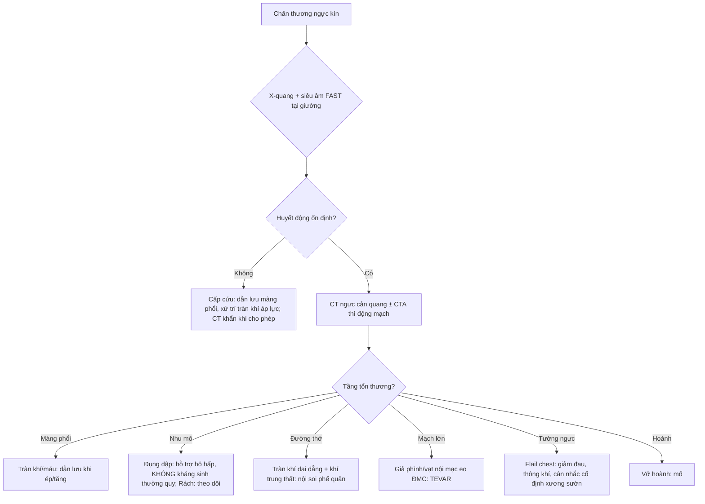
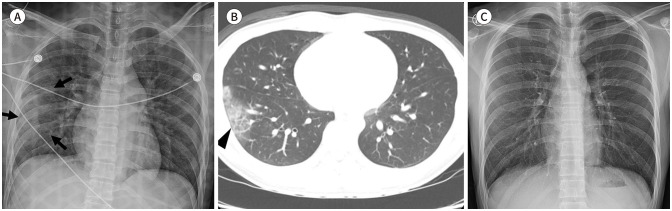
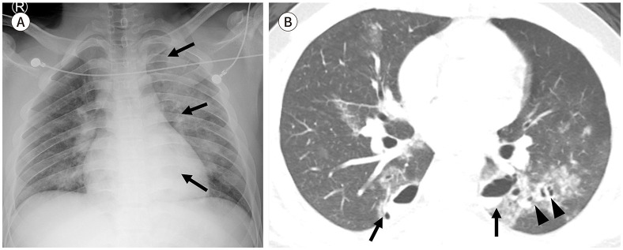
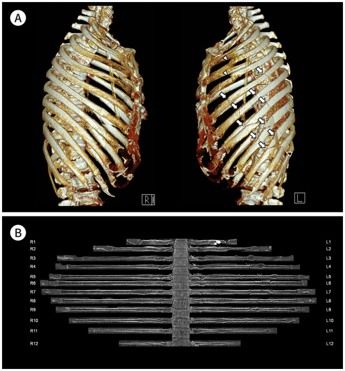
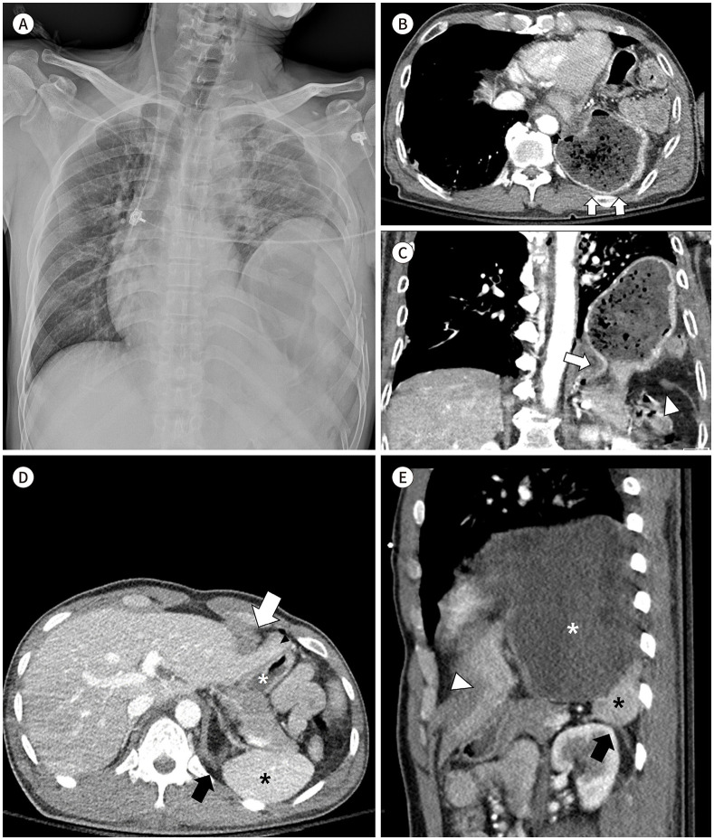
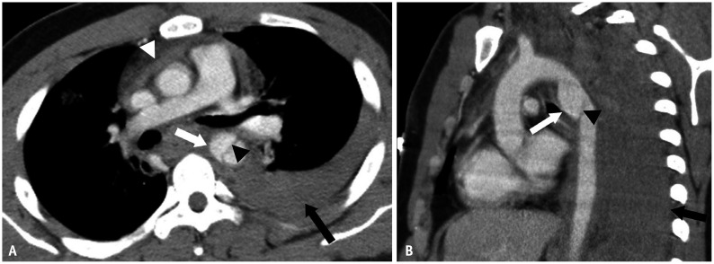
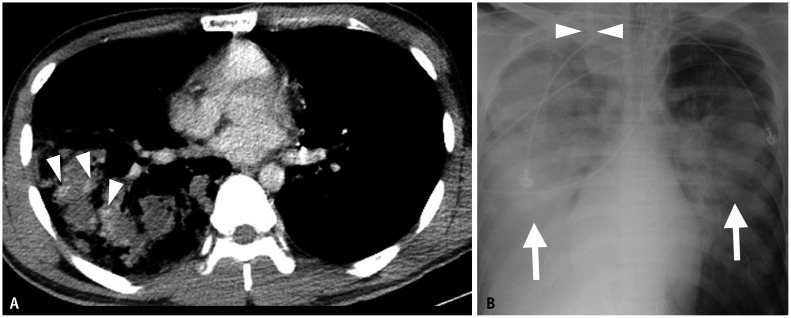
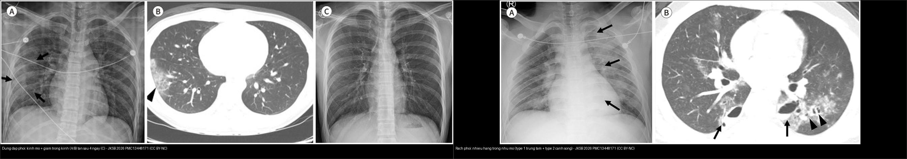

# 080 — Chấn thương ngực kín / Blunt chest trauma

**Tags:** `pattern:chan-thuong` `pattern:dung-dap-phoi` `pattern:rach-phoi` `pattern:tran-khi-mang-phoi` `pattern:vo-hoanh` `pattern:gia-phinh-mach` `vung:nguc` `score:AAST` `protocol:CT-chan-thuong`
**Mức chắc chắn (certainty):** tổng hợp y văn (literature synthesis) + ca nguyên văn (verbatim case) cho các ca ảnh — số liệu từ các bài tổng quan có PMCID, ảnh CC BY-NC 4.0/CC BY-SA 4.0.

## 1. Tổng quan bệnh học – cơ chế hình ảnh

- Chấn thương ngực kín gặp ở ~2/3 bệnh nhân đa chấn thương; đọc CT theo trình tự **"tường ngực → màng phổi → nhu mô → đường thở → trung thất/ĐMC → hoành"**, mỗi tầng có ngưỡng định lượng riêng. Một nguyên tắc xuyên suốt: **mọi bất thường nhu mô mới xuất hiện sau 24 giờ, lan rộng sau 2–3 ngày hoặc tồn tại > 1–2 tuần là KHÔNG điển hình cho đụng dập thuần** — phải nghĩ hít sặc, viêm phổi, ARDS.
- **Đụng dập phổi (pulmonary contusion)** = xuất huyết phế nang + phù kẽ **không phá vỡ nhu mô**, chiếm tới **~75% chấn thương ngực kín**. Hình ảnh: mờ kính (ground-glass) hoặc đông đặc **không theo phân thùy, khớp nơi va đập/phần phổi phụ thuộc**, có thể chừa **1–3 mm dưới màng phổi (subpleural sparing)**. **TẠI SAO chừa dưới màng phổi:** lực dập dồn vào nhu mô trung tâm, lớp nhu mô sát màng phổi ít bị xé — đây là dấu hiệu giúp phân biệt với viêm phổi/hít sặc (thường chạm màng phổi).
  - **Đường thời gian (chốt sinh học):** X-quang có thể **âm tính trong 6 giờ đầu**, mờ **đạt đỉnh 48–72 giờ**; **giảm bắt đầu trong 24–48 giờ và sạch hoàn toàn ~7 ngày**. Khối đụng dập **> ~20–30% thể tích phổi** liên quan chặt với **ARDS và thời gian thở máy kéo dài**.
- **Rách phổi (pulmonary laceration)** = nhu mô bị xé; **TẠI SAO thành hang:** nhu mô phổi đàn hồi co lại khỏi đường rách → tạo **hang cầu/elip (không phải nốt đặc)**, chứa **khí (pneumatocele), máu (hematoma), hoặc cả hai (hematopneumatocele)**, có thể nhiều hang tạo hình "phô mai Thụy Sĩ" (Swiss cheese). Phân loại theo cơ chế: **type 1 nén vỡ (compression rupture) hay gặp nhất, trung tâm; type 2 nén–trượt cạnh cột sống; type 3 xuyên thấu; type 4 liên quan dính màng phổi**. **Hầu hết tự hết trong ≤ 5 tuần; một nốt tồn tại > 4 tuần phải soi phân biệt u**; **rò khí từ đường thở xa > 72 giờ** gợi ý còn thông với màng phổi (bài 041/618).
- **Tràn khí/tràn máu màng phổi:** rách nhu mô tới màng phổi; **tràn khí áp lực (tension)** = khí + trung thất đẩy, tim bị chèn ép — cấp cứu. **Máu màng phổi** (hemothorax) đậm độ **35–70 HU**; **máu thoát mạch hoạt tính** = ổ ngấm thuốc **> 90 HU** to ra/đậm lên ở thì muộn; **giả phình mạch phổi** = ổ ngấm thuốc **giữ hình, thải thuốc ở thì muộn** (cùng nguyên lý tổn thương mạch khu trú như bài 627).
- **Tổn thương khí–phế quản (tracheobronchial injury):** khí trung thất + khí dưới da lan rộng + tràn khí dai dẳng dù đã đặt ống dẫn lưu (bài 618); cần soi phế quản ± CT lát mỏng tìm **khuyết thành/bục đường thở**.
- **Tổn thương mạch lớn (traumatic aortic injury):** **hầu hết ở eo ĐMC (aortic isthmus)** — nơi cố định (dây chằng động mạch) sát đoạn di động. Nặng: **tới 80% tử vong tại hiện trường/trên đường vận chuyển; 50% số đến được viện tử vong trước khi sửa mạch**. Dấu trực tiếp trên CT: **vạt nội mạc (intimal flap) + giả phình**. X-quang **trung thất rộng > 8 cm có PPV < 20%** → không đủ; cần CTA.
- **Gãy xương sườn/tường ngực:** **flail chest = ≥ 3 xương sườn LIÊN TIẾP gãy ở ≥ 2 vị trí** → mảng sườn di động nghịch thường (co vào khi hít vào) + pendelluft + đau → suy hô hấp. **Gãy xương sườn 1 = cơ chế năng lượng cao**, phải tìm tổn thương mạch dưới đòn/đám rối thần kinh cánh tay.
- **Vỡ hoành (diaphragmatic rupture):** ~**1–15%** chấn thương ngực kín; **trái gặp nhiều hơn phải** (gan "đỡ" lực bên phải, nhưng cũng **che mất dấu hiệu vỡ phải** → độ nhạy CT bên phải thấp hơn hẳn). Chẩn đoán muộn → **thoát vị tạng vào ngực + tắc ruột**; dấu **collar sign** (eo hẹp kiểu "cổ áo" nơi tạng chui qua lỗ hoành), **hump sign** (mô gan đội lên bên phải), **dangling diaphragm sign** (bờ hoành rách cuộn vào trong, độ nhạy 54%/độ đặc hiệu 98%). **TẠI SAO nguy hiểm:** khi đã có thoát vị, phổi bên đó bị chèn ép + tạng có thể xoắn/hoại tử.

## 2. Mẫu hình + chẩn đoán phân biệt theo vị trí (gamut)

- **Tường ngực:** gãy xương sườn (đếm số, vị trí, ≥ 3 liên tiếp × ≥ 2 chỗ = flail), gãy xương ức, di lệch đốt sống–sườn.
- **Màng phổi:** tràn khí (thường/tension), tràn máu, tràn dịch–khí.
- **Nhu mô:** đụng dập (mờ không phân thùy, chừa dưới màng phổi, tan ≤ 7 ngày) vs **rách (hang chứa khí/máu, tan ≤ 5 tuần)**; **giả phình mạch phổi** (ổ ngấm khu trú giữ hình, thải thuốc thì muộn).
- **Đường thở:** đứt/rách khí–phế quản — khí trung thất + khí dưới da + **tràn khí dai dẳng**.
- **Trung thất/mạch lớn:** máu tụ trung thất, **giả phình eo ĐMC + vạt nội mạc**, rò thuốc từ động mạch vú trong/động mạch liên sườn (có thể can thiệp nội mạch).
- **Hoành:** vỡ hoành trái (dạ dày/đại tràng/nội tạng lên ngực) vs phải (mô gan đội lên — khó thấy).

Gamut "hang trong phổi sau chấn thương": **rách phổi/pneumatocele** vs **áp-xe phổi** (sốt + mức dịch + bờ ngấm) vs **hang lao/kén bẩm sinh bội nhiễm** (bài 025) — bối cảnh chấn thương + tự xẹp dần là chốt.

## 3. Bảng so sánh phân biệt (ma trận đối chiếu)

| Thực thể (entity) | Hình ảnh điển hình | Chốt vào (rule-in) | Chốt loại (rule-out) | Gợi ý xác nhận |
|---|---|---|---|---|
| **Đụng dập phổi** | Mờ kính/đông đặc **không theo phân thùy**, khớp nơi va đập/phần phổi phụ thuộc | **Chừa 1–3 mm dưới màng phổi + mờ đỉnh 48–72 giờ + tan dần trong ~7 ngày** | Mờ **mới sau 24 giờ, lan nhanh > 2–3 ngày, tồn tại > 1–2 tuần** → hít sặc/viêm phổi/ARDS | Đối chiếu phim cũ–mới; đặt trong bối cảnh chấn thương |
| **Rách phổi (laceration)** | **Hang cầu/elip** chứa khí (pneumatocele), máu hoặc cả hai; "phô mai Thụy Sĩ" | **Hang trong nhu mô ngay sau chấn thương + tự xẹp dần (≤ 5 tuần)** | Hang **có mức dịch + sốt + bờ ngấm dày** = áp-xe; nốt tồn tại > 4 tuần = loại trừ u | Theo dõi chuỗi phim; CT nếu tồn tại > 4 tuần |
| **Tràn khí/tràn máu màng phổi** | Khí/dịch màng phổi, có thể mức khí–dịch | **Khí + gãy xương sườn cùng bên; tension = trung thất đẩy + tim bị chèn** | Dịch **không có máu (0–15 HU) + không chấn thương** → nghĩ bệnh nội khoa | X-quang tại giường; CT khi nghi tổn thương phối hợp |
| **Tổn thương khí–phế quản** | Khí trung thất + khí dưới da lan rộng, tràn khí dai dẳng dù đã dẫn lưu | **Tràn khí tái diễn/dai dẳng + khí trung thất + khuyết thành đường thở trên CT lát mỏng** | Tràn khí đơn thuần, đáp ứng dẫn lưu → không cần soi | **Nội soi phế quản** (chẩn đoán xác định) |
| **Tổn thương ĐMC (tại eo)** | Vạt nội mạc + giả phình + máu tụ trung thất, kèm tràn máu màng phổi trái | **ĐMC eo + dấu trực tiếp (flap/giả phình) trên CTA** | X-quang **trung thất rộng > 8 cm đơn thuần (PPV < 20%)** không đủ chốt/loại | **CTA thì động mạch**; DSA khi chỉ có dấu gián tiếp |
| **Gãy xương sườn/flail chest** | Nhiều đường gãy; 3D thấy mảng sườn di động | **≥ 3 xương sườn liên tiếp gãy ≥ 2 vị trí = flail** | Gãy 1 xương sườn đơn độc, không di lệch → thường không cần cố định | Tái tạo 3D + in-plane; đếm vị trí gãy |
| **Vỡ hoành** | Tạng ổ bụng/dạ dày trong ngực; **collar sign**, **hump sign** (phải), **dangling sign** | **Tạng chui qua lỗ hoành + eo hẹp kiểu cổ áo nơi tạng đi qua** | Hoành **nâng cao đơn thuần không có tạng lạc chỗ** → chưa đủ; vỡ phải dễ bỏ sót | CT MPR coronal/sagittal; **độ nhạy CT thấp hơn bên phải** |

- Ảnh ghép đối chiếu: `` — **đụng dập** (mờ kính có chừa dưới màng phổi, tan sau 4 ngày) đặt cạnh **rách phổi** (nhiều hang trong nhu mô, type 1 trung tâm + type 2 cạnh sống), cùng bài gốc.

### Đọc đúng hai bẫy kinh điển

- **Đụng dập vs hít sặc/viêm phổi:** hít sặc/viêm phổi theo **đường thở/phân thùy**, chạm màng phổi, lâm sàng sốt–bạch cầu; đụng dập **không phân thùy, chừa dưới màng phổi, tan theo thời gian**.
- **Hang rách phổi vs áp-xe:** hang rách **xuất hiện ngay–trong vài giờ**, thành mỏng, tự xẹp; áp-xe **sốt + mức dịch + bờ ngấm**, không tự xẹp.

## 4. Protocol chụp + hệ phân độ/điểm chuẩn hóa

- **CT ngực có cản quang** là tiêu chuẩn cho chấn thương ngực kín; **CT không cản quang** đủ cho xương sườn/tràn khí/nhu mô nhưng **kém nhạy với tổn thương mạch** → nghi tổn thương mạch lớn phải chụp **CTA thì động mạch**, thêm **thì muộn** để phân biệt chảy máu hoạt tính với giả phình.
- Dùng **cửa sổ xương** (trục + in-plane + 3D) cho tường ngực, **cửa sổ phổi** cho nhu mô/đường thở, **cửa sổ trung thất** cho ĐMC/máu tụ; **MPR coronal/sagittal** bắt buộc để đánh giá **hoành** và tổn thương mạch.
- **Phân độ/điểm:**
  - **AAST-OIS ngực** cho từng cấu trúc (đụng dập phổi phân độ theo **thùy**; mức > 20–30% thể tích phổi = nguy cơ ARDS cao).
  - **Flail chest:** ≥ 3 xương sườn liên tiếp × ≥ 2 vị trí; đếm số xương gãy để tiên lượng (càng nhiều càng dễ suy hô hấp) — **cố định xương sườn (surgical stabilization)** cân nhắc khi di lệch nhiều/mảng sườn nặng.
  - **Tổn thương ĐMC:** xác định **vạt nội mạc/giả phình** và vị trí so với **eo ĐMC**; phân độ theo SVS; **TEVAR (stent graft nội mạch)** là điều trị chính và đã giảm tử vong đáng kể — chuyển sang can thiệp nội mạch cho cả các nguồn nhỏ hơn (động mạch vú trong, thân giáp cổ).
- **X-quang ngực tại giường** chỉ là sàng lọc ban đầu (có thể âm tính 6 giờ đầu với đụng dập); **không thay CT** tìm tổn thương ẩn. Lặp lại khi diễn biến xấu (tràn khí tăng, tụt HA, SpO₂ giảm).

## 5. Biến thể bình thường và cạm bẫy

- **Đụng dập gọi nhầm viêm phổi** → kháng sinh vô ích; và ngược lại **hít sặc/viêm phổi gọi nhầm đụng dập** → bỏ sót nhiễm trùng. Chìa khóa: **bờ chạm màng phổi, phân bố theo đường thở, và đường thời gian**.
- **Pneumatocele gọi nhầm kén bẩm sinh/áp-xe** — hỏi tiền sử chấn thương, theo dõi tự xẹp; **nốt/hang tồn tại > 4 tuần phải soi loại trừ u**.
- **Tổn thương ĐMC bỏ sót** khi chỉ dựa vào X-quang (trung thất rộng PPV < 20%): cơ chế nặng → **CTA ngay**.
- **Vỡ hoành phải khó thấy** (mô gan đội lên mờ nhạt; độ nhạy CT bên phải thấp hơn) → tìm dấu **hump/collar**, đối chiếu MPR.
- **"Tràn khí dai dẳng" sau đặt ống dẫn lưu không được coi là thất bại kỹ thuật đơn thuần** — phải loại trừ **rách khí–phế quản** (bài 618).
- **Thỏa mãn tìm kiếm (satisfaction of search):** thấy gãy xương sườn rồi dừng đọc → bỏ sót giả phình eo ĐMC, rách phổi, vỡ hoành. Đọc đủ 6 tầng theo trình tự cố định.
- **Beam hardening do xương sườn/ống nội khí quản** tạo vệt tăng/giảm đậm độ giả trong nhu mô — đối chiếu nhiều bình diện, đừng chốt trên 1 lát.

## 6. Tự lượng giá — Blind Quiz

**Ca 1 — Nam 16 tuổi, tai nạn xe máy, đau ngực phải. X-quang lúc vào (A), CT (B), X-quang sau 4 ngày (C).**

- Gợi ý lâm sàng (clinical context): chấn thương ngực kín, ổn định huyết động.
- Câu hỏi: Dấu hiệu chính trên CT? Dấu hiệu nào giúp phân biệt với viêm phổi? Diễn biến thời gian ra sao?

<b>Bấm để hiện đáp án (findings + chẩn đoán)</b>

- Dấu hiệu (findings): **(A)** X-quang mờ kính khu trú thùy dưới phải (mũi tên); **(B)** CT thấy mờ kính **không theo phân thùy**, **chừa 1–3 mm dưới màng phổi** (đầu mũi tên); **(C)** sau 4 ngày mờ **giảm gần hết**.
- Chẩn đoán (diagnosis): **đụng dập phổi** — mờ do xuất huyết phế nang, không phân thùy, chừa dưới màng phổi, đạt đỉnh 48–72 giờ rồi tan trong ~7 ngày (khác viêm phổi/hít sặc chạm màng phổi + theo đường thở). Không cần kháng sinh thường quy, chỉ hỗ trợ hô hấp.
- Nguồn ảnh: Kim YN et al., *J Korean Soc Radiol* 2026 (**PMC13448171**), CC BY-NC 4.0.

**Ca 2 — Nam 17 tuổi, tai nạn xe máy: X-quang (A) và CT nhu mô (B).**

- Gợi ý lâm sàng: chấn thương ngực kín, khó thở.
- Câu hỏi: Mô tả tổn dạng nhu mô? Cơ chế tạo hang? Có phải áp-xe không?

<b>Bấm để hiện đáp án (findings + chẩn đoán)</b>

- Dấu hiệu: **(A)** X-quang nhiều ổ mờ + mức khí–dịch trong phổi trái (mũi tên); **(B)** CT: **nhiều hang khí trong nhu mô** (đầu mũi tên) — phía **trung tâm thùy dưới trái = type 1 (nén vỡ)**, **cạnh cột sống hai bên = type 2 (nén–trượt)**, quanh đó là đụng dập.
- Chẩn đoán: **rách phổi nhiều hang** — nhu mô co đàn hồi khỏi đường rách tạo hang chứa khí (pneumatocele); **không phải áp-xe** vì xuất hiện ngay sau chấn thương, thành mỏng, tự xẹp dần (hầu hết ≤ 5 tuần). Cần theo dõi; nốt tồn tại > 4 tuần phải loại trừ u.
- Nguồn ảnh: Kim YN et al., *J Korean Soc Radiol* 2026 (**PMC13448171**), CC BY-NC 4.0.

**Ca 3 — Người bệnh tai nạn người đi bộ, đa chấn thương. Tái tạo 3D + in-plane xương sườn.**

- Gợi ý lâm sàng: chấn thương năng lượng cao, suy hô hấp.
- Câu hỏi: Đếm tổn thương? Tiêu chuẩn flail chest? Vì sao flail gây suy hô hấp?

<b>Bấm để hiện đáp án (findings + chẩn đoán)</b>

- Dấu hiệu: **(A)** tái tạo 3D và **(B)** in-plane: gãy **xương sườn 3–10 và 12 bên trái**; xương sườn 3–4 gãy di lệch; mảng sườn gãy **≥ 2 vị trí trên ≥ 3 xương liên tiếp** = **flail chest**.
- Chẩn đoán: **mảng sườn di động (flail chest)** — mảng di chuyển nghịch thường (co vào khi hít vào) gây **pendelluft** + đau → giảm thông khí, dẫn suy hô hấp. Xử trí: giảm đau tích cực, thông khí hỗ trợ, **cân nhắc cố định xương sườn** khi di lệch nặng.
- Nguồn ảnh: Choi JM et al., *J Korean Soc Radiol* 2026 (**PMC13448060**), CC BY-NC 4.0.

**Ca 4 — Bệnh nhân tai nạn giao thông, X-quang ngực (A) và CT ngực (B, C, D, E).**

- Gợi ý lâm sàng: chấn thương ngực kín, đau bụng ngực trái, nôn.
- Câu hỏi: Dấu hiệu chính? Dấu "collar sign" là gì? Vì sao vỡ hoành phải khó chẩn đoán hơn?

<b>Bấm để hiện đáp án (findings + chẩn đoán)</b>

- Dấu hiệu: **(A)** X-quang: hoành trái nâng cao, trung thất đẩy sang phải, tràn khí trái; **(B, C, D, E)** CT: **dạ dày (và mỡ/tạng) thoát vị lên ngực trái qua lỗ hoành** với **eo hẹp kiểu "cổ áo" (collar sign)** nơi tạng đi qua (mũi tên), **dấu dangling** bờ hoành cuộn vào trong (mũi tên trắng), túi khí trong lồng ngực.
- Chẩn đoán: **vỡ hoành trái do chấn thương** — xảy ra ~1–15% chấn thương ngực kín, trái nhiều hơn phải; chẩn đoán muộn → thoát vị/tắc ruột. **Bên phải khó hơn vì mô gan đội lên mờ nhạt (hump sign) + độ nhạy CT bên phải thấp hơn** → đối chiếu MPR. Xử trí: **mổ**.
- Nguồn ảnh: Choi JM et al., *J Korean Soc Radiol* 2026 (**PMC13448060**), CC BY-NC 4.0.

**Ca 5 — Bệnh nhân chấn thương ngực nặng: CT ngực thì mạch (A) và tái tạo coronal oblique (B).**

- Gợi ý lâm sàng: tai nạn tốc độ cao, đau ngực, X-quang trung thất rộng.
- Câu hỏi: Dấu hiệu trực tiếp? Vị trí hay gặp? Vì sao X-quang "trung thất rộng" không đủ chốt? Điều trị chính hiện nay?

<b>Bấm để hiện đáp án (findings + chẩn đoán)</b>

- Dấu hiệu: **(A)** CT trục và **(B)** tái tạo coronal oblique: **giả phình ĐMC tại eo** (mũi tên trắng) + **vạt nội mạc ngắn** (đầu mũi tên đen), kèm **máu tụ trung thất** và **tràn máu màng phổi trái**.
- Chẩn đoán: **tổn thương ĐMC ngực do chấn thương (tại eo)** — tới 80% tử vong tại hiện trường; trong số đến viện, 50% tử vong trước khi sửa mạch. **X-quang trung thất rộng > 8 cm có PPV < 20%** → phải **CTA**. Chẩn đoán xác định = dấu trực tiếp (flap/giả phình); điều trị chính **TEVAR** (stent graft nội mạch).
- Nguồn ảnh: Wong YC et al., *Korean J Radiol* 2023 (**PMC10400372**), CC BY-NC 4.0.

**Ca 6 — Bệnh nhân chấn thương ngực nặng, CT ngực cản quang (A) và X-quang theo dõi (B). Bấm để xem đáp án 2 ảnh + ảnh ghép.**

- Gợi ý lâm sàng: đa chấn thương, suy hô hấp tiến triển nhanh.
- Câu hỏi: Trong ổ đụng dập/rách có gì đặc biệt? Vì sao phải chụp thì mạch và theo dõi sát?

<b>Bấm để hiện đáp án (findings + chẩn đoán)</b>

- Dấu hiệu: **(A)** CT cản quang: đụng dập + rách phổi phải, trong ổ máu tụ có **nhiều giả phình mạch phổi nhỏ** (đầu mũi tên) — ngấm thuốc giữ hình; **(B)** X-quang sau đó: **xuất huyết tiến triển nhanh** (mũi tên) hai bên.
- Chẩn đoán: **đụng dập/rách phổi nặng kèm giả phình mạch phổi + xuất huyết tiến triển** — tổn thương mạch nhỏ cũng có thể chảy máu ồ ạt, cần **can thiệp nội mạch (nút mạch)**; nguyên lý phân biệt giả phình (giữ hình, thải thuốc thì muộn) vs chảy máu hoạt tính (> 90 HU, to ra) giống bài 627.
- Nguồn ảnh: Figure 10, Wong YC et al., *Korean J Radiol* 2023 (**PMC10400372**), CC BY-NC 4.0. Ảnh ghép đối chiếu:

## Bài liên quan chéo
- [001 – Tổng quan hệ Ngực](../001-tong-quan-he-nguc/lesson.md)
- [025 – Hang & nấm phổi](../025-ton-thuong-phoi-tao-hang/lesson.md) (pneumatocele vs áp-xe)
- [041 – Tràn khí màng phổi](../041-tran-khi-mang-phoi/lesson.md) (dẫn lưu)
- [045 – Thành ngực & hoành](../045-thanh-nguc-hoanh/lesson.md) (vỡ hoành)
- [618 – Rò phế quản–màng phổi & rò khí dai dẳng](../618-ro-phe-quan-mang-phoi-va-ro-khi-dai-dang-o-tre/lesson.md)
- [627 – Giả phình mạch & xuất huyết muộn (nguyên lý tổn thương mạch khu trú)](../627-gia-phinh-mach-xuat-huyet-muon-gan-lach-nhi/lesson.md)

## Ảnh
- Tên file: `080_*`. Nguồn + giấy phép từng ảnh trong `images/CREDITS.md`.
- Ảnh ghép: `images/composite_dung-dap-vs-rach-phoi.jpg` (Pillow letterbox, giữ aspect, không crop/kéo giãn). Ảnh **CC BY-NC 4.0 giữ nguyên bản, không ghép**; ảnh ghép chỉ dùng ảnh trong bài (đều CC BY-NC 4.0 — ghi nguồn đầy đủ).

> Không dùng để chẩn đoán độc lập khi chưa có người hướng dẫn.
