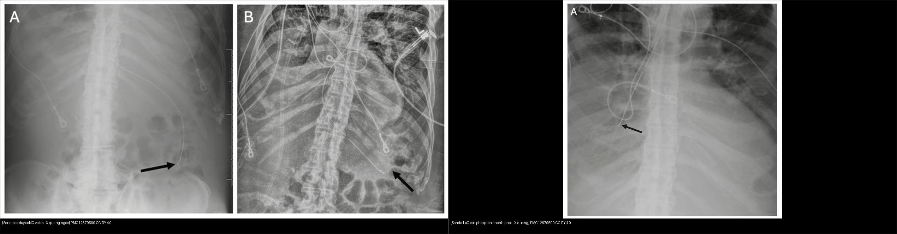
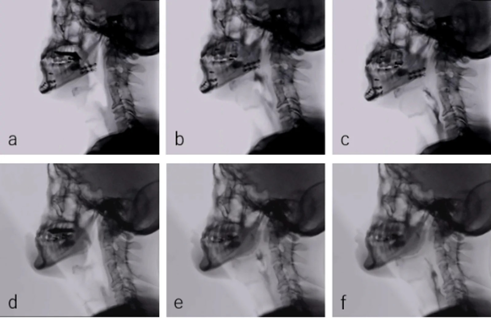
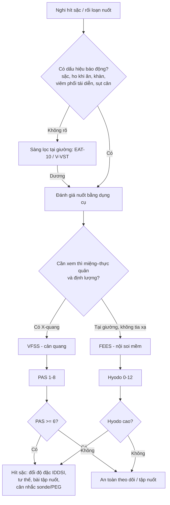
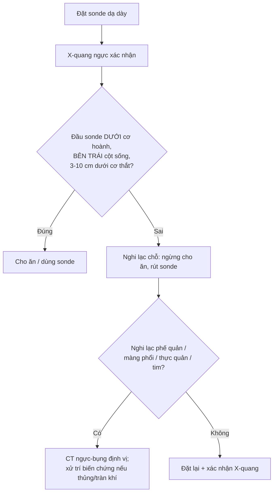
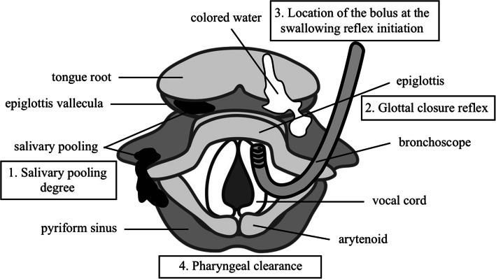
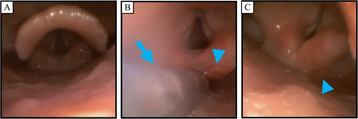
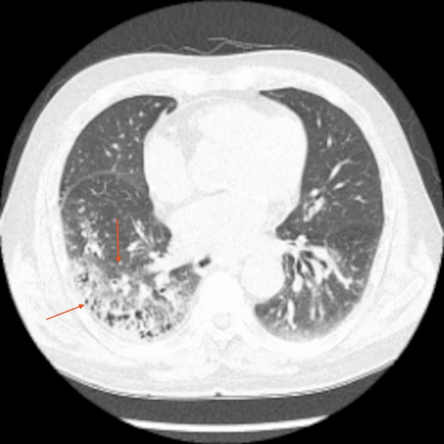
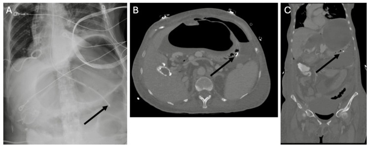
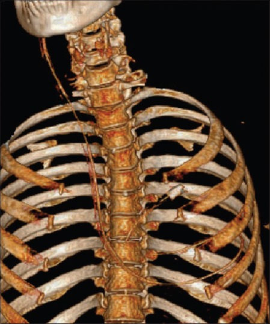
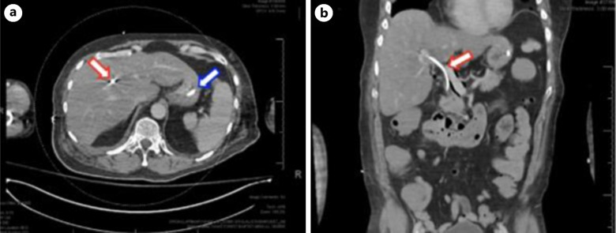

# 081 — Sặc & rối loạn nuốt: VFSS/FEES, viêm phổi hít sặc & vị trí sonde dạ dày / Aspiration & dysphagia

**Tags:** `pattern:sac-hit-sac` `pattern:roi-loan-nuot` `vung:duong-nuot` `vung:thanh-quan` `vung:phe-quan` `vung:phoi` `score:PAS` `score:Hyodo` `protocol:VFSS` `protocol:FEES` `protocol:sonde-da-day` `incidentaloma:viem-phoi-hit-sac`
**Mức chắc chắn (certainty):** tổng hợp y văn (literature synthesis) — số liệu lấy từ các nghiên cứu/cohort truy cập mở (PMC10981800, PMC11555015, PMC13414394, PMC12013387) + ca nguyên văn minh họa (PMC11965062, PMC12982160, PMC12935128, PMC13345614); không tự suy diễn ngoài nguồn.

> Nối tiếp [015 – Ống/dây ICU](../015-ong-day-ICU/lesson.md) (vị trí đầu sonde dạ dày) và [031 – Viêm phổi mẫu hình](../031-viem-phoi-mau-hinh/lesson.md) (viêm phổi hít sặc). Bài này trả lời 3 câu: **(1) nuốt bình thường gồm những thì nào; (2) làm sao nhìn thấy sặc (VFSS/FEES) và phân độ nó; (3) khi nào một mức dịch/tổn thương trên phổi là do sặc, và kiểm tra sonde dạ dày cho đúng.**

## 1. Tổng quan bệnh học – cơ chế hình ảnh

- **Nuốt bình thường (deglutition) gồm 3 thì liên tục:** **thì miệng (oral)** – nhai, tạo viên thức ăn và đẩy ra sau lưỡi; **thì hầu (pharyngeal)** – mở cơ thắt hầu–thực quản trên (UES), gập nắp thanh môn (epiglottis), đóng dây thanh để bảo vệ đường thở; **thì thực quản (esophageal)** – nhu động đưa thức ăn xuống dạ dày. Rối loạn nuốt (dysphagia) **hầu–miệng (oropharyngeal)** liên quan trực tiếp tới an toàn đường thở; **rối loạn nuốt thực quản** thường gây tắc/nghẹn/trào ngược hơn là sặc.
- **Hai khái niệm phải tách bạch (chốt định lượng của cả bài):**
  - **Xuyên qua (penetration):** vật tới **tới/qua sụn phễu–nắp thanh môn nhưng còn TRÊN dây thanh thật** → thường còn phản xạ ho.
  - **Hít sặc (aspiration):** vật **vượt qua dây thanh thật vào khí quản** → nguy cơ viêm phổi/ngạt.
  - **Hít sặc thầm lặng (silent aspiration):** hít sặc **KHÔNG kèm ho**, do suy giảm cảm giác đường thở + phản xạ ho; là nền tảng của viêm phổi hít sặc tái diễn dễ bỏ sót. (PMC13539892)
- **Thang định lượng chốt (Argon – cửa 1):**
  - **PAS (Penetration-Aspiration Scale) 8 điểm** (Rosenbek 1996): 1 = vật không vào đường thở; 2–5 = xuyên qua (2–3 trên dây thanh; 4–5 chạm dây thanh); **6 = xuống dưới dây thanh nhưng ho/đẩy ra được; 7 = xuống dưới dây thanh, cố gắng ho mà không ra; 8 = xuống dưới dây thanh, KHÔNG phản ứng (hít sặc thầm lặng)**. **PAS ≥ 6 = hít sặc thực sự.**
  - **Thang Hyodo (FEES):** **4 mục × 0–3**, tổng **0–12** (tồn lưu nước bọt; phản xạ đóng thanh môn; thanh thải hầu; cử động dây thanh), **0 = bình thường, càng cao càng nặng**. (PMC11965062)
  - **Rối loạn nuốt trong viêm phổi mắc phải cộng đồng (CAP):** xác nhận **53,9%** (122/226) so **19,4%** (44/226) ở bệnh hô hấp không-CAP (EAT-10 + V-VST). (PMC10981800)
  - **Tử vong/nguy cơ:** Parkinson — nguy cơ viêm phổi hít sặc **RR 3,30** (1,82–6,00), tỉ lệ mắc **2,74%**, tử vong viện **10,0%**. (PMC11555015)
- **TẠI SAO hình ảnh hiện được (vật lý, không chỉ liệt kê):**
  - **VFSS (soi nuốt bằng X-quang / modified barium swallow):** dùng **chất cản quang cản tia X** (barit hoặc **iod tan nước Visipaque 270®**) → thấy viên nuốt di chuyển qua thì miệng–hầu–thực quản theo **thời gian thực, động**; nhìn được **trào sớm, tồn lưu, xuyên qua, hít sặc** và **đo định lượng** (độ rộng mở UES, góc gập nắp thanh môn, tỉ lệ tồn lưu chuẩn hóa NRRS). Vì **iod tan nước an toàn hơn barit nếu bị hít vào phổi**, nó được dùng khi nguy cơ sặc cao; nghiên cứu n = 20 cho thấy **không tai biến** và chất lượng ảnh **tương đương** barit. (PMC13619726)
  - **FEES (nội soi mềm đánh giá nuốt):** nhìn trực tiếp **ánh sáng trắng** niêm mạc hầu–thanh quản → thấy **tồn lưu nước bọt/đồ ăn ở xoang lê và xoang hình lê, phù/đỏ sụn phễu, phản xạ đóng thanh môn**; **không tia xạ, làm tại giường**, nhưng **bị "màn trắng" (white-out) đúng lúc nuốt** nên không theo dõi được viên nuốt xuyên suốt. (PMC11965062)
  - **CT viêm phổi hít sặc:** dịch/vi khuẩn lấp phế nang theo **trọng lực** → **đông đặc (consolidation, đậm độ mô mềm ~30–60 HU) + kính mờ (ground-glass)** ở **các phân thùy phụ thuộc tư thế** (xem mục 2). Vật liệu đặc (barit, dị vật, thức ăn) có thể tạo **đậm độ cao bất thường trong phế quản/phế nang**.
- **Cơ chế phân bố theo tư thế (giải thích vì sao hay gặp bên phải):** bệnh nhân **nằm ngửa** → dịch chảy vào **phân thùy sau của thùy trên + phân thùy đỉnh của thùy dưới**; **nằm nghiêng** → phổi phía thấp; **ngồi/đứng** → **thùy dưới, phân thùy đáy**. **Phế quản chính phải dốc hơn và rộng hơn phải** → sặc hay lắng **phổi phải** hơn.
- **Viêm phổi hóa chất (aspiration pneumonitis / Mendelson) vs viêm phổi hít sặc nhiễm khuẩn:** hóa chất xảy ra **sớm (giờ)**, tổn thương **lan tỏa hai bên do acid dịch vị**; nhiễm khuẩn thường **48–72 giờ** sau, **khu trú vùng phụ thuộc**, tác nhân kỵ khí/gram âm. Phân biệt này quyết định **có dùng kháng sinh hay không**.

## 2. Mẫu hình + chẩn đoán phân biệt theo vị trí (Gamut)

- **Mẫu hình 1 — "mờ phân bố theo trọng lực":** đông đặc ± kính mờ ở phân thùy phụ thuộc tư thế, **thường phải, đáy-sau** → nghĩ **viêm phổi hít sặc**; so với viêm phổi thùy điển hình (giới hạn theo thùy, ví dụ phế cầu) hay viêm phổi không điển hình (mờ lan, mô kẽ).
- **Mẫu hình 2 — "đường thở hít vào bị bít":** dị vật/viên thức ăn tắc **phế quản chính hoặc phế quản thùy** → xẹp phổi (mất thể tích, xem [030](../030-dong-dac-xep-phoi/lesson.md)) + ứ khí; ở trẻ nhỏ đặc biệt hay gặp (xem [612](../612-cap-cuu-duong-tho-tren-tre-em/lesson.md)).
- **Mẫu hình 3 — "giãn + tồn lưu đường trên":** giãn thực quản (achalasia, giãn thực quản do tắc) chứa đầy dịch/khí **ngay trên cơ hoành** → cơ chế sặc mạn; giãn dạ dày/ứ đọng, GERD nặng cũng tạo nguồn sặc.
- **Gamut theo vị trí:**
  - **Phân thùy sau thùy trên + đỉnh thùy dưới (nằm ngửa):** hít sặc tư thế ngửa, nằm lâu tại giường.
  - **Thùy dưới đáy (ngồi):** hít sặc khi ăn/uống ở tư thế ngồi.
  - **Một phân thùy/phế quản có vật cản:** dị vật phế quản.
  - **Trung thất sau/trên cơ hoành giãn rộng:** nguyên nhân từ thực quản.
  - **Trên phim X-quang có "đường lạ" của sonde:** kiểm tra sonde dạ dày (mục 4).
- **Gợi nhớ nhanh "BỐN NGUỒN SẶC":** **N**euro (đột quỵ, Parkinson, sa sút trí tuệ, ALS) · **C**ấu trúc hầu–thanh quản (u, xạ trị, phẫu thuật) · **R**ối loạn thực quản (achalasia, trào ngược, túi thừa) · **T**ư thế/thuốc (nằm lâu, an thần, thuốc an thần gây ngủ, ức chế thần kinh).

## 3. Bảng so sánh phân biệt (ma trận đối chiếu)

| Thực thể (entity) | Hình ảnh điển hình | Chốt vào (rule-in) | Chốt loại (rule-out) | Gợi ý xác nhận |
|---|---|---|---|---|
| Viêm phổi hít sặc nhiễm khuẩn | Đông đặc ± kính mờ ở **phân thùy phụ thuộc**, thường **phải đáy-sau**; mới sau 48–72 giờ | **Vị trí theo trọng lực + bối cảnh rối loạn nuốt/hôn mê/nằm lâu** | Mờ lan tỏa hai bên trong vài giờ đầu → nghĩ hóa chất; u/đông đặc quanh rốn phổi → nguyên nhân khác | Lâm sàng nuốt (VFSS/FEES), cấy đàm, đối chiếu đáp ứng kháng sinh |
| Viêm phổi hóa chất (pneumonitis, Mendelson) | Mờ **lan tỏa hai bên, sớm trong vài giờ**, đôi khi kiểu ARDS | **Khởi phát nhanh sau nôn/hít + mờ hai bên lan tỏa** | Khu trú một vùng phụ thuộc, tiến triển 48–72 giờ → nghĩ nhiễm khuẩn | Diễn tiến thời gian; cân nhắc **không** kháng sinh ngay nếu nhẹ |
| Dị vật đường thở | Tắc phế quản → **xẹp phổi + ứ khí**, lệch trung thất; có thể thấy vật cản | **Một bên tăng sáng + mất thể tích + bệnh sử sặc đột ngột** | Tổn thương hai bên lan tỏa → không phải dị vật đơn độc | Soi phế quản ống mềm (chẩn đoán + điều trị) |
| Nguồn từ thực quản (achalasia/giãn thực quản) | Trung thất sau **giãn rộng chứa dịch ± mức khí** ngay trên cơ hoành; X-quang nghiêng có thể thấy mức dịch | **Giãn thực quản + tồn lưu + viêm phổi tái diễn** | Thực quản bình thường → không phải cơ chế chính | Nuốt barit/đo áp lực thực quản, nội soi |
| Sonde dạ dày lạc chỗ | Trên phim X-quang: đầu sonde **không ở dưới cơ hoành/bên trái cột sống**; có thể **đi vào phế quản, màng phổi, thực quản, thậm chí tim** | **Đầu sonde bất thường (không dưới cơ hoành) hoặc đường đi bất thường** | Đầu sonde rõ ở dạ dày, dưới cơ hoành, bên trái cột sống → đúng | X-quang ngực là chuẩn vàng; CT khi nghi thủng/lạc chỗ phức tạp (mục 4) |

*Trái: sonde dạ dày ĐÚNG vị trí — đi giữa, qua cơ hoành, đầu ở dạ dày. Phải: sonde LẠC vào phế quản chính phải — đầu sonde KHÔNG vượt cơ hoành. Nguồn: Kermanshah A et al., Cureus 2025, PMC12679500, CC BY 4.0. Ảnh ghép letterbox.*

### Không thể định vị sonde bằng "nghe bụng" — chỉ tin hình ảnh
- **"Whoosh test"** (bơm hơi nhanh qua sonde rồi nghe thượng vị) **không đáng tin** và đã gây tai biến chết người khi sonde nằm trong đường thở/phổi. (PMC12935128)
- **X-quang ngực là chuẩn vàng.** Đầu sonde lý tưởng **3–10 cm dưới cơ thắt thực quản–dạ dày**; dịch dạ dày **pH < 5**; dịch ruột **bilirubin > 12 mg%**. Ước tính chiều dài theo **NEX (mũi–dái tai–mũi ức) + 30,37 + 6 cm**.

## 4. Protocol chụp + hệ phân độ/điểm chuẩn hóa

### 4.1. Hai phương thức đánh giá nuốt — chọn thế nào
| Tiêu chí | VFSS (X-quang nuốt, modified barium swallow) | FEES (nội soi mềm) |
|---|---|---|
| Nhìn thấy | Toàn bộ thì miệng–hầu–thực quản, viên nuốt **động liên tục** | Niêm mạc hầu–thanh quản, **tồn lưu**, phản xạ; bị **màn trắng** đúng lúc nuốt |
| Ưu điểm | Định lượng (NRRS, mở UES, gập nắp thanh môn); phát hiện **trào sớm** | Tại giường, **không tia xạ**, thấy dịch tiết/niêm mạc |
| Phân độ | **PAS 1–8** | **Hyodo 0–12** (4 mục × 0–3) |
| Nhạy với tồn lưu/xuyên qua/hít sặc | Thấp hơn FEES | **Cao hơn** (khác biệt chung không có ý nghĩa thống kê) |
| Chất cản quang | Barit hoặc **iod tan nước (Visipaque 270®)** — an toàn hơn nếu sặc | Không dùng cản quang |

Nguồn số liệu cột “nhạy”: **Ferrari de Castro MA et al., Braz J Otorhinolaryngol 2025, PMC12013387** (tổng quan hệ thống 6 bài; SROC).

*VFSS với cản quang iod (Visipaque 270®): thì miệng (a/d), thì hầu (b/e), thì hầu + thực quản (c/f). Cản quang iod không tai biến và tương đương barit về chất lượng ảnh. Nguồn: Konishi M et al., Oral Radiol 2026, PMC13619726, CC BY 4.0.*

### 4.2. Thang PAS — quyết định “an toàn hay phải can thiệp”

### 4.3. Kiểm tra vị trí sonde dạ dày (NGT) — quy trình tối thiểu

- **Không dùng "whoosh test"**; bổ trợ **pH < 5** (dịch dạ dày) / **bilirubin > 12 mg%** (dịch ruột). (PMC12935128)

### 4.4. Định lượng VFSS (tham chiếu khi đọc báo cáo)
- **NRRS** (Normalized Residue Ratio Scale) = diện tích tồn lưu / diện tích cấu trúc, chuẩn hóa theo đốt sống C2–C4; **càng cao càng tồn lưu nhiều**. Ở một cohort 50 ca: xoang lê **0,20 vs 0,13** (COVID-19 vs hít sặc, p = 0,01); mở UES **5,08 vs 6,50 mm** (p = 0,03); góc gập nắp thanh môn **66,0° vs 93,4°** (p = 0,04). (PMC13414394)
- **IDDSI** phân độ độ đặc: đồ uống **0 (loãng) → 4 (rất đặc)**; thức ăn **4 (nghiền) → 7 (thường)**; đổi bậc là can thiệp chính khi hít sặc đồ uống loãng.

*Sơ đồ FEES theo thang Hyodo: (1) mức tồn lưu nước bọt, (2) phản xạ đóng thanh môn, (3) thanh thải hầu, (4) cử động dây thanh; mỗi mục 0–3, tổng 0–12. Nguồn: Mitsuzawa K et al., JA Clin Rep 2025, PMC11965062, CC BY 4.0.*

## 5. Biến thể bình thường và cạm bẫy

- **Biến thể bình thường dễ nhầm:**
  - **Người già khỏe mạnh vẫn có thể tồn lưu nhẹ ở xoang lê/xoang hình lê** và **xuyên qua thoáng qua** khi uống nước loãng — không mặc nhiên là bệnh lý.
  - **"White-out" khi FEES đúng lúc nuốt** là hiện tượng bình thường của kỹ thuật, không phải mất hình ảnh bệnh lý.
  - **Trào sớm** nhẹ ở người có sa niêm mạc hầu tuổi cao có thể không gây sặc thật.
- **Cạm bẫy (pitfall):**
  - **Tin "whoosh test"** → nuôi ăn qua sonde nằm trong phế quản/màng phổi; đã có ca sonde **đi qua TM cảnh trong → TM chủ trên → thủng nhĩ phải vào màng tim** chỉ xác định được nhờ hình ảnh. (PMC12935128)
  - **Sonde trong thực quản bị cuộn/xoắn** trông như đã xuống dạ dày trên X-quang → luôn kiểm tra đầu sonde **có vượt cơ hoành** và **nguyên tắc**: một phim nghi ngờ thì **chụp lại/CT**.
  - **Mặc định "mờ đáy phải = viêm phổi cộng đồng"** → bỏ sót cơ chế sặc (bệnh nhân nằm lâu sau thủ thuật, hôn mê, Parkinson). Ca minh họa: viêm phổi hít sặc khởi phát/tăng sau **thủ thuật cột sống thắt lưng** ở người cao tuổi do đau → nằm lâu → ho kém. (PMC12982160)
  - **Satisfaction of search:** đã thấy ổ đông đặc thì bỏ qua **mức dịch giãn thực quản**, **dị vật**, hay **đầu sonde bất thường** trên cùng phim.
  - **Bỏ sót hít sặc thầm lặng:** không ho không có nghĩa là an toàn — bệnh nhân có thể hít sặc mà **không có dấu hiệu lâm sàng** (mục 1); cần đánh giá bằng dụng cụ. (PMC13539892)
  - **Không phải mọi đông đặc đáy phải đều do sặc** — cần đối chiếu tư thế, bệnh sử và tác nhân.

## 6. Tự lượng giá — Blind Quiz ngay trên trang tĩnh

**Ca 1 — Người bệnh rối loạn nuốt được soi nuốt bằng X-quang với cản quang iod.**

- Gợi ý lâm sàng: người lớn khó nuốt, được đánh giá nuốt bằng VFSS.
- Câu hỏi: Ảnh gồm những thì nào của nuốt? Vì sao dùng **iod tan nước** thay barit? Chỉ số nào chứng minh an toàn/can thiệp?

<b>Bấm để hiện đáp án (findings + chẩn đoán)</b>

- Dấu hiệu (findings): các khung **thì miệng** (a/d), **thì hầu** (b/e), **thì hầu + thực quản** (c/f), đối chiếu **Visipaque 270® (iod)** với **Barytester® (barit)** trên cùng người bệnh.
- Chẩn đoán (diagnosis): đánh giá nuốt bằng VFSS. Iod tan nước **an toàn hơn barit nếu bị hít vào phổi**; nghiên cứu cho thấy **không tai biến** và chất lượng ảnh **tương đương** barit (TOST). Khi nghi sặc/bít tắc cần phối hợp **PAS 1–8** và xem xét **IDDSI**.
- Nguồn ảnh: Konishi M et al., *Oral Radiol* 2026, PMC13619726, CC BY 4.0.

**Ca 2 — FEES bằng nội soi mềm ở người bệnh nhược cơ, sau gây mê.**

- Gợi ý lâm sàng: nữ 35 tuổi nhược cơ, mổ nội soi, đánh giá nuốt trước gây mê và sau rút nội khí quản.
- Câu hỏi: Dấu hiệu nào là bất thường sau rút ống? Thang nào dùng để chấm điểm FEES, và điểm 0 nghĩa là gì?

<b>Bấm để hiện đáp án (findings + chẩn đoán)</b>

- Dấu hiệu (findings): sau rút nội khí quản — **tồn lưu nước bọt**, **giảm phản xạ đóng thanh môn**, **đỏ sụn phễu phải** (do nội khí quản + sonde dạ dày); ngày hậu phẫu 1 các dấu hiệu **cải thiện**.
- Chẩn đoán (diagnosis): rối loạn nuốt **thoáng qua do đặt nội khí quản**, không phải cơ bản do nhược cơ. Chấm bằng **thang Hyodo 0–12** (4 mục × 0–3); **0 = nuốt bình thường**. Trong ca này Hyodo **0/12** trước mê và cải thiện sau.
- Nguồn ảnh: Mitsuzawa K et al., *JA Clin Rep* 2025, PMC11965062, CC BY 4.0.

**Ca 3 — Người cao tuổi, sau thủ thuật vùng thắt lưng, sốt và khó thở.**

- Gợi ý lâm sàng: đau lưng tăng sau can thiệp → nằm lâu, ho kém; sốt, khó thở.
- Câu hỏi: Mô tả tổn thương và vị trí? Ba chẩn đoán phân biệt? Cơ chế nào giải thích vị trí này?

<b>Bấm để hiện đáp án (findings + chẩn đoán)</b>

- Dấu hiệu (findings): **đông đặc + kính mờ thùy dưới phổi phải** (vùng phụ thuộc trọng lực), không phải tổn thương quanh thủ thuật cột sống.
- Chẩn đoán (diagnosis): **viêm phổi hít sặc**. Phân biệt: viêm phổi cộng đồng thùy điển hình, viêm phổi hóa chất, và (bối cảnh) viêm đĩa đệm–đốt sống sau thủ thuật. Vị trí **phụ thuộc tư thế** + bệnh sử **nằm lâu/ho kém** là chốt.
- Nguồn ảnh: Kang H & Kwak Y, *Cureus* 2026, PMC12982160, CC BY 4.0.

**Ca 4 — Sonde dạ dày vừa đặt, xác nhận bằng X-quang.**

- Gợi ý lâm sàng: bệnh nhân nặng được đặt sonde dạ dày; kiểm tra trước khi nuôi ăn.
- Câu hỏi: Ảnh nào đúng, ảnh nào sai? Dấu hiệu hình ảnh nào phân biệt? Vì sao "whoosh test" không đủ?

<b>Bấm để hiện đáp án (findings + chẩn đoán)</b>

- Dấu hiệu (findings): bên trái — sonde đi **giữa, vượt cơ hoành, đầu ở dạ dày** = đúng. Bên phải — sonde **rẽ vào phế quản chính phải**, đầu **không vượt cơ hoành** = sai (lạc đường thở).
- Chẩn đoán (diagnosis): **sonde lạc vào phế quản chính phải** — chống chỉ định nuôi ăn; rút và đặt lại. "Whoosh test" nghe được cả khi sonde ở phổi → **không đáng tin**; chỉ tin **hình ảnh** (đầu sonde 3–10 cm dưới cơ thắt thực quản–dạ dày).
- Nguồn ảnh: Kermanshah A et al., *Cureus* 2025, PMC12679500, CC BY 4.0.

**Ca 5 — Nghi biến chứng của sonde dạ dày.**

- Gợi ý lâm sàng: bụng đau/chướng sau đặt sonde dạ dày; nghi thủng.
- Câu hỏi: Tổn thương là gì? Khi nào cần CT? Hai biến chứng nặng khác của sonde dạ dày cần nhớ?

<b>Bấm để hiện đáp án (findings + chẩn đoán)</b>

- Dấu hiệu (findings): trên X-quang + CT — sonde lạc chỗ với **nghi xói mòn/thủng thành dạ dày**; cần CT khi nghi thủng/lạc chỗ phức tạp.
- Chẩn đoán (diagnosis): biến chứng cơ học của sonde. Hai biến chứng nặng khác cần nhớ: **lạc vào phế quản gây tràn khí/mủ màng phổi**, và **lạc theo đường mạch/tim** (ca sonde đi qua TM cảnh trong → TM chủ trên → **thủng nhĩ phải vào màng tim**) và **lạc vào đường mật** (sonde Dobhoff vào ống mật chủ).
- Nguồn ảnh: Kermanshah A et al., *Cureus* 2025, PMC12679500, CC BY 4.0.

**Ca 6 — Hai đường đi sonde "khó tin" (ảnh nguyên bản, không ghép).**

- Gợi ý lâm sàng: (a) nữ 44 tuổi, đặt sonde dạ dày "mù"; (b) bệnh nhân có túi thừa tá tràng, đặt sonde Dobhoff nuôi ăn.
- Câu hỏi: Mỗi ảnh cho thấy sonde đi đâu? Vì sao cần CT khi nghi lạc chỗ?

<b>Bấm để hiện đáp án (findings + chẩn đoán)</b>

- Dấu hiệu (findings): (a) CT 3D — sonde đi qua **TM cảnh trong phải → TM chủ trên → thủng nhĩ phải vào khoang màng tim**; (b) CT — sonde **Dobhoff đi qua tá tràng vào ống mật chủ, tận cùng ở ống gan phải**, kèm **khí trong đường mật (pneumobilia)**.
- Chẩn đoán (diagnosis): biến chứng lạc chỗ hiếm gặp. **Đặt sonde là thủ thuật "mù" → luôn xác nhận bằng hình ảnh**; CT khi nghi lạc chỗ phức tạp để định vị chính xác và xử trí. Biến chứng sonde "mù" có thể gây **chèn ép tim** hoặc **nhiễm trùng đường mật**.
- Nguồn ảnh: (a) Lekshmipriya GJ et al., *Ann Card Anaesth* 2026, PMC12935128, CC BY-NC-ND 4.0 (nguyên bản); (b) Margolis VA et al., *Case Rep Gastroenterol* 2026, PMC13345614, CC BY-NC 4.0 (nguyên bản).

> **Phản biện nguồn (fidelity):** các ca sonde lạc chỗ (màng tim, đường mật) là **ca cực hiếm** chỉ nhằm nhấn mạnh nguyên tắc xác nhận bằng hình ảnh — **không đại diện tần suất**; ngược lại, sặc và viêm phổi hít sặc là biến chứng **thường gặp** hơn nhiều ở người rối loạn nuốt.

## Bài liên quan chéo
- [001 – Tổng quan hệ Ngực](../001-tong-quan-he-nguc/lesson.md)
- [015 – Ống/dây ICU: vị trí đầu sonde dạ dày](../015-ong-day-ICU/lesson.md)
- [030 – Đông đặc & xẹp phổi](../030-dong-dac-xep-phoi/lesson.md)
- [031 – Viêm phổi mẫu hình](../031-viem-phoi-mau-hinh/lesson.md)
- [040 – Tràn dịch màng phổi](../040-tran-dich-mang-phoi/lesson.md)
- [612 – Cấp cứu đường thở trên ở trẻ em](../612-cap-cuu-duong-tho-tren-tre-em/lesson.md)
- [617 – Hội chứng rò khí ở nhũ nhi](../617-hoi-chung-ro-khi-o-nhu-nhi/lesson.md)

## Ảnh
- Tên file: `081_slug_Modality_SourceID.jpg`. Nguồn + giấy phép từng ảnh trong `images/CREDITS.md`.
- Ảnh **CC BY-NC-ND** (PMC12935128) giữ nguyên bản, không crop/ghép. Ảnh composite chỉ ghép hai ảnh CC BY 4.0 (PMC12679500).
- Không tải được (paywall/cấm — AuntMinnie, Radiopaedia đa số): dẫn link ở `sources.md`.

> Không dùng để chẩn đoán độc lập khi chưa có người hướng dẫn.
