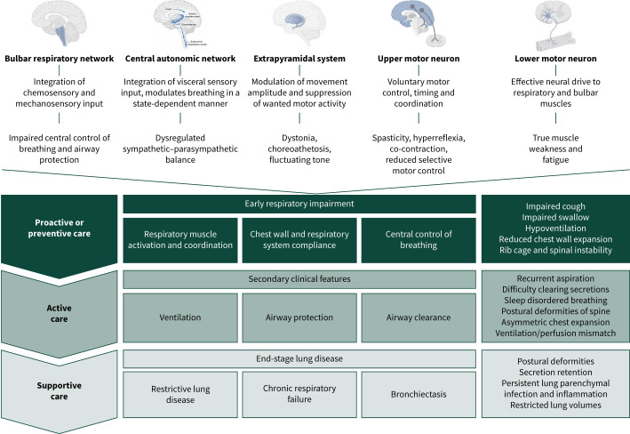
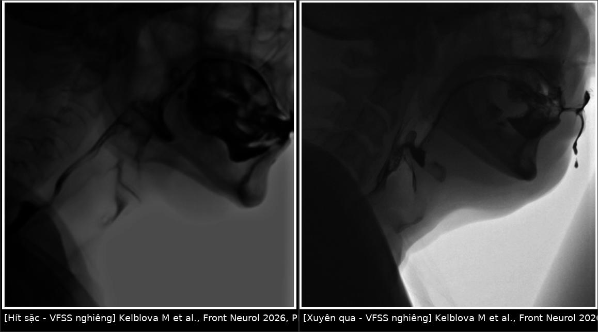
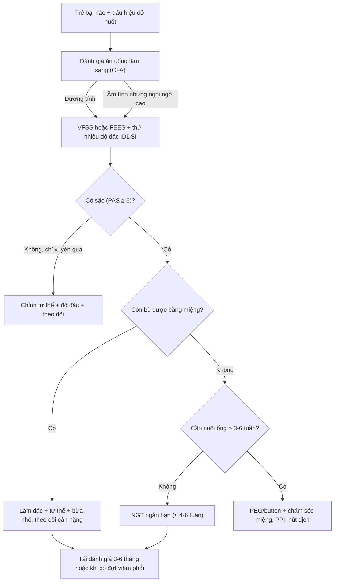
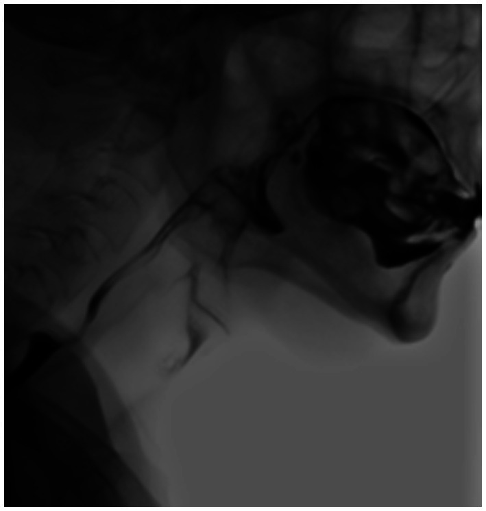
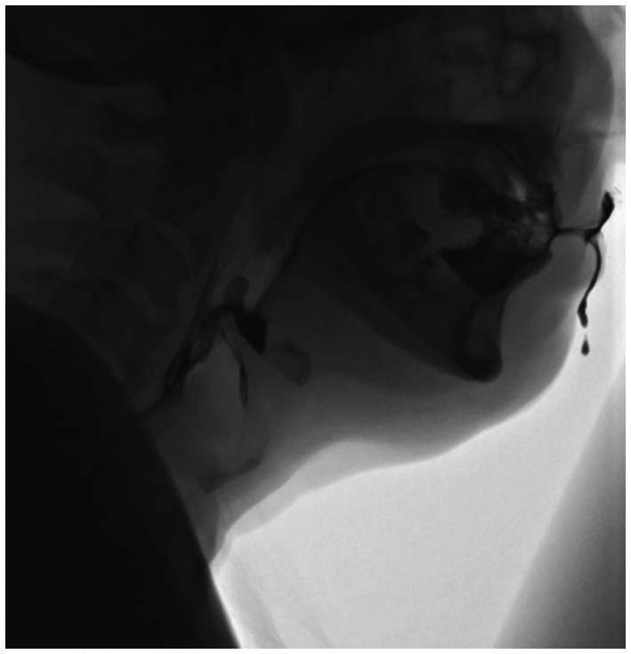
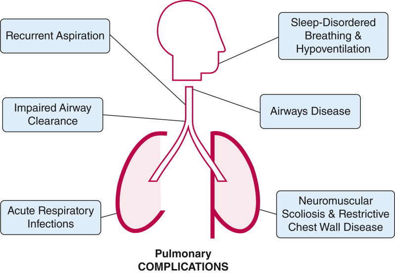

# 082 — Bại não & an toàn nuốt ở trẻ: phân tầng theo GMFCS, VFSS/FEES và ngưỡng chuyển sang nuôi qua ống / Cerebral palsy & swallowing safety

**Tags:** `pattern:hit-sac` `pattern:sac-tham-lang` `pattern:roi-loan-nuot` `vung:duong-nuot` `vung:thanh-quan` `vung:phoi` `score:PAS` `score:GMFCS` `protocol:VFSS` `protocol:FEES` `protocol:IDDSI`
**Mức chắc chắn (certainty):** tổng hợp y văn (literature synthesis) — số liệu lấy từ tổng quan hệ thống và nghiên cứu đoàn hệ truy cập mở (PMC11846443, PMC13579336, PMC13646029, PMC11307002, PMC13386198), ảnh minh họa từ ca/bài CC BY; không suy diễn ngoài nguồn.

> Bài này KHÔNG lặp lại kỹ thuật VFSS/FEES và mẫu hình viêm phổi hít sặc (đã có ở [081 – Sặc & rối loạn nuốt](../081-sac-va-roi-loan-nuot/lesson.md)). Bài trả lời 3 câu riêng của **trẻ bại não (cerebral palsy, CP)**: **(1) trẻ nào nguy cơ cao (GMFCS, dấu hiệu đỏ); (2) khi nào phải soi nuốt bằng hình ảnh thay vì chỉ khám lâm sàng; (3) khi nào đủ bằng chứng để chuyển từ ăn miệng sang sonde/PEG** — và cách theo dõi phổi để không chết vì viêm phổi hít sặc tái diễn.

## 1. Tổng quan bệnh học – cơ chế hình ảnh

- **Bại não (CP):** tổn thương não **không tiến triển** nhưng gây rối loạn vận động và tư thế kéo dài; rối loạn nuốt hầu–miệng (oropharyngeal dysphagia, OPD) là biến chứng thường gặp nhất về dinh dưỡng – hô hấp. Tổng quan hệ thống 2025: OPD gặp ở **tới 85%** trẻ CP, **81,5%** có rối loạn nuốt ở mức độ nào đó (PMC11846443). Suy dinh dưỡng gặp ở **~40%** trẻ CP (PMC13579336).
- **Vì sao CP dễ sặc:** (a) giảm trương lực/điều hợp cơ hầu – lưỡi – thanh quản → viên nuốt không được đẩy an toàn, đóng thanh môn muộn; (b) **giảm cảm giác thanh quản + ngưỡng ho cao** do phơi nhiễm mạn với dịch hít vào → **hít sặc thầm lặng (silent aspiration)**, không ho; (c) trào ngược dạ dày–thực quản (GERD) do tư thế và liệt nhẹ dạ dày; (d) vẹo cột sống/co rút lồng ngực làm giảm khả năng ho và thanh thải nhầy; (e) thuốc chống động kinh/an thần làm giảm tỉnh táo và phản xạ bảo vệ.
- **TẠI SAO hít sặc gây bệnh phổi (vật lý + mô bệnh):**
  - Dịch vị acid + enzym tiêu hóa gây **viêm phổi hóa chất (chemical pneumonitis)** trong **vài giờ**, lan tỏa hai bên; vi khuẩn miệng–hầu bội nhiễm gây **viêm phổi nhiễm khuẩn sau 48–72 giờ**, khu trú.
  - Dịch/vi khuẩn lấp phế nang **theo trọng lực**: nằm ngửa → **phân thùy sau thùy trên + phân thùy đỉnh thùy dưới**; ngồi → **thùy dưới, phân thùy đáy**; phế quản chính phải dốc và rộng hơn → **phổi phải** hay bị hơn.
  - Trên CT: **đông đặc (consolidation, ~30–60 HU) ± kính mờ (ground-glass)** ở vùng phụ thuộc, có thể kèm **phế quản hơi**; hít sặc mạn → **giãn phế quản (bronchiectasis)** và xơ hóa.
- **Vì sao thấy được trên hình ảnh (không chỉ "đoán lâm sàng"):**
  - **VFSS (videofluoroscopic swallowing study):** thuốc cản quang (barium hoặc **iod tan nước**) có **đậm độ tia X cao** → cột cản quang hiện rõ khi đi qua miệng–hầu–thực quản ở **tư thế nghiêng, động, theo thời gian thực**; vị trí cột cản quang **dưới dây thanh thật** = hít sặc.
  - **FEES (fiberoptic endoscopic evaluation of swallowing):** ánh sáng trắng nhìn trực tiếp **thanh quản – xoang lê – xoang hình lê**; thấy **ứ đọng, xuyên qua, sặc** và đánh giá được **dịch tiết/nước bọt** — nhưng bị **"màn trắng" (white-out)** đúng lúc nuốt nên có thể bỏ sót.
  - **Ngưỡng định lượng chốt:** thang **PAS (Penetration-Aspiration Scale) 1–8** — **PAS ≥ 6 = hít sặc thực sự** (dưới dây thanh); **PAS 2–5 = xuyên qua (penetration)**; **PAS 8 = sặc thầm lặng, không phản ứng**. Chi tiết thang: xem [081](../081-sac-va-roi-loan-nuot/lesson.md).
- **Tử vong và gánh nặng:** **bệnh hô hấp (đứng đầu là viêm phổi)** chiếm **40–50%** ca tử vong ở trẻ CP nặng **GMFCS IV–V** (PMC13579336); trẻ CP nhập viện vì bệnh hô hấp có thời gian nằm **dài gấp ~2,5 lần** trẻ cùng tuổi.
- **Sặc ở trẻ em phần lớn KHÔNG có triệu chứng:** **> 80%** ca hít sặc ở trẻ là **thầm lặng** (PMC13646029) → **không được dùng "không ho" để loại trừ sặc**.

*Ba tầng cơ chế: giảm kiểm soát trung ương hô hấp – giảm hoạt hóa cơ thần kinh – bất thường cơ học lồng ngực; hậu quả sớm là giảm thông khí, giảm bảo vệ đường thở và giảm thanh thải, về sau là sặc tái diễn, nhiễm trùng mạn và bệnh phổi hạn chế. Nguồn: Freitag N et al., Breathe 2026, PMC13386198, Fig. 1, CC BY-NC 4.0.*

## 2. Mẫu hình + chẩn đoán phân biệt theo vị trí (Gamut)

- **Mẫu hình 1 — sặc khi ăn/uống (overt aspiration):** ho, tím tái, nghẹt thở khi ăn; VFSS thấy cản quang **dưới dây thanh**. Thường GMFCS III–V.
- **Mẫu hình 2 — sặc thầm lặng:** không ho, chỉ có **"ẩm ướt" giọng nói, thở rít/rattle, nghẹt mũi khi ăn, chảy nước mũi**, hoặc **viêm phổi tái diễn không rõ nguyên nhân**. Đây là kiểu hay bị bỏ nhất ở CP.
- **Mẫu hình 3 — sặc nước bọt/ứ đọng sau nuốt:** chảy nước dãi (drooling), đặc biệt **chảy ngược ra sau (posterior drooling)** → dịch ứ ở hạ hầu rồi tràn thanh quản; FEES thấy **ứ đọng xoang lê/hình lê**.
- **Mẫu hình 4 — sặc do trào ngược:** ho/khò khè sau ăn, nằm; hình ảnh mờ **vùng phụ thuộc** hoặc **đông đặc tái diễn cùng vị trí**; chẩn đoán xác nhận bằng pH–trở kháng 24 giờ (khó diễn giải ở trẻ có rối loạn nhu động).
- **Mẫu hình 5 — bệnh phổi mạn do hít sặc:** giãn phế quản, dày thành phế quản, xẹp phổi tái diễn, tăng áp lực động mạch phổi; đây là **đích của theo dõi dài hạn**.
- **Gamut theo vị trí tổn thương trên VFSS/FEES:**
  - **Xoang lê (vallecula) / xoang hình lê (piriform sinus):** tồn lưu → nguy cơ sặc **sau nuốt** (overflow).
  - **Tiền đình thanh quản (laryngeal vestibule):** xuyên qua (penetration).
  - **Dưới dây thanh (subglottic):** hít sặc (aspiration).
  - **Phân thùy phụ thuộc ở phổi:** viêm phổi hít sặc.
- **Gợi nhớ "6 nguồn viêm phổi tái diễn ở trẻ CP":** **S**ặc (OPD) · **T**rào ngược (GERD) · **T**hanh thải kém (ho yếu, vẹo cột sống) · **N**hiễm mạn/giãn phế quản (Pseudomonas) · **D**inh dưỡng–miễn dịch · **T**huốc (an thần, chống động kinh, giãn cơ).

## 3. Bảng so sánh phân biệt (ma trận đối chiếu)

| Thực thể (entity) | Hình ảnh điển hình (VFSS/FEES/CT) | Chốt vào (rule-in) | Chốt loại (rule-out) | Gợi ý xác nhận |
|---|---|---|---|---|
| Hít sặc thực sự (aspiration) | Cản quang/đồ ăn **dưới dây thanh thật**; có thể thấy cột cản quang trong khí quản | **PAS ≥ 6** (dưới dây thanh) | Cản quang dừng **trên** dây thanh (PAS ≤ 5) → chỉ xuyên qua | VFSS (chuẩn động) hoặc FEES |
| Xuyên qua (penetration) | Cản quang trong **tiền đình thanh quản**, trên dây thanh, thường ho đẩy ra được | **PAS 2–5** + còn phản xạ ho | Cản quang xuống dưới dây thanh → đã là sặc | VFSS/FEES; ghi rõ PAS |
| Sặc thầm lặng (silent aspiration) | Sặc **không ho**, thường PAS 8; chỉ thấy trên VFSS/FEES | **Sặc trên hình ảnh + không phản xạ ho** | Có ho rõ khi sặc → không phải thầm lặng (nhưng vẫn là sặc) | FEES tại giường; **không loại trừ bằng lâm sàng** |
| Sặc nước bọt / ứ đọng | Ứ đọng nước bọt ở xoang lê/hình lê, tràn qua thanh môn | **Ứ đọng rõ + tràn qua thanh môn khi FEES** | Nuốt sạch, không ứ đọng sau nuốt | FEES (nhìn trực tiếp dịch tiết) |
| Sặc do trào ngược (GERD) | Mờ **vùng phụ thuộc** hoặc đông đặc **tái diễn cùng vị trí**; ợ nóng/khò khè sau ăn | **Đáp ứng PPI + pH–trở kháng dương tính** | Không trào ngược, sặc chỉ khi ăn/uống | pH–trở kháng 24 giờ, nội soi |
| Bệnh phổi mạn do hít sặc | Giãn phế quản, dày thành phế quản, xẹp tái diễn, tăng áp phổi | **Giãn phế quản + tiền sử sặc/tái diễn** | Phổi bình thường trên CT độ phân giải cao | CT ngực lát mỏng, cấy đàm |
| Rối loạn nuốt do nguyên nhân **thực quản** (achalasia, hẹp) | Thực quản giãn, ứ dịch, mức khí–dịch; **không sặc khi ăn nhưng trào ngược muộn** | **Giãn thực quản + trào ngược + sặc về đêm** | Thực quản bình thường | Nuốt barit, đo áp lực thực quản |

*Trái: cản quang dừng **trên dây thanh** (xuyên qua). Phải: cản quang đã **xuống dưới dây thanh** vào khí quản (hít sặc). Nguồn: Kelblová M et al., Front Neurol 2026, PMC13389358, CC BY 4.0. Ảnh ghép letterbox, không crop/kéo giãn.*

## 4. Protocol chụp + phân tầng và ngưỡng xử trí

### 4.1 Ai cần đánh giá nuốt (dấu hiệu đỏ)
- **Bữa ăn kéo dài bất thường** (nhiều đơn vị lấy mốc **> 30 phút** — ngưỡng quy ước, chưa có bằng chứng mạnh), mệt cuối bữa, thức ăn rơi ra, phải ép ăn.
- **Ho/sặc/nghet khi ăn uống**, **giọng ướt (wet voice)**, **nghẹt mũi khi ăn**, **chảy nước dãi nhiều**.
- **Viêm phổi tái diễn**, xẹp phổi tái diễn, ho mạn, khò khè; **sụt cân/không tăng cân** dù đủ năng lượng.
- **GMFCS III–V** — nhóm nguy cơ cao nhất; nhưng **GMFCS I–II vẫn có thể "vi sặc" (micro-aspiration)** và bị bỏ qua (bảng GMFCS – PMC13579336).

### 4.2 Sàng lọc trước, hình ảnh quyết định
- **Đánh giá ăn uống lâm sàng (clinical feeding assessment, CFA)** là bước sàng lọc: độ nhạy **80–100%**, độ đặc hiệu **68–79%** cho sặc thật (n = 80 trẻ, FEES làm chuẩn; PMC11307002). **CFA dương tính → phải soi nuốt**; **CFA âm tính nhưng nghi ngờ cao vẫn phải soi** (vì độ đặc hiệu chỉ ~70%).
- **VFSS** khi: cần xác định **có sặc hay không**, **sặc với độ đặc nào**, đánh giá **hiệu quả của tư thế/độ đặc** trước khi quyết định; ưu tiên ở trẻ hợp tác, cần đánh giá toàn bộ thì nuốt.
- **FEES** khi: trẻ nặng khó di chuyển, cần đánh giá **dịch tiết/nước bọt**, theo dõi tại giường; nhược điểm **white-out** và không thấy được thì thực quản.
- **Thử nhiều độ đặc (IDDSI):** chất lỏng mỏng (level 0–1), hơi đặc (2), **vừa đặc (3)**, **đặc vừa (4)**, thức ăn nghiền; **IDDSI level 3–4 là mức khởi đầu được khuyến nghị** khi cần làm đặc (PMC13646029).
- **Thử cả cuối bữa (fatigue test):** sặc có thể **chỉ xuất hiện khi mệt** — lặp lại thì nuốt khi trẻ đã ăn được một lúc, không chỉ đánh giá một viên đầu tiên.

### 4.3 Can thiệp không dùng ống (làm trước, làm song song)
- **Tư thế:** ngồi **thẳng hoặc hơi ngả**, **chân được đỡ**, thân ổn định, **đầu–cổ trung tính hoặc gập nhẹ (chin-tuck)**; **tránh ngồi thẳng không có đỡ thân** ở trẻ kiểm soát thân kém (làm tăng nguy cơ sặc) — đồng thuận Delphi 2026 (PMC13666940).
- **Làm đặc dịch:** giảm số cơn/viêm phổi và cải thiện cân nặng ở trẻ có OPD (PMC13646029), nhưng **không có chuẩn thống nhất** về cách làm đặc; theo dõi **cân nặng, lượng nước tiểu, táo bón** vì làm đặc quá tay → giảm lượng ăn/uống.
- **Bữa ăn:** nhỏ, nhiều lần; **ngừng khi mệt**; vệ sinh răng miệng (giảm vi khuẩn miệng → giảm viêm phổi); **tiêm phòng cúm hằng năm**; điều trị táo bón và trào ngược.
- **Thanh thải đường thở:** kỹ thuật ho có hỗ trợ (MI-E/cough assist), OPEP, vỗ rung; **NIV** khi có rối loạn nhịp thở khi ngủ hoặc suy hô hấp mạn (PMC13579336).
- **Kiểm soát co giật, đau, táo bón, tư thế ngồi** — giảm nhu cầu thuốc an thần (làm tăng nguy cơ sặc).

### 4.4 Ngưỡng chuyển sang nuôi qua ống
- **Sonde dạ dày (NGT) ngắn hạn** khi: sặc nặng không bù được bằng độ đặc/tư thế, **sụt cân cấp**, hoặc cần **nghỉ nuốt** để điều trị viêm phổi — dùng **≤ 4–6 tuần**.
- **Mở thông dạ dày (PEG/button)** khi dự kiến **cần nuôi qua ống > 3–6 tuần** (PMC10187850), đặc biệt khi: sặc thầm lặng tái diễn + **suy dinh dưỡng nặng/không tăng cân**, bữa ăn > 30–45 phút, viêm phổi tái diễn nhiều đợt, hoặc không thể uống đủ nước.
- **Cân nhắc PEJ/jejunostomy hoặc fundoplication** khi sặc **do trào ngược** vẫn tiếp diễn dù đã nuôi dạ dày + PPI (PMC13579336).
- **Quyết định chia sẻ với gia đình:** PEG không chữa được sặc nước bọt; vẫn phải chăm sóc miệng, hút dịch, điều trị trào ngược — chi tiết biến chứng ống xem [083](../083-nuoi-an-qua-sonde/lesson.md).

## 5. Biến thể bình thường và cạm bẫy

- **"Không ho" không loại trừ sặc:** **> 80%** sặc ở trẻ là thầm lặng; ngưỡng ho cao là hệ quả của phơi nhiễm mạn, không phải bằng chứng an toàn.
- **VFSS chỉ là "một lát cắt thời gian":** một lần nuốt bình thường không loại trừ sặc khi mệt, khi ăn thức ăn khác, hoặc khi tư thế thay đổi. Phải thử **nhiều độ đặc + cuối bữa**.
- **FEES "white-out":** đúng lúc nuốt màn hình trắng → **có thể bỏ sót sặc**; nếu nghi ngờ, làm VFSS hoặc FEES lặp.
- **Nhầm cản quang trong khí quản với "dây thần kinh/tia"**: trên VFSS, cột cản quang dưới dây thanh **mờ dần theo thì thở**; kiểm tra cả khung trước và sau nuốt.
- **Ngửa cổ khi ăn** làm mở đường thở — tránh; **gập cổ quá mức** lại gây ứ đọng hạ hầu. Tư thế phải cá thể hóa theo kết quả VFSS.
- **Làm đặc quá tay:** giảm lượng dịch → **mất nước, táo bón, giảm năng lượng**; IDDSI level 3–4 là điểm khởi đầu, không phải đích cố định.
- **Quy mọi viêm phổi tái diễn cho sặc:** phải loại trừ **giãn phế quản, dị vật, lao, suy giảm miễn dịch, vẹo cột sống hạn chế phổi** — đặc biệt khi kháng sinh không đáp ứng.
- **Viêm phổi hóa chất vs nhiễm khuẩn:** khởi phát **trong vài giờ**, mờ lan tỏa hai bên → hóa chất, **không cần kháng sinh ngay**; khu trú, 48–72 giờ → nhiễm khuẩn.

## 6. Tự lượng giá — Blind Quiz

**Ca 1 — Bé trai 6 tuổi, bại não GMFCS V, viêm phổi tái diễn 3 lần/năm, không ho khi ăn. VFSS nghiêng thì nuốt chất lỏng mỏng:**

- Câu hỏi: Cản quang đi tới đâu? Đây là xuyên qua hay hít sặc? Vì sao trẻ không ho?

<b>Bấm để hiện đáp án (findings + chẩn đoán)</b>

- Dấu hiệu: cột cản quang **vượt qua dây thanh thật, đi vào khí quản** (dưới dây thanh) — **hít sặc (aspiration)**, tương ứng **PAS ≥ 6**; không có phản xạ ho → **PAS 8 (sặc thầm lặng)**.
- Chẩn đoán: sặc thầm lặng do giảm cảm giác thanh quản + ngưỡng ho cao — vì vậy **triệu chứng lâm sàng không đủ để loại trừ**.
- Nguồn ảnh: Kelblová M et al., Front Neurol 2026, PMC13389358, Fig. 11, CC BY 4.0.

**Ca 2 — Bé gái 4 tuổi, CP, ho khi uống nước nhưng uống được cháo; VFSS nghiêng:**

- Câu hỏi: Cản quang dừng ở mức nào? Có cần dừng ăn miệng không?

<b>Bấm để hiện đáp án</b>

- Dấu hiệu: cản quang vào **tiền đình thanh quản nhưng còn TRÊN dây thanh** → **xuyên qua (penetration), PAS 2–5**; có ho → còn phản xạ bảo vệ.
- Xử trí: **chưa cần dừng ăn miệng** — làm đặc dịch (IDDSI 3–4), chỉnh tư thế, bữa nhỏ; **tái đánh giá** và theo dõi cân nặng/viêm phổi. Nếu tái diễn hoặc sụt cân → cân nhắc VFSS lặp, NGT/PEG.
- Nguồn ảnh: Kelblová M et al., Front Neurol 2026, PMC13389358, Fig. 12, CC BY 4.0.

**Ca 3 — Bé trai 8 tuổi, CP + vẹo cột sống, 2 đợt viêm phổi trong 6 tháng. Nhìn sơ đồ dưới và trả lời:**

- Câu hỏi: Kể **3 cơ chế** gây biến chứng phổi ở trẻ bại não ngoài sặc khi ăn; cơ chế nào cần can thiệp bằng **hình ảnh** và cơ chế nào bằng **dụng cụ hỗ trợ ho**?

<b>Bấm để hiện đáp án</b>

- 3 cơ chế: **(1) sặc tái diễn (recurrent aspiration)** — chẩn đoán bằng VFSS/FEES; **(2) thanh thải đường thở kém (impaired airway clearance)** — ho yếu, ứ nhầy, xẹp phổi → MI-E/cough assist, vỗ rung; **(3) bệnh đường thở/tắc nghẽn khi ngủ + vẹo cột sống hạn chế lồng ngực** → đa ký giấc ngủ, NIV, đánh giá chỉnh hình.
- Cộng thêm: nhiễm trùng hô hấp cấp, suy dinh dưỡng làm yếu cơ hô hấp — đều là mắt xích can thiệp được.
- Nguồn ảnh: Desai B et al., CHEST Pulmonary 2023, PMC13420473, Fig. 1, CC BY 4.0.

## Bài liên quan chéo
- [081 – Sặc & rối loạn nuốt (VFSS/FEES, PAS/Hyodo)](../081-sac-va-roi-loan-nuot/lesson.md)
- [083 – Nuôi ăn qua sonde/PEG: biến chứng mạn](../083-nuoi-an-qua-sonde/lesson.md)
- [031 – Viêm phổi mẫu hình](../031-viem-phoi-mau-hinh/lesson.md)
- [015 – Ống/dây ICU](../015-ong-day-ICU/lesson.md)
- [612 – Cấp cứu đường thở trên trẻ em](../612-cap-cuu-duong-tho-tren-tre-em/lesson.md)

## Ảnh
- `images/082_bai-nao-an-toan-nuot_VFSS_PMC13389358-Fig11.jpg` — sặc (dưới dây thanh), CC BY 4.0.
- `images/082_bai-nao-an-toan-nuot_VFSS_PMC13389358-Fig12.jpg` — xuyên qua (trên dây thanh), CC BY 4.0.
- `images/082_bai-nao-an-toan-nuot_SoDo_PMC13386198-Fig1.jpg` — sơ đồ cơ chế thần kinh–phổi, CC BY-NC 4.0.
- `images/082_bai-nao-an-toan-nuot_SoDo_PMC13420473-Fig1.jpg` — sơ đồ biến chứng phổi, CC BY 4.0.
- `images/composite_xuyen-qua-vs-hit-sac.jpg` — ảnh ghép đối chiếu, CC BY 4.0 (hai ảnh gốc).
- Nguồn + giấy phép từng ảnh: `images/CREDITS.md`.

> Không dùng để chẩn đoán độc lập khi chưa có người hướng dẫn.
