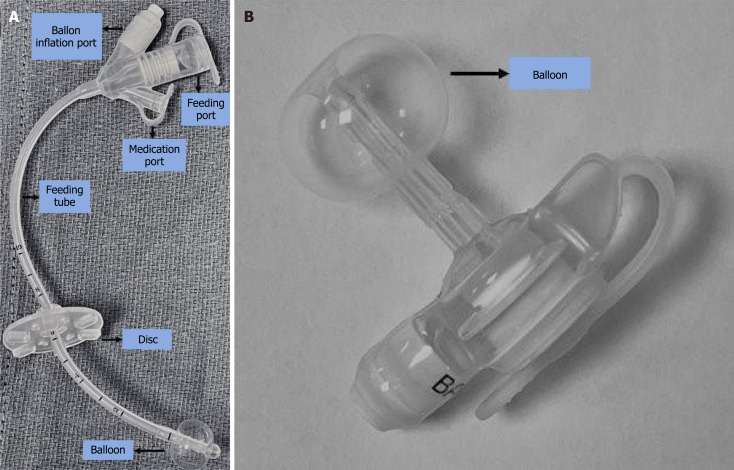
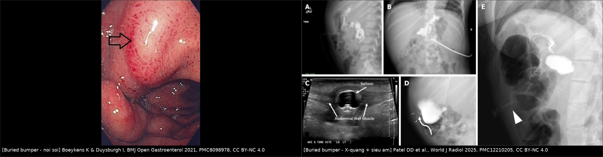
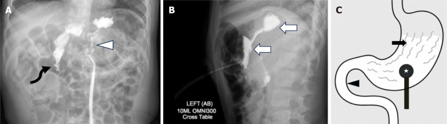
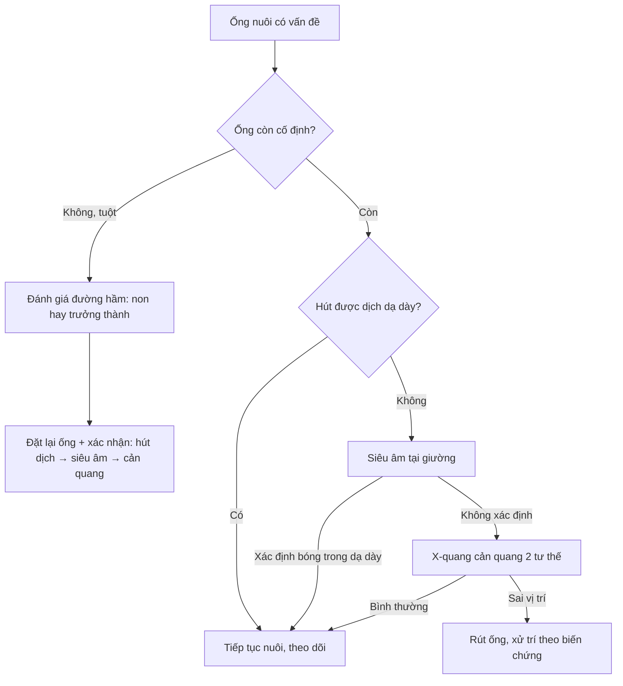
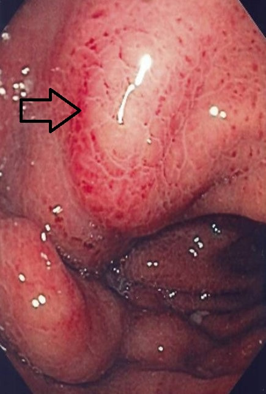
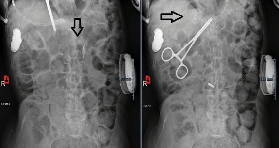
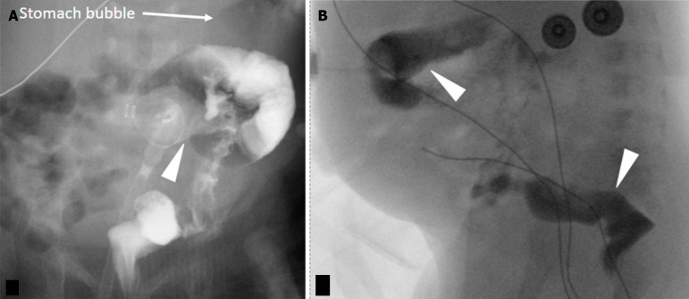

# 083 — Nuôi ăn qua sonde & mở thông dạ dày ở trẻ: biến chứng mạn, kiểm tra vị trí và xử trí / Long-term enteral feeding tubes in children

**Tags:** `pattern:bien-chung-ong-nuoi` `vung:da-day` `vung:thanh-bung` `score:ASPEN` `protocol:kiem-tra-vi-tri` `protocol:contrast-study` `incidentaloma:pneumoperitoneum` `incidentaloma:buried-bumper`
**Mức chắc chắn (certainty):** tổng hợp y văn (literature synthesis) — số liệu từ các đoàn hệ nhi khoa và hướng dẫn ASPEN 2026 truy cập mở (PMC10187850, PMC12375655, PMC11720959, PMC12210205, PMC13169229, PMC11959107); ảnh từ bài CC BY/CC BY-NC; không suy diễn ngoài nguồn.

> Bài này tập trung **"chuyện sau khi đã có ống"**: biến chứng sớm/muộn, đọc hình ảnh khi ống trục trặc, và ngưỡng xử trí. Cách đặt sonde dạ dày – kiểm tra vị trí lần đầu và viêm phổi hít sặc đã có ở [081](../081-sac-va-roi-loan-nuot/lesson.md); chỉ định chuyển từ ăn miệng sang ống ở trẻ bại não ở [082](../082-bai-nao-an-toan-nuot/lesson.md).

## 1. Tổng quan bệnh học – cơ chế hình ảnh

- **Chỉ định & lựa chọn ống:** nuôi qua ống khi trẻ **không thể ăn miệng an toàn/đủ nhu cầu**. Khi dự kiến cần **> 3–6 tuần**, mở thông dạ dày (gastrostomy) được ưu tiên hơn sonde mũi–dạ dày (nasogastric tube, NGT) vì ổn định hơn và ít biến chứng mũi–hầu (PMC10187850).
  - **NGT/NJ (nasojejunal):** đặt qua mũi; NGT dùng ngắn hạn, NJ khi cần nuôi sau môn vị.
  - **PEG (percutaneous endoscopic gastrostomy):** ống qua da vào dạ dày, có **bumper/balloon trong lòng dạ dày** giữ lại.
  - **Button (low-profile balloon gastrostomy tube, BGT):** ống thấp sát da, bóng nước trong dạ dày — thẩm mỹ hơn, nhưng **dễ bị chôn bumper (buried bumper)** nếu da dày lên/tăng cân.
  - **PEJ/GJ, mở thông dạ dày–hỗng tràng, phẫu thuật:** khi cần nuôi hỗng tràng hoặc thất bại PEG.
- **TẠI SAO hình ảnh đọc được (vật lý):**
  - Ống và bumper/balloon **cản tia X** → thấy trên X-quang bụng; **bóng chứa nước** → thấy được trên **siêu âm** dưới dạng cấu trúc echo trống, có thành, nằm trong lòng dạ dày.
  - **X-quang cản quang:** bơm cản quang qua ống → thấy **đường viền dạ dày và các nếp niêm mạc (rugae)**, và **thuốc xuống tá tràng**; nếu cản quang **ngoài lòng dạ dày** hoặc **đổ vào đại tràng** → sai vị trí.
  - **CT:** xác định ống đi **xuyên qua gan/đại tràng/tá tràng** hoặc tụ dịch, áp-xe thành bụng.
- **Cơ chế từng biến chứng (mô bệnh – vật lý):**
  - **Buried bumper (chôn bumper):** áp lực kéo dài giữa **bumper trong lòng dạ dày và đĩa ngoài da** → **hoại tử áp lực** thành dạ dày/thành bụng, bumper **lún vào mô**; nguy cơ tăng khi **tăng cân nhanh**, dùng **button thấp**, đĩa ngoài quá chặt, theo dõi kém.
  - **Nhiễm trùng lỗ mở (peristomal infection):** ẩm ướt + cọ xát + vi khuẩn da/miệng → viêm đỏ, chảy mủ; thường **trong 30 ngày đầu**.
  - **Rò tiêu hóa–da (gastrocutaneous fistula):** đường hầm đã **biểu mô hóa** → không tự đóng sau rút ống; dịch dạ dày chảy ra da.
  - **Hội chứng nuôi ăn lại (refeeding syndrome):** nạp glucose → **insulin tăng** → **K, Mg, phosphate vào nội bào** → **hạ phosphate máu** (nguy hiểm nhất), loạn nhịp, yếu cơ, phù; xảy ra trong **1–3 tuần đầu** nuôi lại.
  - **Tiêu chảy do nuôi ống:** tải thẩm thấu cao, thiếu chất xơ, kháng sinh, tốc độ bơm nhanh.
  - **Pneumoperitoneum sau PEG:** khí vào ổ bụng khi đặt/qua đường hầm; **thường tự hết** nhưng thể vừa/lớn có thể là dấu hiệu thủng.
- **Ngưỡng định lượng chốt:**
  - Biến chứng **nặng 14,4%**, nhẹ **85,6%** trong 202 biến cố ở 124 trẻ (PMC10187850); **buried bumper 10,47%** ở 86 trẻ PEG (PMC12375655); biến chứng nhẹ **68%** (chủ yếu mô hạt/đỏ da) ở 81 trẻ (PMC11720959).
  - **Pneumoperitoneum 4,6%** sau PEG, tự hết trong **2–18 ngày**; **2/9** ca vừa/lớn tử vong (PMC4641857).
  - **Refeeding syndrome 10,4%**, hạ phosphate < 0,8 mmol/L **13,7%**, giảm phosphate < 1,2 mmol/L **46,6%** (PMC11959107); ở trẻ suy dinh dưỡng cấp nặng, tỉ lệ 8,7–34,8% (PMC12468821).
  - **Thay bóng lần đầu: sau 6–12 tuần** (ASPEN 2026, PMC13169229).
  - **Kiểm tra ống bằng X-quang 2 tư thế có cản quang:** độ chính xác **97,8%**, NPV **99,5%**, không xác định **5,7%** (PMC12766352).

*Trái (A): G-tube chuẩn có đĩa ngoài, cổng nuôi/thuốc và bóng; phải (B): button thấp (low-profile) — bóng nằm trong dạ dày, đầu ống sát da. Nguồn: Patel DD et al., World J Radiol 2025, PMC12210205, Fig. 1, CC BY-NC 4.0.*

## 2. Mẫu hình + chẩn đoán phân biệt theo thời điểm (Gamut)

- **Biến chứng sớm (≤ 30 ngày):** nhiễm trùng/đỏ lỗ mở, rò dịch quanh ống, chảy máu, liệt ruột, **pneumoperitoneum**, **sai vị trí** (trong ổ bụng, đại tràng, gan), sặc trong lúc nuôi.
- **Biến chứng muộn (> 30 ngày):** **buried bumper**, **tuột ống**, **di trú ống** (vào tá tràng → tắc tá tràng), **tắc ống**, **mô hạt**, **rò tiêu hóa–da**, **tắc đường ra dạ dày do bóng quá căng**, di căn tại chỗ (hiếm), hẹp/rò đường hầm.
- **Gamut theo cơ chế:**
  - **Áp lực:** buried bumper, loét/hoại tử da do đĩa quá chặt.
  - **Co kéo:** tuột ống khi thay/giật, hở đường hầm.
  - **Vị trí:** đặt nhầm vào đại tràng, gan, ổ bụng; di trú vào tá tràng.
  - **Nhiễm:** viêm da quanh lỗ, áp-xe, nhiễm trùng huyết.
  - **Chuyển hóa:** refeeding, tiêu chảy, mất nước.
- **Gợi nhớ "BURIED":** **B**leeding (chảy máu) · **U**lcer/buried bumper · **R**efilling/occlusion (tắc) · **I**nfection · **E**scape (rò dịch) · **D**islodgement (tuột ống).

## 3. Bảng so sánh phân biệt (ma trận đối chiếu)

| Thực thể (entity) | Hình ảnh điển hình | Chốt vào (rule-in) | Chốt loại (rule-out) | Gợi ý xác nhận |
|---|---|---|---|---|
| Buried bumper (chôn bumper) | Nội soi: bumper/đĩa **lún dưới niêm mạc**, không thấy bóng; X-quang: bóng **không di chuyển theo dạ dày**; **siêu âm: bóng nằm trong thành bụng/cơ** | **Bóng không nằm trong lòng dạ dày + đau/chảy dịch tại lỗ** | Bóng thấy rõ trong lòng dạ dày, ống trượt tự do | Siêu âm tại giường + nội soi; CT nếu nghi áp-xe |
| Tuột ống (dislodgement) | Ống **không còn ở vị trí**, lỗ mở còn; bụng chướng nếu bơm nhầm ổ bụng | **Ống ra ngoài/không rút được dịch dạ dày** | Ống còn cố định, hút ra dịch dạ dày | Kiểm tra lâm sàng; **hút dịch → siêu âm → cản quang** |
| Di trú vào tá tràng | Bóng/ống **đi qua môn vị xuống tá tràng**, bụng chướng, nôn dịch mật | **Đầu ống/bóng ở vùng tá tràng trên X-quang** | Đầu ống ở thân dạ dày, dưới cơ hoành trái | X-quang bụng; kéo lại và kiểm tra |
| Đặt nhầm vào đại tràng | Cản quang **đổ vào khung đại tràng** (có haustra), phân quanh ống | **Cản quang vào đại tràng + phân quanh lỗ** | Cản quang chỉ trong dạ dày, xuống tá tràng | X-quang cản quang 2 tư thế, CT |
| Nhiễm trùng lỗ mở | Đỏ, sưng, chảy mủ quanh lỗ; mô hạt có thể kèm | **Mủ + đau + sốt** | Chỉ mô hạt hồng, không mủ | Cấy dịch, siêu âm tìm áp-xe |
| Mô hạt (granulation tissue) | Nốt hồng ướt, dễ chảy máu quanh lỗ | **Mô hạt thừa, không sốt** | Mủ/tấy đỏ lan → nhiễm trùng | Chăm sóc da, bạc nitrat nếu cần |
| Rò tiêu hóa–da kéo dài | Dịch dạ dày chảy qua lỗ sau rút ống nhiều tuần | **Rò dịch kéo dài ≥ 4 tuần** (ngưỡng quy ước) | Lỗ khô và tự đóng trong vài ngày | Nội soi/CT đường hầm; can thiệp đóng |
| Refeeding syndrome | Không có hình ảnh đặc hiệu; **hạ phosphate/K/Mg**, phù, loạn nhịp | **Phosphate < 0,8 mmol/L** sau khi bắt đầu nuôi | Điện giải bình thường, không triệu chứng | Xét nghiệm điện giải hằng ngày tuần đầu |

*Trái: nội soi — bumper lún dưới niêm mạc, mũi tên chỉ chỗ ống thoát ra (buried bumper). Phải: X-quang cản quang + siêu âm — bóng nằm trong thành bụng, không thấy trong lòng dạ dày. Nguồn: Boeykens K & Duysburgh I, BMJ Open Gastroenterol 2021, PMC8098978, Fig. 1 (CC BY-NC 4.0); Patel DD et al., World J Radiol 2025, PMC12210205, Fig. 7 (CC BY-NC 4.0). Ảnh ghép letterbox.*

## 4. Protocol chụp + kiểm tra vị trí + ngưỡng xử trí

### 4.1 Kiểm tra ống mới thay (quan trọng nhất trong thực hành)
- **Bước 1 — hút dịch dạ dày:** có dịch dạ dày (pH thấp) là bằng chứng ủng hộ vị trí trong dạ dày.
- **Bước 2 — nếu không hút được dịch:** **siêu âm tại giường (POCUS)** bơm nước/normal saline vào bóng để xác nhận bóng trong dạ dày. Trong nghiên cứu 118 lần thay ống, **13,6%** siêu âm không xác định được; **4/16** ca không xác định được xác nhận **ống nằm trong đường hầm thành bụng** bằng cản quang (PMC13169229).
- **Bước 3 — nếu siêu âm không xác định:** **X-quang cản quang**. Protocol **X-quang bụng 2 tư thế có cản quang** đạt độ chính xác **97,8%**, độ nhạy **90,0%**, độ đặc hiệu **98,2%**, NPV **99,5%**; **5,7%** ca không xác định (PMC12766352).
- **Thời điểm thay bóng lần đầu:** **6–12 tuần** sau đặt (ASPEN 2026) — chờ đường hầm trưởng thành để tránh đặt nhầm vào ổ bụng (PMC13169229).
- **Sau thay ống:** không cho ăn qua ống cho tới khi xác nhận vị trí; ghi lại **chiều dài ống** và **thể tích bóng** theo khuyến cáo của nhà sản xuất.

*X-quang cản quang bình thường: thuốc phủ đường viền dạ dày và các nếp niêm mạc (mũi tên), xuống tá tràng (mũi tên cong) — không có thuốc ngoài lòng dạ dày. (C): sơ đồ tương ứng. Nguồn: Patel DD et al., World J Radiol 2025, PMC12210205, Fig. 2, CC BY-NC 4.0.*

### 4.2 Chọn ống & theo dõi
- **NGT:** dùng ngắn hạn; băng dính thường **không giữ được 40% ống** (tuột), **nasal bridle** giảm tuột **57%** (HR 6,3) và giảm tuột từ **88% → 31%** sau 30 ngày (PMC12080054).
- **PEG vs phẫu thuật:** tỉ lệ biến chứng và can thiệp lại **tương đương**; PEG có xu hướng cải thiện cân nặng sớm hơn (PMC13262180).
- **Buried bumper:** theo dõi bằng **đo chiều dài ống ngoài da** mỗi lần thăm khám; đĩa ngoài **không quá chặt**, vệ sinh và lau khô lỗ mở.
- **Tắc ống:** bơm nước ấm, tránh dùng vật cứng; thuốc nghiền kỹ, không trộn cùng nhau.

### 4.3 Refeeding và biến chứng chuyển hóa
- **Sàng lọc nguy cơ:** sụt cân nhanh, BMI thấp, ăn rất ít > 5 ngày, bệnh nền thần kinh/ung thư.
- **Khởi đầu thấp, tăng dần** (nguyên tắc của protocol nuôi lại); **xét nghiệm điện giải** (phosphate, K, Mg) định kỳ — hạ kali máu thường xuất hiện **ngày 4–17** (PMC11959107).
- **Ngưỡng cảnh báo:** phosphate **< 0,8 mmol/L** = hạ phosphate thực sự; **< 1,2 mmol/L** gặp ở **46,6%** trẻ trong 3 tuần đầu (PMC11959107) — theo dõi sát, bổ sung phosphate/K/Mg theo hướng dẫn.
- **Dấu hiệu nguy hiểm:** loạn nhịp, suy tim, co giật, yếu cơ, phù — ngừng/tăng chậm, xử trí cấp cứu.

## 5. Biến thể bình thường và cạm bẫy

- **Pneumoperitoneum sau PEG không luôn lành tính:** gặp **4,6%**, tự hết trong **2–18 ngày**, nhưng **2/9** ca vừa/lớn tử vong — **thể vừa/lớn + sốt/đau bụng/tăng bạch cầu** phải loại trừ thủng (PMC4641857).
- **Bóng quá căng** có thể **chèn môn vị gây tắc dạ dày** (gastric outlet obstruction) — hình ảnh X-quang cản quang cho thấy cản quang ứ lại; xử trí **xả bớt bóng**.
- **Cản quang trong đại tràng dễ nhầm là dạ dày:** tìm **haustra**, phân trong lòng, và đường đi của ống; nếu nghi ngờ → CT (PMC12210205).
- **Buried bumper dễ bị bỏ qua** vì ống vẫn "hút được" một ít dịch; đau/chảy dịch tái diễn + bóng không thấy trên X-quang là dấu hiệu cảnh báo.
- **Mô hạt vs nhiễm trùng:** mô hạt hồng, mềm, không sốt; nhiễm trùng có mủ, tấy đỏ lan, đau, sốt — cấy trước khi dùng kháng sinh.
- **Rò tiêu hóa–da kéo dài** thường do đường hầm đã biểu mô hóa sau đặt ống lâu; đừng chờ tự đóng mãi.
- **Không quy mọi tiêu chảy cho "sữa":** kiểm tra tốc độ bơm, nồng độ, kháng sinh, nhiễm Clostridioides difficile.
- **Trẻ có ống vẫn có thể sặc** (dịch dạ dày trào ngược, sặc nước bọt) — ống không thay thế đánh giá nuốt.

## 6. Tự lượng giá — Blind Quiz

**Ca 1 — Bé gái 5 tuổi, button dạ dày 8 tháng, đau và chảy dịch tại lỗ mở (bệnh cảnh giả định mô phỏng hình ảnh nguồn). Nội soi dạ dày:**

- Câu hỏi: Mũi tên chỉ gì? Vì sao bóng không thấy trong lòng dạ dày? Xử trí?

<b>Bấm để hiện đáp án (findings + chẩn đoán)</b>

- Dấu hiệu: **bumper/đĩa lún dưới niêm mạc**, chỉ còn lỗ ống thoát ra — **buried bumper syndrome**. Bóng bị kéo vào thành dạ dày/thành bụng nên không thấy trong lòng dạ dày.
- Xử trí: ngừng nuôi qua ống, xác nhận bằng **siêu âm/CT**, rút/loại bỏ bumper (nội soi hoặc phẫu thuật), đặt lại ống ở vị trí mới; dự phòng bằng đĩa ngoài không quá chặt + theo dõi cân nặng.
- Nguồn ảnh: Boeykens K & Duysburgh I, BMJ Open Gastroenterol 2021, PMC8098978, Fig. 1, CC BY-NC 4.0.

**Ca 2 — Bé trai 3 tuổi, PEG 1 năm, bụng chướng và nôn (bệnh cảnh giả định mô phỏng hình ảnh nguồn). X-quang bụng:**

- Câu hỏi: Ống/bóng đã đi đâu? Biến chứng gì? Làm gì ngay?

<b>Bấm để hiện đáp án</b>

- Dấu hiệu: PEG **di trú vào tá tràng** (trái) gây **tắc đường ra dạ dày**; sau khi kéo lại vị trí ban đầu (phải) thì hết tắc.
- Xử trí: **kéo ống về vị trí ban đầu** (như ca nguồn), xác nhận bằng X-quang; nếu tái di trú → đổi loại ống/button có cơ cấu giữ tốt hơn.
- Nguồn ảnh: Boeykens K & Duysburgh I, BMJ Open Gastroenterol 2021, PMC8098978, Fig. 5, CC BY-NC 4.0.

**Ca 3 — Sơ sinh 1 tháng, đặt PEG 5 ngày, dịch nâu sẫm quanh ống. X-quang cản quang:**

- Câu hỏi: Cản quang đổ vào cấu trúc nào? Chẩn đoán? Vì sao nguy hiểm?

<b>Bấm để hiện đáp án</b>

- Dấu hiệu: cản quang **đổ vào đại tràng** (thấy haustra, khung đại tràng) — **đặt nhầm ống xuyên đại tràng (colonic gastrostomy)**.
- Nguy hiểm: nuôi qua ống vào đại tràng → **tiêu chảy, nhiễm trùng, rò đại tràng–da, viêm phúc mạc**; cần rút ống, kháng sinh, và đặt lại đường vào dạ dày (nội soi/phẫu thuật).
- Nguồn ảnh: Patel DD et al., World J Radiol 2025, PMC12210205, Fig. 11, CC BY-NC 4.0.

## Bài liên quan chéo
- [081 – Sặc & rối loạn nuốt (sonde dạ dày, VFSS/FEES)](../081-sac-va-roi-loan-nuot/lesson.md)
- [082 – Bại não & an toàn nuốt ở trẻ](../082-bai-nao-an-toan-nuot/lesson.md)
- [015 – Ống/dây ICU](../015-ong-day-ICU/lesson.md)
- [646 – Hội chứng khoang bụng ở trẻ: đo áp lực bàng quang, phân độ I–IV](../646-hoi-chung-khoang-bung-o-tre/lesson.md)

## Ảnh
- `images/083_nuoi-an-qua-sonde_Anh_PMC12210205-Fig1.jpg` — G-tube vs button, CC BY-NC 4.0.
- `images/083_nuoi-an-qua-sonde_NoiSoi_PMC8098978-Fig1.jpg` — buried bumper, CC BY-NC 4.0.
- `images/083_nuoi-an-qua-sonde_US-XR_PMC12210205-Fig7.jpg` — buried bumper trên X-quang/US, CC BY-NC 4.0.
- `images/083_nuoi-an-qua-sonde_XR_PMC8098978-Fig5.jpg` — PEG di trú vào tá tràng, CC BY-NC 4.0.
- `images/083_nuoi-an-qua-sonde_XR_PMC12210205-Fig2.jpg` — kiểm tra cản quang bình thường, CC BY-NC 4.0.
- `images/083_nuoi-an-qua-sonde_XR_PMC12210205-Fig11.jpg` — đặt nhầm vào đại tràng, CC BY-NC 4.0.
- `images/composite_buried-bumper.jpg` — ảnh ghép đối chiếu.
- Nguồn + giấy phép từng ảnh: `images/CREDITS.md`.

> Không dùng để chẩn đoán độc lập khi chưa có người hướng dẫn.
