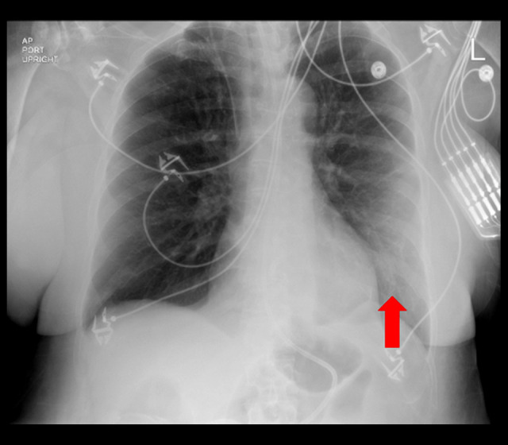
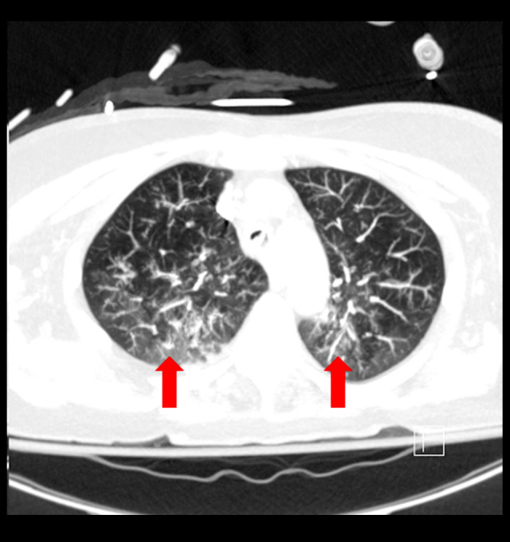
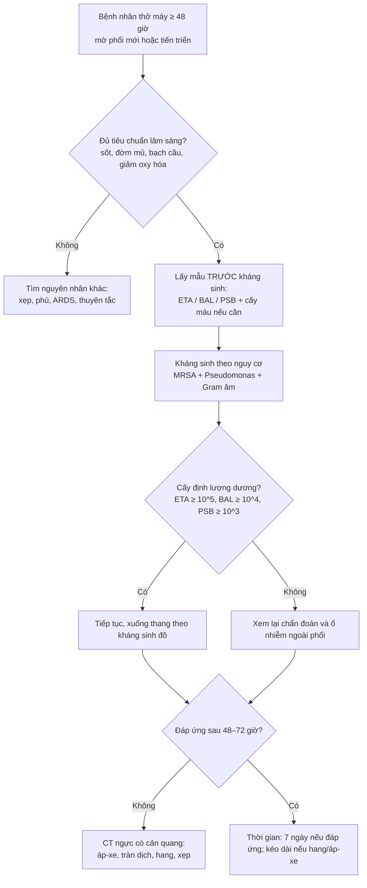
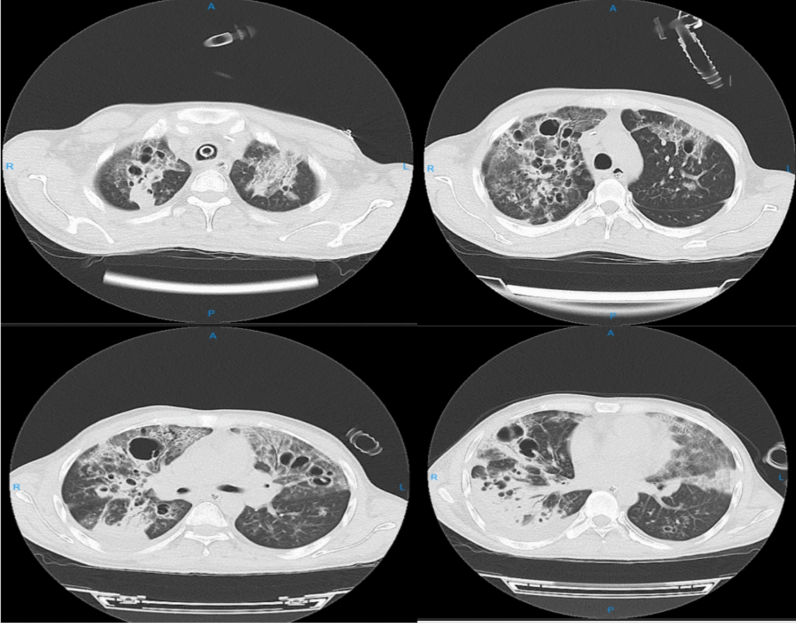
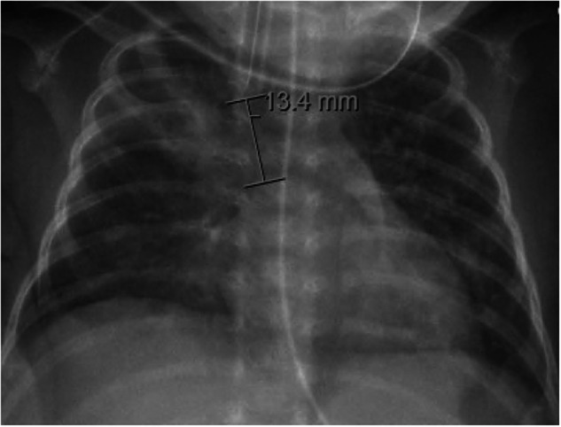

# 084 — Viêm phổi thở máy (VAP): X-quang/CT, cấy định lượng & bó dự phòng vi hít sặc ở ICU / Ventilator-associated pneumonia

**Tags:** `pattern:dong-dac` `pattern:hang` `vung:phoi` `score:CPIS` `protocol:X-quang-tai-giuong` `protocol:CT-lat-mong` `protocol:cay-dinh-luong` `incidentaloma:xep-phoi`
**Mức chắc chắn (certainty):** tổng hợp y văn (literature synthesis) — số liệu lấy từ các bài tổng quan/đoàn hệ mở (PMC13549390, PMC13126261, PMC11379627, PMC11330674, PMC13332427), ca minh họa từ hai báo cáo ca CC BY-NC-ND; không suy diễn ngoài nguồn, số nào chưa đối chiếu thì ghi rõ.

> Bài này trả lời 3 câu hỏi thực hành: **(1) mờ phổi mới ở người thở máy có phải VAP không? (2) lấy mẫu – ngưỡng cấy nào đủ chốt? (3) bó dự phòng nào thực sự có số liệu, và cái nào đã bị "hạ bậc"?** Viêm phổi hít sặc cộng đồng và VFSS/FEES ở trẻ đã có ở [081](../081-sac-va-roi-loan-nuot/lesson.md); biến chứng ống nuôi ăn ở [083](../083-nuoi-an-qua-sonde/lesson.md).

*X-quang ngực AP tại giường ngày 7 ở bệnh nhân vừa được đặt lại nội khí quản: ống nội khí quản, điện cực và dây theo dõi; mũi tên đỏ chỉ **đám mờ mới ở thùy dưới trái**. Đây là kiểu "mờ mới + sốt + tăng bạch cầu" điển hình của VAP. Nguồn: Kalinoski M, Ingraham NE, Am J Case Rep 2023, PMC10584195, Fig. 3, CC BY-NC-ND 4.0 (giữ nguyên bản).*

## 1. Tổng quan bệnh học – cơ chế hình ảnh

- **Định nghĩa:** VAP là viêm phổi xuất hiện **sau ≥ 48 giờ** đặt nội khí quản/mở khí quản (≥ 2 ngày lịch); viêm phổi trong vòng 48 giờ sau rút ống cũng được xếp vào phổ VAP (PMC13549390). Đây là mốc **phân biệt với viêm phổi cộng đồng/viêm phổi hít sặc lúc nhập viện** — cùng một hình ảnh đông đặc nhưng khác thời điểm và khác vi khuẩn.
- **Gánh nặng (số liệu cần nhớ):**
  - Mỹ (CDC/NHSN): trung vị **1,1 ca/1000 ngày thở máy** ở ICU nội–ngoại.
  - Các nước thu nhập thấp–trung bình (INICC): **11,96 ca/1000 ngày thở máy** giai đoạn 2015–2020 (giảm từ **24,1** giai đoạn 2002–2005) — vẫn cao gấp ~10 lần Mỹ (PMC13549390).
  - Tử vong trong các đoàn hệ ICU: **25–76%**, tử vong quy do VAP khoảng **30%**, RR tử vong **≈ 2,0**; kéo dài thở máy **4,3 ngày** (PMC13126261).
  - Chi phí quy do: **9.966 USD** (Mỹ) và **20.965,28 EUR** (Tây Ban Nha) mỗi ca (PMC13549390).
- **Cơ chế then chốt — vi hít sặc qua bóng chèn (microaspiration):** ống nội khí quản nối hầu với khí quản, **xóa hàng rào thanh môn**; dịch hầu họng (và dịch dạ dày trào ngược) chảy men theo nếp gấp của bóng chèn xuống phổi. Màng sinh học (biofilm) bám mặt trong 1/3 dưới ống nội khí quản là ổ chứa vi khuẩn; mỗi lần hút ống có thể bong mảng biofilm xuống phổi dưới áp lực dương của máy thở (PMC11379627). Vì vậy VAP **không phải bệnh "lây từ ngoài vào" đơn thuần** mà là bệnh của **hàng rào bị bắc cầu + ứ đọng + vi khuẩn bệnh viện**.
- **TẠI SAO hình ảnh trông như vậy (vật lý):**
  - Phế nang bình thường chứa khí (−800 đến −900 HU); khi đầy dịch viêm/mủ, tỷ trọng tăng lên **khoảng 0–40 HU** → trên X-quang thành **đám mờ**, trên CT thành **đông đặc**. Phế quản trong vùng đông đặc vẫn chứa khí → **dấu phế quản hơi (air bronchogram)** — dấu hiệu chứng minh mờ **trong phế nang**, không phải xẹp phổi do tắc phế quản trung tâm.
  - **Trọng lực quyết định vị trí:** dịch viêm và vi hít sặc lắng ở vùng **phụ thuộc (dependent)** — thùy dưới, phân thùy sau; vì thế VAP điển hình là **đông đặc đáy phổi**, thường phải hơn trái.
  - **Vì sao X-quang kém hơn CT:** phim **AP tại giường** bị phóng đại, xoay, hít vào kém, chồng các đường dẫn lưu/điện cực; độ nhạy thấp, và **độ đặc hiệu chỉ khoảng 55%** khi chỉ dựa vào "mờ + triệu chứng" (PMC13332427). CT lát mỏng phát hiện đông đặc, dấu phế quản hơi, hang, tràn dịch và **phân bố theo trọng lực** rõ hơn nhiều.
- **Mô bệnh:** viêm phế nang cấp với **bạch cầu đa nhân trung tính + fibrin + dịch phù**; thể nặng gây **hoại tử phế nang → hang** (S. aureus, Pseudomonas, Klebsiella, E. coli, Acinetobacter). Trẻ nhỏ có thể tạo **pneumatocele** (nang khí) do đường thở mỏng, dễ van một chiều.

## 2. Mẫu hình + chẩn đoán phân biệt theo phân bố (Gamut)

- **Đông đặc đơn ổ vùng phụ thuộc (thùy dưới phải/trái):** VAP điển hình do vi hít sặc; cũng gặp trong viêm phổi hít sặc, xẹp phổi thùy dưới.
- **Đông đặc đa ổ/lan tỏa hai bên:** VAP nặng, ARDS kèm VAP, phù phổi, xẹp phổi lan tỏa, xuất huyết phế nang. "Mờ hai bên" **không loại trừ** VAP nhưng cũng **không chứng minh** VAP.
- **Đông đặc + hang/hoại tử:** VAP do vi khuẩn sinh độc lực (S. aureus, Pseudomonas, Klebsiella, E. coli, Acinetobacter); lao, nấm, nhồi máu phổi, áp-xe sau hít sặc.
- **Nốt/đám mờ ngoại vi đa dạng + mạch nuôi (feeding vessel):** thuyên tắc nhiễm khuẩn (septic emboli) từ catheter/dòng máu — bệnh cảnh ICU rất dễ nhầm VAP.
- **Mờ một bên + mất thể tích (dịch chuyển rãnh liên thùy, cơ hoành lên cao):** xẹp phổi do tắc ống/nút nhầy — "VAP giả".
- **Mờ nhanh–tan nhanh:** phù phổi, xẹp phổi sau hút/physiotherapy; VAP thường **dai dẳng và tiến triển** trong 48–72 giờ.
- **Gợi nhớ "SUCTION" (cơ chế vi hít sặc):** **S**upine (đầu giường thấp) · **U**nconscious/sedated (giảm phản xạ nuốt) · **C**uff leak (áp lực bóng chèn thấp) · **T**ube biofilm (màng sinh học trên ống) · **I**mmobility (ít vận động, ứ đọng) · **O**ral hygiene kém · **N**utrition (nuôi qua ống, trào ngược).

## 3. Bảng so sánh phân biệt (ma trận đối chiếu)

| Thực thể (entity) | Hình ảnh điển hình | Chốt vào (rule-in) | Chốt loại (rule-out) | Gợi ý xác nhận |
|---|---|---|---|---|
| **VAP** | Đông đặc mới/tiến triển vùng phụ thuộc, dấu phế quản hơi, có thể hang; xuất hiện sau ≥ 48 giờ thở máy | **Mờ mới + ≥ 3 dấu lâm sàng (sốt, đờm mủ, tăng/giảm BC, giảm oxy hóa) + cấy định lượng dương** | Mờ tan nhanh sau hút/physio; không có bằng chứng vi khuẩn và không có bệnh cảnh nhiễm | Cấy ETA/BAL/PSB trước kháng sinh; so phim cũ |
| **Xẹp phổi (atelectasis)** | Mờ đồng nhất theo thùy, **mất thể tích** (rãnh/cơ hoành dịch), không có phế quản hơi trừ khi tắc một phần | **Mờ + mất thể tích + tan nhanh sau hút/physio** | Mờ dai dẳng, tiến triển, kèm phế quản hơi → nghĩ đông đặc viêm | So phim trước–sau hút; CT nếu nghi tắc |
| **Phù phổi** | Mờ hai bên, **cánh bướm**, dày vách, tràn dịch hai bên, tim to | **Đối xứng + Kerley B + đáp ứng lợi tiểu nhanh** | Mờ không đối xứng, có hang, không đáp ứng lợi tiểu | Siêu âm tim, BNP, đáp ứng điều trị |
| **ARDS** | Mờ lan tỏa hai bên, không giải thích hết bằng tràn dịch/xẹp, đông đặc vùng phụ thuộc | **PaO2/FiO2 ≤ 300 + mờ hai bên không phải phù/xẹp + khởi phát trong 1 tuần** | Mờ khu trú một thùy, có hang, có ổ áp-xe | Khí máu, CT; VAP có thể **chồng lên** ARDS |
| **Viêm phổi hít sặc (aspiration pneumonitis)** | Đông đặc vùng phụ thuộc (thùy dưới phải), xuất hiện **2–6 giờ** sau hít sặc | **Bệnh cảnh hít sặc rõ + mờ xuất hiện rất sớm + sốt nhẹ** | Mờ xuất hiện sau 48 giờ thở máy → nghĩ VAP | Bệnh sử, thời điểm; cấy phân biệt nhiễm |
| **Thuyên tắc nhiễm khuẩn (septic emboli)** | Nốt/đám mờ ngoại vi đa ổ, có thể hang, **mạch nuôi** | **Nhiễm khuẩn huyết + catheter + nốt ngoại vi đa ổ** | Đông đặc một vùng lớn vùng phụ thuộc → nghĩ VAP | Cấy máu, siêu âm tim, CT |
| **Lao/nấm phổi** | Hang thành dày/mỏng, nốt vệ tinh, tree-in-bud, phân bố thùy trên | **Nốt vệ tinh + tree-in-bud + vị trí đỉnh–thùy trên** | Hang đơn độc vùng đáy ở BN thở máy cấp → nghĩ VAP hoại tử | AFB/PCR, Galactomannan, sinh thiết khi phù hợp |
| **CPIS cao đơn thuần** | Không có hình ảnh riêng | **CPIS > 6 gợi ý nhưng không chốt** | CPIS thấp không loại trừ VAP | Chỉ dùng hỗ trợ; **AUC của CPIS cải tiến chỉ 0,686** (PMC13289337) |

*CT ngực cửa sổ nhu mô ở cùng bệnh nhân: đông đặc đa ổ hai bên, dấu phế quản hơi — tổn thương **đã có từ lúc nhập viện** (viêm phổi cộng đồng), không phải VAP. Chính vì vậy **mốc thời gian ≥ 48 giờ và so phim cũ** mới là chốt. Nguồn: Kalinoski M, Ingraham NE, Am J Case Rep 2023, PMC10584195, Fig. 2, CC BY-NC-ND 4.0.*

## 4. Protocol chụp + lấy mẫu + bó dự phòng

### 4.1 Chẩn đoán: lâm sàng + hình ảnh (đừng chỉ nhìn phim)

- **Người lớn:** nghi VAP khi thở máy **≥ 48 giờ** và có **mờ phổi mới/tiến triển** kèm ≥ 2–3 dấu: sốt/hạ nhiệt, đờm mủ hoặc tăng tiết, tăng bạch cầu (hoặc giảm), giảm oxy hóa.
- **Trẻ < 1 tuổi (CDC):** thở máy ≥ 2 ngày + **giảm trao đổi khí** + **≥ 3/7 dấu** (dao động nhiệt độ, BC ≤ 4.000 hoặc ≥ 15.000/mm³ kèm ≥ 10% band, đờm mủ mới, ngưng thở/suy hô hấp, ran–khò khè, ho, nhịp tim < 100 hoặc > 170) + **≥ 2 phim có mờ mới/tiến triển dai dẳng** (PMC11379627).
- **Bản sửa cho NICU (neo-VAP):** tăng hỗ trợ hô hấp + phim mới + **3/5 dấu** (dao động nhiệt, nhịp tim bất thường, suy hô hấp, tăng tiết ống, BC bất thường) (PMC11379627).
- **Hình ảnh:** X-quang tại giường **so với phim trước** là bước đầu; **CT lát mỏng có cản quang** khi mờ không rõ, nghi áp-xe/tràn dịch cạnh phổi, hang hoặc không đáp ứng điều trị. **Siêu âm phổi tại giường** là lựa chọn bổ trợ: đông đặc **> 0,5 cm**, tràn dịch, dấu phế quản động học; một nghiên cứu ở trẻ sơ sinh cho **Se 94%, AUC 0,97** (PMC11379627) — số này **chưa ngoại suy cho người lớn**.
- **Đừng nhầm "mờ" với "nhiễm":** trong một đoàn hệ được đối chiếu bằng BAL, **28% ca không viêm phổi vẫn được bác sĩ nghĩ "khả năng cao" là viêm phổi**, trong khi **20% ca viêm phổi thật bị bỏ sót** (PMC13332427) — chẩn đoán VAP thiên về **quá chẩn đoán**.

### 4.2 Lấy mẫu & ngưỡng cấy định lượng

- **Lấy mẫu TRƯỚC kháng sinh** (nếu không trì hoãn được điều trị thì lấy ngay sau khi bắt đầu).
- **Ngưỡng dương tính (CDC, theo phương pháp):** **hút nội khí quản định lượng (ETA) ≥ 10⁵ CFU/mL**; **BAL ≥ 10⁴ CFU/mL**; **PSB (protected specimen brush) ≥ 10³ CFU/mL** (PMC11330674).
- **Mẫu đờm "mủ":** **≥ 25 bạch cầu đa nhân và ≤ 10 tế bào biểu mô** trên một vi trường độ phóng đại thấp (PMC11379627).
- **ETA định lượng so với BAL:** thử nghiệm ngẫu nhiên 73 bệnh nhân cho thấy điều trị theo **ETA định lượng** có kết cục tương đương BAL (tử vong 28 ngày 37,8% vs 25,0%; p = 0,353) — ETA là lựa chọn hợp lý khi không có nội soi phế quản (PMC4301249).
- **Cấy máu:** ít giá trị trong VAP đơn thuần; nên lấy khi nghi nhiễm khuẩn huyết/tràn dịch cạnh phổi (PMC11379627).
- **Pitfall vi sinh:** **MRSA nasal swab âm** không loại trừ VAP do MRSA ở bệnh nhân nặng — ca minh họa có swab âm nhưng **ETA dương MRSA**, phải dùng lại vancomycin (PMC10584195).

### 4.3 Kháng sinh & đánh giá lại (có mốc thời gian)

- **Khởi đầu theo nguy cơ:** phủ **S. aureus (gồm MRSA nếu nguy cơ) + Pseudomonas + trực khuẩn Gram âm bệnh viện**; xuống thang theo cấy và kháng sinh đồ.
- **Bộ tiêu chuẩn Goerens (neo-VAP) để quyết định thời gian:** đủ **3 tiêu chuẩn** → **≥ 7–14 ngày**; chỉ **1–2 tiêu chuẩn** → **24–36 giờ + đánh giá lại 48–72 giờ**; **0–1 tiêu chuẩn** → **ngừng sau 24–36 giờ** (PMC11379627).
- **Đánh giá lại 48–72 giờ:** nếu không cải thiện, xem lại chẩn đoán (xẹp, ARDS, phù, áp-xe, tràn dịch) và **ổ nhiễm ngoài phổi** trước khi leo thang kháng sinh.

### 4.4 Bó dự phòng — số liệu và "hạ bậc" cần biết

| Biện pháp | Ngưỡng / cách làm | Bằng chứng & mức |
|---|---|---|
| Đầu giường cao | **30°–45°** nếu không chống chỉ định | Giảm trào ngược/vi hít sặc; mức 2b (PMC13549390) |
| Vệ sinh miệng | **Mỗi 6–8 giờ**, **bàn chải + súc miệng** | Mức 2b; **KHÔNG dùng chlorhexidine thường quy** (mức 1a) (PMC13549390) |
| Áp lực bóng chèn | **25–30 cmH₂O**, theo dõi/điều chỉnh liên tục | Mức 2b; kết hợp **hút dịch dưới thanh môn (SSD)** mức 1a (PMC13549390) |
| Ống có kênh SSD | Chọn khi dự kiến thở máy **> 72 giờ** | **OR VAP 0,42 (95% CI 0,29–0,61)**; giảm 0,44 ca/1000 ngày (PMC13126261) |
| Thay dây thở | **Không thay thường quy**; chỉ khi bẩn/hỏng | Mức 2b (PMC13549390) |
| HME (bộ trao đổi ẩm–nhiệt) | Thay **mỗi 5–7 ngày** | Mức 2b (PMC13549390) |
| Hút kín | Ưu tiên khi nhiễm/đa kháng hoặc bệnh lây hô hấp | Mức 2b (PMC13549390) |
| Ngừng an thần/đánh giá rút ống hằng ngày | Đánh giá mỗi ngày | Giảm ngày thở máy — yếu tố nguy cơ độc lập (PMC13549390) |
| Vận động sớm | Bắt đầu sớm khi huyết động cho phép | Mức 1c (PMC13549390) |
| Kháng sinh dự phòng toàn thân/SDD | **Không** dùng thường quy | Mức 2b, không giảm tử vong (PMC13549390) |
| Ức chế acid dạ dày thường quy | **Không** | Mức 1a (PMC13549390) |

- **Hiệu quả của cả bó (quality improvement):** VAP giảm **36,4 → 23/1000 ngày**; **8,5 → 2,5**; **8,9 → 3,9** (trẻ < 750 g); **11,7 → 1,9** — tất cả p < 0,05 (PMC11379627).
- **Cảnh báo ở trẻ sơ sinh:** nâng đầu giường **xung đột với khuyến cáo ngủ an toàn của AAP** và có thể **tăng trào ngược** ở trẻ đủ tháng; chlorhexidine cũng không được khuyến cáo thường quy ở trẻ — **đừng bê nguyên bó người lớn vào NICU** (PMC11379627, PMC13549390).

### 4.5 Khác biệt nhi khoa / sơ sinh (đọc nhanh)

- **Định nghĩa CDC cho trẻ < 1 tuổi** không hoàn toàn khớp người lớn; **không có tiêu chuẩn riêng cho sơ sinh non tháng** — đây là lỗ hổng đã được nêu trong y văn (PMC11379627).
- **Siêu âm phổi** hữu ích hơn X-quang ở trẻ có bệnh phổi mạn/BPD; tiêu chuẩn đáng nghi: đông đặc **> 0,5 cm**, tràn dịch, dấu phế quản động học.
- **Pneumatocele** ở trẻ nhỏ là dấu hiệu CDC của VAP (trẻ ≤ 1 tuổi) — đừng nhầm với hang hoại tử người lớn.

## 5. Biến thể bình thường và cạm bẫy

- **"Mờ mới" trên phim AP tại giường có thể là giả:** xoay nhẹ, hít vào kém, chồng vai/mô mềm, điện cực, dịch truyền — luôn so **cùng tư thế, cùng khoảng cách**, và đối chiếu CT khi quyết định điều trị dài.
- **Xẹp phổi là kẻ bắt chước số 1:** mờ + mất thể tích, **tan nhanh sau hút/physio**; nếu mờ dai dẳng và có **phế quản hơi**, nghiêng về đông đặc viêm.
- **Phù phổi/ARDS không loại trừ VAP:** VAP có thể **chồng lên** ARDS; đừng dừng lại ở chẩn đoán "ARDS" khi có mờ không đối xứng, hang hoặc đờm mủ mới.
- **CPIS không đủ chốt:** CPIS cải tiến chỉ đạt **AUC 0,686** so với BAL định lượng; dùng như yếu tố hỗ trợ, không thay cấy (PMC13289337).
- **VAE ≠ VAP:** hệ thống giám sát VAE (VAC → IVAC → PVAP) có **độ nhạy ~40%, PPV < 25%** so với VAP; dùng cho giám sát chất lượng, **không dùng để chẩn đoán cá nhân** (PMC13533606).
- **Hang trên phim thở máy:** nghĩ VAP hoại tử trước, nhưng vẫn phải loại lao/nấm/nhồi máu — nhất là khi hang ở thùy trên, có nốt vệ tinh.
- **Đo trên ảnh ≠ đo tổn thương:** nhiều phim có chú thích đo **độ sâu ống nội khí quản** (ví dụ 13,4 mm) — đừng đọc con số đó như kích thước đám mờ.
- **Satisfaction of search:** khi đã thấy đông đặc, vẫn phải rà **tràn khí màng phổi, tràn dịch, áp-xe, ống/chăm sai vị trí** — đây là các biến chứng đổi xử trí ngay.

## 6. Tự lượng giá — Blind Quiz

**Ca 1 — Nữ 58 tuổi, sốc nhiễm khuẩn, thở máy; ngày 6 rút ống, cùng ngày sốt lại và suy hô hấp phải đặt lại ống. Phim ngày 7:**

- Câu hỏi: Dấu hiệu chính? Có phải VAP không? Cấy gì và tại sao **swab mũi âm** không đủ loại trừ?

<b>Bấm để hiện đáp án (findings + chẩn đoán)</b>

- Dấu hiệu: **đám mờ mới thùy dưới trái** (mũi tên đỏ) trên nền phim trước đó không có; ống nội khí quản tại chỗ.
- Chẩn đoán: **VAP** — xuất hiện sau khi đặt lại ống, kèm sốt/tăng bạch cầu/suy hô hấp.
- Xử trí: cấy **dịch hút nội khí quản (ETA)** trước/sát lúc khởi đầu kháng sinh; ca nguồn có **ETA dương MRSA** dù **swab mũi âm** → không được ngừng vancomycin chỉ vì swab âm ở bệnh nhân nặng.
- Nguồn: Kalinoski M, Ingraham NE, Am J Case Rep 2023, PMC10584195, Fig. 3, CC BY-NC-ND 4.0.

**Ca 2 — Nam 27 tuổi, chấn thương ngực + xuất huyết dưới nhện, thở máy; CT ngực sau vài ngày:**

- Câu hỏi: Mô tả tổn thương? Chẩn đoán? Ba phân biệt cần loại trừ?

<b>Bấm để hiện đáp án</b>

- Dấu hiệu: **hang thành dày nhiều ổ hai bên**, đông đặc quanh hang, xơ hóa và **tràn dịch màng phổi phải ít–vừa**; tổn thương đáy phổi chiếm ưu thế.
- Chẩn đoán: **VAP thể hoại tử tạo hang** — ca nguồn cấy ra **E. coli đa kháng** (hiếm nhưng đang nổi lên).
- Phân biệt: lao/nấm (nốt vệ tinh, thùy trên), nhồi máu phổi, áp-xe sau hít sặc; **cấy định lượng + AFB/nấm** quyết định.
- Nguồn: Dahmardeh AR, Keykha A, J Med Case Rep 2025, PMC12625286, Fig. 3, CC BY-NC-ND 4.0.

**Ca 3 — Sơ sinh 27 tuần, thở máy 5 tuần, X-quang ngực:**

- Câu hỏi: Đọc được gì? Con số 13,4 mm là gì? Vì sao khó chẩn đoán VAP ở trẻ này?

<b>Bấm để hiện đáp án</b>

- Dấu hiệu: ống nội khí quản; **13,4 mm là độ sâu ống** (đo từ đầu ống đến vị trí đánh dấu), **không phải kích thước tổn thương**; nhu mô có mờ rải rác hai bên, khó tách khỏi bệnh phổi mạn/BPD.
- Chẩn đoán: ca nguồn được chẩn đoán **VAP sơ sinh** theo tiêu chuẩn CDC (Klebsiella pneumoniae + S. aureus), nhưng hình ảnh **không đặc hiệu** — phải ghép lâm sàng + cấy ETA.
- Bài học: ở trẻ non tháng, **phim "bẩn" là chuyện thường**; đừng chẩn đoán VAP chỉ vì phổi mờ.
- Nguồn: Bondarev DJ, Ryan RM, Mukherjee D, J Perinatol 2024, PMC11379627, Fig. 2, CC BY 4.0.

## Bài liên quan chéo

- [001 – Tổng quan hệ Ngực](../001-tong-quan-he-nguc/lesson.md)
- [030 – Đông đặc & xẹp phổi: học thuyết mất thể tích](../030-dong-dac-xep-phoi/lesson.md)
- [025 – Hang & nấm phổi: dấu liềm khí](../025-ton-thuong-phoi-tao-hang/lesson.md)
- [040 – Tràn dịch màng phổi & mủ màng phổi](../040-tran-dich-mang-phoi/lesson.md)
- [081 – Sặc & rối loạn nuốt: VFSS/FEES, viêm phổi hít sặc](../081-sac-va-roi-loan-nuot/lesson.md)
- [083 – Nuôi ăn qua sonde & mở thông dạ dày ở trẻ](../083-nuoi-an-qua-sonde/lesson.md)

## Ảnh

- `images/084_viem-phoi-tho-may_XR_PMC10584195-Fig3.jpg` — X-quang ngày 7, mờ mới thùy dưới trái, CC BY-NC-ND 4.0.
- `images/084_viem-phoi-tho-may_CT_PMC10584195-Fig2.jpg` — CT nhập viện, đông đặc đa ổ, CC BY-NC-ND 4.0.
- `images/084_viem-phoi-tho-may_CT_PMC12625286-Fig3.jpg` — CT hang hai bên (VAP hoại tử), CC BY-NC-ND 4.0.
- `images/084_viem-phoi-tho-may_XR_PMC11379627-Fig2.jpg` — X-quang sơ sinh VAP, CC BY 4.0.
- Nguồn + giấy phép từng ảnh: `images/CREDITS.md`.

> Không dùng để chẩn đoán độc lập khi chưa có người hướng dẫn.
