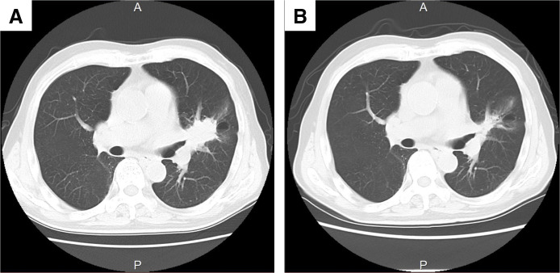
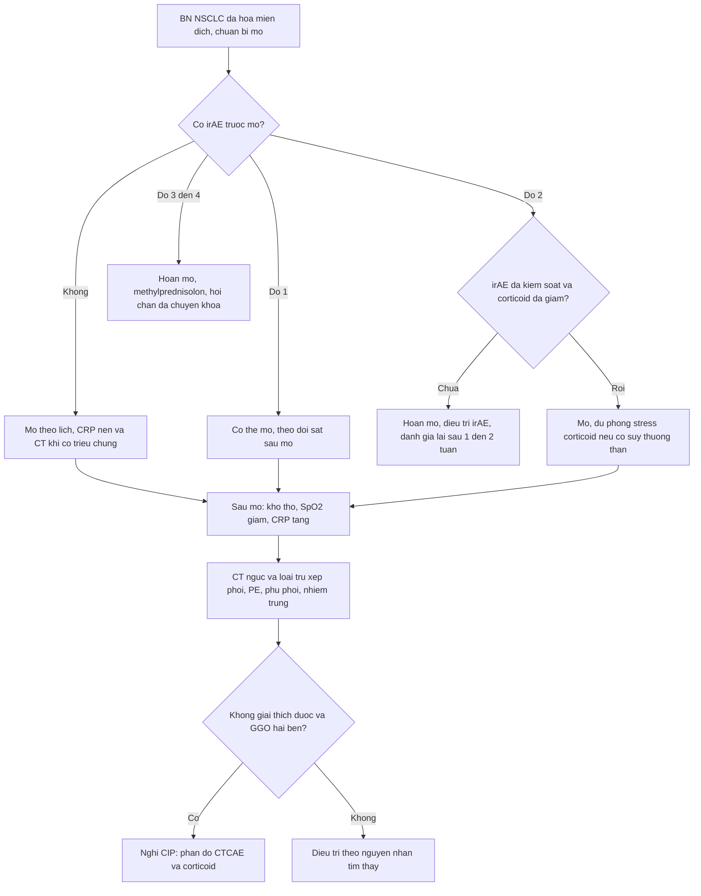
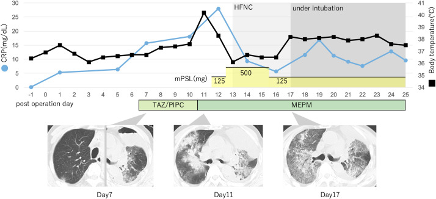
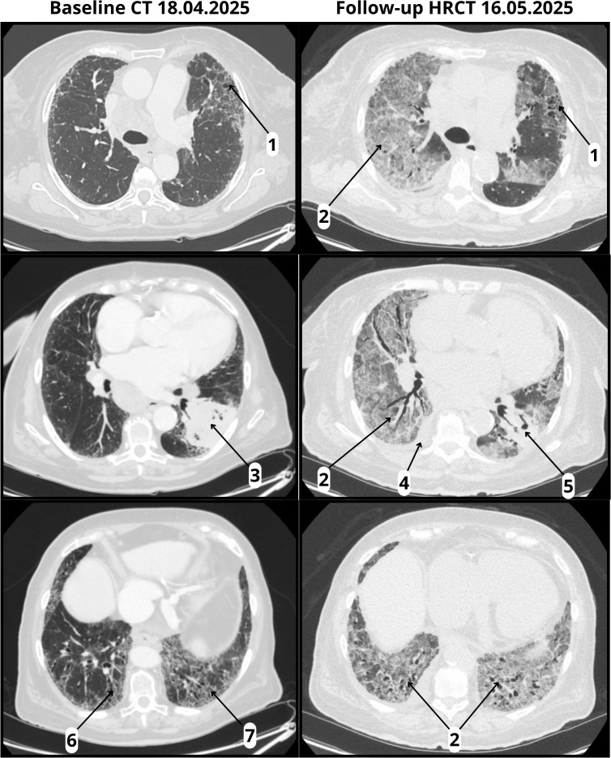

# 085 — Độc tính miễn dịch quanh mổ sau hóa–miễn dịch ung thư phổi / Perioperative immune-related toxicity after neoadjuvant chemo-immunotherapy in lung cancer

**Tags:** `pattern:vien-phoi-mien-dich` `pattern:kinh-mo` `vung:phoi` `protocol:CT-nguc` `score:CTCAE` `score:Clavien-Dindo`
**Mức chắc chắn (certainty):** tổng hợp y văn (literature synthesis) — 1 cohort đa trung tâm 130 bệnh nhân (Watanabe et al., *JTO Clin Res Rep* 2026, PMC12767704), 1 nghiên cứu thực tế 3211 bệnh nhân (Naidoo et al., *Oncologist* 2025, PMC12395253), 1 tổng quan scoping về chăm sóc quanh mổ (Codru & Vecerzan, *Cancers* 2026, PMC13510335), 2 ca nguyên văn dùng làm hình (PMC13044796, PMC12623183). Liều corticoid lấy từ **khuyến cáo ASCO 2021** (ghi rõ nguồn khuyến cáo, không phải số liệu cohort); chỗ chưa kiểm chứng ghi **"chưa rõ"**.

## 1. Tổng quan bệnh học – cơ chế hình ảnh

- **Vì sao hóa–miễn dịch tân bổ trợ tạo ra một "cửa sổ nguy hiểm" quanh mổ:** kháng thể ức chế PD-1/PD-L1 **gỡ bỏ dung nạp ngoại vi** → tế bào T tấn công mô lành: phổi (viêm phổi miễn dịch), tuyến giáp, thượng thận/tuyến yên, gan, ruột, cơ tim. Trong khi đó **cuộc mổ lồng ngực** thêm ba yếu tố: **thông khí một phổi**, **xẹp phổi**, và **cơn bão cytokine do phẫu thuật** — một phổi đang có viêm dưới lâm sàng có thể chuyển thành **ARDS** sau mổ.
- **TẠI SAO hình ảnh là GGO (ground-glass opacity):** viêm miễn dịch gây **dày vách phế nang + dịch viêm trong khoang phế nang một phần**. Trên CT, vùng phổi vẫn **nhìn thấy mạch máu xuyên qua** = **GGO**; khi dịch lấp kín phế nang thì **mất mạch** = **đông đặc (consolidation)**. Đây là lý do **cùng một bệnh** có thể từ GGO khu trú → GGO lan tỏa → đông đặc + phế quản phế nang dãn (ARDS) tùy mức độ tổn thương.
- **Ngưỡng định lượng phải nhớ (cửa 1 của Argon):**
  - **irAE trước mổ 18,5% (24/130)** ở bệnh nhân NSCLC giai đoạn IIA–IIIB dùng **nivolumab + hóa trị platinum** (Watanabe et al. 2026, 29 trung tâm Nhật Bản). Nhóm có irAE: **hoàn thành đủ chu kỳ 58,3% vs 92,5%** (p < 0,05), **chỉ 78,3% (18/24) được mổ**, **R0 94,4%**.
  - **Đáp ứng mô bệnh thấp hơn khi có irAE trước mổ:** **MPR 38,9% vs 63,1%**, **pCR 27,8% vs 36,8%**. Biến chứng sau mổ và thời gian nằm viện **không khác biệt** giữa hai nhóm.
  - **Khoảng cách từ đợt cuối tới mổ:** **66,5 ngày (42–140)** ở nhóm có irAE vs **55 ngày (29–64)** ở nhóm không có — khác biệt không có ý nghĩa thống kê, nhưng cho thấy irAE **thường đẩy lùi lịch mổ**.
  - **Yếu tố dự báo irAE trước mổ (phân tích thăm dò):** u **> 3,8 cm** → **OR 2,54 (1,02–6,33), p = 0,046**; **bạch cầu ái toan ≥ 2,0%** cũng được xác định là yếu tố dự báo.
  - **irAE nặng ở NSCLC tiến xa** (3211 bệnh nhân, Naidoo et al. 2025): **8,6%** có irAE nặng; hay gặp **tiêu chảy 3,5%**, **viêm phổi 1,4%**, **phát ban 1,3%**; **57,4%** phải nhập viện; **71,8%** được dùng corticoid. Khi irAE nặng **được xử trí đầu tiên bằng corticoid/ức chế miễn dịch**, nguy cơ tử vong **tăng 53% (22,3–91,4%)** so với nhóm không có irAE nặng; nếu **phải nhập viện/cấp cứu** thì **tăng 61% (37,9–87,9%)** — đây là **kết hợp, không phải nhân quả**.
  - **Ca tử vong sau mổ (PMC13044796):** nam 84 tuổi, 3 chu kỳ **nivolumab + carboplatin + paclitaxel**, cắt thùy trên trái + vét hạch trung thất. Hậu phẫu ban đầu bình thường; **ngày hậu phẫu 7 (POD 7)** xuất hiện **CRP 15,73 mg/dL** + **GGO hai bên** trên CT; dù dùng corticoid + kháng sinh, bệnh nhân **tử vong POD 25**, mô bệnh học **tổn thương phế nang lan tỏa (DAD)**.
  - **Ca tử vong do CIP khởi phát sớm (PMC12623183):** bệnh nhân có **xơ phổi UIP** nền, sau **1 liều pembrolizumab** xuất hiện **HRCT 22 ngày sau truyền**: **GGO lan tỏa hai bên + tràn dịch màng phổi + dịch màng tim** trên nền **honeycombing** — hình ảnh **AIP/ARDS**; tử vong dù đã dùng corticoid liều cao + mycophenolate + infliximab.
- **Vì sao "đáp ứng trên CT" không đồng nghĩa "hết u":** CT đo **kích thước**, không đo **tế bào sống**. Sau hóa–miễn dịch, u có thể teo do **xơ hóa/hoại tử** mà vẫn còn **u sống vi thể** — vì vậy **pCR chỉ xác định bằng mô bệnh học sau mổ**; ngược lại u còn đậm độ trên CT có thể chỉ là **xơ viêm**.

## 2. Mẫu hình + chẩn đoán phân biệt theo vị trí (gamut)

**Câu hỏi thực hành:** bệnh nhân **đã hóa–miễn dịch, vừa mổ phổi, nay khó thở / sốt / SpO₂ giảm** — đó là **CIP**, **viêm phổi vi khuẩn**, **xẹp phổi**, **phù phổi**, **thuyên tắc phổi**, **hít sặc**, hay **rò phế quản – màng phổi**?

- **Theo thời điểm:**
  1. **Trước mổ (trong chu kỳ tân bổ trợ):** viêm phổi miễn dịch, viêm tuyến giáp, suy thượng thận, viêm gan — thường **4–12 tuần** sau đợt truyền (khoảng thời gian điển hình của irAE; **chưa rõ** phân bố chính xác theo tuần cho riêng nhóm tân bổ trợ).
  2. **POD 0–3:** **xẹp phổi**, **viêm phổi hít**, **phù phổi cấp**, **thuyên tắc phổi**, **TRALI**, đau do vết mổ.
  3. **POD 3–10:** **CIP khởi phát**, **ARDS**, **viêm phổi bệnh viện** (xem [084](../084-viem-phoi-tho-may/lesson.md)).
  4. **POD 10–30:** CIP tiến triển, **rò phế quản – màng phổi**, **mủ màng phổi**, hẹp miệng nối phế quản.
- **Theo mô hình trên CT:**
  - **OP (organizing pneumonia):** đám GGO/đông đặc **vách hoặc dưới màng phổi**, có thể di chuyển — thể hay gặp nhất của CIP.
  - **NSIP:** GGO + **dày vách liên tiểu thùy** đối xứng hai đáy phổi.
  - **HP (hypersensitivity pneumonitis):** GGO lan tỏa + **nốt trung tâm tiểu thùy** + bắt khí.
  - **AIP/ARDS:** **GGO lan tỏa + đông đặc + phế quản phế nang dãn**, có thể kèm tràn dịch — **tiên lượng xấu nhất** (ca PMC12623183).
- **Theo cơ quan (nhớ "PHỔI – GIÁP – THƯỢNG THẬN – GAN – RUỘT – TIM"):** phổi; tuyến giáp (suy giáp/biến đổi TSH); thượng thận – tuyến yên (suy thượng thận, hạ Na⁺); gan (tăng transaminase); ruột (tiêu chảy/viêm đại tràng); **tim (viêm cơ tim — hiếm nhưng chết người, có thể biểu hiện loạn nhịp/tụt HA sau mổ)**.

## 3. Bảng so sánh phân biệt (ma trận đối chiếu)

| Thực thể (entity) | Hình ảnh điển hình | Chốt vào (rule-in) | Chốt loại (rule-out) | Gợi ý xác nhận |
|---|---|---|---|---|
| **CIP (viêm phổi miễn dịch)** | **GGO hai bên**, đối xứng hoặc vái, dưới màng phổi/đáy phổi; có thể đông đặc, dày vách; **không tôn trọng phân thùy** | **GGO hai bên mới xuất hiện sau ICI**, cấy âm, **không đáp ứng kháng sinh**, có thể kèm irAE cơ quan khác | Đông đặc một thùy + sốt cao + đờm mủ + cấy dương → viêm phổi vi khuẩn | CT ngực lát mỏng; loại trừ nhiễm (cấy, procalcitonin); **cân nhắc corticoid thử** |
| **Viêm phổi vi khuẩn sau mổ** | Đông đặc **một thùy/phân thùy**, có **phế quản hơi**, có thể mức dịch | **Sốt + đờm mủ + cấy dương + đáp ứng kháng sinh** | GGO lan tỏa hai bên không khu trú → nghĩ CIP | Cấy đờm/máu, procalcitonin, kháng sinh theo kinh nghiệm |
| **Xẹp phổi sau mổ** | **Đông đặc kèm mất thể tích**: dồn rãnh liên thùy, trung thất lệch **về phía tổn thương**, cơ hoành nâng | **Mất thể tích + trung thất lệch cùng bên** | Trung thất lệch **ra xa** → tràn dịch/tràn khí, không phải xẹp | So phim trước mổ; nghiệm pháp hít sâu; nội soi hút |
| **Phù phổi cấp tim** | GGO **hai đáy, quanh rốn**, dày vách, **tràn dịch hai bên**, tim to | **BNP tăng + đáp ứng lợi tiểu**, GGO kiểu "cánh bướm" | GGO **ngoại vi, không đối xứng rốn phổi**, BNP bình thường → nghĩ CIP | Siêu âm tim, BNP, thử lợi tiểu |
| **Thuyên tắc phổi** | **Không có GGO đặc hiệu**; có thể nhồi máu hình nêm ngoại vi; **CTPA** là chốt | **CTPA có huyết khối** + D-dimer tăng + giãn thất phải | CTPA âm → loại PE, tìm nguyên nhân khác | CTPA (không dùng X-quang/CT thường để loại PE) |
| **Viêm phổi hít** | Đông đặc **thùy dưới phải/trên phải** (thùy phụ thuộc), có thể hang | **Sặc rõ + đông đặc phân thùy phụ thuộc** | GGO lan tỏa hai bên → CIP/phù phổi | Bệnh sử nuốt, VFSS/FEES khi cần (xem [081](../081-sac-va-roi-loan-nuot/lesson.md)) |
| **Rò phế quản – màng phổi / mủ màng phổi** | **Mức khí – dịch trong khoang màng phổi**, dày màng phổi, khí trong mô mềm | **Mức khí dịch + sốt sau mổ** + khí ra ống dẫn lưu khi ho | Đông đặc phổi đơn thuần, không có mức khí | CT có cản quang, nội soi phế quản, cấy dịch màng phổi |
| **Tái phát/tiến triển u** | Khối/tổn thương **tại chỗ cũ** hoặc hạch to lại; có thể GGO quanh u (xẹp do tắc) | **So sánh với CT ngay sau mổ** + PET/CT | GGO lan tỏa hai bên **không tương ứng vùng mổ** → CIP | CT đối chiếu, PET/CT, sinh thiết khi còn chỉ định |

*CT ngực cùng bệnh nhân trước (A) và sau (B) hóa–miễn dịch: khối teo nhưng **không** có GGO lan tỏa trước mổ — đây là kiểu "đáp ứng hình ảnh tốt" mà vẫn có thể còn u sống vi thể. Nguồn: Osako T et al., Surg Case Rep 2026, PMC13044796 Fig. 1, CC BY 4.0.*

### Đọc CIP trên CT — ba câu hỏi theo thứ tự
1. **Phân bố:** hai bên? đối xứng? đáy phổi/ngoại vi? → CIP thường hai bên, nhưng **có thể một bên hoặc không đối xứng** (ca PMC13044796 ngày 7 chỉ rõ ở phổi mổ).
2. **Mô hình:** GGO thuần (sớm) → GGO + đông đặc (tiến triển) → **phế quản phế nang dãn** (ARDS, tiên lượng xấu).
3. **Nền phổi:** có **xơ/honeycombing** không? Nếu có, GGO mới trên nền xơ là **AIP/ARDS** — nguy cơ tử vong cao (ca PMC12623183).

## 4. Protocol chụp + hệ phân độ/điểm chuẩn hóa

### 4.1. Trước mổ (preoperative)
- **Khai thác irAE đầy đủ:** cơ quan, **độ CTCAE**, thuốc đã dùng, **đã về ≤ độ 1 chưa**, còn corticoid không.
- **Xét nghiệm nền:** **TSH + fT4** (tuyến giáp), **Na⁺/K⁺**, ** cortisol 8 giờ sáng** nếu mệt/tụt HA/tăng sắc tố (suy thượng thận), **AST/ALT/bilirubin**, **creatinine**.
- **Đánh giá phổi:** **spirometry + DLCO** (đặc biệt trước cắt phổi), **CT ngực lát mỏng** so với CT trước điều trị; tìm **GGO mới** trước khi gây mê.
- **Nguyên tắc thời điểm:** **tiền sử dùng ICI đơn thuần KHÔNG phải lý do hoãn mổ** — quyết định cá thể hóa (tổng quan scoping PMC13510335); nhưng **đang có viêm phổi miễn dịch hoạt động độ ≥ 2 thì hoãn mổ chương trình** cho tới khi kiểm soát. Ngưỡng "corticoid ≤ 10 mg prednisone/ngày" thường được dùng trong thực hành — **chưa có RCT xác nhận, ghi "chưa rõ"**.
- **Dự phòng suy thượng thận do stress:** nếu có suy thượng thận đã biết, **hydrocortisone liều stress** trong và sau mổ (khuyến cáo chung; liều cụ thể theo phác đồ gây mê — **chưa rõ liều tối ưu từ cohort này**).

### 4.2. Sau mổ (postoperative)
- **Theo dõi:** SpO₂, nhịp thở, **CRP nền – POD 1 – POD 3**, công thức máu; **CT ngực** khi có **khó thở mới, SpO₂ giảm, sốt không rõ nguồn, hoặc CRP tăng bất thường**.
- **Thứ tự loại trừ khi tụt oxy sau mổ:** (1) **xẹp phổi** (so phim, hút, vật lý trị liệu), (2) **thuyên tắc phổi** (CTPA), (3) **phù phổi** (BNP, siêu âm tim), (4) **nhiễm trùng** (cấy, procalcitonin), (5) **CIP** khi các nguyên nhân trên không giải thích được.
- **CIP — phân độ CTCAE v5.0 và xử trí:** độ 1 **không triệu chứng** (theo dõi, ngừng ICI nếu còn chỉ định); độ 2 **có triệu chứng, giới hạn hoạt động hàng ngày** (ngừng ICI, **prednisone 1 mg/kg/ngày**); độ 3 **giới hạn tự chăm sóc, cần oxy** (**methylprednisolone 1–2 mg/kg/ngày**, nhập viện); độ 4 **đe dọa tính mạng, cần đặt nội khí quản** (methylprednisolone liều cao + **infliximab 5 mg/kg** hoặc **mycophenolate** nếu không đáp ứng sau 48 giờ). *Liều corticoid là **khuyến cáo ASCO 2021**, không phải số liệu của cohort 130 bệnh nhân; giảm liều trong **4–6 tuần**, không ngắt đột ngột.*
- **Suy thượng thận cấp:** tụt HA **không đáp ứng vận mạch** + hạ Na⁺ → **hydrocortisone 100 mg IV** rồi duy trì, trước khi kết luận "sốc nhiễm khuẩn".
- **Viêm cơ tim miễn dịch:** loạn nhịp/troponin tăng/tụt HA sau mổ — **ECG + troponin + siêu âm tim**, hội chẩn tim mạch ngay.

## 5. Biến thể bình thường và cạm bẫy

- **Cạm bẫy 1 — "POD 7 GGO là viêm phổi bệnh viện".** Ca PMC13044796: **CRP 15,73 mg/dL**, GGO hai bên, **không đáp ứng kháng sinh**; chẩn đoán đúng là **CIP/DAD** và bệnh nhân tử vong. Dấu hiệu gợi ý: **GGO hai bên không tôn trọng phân thùy**, cấy âm, **không có đờm mủ**.
- **Cạm bẫy 2 — "không khó thở nên chưa phải CIP".** Trong ca trên, **POD 7 bệnh nhân còn không triệu chứng** nhưng CT đã có GGO và CRP tăng; chờ tới khi khó thở là **đã muộn**. Với bệnh nhân đã hóa–miễn dịch, **CRP tăng + CT mới** đủ để hội chẩn.
- **Cạm bẫy 3 — bỏ sót suy thượng thận vì "chỉ là tụt HA sau gây mê".** Hạ Na⁺, tăng sắc tố, mệt kéo dài, **tụt HA không đáp ứng vận mạch** → thử **hydrocortisone**; đừng chờ cortisol 8 giờ nếu bệnh nhân đang sốc.
- **Cạm bẫy 4 — hủy mổ chỉ vì "đã từng dùng ICI".** Tổng quan scoping: **tiền sử ICI không làm tăng tử vong sau mổ một cách nhất quán**; hủy mổ oan làm mất cơ hội phẫu thuật triệt để. Ngược lại, **mổ khi đang viêm phổi hoạt động** là sai sót nguy hiểm — phân biệt "tiền sử" với "đang hoạt động".
- **Cạm bẫy 5 — giảm corticoid quá nhanh.** Bệnh nhân đáp ứng rồi tái phát sau khi giảm liều; cần **giảm chậm 4–6 tuần** và theo dõi CT/SpO₂ trong suốt thời gian giảm.
- **Cạm bẫy 6 — quy kết mọi GGO sau mổ cho CIP.** **Xẹp phổi, phù phổi, hít sặc, nhiễm trùng** đều phổ biến hơn CIP; điều trị CIP khi đang có nhiễm trùng sẽ **che lấp nhiễm trùng**. Luôn loại trừ theo thứ tự ở mục 4.2.

## 6. Tự lượng giá — Blind Quiz

**Ca 1 — Nam 84 tuổi, cắt thùy trên trái sau 3 chu kỳ hóa–miễn dịch**

- Bối cảnh: ung thư biểu mô vảy phổi trái giai đoạn IIB; 3 chu kỳ **nivolumab + carboplatin + paclitaxel**; cắt thùy trên trái + vét hạch. Hậu phẫu ban đầu bình thường.
- Câu hỏi: Đọc ba ảnh CT ở **ngày 7, 11, 17**: mô hình tổn thương thay đổi thế nào? Chẩn đoán? Vì sao kháng sinh không cải thiện?

<b>Bấm để hiện đáp án (findings + chẩn đoán)</b>

- **Ngày 7:** GGO/đông đặc **khu trú phổi trái (bên mổ)**, CRP **15,73 mg/dL**, bệnh nhân **chưa khó thở**.
- **Ngày 11:** tổn thương **lan hai bên**, đông đặc tăng, cần **HFNC**.
- **Ngày 17:** **ARDS** — GGO lan tỏa + đông đặc + phế quản phế nang dãn, phải **đặt nội khí quản**; tử vong **POD 25**.
- **Chẩn đoán:** **viêm phổi miễn dịch (CIP) tiến triển thành DAD/ARDS** sau hóa–miễn dịch; mô bệnh **DAD**.
- **Vì sao kháng sinh không cải thiện:** tổn thương do **tế bào T**, không phải vi khuẩn — cần **corticoid liều cao** (ca này dùng methylprednisolone 125 → 500 → 125 mg) ± ức chế miễn dịch; kháng sinh chỉ để **dự phòng/điều trị bội nhiễm**.
- **Phản biện:** ca tử vong **dù đã dùng corticoid liều cao** — CIP nặng có thể không hồi phục; bài học là **nhận diện sớm ở giai đoạn GGO còn khu trú**.
- Nguồn: Osako T et al., *Surg Case Rep* 2026, PMC13044796, Fig. 2, CC BY 4.0.

**Ca 2 — Bệnh nhân xơ phổi nền, 22 ngày sau 1 liều pembrolizumab**

- Bối cảnh: bệnh nhân ung thư phổi có **xơ phổi UIP/honeycombing** nền; sau **1 liều pembrolizumab** xuất hiện khó thở tăng nhanh.
- Câu hỏi: So sánh hai cột ảnh. Mô hình tổn thương mới là gì? Vì sao tiên lượng khác CIP trên phổi lành?

<b>Bấm để hiện đáp án (findings + chẩn đoán)</b>

- **Trái (18/04/2025):** honeycombing dưới màng phổi hai đáy, không có GGO lan tỏa — **UIP nền**.
- **Phải (16/05/2025, 22 ngày sau truyền):** **GGO lan tỏa hai bên + đông đặc + tràn dịch màng phổi + dịch màng tim** trên nền xơ — mô hình **AIP/ARDS**.
- **Chẩn đoán:** **CIP khởi phát sớm trên nền xơ phổi** — tổn thương phổi lành còn lại rất ít nên **dự trữ hô hấp thấp**, diễn tiến nhanh tới tử vong dù đã dùng corticoid + mycophenolate + infliximab.
- **Ý nghĩa thực hành:** trước khi dùng ICI ở bệnh nhân có xơ phổi, cần **đo DLCO, đánh giá CT nền**, và cảnh báo nguy cơ; khi có GGO mới, **ngừng ICI ngay** và điều trị sớm.
- Nguồn: Keller DM et al., *Front Oncol* 2025, PMC12623183, Fig. 1, CC BY 4.0.

**Ca 3 — Cùng bệnh nhân Ca 1, CT trước và sau 3 chu kỳ**

- Bối cảnh: CT ở thời điểm chẩn đoán (A) và sau 3 chu kỳ (B), trước khi mổ.
- Câu hỏi: Mô tả thay đổi ở phổi trái. Có thể kết luận **pCR** trên CT không? Vì sao vẫn phải mổ?

<b>Bấm để hiện đáp án (findings + chẩn đoán)</b>

- **(A)** Khối lớn thùy trên trái gây **xẹp/phổi mất thông khí** phía sau; **(B)** khối **teo rõ**, phổi thông khí lại một phần — đáp ứng hình ảnh tốt.
- **Không thể kết luận pCR trên CT:** CT chỉ đo kích thước/đậm độ; **pCR cần 0% tế bào u sống ở cả u và hạch** trên mô bệnh học. Trong cohort 130 bệnh nhân, **pCR 27,8–36,8%** và **MPR 38,9–63,1%** — nghĩa là **một tỷ lệ đáng kể không đạt pCR dù hình ảnh đẹp**.
- **Vẫn phải mổ** vì phẫu thuật là **chuẩn điều trị triệt để** cho NSCLC giai đoạn mổ được sau hóa–miễn dịch; CT chỉ giúp **loại trừ tiến triển** và **phát hiện CIP trước mổ**.
- Nguồn: Osako T et al., *Surg Case Rep* 2026, PMC13044796, Fig. 1, CC BY 4.0.

## Bài liên quan chéo
- [046 – Tái phân giai đoạn trung thất sau hóa–miễn dịch & bệnh hạch tồn dư](../046-tai-phan-giai-doan-trung-that-sau-hoa-mien-dich/lesson.md)
- [044 – Cryobiopsy trung thất qua EBUS: lấy mô lớn khi TBNA không đủ](../044-cryobiopsy-trung-that-EBUS/lesson.md)
- [084 – Viêm phổi thở máy (VAP) & dự phòng vi hít sặc](../084-viem-phoi-tho-may/lesson.md)
- [033 – Phù phổi & ARDS](../033-phu-phoi-ards/lesson.md)
- [031 – Viêm phổi mẫu hình](../031-viem-phoi-mau-hinh/lesson.md)
- [043 – Chăm sóc hô hấp quanh mổ](../043-cham-soc-ho-hap-quanh-mo-tis-eos/lesson.md)

## Ảnh
- `085_truoc-sau-hoa-miendich_CT_PMC13044796-Fig1-CCBY.jpg`, `085_dien-tien-sau-mo_BD_PMC13044796-Fig2-CCBY.jpg` — PMC13044796, CC BY 4.0.
- `085_CIP-AIP_HRCT_PMC12623183-Fig1-CCBY.jpg` — PMC12623183, CC BY 4.0.
- Nguồn + giấy phép từng ảnh: `images/CREDITS.md`.

> Không dùng để chẩn đoán độc lập khi chưa có người hướng dẫn.
