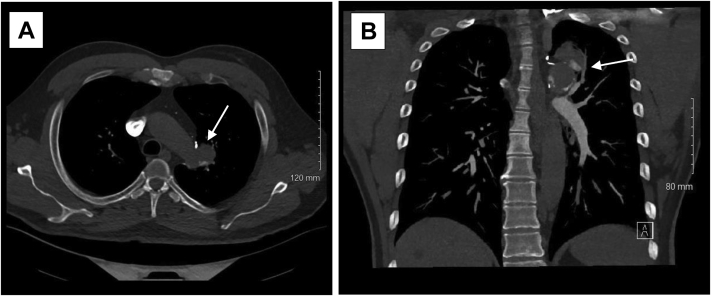
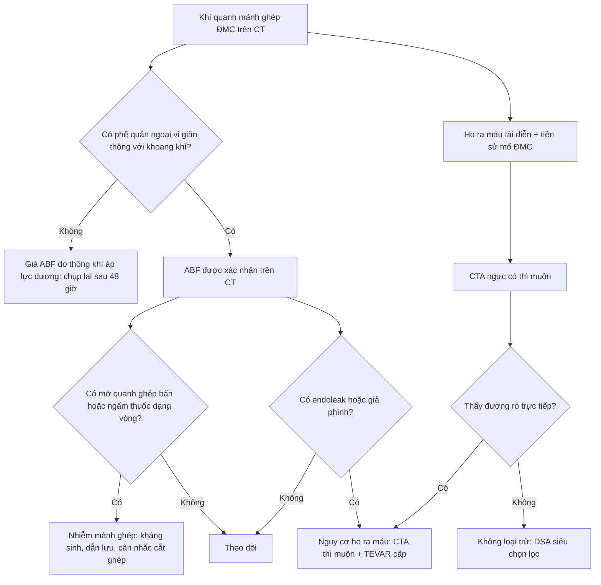
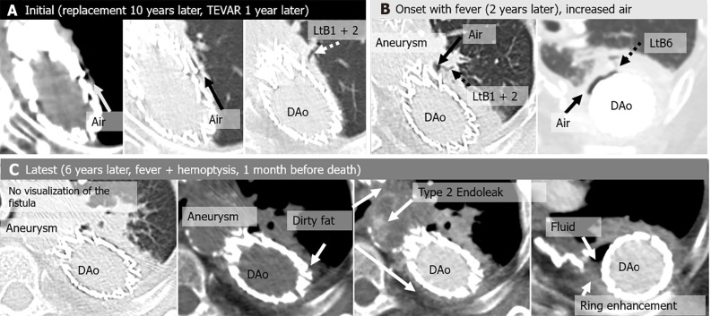

# 086 — Rò động mạch chủ – phế quản: ho ra máu "báo trước" và CTA / Aortobronchial fistula (ABF)

**Tags:** `pattern:ro-mach-phe-quan` `pattern:ho-ra-mau` `pattern:phinh-gia-dong-mach-chu` `pattern:khi-quanh-manh-ghep` `vung:trung-that` `vung:phoi` `protocol:CTA-nguc` `protocol:DSA` `protocol:noi-soi-phe-quan` `incidentaloma:khong`
**Mức chắc chắn (certainty):** tổng hợp y văn (literature synthesis) — số liệu từ 2 bài mở (PMC11372552, PMC12582977) + 1 ca minh họa CC BY-NC-ND; không có ca nguyên văn của nhóm.

## 1. Tổng quan bệnh học – cơ chế hình ảnh

- **Bệnh học:** một **đường rò (fistula)** hình thành giữa **động mạch chủ ngực** và **phế quản** (thường là phế quản gốc trái hoặc phế quản thùy dưới trái, vì ĐMC xuống nằm sát bờ trái trung thất). Cơ chế là **ăn mòn mạn tính**: túi phình/giả phình, mảnh ghép nhân tạo hoặc stent-graft, ổ nhiễm (phình nhiễm khuẩn, lao), u xâm lấn → viêm dính → hoại tử thành ĐMC và thành phế quản → thủng.
- **Tần suất (số đã công bố):** sau mổ ĐMC ngực **0,3–5,0%**; sau mổ mở ĐMC xuống/ngực–bụng vì phình **8/145 = 5,6%**; sau **TEVAR 0,4–0,6%**. Thời gian xuất hiện **rất muộn**: từ **3 tuần đến 25 năm**, một loạt 6 ca có trung vị **13 năm** (khoảng 1–26 năm).
- **TẠI SAO ho ra máu lại từng cơn (intermittent)?** Cửa rò nhỏ, áp lực ĐMC cao → máu phun vào lòng phế quản, nhưng **cục máu đông bít lỗ rò** làm cầm máu tạm; khi cục đông tan/bong → **ho ra máu lại**, mỗi lần thường nặng hơn. **Ho ra máu từng cơn gặp ở ~95% bệnh nhân**; khi cục đông bung ra hoàn toàn, máu ồ ạt vào đường thở → **tử vong gần 100% nếu không can thiệp** (điều trị bảo tồn có tử vong trong viện **~50%**).
- **TẠI SAO CTA có thể ÂM TÍNH?** Đường rò bị **máu đông hoặc mủ lấp** đúng lúc chụp, nên thuốc cản quang không đi qua được. Trong một loạt 6 ca, CTA thấy **trực tiếp đường rò ở 50% số lần chụp**, nhưng ở nhóm **có triệu chứng** chỉ còn **29%**. Kết luận: **CTA âm không loại trừ ABF** — quyết định dựa trên bối cảnh + dấu hiệu gián tiếp.
- **TẠI SAO khí quanh mảnh ghép (peri-graft air) là dấu hiệu trung tâm?** Khí trong khoang quanh mảnh ghép/stent sau nhiều năm **không phải "khí hậu phẫu bình thường"** — nó chỉ có thể đến từ **đường thở** (rò) hoặc từ **vi khuẩn sinh hơi** (nhiễm mảnh ghép). Vì vậy khí quanh mảnh ghép muộn = **phải tìm cả rò và nhiễm**.

## 2. Mẫu hình + chẩn đoán phân biệt theo vị trí (Gamut)

- **Theo bối cảnh (etiology) — quyết định cách đọc phim:**
  - **Sau mổ ĐMC/TEVAR** (muộn, nhiều năm): rò do mảnh ghép ăn mòn phế quản ± **nhiễm mảnh ghép**.
  - **Phình nhiễm khuẩn ĐMC** (salmonella, lao, giang mai): sốt + đau ngực + ho ra máu, có thể rò **trước cả khi mổ**.
  - **Loét xuyên thành/phình xơ vữa**, **sau sửa hẹp eo ĐMC**, **u thực quản–phổi xâm lấn**, **dị vật (coil) di trú**.
- **Theo vị trí giải phẫu:** hay gặp **ĐMC xuống + phế quản gốc/thùy dưới trái**; cũng có ở quai ĐMC → phế quản gốc trái, hoặc ĐMC lên (hiếm).
- **Gamut "khối cạnh ĐMC + ho ra máu" (bắt buộc phân biệt):**
  1. **Rò ĐMC–phế quản** (bài này).
  2. **Rò ĐMC–thực quản** — nuốt khó, ho ra máu ít hơn, hình ảnh giả phình/loét sát thực quản.
  3. **Giả phình Rasmussen** trong hang lao — nguồn từ **động mạch phổi**, có hang lao.
  4. **Phình/giả phình động mạch phế quản** — nguồn từ tuần hoàn phế quản, thường kèm giãn phế quản.
  5. **Giả phình động mạch phổi (Hughes–Stovin)** — huyết khối trong túi phình, bệnh cảnh viêm.
  6. **U phổi xâm lấn ĐMC** — khối mô mềm lớn, bờ không đều, không có khí quanh mảnh ghép.

## 3. Bảng so sánh phân biệt (ma trận đối chiếu)

| Thực thể (entity) | Hình ảnh điển hình | Chốt vào (rule-in) | Chốt loại (rule-out) | Gợi ý xác nhận |
|---|---|---|---|---|
| **Rò ĐMC–phế quản (ABF)** | **Khí quanh mảnh ghép/ĐMC** + **phế quản ngoại vi giãn dính vào khoang khí** + xẹp phổi quanh; giả phình/endoleak sát phế quản | **Khí quanh mảnh ghép muộn + phế quản giãn thông với khoang khí** (gặp **6/6 = 100%** ca trong loạt) | Không có giãn phế quản cạnh ổ khí → nghĩ **giả ABF do thông khí áp lực dương** | CTA có thì muộn + DSA siêu chọn lọc; nội soi phế quản **khi đã sẵn sàng can thiệp** |
| **Rò ĐMC–thực quản** | Khí/truyền thuốc giữa ĐMC và **thực quản**, giả phình sát thực quản | **Nuốt khó + nôn ra máu** + khí quanh thực quản | Phế quản giãn thông khoang khí → ABF | Nội soi thực quản có chuẩn bị mổ |
| **Giả phình Rasmussen (lao)** | Hang lao thành mỏng + **túi phình nhỏ trong/thành hang**, nguồn **động mạch phổi** | **Hang lao cũ + máu trong hang** + nguồn mạch phổi trên CTA | Khí quanh mảnh ghép ĐMC → ABF | CTA; nút mạch động mạch phổi |
| **Phình động mạch phế quản** | Nốt/túi mạch trong rốn phổi, **động mạch phế quản giãn > 2 mm** | **Giãn phế quản + mạch phế quản phì đại** | Có mảnh ghép ĐMC + khí quanh ghép → ABF | CTA, nút mạch |
| **Giả phình động mạch phổi (Hughes–Stovin)** | Túi phình ĐMP, **huyết khối trong thành**, thường nhiều ổ | **Bệnh cảnh viêm/huyết khối + phình ĐMP nhiều ổ** | Không liên quan ĐMC | CTA/CTPA |
| **Giả ABF do thông khí áp lực dương** | Khí quanh mảnh ghép **mới xuất hiện trong vài ngày**, **KHÔNG có phế quản giãn** | **Khí biến mất sau 2 ngày, không tái diễn nhiều năm** | Có phế quản giãn thông với khí → ABF thật | Chụp lại sau 48 giờ |

*CT ngực (A: mặt phẳng ngang, B: mặt phẳng vành): khối không đều sát quai ĐMC, có **thuốc cản quang trong khối** (mũi tên) — giả phình/đường rò vào phế quản. Nguồn: *J Vasc Surg Cases Innov Tech* 2022 (PMC9678969), CC BY-NC-ND 4.0, nguyên bản.*

### Đọc CTA theo 4 câu hỏi (thay vì tìm "đường rò")

1. **Có khí quanh mảnh ghép/ĐMC không?** (muộn sau mổ = bất thường).
2. **Có phế quản ngoại vi giãn nằm trong vùng xẹp phổi quanh mảnh ghép, thông với khoang khí?** — dấu hiệu **100%** trong loạt 6 ca, và là điểm phân biệt với giả ABF.
3. **Có giả phình/endoleak?** — gắn với **ho ra máu** (2/2 ca ho ra máu có endoleak/pseudoaneurysm).
4. **Có dấu nhiễm mảnh ghép?** — **mỡ quanh ghép "bẩn" (dirty fat) 4/4 = 100%** và **ngấm thuốc dạng vòng (ring enhancement) 3/3 = 100%** ở ca nhiễm.

## 4. Protocol chụp + hệ phân độ/điểm

- **CTA ngực là bước 1** (không phải X-quang): lát **0,5–1,25 mm**, bơm **100 mL** thuốc cản quang nồng độ **370 mgI/mL** với tốc độ **5 mL/giây**, bắt đỉnh (bolus tracking) ở ĐMC xuống ngang **Th7, ngưỡng 250 HU**, cộng **thì muộn 70 giây** (cần cho endoleak và ngấm thành mạch). Tái tạo MPR + MIP theo trục mạch.
- **Nhìn cả 4 vùng** dù triệu chứng khu trú: quai ĐMC – ĐMC xuống – rốn phổi trái – nhu mô phổi quanh mảnh ghép (xẹp phổi + giãn phế quản là dấu hiệu chỉ điểm).
- **DSA** là chuẩn vàng *về mặt chứng minh dòng chảy*: thuốc từ ĐMC **hiện đồng thời vào phế quản**. Nhưng **cục đông có thể làm DSA âm** → nếu nghi cao phải **siêu chọn lọc** và **giữ catheter tại chỗ**, không rút ra rồi chụp lại.
- **Nội soi phế quản:** thấy máu/clot hoặc đầu của stent-graft lồi vào lòng phế quản, nhưng có **nguy cơ bong cục đông → chảy máu ồ ạt**; chỉ làm khi **phòng mổ/can thiệp đã sẵn sàng**.
- **Điều trị:** **TEVAR** là lựa chọn đầu tay để bịt rò (cầu nối hoặc triệt để), sau đó xử lý nhiễm (kháng sinh dài, cắt mảnh ghép nếu nhiễm). Số liệu tổng hợp TEVAR cho ABF (Canaud, **134 bệnh nhân**): **thành công kỹ thuật 93,2%**, **tử vong 30 ngày 5,9%**, **tử vong do nguyên nhân ĐMC 14,3%** sau theo dõi trung bình **17,4 tháng**.

## 5. Biến thể bình thường và cạm bẫy

- **Khí quanh mảnh ghép ngay sau mổ (vài ngày đầu)** là bình thường và tự hết; chỉ khí **mới xuất hiện muộn** mới có nghĩa.
- **Cạm bẫy 1 — CTA/DSA âm:** cục đông bít lỗ rò; **ho ra máu từng cơn + tiền sử mổ ĐMC** là chỉ định chụp lại/siêu chọn lọc, không phải "loại trừ".
- **Cạm bẫy 2 — nội soi phế quản làm bùng phát chảy máu:** bong cục đông = mất "nắp" cầm máu; luôn chuẩn bị can thiệp trước.
- **Cạm bẫy 3 — gọi là "viêm phổi quanh mảnh ghép":** xẹp phổi + giãn phế quản quanh mảnh ghép là **dấu hiệu chỉ điểm của ABF**, không phải viêm phổi thông thường; điều trị kháng sinh đơn thuần sẽ bỏ lỡ cửa sổ cứu.
- **Cạm bẫy 4 — thoả mãn tìm kiếm:** thấy giả phình là dừng, không tìm **nhiễm mảnh ghép** (mỡ bẩn, ngấm vòng) — nhiễm là yếu tố tiên lượng xấu nhất và đổi hoàn toàn kế hoạch (cắt mảnh ghép, kháng sinh dài).
- **Cạm bẫy 5 — nhầm nguồn chảy máu:** ho ra máu ở bệnh nhân có giãn phế quản có thể từ **động mạch phế quản** (bài 091) — nút mạch phế quản sẽ không cầm được rò từ ĐMC.

## 6. Tự lượng giá — Blind Quiz

**Ca 1 — Nam 60–70 tuổi, ho ra máu tái diễn, tiền sử mổ ĐMC ngực nhiều năm trước.**

- Câu hỏi: (1) Mô tả tổn thương và vị trí so với quai ĐMC. (2) Ba chẩn đoán phân biệt? (3) Vì sao không được chỉ dựa vào nội soi phế quản để chẩn đoán?

<b>Bấm để hiện đáp án (findings + chẩn đoán)</b>

- **Dấu hiệu:** khối không đều **sát quai/ĐMC xuống**, **có thuốc cản quang bên trong** (mũi tên) → giả phình thông với ĐMC; bối cảnh mổ ĐMC cũ + ho ra máu tái diễn.
- **Chẩn đoán:** **rò động mạch chủ – phế quản (ABF)**.
- **Phân biệt:** rò ĐMC–thực quản; giả phình Rasmussen (nguồn ĐMP, có hang lao); phình động mạch phế quản (giãn phế quản + mạch phế quản lớn); u phổi xâm lấn ĐMC.
- **Vì sao không chỉ nội soi:** nội soi có thể **bong cục đông** gây chảy máu ồ ạt, và không đánh giá được tình trạng mảnh ghép/giả phình — cần **CTA ± DSA**, can thiệp sẵn sàng.
- **Nguồn ảnh:** *J Vasc Surg Cases Innov Tech* 2022 (PMC9678969), CC BY-NC-ND 4.0.

**Ca 2 — Bệnh nhân sau TEVAR, khí quanh stent-graft xuất hiện muộn; 2 năm sau sốt và ho ra máu.**

- Câu hỏi: (1) Dấu hiệu nào trên ảnh chứng minh rò? (2) Dấu hiệu nào nói **nhiễm mảnh ghép**? (3) Vì sao phải chụp **thì muộn**?

<b>Bấm để hiện đáp án (findings + chẩn đoán)</b>

- **Chứng minh rò:** **khí trong khoang quanh mảnh ghép** + **phế quản ngoại vi giãn (LTB1+2, LTB6) thông trực tiếp với khoang khí** — dấu hiệu có ở **6/6 ca** trong loạt này.
- **Nhiễm mảnh ghép:** **mỡ quanh ghép "bẩn" (dirty fat)** và **ngấm thuốc dạng vòng (ring enhancement)** quanh mảnh ghép, kèm **dịch quanh ghép** — gặp **100%** ở nhóm nhiễm.
- **Thì muộn:** để thấy **endoleak type 2** và **giả phình** — hai dấu hiệu gắn với **ho ra máu**; trên ảnh lần cuối còn thấy endoleak và ngấm vòng.
- **Nguồn ảnh:** *World J Radiol* 2024 (PMC11372552), CC BY-NC 4.0, nguyên bản.

## Bài liên quan chéo
- [091 – Ho ra máu ồ ạt & nút mạch động mạch phế quản](../091-ho-ra-mau-oat-nut-mach-dong-mach-phe-quan/lesson.md)
- [094 – Giả phình Rasmussen & nút mạch động mạch phổi](../094-phinh-gia-rasmussen-nut-mach-dong-mach-phoi/lesson.md)
- [096 – Phình động mạch phổi & hội chứng Hughes–Stovin](../096-phinh-dong-mach-phoi-that-hughes-stovin/lesson.md)
- [097 – Phình động mạch phế quản & phình ĐMC ngực](../097-phinh-dong-mach-phe-quan-baa/lesson.md)
- [171 – Bóc tách động mạch chủ bụng & IMH](../171-boc-tach-dong-mach-chu-bung-va-IMH/lesson.md)

> Không dùng để chẩn đoán độc lập khi chưa có người hướng dẫn.
