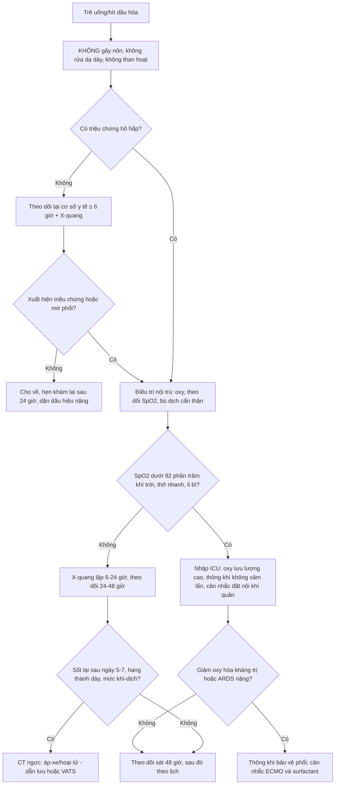
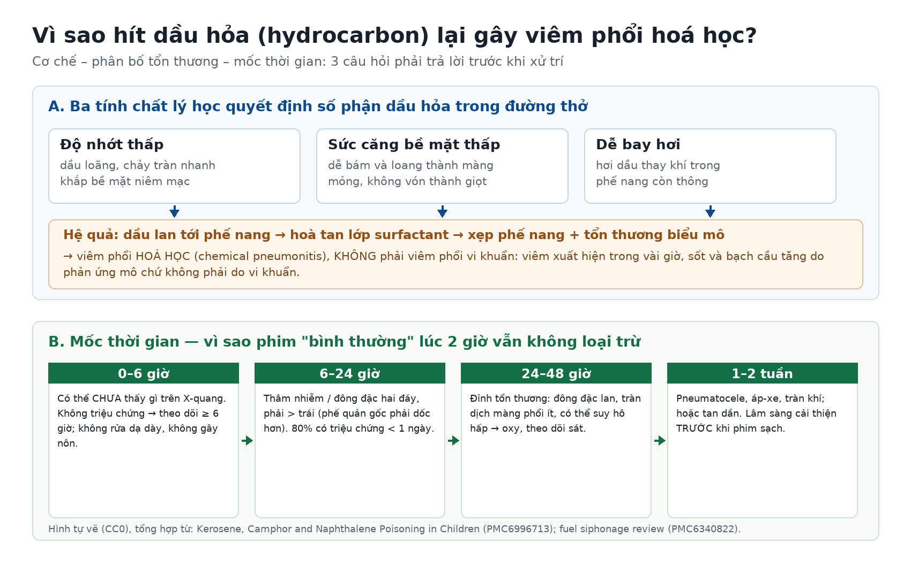
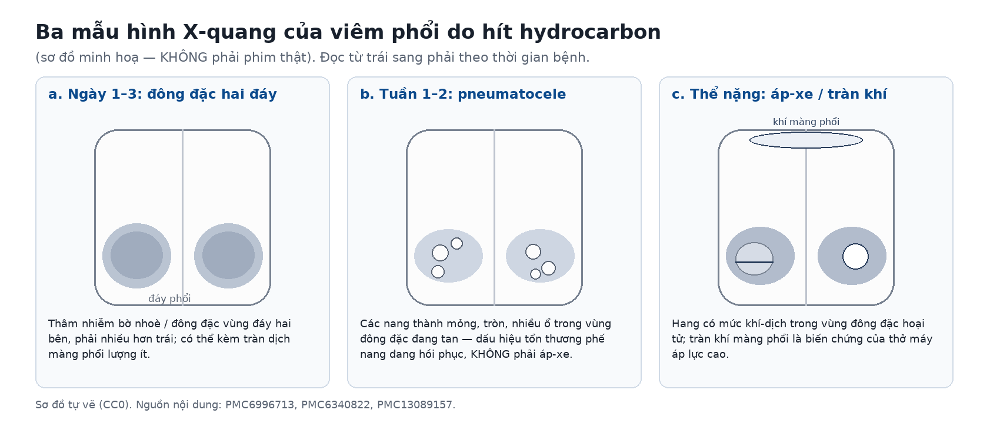

# 087 — Viêm phổi do hít dầu hỏa / hydrocarbon ở trẻ: cơ chế hoá học, mốc thời gian trên phim & ba việc KHÔNG được làm / Hydrocarbon pneumonitis

**Tags:** `pattern:dong-dac` `pattern:thamnhiem` `vung:phoi` `protocol:X-quang-som` `protocol:CT-nguc` `incidentaloma:khong`
**Mức chắc chắn (certainty):** tổng hợp y văn (literature synthesis) — loạt 313 trẻ ngộ độc dầu hỏa ở Sri Lanka (*Int J Pediatr* 2017, PMC5733930), tổng quan xử trí ngộ độc kerosene/camphor/naphthalene ở trẻ (*Indian J Crit Care Med* 2019, PMC6996713), phân tích gộp 40 ca hít hydrocarbon do hút xăng dầu (*World J Emerg Med* 2019, PMC6340822), ba ca nguyên văn (PMC10943606, PMC13089157, PMC13033276). Số nào nguồn không đưa thì ghi "chưa rõ".

> **Ba câu hỏi của bài:** (1) **Vì sao chỉ một ngụm dầu hỏa đã gây đông đặc hai phổi — và vì sao đó là viêm phổi HOÁ HỌC chứ không phải viêm phổi vi khuẩn?** (2) **Phim chụp lúc 2 giờ bình thường thì đã loại trừ được chưa?** (3) **Việc gì phải tránh tuyệt đối, và khi nào cần CT / hồi sức / ngoại khoa?**
> Khác với viêm phổi hít sặc thức ăn – dịch dạ dày ở [081](../081-sac-va-roi-loan-nuot/lesson.md): ở đây **tác nhân là dung môi**, tổn thương xuất hiện **trong vài giờ**, và **không có vi khuẩn** trong phần lớn ca.

## 1. Tổng quan bệnh học – cơ chế hình ảnh

### 1.1 Bốn tính chất lý học quyết định tổn thương (TẠI SAO)

- **Độ nhớt thấp:** dầu hỏa loãng nên **chảy tràn** nhanh trên niêm mạc thay vì vón lại thành khối dễ ho ra — chỉ cần **một lượng rất nhỏ** đã đủ phủ một diện tích lớn. Đây là lý do **thể tích hít không tương quan với mức độ nặng**, và cũng là lý do **gây nôn là hành vi nguy hiểm nhất** (xem mục 4).
- **Sức căng bề mặt thấp:** chất lỏng **bám và loang thành màng mỏng**, men theo đường thở nhỏ tới tận phế nang — khác dịch dạ dày (nhớt, dễ bị phản xạ ho đẩy ra).
- **Dễ bay hơi:** hơi dung môi **thay chỗ khí** trong phế nang còn thông, gây **giảm thể tích khí hữu ích** tại vùng đó.
- **Tính tan trong lipid:** dầu **hoà tan lớp surfactant** (chất hoạt diện) và phá màng tế bào biểu mô phế nang → **xẹp phế nang + viêm phổi hoá học**. Vì vậy tổn thương là **viêm mô do hoá chất**, không phải quá trình sinh mủ do vi khuẩn (PMC6996713).
- **Vì sao đáy phổi và bên phải:** phế quản gốc phải **dốc hơn** (góc ~25° so với ~45° bên trái) và **rộng hơn**, nên chất lỏng theo trọng lực vào **thùy giữa và thùy dưới phải** trước; khi bệnh nhân nằm ngửa, vùng phụ thuộc là **đáy sau hai bên**. Trong 40 ca hít dung môi (chủ yếu hút xăng bằng miệng), **thùy giữa phải bị nhiều nhất (80%)** và **36,7% có tổn thương ≥ 2 thùy** (PMC6340822).
- **Trên CT, vì sao là "ground-glass + đông đặc có phế quản hơi":** phù và hoại tử biểu mô phế nang **không lấp đầy phế quản** → còn **phế quản hơi** trong vùng đông đặc; khác nhồi máu phổi (đông đặc hình nêm, không phế quản hơi) và khác xẹp phổi (mất thể tích).

### 1.2 Ngưỡng định lượng nằm lòng (bắt buộc nhớ)

| Chỉ số | Con số | Nguồn |
|---|---|---|
| Tuổi hay gặp | **93% (283/313) trẻ < 5 tuổi**; nam **60,4%** | *Int J Pediatr* 2017 (PMC5733930) |
| Nơi xảy ra | phần lớn **tại bếp trong nhà**, do **đựng dầu trong chai nước uống** và thiếu giám sát | *cùng nguồn* |
| Tử vong (loạt cộng đồng) | **0,3%**; biến chứng hay gặp nhất là **viêm phổi hoá học** | *cùng nguồn* |
| Hành vi sơ cứu có hại của người chăm sóc | **30%** (gây nôn, cho uống nước/sữa, ép nôn) | *cùng nguồn* |
| Triệu chứng khởi phát | **80% có triệu chứng trong < 1 ngày**; ho **70%**, đau ngực **62,5%**, khó thở **55%**, sốt **52,5%** | *World J Emerg Med* 2019 (PMC6340822) |
| Diễn biến chung | **~90% ca nhập viện diễn biến lành tính**, tự khỏi | *Perfusion* 2024 (PMC10943606) |
| Thời điểm phim có thể **còn bình thường** | trong **6 giờ đầu** — nên trẻ **không triệu chứng phải theo dõi ≥ 6 giờ** | *Indian J Crit Care Med* 2019 (PMC6996713) |
| Mốc đỉnh tổn thương trên phim | **24–48 giờ**; lâm sàng cải thiện **trước** khi phim sạch | *World J Emerg Med* 2019 (PMC6340822) |
| Chống chỉ định | **gây nôn, rửa dạ dày, than hoạt** (tăng nguy cơ hít lại) | *Indian J Crit Care Med* 2019 (PMC6996713) |
| Corticoid / kháng sinh dự phòng | **không có lợi ích rõ** — không dùng thường quy | *cùng nguồn* |
| Thể nặng cần ECMO | ca 14 tháng: **ECMO 72 giờ**, rút nội khí quản **ngày 15**, xuất viện sau **1 tháng**, không di chứng | *Perfusion* 2024 (PMC10943606) |
| Thể hoại tử/áp-xe | ca 46 tuổi (dung môi công nghiệp): **CT ngày 7** có hang – áp-xe hai bên → **VATS dẫn lưu**, rút ống ngực **ngày 15**, xuất viện **ngày 28** | *Ann Occup Environ Med* 2026 (PMC13089157) |

## 2. Mẫu hình + chẩn đoán phân biệt theo vị trí (gamut)

**Mẫu hình cần nhận ra:** trẻ **< 5 tuổi**, có **chai dầu/chai nước uống đựng dầu hỏa** trong nhà → **ho, thở nhanh, sốt nhẹ, hơi thở mùi dầu** trong vòng **vài giờ**; X-quang **hai đáy mờ**, **phải > trái**, có thể kèm **tràn dịch ít**.

**Gamut theo vị trí (mnemonic "ĐÁY – GIỮA – MỘT BÊN – LAN TOẢ"):**

1. **Hai đáy, phải > trái (điển hình nhất):** viêm phổi hoá học do hydrocarbon; viêm phổi hít sặc dịch dạ dày (Mendelson) — khác ở **pH và thời điểm** (hoá chất: vài giờ, không cần vi khuẩn); **phù phổi** (tim, thận) — đối xứng, Kerley B, tim to.
2. **Thùy giữa phải / thùy dưới phải đơn độc:** dị vật đường thở bỏ quên (kèm **xẹp/ứ khí một bên**, dấu **ngừng thở thì thở ra**), hoặc hít một lần lượng nhỏ ở tư thế nằm nghiêng phải.
3. **Một bên, hình nêm, không phế quản hơi:** **nhồi máu phổi**, **dập phổi** (tiền sử chấn thương), **xuất huyết phổi** (thiếu máu, ho máu).
4. **Lan toả hai bên nhanh, giống ARDS:** thể nặng của hydrocarbon (báo cáo ECMO), **bỏng hít khói**, **xuất huyết phổi lan toả**, **phù phổi cấp**.
5. **Nang thành mỏng xuất hiện sau 1–2 tuần:** **pneumatocele** (dấu hồi phục của viêm phổi hoá học) — hàng phân biệt quan trọng với **áp-xe**, **hang lao**, **kén khí bẩm sinh** (xem mục 5).

**Dấu hiệu cảnh báo phải đổi cách tiếp cận:** thở rít/khó thở tăng nhanh, **SpO₂ < 92%** khí trời, thở nhanh theo tuổi, li bì, ho máu, hoặc **mờ phổi lan nhanh trong 12 giờ** → nhập ICU, không chờ phim lặp.

## 3. Bảng so sánh phân biệt (ma trận đối chiếu)

| Thực thể (entity) | Hình ảnh điển hình (X-quang/CT) | Chốt vào (rule-in) | Chốt loại (rule-out) | Gợi ý xác nhận |
|---|---|---|---|---|
| **Viêm phổi hoá học do hydrocarbon (bài này)** | Đông đặc/thâm nhiễm **hai đáy, phải > trái**, phế quản hơi; **pneumatocele ở tuần 1–2** | **Tiền sử hít dầu/chai đựng dầu + triệu chứng ≤ 24 giờ + mờ hai đáy** | Không có phơi nhiễm, hoặc mờ khu trú một thùy có dị vật → không phải | Hỏi kỹ **vật chứa**; X-quang lúc nhập + 6–24 giờ; theo dõi ≥ 6 giờ nếu không triệu chứng |
| **Viêm phổi vi khuẩn cộng đồng** | Đông đặc **một thùy** hoặc khu trú, có **phế quản hơi**, có thể tràn dịch | **Sốt cao + CRP/BC tăng + đông đặc khu trú, không phơi nhiễm** | Mờ **hai đáy đối xứng sau hít dầu**, sốt nhẹ, không ổ khu trú → nghĩ hoá học | Cấy máu/dịch hút; **không** dùng kháng sinh chỉ vì sốt/BC tăng |
| **Hít sặc dịch dạ dày (Mendelson)** | Đông đặc **đáy phải** hoặc hai đáy, xuất hiện **1–2 giờ** sau nôn/nằm ngửa | **Bối cảnh nôn – hôn mê – mổ cấp cứu**, không mùi dầu | Có **mùi dung môi**, trẻ vừa uống dầu → nghĩ hydrocarbon | Sốt cao hơn, thường có yếu tố nguy cơ nuốt (bài [081](../081-sac-va-roi-loan-nuot/lesson.md)) |
| **Dị vật đường thở** | **Xẹp/ứ khí một bên**, **dịch chuyển trung thất**, dấu **ngừng thở thì thở ra** | **Mờ + mất thể tích một bên, khởi phát đột ngột khi đang ăn/chơi** | Hai bên đối xứng, không mất thể tích → không phải dị vật | Soi phế quản nếu nghi; CT thì thở ra |
| **Nhồi máu phổi** | Đông đặc **hình nêm**, đáy quay về màng phổi, **không phế quản hơi**, có thể **dấu Hampton** | **Đau ngực kiểu màng phổi + D-dimer/CTPA dương tính** | Phế quản hơi + phơi nhiễm dầu → không phải | CTPA |
| **Pneumatocele (biến chứng, không phải chẩn đoán khác)** | **Nang thành mỏng, tròn, nhiều ổ**, xuất hiện **1–2 tuần** sau đợt viêm phổi | **Xuất hiện sau đợt hoá học, thành mỏng đều, không mức dịch** | Thành dày > 3 mm + mức khí-dịch + sốt lại → nghĩ **áp-xe** | X-quang lặp; CT nếu nghi áp-xe/tràn khí |
| **Áp-xe phổi / hoại tử** | Hang **thành dày**, **mức khí-dịch**, đông đặc quanh tiến triển | **Sốt cao lại sau ngày 5–7 + hang thành dày** | Nang thành mỏng không mức dịch → không phải | CT; dẫn lưu/VATS nếu kháng trị (PMC13089157) |
| **Tràn khí màng phổi** | **Đường màng phổi**, mất mạch phổi, trung thất đẩy | **Đột ngột xấu đi khi đang thở máy/NIV** | Không có đường màng phổi → loại | Siêu âm/X-quang tại giường, chọc giải áp khi cấp cứu |

## 4. Protocol chụp + phân tầng xử trí

**Chụp gì, khi nào:**
- **X-quang ngực thẳng lúc nhập viện** (và **lặp sau 6 giờ nếu ban đầu bình thường nhưng có triệu chứng**; lặp 24–48 giờ để xác định đỉnh).
- **CT ngực** khi: nghi **áp-xe/hoại tử**, nghi **tràn khí – trung thất**, bệnh cảnh **không khớp** lâm sàng (để loại dị vật, nhồi máu, phù phổi), hoặc trước can thiệp ngoại khoa.
- **Siêu âm phổi tại giường** hữu ích khi không di chuyển được trẻ: **đông đặc có phế quản hơi động**, **tràn dịch lượng ít**.
- **Không cần cản quang** cho mục đích chẩn đoán viêm phổi hoá học.

**Ba việc KHÔNG được làm (nguy cơ cao hơn lợi ích):**
1. **Không gây nôn / không rửa dạ dày** — hít lại trong lúc nôn làm tổn thương nặng thêm (PMC6996713; 30% người chăm sóc đã làm sai — PMC5733930).
2. **Không than hoạt** — không hấp thụ hydrocarbon, chỉ tăng nguy cơ hít.
3. **Không kháng sinh thường quy, không corticoid** — sốt và bạch cầu tăng là **phản ứng mô**; chỉ dùng kháng sinh khi có **bằng chứng bội nhiễm** (hang/áp-xe, đông đặc mới sau ngày 5, cấy dương tính).

**Phân tầng (mốc thời gian thay cho RADS — bệnh này không có hệ phân độ):**

**Điều trị hỗ trợ (theo nguồn):**
- **Oxy** để giữ SpO₂ ≥ 92–94%; **theo dõi hô hấp** và **cân bằng dịch** chặt (tránh phù phổi do truyền quá tay).
- **Đặt nội khí quản sớm** khi suy hô hấp không đáp ứng oxy hoặc **rối loạn ý thức nặng** (PMC6996713).
- **ECMO + surfactant** đã có ca nhi thành công (PMC10943606) — chỉ định khi ARDS nặng kháng trị, không phải điều trị thường quy.
- **Ngoại khoa** khi áp-xe/hoại tử không đáp ứng kháng sinh (VATS dẫn lưu — PMC13089157).

## 5. Biến thể bình thường và cạm bẫy

- **Cạm bẫy số 1 — "phim 2 giờ bình thường là yên tâm":** tổn thương hoá học **cần vài giờ mới đủ nước – tế bào** để tạo mờ trên X-quang. Trẻ **không triệu chứng** vẫn phải **theo dõi ≥ 6 giờ**; trẻ có triệu chứng thì **phim lặp 6–24 giờ** (PMC6996713).
- **Cạm bẫy số 2 — điều trị "viêm phổi" bằng kháng sinh dài ngày:** sốt 52,5% và bạch cầu tăng là **phản ứng hoá học**, không phải nhiễm khuẩn. Kháng sinh thường quy **không cải thiện kết cục** mà làm **trễ** nhận diện biến chứng thật (áp-xe, tràn khí).
- **Cạm bẫy số 3 — gây nôn "để tống dầu ra":** đây là **nguyên nhân làm bệnh nặng lên**; 30% người chăm sóc trong loạt Sri Lanka đã làm vậy trước khi đến viện. Hỏi rõ **"ở nhà đã làm gì"** là bắt buộc.
- **Cạm bẫy số 4 — pneumatocele bị đọc thành áp-xe/lao hang:** pneumatocele thành **mỏng đều (< 3 mm)**, **không mức khí-dịch**, xuất hiện **sau đợt viêm phổi đang tan**, và **tự mất trong vài tuần đến vài tháng**. Ngược lại **hang thành dày + mức dịch + sốt lại** mới là áp-xe.
- **Cạm bẫy số 5 — bỏ sót tràn khí khi đang thở máy:** trẻ ARDS do hydrocarbon được thông khí áp lực cao có nguy cơ **barotrauma**; xấu đột ngột phải nghĩ **tràn khí màng phổi áp lực**, không chờ CT.
- **Cạm bẫy số 6 — hỏi phơi nhiễm không kỹ:** dầu được **đựng trong chai nước ngọt/chai trà** nên trẻ uống như nước; người lớn **không biết** là dầu. Ở người trẻ lớn/tai nạn lao động, cơ chế thường là **hút xăng bằng miệng (siphon)** — 40 ca trong y văn, **80% thùy giữa phải** (PMC6340822).
- **Biến thể bình thường:** **thùy giữa phải mờ nhẹ đơn độc ở trẻ nằm ngửa** sau một lần sặc lượng rất nhỏ có thể **tự tan trong 48–72 giờ** — theo dõi lâm sàng, không can thiệp.

## 6. Tự lượng giá — Blind Quiz ngay trên trang tĩnh

**Ca 1 — Bé trai 22 tháng, ho và thở nhanh 4 giờ sau khi uống từ chai nước ngọt để trong bếp. Hơi thở mùi dầu, SpO₂ 94%. X-quang lúc nhập viện và sơ đồ cơ chế:**

- Gợi ý lâm sàng: không sốt, không nôn; mẹ định "móc họng cho nôn" nhưng chưa làm.
- Câu hỏi: (1) Việc đầu tiên phải làm và việc phải **ngăn** là gì? (2) Vì sao X-quang lúc này có thể chưa thấy gì? (3) Đây là viêm phổi gì — có cần kháng sinh không?

<b>Bấm để hiện đáp án (findings + chẩn đoán)</b>

- **Phải ngăn ngay:** **không gây nôn, không rửa dạ dày, không than hoạt** — hít lại trong lúc nôn làm tổn thương phổi nặng thêm (PMC6996713).
- **Vì sao phim có thể bình thường:** độ nhớt thấp + sức căng bề mặt thấp → dầu loang thành màng mỏng tới phế nang, phá surfactant; **phải mất vài giờ** mới đủ phù – hoại tử biểu mô để tạo mờ trên X-quang. Trong **6 giờ đầu**, phim bình thường **không loại trừ**.
- **Chẩn đoán:** **viêm phổi hoá học do hydrocarbon** — không phải viêm phổi vi khuẩn; **không kháng sinh thường quy, không corticoid**; oxy + theo dõi ≥ 6 giờ, lặp phim 6–24 giờ.
- **Hình:** sơ đồ tự vẽ (CC0), tổng hợp từ PMC6996713 và PMC6340822.

**Ca 2 — Bé gái 3 tuổi, ngày thứ 12 sau đợt viêm phổi hoá học. Hết sốt 5 ngày, ăn lại. Phim kiểm tra:**

- Câu hỏi: (1) Panel nào mô tả tổn thương của bé? (2) Đây là biến chứng hay dấu hồi phục? (3) Có cần kháng sinh/dẫn lưu không?

<b>Bấm để hiện đáp án (findings + chẩn đoán)</b>

- **Panel b (pneumatocele):** nhiều **nang thành mỏng, tròn, không mức khí-dịch** trong vùng đông đặc đang tan.
- **Đây là dấu hồi phục**, không phải áp-xe: thành **< 3 mm đều**, không mức dịch, lâm sàng đã cải thiện. Điều trị: **không kháng sinh, không dẫn lưu**; hẹn X-quang lại và giải thích cho gia đình (nang tự mất trong vài tuần đến vài tháng).
- **Khi nào đổi hướng:** nang **thành dày > 3 mm + mức khí-dịch + sốt lại** → áp-xe, cần CT và can thiệp.
- **Hình:** sơ đồ tự vẽ (CC0).

**Ca 3 — Nam 46 tuổi, hít dung môi tẩy rửa công nghiệp (tưởng là nước), tự ép nôn rồi đi làm tiếp 3 ngày. Ngày 7: sốt lại, khó thở tăng.**

- Câu hỏi: (1) Vì sao **trì hoãn** và **ép nôn** làm bệnh nặng hơn? (2) Trên CT ngày 7 tìm gì? (3) Ngưỡng chuyển ngoại khoa?

<b>Bấm để hiện đáp án (findings + chẩn đoán)</b>

- **Vì sao nặng:** hít một lượng nhỏ nhưng **độ nhớt thấp** làm dung môi lan rộng; **ép nôn** tạo thêm đợt hít; **điều trị muộn 3 ngày** → viêm phổi hoại tử đóng gói (encapsulated necrotizing pneumonia) hai bên.
- **CT ngày 7:** hang/ổ hoại tử **trong vùng đông đặc**, mức khí-dịch, tổn thương **thùy giữa phải + đáy hai bên**; cấy máu/đàm **âm tính** — củng cố bản chất **hoá học, không nhiễm khuẩn**.
- **Ngưỡng ngoại khoa:** kháng sinh thất bại + ổ mủ đóng gói không dẫn lưu được → **VATS dẫn lưu**; sau mổ rút ống ngực **ngày 15**, xuất viện **ngày 28** (PMC13089157).
- **Lưu ý trung thực nguồn:** đây là **ca người lớn** hít dung môi công nghiệp, không phải dầu hỏa gia dụng — dùng để minh hoạ **dải biến chứng nặng** của cùng nhóm hydrocarbon.

## Bài liên quan chéo
- [001 – Tổng quan hệ Ngực](../001-tong-quan-he-nguc/lesson.md)
- [081 – Sặc & rối loạn nuốt: VFSS/FEES, viêm phổi hít sặc](../081-sac-va-roi-loan-nuot/lesson.md)
- [082 – Bại não & an toàn nuốt ở trẻ](../082-bai-nao-an-toan-nuot/lesson.md)
- [084 – Viêm phổi thở máy (VAP) & dự phòng vi hít sặc](../084-viem-phoi-tho-may/lesson.md)
- [025 – Tổn thương phổi tạo hang & nấm phổi](../025-ton-thuong-phoi-tao-hang/lesson.md) (hang thành dày vs nang thành mỏng)

## Ảnh
- `087_hydrocarbon-so-do-co-che_CC0.png` — sơ đồ tự vẽ, **CC0** (nội dung: PMC6996713, PMC6340822).
- `087_hydrocarbon-mau-hinh_CC0.png` — sơ đồ tự vẽ, **CC0** (nội dung: PMC6996713, PMC6340822, PMC13089157).
- Không tải được ảnh lâm sàng có giấy phép rõ cho thể trẻ em; các ca gốc dẫn link trong `sources.md`. Chi tiết: `images/CREDITS.md`.

> Không dùng để chẩn đoán độc lập khi chưa có người hướng dẫn.
