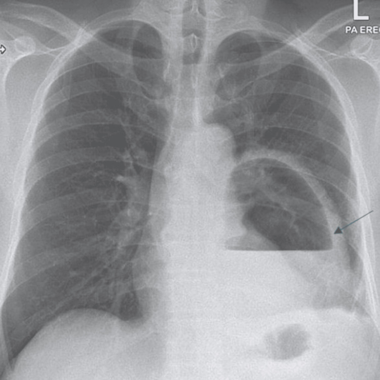
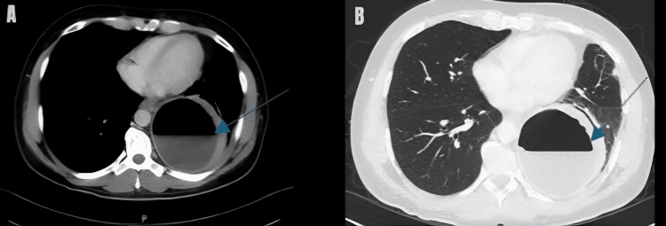
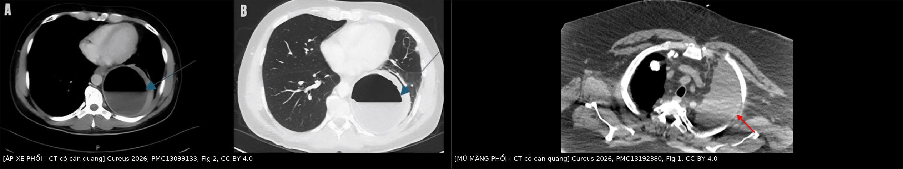
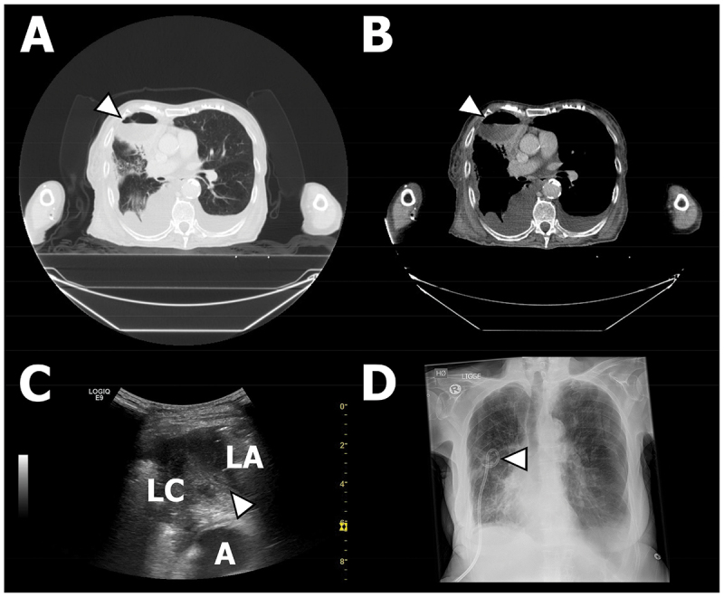
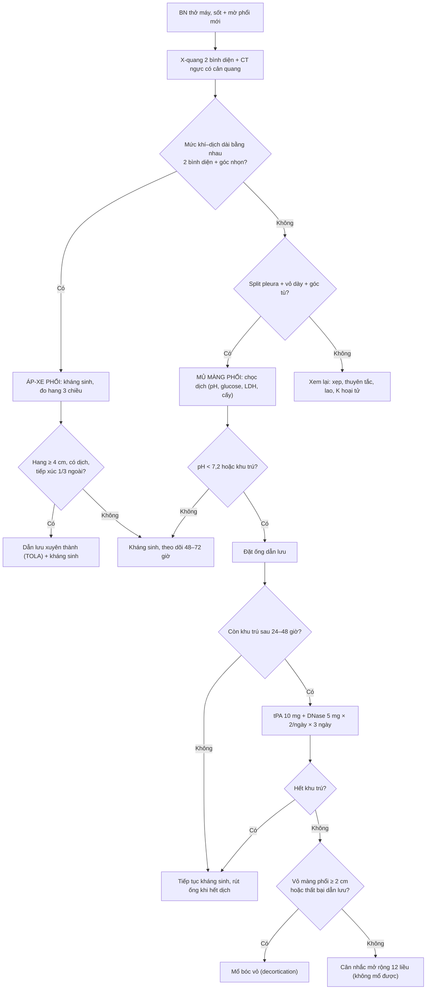
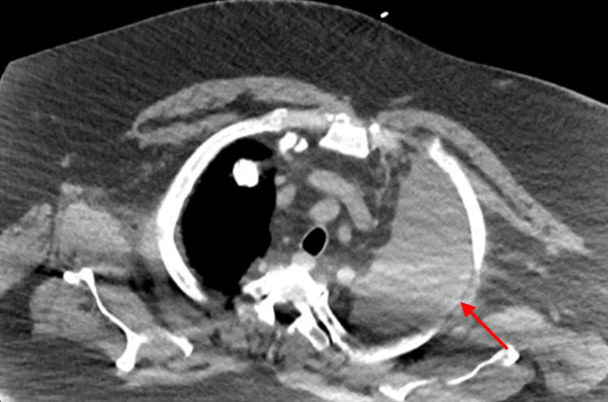
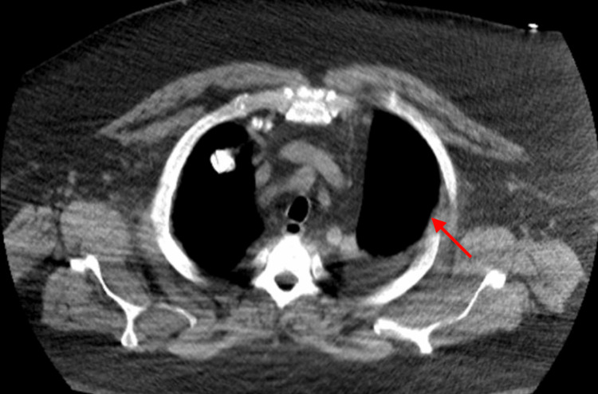
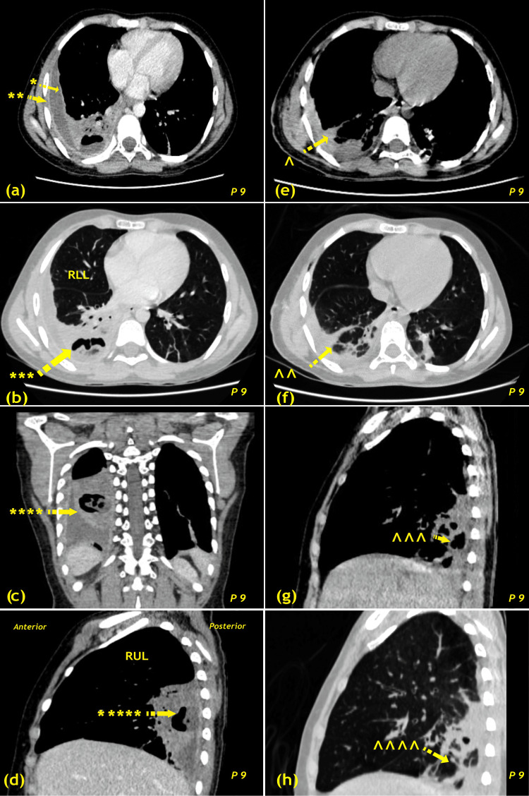

# 088 — Áp-xe phổi & mủ màng phổi sau viêm phổi thở máy (VAP): ngưỡng dẫn lưu, tiêu sợi huyết & khi nào mổ / Lung abscess and empyema complicating VAP

**Tags:** `pattern:hang` `pattern:mu-mang-phoi` `pattern:tran-dich-khu-tru` `vung:phoi` `vung:mang-phoi` `score:Light-criteria` `protocol:CT-nguc-can-quang` `protocol:dan-luu-mang-phoi`
**Mức chắc chắn (certainty):** tổng hợp y văn (literature synthesis) — số liệu lấy từ 2 đoàn hệ lớn/đoàn hệ trẻ có đối chiếu (PMC12713218, PMC13020819), 1 RCT đang chạy về dẫn lưu xuyên thành (PMC13463463), 1 phân tích gộp về tiêu sợi huyết (PMC12801050), 2 bài tổng quan quản lý nhiễm trùng màng phổi (PMC10790177, PMC11290072), cộng 3 báo cáo ca CC BY làm hình (PMC13099133, PMC13192380, PMC12497427). Số nào chưa đối chiếu được ghi **"chưa rõ"**.

> Bài này trả lời 3 câu hỏi thực hành: **(1) mờ phổi mới + sốt ở người thở máy đã có ổ mủ CHƯA — áp-xe trong nhu mô hay mủ trong khoang màng phổi? (2) khi nào đặt ống, khi nào bơm tiêu sợi huyết, khi nào mổ? (3) điều gì trên CT quyết định được thủ thuật an toàn?** Chẩn đoán VAP (định nghĩa, cấy định lượng, bó dự phòng) ở [084](../084-viem-phoi-tho-may/lesson.md); tràn dịch màng phổi nói chung ở [040](../040-tran-dich-mang-phoi/lesson.md); hang phổi và dấu liềm khí ở [025](../025-ton-thuong-phoi-tao-hang/lesson.md).

*X-quang ngực PA: **hang lớn vùng dưới–trái có mức khí–dịch ngang** (mũi tên xanh) — mức dịch nằm ngang tuyệt đối, phía trên là khí, thành hang dày. Đây là hình ảnh "đã có ổ mủ" của áp-xe phổi, khác hẳn đám mờ đông đặc thuần túy. Nguồn: Cureus 2026, PMC13099133, Fig. 1, CC BY 4.0.*

## 1. Tổng quan bệnh học – cơ chế hình ảnh

- **Chuỗi bệnh sinh từ VAP:** vi hít sặc qua bóng chèn → viêm phổi → **viêm phổi hoại tử (necrotizing pneumonia)** ở các chủng sinh độc lực (*S. aureus*, *Pseudomonas aeruginosa*, *Klebsiella*, *E. coli*, *Acinetobacter*) → hoại tử hóa lỏng nhu phôi, thải ra qua phế quản → **hang (cavity)**; nếu ổ hoại tử thông với khoang màng phổi → **rò phế quản–màng phổi + mủ màng phổi (empyema)**. Vì vậy hai tổn thương này **thường đi cùng nhau** ở cùng một bệnh nhân, cùng một bên phổi, cùng vùng phụ thuộc.
- **TẠI SAO trên CT trông như vậy (vật lý):**
  - Khí trong hang: **−800 đến −900 HU**; mủ/dịch trong hang: **0–25 HU** → chênh đậm độ rất lớn tạo **mức khí–dịch (air–fluid level)** sắc nét, khác với mờ mô mềm lan tỏa của đông đặc.
  - Màng phổi viêm tiết fibrin: **hai lá màng phổi tách nhau bởi dịch, cả hai lá đều bắt thuốc** → **dấu tách màng phổi (split-pleura sign)**; lá thành dày lên thành **"vỏ màng phổi" (pleural peel)** — khi ≥ 2 cm là dấu hiệu **tổ chức hóa mạn**, tiên lượng kém đáp ứng dẫn lưu đơn thuần.
  - Dịch có fibrin ngăn thành **vách (septation)** → hình ảnh **khu trú hóa (loculation)**: dịch không chảy theo trọng lực thành một lớp mỏng mà đọng thành nhiều ổ tròn, không thay đổi khi đổi tư thế. Đây là lý do **một ống dẫn lưu duy nhất không dẫn hết** và là cơ sở sinh học của liệu pháp tiêu sợi huyết.
- **Ngưỡng định lượng phải nhớ:**
  - **Hình học áp-xe vs mủ màng phổi** (đọc trên 2 bình diện): áp-xe hình cầu → **chiều dài mức khí–dịch đo trên phim thẳng và nghiêng/CT trục–đứng BẰNG NHAU**; mủ màng phổi hình thấu kính dẹt → **chiều dài KHÁC NHAU**. Áp-xe tạo **góc nhọn** với thành ngực; mủ màng phổi tạo **góc tù** + split pleura.
  - **Kích thước hang quyết định can thiệp:** trong thử nghiệm TOLA, tiêu chuẩn vào gồm hang **≥ 4 cm đường kính**, **có dịch bên trong** và **tiếp xúc 1/3 ngoài của phổi** (PMC13463463). Trong đoàn hệ 222 bệnh nhân, nhóm được can thiệp có hang trung vị **10 cm (IQR 5,4–12)** so với **4,5 cm (3,2–6,3)** ở nhóm không can thiệp, CRP **212 mg/L** so với **129 mg/L** (PMC12713218).
  - **Dịch màng phổi "cần dẫn lưu":** **pH < 7,2** là ngưỡng kinh điển và vẫn là chỉ số đơn lẻ hữu ích nhất; tuy nhiên pH **tới 7,37 vẫn có thể cần dẫn lưu**, nên pH không phải tiêu chuẩn tuyệt đối (PMC10790177). Ở trẻ, **tràn dịch > 2 cm hoặc suy hô hấp** là chỉ định dẫn lưu (PMC11290072).
  - **Thời gian điều trị nội khoa:** kháng sinh tĩnh mạch trung vị **14 ngày**, sau đó uống **26 ngày** (tổng trung vị ~40 ngày); nằm viện trung vị **14 ngày** (PMC12713218).
- **Mô bệnh:** 3 giai đoạn của mủ màng phổi — **E**xudative (dịch tự do, đáp ứng ống dẫn lưu) → **F**ibrinopurulent (vách, khu trú, cần tiêu sợi huyết) → **O**rganizing (vỏ xơ dày, cần mổ bóc vỏ). Đọc CT để xếp giai đoạn chính là đọc **vách và độ dày vỏ**.

*Cùng bệnh nhân: mặt phẳng **trục (A)** và **đứng (B)** của một hang 9,3 × 9,6 cm, thành dày bắt thuốc, mức khí–dịch phẳng. Đây chính là cách đo "hai bình diện" để chứng minh mức khí–dịch **thuộc nhu mô** chứ không thuộc khoang màng phổi. Nguồn: Cureus 2026, PMC13099133, Fig. 2, CC BY 4.0.*

## 2. Mẫu hình + chẩn đoán phân biệt theo vị trí & số lượng (Gamut)

- **Hang đơn độc vùng phụ thuộc (thùy dưới, phân thùy sau) ở người thở máy:** áp-xe do VAP/viêm phổi hoại tử, áp-xe sau hít sặc, hang do lao, nấm, nhồi máu phổi hoại tử, di căn hoại tử.
- **Hang + tụ dịch cùng bên:** áp-xe có rò phế quản–màng phổi, hoặc mủ màng phổi có khí trong khoang (pyopneumothorax). **Bắt buộc tìm rò** trước khi quyết định chỉ đặt ống.
- **Tụ dịch màng phổi khu trú đơn thuần:** tràn dịch cạnh phổi đơn giản / phức tạp / mủ màng phổi thực sự — ba mức này **chỉ phân biệt được bằng chọc hút**, không bằng đậm độ trên CT.
- **Tổn thương đa ổ hai bên, nốt ngoại vi + mạch nuôi:** thuyên tắc nhiễm khuẩn (septic emboli) — bệnh cảnh ICU rất dễ gộp nhầm vào "VAP hoại tử".
- **Mờ một bên + mất thể tích + tan nhanh sau hút:** xẹp phổi do nút nhầy — "áp-xe giả".
- **Gợi nhớ "E–F–O" (giai đoạn mủ màng phổi):** **E**xudative → **F**ibrinopurulent → **O**rganizing; và **"2 bình diện"** cho mọi mức khí–dịch.

## 3. Bảng so sánh phân biệt (ma trận đối chiếu)

| Thực thể (entity) | Hình ảnh điển hình | Chốt vào (rule-in) | Chốt loại (rule-out) | Gợi ý xác nhận |
|---|---|---|---|---|
| **Áp-xe phổi (lung abscess)** | Hang tròn, thành dày đều, **mức khí–dịch**, đông đặc quanh, **góc nhọn** với màng phổi, không có vỏ màng phổi | **Mức khí–dịch dài bằng nhau trên 2 bình diện + góc nhọn + không tách màng phổi** | Tách màng phổi + góc tù + vỏ dày đều → mủ màng phổi | CT có cản quang; **hút dịch/đờm** cấy; theo dõi đáp ứng kháng sinh |
| **Mủ màng phổi (empyema)** | Tụ dịch **khu trú**, hình thấu kính, **góc tù**, **split pleura**, lá thành bắt thuốc, có thể có bóng khí | **Split pleura + vỏ màng phổi bắt thuốc + dịch đục/mủ khi chọc** | Hang trong nhu mô với mức khí–dịch bằng nhau 2 bình diện → áp-xe | Siêu âm (vách, echo) + chọc dịch: pH, glucose, LDH, Gram/cấy |
| **Tràn dịch cạnh phổi phức tạp (complicated parapneumonic effusion)** | Dịch tự do hoặc bắt đầu khu trú, **không** có vỏ dày, không có khí | **pH < 7,2 hoặc khu trú/vách trên siêu âm** | Dịch tự do, pH bình thường, không vách → đơn giản | Chọc dịch; siêu âm lặp lại |
| **Viêm phổi hoại tử (necrotizing pneumonia)** | Nhiều ổ giảm đậm độ nhỏ trong đông đặc, chưa thành hang rõ | **Đông đặc + nhiều ổ khí nhỏ/dịch trong đông đặc** | Hang lớn có thành rõ → đã là áp-xe | CT lát mỏng; cấy máu/đờm |
| **Hang lao / nấm** | Thùy trên–đỉnh sau, thành mỏng, **nốt vệ tinh, tree-in-bud**; nấm: khối trong hang di động | **Nốt vệ tinh + tree-in-bud + vị trí đỉnh** | Hang đơn độc đáy phổi ở BN thở máy cấp → nghĩ VAP | AFB/PCR, galactomannan |
| **Thuyên tắc nhiễm khuẩn (septic emboli)** | Nốt/đám mờ **ngoại vi đa ổ**, có thể hang, **mạch nuôi** | **Nhiễm khuẩn huyết + catheter + tổn thương ngoại vi nhiều ổ** | Một ổ lớn vùng phụ thuộc → áp-xe/mủ | Cấy máu, siêu âm tim |
| **K phổi hoại tử (SCC)** | Hang thành dày **> 15 mm, lệch tâm, bờ trong gồ ghề**, không nốt vệ tinh | **Thành dày lệch tâm + hút thuốc + tuổi** | Thành mỏng đều + sốt cấp → nhiễm | Sinh thiết, PET-CT |
| **Xẹp phổi do tắc** | Mờ đồng nhất theo thùy, **mất thể tích**, không mức khí–dịch | **Mất thể tích + tan nhanh sau hút/physio** | Mức khí–dịch + đông đặc quanh → ổ mủ | So phim trước–sau; CT |

*Trái: **áp-xe phổi** — hang lớn trong nhu mô, thành dày bắt thuốc, mức khí–dịch phẳng, góc nhọn với thành ngực, không có vỏ màng phổi. Phải: **mủ màng phổi khu trú** — tụ dịch hình thấu kính trong khoang màng phổi, ép xẹp phổi lân cận, không có mức khí–dịch trong nhu mô. Nguồn: Cureus 2026, PMC13099133 Fig. 2 và PMC13192380 Fig. 1, CC BY 4.0; ảnh ghép letterbox, giữ nguyên tỷ lệ.*

### Ba dấu hiệu quyết định thủ thuật (đọc kỹ trước khi đặt ống)
- **Split pleura sign:** hai lá màng phổi tách + đều bắt thuốc → xác nhận dịch **trong khoang màng phổi**, không phải trong nhu mô.
- **Vỏ màng phổi ≥ 2 cm:** giai đoạn tổ chức hóa — trong loạt 9 trẻ mổ bóc vỏ sớm, **100% có dày màng phổi ≥ 2 cm** (PMC12497427); dẫn lưu đơn thuần khó thành công, phải tính mổ.
- **Tiếp xúc 1/3 ngoài + có dịch:** điều kiện để **dẫn lưu xuyên thành (TOLA)** an toàn — nếu ổ nằm sâu/trung tâm, đường vào xuyên thành sẽ đi qua nhu mô lành và màng phổi tự do (PMC13463463).

## 4. Protocol chụp + ngưỡng xử trí + flowchart

### 4.1 Chẩn đoán hình ảnh
- **X-quang tại giường:** bước đầu, luôn so phim cũ cùng tư thế; tìm **mức khí–dịch** và **mất thể tích**. Chụp **2 bình diện** (thẳng + nghiêng, hoặc thẳng + CT) khi có mức khí–dịch — đây là cách phân biệt áp-xe/mủ màng phổi bằng hình học.
- **CT ngực có cản quang, lát ≤ 1–1,25 mm:** bắt buộc khi nghi ổ mủ. Đo và ghi vào báo cáo: **(a)** kích thước 3 chiều của hang; **(b)** độ dày thành hang tại điểm dày nhất; **(c)** có/không mức khí–dịch; **(d)** độ dày vỏ màng phổi và split pleura; **(e)** vị trí ổ so với thành ngực (tiếp xúc 1/3 ngoài?); **(f)** có rò phế quản–màng phổi (khí trong khoang + tổn thương nhu mô thông vào).
- **Siêu âm màng phổi tại giường:** phát hiện vách, dịch echo dày (mủ), hướng dẫn chọn vị trí đặt ống và theo dõi thể tích dịch — rẻ, không xạ, lặp lại được.
- **Chọc hút dịch màng phổi (bắt buộc trước khi kết luận "empyema"):** gửi **pH, glucose, LDH, protein, Gram + cấy (nên cấy vào chai cấy máu — tăng tỷ lệ phân lập vi khuẩn lên khoảng 60%)** (PMC10790177).

### 4.2 Ngưỡng xử trí
| Tình huống | Ngưỡng / hành động | Nguồn |
|---|---|---|
| Ổ mủ trong nhu mô, chưa có chỉ định can thiệp | Kháng sinh phổ rộng, đủ dài; theo dõi 48–72 giờ | PMC12713218 |
| Hang **≥ 4 cm**, có dịch, tiếp xúc 1/3 ngoài phổi | **Cân nhắc dẫn lưu xuyên thành (TOLA)** phối hợp kháng sinh | PMC13463463 |
| Hang lớn, CRP cao (nhóm can thiệp: **10 cm**, **212 mg/L**) | Ngưỡng thực tế để can thiệp trong thực hành | PMC12713218 |
| Tràn dịch cạnh phổi **pH < 7,2** | **Đặt ống dẫn lưu**; lưu ý pH tới **7,37** vẫn có thể cần dẫn lưu | PMC10790177 |
| Trẻ: tràn dịch **> 2 cm** hoặc suy hô hấp | Dẫn lưu màng phổi | PMC11290072 |
| Dịch khu trú, dẫn lưu kém sau 24–48 giờ | **tPA 10 mg + DNase 5 mg × 2 lần/ngày × 3 ngày (6 liều)** | PMC13192380 |
| Còn khu trú sau 6 liều, không mổ được | Có thể **mở rộng thành 12 liều** dưới theo dõi sát (không có RCT) | PMC13192380 |
| Vỏ màng phổi **≥ 2 cm**, tổ chức hóa, thất bại dẫn lưu | **Mổ bóc vỏ (decortication)** sớm | PMC12497427 |

*Bốn bước của dẫn lưu hang: **(A, B)** CT xác định hang có mức khí–dịch, nằm **sát màng phổi** (điều kiện để đường vào xuyên thành không xuyên nhu mô lành); **(C)** siêu âm tại giường thấy ranh giới **đông đặc phổi – hang**; **(D)** X-quang nằm sau 1 ngày: đầu ống trong ổ mủ. Nguồn: Eur Clin Respir J 2026, PMC12713218, Fig. 2, CC BY-NC 4.0.*

### 4.3 Hiệu quả của tiêu sợi huyết — con số thật

Phân tích gộp **19 nghiên cứu** so sánh liệu pháp enzyme trong màng phổi (IET) với chăm sóc chuẩn: **nằm viện 12,9 ngày (95% CI 10,4–15,4) so với 22,7 ngày (17,9–27,4)**; **tỷ lệ cần mổ 11,5% (7,2–18,0) so với 23,4% (8,3–50,5)**; **chảy máu đáng kể 3,7%** (PMC12801050). Đây là bằng chứng mức trung bình (chủ yếu đoàn hệ), **không phải** bằng chứng từ RCT lớn — MIST-1 với streptokinase đơn thuần **không** giảm tử vong, mổ hay thời gian nằm viện.

### 4.4 Kết cục điều trị (để tư vấn gia đình)
- **Người lớn (222 BN):** lui bệnh trên hình ảnh **~87%** ở lần chụp trước 8 tuần; tử vong 90 ngày **2,7–12,7%** tùy phác đồ, 365 ngày **10,8–33,3%**; chỉ **6,8%** cần can thiệp (PMC12713218).
- **Trẻ (23 BN):** tuổi trung bình **7,2** (2–13); nằm viện trung bình **16,6 ngày**; **91,3% hết hoàn toàn trên X-quang** sau 1–2 tuần; **85–90%** đáp ứng kháng sinh đơn thuần (PMC13020819).
- **Mổ bóc vỏ sớm ở trẻ (9 BN):** biến chứng **33,3%** (rò khí kéo dài 22,2%, nhiễm vết mổ 11,1%), tử vong 30 ngày **11,1%**, sống 12 tháng **88,9%**, nằm viện trung vị **12 ngày** (PMC12497427).

## 5. Biến thể bình thường và cạm bẫy

- **Đọc mức khí–dịch trên một bình diện là lỗi kinh điển:** chỉ khi đo trên **2 bình diện** mới phân biệt được áp-xe (bằng nhau) với mủ màng phổi (khác nhau). Trên CT trục, hãy dựng thêm **mặt phẳng đứng (coronal/sagittal)** trước khi kết luận.
- **Đậm độ không phân biệt được dịch cạnh phổi với mủ:** cả hai đều **0–25 HU**. "Empyema" là chẩn đoán **vi sinh + hóa sinh**, không phải chẩn đoán HU.
- **Split pleura có thể mất khi có rò phế quản–màng phổi** (khí vào khoang làm thay đổi hình thái) — khi đó dựa vào vỏ màng phổi và tổn thương nhu mô thông vào.
- **Ống dẫn lưu nằm trong nhu mô:** kiểm tra trên CT lát mỏng; ống trong nhu mô không dẫn được mủ và tạo đường rò mới.
- **Hang giả (pseudocavity):** do dày dính màng phổi, thoát vị phổi, hoặc bóng khí trong đông đặc — bờ không liên tục, không có thành thật.
- **Pneumatocele ở trẻ:** nang khí mỏng thành sau viêm phổi, tự khỏi; **không** đặt ống dẫn lưu vì "hang".
- **Satisfaction of search:** khi đã thấy ổ mủ, vẫn phải rà **tràn khí màng phổi, rò phế quản–màng phổi, ống/chăm sai vị trí, huyết khối** — các biến chứng đổi xử trí ngay.
- **Đo trên ảnh ≠ đo tổn thương:** nhiều phim có chú thích đo **độ sâu ống nội khí quản** — đừng đọc con số đó như kích thước hang.

## 6. Tự lượng giá — Blind Quiz

**Ca 1 — Nam 52 tuổi, trước khỏe mạnh, sốt 4 ngày, ho, đau ngực trái; bạch cầu 11,3 × 10³/µL, CRP 252,8 mg/L. Phim thẳng:**

- Câu hỏi: Mô tả dấu hiệu chính? Đây là tổn thương trong nhu mô hay trong khoang màng phổi? Cần thêm gì để chốt?

<b>Bấm để hiện đáp án (findings + chẩn đoán)</b>

- Dấu hiệu: **hang lớn vùng dưới–trái, thành dày, mức khí–dịch ngang** (mũi tên xanh); không thấy vỏ màng phổi rõ.
- Chẩn đoán: **áp-xe phổi** (ca nguồn: *Pseudomonas aeruginosa* cộng đồng, kích thước **9,3 × 9,6 cm** trên CT).
- Cần thêm: **CT có cản quang** để đo 3 chiều, xác định góc nhọn/góc tù và loại trừ mủ màng phổi; cấy đờm/máu.
- Nguồn: Cureus 2026, PMC13099133, Fig. 1, CC BY 4.0.

**Ca 2 — Nam 62 tuổi, béo phì, suy tim, đái tháo đường; sốt dai dẳng, CT ngực có cản quang:**

- Câu hỏi: Dấu hiệu nào cho biết dịch nằm trong **khoang màng phổi** chứ không phải trong nhu mô? Vì sao ống dẫn lưu đơn thuần thất bại?

<b>Bấm để hiện đáp án</b>

- Dấu hiệu: **tụ dịch lớn, khu trú (loculated)** ở màng phổi trái, **ép xẹp phổi lân cận**, không có mức khí–dịch trong nhu mô; thành phần khu trú do **vách fibrin**.
- Vì sao thất bại: dịch chia nhiều ổ, một ống chỉ dẫn được ổ nối với đầu ống → cần **tiêu sợi huyết** hoặc mổ.
- Điều trị ca nguồn: ống **14F** + **tPA 10 mg + DNase 5 mg × 2/ngày**, kéo dài **12 liều** vì còn khu trú; kết quả CT gần như hết dịch, không chảy máu.
- Nguồn: Cureus 2026, PMC13192380, Fig. 1, CC BY 4.0.

**Ca 3 — Cùng bệnh nhân ca 2, sau 6 ngày điều trị enzyme trong màng phổi:**

- Câu hỏi: Đáp ứng đủ để rút ống chưa? Tiêu chí nào theo dõi?

<b>Bấm để hiện đáp án</b>

- Dấu hiệu: **giảm mạnh ổ khu trú, phổi trái nở lại**, còn ít dịch/dày màng phổi mỏng.
- Tiêu chí rút ống: hết sốt, CRP giảm, **dịch < 50 mL/ngày**, phổi nở trên X-quang/CT, không còn ổ khu trú.
- Bài học: **khu trú là chỉ định của enzyme, không phải của "đổi kháng sinh"**.
- Nguồn: Cureus 2026, PMC13192380, Fig. 2, CC BY 4.0.

**Ca 4 — Trẻ < 12 tuổi, mủ màng phổi thất bại dẫn lưu; CT trước mổ (nhiều panel):**

- Câu hỏi: Độ dày nào của vỏ màng phổi định hướng mổ? Nguy cơ của mổ bóc vỏ sớm?

<b>Bấm để hiện đáp án</b>

- Dấu hiệu: **dịch khu trú + dày màng phổi ≥ 2 cm + lá thành bắt thuốc** ở mọi bệnh nhân trong loạt này (9/9).
- Ngưỡng: **vỏ ≥ 2 cm** và thất bại dẫn lưu → **bóc vỏ**; tỷ lệ biến chứng **33,3%** (rò khí kéo dài, nhiễm vết mổ), tử vong 30 ngày **11,1%** — phải tư vấn trước mổ.
- Nguồn: Cureus 2025, PMC12497427, Fig. 3, CC BY 4.0.

## Bài liên quan chéo

- [001 – Tổng quan hệ Ngực](../001-tong-quan-he-nguc/lesson.md)
- [025 – Hang & nấm phổi: dấu liềm khí, Monod sign](../025-ton-thuong-phoi-tao-hang/lesson.md)
- [030 – Đông đặc & xẹp phổi: học thuyết mất thể tích](../030-dong-dac-xep-phoi/lesson.md)
- [040 – Tràn dịch màng phổi & mủ màng phổi](../040-tran-dich-mang-phoi/lesson.md)
- [041 – Tràn khí màng phổi](../041-tran-khi-mang-phoi/lesson.md)
- [084 – Viêm phổi thở máy (VAP): cấy định lượng & bó dự phòng](../084-viem-phoi-tho-may/lesson.md)
- [091 – Ho ra máu ồ ạt & nút mạch động mạch phế quản](../091-ho-ra-mau-oat-nut-mach-dong-mach-phe-quan/lesson.md)

## Ảnh

- `images/088_apxe-phoi_XR_PMC13099133-Fig1.jpg` — X-quang PA, hang + mức khí–dịch dưới–trái, CC BY 4.0.
- `images/088_apxe-phoi_CT_PMC13099133-Fig2.jpg` — CT có cản quang (trục + đứng), hang 9,3 × 9,6 cm, CC BY 4.0.
- `images/088_apxe-phoi_CT-US_PMC12713218-Fig2.jpg` — CT + siêu âm + X-quang sau đặt ống dẫn lưu xuyên thành, CC BY-NC 4.0.
- `images/088_mu-mang-phoi_CT_PMC13192380-Fig1.jpg` — CT tụ dịch khu trú màng phổi trái, CC BY 4.0.
- `images/088_mu-mang-phoi_CT_PMC13192380-Fig2.jpg` — CT sau 12 liều tPA–DNase, CC BY 4.0.
- `images/088_mu-mang-phoi_CT_PMC12497427-Fig3.jpg` — CT trước mổ bóc vỏ (8 panel), CC BY 4.0.
- `images/composite_apxe-vs-mu.jpg` — ảnh ghép đối chiếu áp-xe vs mủ màng phổi (letterbox, không crop).
- Nguồn + giấy phép từng ảnh: `images/CREDITS.md`.

> Không dùng để chẩn đoán độc lập khi chưa có người hướng dẫn.
