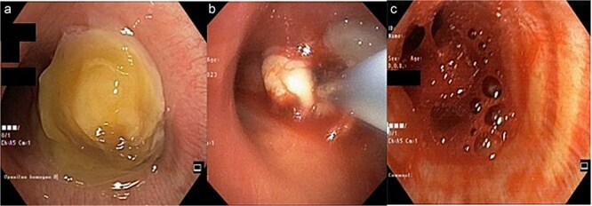
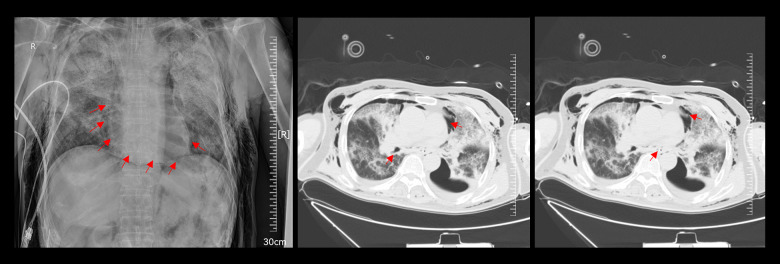
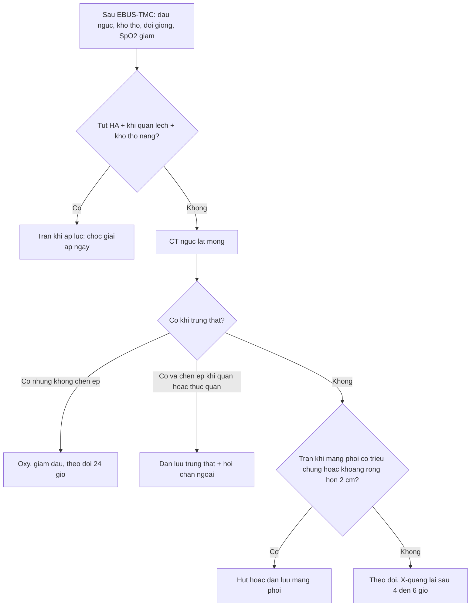
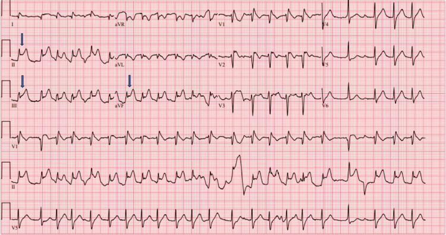

# 089 — Biến chứng & xử trí sau cryobiopsy trung thất qua EBUS (EBUS-TMC) / Complications and management of EBUS-guided transbronchial mediastinal cryobiopsy

**Tags:** `pattern:bien-chung` `pattern:tran-khi-trung-that` `pattern:chay-mau` `vung:trung-that` `protocol:EBUS-TMC` `score:CTCAE`
**Mức chắc chắn (certainty):** tổng hợp y văn (literature synthesis) — gộp 1 phân tích gộp 10 nghiên cứu (Mathew et al., *J Thorac Dis* 2024, PMC11320235), 3 cohort lớn (Echeverri-Hoyos 118 ca, PMC13626287; Mangold 137 ca, PMC11647314; Oruqaj 90 ca, PMC13148967), 2 ca nguyên văn dùng làm hình (PMC12008113, PMC13410793) và 1 báo cáo ca về biến chứng adrenergic (PMC13440509). Số nào chưa có nguồn kiểm chứng được ghi rõ **"chưa rõ"**; ca minh họa chảy máu là **cryobiopsy nội phế quản**, không phải EBUS-TMC — ghi rõ để không đánh tráo nguồn.

## 1. Tổng quan bệnh học – cơ chế hình ảnh

- **EBUS-TMC làm gì (cơ chế gây biến chứng):** đầu dò EBUS định vị hạch → **tạo đường hầm (tunnelling) xuyên thành phế quản** bằng kim 19G/22G hoặc dao điện → đưa **cryoprobe 1,1 mm** vào hạch, làm lạnh bằng hiệu ứng Joule–Thomson (**3–5 giây**, một số trung tâm 6–10 giây), mô dính vào đầu dò rồi **kéo ra**. Mẫu thu được trung bình **3,5 ± 0,9 mm** (22G) và **3,6 ± 1,1 mm** (19G) — lớn hơn hẳn cytoblock của TBNA (Oruqaj et al. 2026). Chính **lỗ xuyên thành phế quản + mảnh mô lớn** là nguồn của hai biến chứng chính: **rò khí** và **chảy máu**.
- **Vì sao rò khí (air leak) xảy ra — vật lý đơn giản:** đường thở có **áp lực dương** trong khi trung thất áp lực âm/trung tính. Một lỗ 1,1 mm xuyên thành phế quản tạo **gradient áp lực** đẩy khí vào trung thất; khí men theo **bao mạch – phế quản (perivascular sheath)** bóc tách lên cổ (hiệu ứng **Macklin**). Vì vậy khí có thể có mặt ở **trung thất, mô mềm cổ, màng tim, màng phổi, thậm chí phúc mạc** — cùng một cơ chế, nhiều ngăn.
- **Vì sao chảy máu:** hạch trung thất nằm sát **động mạch phế quản, tĩnh mạch phế quản, động mạch phổi**; mô lạnh khi **tan băng (thaw)** gây co – giãn mạch đột ngột và **rách cơ học** khi kéo mẫu. Đây là lý do chảy máu có thể **muộn vài phút sau khi đã cầm** (ca nguyên văn bên dưới: cầm máu bằng nước muối lạnh, **5 phút sau** mới bùng lại).
- **Ngưỡng định lượng phải nhớ (cửa 1 của Argon):**
  - **Phân tích gộp 10 nghiên cứu, 844 bệnh nhân (554 cryobiopsy / 704 TBNA)** — Mathew et al. 2024: chảy máu **nhẹ 36,5%** (không cần can thiệp), **chảy máu cần can thiệp 0,7%**, **tràn khí màng phổi 0,4%**, **tràn khí trung thất 0,4%**.
  - **Thực hành thực tế 118 ca** — Echeverri-Hoyos et al. 2026: chẩn đoán xác định **92,4% (109/118)**; **tràn khí trung thất 11,9%**, **co thắt phế quản 5,9%**, **tràn khí màng phổi 4,2%**; **không có** tràn máu trung thất hay nhiễm trùng. Trạm sinh thiết hay gặp nhất **trạm 7 (71,2%)**; lymphoma **27,9%**, anthracosis **14,4%**; PD-L1 làm được ở **37,3%**.
  - **Cohort 137 ca** — Mangold et al. 2024: chẩn đoán **56,2% (TBNA) vs 91,2% (cryobiopsy)**; làm lạnh **4–7 giây** với probe 1,7 mm (18,2%) hoặc **6–10 giây** với probe 1,1 mm (81,8%); đường hầm bằng dao điện 70,8%, kim 19G 12,4%, kim 22G 16,8%.
  - **Cohort 90 ca** — Oruqaj et al. 2026: **không có chảy máu nặng hay biến chứng nặng**; thời gian thủ thuật **25,1 ± 3,9 phút** (22G) vs **26,7 ± 5,3 phút** (19G).
  - **Bối cảnh EBUS nói chung** — Rizvi et al. 2025 (tổng quan): biến chứng **0,04–17%**, nhiễm trùng **0,04–4%**, tử vong **0,01–0,04%**.
- **Vì sao 0,4% (gộp) khác 11,9% (thực tế) tới ~30 lần — đây là bài học lớn nhất:**
  1. **Định nghĩa:** "tràn khí trung thất" trong phân tích gộp thường chỉ tính ca **có triệu chứng/cần can thiệp**; cohort thực tế chụp **CT sau thủ thuật** nên bắt được cả ca **không triệu chứng**.
  2. **Cách phát hiện:** X-quang ngực bỏ sót phần lớn khí trung thất; **CT là tiêu chuẩn**.
  3. **Kinh nghiệm và số mảnh:** cohort thực tế gồm nhiều trung tâm mới triển khai; số mảnh và số lần đưa đầu dò chưa chuẩn hóa (**chưa rõ số mảnh tối ưu — không có RCT**).
  - Hệ quả thực hành: **không được đọc "0,4%" là "không cần theo dõi"**; phải theo dõi lâm sàng 2–4 giờ và chụp khi có triệu chứng.

## 2. Mẫu hình + chẩn đoán phân biệt theo vị trí (gamut)

**Câu hỏi thực hành:** sau EBUS-TMC, bệnh nhân **đau ngực, khó thở, đổi giọng, SpO₂ giảm, hoặc sưng cổ** — đó là **khí**, **máu**, **nhiễm**, hay **do thuốc mê**? Xếp gamut theo **thời điểm** và **cơ chế**:

- **Theo thời điểm:**
  1. **Trong thủ thuật:** chảy máu tại chỗ, co thắt phế quản, co thắt thanh quản, tụt oxy do thuốc an thần.
  2. **0–30 phút sau:** chảy máu **muộn** (đã "cầm" rồi bùng lại), tràn khí trung thất sớm, tràn khí màng phổi.
  3. **2–24 giờ:** khí lan lên cổ (sưng mặt – cổ), khí màng tim, khó thở do chèn ép.
  4. **2–14 ngày:** **viêm trung thất**, nhiễm trùng giường u, rò phế quản – trung thất, viêm màng tim.
- **Theo cơ chế — nhớ "KHÍ – MÁU – NHIỄM – MÊ":**
  - **KHÍ:** tràn khí trung thất, tràn khí màng phổi, tràn khí màng tim, tràn khí dưới da, (hiếm) tràn khí phúc mạc.
  - **MÁU:** chảy máu nhẹ (rỉ) → vừa (cần bóng chèn/thuốc co mạch) → nặng (tắc đường thở, cần đặt nội khí quản/blocker/ống cứng).
  - **NHIỄM:** viêm trung thất, viêm màng tim, áp-xe giường u — thường **muộn**, sốt + CRP tăng.
  - **MÊ:** tụt huyết áp, loạn nhịp, phản ứng thuốc tê, (**và**) biến chứng **adrenergic do adrenaline tại chỗ** (xem mục 5).
- **Theo vị trí tổn thương trên CT:** trung thất trước (quanh động mạch chủ – động mạch phổi), trung thất giữa (quanh khí quản – thực quản), trung thất sau, màng phổi, màng tim, mô mềm cổ.

## 3. Bảng so sánh phân biệt (ma trận đối chiếu)

| Thực thể (entity) | Hình ảnh điển hình | Chốt vào (rule-in) | Chốt loại (rule-out) | Gợi ý xác nhận |
|---|---|---|---|---|
| **Tràn khí trung thất** | CT: **những "vệt khí" (streaks) viền quanh mạch máu và khí quản**, khí trong mô mềm cổ; X-quang: dải khí dọc trung thất, dấu "continuous diaphragm" | **Khí viền quanh khí quản/thực quản trên CT** + sưng cổ sau thủ thuật | Khí **trong lòng** thực quản/khí quản (không phải mô mềm); kén khí phổi | CT ngực không cản quang, cửa sổ mô mềm |
| **Tràn khí màng phổi** | Đường màng phổi tạng, **không có mạch máu ra ngoài đường đó**; nằm thì **deep sulcus** | **Đường màng phổi + khoang khí**; có triệu chứng hoặc khoang **rộng hơn 2 cm** | Kén khí khổng lồ (còn vách/mạch bên trong); tràn khí ẩn chỉ thấy trên CT | CT ngực; so với [041](../041-tran-khi-mang-phoi/lesson.md) |
| **Tràn khí màng tim** | CT: **quầng khí bao quanh tim**, tách khỏi màng phổi; X-quang: viền khí quanh bóng tim | **Khí trong bao tim** + tiếng cọ màng tim, tụt HA | Khí trung thất đơn thuần (không bao quanh tim) | Siêu âm tim tại giường nếu huyết động bất ổn |
| **Chảy máu nhẹ (rỉ)** | Nội soi: máu đọng thành vệt, **tự cầm**; bệnh nhân còn nói được | **Cầm sau hút + nước muối lạnh** | Chảy máu phun thành tia / máu tràn hai phế quản | Nội soi lại ngay sau 2–5 phút |
| **Chảy máu nặng** | Nội soi: **máu lấp kín lòng phế quản**, bệnh nhân ho ra máu ồ ạt, SpO₂ tụt | **Máu tràn sang phế quản đối diện** hoặc **tụt oxy** là chốt nặng | Chỉ rỉ máu tại chỗ, SpO₂ giữ | Đặt nội khí quản + bóng chèn/blocker; nội soi ống cứng nếu cần |
| **Viêm trung thất** | CT: **khí + dịch + dày mô mềm trung thất**, có thể tụ dịch; sau 2–14 ngày | **Sốt + đau ngực + CRP tăng** sau thủ thuật, CT có dịch/khí | Đau cơ – xương do tư thế, không sốt, CRP bình thường | Cấy máu/dịch, kháng sinh tĩnh mạch rộng |
| **Co thắt phế quản** | Không có tổn thương trên CT; **khò khè + tăng áp lực đường thở** khi thông khí | **Khò khè ± tụt SpO₂ ngay sau đưa đầu dò**, đáp ứng giãn phế quản | Tắc do máu/nút nhầy (nhìn thấy trên nội soi) | Giãn phế quản khí dung; nội soi kiểm tra |

*Ca nguyên văn: nam giới, u phổi phải lớn 9,6 × 9,5 × 14,5 cm; máu đã cầm bằng nước muối lạnh nhưng bùng lại sau 5 phút. Nguồn: Nadzir M et al., J Surg Case Rep 2025, PMC12008113 Fig. 2, CC BY 4.0 (giữ nguyên bản, không crop).*

### Đọc đúng hai hình ảnh then chốt
- **Khí trung thất trên CT:** tìm **"khí viền quanh khí quản và thực quản"** ở cửa sổ mô mềm — không phải khí trong lòng ống tiêu hóa. Hình dưới là ca sau can thiệp nội soi phế quản ở bệnh nhân mở khí quản, ho ra máu + SpO₂ < 85% do ho mạnh: khí lan mô mềm cổ và trung thất, kèm tràn khí màng phổi trái.
- **Chảy máu trên nội soi:** đánh giá **ba yếu tố**: (1) máu có **tràn sang phế quản đối diện** không, (2) bệnh nhân còn **tự thở/tự bảo vệ đường thở** không, (3) **SpO₂**. Chỉ cần (1) hoặc SpO₂ tụt là **chảy máu nặng**, không chờ đánh giá thêm.

*CT ngực: khí trong mô mềm cổ – trung thất, chủ yếu quanh khí quản và thực quản. Nguồn: Pengcheng L et al., Am J Case Rep 2026, PMC13410793 Fig. 2, CC BY-NC-ND 4.0 (dùng nguyên bản, không crop/ghép).*

## 4. Protocol chụp + hệ phân độ/điểm chuẩn hóa + xử trí

### 4.1. Chuẩn bị (pre-procedure)
- **CT ngực có cản quang** trước thủ thuật: đánh giá **vị trí hạch – quan hệ mạch máu**, phát hiện giãn động mạch phế quản, phình động mạch chủ (chống chỉ định tương đối với đường hầm ở vị trí sát mạch).
- **Đông máu:** các series không nêu ngưỡng thống nhất; thực hành phổ biến là **tiểu cầu ≥ 50 G/L và INR ≤ 1,5** — *chưa có RCT cho EBUS-TMC, ghi rõ là thực hành, không phải bằng chứng*. Ngừng kháng kết tập theo phác đồ của đơn vị.
- **Chuẩn bị "cứu hộ":** bóng chèn (balloon) luồn sẵn qua kênh làm việc, **adrenaline pha loãng**, nước muối lạnh, ống nội khí quản và **blocker phế quản** trong phòng; hai người thao tác (một người giữ đầu dò – một người lo đường thở) như mô tả trong kỹ thuật "hai ống soi".

### 4.2. Trong thủ thuật (intra-procedure)
- **Đầu dò 1,1 mm**, làm lạnh **3–5 giây** (hoặc 6–10 giây nếu dùng 1,1 mm theo Mangold) — **không kéo khi mô còn dính mạnh**.
- **Kiểm tra Doppler** trước khi tạo đường hầm ở hạch sát mạch.
- **Lấy mẫu "kéo qua kênh" (in-channel extraction):** kỹ thuật mới rút mẫu **qua kênh làm việc mà không cần rút ống soi** — 30 ca trung thất + 10 ca phổi, **3 giây làm lạnh**, **không biến chứng**, thời gian **15,7 ± 6,3 phút** (trung thất) và **14,6 ± 5,8 phút** (phổi) — giữ được quan sát liên tục và **xử trí chảy máu ngay** (Ariza-Prota et al. 2025). Đây là biện pháp **phòng ngừa** đáng giá vì mất tầm nhìn chính là lúc chảy máu nguy hiểm nhất.
- **Số mảnh:** thực hành 2–3 mảnh/trạm trong các series; **số mảnh tối ưu chưa được xác định bằng RCT — ghi "chưa rõ"**.

### 4.3. Sau thủ thuật (post-procedure) — theo dõi và ngưỡng xử trí
- **Theo dõi tối thiểu 2–4 giờ** tại phòng hồi tỉnh: SpO₂, nhịp thở, đau ngực, giọng nói, sưng cổ.
- **Chụp X-quang ngực** nếu có triệu chứng; **CT ngực** khi nghi khí trung thất, khí màng tim, hoặc tràn khí màng phổi không rõ trên X-quang. (Không chụp thường quy: cohort 118 ca có **11,9% tràn khí trung thất** chủ yếu nhờ CT — nếu chỉ chụp khi có triệu chứng, con số thực hành sẽ thấp hơn nhiều, nhưng **không được bỏ theo dõi lâm sàng**.)
- **Ngưỡng dẫn lưu khí trung thất:** chỉ định khi **chèn ép khí quản/thực quản**, khí lan nhanh, hoặc **tràn khí màng tim có tamponade**; trường hợp không chèn ép: **oxy, giảm đau, theo dõi 24 giờ** (đa số tự tiêu).
- **Ngưỡng dẫn lưu tràn khí màng phổi:** **có triệu chứng** hoặc khoang khí **rộng hơn 2 cm** — theo ngưỡng chung của tràn khí màng phổi (xem [041](../041-tran-khi-mang-phoi/lesson.md)); tràn khí áp lực: **chọc giải áp ngay, không chờ CT**.
- **Bậc thang cầm máu (leo từng bậc, không nhảy bậc):**
  1. **Hút liên tục + nước muối lạnh** (co mạch, rửa máu).
  2. **Bóng chèn (balloon tamponade)** qua kênh làm việc, bơm vừa đủ để bít phế quản nguồn — giữ 5–10 phút rồi xả từ từ.
  3. **Thuốc co mạch tại chỗ:** adrenaline pha loãng (thường **1:10 000–1:20 000**) — **thận trọng**: có ca **ST chênh lên thoáng qua** sau adrenaline nội phế quản (xem mục 5); **phenylephrine** là lựa chọn thay thế ít tác dụng β hơn.
  4. **Tranexamic acid:** khí dung **250–500 mg trong 5 mL NaCl 0,9% mỗi 6–8 giờ** (dữ liệu từ ho ra máu, không phải RCT riêng cho cryobiopsy); IV **500–1000 mg mỗi 6–8 giờ** khi chảy máu vừa – nặng.
  5. **Chảy máu nặng/không cầm:** đặt **nội khí quản + blocker phế quản**, hoặc **nội soi ống cứng** để hút và kiểm soát; hội chẩn gây mê – ngoại lồng ngực; cân nhắc **nút mạch động mạch phế quản** nếu chảy máu dai dẳng.
- **Nhiễm trùng:** không khuyến cáo kháng sinh dự phòng thường quy cho EBUS-TMC (các cohort **không ghi nhận** nhiễm trùng); theo dõi sốt + CRP sau 48–72 giờ.

## 5. Biến thể bình thường và cạm bẫy

- **Cạm bẫy 1 — "cầm máu rồi" không có nghĩa là an toàn.** Ca nguyên văn: máu ngừng sau nước muối lạnh, **5 phút sau** bệnh nhân tụt oxy, nội soi lại thấy máu lấp **cả hai phế quản chính**, ngừng tim. Bài học: **ở lại phòng, quan sát ít nhất 5–10 phút sau khi cầm máu**, và **không rút ống soi** cho tới khi chắc chắn.
- **Cạm bẫy 2 — adrenaline nội phế quản gây "giả nhồi máu".** Hai ca sau adrenaline nội phế quản có **ST chênh lên ở chuyển đạo dưới (II, III, aVF)**, được chụp mạch vành cấp → **không hẹp**, điện tâm đồ tự về bình thường; cơ chế nghi do **co thắt mạch vành thoáng qua** do thành phần β. Xử trí: **ngừng adrenaline, ECG lặp lại, troponin**, chỉ can thiệp nếu ST không lui. Cân nhắc **phenylephrine** thay thế.
- **Cạm bẫy 3 — "tràn khí trung thất" trên CT không đồng nghĩa "cần mổ".** Phần lớn không chèn ép, tự tiêu trong 24–72 giờ; **chỉ dẫn lưu khi có chèn ép hoặc tamponade**.
- **Cạm bẫy 4 — nhầm giải phẫu trên EBUS.** **Ngách động mạch chủ trên (superior aortic recess)** giữa động mạch chủ lên và động mạch phổi trái có thể bị đọc nhầm là **hạch 4R/4L**; chọc vào đây vừa **không lấy được hạch**, vừa tăng nguy cơ chảy máu. Luôn dùng **Doppler** và xác nhận bằng hình thái.
- **Cạm bẫy 5 — co thắt phế quản bị bỏ qua vì "chỉ là ho".** Khò khè + tăng áp lực đường thở ngay sau đưa đầu dò là dấu hiệu; xử trí giãn phế quản khí dung, không tiếp tục lấy thêm mảnh.
- **Biến thể bình thường:** **khí trong thực quản** và **khí trong túi thừa khí quản** có thể giả tràn khí trung thất trên CT — phân biệt bằng vị trí trong lòng ống và không lan dọc bao mạch.

## 6. Tự lượng giá — Blind Quiz

**Ca 1 — Nam giới, u phổi phải lớn, ho ra máu sau can thiệp**

- Bối cảnh: khối u phổi phải **9,6 × 9,5 × 14,5 cm**, chèn phế quản chính phải; đã làm cryobiopsy nội phế quản.
- Câu hỏi: Mô tả 3 panel (a, b, c). Panel (c) nói gì về **thời điểm** biến chứng? Ba việc phải làm ngay?

<b>Bấm để hiện đáp án (findings + chẩn đoán)</b>

- **(a)** Khối u lấp gần hết phế quản chính phải, phế quản trái còn thông; **(b)** đầu dò cryo áp vào khối u trong lòng phế quản; **(c)** máu đọng và lan sang **cả hai phế quản chính** — hình ảnh này chụp **5 phút sau** khi đã cầm máu ban đầu.
- **Chẩn đoán:** chảy máu nặng muộn sau cryobiopsy, tắc đường thở hai bên → ngừng tim.
- **Ba việc ngay:** (1) **hút + nước muối lạnh**, (2) **bóng chèn/blocker** vào phế quản phải, (3) **đặt nội khí quản và gọi gây mê** — không chờ cầm máu tự nhiên.
- **Phản biện nguồn:** đây là **cryobiopsy nội phế quản** (không phải EBUS-TMC); cơ chế chảy máu tương tự nhưng **nguy cơ tắc đường thở cao hơn** vì tổn thương nằm trong lòng phế quản lớn. Dùng làm bài học về **chảy máu muộn**, không dùng để suy ra tỷ lệ biến chứng của EBUS-TMC.
- Nguồn: Nadzir M et al., *J Surg Case Rep* 2025, PMC12008113, Fig. 2, CC BY 4.0.

**Ca 2 — Bệnh nhân mở khí quản, ho dữ dội khi nội soi, SpO₂ < 85%**

- Bối cảnh: nam 69 tuổi, mở khí quản > 1 tháng, nội soi phế quản tại giường để hút đờm và rửa phế quản; ho dữ dội rồi tụt oxy, sưng lan cổ – ngực.
- Câu hỏi: Khí nằm ở đâu? Cơ chế nào giải thích **cả** khí trung thất **và** tràn khí màng phổi trái? Xử trí đầu tay?

<b>Bấm để hiện đáp án (findings + chẩn đoán)</b>

- **Findings:** khí trong mô mềm cổ và trung thất, **viền quanh khí quản và thực quản**; kèm **tràn khí màng phổi trái**.
- **Cơ chế:** **hiệu ứng Macklin** — khí từ phế quản thoát ra men theo bao mạch – phế quản vào trung thất, lan lên mô mềm cổ; đồng thời khí vào khoang màng phổi. Ho dữ dội làm tăng áp lực đường thở, là yếu tố khởi phát.
- **Xử trí:** **oxy + giảm đau + theo dõi sát**; **dẫn lưu màng phổi** nếu tràn khí có triệu chứng/lớn; **dẫn lưu trung thất** chỉ khi chèn ép. Ở ca này, tràn khí màng phổi trái là chỉ định dẫn lưu rõ.
- Nguồn: Pengcheng L et al., *Am J Case Rep* 2026, PMC13410793, Fig. 2, CC BY-NC-ND 4.0 (nguyên bản).

**Ca 3 — ST chênh lên ngay sau khi bơm adrenaline vào phế quản**

- Bối cảnh: bệnh nhân được nội soi phế quản robot, chảy máu sau sinh thiết, bơm adrenaline tại chỗ; ECG ngay sau đó.
- Câu hỏi: Chẩn đoán điện tâm đồ? Cơ chế? Bước tiếp theo và cách phòng?

<b>Bấm để hiện đáp án (findings + chẩn đoán)</b>

- **Findings:** **ST chênh lên ở II, III, aVF** (mũi tên xanh) — hình ảnh "nhồi máu thành dưới" thoáng qua.
- **Chẩn đoán:** **co thắt mạch vành do adrenaline** (bắt chước STEMI), không phải huyết khối: chụp mạch vành **không hẹp**, ECG tự về bình thường.
- **Bước tiếp theo:** ngừng adrenaline, **ECG lặp lại + troponin**, đánh giá huyết động; chỉ can thiệp mạch vành nếu ST không lui.
- **Phòng:** dùng **nồng độ pha loãng**, liều nhỏ nhất hiệu quả; cân nhắc **phenylephrine** (co mạch tại chỗ, không kích thích β).
- Nguồn: Wortsman J et al., *Cureus* 2026, PMC13440509, Fig. 1, CC BY 4.0.

## Bài liên quan chéo
- [044 – Cryobiopsy trung thất qua EBUS (EBUS-TMC): chỉ định & kỹ thuật](../044-cryobiopsy-trung-that-EBUS/lesson.md)
- [018 – EBUS-TBNA & EUS-B: chọc hút hạch trung thất](../018-EBUS-TBNA-EUS-hach-trung-that/lesson.md)
- [041 – Tràn khí màng phổi: ngưỡng dẫn lưu & tràn khí áp lực](../041-tran-khi-mang-phoi/lesson.md)
- [061 – Tràn khí trung thất](../061-tran-khi-trung-that/lesson.md)
- [046 – Tái phân giai đoạn trung thất sau hóa–miễn dịch](../046-tai-phan-giai-doan-trung-that-sau-hoa-mien-dich/lesson.md)

## Ảnh
- `089_EBUS-TMC-chay-mau_NS_PMC12008113-Fig2-CCBY.jpg`, `089_EBUS-TMC-khoi-u_CT_PMC12008113-Fig1-CCBY.jpg` — PMC12008113, CC BY 4.0.
- `089_pneumomediastinum_CT_PMC13410793-Fig2-CCBYNCND.jpg` — PMC13410793, CC BY-NC-ND 4.0 (nguyên bản).
- `089_EBUS-TMC-rua-ong_NS_PMC12689022-Fig1-CCBY.jpg` — PMC12689022, CC BY 4.0.
- `089_epinephrine-STEMI_ECG_PMC13440509-Fig1-CCBY.jpg` — PMC13440509, CC BY 4.0.
- Nguồn + giấy phép từng ảnh: `images/CREDITS.md`.

> Không dùng để chẩn đoán độc lập khi chưa có người hướng dẫn.
