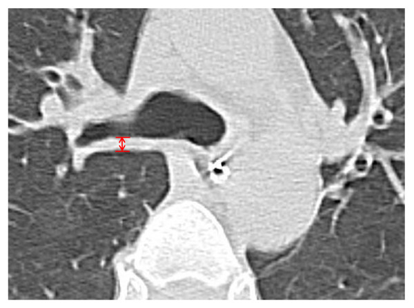
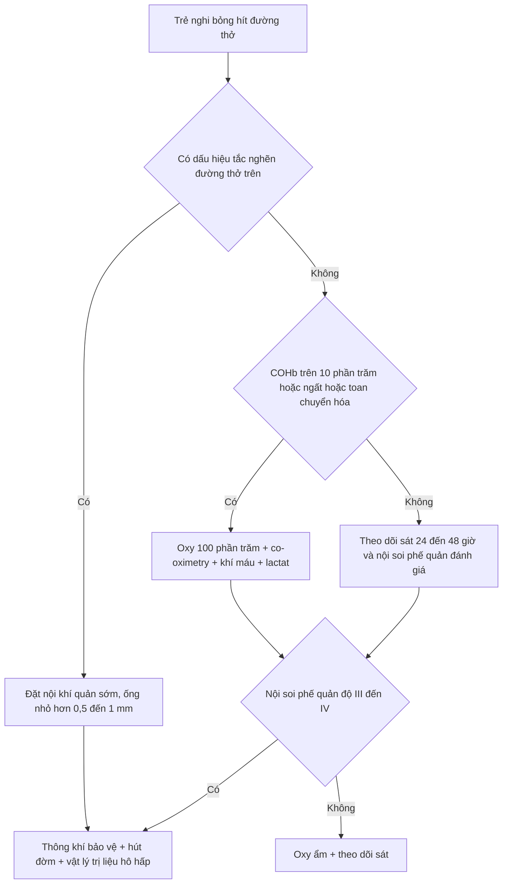
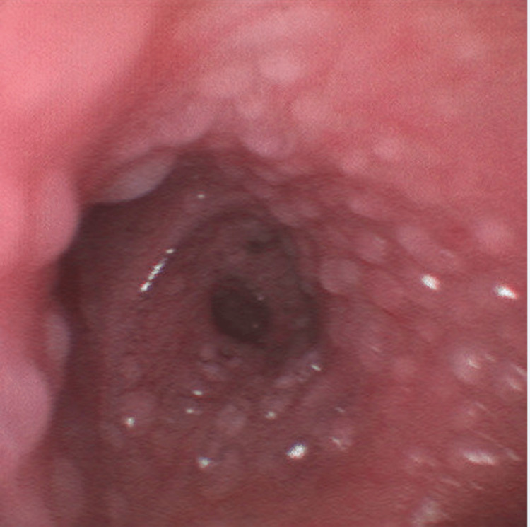
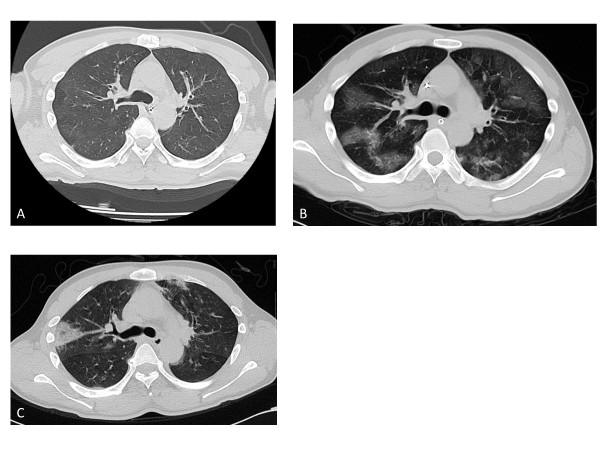
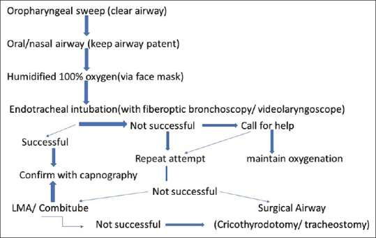

# 090 — Bỏng hít đường thở ở trẻ / Pediatric inhalation injury

**Tags:** `pattern:bong-hit-duong-tho` `pattern:phu-duong-tho` `pattern:day-thanh-phe-quan` `pattern:xep-phoi` `vung:duong-tho` `vung:phe-quan` `vung:phoi` `protocol:noi-soi-phe-quan` `protocol:CT-nguc` `protocol:X-quang-nguc` `score:bronchoscopy-grade`

**Mức chắc chắn (certainty):** tổng hợp y văn (literature synthesis) — ghép **1 đoàn hệ 60 trẻ** được nội soi phế quản vì nghi bỏng hít (PMC10442977), **1 nghiên cứu 37 ca** về CT ngực thì đầu để lấy ngưỡng dày thành phế quản (PMC3707034), **1 tổng quan cơ chế – điều trị** (PMC3653783), **1 phân tích gộp 9 thử nghiệm** về heparin khí dung (PMC7271764) và **1 ca nguyên văn có ảnh nội soi** (PMC10544648). Ca có ảnh là **người lớn 26 tuổi** — dùng để minh họa **hình thái tổn thương đường thở**, không dùng để suy ra tỷ lệ ở trẻ.

> **Câu chốt:** Trong bỏng hít ở trẻ, **"phổi trắng sạch" trên X-quang không loại trừ gì cả** — tổn thương quyết định nằm ở **đường thở**, và **đường thở của trẻ chỉ rộng 4–5 mm ở dưới thanh môn**: thêm **1 mm phù** làm **sức cản tăng ~16 lần** (định luật Poiseuille). Ba con số phải nhớ: **(1)** bỏng hít gặp ở **20–30%** trẻ bỏng nặng; **(2)** **thành phế quản dày > 3,0 mm** trên CT thì đầu dự báo viêm phổi với **Se 79% / Sp 96%**; **(3)** nội soi phế quản **độ III–IV** (loét/hoại tử/niêm mạc bong) đi kèm **thở máy 82,6%** ở nhóm có bỏng hít so với **14,3%** ở nhóm không.

## 1. Tổng quan bệnh học – cơ chế hình ảnh (TẠI SAO)

### 1.1 Ba cơ chế — ba tầng giải phẫu khác nhau

| Cơ chế | Tầng tổn thương | Vì sao giới hạn ở tầng đó |
|---|---|---|
| **Nhiệt (heat)** | **Trên thanh môn → khí quản**, **trừ khi hít hơi nước (steam)** | Không khí trong phòng cháy tới **1000 °F**, nhưng **nhiệt dung của không khí thấp**, đường thở trên **tản nhiệt rất hiệu quả** và **phản xạ đóng thanh quản** → khí quá nóng nguội trước khi xuống carina (PMC3653783) |
| **Hoá chất (chemical)** | **Toàn bộ đường thở**, kể cả phế quản nhỏ và nhu mô | Khói chứa **aldehyde, acid, oxit nitơ, acrolein** — hoà tan vào niêm mạc, gây **viêm, bong biểu mô, phù**; không bị "tản nhiệt" |
| **Toàn thân (systemic)** | **Máu – ty thể** | **CO** gắn hemoglobin mạnh gấp **200 lần** oxy; **cyanid** ức chế **cytochrome oxidase** → tế bào không dùng được oxy dù máu đủ oxy (PMC3653783) |

- **Hơi nước là ngoại lệ quan trọng:** hơi nước mang **ẩn nhiệt lớn**, nên hít hơi từ nồi áp suất/vụ nổ có thể gây **bỏng trực tiếp dưới carina** — đúng loại tổn thương mà "không khí nóng" thường không gây được (PMC3653783). Đây cũng là lý do ca PMC10544648 (bỏng bếp, **66% TBSA**) có **bóng nước (bulla) rải khắp niêm mạc phế quản** thay vì chỉ bồ hóng.

### 1.2 TẠI SAO trẻ nguy hiểm hơn người lớn — vật lý dòng khí

- **Định luật Poiseuille:** sức cản đường thở **R ∝ 1/r⁴**. Dưới thanh môn của nhũ nhi chỉ rộng **4–5 mm**; **1 mm phù** (bán kính 2 mm → 1 mm) làm **R tăng 16 lần**, và **diện tích lòng giảm ~75%**. Ở người lớn khí quản ~18 mm, cùng 1 mm phù chỉ làm R tăng ~1,26 lần.
- **Mô dưới niêm mạc lỏng lẻo + sụn mềm** → phù lan nhanh; **điểm hẹp nhất là vòng sụn nhẫn (cricoid)** ở trẻ nhỏ, không phải dây thanh.
- **Hệ quả thực hành:** trẻ có thể **nói chuyện, chơi, SpO₂ 98%** rồi **tụt đường thở trong 30–60 phút** khi phù đạt ngưỡng. Phù tăng **song song với truyền dịch hồi sức** trong **6–24 giờ đầu** (PMC3653783).
- **Vì sao khám lúc nhập viện không tiên lượng được:** bài tổng quan ghi rõ **"đánh giá ban đầu không phải chỉ báo tốt về mức độ tắc nghẽn sẽ xảy ra sau đó"** (PMC3653783).

### 1.3 Vì sao hình ảnh lại như vậy

- **X-quang ngực:** phần lớn **bình thường lúc đầu** vì tổn thương là **phù niêm mạc**, không phải **dịch trong phế nang**. Khi có bất thường muộn hơn: **dày thành phế quản, xẹp phổi, thâm nhiễm**.
- **CT:** **phù thành phế quản** làm **thành dày** — đo được bằng mm. Trong nghiên cứu 37 ca, **thành phế quản bình thường 1,0 ± 0,6 mm**, tăng lên **2,45 ± 1,26 mm lúc nhập viện**, **đỉnh 3,40 ± 1,20 mm sau 24 giờ**, rồi giảm còn **1,49 ± 0,64 mm sau 7 ngày** (PMC3707034). **TẠI SAO đỉnh ở 24 giờ:** phù tăng theo **rò mao mạch + hồi sức dịch**, đạt đỉnh khi cả hai cùng tác động, rồi giảm khi niêm mạc tái hấp thu.
- **Nội soi phế quản:** là **chuẩn tham chiếu** vì nhìn trực tiếp **bồ hóng, phù, loét, mảng niêm mạc bong, cast** — những thứ CT chỉ thấy gián tiếp.
- **Cast (nút nhầy–biểu mô):** biểu mô phế quản **bong thành mảng**, cộng **dịch tiết giàu protein** và **chất nhầy tăng tiết** → **đông đặc, bít lòng phế quản** → xẹp phổi và **ức chế co mạch phổi do thiếu oxy** (shunt) (PMC5879861, Fig. 2).

### 1.4 Ngưỡng định lượng cần nhớ

| Chỉ số | Số liệu | Nguồn |
|---|---|---|
| Tần suất ở trẻ bỏng nặng | **20–30%** | PMC10442977 |
| Tử vong loạt **850 trẻ** (Shriners, 10 năm) | **~16%**, phần lớn do biến chứng phổi | dẫn trong PMC10442977 |
| Tử vong thêm do bỏng hít (người lớn, > 1.000 ca) | **+20%** tối đa khi chỉ có bỏng hít; **+60%** khi kèm viêm phổi | PMC3653783 |
| Tử vong bỏng hít so với không bỏng hít (gộp) | **27,6% vs 13,9%** | PMC3653783 |
| COHb trong đám cháy không gian kín | **> 10%**; tổn thương đáng kể có thể xảy ra **ngay từ 10%** | PMC3653783 |
| Bán thải COHb | **250 phút** khí trời → **40–60 phút** với **O₂ 100%** | PMC3653783 |
| Thành phế quản trên CT (bình thường → đỉnh) | **1,0 ± 0,6 → 3,40 ± 1,20 mm** (24 giờ) → **1,49 ± 0,64 mm** (ngày 7) | PMC3707034 |
| Ngưỡng **BWT > 3,0 mm** dự báo viêm phổi | **Se 79% · Sp 96% · PPV 91% · NPV 88%** | PMC3707034 |
| Điểm nội soi **> 2** dự báo viêm phổi | **Se 50% · Sp 70%** — **kém hơn CT** | PMC3707034 |
| Trẻ cần thở máy khi có bỏng hít | **82,6% vs 14,3%** (p < 0,001) | PMC10442977 |
| TBSA ngưỡng tử vong ở trẻ bỏng hít | **≥ 47,5%**: **OR 5,075 (1,223–21,065)**, AUC **0,744** | PMC10442977 |

## 2. Mẫu hình + chẩn đoán phân biệt theo vị trí và theo thời gian (Gamut)

**Mẫu hình cốt lõi:** **bồ hóng + phù + dày thành phế quản**, với **X-quang sớm thường bình thường**, ở trẻ **bỏng mặt/cổ trong không gian kín**.

- **Theo tầng giải phẫu:**
  - **Trên thanh môn/thanh môn:** phù lưỡi, nắp thanh môn, phễu thanh quản → **rít, khàn, nuốt đau, chảy nước bọt** — **nguy cơ tắc nghẽn cấp**.
  - **Khí quản – phế quản:** **bồ hóng, ban đỏ, loét, bong niêm mạc, cast** → **ho, khò khè, xẹp phổi từng vùng**.
  - **Nhu mô:** **ARDS, xẹp, viêm phổi** (thường **quanh ngày thứ 10** nếu có) (PMC3653783).
  - **Toàn thân:** **ngộ độc CO/cyanid** — hình ảnh phổi **không tương xứng** với mức nặng.
- **Theo thời gian (quan trọng để không "đọc sai phim bình thường"):**
  - **0–6 giờ:** X-quang thường bình thường; **COHb** có thể đã giảm vì chờ vận chuyển.
  - **6–24 giờ:** **phù đường thở tăng nhanh** — đây là cửa sổ **đặt ống sớm**.
  - **24–72 giờ:** **CT đỉnh dày thành phế quản**, **ARDS**.
  - **5–10 ngày:** **viêm phổi** (trung vị ~10 ngày trong loạt Shirani) (PMC3653783).
  - **Tuần–tháng:** **hẹp khí quản**, **hẹp dưới thanh môn**, u hạt (bài 3047).

## 3. Bảng so sánh phân biệt (ma trận đối chiếu)

| Thực thể (entity) | Hình ảnh điển hình | Chốt vào (rule-in) | Chốt loại (rule-out) | Gợi ý xác nhận |
|---|---|---|---|---|
| **Bỏng hít đường thở (inhalation injury)** | **Bồ hóng/ban đỏ/loét** trên nội soi; **dày thành phế quản**; X-quang sớm **bình thường** | **Bồ hóng dưới dây thanh + bối cảnh cháy không gian kín**; **BWT > 3,0 mm** | **Nội soi không bồ hóng, không phù, BWT < 2 mm** → ít khả năng | **Nội soi phế quản ≤ 12 giờ** + CT lát mỏng |
| **ARDS do bỏng da/ hồi sức dịch** | **Mờ lan hai bên, dưới màng phổi, không dày thành phế quản**; **PaO₂/FiO₂ giảm** | **Mờ hai bên trong 24–72 giờ + P/F < 300 + không phải phù do tim** | **Mờ một vùng + dày thành phế quản** → bỏng hít/xẹp | CT + khí máu + siêu âm tim |
| **Viêm phổi bệnh viện/ thở máy** | **Thâm nhiễm mới hoặc tiến triển**, **mờ đồng nhất một thùy**, có thể **hang** | **Thâm nhiễm MỚI sau 48 giờ + sốt + tăng bạch cầu + vi khuẩn** | **Mờ xuất hiện ngay giờ đầu, không sốt** → phù/bỏng hít, **không phải viêm phổi** | Cấy dịch rửa phế quản; **không cấy = không chẩn đoán** |
| **Xẹp phổi do cast** | **Mờ tam giác một phân thùy**, **dịch chuyển rãnh**, **giảm thể tích** | **Mờ + giảm thể tích + nội soi thấy cast bít phế quản** | **Mờ không giảm thể tích, không cast** → ARDS/viêm phổi | Nội soi hút cast; X-quang/CT so sánh |
| **Phù phổi do truyền dịch quá mức (fluid creep)** | **Mờ hai bên đối xứng, dày vách, tràn dịch màng phổi**, **cân nặng tăng** | **Cân nặng tăng > 10% + mờ hai bên + bóng tim to** | **BWT tăng đơn độc, cân nặng ổn định** → bỏng hít | Cân nặng, bảng dịch, siêu âm |
| **Hẹp khí quản/ dưới thanh môn muộn** | **Hẹp khu trú**, **thành dày xơ**, **không thay đổi theo nhịp thở** | **Tiền sử đặt ống/mở khí quản + rít cả hai thì + hẹp cố định** | **Hẹp thay đổi thì thở (mềm sụn)** → khác | CT lát mỏng + nội soi ống mềm (bài 3047) |

*Cách đo **bronchial wall thickness (BWT)** trên HRCT: đo **vuông góc với trục phế quản, 2 cm dưới carina**, tại điểm dày nhất (mũi tên đỏ). Đây là phép đo **có ngưỡng hành động**: **> 3,0 mm** dự báo viêm phổi. Nguồn: *Crit Care* 2013, Fig. 1 — PMC3707034, **CC BY 4.0**, nguyên bản.*

## 4. Protocol chụp, phân độ và xử trí đường thở

### 4.1 Hình ảnh — thứ tự và ngưỡng

1. **X-quang ngực tại giường (thì đầu):** **không loại trừ** — dùng làm **mốc nền** và tìm **tràn khí, xẹp, thâm nhiễm**.
2. **CT ngực lát mỏng (≤ 1 mm) trong vài giờ đầu, khi trẻ đã ổn định:** đo **BWT 2 cm dưới carina**; tìm **xẹp, mờ kính, tràn khí/dịch**. Ngưỡng **BWT > 3,0 mm → dự báo viêm phổi (Se 79%/Sp 96%)** (PMC3707034). **Không** chụp CT khi trẻ đang tụt đường thở — **đường thở trước, hình ảnh sau**.
3. **Nội soi phế quản ống mềm trong 12 giờ đầu:** xác định **bồ hóng, phù, loét, cast**; phân độ theo bảng dưới; **đồng thời hút và rửa** để lấy mẫu cấy.
4. **Xét nghiệm:** **co-oximetry** (không dùng SpO₂ thường), **khí máu**, **lactat**, **điện tim**; nghi cyanid khi **toan chuyển hoá + lactat cao** trong cháy vật liệu tổng hợp.

### 4.2 Phân độ nội soi phế quản (dùng trong đoàn hệ trẻ)

| Độ | Tổn thương | Ý nghĩa thực hành |
|---|---|---|
| **0** | Không tổn thương | Loại bỏ bỏng hít nếu không có bối cảnh mạnh |
| **I – nhẹ** | Ban đỏ nhẹ hoặc **bồ hóng** ở phế quản gần và xa | Theo dõi, oxy ẩm |
| **II – vừa** | Ban đỏ vừa, **bồ hóng**, **tăng tiết phế quản** hoặc **tắc nghẽn phế quản** | Vật lý trị liệu hô hấp, hút đờm |
| **III – nặng** | Viêm nặng, **niêm mạc dễ chảy máu**, **nhiều bồ hóng**, **tăng tiết nhiều**, tắc nghẽn | Thở máy bảo vệ, nội soi rửa lặp lại |
| **IV – rất nặng** | **Bong niêm mạc, hoại tử, bít hoàn toàn lòng** | Can thiệp tích cực, tiên lượng xấu |

*Bảng phân độ theo PMC10442977 (Bảng 1 của bài gốc).*

- Trong **60 trẻ** được nội soi: **bình thường 23,3% · nhẹ 30% · vừa 26,7% · nặng 18,3% · rất nặng 1,7%**; **46/60 (76,7%)** có bỏng hít xác nhận (PMC10442977).
- **Lưu ý phản biện:** điểm nội soi **> 2** chỉ đạt **Se 50%/Sp 70%** cho viêm phổi — **kém hơn BWT trên CT**; đừng dùng phân độ nội soi một mình để tiên lượng (PMC3707034).

### 4.3 Quyết định đường thở

- **Đặt ống sớm khi có:** **rít (stridor)**, **khàn tiếng**, **chảy nước bọt/khó nuốt**, **phù mặt–cổ sâu**, **bỏng niêm mạc miệng**, **bồ hóng vùng hầu**, **GCS ≤ 8**, **co kéo cơ hô hấp**, **SpO₂ giảm/tăng CO₂** (PMC3653783; PMC10442977).
- **Chọn ống nhỏ hơn 0,5–1,0 mm** so với tuổi vì **phù dưới thanh môn**; chuẩn bị **nội soi ống mềm/ống cứng** và **phương án mở khí quản** khi mặt bỏng nặng không đặt được qua miệng (PMC10442977).
- **Không đặt ống "phòng ngừa" hàng loạt** ở trẻ chỉ có bồ hóng nhẹ, không triệu chứng: ống làm **tăng nguy cơ viêm phổi và hẹp khí quản muộn**.

### 4.4 Điều trị hỗ trợ có bằng chứng

- **Oxy 100%** ngay khi nghi ngộ độc CO: rút **bán thải từ 250 phút xuống 40–60 phút** (PMC3653783). **Đo COHb bằng co-oximetry**, không dựa vào SpO₂.
- **Hồi sức dịch:** công thức bỏng chuẩn (Parkland **2–4 mL/kg/%TBSA**); bỏng hít **làm tăng nhu cầu dịch** nhưng **truyền dư làm phù đường thở nặng hơn** — theo dõi **nước tiểu, lactat, cân nặng**, tránh "fluid creep".
- **Heparin + N-acetylcysteine khí dung:** gộp **9 thử nghiệm** — **tử vong RR 0,75**, **thời gian thở máy SMD −0,78**, **nằm viện SMD −0,42**; **không giảm viêm phổi (RR 0,97)** và **không giảm đặt lại ống (RR 0,88)** (PMC7271764). Bằng chứng **chất lượng thấp**, không phải chuẩn bắt buộc.
- **Không kháng sinh dự phòng, không corticoid toàn thân** — không cải thiện kết cục và làm tăng nhiễm khuẩn (PMC10442977 mô tả phác đồ không dùng cả hai).
- **Vật lý trị liệu hô hấp + nội soi rửa lặp lại** khi có **xẹp dai dẳng do cast** (PMC10442977).

## 5. Biến thể bình thường và cạm bẫy

- **Cạm bẫy 1 — X-quang bình thường:** phần lớn bệnh nhi **X-quang đầu bình thường**; **"phổi sạch" không loại trừ bỏng hít**. Quyết định dựa vào **bối cảnh + nội soi**, không dựa vào phim.
- **Cạm bẫy 2 — SpO₂ bình thường trong ngộ độc CO:** máy đo **hai bước sóng** đọc **carboxyhemoglobin như oxyhemoglobin** → **SpO₂ 98–100% giả**. Phải **co-oximetry**; **da hồng anh đào (cherry-red) là dấu hiệu hiếm và muộn**.
- **Cạm bẫy 3 — COHb "bình thường" vì đo muộn:** bán thải **250 phút** khí trời; trẻ đến sau 1–2 giờ có thể đã **giảm COHb** trong khi vẫn tổn thương thần kinh/tim. **Điều trị theo lâm sàng + bối cảnh**, không theo con số đơn thuần.
- **Cạm bẫy 4 — không thấy bồ hóng:** bồ hóng **có thể không thấy** ở tổn thương hoá chất/nhiệt khô; **không có bồ hóng không loại trừ**.
- **Cạm bẫy 5 — thoả mãn tìm kiếm:** thấy **bỏng da rộng** rồi dừng, bỏ **bỏng đường thở**, **ngộ độc CO/cyanid**, **chấn thương phối hợp** (vụ nổ: mảnh, màng nhĩ, sọ).
- **Cạm bẫy 6 — đặt ống quá lớn:** ở trẻ, **ống "đúng tuổi"** vẫn có thể **chèn ép niêm mạc phù** → **loét, hẹp muộn**. Chọn **nhỏ hơn 0,5–1,0 mm**, kiểm tra **rò khí quanh ống** ở **20–25 cmH₂O**.
- **Cạm bẫy 7 — truyền dịch "cho đủ Parkland" mà quên đường thở:** phù tăng nhanh trong **6–24 giờ**; nếu chưa đặt ống, **theo dõi sát và đặt ống trước khi phù đạt đỉnh**, không chờ khó thở rõ.
- **Biến thể bình thường:** **bồ hóng đơn thuần ở mũi/miệng** không đồng nghĩa tổn thương thanh–khí quản; **dày thành phế quản nhẹ < 2 mm** có thể do **nhiễm trùng hô hấp trên thoáng qua** hoặc **kỹ thuật đo lệch mặt phẳng** — đo lại **vuông góc trục phế quản**.

## 6. Tự lượng giá — Blind Quiz

**Ca 1 — Nội soi phế quản ở bệnh nhân bỏng 66% TBSA sau cháy bếp (ca người lớn, dùng để nhận diện hình thái):**

- Câu hỏi: Mô tả tổn thương. Đây là dấu hiệu của **cơ chế nào**? Vì sao tổn thương **dưới carina** lại **hiếm** nhưng vẫn xảy ra?

<b>Bấm để hiện đáp án (findings + chẩn đoán)</b>

- **Dấu hiệu:** **hàng trăm bóng nước (bulla) chưa vỡ** phủ kín niêm mạc khí–phế quản — thay vì bồ hóng.
- **Cơ chế:** **bỏng nhiệt trực tiếp** xuống đường thở dưới (thường gặp khi **hít hơi nước** hoặc **khí nóng có ẩn nhiệt cao**), không phải cơ chế hoá chất điển hình.
- **Ý nghĩa:** phân độ **IV** (bong/hoại tử niêm mạc) → nguy cơ **bít lòng, xẹp, hẹp muộn**.
- **Lưu ý:** đây là **ca người lớn 26 tuổi**; trẻ có cùng hình thái nhưng **đường thở nhỏ hơn** nên **dung nạp kém hơn nhiều**.
- Nguồn ảnh: *Cureus* 2023, Fig. 1 — PMC10544648, **CC BY 4.0**.

**Ca 2 — Bé trai 4 tuổi, bỏng mặt–cổ trong phòng kín. CT ngực lúc nhập viện và sau 24 giờ, ngày 7:**

- Câu hỏi: Ở hình A có bất thường gì? Vì sao hình B **xấu hơn** dù đã điều trị? Hình C nói lên điều gì?

<b>Bấm để hiện đáp án</b>

- **A (nhập viện):** phổi **gần bình thường** nhưng **thành phế quản dày** — BWT **4,1 mm** (bình thường **1,0 ± 0,6 mm**).
- **B (24 giờ):** **mờ kính lan hai bên** + BWT **4,4 mm** — phù tăng do **rò mao mạch và hồi sức dịch**, đỉnh của chuỗi.
- **C (ngày 7):** **xẹp phổi** còn lại, BWT giảm **2,8 mm**; bệnh nhân **viêm phổi, nằm ICU 14 ngày**.
- **Bài học:** **CT thì đầu có thể "gần bình thường"**; giá trị nằm ở **đo BWT** và **so sánh chuỗi**, không phải "chụp một lần rồi kết luận".
- Nguồn ảnh: PMC3707034, Fig. 2, **CC BY 4.0** (ca **người lớn**, COHb **50,3%** lúc vào).

**Ca 3 — Bé gái 3 tuổi bỏng 45% TBSA, sau 6 giờ khò khè tăng, X-quang phổi bình thường. Bạn làm gì tiếp?**

- Câu hỏi: Vì sao **không** được yên tâm với X-quang bình thường? Bước nào **trước**, bước nào **sau**? Khi nào gọi **đường thở ngoại khoa**?

<b>Bấm để hiện đáp án</b>

- **Vì sao:** tổn thương là **phù niêm mạc đường thở**, không phải dịch phế nang → **X-quang bình thường là điển hình**, không phải bằng chứng lành.
- **Thứ tự:** **đường thở trước** — đánh giá **rít/khàn/chảy nước bọt/phù mặt cổ**; nếu có → **đặt ống sớm, ống nhỏ hơn 0,5–1,0 mm**. Sau đó **nội soi phế quản ≤ 12 giờ** + **CT lát mỏng** khi ổn định.
- **Gọi đường thở ngoại khoa** khi **đặt ống qua miệng thất bại** (phù thanh môn nặng, mặt bỏng không tiếp cận được) → **mở khí quản**.
- Nguồn ảnh: *Indian J Crit Care Med* 2018, Fig. 5 — PMC5879861, **CC BY-NC-SA 4.0**.

## Bài liên quan chéo
- [087 – Viêm phổi do hít dầu hỏa/hydrocarbon ở trẻ](../087-viem-phoi-hit-dau-hoa-hydrocarbon/lesson.md) — cùng "hít" nhưng **hoá học lỏng**, không phải khói.
- [088 – Áp-xe phổi & mủ màng phổi sau thở máy](../088-apxe-phoi-mu-mang-phoi-sau-vap/lesson.md) — biến chứng nhiễm khuẩn của chính thở máy.
- [084 – Viêm phổi thở máy](../084-viem-phoi-tho-may/lesson.md) — phân biệt thâm nhiễm mới sau 48 giờ.
- [3047 – Hẹp khí quản sau đặt nội khí quản ở trẻ](../3047-hep-khi-quan-sau-dat-noi-khi-quan-o-tre/lesson.md) — di chứng muộn, Poiseuille và bậc thang can thiệp.
- [001 – Tổng quan hệ Ngực](../001-tong-quan-he-nguc/lesson.md)
- [600 – Tổng quan Nhi khoa](../600-tong-quan-nhi-khoa/lesson.md)

> Không dùng để chẩn đoán độc lập khi chưa có người hướng dẫn.
