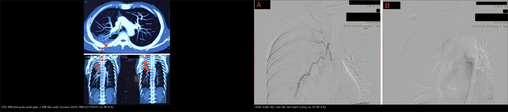
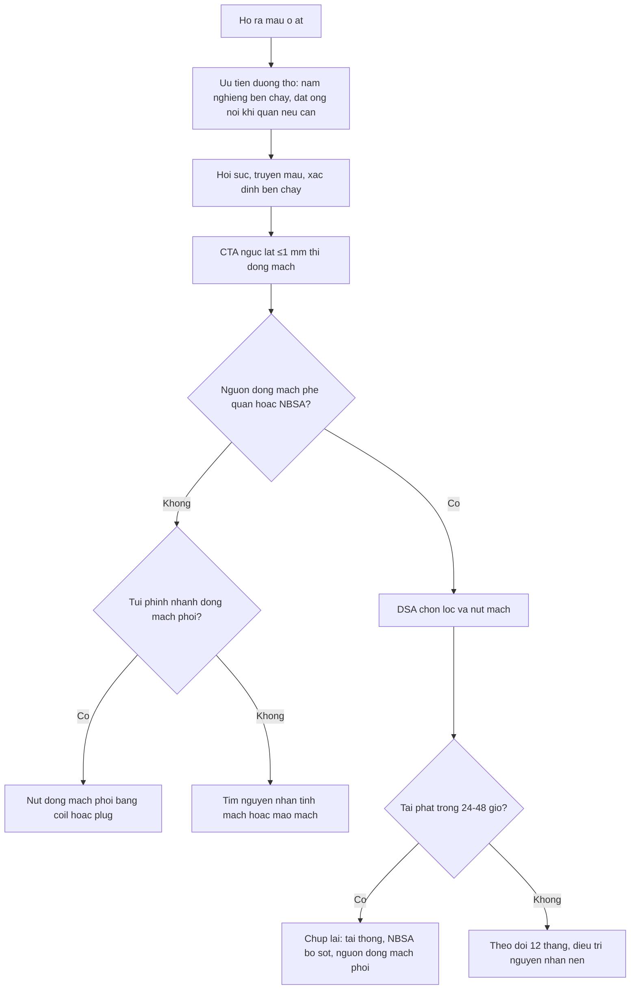
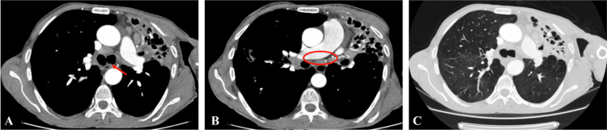
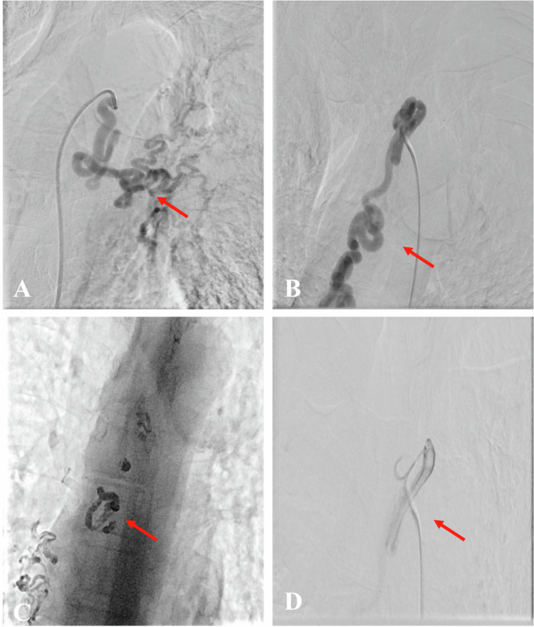
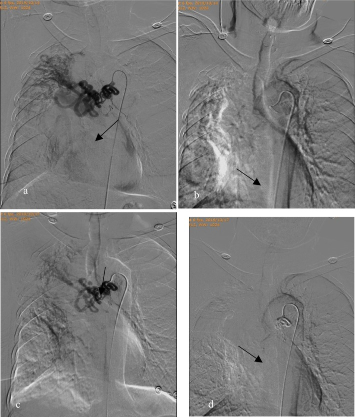

# 091 — Ho ra máu ồ ạt & nút mạch động mạch phế quản / Massive hemoptysis and bronchial artery embolization

**Tags:** `pattern:ho-ra-mau` `pattern:chay-mau` `vung:phoi` `protocol:CTA-nguc` `protocol:DSA-nut-mach`
**Mức chắc chắn (certainty):** tổng hợp y văn (literature synthesis) — gộp 1 cohort 162 ca ho ra máu ồ ạt được nút mạch (Yue et al., *Clin Respir J* 2026, PMC13120837), 1 nghiên cứu tiến cứu 28 ca đối chiếu CTA–DSA (Haji Ahmadi et al., *Libyan J Med* 2026, PMC12903930), 1 ca nguyên văn dùng làm hình (PMC12772075), 1 ca nguyên văn về ho ra máu **tĩnh mạch** phản biện (Bertuccio et al., *Diagnostics* 2026, PMC13565564) và hướng dẫn xử trí của Hội Nội tiết châu Âu (PMC5314805 — chỉ dùng cho phần sốc). Số chưa đối chiếu được ghi **"chưa rõ"**, không bịa.

## 1. Tổng quan bệnh học – cơ chế hình ảnh

- **Vì sao ho ra máu ồ ạt giết người bằng ngạt chứ không bằng mất máu:** động mạch phế quản là nhánh của **động mạch chủ xuống**, áp lực hệ thống (~100 mmHg); động mạch phổi chỉ ~15–20 mmHg. Máu từ nhánh phế quản vỡ **phun thẳng vào lòng phế quản**, đông thành cục lấp đường thở → **tử vong do asphyxia**, không phải do thiếu thể tích. Vì vậy ưu tiên số một là **bảo vệ đường thở**, không phải truyền máu (Yue et al. 2026: tử vong 6,5–38%, "nguyên nhân tử vong thường là ngạt").
- **Ngưỡng định nghĩa (cửa 1 của Argon):** ho ra máu ồ ạt = **> 100 mL một lần** hoặc **> 500 mL/24 giờ** (Yue et al. 2026). Không có định nghĩa thống nhất toàn cầu — nên ghi rõ ngưỡng khi trao đổi với đồng nghiệp.
- **Vì sao mạch phế quản phì đại (hypertrophy):** viêm mạn (lao, giãn phế quản, nấm hang) → **giảm tưới máu phổi + thiếu oxy mô** → giãn mạch và tăng sinh mao mạch, kèm **shunt hệ thống–phổi**. Trên CTA, mạch phì đại khi **đường kính > 2 mm** (bình thường **< 1,5 mm** ở đoạn gần, **0,5 mm** ở đoạn xa — Haji Ahmadi et al. 2026). Trong 28 ca của nhóm này, **42,9% phì đại động mạch phế quản phải**, **25,0% bên trái** (ngưỡng > 2 mm).
- **Vì sao phải chụp CTA trước DSA — ba lý do quyết định:**
  1. **Tìm nguồn ngoài phế quản:** **25% ca (7/28)** có **động mạch hệ thống không phải phế quản (NBSA)** — liên sườn, động mạch ngực trong, nhánh dưới đòn, hoành, thân tạng. Bỏ sót = nút mạch xong vẫn chảy.
  2. **Xác định vị trí xuất phát** (orthotopic từ động mạch chủ xuống ngang T5–T6 so với **ectopic** từ cung động mạch chủ/thân sườn–phế quản) — quyết định ống thông và thời gian thủ thuật.
  3. **Nhìn thấy động mạch cấp máu tủy** trước khi bơm hạt — nút nhầm nhánh này gây **nhồi máu tủy sống** (biến chứng thảm khốc, hiếm nhưng không hồi phục).
- **Hiệu quả thật của nút mạch (đừng hứa quá):** thành công kỹ thuật **98,76% (160/162)**, nhưng **thành công lâm sàng 12 tháng chỉ 70,99% (115/162)**; **47 ca tái phát**, thời gian tái phát trung bình **26 ± 3,43 ngày** (Yue et al. 2026). Ở cohort 28 ca nhỏ hơn: thành công ngay **92,9%**, tái phát **14,3% trong 30 ngày** (Haji Ahmadi et al. 2026).
- **Nguyên nhân hay gặp (28 ca):** di chứng lao **25,0%**, giãn phế quản **21,4%**, ung thư phổi **21,4%**, lao hoạt động **10,7%**, aspergilloma **7,1%**, viêm phổi hoại tử **7,1%**, không rõ nguyên nhân **7,1%**. X-quang ngực chỉ định vị được nguồn chảy máu ở **45–60%** và gợi ý nguyên nhân ở **≤ 35%** ca → **X-quang bình thường không loại trừ ho ra máu nguy hiểm**.

## 2. Mẫu hình + chẩn đoán phân biệt theo vị trí nguồn chảy (gamut)

**Câu hỏi thực hành:** bệnh nhân đang ho ra máu — máu **từ đâu**? Chọn theo 4 tầng giải phẫu, vì mỗi tầng có can thiệp khác nhau.

1. **Động mạch phế quản (phần lớn ca):** giãn/phì đại do viêm mạn, lao, giãn phế quản, nấm hang. → **Nút mạch phế quản (BAE)** là điều trị đầu tay.
2. **Động mạch hệ thống không phải phế quản (NBSA):** liên sườn, ngực trong, dưới đòn, hoành, thân tạng — xuất hiện khi có **dính màng phổi/thành ngực** hoặc bệnh màng phổi mạn. 25% ca trong cohort trên.
3. **Động mạch phổi:** **phình giả Rasmussen** trong hang lao, **phình giả sau đặt catheter Swan–Ganz**, hội chứng Hughes–Stovin, Behçet, dị dạng động–tĩnh mạch. → BAE **thất bại**, phải **nút nhánh động mạch phổi bằng coil/plug**.
4. **Tĩnh mạch / mao mạch:** **giãn tĩnh mạch khí quản** do tắc tĩnh mạch chủ trên (bướu giáp sau xương ức, huyết khối, xơ trung thất) — BAE không bao giờ cầm; và **xuất huyết phế nang lan tỏa** (miễn dịch, nhiễm trùng, tim mạch) — máu mao mạch, không có mạch nguồn để nút.
- Gợi nhớ **"B–N–P–V"**: **B**ronchial (phế quản) → **N**on-bronchial systemic → **P**ulmonary artery → **V**enous/capillary.

## 3. Bảng so sánh phân biệt (ma trận đối chiếu)

| Thực thể (entity) | Hình ảnh điển hình (CT/DSA) | Chốt vào (rule-in) | Chốt loại (rule-out) | Gợi ý xác nhận |
|---|---|---|---|---|
| Nguồn động mạch phế quản | CTA: **nhánh > 2 mm**, xuất phát từ động mạch chủ xuống T5–T6, đi dọc phế quản; DSA: mạch giãn, xoắn, "corkscrew", tăng tưới máu | **Mạch > 2 mm + xuất phát trực tiếp từ ĐMC xuống** | Không thấy nhánh phế quản giãn nhưng vẫn chảy máu → tìm NBSA/ĐM phổi | CTA ≤ 1 mm thì động mạch; DSA chọn lọc |
| NBSA (liên sườn, ngực trong, dưới đòn) | CTA: nhánh từ **thành ngực/màng phổi dày**, chạy vào tổn thương phổi qua dính màng phổi | **Nhánh nuôi từ ngoài phổi đi vào tổn thương + màng phổi dày** | Mạch xuất phát từ ĐMC xuống đúng vị trí phế quản → là phế quản | CTA dựng MIP coronal; **phải nút cả NBSA** |
| Phình giả / phình động mạch phổi (Rasmussen) | CTA: túi phình từ **nhánh động mạch phổi** sát thành hang; DSA phổi: đầy thuốc giữ hình | **Túi phình nối với nhánh ĐM phổi + hang lao cũ** | Phình từ ĐMC/ĐM phế quản → nút phế quản | Chụp **động mạch phổi** chọn lọc, không phải chỉ chụp ĐMC |
| Giãn tĩnh mạch khí quản (tắc TM chủ trên) | CT: hẹp/tắc TM chủ trên + **tuần hoàn bàng hệ trung thất–thành ngực**; nội soi: tĩnh mạch dưới niêm mạc | **Tái phát sau BAE "kỹ thuật tốt" + tắc TM chủ trên** | Mạch phế quản giãn rõ + không tắc tĩnh mạch → nguồn động mạch | Nội soi phế quản + NBI; **tái thông tĩnh mạch**, không nút động mạch |
| Xuất huyết phế nang lan tỏa | CT: **GGO/đông đặc lan tỏa hai bên**, không có mạch nguồn | **Đông đặc lan tỏa + thiếu máu + không ổ khu trú** | Ổ khu trú + mạch giãn → nguồn mạch | Rửa phế quản (hemosiderin), miễn dịch |

*Trái: CTA — mũi tên xanh chỉ động mạch phế quản phải giãn, mũi tên đỏ chỉ giãn phế quản; các panel dưới: động mạch liên sườn 1–6 giãn (mũi tên đỏ). Phải: DSA trước (A) và sau (B) nút mạch bằng PVA + keo. Nguồn: Cureus 2025, PMC12772075 Fig. 3 và Fig. 5, CC BY 4.0. Ảnh ghép letterbox, không crop.*

### Đọc DSA đúng thứ tự (tránh nút nhầm)
1. **Xác định catheter đang ở đâu** (ĐMC xuống / thân sườn–phế quản / nhánh liên sườn) — chụp "flush" trước, chọn lọc sau.
2. **Tìm nhánh cấp máu tủy (artery of Adamkiewicz)** — nếu nhánh liên sườn–thắt lưng cho nhánh xuống tủy, **không được nút** hoặc phải vượt qua nhánh đó.
3. **Chụp thì muộn** tìm **shunt hệ thống–phổi** và **xuất thuốc (extravasation)**.
4. **Nút đến khi mất tưới máu ổ tổn thương** ("pruning"), không nút "cho đẹp" toàn bộ mạch lành.

## 4. Protocol chụp + phân độ & quyết định can thiệp

**CTA ngực (trước DSA, mọi ca không chắc nguồn):**
- Lát **≤ 1 mm**, cửa sổ trung thất + phổi, **thì động mạch** (bolus tracking, ~25–35 giây), phủ **từ đỉnh phổi đến trên cơ hoành**.
- Dựng **MIP coronal/sagittal** để lần theo mạch; đo **đường kính mạch phế quản (mm)** và ghi **vị trí xuất phát** (orthotopic vs ectopic) vào phiếu.
- Ghi rõ **có/không NBSA**, **có/không túi phình nhánh phổi**, **có/không giãn tĩnh mạch trung thất**.
- **Đối chiếu CTA–DSA chỉ ở mức trung bình** cho phát hiện phì đại (Cohen's kappa mức "moderate", Haji Ahmadi et al. 2026) → **CTA âm tính vẫn phải chụp DSA nếu lâm sàng nặng**.

**Vật liệu nút mạch (kinh điển):**

| Vật liệu | Dùng khi | Lưu ý |
|---|---|---|
| Hạt PVA 355–500 µm | Nguồn phế quản thông thường | Không dùng hạt quá nhỏ (< 300 µm) → nguy cơ hoại tử phế quản/tủy |
| Bọt gelatin (gelfoam) | Cầm máu tạm, ca cấp cứu | Tái thông sau vài tuần → tái phát muộn |
| Keo NBCA / Glubran–Lipiodol | Tái phát, mạch xoắn lớn, shunt | Khó kiểm soát, nguy cơ hoại tử nếu bơm xa |
| Coil / plug | Phình, phình giả, mạch lớn | Để lại dị vật vĩnh viễn trong mạch |

- **Nút mạch hay mổ?** BAE là **điều trị đầu tay** cho ho ra máu ồ ạt (ít xâm lấn, làm được ngay cả khi bệnh nhân nặng). **Mổ** dành cho: thất bại/tái phát sau ≥ 2 lần nút, **phình động mạch phổi lớn không nút được**, **vỡ phế quản–màng phổi**, hoặc tổn thương khu trú mổ được (u, giãn phế quản một thùy) ở bệnh nhân đủ điều kiện.
- **Theo dõi sau nút:** nằm lại **24–48 giờ** (đa số tái phát sớm trong **26 ngày** — Yue et al. 2026), chụp lại khi ho ra máu tái diễn; đánh giá hiệu quả lúc **30 ngày** và **12 tháng**.

## 5. Biến thể bình thường và cạm bẫy

- **Biến thể bình thường:** động mạch phế quản phải thường xuất phát từ **thân sườn–phế quản (intercostobronchial trunk)**, không phải trực tiếp từ ĐMC; có ca **xuất phát lạc chỗ (ectopic)** từ cung ĐMC — đọc CTA mà không lần theo gốc sẽ tưởng "không có mạch phế quản".
- **Cạm bẫy 1 — tĩnh mạch:** ho ra máu tái phát **trong 24 giờ sau BAE "kỹ thuật tốt"** ở người có **bướu giáp sau xương ức/tắc TM chủ trên** → giãn tĩnh mạch khí quản, **không phải** nguồn động mạch; nút thêm động mạch vô ích, phải **tái thông tĩnh mạch** (Bertuccio et al. 2026, PMC13565564).
- **Cạm bẫy 2 — nguồn động mạch phổi:** hang lao + ho máu + **túi phình sát thành hang** → nút phế quản xong vẫn chảy; phải chụp **động mạch phổi**.
- **Cạm bẫy 3 — bỏ sót NBSA:** chỉ nút nhánh phế quản khi có nhánh liên sườn/ngực trong nuôi ổ tổn thương → tái phát sớm; **nút cả hai**.
- **Cạm bẫy 4 — nhồi máu tủy sống:** bơm hạt vào nhánh liên sườn–thắt lưng có nhánh tủy; luôn chụp kiểm tra trước khi bơm, dùng hạt **≥ 355 µm**.
- **Cạm bẫy 5 — "máu đỏ tươi = động mạch":** không đáng tin; máu từ tĩnh mạch cổ/khí quản cũng đỏ tươi. Dựa vào **CTA + nội soi**, không dựa màu máu.
- **Cạm bẫy hình ảnh của bài gốc:** ở Fig. 1C (PMC12903930) chú thích gốc ghi **xẹp thùy trên phổi phải**, trong khi hình cho thấy đám mờ bên **trái** — ghi nhận sự không khớp của nguồn, không tự sửa chú thích.

## 6. Tự lượng giá — Blind Quiz

**Ca 1 — Nam 52 tuổi, ho ra máu; CTA ngực có cản quang. Trước khi đọc đáp án, hãy chỉ ra mạch bất thường.**

- Gợi ý lâm sàng: ho ra máu mức trung bình–nhiều, có bệnh phổi nền.
- Câu hỏi: Mạch nào giãn? Xuất phát từ đâu? Có cần tìm thêm nguồn ngoài phế quản không?

<b>Bấm để hiện đáp án (findings + chẩn đoán)</b>

- Dấu hiệu: **động mạch phế quản trái giãn, xoắn** (mũi tên đỏ A/B), xuất phát **trực tiếp từ động mạch chủ xuống ở vị trí 12 giờ** (orthotopic); hình C (cửa sổ phổi) có xẹp phổi + giãn phế quản.
- Chẩn đoán: **ho ra máu do động mạch phế quản phì đại** — vì viêm mạn làm tăng sinh mạch hệ thống trong phổi.
- Bước tiếp: DSA chọn lọc + nút mạch; **vẫn phải tìm NBSA** vì 25% ca có nhánh ngoài phế quản.
- Nguồn ảnh: *Libyan J Med* 2026, PMC12903930 Fig. 1, CC BY-NC 4.0 (nguyên bản, không chỉnh sửa).

**Ca 2 — Vẫn ca trên: DSA chọn lọc. Nhìn 4 panel, đoán panel nào là "sau nút".**

- Câu hỏi: Panel nào chứng minh nút thành công? Vì sao panel B lại quan trọng về mặt kỹ thuật?

<b>Bấm để hiện đáp án</b>

- Dấu hiệu: **A** — động mạch phế quản trái giãn, xoắn; **B** — động mạch phế quản **phải xuất phát lạc chỗ từ mặt dưới cung động mạch chủ**, đường đi ngoằn ngoèo; **C** — **tắc hoàn toàn** mạch bất thường sau nút bằng PVA + keo; **D** — tắc mạch sau bơm PVA.
- Ý nghĩa: gốc lạc chỗ khiến thao tác chọn lọc khó — phải chụp "flush" trước để không bỏ sót.
- Nguồn: PMC12903930 Fig. 2, CC BY-NC 4.0.

**Ca 3 — Nam 74 tuổi, giãn phế quản, ho ra máu ồ ạt tái phát sau lần nút đầu. Nhìn DSA, giải thích vì sao tái phát.**

- Câu hỏi: 3 chẩn đoán phân biệt cho tái phát sớm? Panel nào cho thấy "mạch vẫn còn" và vật liệu lần hai là gì?

<b>Bấm để hiện đáp án</b>

- Dấu hiệu: (a) động mạch phế quản phải giãn, xoắn, tăng tưới máu; (b) sau nút PVA + gelfoam — mạch "pruned"; (c) **chụp lại trước lần nút thứ hai: mạch vẫn phì đại, xoắn kiểu "corkscrew"**; (d) sau nút **NBCA**: mạch tắc, ổ tăng tưới máu biến mất.
- Chẩn đoán: **tái phát do tái thông/không nút hết nguồn** — trong cohort 162 ca, tái phát 47 ca, trung bình **26 ngày**; thành công lâm sàng 12 tháng chỉ **70,99%**.
- Phân biệt: (1) tái thông mạch đã nút (gelatin sponge tan); (2) **NBSA bỏ sót**; (3) nguồn **động mạch phổi** (Rasmussen) không được nút.
- Nguồn: *Clin Respir J* 2026, PMC13120837 Fig. 4, CC BY 4.0.

## Bài liên quan chéo
- [001 – Tổng quan hệ Ngực](../001-tong-quan-he-nguc/lesson.md)
- [025 – Hang & nấm phổi](../025-ton-thuong-phoi-tao-hang/lesson.md) (phình giả Rasmussen trong hang lao)
- [041 – Tràn khí màng phổi](../041-tran-khi-mang-phoi/lesson.md)
- [049 – Theo dõi sau cắt thùy phổi](../049-theo-doi-sau-cat-thuy-phoi-bam-sinh/lesson.md)
- [084 – Viêm phổi thở máy](../084-viem-phoi-tho-may/lesson.md) (bảo vệ đường thở ở ICU)
- [092 – Suy thượng thận & suy tuyến yên quanh mổ](../092-suy-thuong-than-suy-tuyen-yen-quanh-mo/lesson.md) (tụt HA kháng trị sau can thiệp)

> Không dùng để chẩn đoán độc lập khi chưa có người hướng dẫn.
