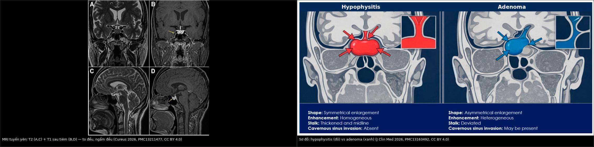
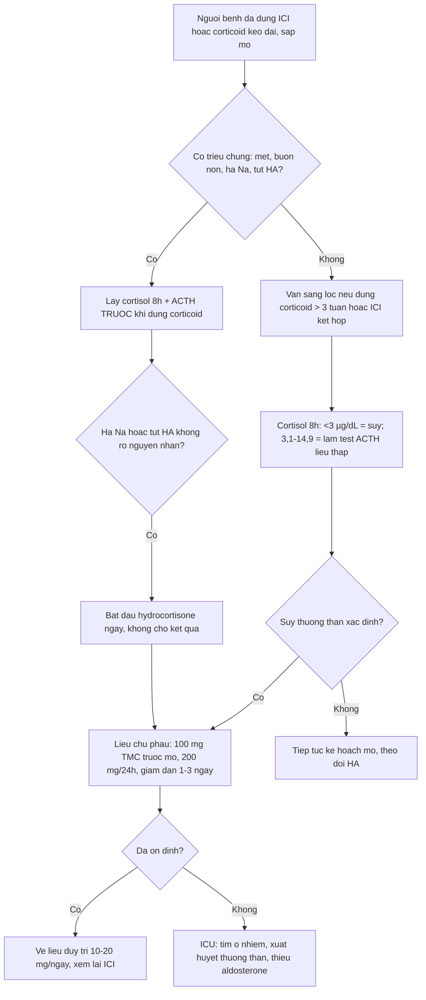
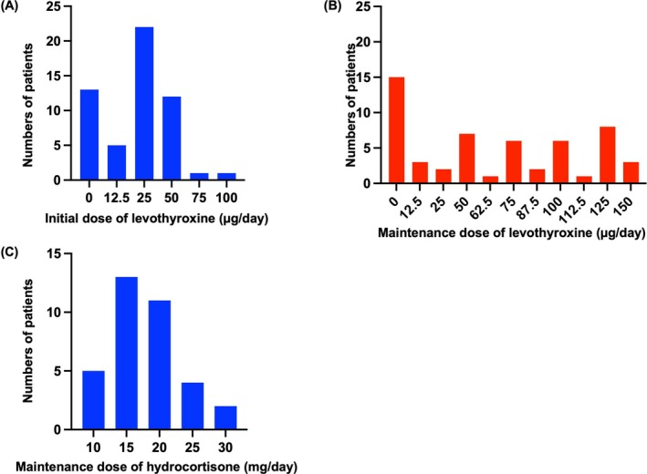
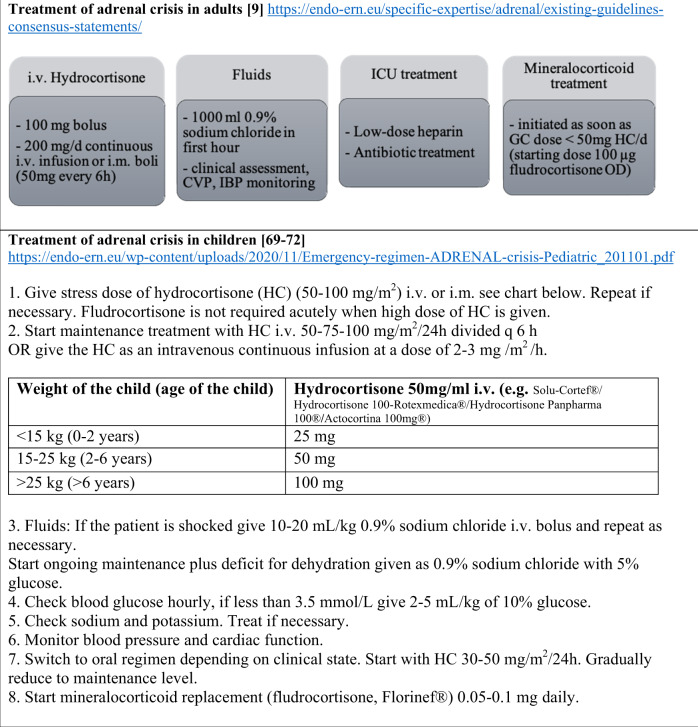
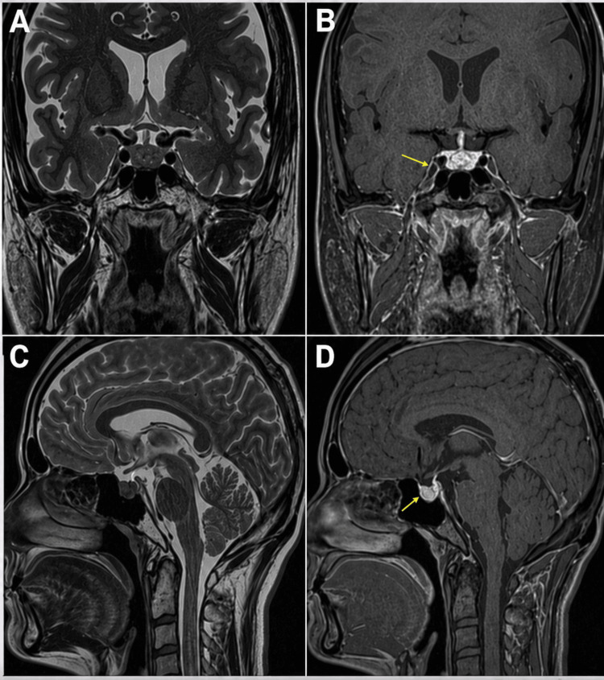
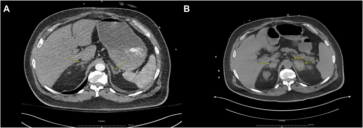

# 092 — Suy thượng thận & suy tuyến yên do ức chế điểm kiểm soát miễn dịch quanh mổ / Perioperative adrenal insufficiency and hypophysitis after immune checkpoint inhibitors

**Tags:** `pattern:suy-noi-tiet` `pattern:kinh-mo` `vung:tuyen-yen` `vung:thuong-than` `protocol:MRI-tuyen-yen` `protocol:CT-bung` `score:CTCAE`
**Mức chắc chắn (certainty):** tổng hợp y văn (literature synthesis) — 1 nghiên cứu 12 978 bệnh nhân dùng ICI (Kamitani et al., *J Clin Endocrinol Metab* 2025, PMC12712991), 1 nghiên cứu tiến cứu sàng lọc trước mổ tim–lồng ngực 98 bệnh nhân (Manosroi & Atthakomol, *Medicina* 2023, PMC9864834), 1 tổng quan về hypophysitis (Iglesias, *J Clin Med* 2026, PMC13163492), 1 ca nguyên văn MRI (Alasmar et al., *Cureus* 2026, PMC13211477), 1 ca nguyên văn xuất huyết thượng thận hai bên sau CABG (Yeh et al., *AACE Endocrinol Diabetes* 2025, PMC12744800), 1 ca sốc quanh mổ (Gültekin et al., *Cureus* 2025, PMC12392692) và hướng dẫn cấp cứu của Hội Nội tiết châu Âu (Arlt, *Endocr Connect* 2016, PMC5314805). Chỗ chưa kiểm chứng ghi **"chưa rõ"**.

## 1. Tổng quan bệnh học – cơ chế hình ảnh

- **Vì sao ức chế điểm kiểm soát (immune checkpoint inhibitor — ICI) gây suy nội tiết:** kháng thể kháng **CTLA-4** hoạt hóa bổ thể tại tuyến yên (phản ứng quá mẫn type II) → **viêm tuyến yên (hypophysitis)**; kháng thể kháng **PD-1/PD-L1** thường chỉ gây **thiếu ACTH đơn độc** với **MRI tuyến yên bình thường**. Đây là điểm khác biệt lớn nhất giữa hai nhóm thuốc và là lý do **MRI âm tính không loại trừ suy thượng thận thứ phát**.
- **Vì sao thiếu cortisol gây tụt huyết áp kháng vận mạch:** cortisol là **chất cho phép (permissive)** của catecholamine — thiếu cortisol làm **giảm biểu hiện thụ thể α-adrenergic** ở mạch, giảm co mạch và giảm thể tích tuần hoàn. Vì vậy bệnh nhân **không đáp ứng với noradrenaline/adrenaline liều cao** cho tới khi bù glucocorticoid. Ca quanh mổ của Gültekin et al. 2025 chính là hình ảnh này: sốc trong mổ bắc cầu chủ–đùi, **không đáp ứng vận mạch liều cao**, giải quyết trong vòng 1 giờ sau **methylprednisolone 75 mg**.
- **Vì sao hạ Na⁺ mà K⁺ bình thường/giảm (khác suy thượng thận nguyên phát):** trong suy **thứ phát** (thiếu ACTH), **aldosterone còn** → không giữ K⁺, không toan; cortisol thiếu làm **tăng ADH** và giảm thanh thải nước tự do → **hạ Na⁺**. Thiếu aldosterone (nguyên phát) mới có **tăng K⁺, nhiễm toan, tăng sắc tố**. Ca Gültekin: **hạ K⁺** là manh mối chỉ ra suy **thứ phát**.
- **Ngưỡng định lượng phải nhớ (cửa 1 của Argon):**
  - **Tần suất bất thường nội tiết do ICI** (12 978 bệnh nhân, Nhật Bản): **một tuyến 12,0%**, **nhiều tuyến 1,4%**; phối hợp hay gặp nhất là **suy giáp + suy thượng thận 1,3%** (Kamitani et al. 2025).
  - **Trong hypophysitis do ICI:** **thiếu ACTH 60–80%** lúc chẩn đoán; suy giáp trung ương **40–70%**; suy sinh dục **40–60%** (Iglesias 2026).
  - **Sàng lọc trước mổ tim–lồng ngực** (98 bệnh nhân): **34,7% có suy thượng thận** theo test ACTH liều thấp; bù **hydrocortisone 100 mg trước mổ + 200 mg/24 giờ** cho kết cục **tương đương** nhóm bình thường, chỉ **tăng đường huyết cần insulin** (OR **14,15**; KTC 95% 1,44–138,60; p = 0,02) (Manosroi & Atthakomol 2023).
  - **Ngưỡng chẩn đoán dùng trong nghiên cứu trên:** cortisol 8 giờ sáng **< 3 µg/dL (≈ 83 nmol/L)** = suy thượng thận; **3,1–14,9 µg/dL (≈ 86–414 nmol/L)** = vùng xám → làm **test ACTH liều thấp 5 µg**, đỉnh **< 15 µg/dL (≈ 414 nmol/L)** = suy thượng thận. **Suy thượng thận liên quan bệnh nặng (CIRCI):** cortisol ngẫu nhiên **< 10 µg/dL** khi đang tụt huyết áp.
  - **Tần suất cơn suy thượng thận cấp:** **8/100 bệnh nhân–năm** ở người đã có suy thượng thận (Dineen et al. 2019, PMC6566489) — nghĩa là **nguy cơ luôn hiện diện**, không chỉ trong mổ.
  - **Xuất huyết thượng thận hai bên (BAH) + suy thượng thận:** tử vong **tới 27,8%**, và **tới 100% nếu không chẩn đoán** (Yeh et al. 2025).
- **Vì sao hình ảnh vẫn cần dù chẩn đoán là sinh hóa:** MRI tuyến yên trả lời "viêm hay u", CT bụng trả lời "xuất huyết/ di căn/ teo" — hai câu hỏi này đổi thái độ điều trị (corticoid liều cao ± phẫu thuật giải ép **so với** bù hormone đơn thuần).

## 2. Mẫu hình + chẩn đoán phân biệt theo vị trí (gamut)

**Câu hỏi thực hành:** bệnh nhân **đã dùng ICI, sắp hoặc vừa mổ** (cắt phổi, cắt thực quản, CABG) nay **mệt, buồn nôn, hạ Na⁺, tụt HA không đáp ứng vận mạch** — suy thượng thận do ICI, do corticoid kéo dài, do xuất huyết thượng thận, hay sốc nhiễm khuẩn?

**Theo tầng tổn thương:**
1. **Tuyến yên (thứ phát):** hypophysitis do ICI (CTLA-4), thiếu ACTH đơn độc (PD-1/PD-L1), u tuyến yên, apoplexy, Sheehan, IgG4, di căn, sau xạ não — **phải loại u/apoplexy trước khi quy cho thuốc**.
2. **Thượng thận (nguyên phát):** xuất huyết hai bên (HIT, kháng đông, sốc nhiễm khuẩn, sau CABG), di căn, lao/nấm, lymphoma, bệnh tự miễn teo tuyến, sau cắt thượng thận.
3. **Do thuốc khác:** **corticoid kéo dài** (ức chế trục HPA — nguyên nhân hay bị bỏ qua nhất ở bệnh nhân ung thư), megestrol, ketoconazole, abiraterone, thuốc ức chế miễn dịch.
4. **Giả suy thượng thận:** sốc nhiễm khuẩn (CIRCI), suy giáp nặng, hội chứng thận hư (mất protein gắn cortisol) — cortisol toàn phần thấp nhưng cortisol tự do bình thường.

**Theo hình ảnh tuyến yên:**

| Mẫu hình MRI | Nghĩ tới |
|---|---|
| Tuyến yên **to đều, ngấm đều, cuống dày, không xâm lấn xoang hang** | Hypophysitis (ICI-CTLA-4, lymphocytic, IgG4) |
| Tuyến yên **bình thường** | Thiếu ACTH đơn độc do PD-1/PD-L1; suy trục do corticoid ngoại sinh |
| **Khối không đều, cuống lệch, có thể xâm lấn xoang hang** | U tuyến yên (adenoma) |
| **T1 sáng trong tuyến** | Apoplexy/xuất huyết tuyến yên — cấp cứu |
| **Tuyến teo nhỏ** | Suy tuyến yên mạn, sau xạ/mổ |

**Theo hình ảnh thượng thận trên CT:**

| Mẫu hình | Nghĩ tới |
|---|---|
| **Hai thượng thận to, không đều, đậm độ hỗn hợp** sau mổ/kháng đông | **Xuất huyết thượng thận hai bên** |
| Khối hai bên, bờ không đều, di căn nơi khác | Di căn (phổi, vú, melanoma) |
| Vôi hóa + teo | Lao/nấm cũ, xuất huyết cũ |
| Tuyến mảnh, teo đều | Suy thượng thận tự miễn mạn |
| Nhân **< 10 HU** trên CT không cản quang | Adenoma lành (ngưỡng kinh điển — **chưa đối chiếu nguồn trong lượt này**) |

## 3. Bảng so sánh phân biệt (ma trận đối chiếu)

| Thực thể (entity) | Hình ảnh / xét nghiệm điển hình | Chốt vào (rule-in) | Chốt loại (rule-out) | Gợi ý xác nhận |
|---|---|---|---|---|
| Hypophysitis do ICI | MRI: **to đều, ngấm đều, cuống dày**, không xâm lấn xoang hang; đau đầu, hạ Na⁺ | **ACTH thấp + cortisol thấp + MRI to đều/cuống dày** (hoặc MRI bình thường với PD-1) | Khối không đều + cuống lệch → **adenoma**, không phải viêm | MRI tuyến yên lát mỏng 2–3 mm trước/sau tiêm; ACTH + cortisol 8h |
| U tuyến yên (adenoma) | **Không đều, cuống lệch, có thể xâm lấn xoang hang**; ngấm không đồng nhất | **Bờ không đều + lệch cuống + khối > 10 mm** | To đều, cuống giữa, ngấm đều → hypophysitis | MRI + thị trường + prolactin/IGF-1 |
| Suy thượng thận nguyên phát (Addison, BAH) | CT: thượng thận to/hỗn hợp (xuất huyết) hoặc teo; **hạ Na⁺ + tăng K⁺**, tăng sắc tố | **ACTH cao + cortisol thấp + tăng K⁺** | K⁺ bình thường/giảm + không tăng sắc tố → **thứ phát** | ACTH, renin, aldosterone; CT bụng |
| Suy thượng thận thứ phát (ICI/ corticoid) | MRI tuyến yên bình thường hoặc to đều; **hạ Na⁺, K⁺ bình thường/giảm**, không tăng sắc tố | **ACTH thấp/không tăng + cortisol thấp + K⁺ bình thường** | ACTH tăng → nguyên phát | Cortisol 8h + ACTH; test ACTH liều thấp |
| Sốc nhiễm khuẩn (CIRCI) | Nhiễm khuẩn rõ, lactate cao, CT ổ nhiễm; cortisol có thể thấp | **Cortisol ngẫu nhiên < 10 µg/dL khi tụt HA + ổ nhiễm** | Cortisol cao, đáp ứng vận mạch tốt → không phải CIRCI | Cấy máu, lactate; cortisol trước khi dùng corticoid |
| Xuất huyết thượng thận hai bên sau mổ | CT: **hai tuyến to, đậm độ hỗn hợp**, thường có **giảm tiểu cầu (HIT)** | **CT hai tuyến to hỗn hợp + tiểu cầu giảm + hạ Na⁺** | Tuyến bình thường trên CT → tìm nguyên nhân khác | CT bụng không/ có cản quang; HIT-PF4 |

*Trái: MRI tuyến yên — T2 coronal/sagittal (A, C) và T1 sau tiêm (B, D): tuyến yên to, ngấm thuốc đều (mũi tên vàng). Phải: sơ đồ đối chiếu — hypophysitis (đỏ): to **đối xứng**, ngấm **đồng nhất**, cuống **dày và giữa**, **không** xâm lấn xoang hang; adenoma (xanh): to **không đối xứng**, ngấm **không đồng nhất**, cuống **lệch**, **có thể** xâm lấn xoang hang. Nguồn: PMC13211477 Fig. 1 và PMC13163492 Fig. 3, CC BY 4.0. Ảnh ghép letterbox.*

### Vì sao "bình thường trên MRI" vẫn có thể là suy thượng thận
- Với **PD-1/PD-L1**, tổn thương là **thiếu ACTH chức năng** chứ không phải viêm có khối → MRI **bình thường** ở đa số; chẩn đoán **bằng sinh hóa**, không bằng hình ảnh (Iglesias 2026).
- Ngược lại, **to tuyến yên đơn thuần** ở người ung thư có thể là **di căn** hoặc **adenoma tình cờ** — đừng tự động gán cho ICI.

## 4. Protocol chụp + quy trình quyết định quanh mổ

**MRI tuyến yên (khi nghi hypophysitis hoặc có triệu chứng thần kinh):**
- Lát mỏng **2–3 mm**, coronal + sagittal, **T1 trước tiêm, T1 sau tiêm** (đánh giá ngấm thuốc và cuống), **T2** (phân biệt xuất huyết/nang); thêm **T1 không mỡ (fat-sat)** nếu nghi xuất huyết.
- Đo **chiều cao tuyến yên (mm)**, **độ dày cuống**, ghi **có/không xâm lấn xoang hang**, **cuống lệch hay giữa**.
- **Không cản quang gadolinium khi mang thai** hoặc suy thận nặng (eGFR < 30) — dùng T2 + T1 không tiêm.

**CT bụng (khi nghi xuất huyết/di căn thượng thận):**
- CT **không cản quang** trước (đo HU, so sánh hai bên), sau đó thì tĩnh mạch nếu cần; **ghi rõ kích thước và đậm độ** hai tuyến.
- Ở bệnh nhân **sau CABG/sau mổ lớn có giảm tiểu cầu** → **nghĩ HIT + BAH**, chụp sớm trước khi tụt HA.

**Quy trình quanh mổ (bắt buộc trước khi gây mê):**

- **Liều cấp cứu (Hội Nội tiết châu Âu 2016):** **hydrocortisone 100 mg tiêm mạch** rồi **200 mg/24 giờ truyền liên tục** (hoặc **50 mg mỗi 6 giờ**); **NaCl 0,9% 1000 mL trong giờ đầu**; khi liều hydrocortisone xuống **< 50 mg/ngày** mới thêm **fludrocortisone 100 µg/ngày** (chỉ cần ở suy **nguyên phát**).
- **Liều duy trì:** **hydrocortisone 10–20 mg/ngày** (thực tế đa số **15–20 mg/ngày**, Nishihama et al. 2026, Fig. 3C); nếu tuyến yên to + đau đầu/rối loạn thị trường → **prednisolone 0,5–1,0 mg/kg/ngày**.

*Panel C: liều **hydrocortisone duy trì** ở 34 bệnh nhân suy thượng thận do irAE — tập trung **15–20 mg/ngày**, khớp khuyến cáo 10–20 mg/ngày. Nguồn: Nishihama K et al., *Cancer Med* 2026, PMC13071169 Fig. 3, CC BY-NC 4.0.*

- **Thứ tự hormone:** **hydrocortisone trước, levothyroxine sau 5–7 ngày** — bù giáp trước khi bù cortisol có thể gây **cơn suy thượng thận cấp** (Nishihama et al. 2026).
- **ICI có phải ngừng vĩnh viễn?** Suy nội tiết do ICI thường **kiểm soát được bằng bù hormone**; quyết định giữ/ngừng thuộc bác sĩ ung thư theo mức độ (CTCAE) và tình trạng ổn định — **không tự ngừng vì "suy thượng thận"** khi bệnh nhân đã ổn định với liều thay thế. (Chi tiết bậc thang xử trí irAE: xem [085](../085-doc-tinh-mien-dich-quanh-mo-ung-thu-phoi/lesson.md).)

*Nguồn: Nowotny H et al., *Endocrine* 2021, PMC7929907 Fig. 3, CC BY 4.0. Người lớn: hydrocortisone 100 mg bolus + 200 mg/24h truyền (hoặc 50 mg mỗi 6h), 1000 mL NaCl 0,9% giờ đầu, fludrocortisone 100 µg khi liều GC < 50 mg/ngày.*

## 5. Biến thể bình thường và cạm bẫy

- **Biến thể bình thường:** tuyến yên **to nhẹ ở phụ nữ trẻ/đang mang thai** (tăng thể tích sinh lý), **tuyến yên "rỗng" một phần**, **cuống hơi lệch** do tư thế — đừng gọi là hypophysitis nếu không có bối cảnh ICI + xét nghiệm.
- **Cạm bẫy 1 — lấy máu muộn:** nếu đã tiêm corticoid trước khi lấy cortisol/ACTH thì **không chẩn đoán được nữa**. Nhưng **không được chờ kết quả để điều trị** — lấy máu rồi tiêm ngay (Hội Nội tiết châu Âu 2016).
- **Cạm bẫy 2 — hạ Na⁺ bị quy cho SIADH:** hạ Na⁺ + tụt HA + mệt ở người dùng ICI phải **loại suy thượng thận trước**; điều trị SIADH bằng hạn chế nước ở người suy thượng thận sẽ **làm nặng thêm**.
- **Cạm bẫy 3 — dùng fludrocortisone ở suy thứ phát:** aldosterone còn → không cần, và dùng thêm gây **tăng huyết áp/hạ K⁺**.
- **Cạm bẫy 4 — bù giáp trước cortisol:** khởi động levothyroxine ở người chưa bù cortisol có thể **khởi phát cơn suy thượng thận**; luôn **cortisol trước**.
- **Cạm bẫy 5 — "suy thượng thận do ICI thì MRI phải bất thường":** với **PD-1/PD-L1**, MRI **bình thường** là điển hình; đừng bỏ chẩn đoán vì hình ảnh đẹp.
- **Cạm bẫy 6 — quên xuất huyết thượng thận sau mổ tim:** bệnh nhân **giảm tiểu cầu + đau bụng + hạ Na⁺** sau CABG = **HIT → BAH**; CT bụng là xét nghiệm chốt, chậm trễ có thể tử vong (tới 100% nếu không chẩn đoán).

## 6. Tự lượng giá — Blind Quiz

**Ca 1 — Bệnh nhân ung thư phổi, đã dùng pembrolizumab, mệt và hạ Na⁺. Xem MRI tuyến yên trước, rồi mở đáp án.**

- Gợi ý lâm sàng: mệt, chóng mặt, không đau đầu dữ dội.
- Câu hỏi: Tuyến yên to hay bình thường? Dấu hiệu nào giúp phân biệt viêm với u? Xét nghiệm nào quyết định chẩn đoán?

<b>Bấm để hiện đáp án (findings + chẩn đoán)</b>

- Dấu hiệu: **tuyến yên to nhẹ, ngấm thuốc đồng nhất, cuống giữa, không xâm lấn xoang hang** (mũi tên vàng ở B, D).
- Chẩn đoán: **hypophysitis do ICI** — viêm lan đều nên ngấm đều; u tuyến yên sẽ **không đều + lệch cuống**.
- Xác nhận: **cortisol 8 giờ sáng thấp + ACTH không tăng**; MRI chỉ hỗ trợ.
- Lưu ý: nếu là **PD-1/PD-L1 đơn trị**, MRI có thể **bình thường** mà vẫn thiếu ACTH.
- Nguồn: *Cureus* 2026, PMC13211477 Fig. 1, CC BY 4.0.

**Ca 2 — Nam 56 tuổi, 1 tuần sau CABG, đau bụng, tụt HA, tiểu cầu 154 000 → 39 000/µL, hạ Na⁺. Xem CT bụng.**

- Câu hỏi: Thượng thận thay đổi thế nào giữa hai thời điểm? Chẩn đoán? Vì sao K⁺ có thể tăng ở ca này nhưng lại giảm ở ca suy do ICI?

<b>Bấm để hiện đáp án</b>

- Dấu hiệu: (A) lúc nhập viện — **hai thượng thận bình thường**; (B) đêm tiểu cầu xuống thấp nhất — **hai thượng thận to, đậm độ không đồng nhất** = **xuất huyết thượng thận hai bên**.
- Chẩn đoán: **suy thượng thận nguyên phát do xuất huyết hai bên trong HIT sau CABG**; xác nhận bằng **test cosyntropin**, điều trị **hydrocortisone** → bệnh nhân cải thiện.
- Vì sao K⁺ khác nhau: xuất huyết phá hủy **toàn bộ vỏ** → mất aldosterone → **tăng K⁺**; suy do ICI là **thứ phát** (ACTH) → aldosterone còn → **K⁺ bình thường/giảm**.
- Nguồn: *AACE Endocrinol Diabetes* 2025, PMC12744800 Fig. 1, CC BY 4.0.

**Ca 3 — Bệnh nhân đã dùng corticoid 3 tháng, sắp mổ cắt thùy phổi. Nhìn sơ đồ xử trí, trả lời thứ tự hành động.**

- Câu hỏi: Trước khi rạch da cần làm gì? Nếu tụt HA giữa mổ, liều đầu tiên là gì? Khi nào thêm fludrocortisone?

<b>Bấm để hiện đáp án</b>

- Trước mổ: **lấy cortisol 8 giờ sáng + ACTH** (nếu chưa có), và **bù liều chu phẫu** nếu nghi suy: **hydrocortisone 100 mg tiêm mạch trước mổ**, sau đó **200 mg/24 giờ** rồi **giảm dần 1–3 ngày**.
- Nếu tụt HA giữa mổ: **100 mg hydrocortisone tiêm mạch ngay** + **1000 mL NaCl 0,9%** giờ đầu; không chờ kết quả.
- Fludrocortisone: chỉ khi **suy nguyên phát** và **liều hydrocortisone < 50 mg/ngày** (liều 100 µg/ngày).
- Vì sao: bù sớm làm **mạch đáp ứng lại catecholamine**; chậm trễ là nguyên nhân tử vong có thể tránh.
- Nguồn: PMC7929907 Fig. 3 (CC BY 4.0) + Hội Nội tiết châu Âu 2016 (PMC5314805).

## Bài liên quan chéo
- [001 – Tổng quan hệ Ngực](../001-tong-quan-he-nguc/lesson.md)
- [085 – Độc tính miễn dịch quanh mổ sau hóa–miễn dịch ung thư phổi](../085-doc-tinh-mien-dich-quanh-mo-ung-thu-phoi/lesson.md)
- [043 – Chăm sóc hô hấp quanh mổ & TIS](../043-cham-soc-ho-hap-quanh-mo-tis-eos/lesson.md)
- [084 – Viêm phổi thở máy](../084-viem-phoi-tho-may/lesson.md)
- [091 – Ho ra máu ồ ạt & nút mạch động mạch phế quản](../091-ho-ra-mau-oat-nut-mach-dong-mach-phe-quan/lesson.md)

> Không dùng để chẩn đoán độc lập khi chưa có người hướng dẫn.
