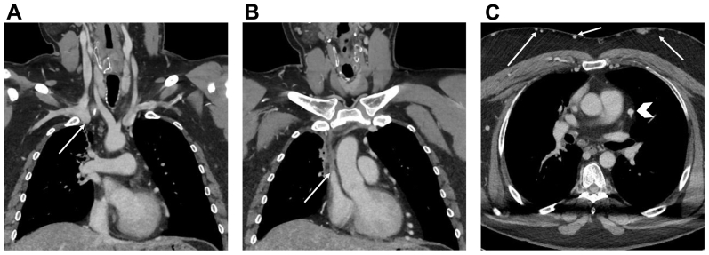
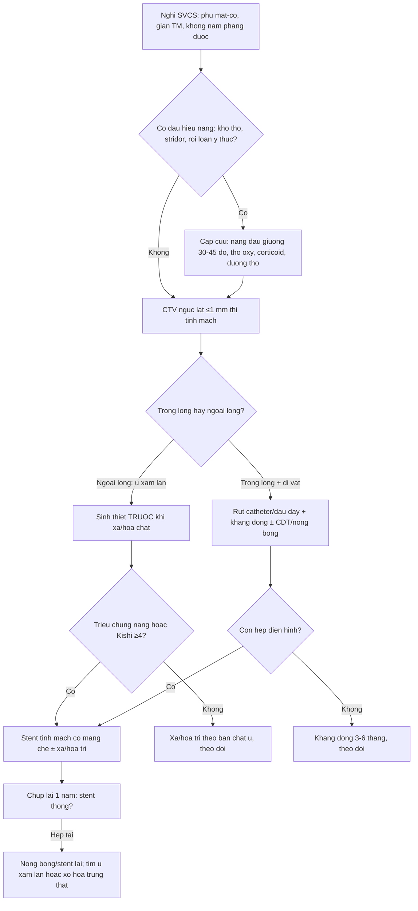
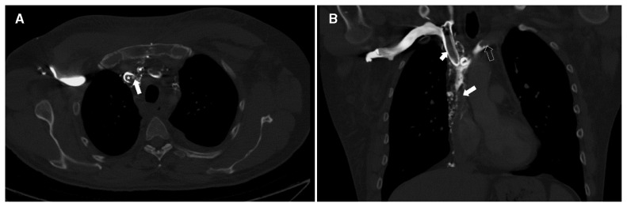
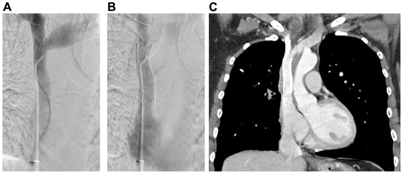
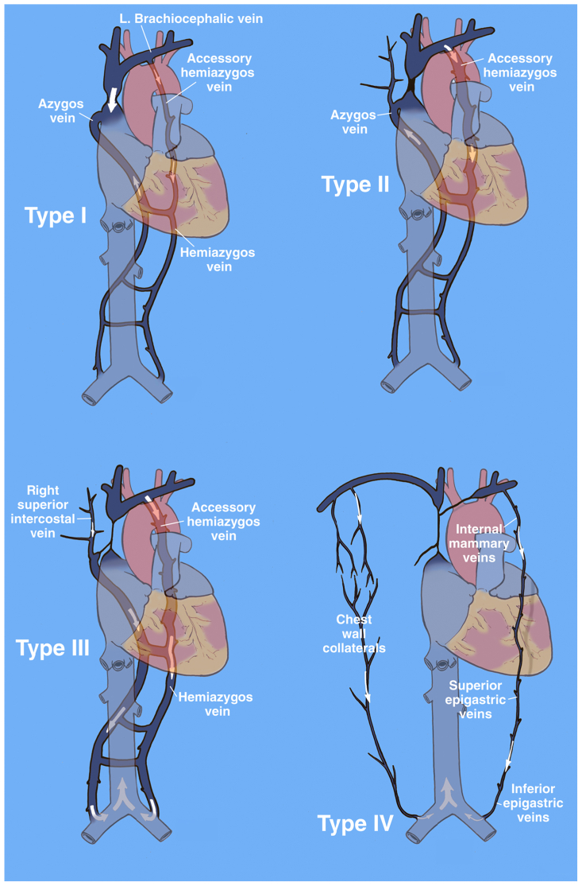

# 093 — Hội chứng tĩnh mạch chủ trên / Superior vena cava syndrome (SVCS)

**Tags:** `pattern:hep-tinh-mach` `pattern:tuan-hoan-bang-he` `vung:trung-that` `protocol:CTV-nguc` `protocol:stent-tinh-mach` `score:Stanford-Doty` `score:Kishi`
**Mức chắc chắn (certainty):** tổng hợp y văn (literature synthesis) — 1 review hệ thống có thống kê gộp (Sen I et al., *J Vasc Surg Venous Lymphat Disord* 2026, PMC13098589), 1 tổng quan (umbrella review) về phân độ và xử trí (Shah RP et al., *Cureus* 2023, PMC10439982), và 1 ca nguyên văn dùng làm hình (Morriello F et al., *CMAJ* 2023, PMC9851630). Số nào nguồn không nêu thì ghi **"chưa rõ"** — không bịa.

## 1. Tổng quan bệnh học – cơ chế hình ảnh

- **Giải phẫu tạo ra bệnh:** tĩnh mạch chủ trên (superior vena cava — SVC) **dài 7,1 ± 1,4 cm, đường kính 2,1 ± 0,7 cm** trên CT (thay đổi theo thể tích), dẫn khoảng **1/3 lượng máu tĩnh mạch về tim** (Shah RP et al. 2023). Thành mỏng, áp lực trong lòng thấp, lại nằm trong trung thất trước giữa xương ức và khí quản → **bất kỳ khối nào to lên trong khoang này cũng đè xẹp trước khi kịp "phá" thành mạch**.
- **Ngưỡng định lượng (cửa 1 của Argon):** diện tích cắt ngang SVC **< 1,07 cm²** được dùng làm ngưỡng chẩn đoán hẹp/chèn ép SVC trên CT (Shah RP et al. 2023). Đo bằng **diện tích**, không đoán bằng mắt — vì lòng mạch hình bầu dục nên đường kính 1 chiều đánh lừa.
- **TẠI SAO triệu chứng nặng lên khi nằm ngửa:** tắc SVC làm áp lực tĩnh mạch não–mặt–cổ tăng; nằm ngửa **bỏ mất trợ giúp của trọng lực** nên ứ càng nặng → bệnh nhân **phải kê nhiều gối, không nằm phẳng được, cúi người khó** (Sen I et al. 2026). Đây là dấu hỏi lâm sàng rẻ tiền nhất và cũng là dấu quyết định cấp cứu.
- **TẠI SAO nguy hiểm không nằm ở "tắc mạch" mà ở phù đường thở:** dịch ứ gây **phù thanh quản/hầu, khí quản**; hội chứng SVC **cấp** có suy hô hấp, rối loạn ý thức, hôn mê là **cấp cứu đe dọa tính mạng** (Sen I et al. 2026). Tử vong vì **ngạt và phù não**, không vì thiếu máu não do thiếu cung cấp.
- **TẠI SAO hẹp nặng mà bệnh nhân vẫn "bình thường":** 4 đường bàng hệ — **(1) azygos–hemiazygos** (qua liên sườn–thắt lưng, đường quan trọng nhất), **(2) ngực trong** (qua thượng vị và tĩnh mạch ngực nông), **(3) ngực bên** (qua mạch mũ nông → tĩnh mạch hiển lớn–đùi), **(4) đốt sống–cạnh đốt sống**; thể rất nặng có đường "hot quadrate sign" nối thượng vị–ngực trong (Shah RP et al. 2023). Vì vậy **mức độ triệu chứng KHÔNG tương quan với mức độ hẹp giải phẫu khi đã có bàng hệ phong phú** — câu này phải nói với đồng nghiệp trước khi đặt stent.
- **TẠI SAO phân biệt "u xâm lấn" với "huyết khối lành tính" lại quyết định điều trị:** u/lymphoma **chèn ép hoặc xâm lấn từ ngoài** → lòng mạch hẹp nhưng **không có cục máu trong lòng**; stent đặt vào sẽ bị **u mọc xuyên qua lưới** (vì vậy review khuyến nghị **stent có màng che — covered stent** cho bệnh ác tính). Ngược lại huyết khối do catheter/máy tạo nhịp là **dị vật trong lòng** → phải **rút bỏ dị vật** trước/đồng thời, nong bóng ± stent; đặt stent mà để nguyên đầu dây là mời tái hẹp (Shah RP et al. 2023; Sen I et al. 2026).
- **Dịch tễ định lượng:** u ác tính **~60%** ca; nguyên nhân iatrogenic (huyết khối/hẹp do catheter, máy tạo nhịp, ICD) **30–40%**; **28%** ca SVCS gắn với một dụng cụ/đường truyền (Rice et al., dẫn trong Shah RP et al. 2023); SVCS là biến chứng ở **0,1–3,3%** người mang máy tạo nhịp. Ở người lớn tuổi, **ung thư là nguyên nhân hàng đầu** (đặc biệt **ung thư phổi tế bào nhỏ**, sau đó **lymphoma không Hodgkin**, rồi di căn trung thất).
- **Giá trị của CT:** CT có cản quang **độ nhạy 96%, độ đặc hiệu 92%** cho chẩn đoán SVCS, và trả lời được 3 câu mà siêu âm không trả lời được: **trong lòng hay ngoài lòng, dài bao nhiêu, có bàng hệ nào** (Shah RP et al. 2023). Siêu âm Duplex **không thấy được SVC** vì bị xương sườn và phổi che.

## 2. Mẫu hình + chẩn đoán phân biệt theo vị trí (gamut)

**Câu hỏi thực hành:** hẹp/tắc **ở tầng nào** và **do cái gì**? Hai trục này quyết định cấp cứu hay không và đặt stent hay không.

**Trục A — theo tầng so với tĩnh mạch azygos** (vì azygos là "cửa thoát" duy nhất còn lại):

1. **Trên azygos (supra-azygos):** máu vẫn về tim qua azygos → **thường dung nạp tốt hơn**, bàng hệ liên sườn–azygos giữ được dòng.
2. **Ngang azygos:** **nặng nhất về triệu chứng** — không còn đường nào vào SVC, máu buộc phải đi qua bàng hệ xuống tĩnh mạch chủ dưới.
3. **Dưới azygos (infra-azygos):** máu azygos phải **chảy ngược** xuống tĩnh mạch chủ dưới → giãn tĩnh mạch thực quản/trung thất dưới, phù rõ.

**Phân độ venography Stanford–Doty** (chuẩn hay dùng nhất khi can thiệp):

| Type | Tổn thương | Dòng azygos | Ý nghĩa thực hành |
|---|---|---|---|
| I | Hẹp khít SVC nhưng **dòng còn đi đúng chiều** | Xuôi bình thường | Bàng hệ qua hemiazygos/accessory hemiazygos; thường nhẹ |
| II | **Hẹp > 90% hoặc tắc** SVC | **Azygos còn thông, dòng xuôi** | Còn "van an toàn" — can thiệp có kế hoạch |
| III | Tắc SVC **lan tới azygos**, azygos **chảy ngược** | Đảo chiều | Nặng, bàng hệ ngực–thành ngực rõ |
| IV | Tắc **lan cả brachiocephalic hai bên + azygos** | Không còn azygos | Nặng nhất; thường phải can thiệp nhiều thì |

*(Nguồn: Sen I et al. 2026, Fig. 5; đối chiếu Stanford & Doty 1986.)*

**Trục B — theo nguyên nhân (gamut):**

- **Ác tính (60%):** ung thư phổi (đặc biệt **tế bào nhỏ**) chèn ép/xâm lấn, **lymphoma không Hodgkin** (khối xâm lấn–co kéo), di căn trung thất, u tuyến ức, u màng phổi trung thất.
- **Lành tính do dụng cụ (30–40%):** huyết khối quanh **catheter tĩnh mạch trung tâm, máy tạo nhịp, ICD**; hẹp do xơ hóa quanh đầu dây.
- **Lành tính không do dụng cụ:** **xơ hóa trung thất (fibrosing mediastinitis)** — thường do lao/nấm sợi, **hẹp không đều, co kéo, có vôi hóa**; **hẹp sau xạ trị**; **bướu giáp sau xương ức**; **phình/bóc tách quai động mạch chủ**; bệnh tăng đông, Behçet.

## 3. Bảng so sánh phân biệt (ma trận đối chiếu)

| Thực thể (entity) | Hình ảnh điển hình (CTV/CT) | Chốt vào (rule-in) | Chốt loại (rule-out) | Gợi ý xác nhận |
|---|---|---|---|---|
| **U/lymphoma xâm lấn–chèn ép** | Khối mô mềm trung thất phải **liên tục với thành mạch**, lòng SVC hẹp **từ ngoài vào**, bờ ngoài gồ ghề; bàng hệ trung thất | **Khối mô mềm áp vào SVC + SVC hẹp nhưng KHÔNG có hình khuyết trong lòng** | Có khuyết trong lòng + dị vật (catheter/đầu dây) → huyết khối | Sinh thiết **trước** xạ/hóa; PET-CT |
| **Huyết khối quanh catheter/đầu dây** | **Khuyết thuốc trong lòng** SVC/brachiocephalic, thấy **catheter/đầu dây đi xuyên qua** ổ khuyết; tĩnh mạch giãn | **Dị vật trong lòng + khuyết thuốc bám quanh dị vật** | Khối mô mềm ngoài lòng, không dị vật → u/xơ | Rút dị vật ± nong bóng/stent; siêu âm tĩnh mạch cổ tay |
| **Xơ hóa trung thất** | Đám mô mềm **co kéo, không đều**, **vôi hóa**, hẹp nhiều đoạn (SVC + nhánh phổi + phế quản); thường có tiền sử lao/nấm | **Vôi hóa + co kéo + hẹp nhiều tầng** | Khối tròn, phát triển nhanh, không vôi → u | CT so phim cũ; **không sinh thiết mù** (nguy cơ chảy máu) |
| **Hẹp sau xạ** | Đoạn hẹp **đúng trường chiếu**, thành dày xơ, không khối mới | **Giới hạn hẹp trùng vùng xạ + không có khối** | Có khối mới trong trường xạ → tái phát, phải lấy mô | So sánh kế hoạch xạ; PET |
| **Bướu giáp sau xương ức** | Tuyến giáp **tăng tỷ trọng iod**, đẩy–chèn SVC/khí quản, có nang/vôi | **Tuyến giáp liên tục với cổ + chèn SVC** | Mô mềm trung thất tách rời tuyến giáp → u khác | Siêu âm cổ; CT có/không cản quang |
| **Phình/bóc tách quai ĐMC** | Giãn quai > 4 cm, **flap** hoặc huyết khối trong lòng, đè SVC | **Túi phình/flap của ĐMC** | ĐMC bình thường → loại | CTA thì động mạch, ECG-gating |
| **Giãn tĩnh mạch khí quản (hậu quả)** | Tĩnh mạch dưới niêm mạc khí quản giãn, **ho ra máu tái phát** | **Tắc SVC + ho máu + nội soi thấy tĩnh mạch dưới niêm mạc** | Không tắc SVC → tìm nguồn động mạch (bài 091) | Nội soi phế quản; **tái thông tĩnh mạch, không nút động mạch** |

*Nam 48 tuổi, SVCS do lymphoma không Hodgkin. (A) Coronal: khối xâm lấn–co kéo trung thất trên phải, mũi tên chỉ **đoạn xa tĩnh mạch brachiocephalic phải**; (B) mũi tên chỉ **đầu trên SVC** bị hẹp; (C) axial: **chevron trắng** chỉ **tĩnh mạch bàng hệ màng tim**, mũi tên trắng hai bên là bàng hệ thành ngực. Nguồn: Sen I et al., J Vasc Surg Venous Lymphat Disord 2026, PMC13098589 Fig. 1, CC BY-NC-ND 4.0 — dùng **nguyên bản**, không crop/ghép.*

### Đọc CTV theo 4 câu hỏi cố định (tránh bỏ sót)
1. **Trong lòng hay ngoài lòng?** — khuyết thuốc + dị vật = trong lòng; khối mô mềm ép = ngoài lòng.
2. **Tắc tới đâu so với azygos?** — trên/ngang/dưới azygos (quyết định mức nặng).
3. **Bàng hệ đi đường nào?** — azygos, ngực trong, ngực bên, cạnh sống (giải thích vì sao ít/nhiều triệu chứng).
4. **Có bao nhiêu "chỗ hẹp" và dài bao nhiêu cm?** — chọn cỡ stent (bài gốc dùng stent tự bung **13 mm × 10 cm** cho brachiocephalic phải + SVC, nong bóng tới **14 mm**).

## 4. Protocol chụp + phân độ & quyết định can thiệp

**CTV ngực (khảo sát chuẩn, trước mọi can thiệp):**
- Lát **≤ 1 mm**, cửa sổ trung thất, **thì tĩnh mạch**; phủ từ **tĩnh mạch cổ–dưới đòn tới tĩnh mạch chủ dưới trên gan** (để thấy đường bàng hệ xuống dưới).
- Đo và ghi vào phiếu: **diện tích lòng SVC (cm²)**, **chiều dài đoạn hẹp (cm)**, **đường kính tĩnh mạch lành kế cận (mm)**, **vị trí so với azygos**, **danh sách bàng hệ**.
- *Thông số trễ (delay) tối ưu cho thì tĩnh mạch: nguồn đã đọc **không nêu số cụ thể** — chưa rõ, cần tra thêm; đừng lấy số ước lượng làm chuẩn.*
- **IVUS (siêu âm trong lòng mạch)** là bổ trợ *trong lúc thủ thuật*: đo cỡ mạch khi lòng bị xẹp/che khuất, đo chiều dài tổn thương, phân biệt **huyết khối mềm – hẹp xơ – chèn ép từ ngoài** → chọn bóng/stent (Sen I et al. 2026).

**Phân độ & ngưỡng can thiệp:**

| Hệ | Nội dung | Ngưỡng xử trí |
|---|---|---|
| **Kishi** | Chấm điểm triệu chứng | **≥ 4 điểm → đặt stent qua da**; **< 4 → điều trị bảo tồn** sau khi cân nhắc nguyên nhân, lựa chọn khác và tiên lượng (Shah RP et al. 2023) |
| **Stanford–Doty** | Venography I–IV | Dùng mô tả mức tắc & chọn kỹ thuật; **không** phải chỉ định can thiệp |
| **Azizi** | I: tắc 2 brachiocephalic ± SVC trên azygos; II: tắc SVC trên azygos không lan brachiocephalic; III: tắc **tại** ngã ba azygos; IV: tắc **dưới** azygos | Dùng để trao đổi & nghiên cứu, thuận tiện hơn venography (Shah RP et al. 2023) |

**Hiệu quả & biến chứng (số liệu để tư vấn, không hứa hẹn):**

| Chỉ số | Số liệu | Nguồn |
|---|---|---|
| Cải thiện triệu chứng ngay sau stent | **97–99%** | Sen I et al. 2026 |
| Thành công lâm sàng gộp (54 nghiên cứu, **2249** bệnh nhân) | **96,8%**; stent thông **> 90% ở 1 năm** | dẫn trong Sen I et al. 2026 |
| Thành công kỹ thuật | **80–98%**; hẹp lại **4,3–29,5%**; tái phát **1,2–20,5%** | Shah RP et al. 2023 |
| **Covered vs uncovered** (lành tính) | Tái phát triệu chứng **29,4% vs 60%** (P = 0,044); % hẹp lại **17,9% vs 48,3%** (P < 0,001) | Sen I et al. 2026 (Haddad et al.) |
| Covered vs noncovered (12 tháng) | Thông **94% vs 48%** | Sen I et al. 2026 (Gwon et al.) |
| Biến chứng chung | **~9%**; tử vong **1–2%**; **chèn ép tim 0,1–1,8%** | Sen I et al. 2026; Shah RP et al. 2023 |
| Hẹp lại / tái phát (gộp 2200 ca) | **10,5%** (95% CI 8,4–12,6) / **10,8%** (95% CI 8,1–13,5); biến chứng **7,5%** | dẫn trong Sen I et al. 2026 |
| Xạ trị | Giảm triệu chứng **~80%**, nhưng **3 ngày – 4 tuần** mới rõ | Shah RP et al. 2023 |
| Mổ bắc cầu | Thành công **93–100%**; thông **45% / 68% / 75%** ở 1/5 năm (primary/assisted/secondary); **~50%** vẫn cần stent sau đó | Sen I et al. 2026; Shah RP et al. 2023 |

- **Kháng đông sau thủ thuật:** **3–6 tháng** khi có huyết khối cấp/bán cấp (chờ nội mạc giả phủ stent); xơ hóa trung thất có thể chỉ cần **kháng kết tập tiểu cầu** (Sen I et al. 2026). Ở SVCS lành tính, nghiên cứu Mayo **không thấy** kháng đông làm giảm hẹp lại/tái phát → đừng coi là bắt buộc tuyệt đối.
- **Theo dõi:** siêu âm Duplex/CTV/MRV **mỗi 6 tháng trong 2 năm đầu**, sau đó **hàng năm** hoặc khi triệu chứng quay lại (vì hẹp lại hầu như luôn kèm triệu chứng).
- **Cấp cứu (làm trước, hỏi sau):** **nằm đầu cao 30–45°**, tránh cúi/tránh cổ áo chật, **lợi tiểu** cho triệu chứng sớm, **corticoid** khi có phù đường thở hoặc đang xạ trị, bảo vệ đường thở; **chụp và tái thông tĩnh mạch** là can thiệp giải quyết nguyên nhân.

## 5. Biến thể bình thường và cạm bẫy

- **Biến thể bình thường:** đường kính SVC **thay đổi mạnh theo thể tích tuần hoàn** (2,1 ± 0,7 cm) — người mất nước/hạ huyết áp có SVC xẹp **giả hẹp**; đừng chẩn đoán hẹp trên phim chụp lúc bệnh nhân đang tụt huyết áp. Ngoài ra **bàng hệ tồn tại sau khi hẹp đã được giải quyết** — bàng hệ còn thấy trên CT **không** đồng nghĩa can thiệp thất bại.
- **Cạm bẫy 1 — tin vào mức độ hẹp:** hẹp 90% mà bệnh nhân chỉ hơi phù mặt là bình thường (đã có bàng hệ); ngược lại hẹp 60% cấp tính có thể gây phù thanh quản. **Đọc triệu chứng + tốc độ khởi phát**, không đọc % hẹp.
- **Cạm bẫy 2 — đặt stent khi còn dị vật:** SVCS do máy tạo nhịp/ICD/catheter mà **không rút đầu dây** → tái hẹp sớm. Nguyên tắc: **rút dị vật + nong bóng ± stent**, theo dõi sát nếu phải cấy lại dây.
- **Cạm bẫy 3 — stent có màng "nhốt" nhánh lành:** đặt covered stent qua chỗ hợp lưu có thể **bít tĩnh mạch brachiocephalic đối bên hoặc tĩnh mạch azygos**. Đã có kỹ thuật **kissing stent hai bên** hoặc **stent nhánh hình chữ Y**, nhưng **tái thông một bên thường đủ** giảm phù đầu–cổ (Sen I et al. 2026).
- **Cạm bẫy 4 — vỡ SVC gây chèn ép tim:** một phần SVC được **màng tim phủ**, nên vỡ tại đây gây **tamponade** (tử vong 1–2%, tamponade 0,1–1,8%). Xử trí: **nhận ra ngay – nong bóng kéo dài để cầm – đặt covered stent – chọc dẫn lưu màng tim dưới siêu âm**.
- **Cạm bẫy 5 — lấy mô SAU khi đã xạ:** xạ làm mất cấu trúc mô → **không còn chẩn đoán mô học được**. Với u trung thất gây SVCS, **sinh thiết trước** khi bắt đầu xạ/hóa (Shah RP et al. 2023).
- **Cạm bẫy 6 — xơ hóa trung thất bị đọc là "u tiến triển":** đám xơ **co kéo, vôi hóa, hẹp nhiều tầng** và **không to lên** theo thời gian; so phim cũ là cách phân biệt rẻ nhất. Nguồn có ca minh họa xơ hóa trung thất **đã đặt stent động mạch phổi trước đó** (Sen I et al. 2026, Fig. 4) — đừng nhầm bó mạch–xơ với khối u mới.

## 6. Tự lượng giá — Blind Quiz

**Ca 1 — Nam 48 tuổi, phù mặt–cổ, giãn tĩnh mạch ngực, không nằm phẳng được. Nhìn CTV coronal, trước khi đọc đáp án hãy chỉ ra tổn thương và 2 nhóm bàng hệ.**

- Gợi ý lâm sàng: khởi phát trong vài tuần, có khối trung thất trên phải.
- Câu hỏi: Hẹp ở tầng nào? Trong lòng hay ngoài lòng? Bàng hệ đi đường nào? Cần lấy mô trước hay đặt stent trước?

<b>Bấm để hiện đáp án (findings + chẩn đoán)</b>

- Dấu hiệu: **khối mô mềm xâm lấn–co kéo trung thất trên phải**, làm hẹp **đoạn xa brachiocephalic phải** (mũi tên A) và **đầu trên SVC** (mũi tên B). Axial (C): **bàng hệ màng tim** (chevron trắng) và **bàng hệ thành ngực hai bên** (mũi tên trắng).
- Chẩn đoán: **SVCS do lymphoma không Hodgkin xâm lấn trung thất** — hẹp **từ ngoài vào**, không có khuyết thuốc trong lòng.
- Thứ tự đúng: **sinh thiết lấy mô trước**, rồi **stent có màng che** để giải quyết triệu chứng trong khi chờ hóa trị — vì xạ/hóa trước sẽ làm mất khả năng chẩn đoán mô học.
- Nguồn ảnh: Sen I et al., *J Vasc Surg Venous Lymphat Disord* 2026, PMC13098589 Fig. 1, CC BY-NC-ND 4.0 (nguyên bản, không chỉnh sửa).

**Ca 2 — Nữ 42 tuổi, đang mang catheter tĩnh mạch trung tâm, phù nửa mặt phải. CT có cản quang: đâu là "thủ phạm" và vì sao KHÔNG đặt stent đơn thuần?**

- Câu hỏi: Khuyết thuốc nằm trong hay ngoài lòng mạch? Có dị vật không? Bước xử trí đầu tiên?

<b>Bấm để hiện đáp án</b>

- Dấu hiệu: (A) axial — **SVC bị tắc do catheter** (mũi tên) với **huyết khối bám quanh** (dấu *); (B) coronal — **huyết khối lan rộng** ở brachiocephalic phải (mũi tên ngắn), brachiocephalic trái (mũi tên rỗng) và SVC.
- Chẩn đoán: **SVCS do huyết khối quanh catheter** — nguyên nhân **lành tính hay gặp nhất**, chiếm 30–40% ca và gắn với dụng cụ trong 28% ca.
- Vì sao không stent đơn thuần: dị vật vẫn nằm trong lòng là **nidus** cho huyết khối mới. Trình tự: **rút catheter + kháng đông** (cấp/bán cấp có thể thêm **CDT** hoặc hút huyết khối), chỉ **nong bóng ± stent** khi còn hẹp cố định sau khi hết huyết khối.
- Nguồn ảnh: Morriello F et al., *CMAJ* 2023, PMC9851630 Fig. 2, CC BY-NC-ND 4.0 (nguyên bản).

**Ca 3 — Vẫn bệnh nhân ca 1, sau can thiệp. Đọc ảnh kiểm tra 1 năm: đâu là dấu hiệu thành công thật?**

- Câu hỏi: Chênh áp trước/sau bao nhiêu thì coi là thành công? Trên CTV 1 năm, thế nào là "thông tốt"?

<b>Bấm để hiện đáp án</b>

- Dấu hiệu: (A,B) venography sau đặt stent — lòng mạch rộng, không tràn thuốc; (C) **CTV 1 năm: stent thông rộng**, bệnh nhân không triệu chứng.
- Ngưỡng: trước can thiệp **chênh áp brachiocephalic–nhĩ phải 13 mmHg**; sau đặt stent còn **1–2 mmHg**. Đây là **tiêu chuẩn khách quan** của thành công huyết động (khác với "hết phù" chủ quan).
- Lưu ý: bàng hệ có thể **vẫn còn thấy** trên CTV dù stent thông — đừng đọc đó là thất bại.
- Nguồn: PMC13098589 Fig. 8, CC BY-NC-ND 4.0.

**Sơ đồ phân độ Stanford–Doty (dùng để mô tả tổn thương khi hội chẩn):**

<b>Bấm để hiện đáp án (cách đọc 4 type)</b>

- **Type I:** hẹp khít SVC, **dòng azygos vẫn xuôi chiều** bình thường; bàng hệ qua hemiazygos/accessory hemiazygos.
- **Type II:** **hẹp > 90% hoặc tắc SVC**, nhưng **azygos còn thông, dòng xuôi**.
- **Type III:** tắc SVC lan tới **ngã ba azygos** → azygos **chảy ngược**; bàng hệ ngực trong/thành ngực rõ.
- **Type IV:** tắc lan **brachiocephalic hai bên + azygos** → máu đi qua **ngực trong → thượng vị → tĩnh mạch chủ dưới**.
- Nguồn: PMC13098589 Fig. 5, CC BY-NC-ND 4.0.

## Bài liên quan chéo
- [001 – Tổng quan hệ Ngực](../001-tong-quan-he-nguc/lesson.md)
- [010 – Giải phẫu ngực cắt lớp](../010-giai-phau-nguc-cat-lop/lesson.md) (trung thất, các khoang mạch)
- [060 – Khối trung thất theo ITMIG](../060-khoi-trung-that-itmig/lesson.md) (nguyên nhân ác tính gây SVCS)
- [091 – Ho ra máu ồ ạt & nút mạch động mạch phế quản](../091-ho-ra-mau-oat-nut-mach-dong-mach-phe-quan/lesson.md) (giãn tĩnh mạch khí quản do tắc SVC — nguyên nhân ho máu **không** do động mạch)
- [015 – Ống/dây ICU & giả ảnh](../015-ong-day-ICU/lesson.md) (catheter, port, đầu dây tạo nhịp)
- [070 – Thuyên tắc phổi & ĐMC cấp](../070-thuyen-tac-phoi-dmc-cap/lesson.md) (chẩn đoán phân biệt khi có khuyết thuốc mạch)

## Ảnh
- Tên file theo quy ước `093_<slug>_<Modality>_<SourceID>.jpg`; nguồn + giấy phép từng ảnh ở `images/CREDITS.md`.
- Cả 4 ảnh đều **CC BY-NC-ND 4.0** → dùng **nguyên bản**: **không crop, không ghép, không vẽ chú thích lên ảnh** (vì vậy bài này **không có ảnh composite**).
- Không tải ảnh từ AuntMinnie (chỉ dẫn link) và không dùng hình từ bài có hình của Elsevier khi chưa xin phép.

> Không dùng để chẩn đoán độc lập khi chưa có người hướng dẫn.
