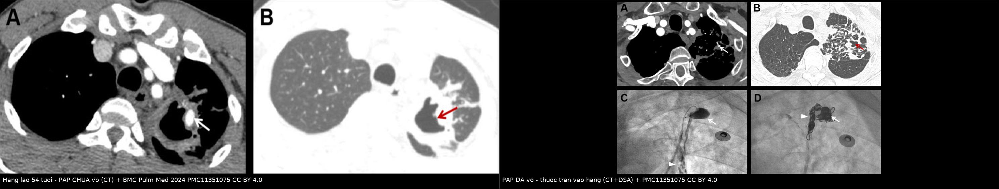
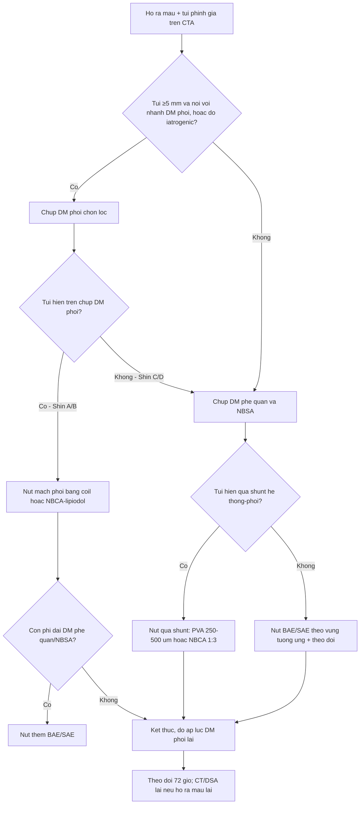
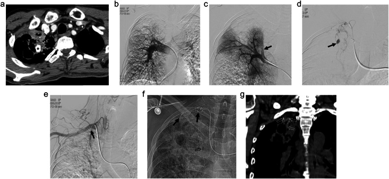
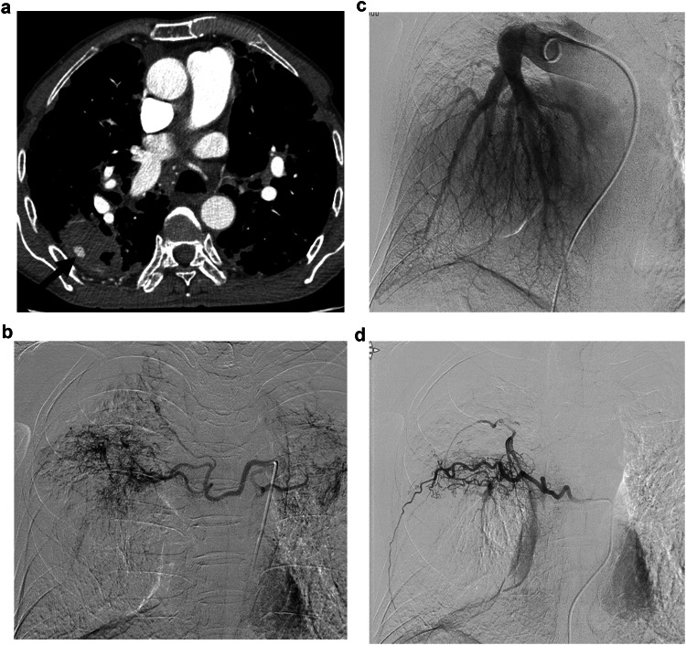
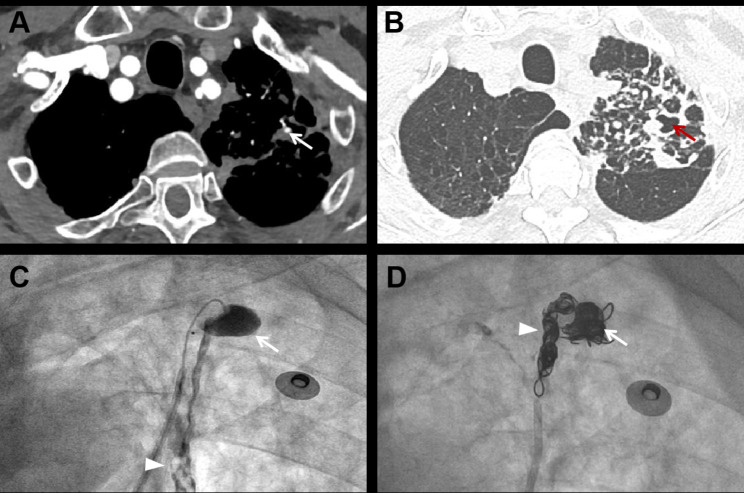
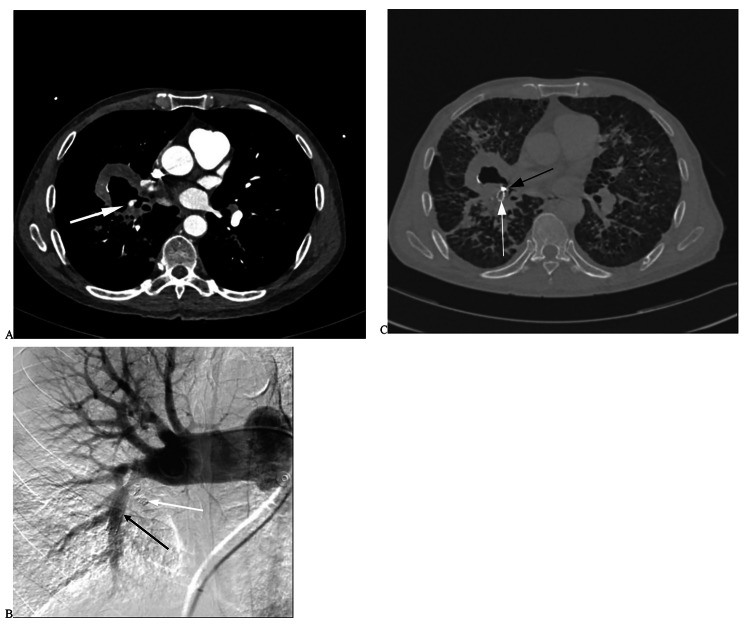

# 094 — Ho ra máu từ động mạch phổi: phình giả Rasmussen & nút mạch phổi / Rasmussen aneurysm and pulmonary artery embolization

**Tags:** `pattern:ho-ra-mau` `pattern:phinh-mach` `vung:phoi` `protocol:CTA-nguc` `protocol:DSA-nut-mach-phoi` `score:Shin`
**Mức chắc chắn (certainty):** tổng hợp y văn (literature synthesis) — 1 cohort 28 bệnh nhân/29 túi phình giả động mạch phổi (Akis S et al., *Eur Radiol* 2025, PMC12634792), 1 cohort 50 bệnh nhân/58 túi phình giả có phân tích yếu tố nguy cơ vỡ (Liu M et al., *BMC Pulm Med* 2024, PMC11351075), 1 cohort 23 ca nút mạch phổi (Li FQ et al., *J Cardiothorac Surg* 2023, PMC10426096) và 1 cohort 58 ca nút mạch phế quản có phân tích hồi quy (Chen Y et al., *J Thorac Dis* 2026, PMC13266778). Số chưa kiểm chứng ghi **"chưa rõ"**, không bịa.

## 1. Tổng quan bệnh học – cơ chế hình ảnh

- **Phình giả (pseudoaneurysm) khác phình thật (true aneurysm) ở đâu:** phình thật có **đủ 3 lớp** thành mạch; phình giả chỉ còn **lớp áo ngoài (adventitia) hoặc mô mềm quanh mạch** giữ máu lại → **nguy cơ vỡ cao hơn hẳn** (Liu M et al. 2024; Akis S et al. 2025). Trong phổi, "vỏ" đó thường là **mô hang lao xơ, mô viêm hoại tử hoặc mô u** — mỏng, không co giãn, không có cơ trơn.
- **TẠI SAO vỡ khi đường kính tăng — định luật Laplace (cửa 1 của Argon):** sức căng thành **T ∝ P × r / độ dày thành**. Với túi phình giả, cả **bán kính (r)** lẫn **áp lực (P)** đều là biến số bệnh lý, còn **độ dày thành ≈ 0** → chỉ cần tăng nhẹ đường kính hoặc tăng áp lực động mạch phổi là đủ vượt giới hạn mô. Đây chính là lý do **đường kính và áp lực động mạch phổi** đều xuất hiện trong mô hình nguy cơ vỡ.
- **Số liệu chứng minh (Liu M et al. 2024, 50 bệnh nhân / 58 túi phình giả):**

| Yếu tố | Nhóm **vỡ** (21 ca) | Nhóm **chưa vỡ** (29 ca) | P |
|---|---|---|---|
| Ho ra máu ồ ạt | **57,1%** | 6,9% | **< 0,001** |
| Đường kính túi phình giả | **8,1 ± 3,2 mm** | 6,0 ± 2,3 mm | **0,012** |
| Có hang phổi kế cận | **76,2%** | 44,8% | **0,027** |
| Đường kính hang | **32,9 ± 18,8 mm** | 15,7 ± 8,4 mm | **0,005** |
| Áp lực ĐM phổi trung bình (mPAP) | **23,9 ± 7,4 mmHg** | 19,2 ± 5,0 mmHg | **0,011** |

- **TẠI SAO ho ra máu từ động mạch phổi lại gây ngạt dù áp lực thấp:** áp lực động mạch phổi chỉ ~15–20 mmHg (thấp hơn hệ thống rất nhiều), nên **không phun thành tia** — nhưng túi phình giả nằm **ngay trong hang, sát lòng phế quản**, nên máu **chảy tràn vào đường thở** và đông thành cục bít phế quản. Tử vong vì **ngạt (asphyxia)**, không vì mất máu. Ở nhóm phình giả động mạch phổi, **tử vong 1 năm ~50–100% nếu không điều trị**, nguyên nhân chính là ngạt do xuất huyết ồ ạt trong phổi (Li FQ et al. 2023); **sau khi vỡ, tử vong có thể tới 50%** (Liu M et al. 2024).
- **TẠI SAO hang lao lại là "ổ" của phình giả Rasmussen:** lao làm **viêm mạn + hoại tử + xơ hóa** thành mạch nhánh động mạch phổi đi trong thành hang; thành mạch bị **hoại tử dạng nang lớp áo giữa (cystic medial necrosis)** và bị mô hạt–xơ thay thế → mạch **mất đàn hồi, dính vào thành hang cứng, không co lại được khi vỡ** (Liu M et al. 2024). Vì vậy **Rasmussen = phình giả của nhánh động mạch phổi trong/ sát hang lao**, và có xu hướng **vỡ dễ hơn** phình giả do nguyên nhân khác.
- **Tần suất (để không bỏ sót):** phình giả động mạch phổi gặp ở **5–11%** bệnh nhân được nút mạch phế quản, **~11%** người được khảo sát vì ho ra máu, **~14%** người lao phổi mạn (Akis S et al. 2025); **5–10%** các ca ho ra máu ồ ạt có nguồn **động mạch phổi** (Li FQ et al. 2023). Nói cách khác: cứ 10–20 ca nút mạch phế quản thì có **1 ca có nguồn động mạch phổi** — nếu chỉ nút phế quản thì **vẫn chảy**.
- **Vì sao nút phế quản đơn thuần thất bại (bằng chứng hồi quy):** ở 58 bệnh nhân aspergillosis phổi mạn được nút mạch phế quản, **39,7%** có tổn thương động mạch phổi (phình/phình giả) trên DSA; sau 1 năm **39,7%** tái phát ho ra máu, và **tổn thương động mạch phổi là yếu tố nguy cơ độc lập duy nhất** còn lại trong mô hình đa biến: **HR 3,43 (95% CI 1,31–9,02; P = 0,01)** (Chen Y et al. 2026). Kết luận thực hành: **đánh giá "hai vòng tuần hoàn" (hệ thống + động mạch phổi)** thay vì chỉ nút phế quản.
- **Vì sao áp lực động mạch phổi tăng khi có shunt hệ thống–phổi:** ở 19 ca có **rò động mạch phế quản → động mạch phổi (BA–PA fistula)**, áp lực động mạch phổi trước nút **52,11 ± 2,12 cmH₂O (35–69)**, sau nút giảm còn **33,58 ± 1,63 (22–44), P = 0,001**; ở 4 ca không có rò, áp lực **không đổi** (24,50 → 24,75 cmH₂O, P = 0,850) (Li FQ et al. 2023). Nghĩa là **shunt vừa là nguồn chảy vừa là "bơm" làm túi phình giả căng thêm** → nút shunt cũng là điều trị giảm áp.
- **Hình ảnh trên CTA — đo cái gì:** đường kính **lớn nhất trên lát trục (mm)**, **có/không liên tục với nhánh động mạch phổi**, **có hang kế cận + đường kính hang**, **có phì đại động mạch phế quản/NBSA**, **có shunt**. Trong 29 túi phình giả: **25/29 liên tục với động mạch phổi, 4/29 tách rời**; **99,3%** ở động mạch phân thùy/dưới phân thùy (Liu M et al. 2024) → **phải dựng MPR/MIP và lần theo nhánh**, không đọc lát trục đơn thuần.
- **Vị trí ưu tiên:** thùy trên. Ở 29 túi phình giả của Akis S et al. 2025: **thùy trên phải 41,4%, thùy trên trái 31,0%**, thùy giữa phải 3,4%, thùy dưới phải 13,8%, thùy dưới trái 10,4%; trong lao phổi, **86,4% (19/22)** ở thùy trên. Ở 58 túi phình giả của Liu M et al. 2024: **thùy trên trái 41,4%, thùy trên phải 31,0%**.

## 2. Mẫu hình + chẩn đoán phân biệt theo vị trí (gamut)

**Câu hỏi thực hành:** bệnh nhân ho ra máu + có "nốt tròn cản quang trong hang/đám mờ" — **đó là mạch, là nấm, hay là cục máu?** Và nếu là mạch thì **mạch nào đang nuôi nó**?

**Trục A — theo nguyên nhân (gamut):**

1. **Lao phổi (Rasmussen)** — hay gặp nhất trong các cohort có hang; tổn thương ở **thùy trên**, trong/sát hang, thường kèm **phì đại động mạch phế quản**.
2. **Viêm phổi hoại tử / aspergillosis** — sau đợt nhiễm trùng, vùng hoại tử → phình giả; aspergilloma có thể ăn mòn thành mạch.
3. **Iatrogenic** — catheter Swan–Ganz, **sinh thiết xuyên thành ngực**, **đốt u (ablation)**, đặt catheter động mạch phổi.
4. **U phổi** (nguyên phát/di căn) — mạch bị u ăn mòn; đây là nhóm mà **nút phế quản đơn thuần hay tái phát**.
5. **Khác:** giãn phế quản, Behçet, chấn thương, **COVID-19** (được ghi nhận là nguyên nhân mới), bệnh mô liên kết.

**Trục B — theo khả năng nhìn thấy trên chụp mạch (phân loại Shin, dùng để chọn đường tiếp cận):**

| Type | Thấy được ở đâu | Hệ quả thực hành |
|---|---|---|
| **A** | Chụp **động mạch phổi không chọn lọc** | Nút trực tiếp nhánh phổi; dễ nhất |
| **B** | Chỉ thấy khi chụp **phân thùy/dưới phân thùy chọn lọc** | Cần microcatheter, chọn lọc sâu |
| **C** | **Không** thấy trên chụp động mạch phổi — chỉ thấy khi chụp **động mạch phế quản/NBSA** (qua shunt hệ thống–phổi) | Nút **qua shunt** hoặc nút phế quản/NBSA vùng tương ứng |
| **D** | **Chỉ thấy trên CTA**, không thấy trên bất kỳ chụp mạch nào | Cân nhắc **nút "theo vùng"** (empirical), theo dõi, hoặc can thiệp trực tiếp qua da ở ca chọn lọc |

*(Nguồn: Shin et al., dẫn trong Akis S et al. 2025 và Liu M et al. 2024.)*

**Trục C — theo vị trí túi phình (quyết định vật liệu):**

- **Ngoại vi (phân thùy/dưới phân thùy, ~99%):** **coil** qua microcatheter là lựa chọn đầu tay; có thể **chọc trực tiếp qua da** với ca sát màng phổi (nguồn không thực hiện trong cohort — ghi nhận là hạn chế).
- **Trung tâm (thân/thùy lớn, cổ rộng):** **stent phủ + coil trong túi** ("stent-assisted") để giữ coil không trôi và bảo tồn nhánh lành.

## 3. Bảng so sánh phân biệt (ma trận đối chiếu)

| Thực thể (entity) | Hình ảnh điển hình (CTA/DSA) | Chốt vào (rule-in) | Chốt loại (rule-out) | Gợi ý xác nhận |
|---|---|---|---|---|
| **Rasmussen (phình giả trong hang lao)** | Túi cản quang **tròn, nối với nhánh ĐM phổi**, **nằm trong/sát thành hang** ở thùy trên; hang thành xơ, có nốt vệ tinh | **Túi nối nhánh ĐM phổi + hang lao thùy trên** | Nốt đặc **không ngấm thuốc**, không nối mạch → aspergilloma/u | CTA ≤ 1 mm + MIP; DSA phổi chọn lọc |
| **Phình giả sau viêm hoại tử/aspergillus** | Túi trong vùng **đông đặc hoại tử**, có thể có liềm khí; bờ phổi dày | **Bối cảnh nhiễm trùng cấp + túi trong vùng hoại tử** | Hang **sạch**, không có túi → chỉ là hang | Cấy nấm/vi khuẩn; theo dõi CT sau điều trị |
| **Phình giả do iatrogenic (Swan–Ganz, sinh thiết, đốt)** | Túi **dọc đường đi của catheter/đầu kim/ổ đốt**, thường ngoại vi; có máu tụ quanh | **Tiền sử thủ thuật trong 1–4 tuần + túi đúng vị trí can thiệp** | Túi ở vùng không can thiệp → nguyên nhân khác | So phim trước/sau thủ thuật |
| **Phình giả liên quan u** | Túi **trong khối u hoại tử**, bờ dày không đều; có hạch/ xâm lấn | **Khối u + túi trong u** | Không có khối → loại | PET-CT, sinh thiết |
| **Phình thật động mạch phổi** | Giãn **đều cả 3 lớp**, thường ở **thân/phân thùy chính**, có thể vôi hóa thành; gặp trong tăng áp phổi | **Giãn đồng đều + thành rõ + bối cảnh tăng áp phổi** | Túi lệch tâm, cổ hẹp → **phình giả** | Đo áp lực ĐM phổi (catheter); CT so phim |
| **Phình động mạch phế quản** | Túi từ **nhánh phế quản**, thường trong ổ viêm mạn; có thể **kèm** phình giả phổi | **Nguồn từ ĐM phế quản (hệ thống)** | Túi đổ đầy từ **nhánh ĐM phổi** → phình giả phổi | DSA chọn lọc từng hệ; 8% ca có **cả hai** |
| **Rò hệ thống–phổi không có túi** | Mạch phế quản phì đại đổ vào nhánh phổi, **không có túi** | **Shunt + phì đại mạch phế quản, không túi** | Có túi → phình giả | Đo áp lực ĐM phổi trước/sau nút |

*Trái: nam 54 tuổi, lao phổi, **phình giả CHƯA vỡ** trong hang thùy trên trái — (A) CT có cản quang: túi ngấm thuốc (mũi tên) trong nhánh phân thùy; (B) cửa sổ phổi: hang lớn kế cận (mũi tên đỏ). Phải: nam 76 tuổi, lao tái phát, **phình giả ĐÃ VỠ** — (A) CT: túi trong nhánh phân thùy thùy trên trái; (B) cửa sổ phổi: hang kế cận; (C) DSA: thuốc tràn từ túi vào hang; (D) sau nút coil: túi và đoạn gần mạch nuôi tắc. Nguồn: Liu M et al., BMC Pulm Med 2024, PMC11351075 Fig. 3 + Fig. 4, CC BY 4.0. Ảnh ghép letterbox, không crop.*

### Đọc CTA tìm phình giả theo 5 bước (tránh bỏ sót)
1. **Lần theo toàn bộ cây động mạch phổi** trên MIP coronal/sagittal — không chỉ nhìn nốt trong hang.
2. **Đo đường kính lớn nhất (mm)** và ghi rõ **có nối với nhánh phổi hay tách rời** (4/29 ca tách rời → không nút được qua đường phổi).
3. **Đo hang kế cận** — hang **≥ 30 mm** và túi **≥ 8 mm** là vùng nguy cơ cao (bảng mục 1).
4. **Tìm phì đại động mạch phế quản/NBSA và shunt** — quyết định có phải nút thêm hệ thống.
5. **Ghi vị trí phân thùy** — quyết định chọn microcatheter và vật liệu.

## 4. Protocol chụp + phân độ & quyết định can thiệp

**CTA ngực (bắt buộc trước can thiệp):**
- Lát **1,00 mm**, từ **cửa vào lồng ngực đến 5–10 cm trên ổ bụng** (để không bỏ sót động mạch liên sườn/ngực trong), **thì động mạch**.
- Dựng **MPR + MIP**; đo túi, hang, mạch phế quản; ghi nhận shunt (Akis S et al. 2025; Liu M et al. 2024 dùng đúng protocol này).

**DSA — chọn đường tiếp cận theo CTA (đây là phần "quyết định"):**

**Vật liệu & kỹ thuật (số liệu từ 3 cohort):**

| Vật liệu | Dùng khi | Liều/cỡ trong nguồn | Lưu ý |
|---|---|---|---|
| **Microcoil 3–6 mm** (Tornado, Nester) | Túi ngoại vi, cổ hẹp | 3–6 mm qua microcatheter 1,7–2,0 F | Có thể nút **túi (61,9%)**, **cổ túi (4,8%)** hoặc **mạch nuôi (47,6%)** |
| **NBCA : lipiodol = 1 : 3** | Nút qua shunt hệ thống–phổi | Tỉ lệ 1:3 | Keo lan xa → chỉ dùng khi đã kiểm soát được dòng |
| **PVA 250–500 µm** | Nút phế quản/NBSA kèm | 250–500 µm | Không dùng hạt quá nhỏ (< 300 µm) |
| **Gelatin 560–1000 µm** | Nút bổ trợ, ca cấp cứu | 560–1000 µm | Tái thông muộn → tái phát muộn |
| **Stent phủ + coil** | **Cổ rộng, thân/thùy lớn** | Stent tự bung phủ cổ túi + coil trong túi | Bảo tồn nhánh lành; kỹ thuật "stent-assisted" |

**Hiệu quả — nói thật với gia đình:**

| Chỉ số | Số liệu | Nguồn |
|---|---|---|
| Chụp mạch phổi thấy được túi (Shin A/B) | **15/21 (71,4%)**; **6/21 (28,6%) không thấy** | Akis S et al. 2025 |
| Nút mạch phổi thành công kỹ thuật | **100%** | Liu M et al. 2024; Li FQ et al. 2023 |
| Thành công lâm sàng (cầm máu) | **96,0%** (1 tử vong do ho ra máu ồ ạt trong viện) | Liu M et al. 2024 |
| Cầm máu hoàn toàn / còn máu lẫn đờm | **13/24 ca cầm hoàn toàn**; **9/24 còn máu lẫn đờm nhưng hết trong < 1 tháng** | Akis S et al. 2025 |
| Tái phát ho ra máu sau nút (theo dõi 1 năm) | **5/17 ca (29,4%)**, trong đó **4 ca trong 6 tháng** | Liu M et al. 2024 |
| Tái phát ho ra máu ồ ạt (theo dõi trung bình ~19 tháng) | **10/23 ca**; **2 tử vong do ngạt** | Li FQ et al. 2023 |
| Sau nút phế quản đơn thuần ở bệnh nhân có tổn thương ĐM phổi | Tái phát **39,7%/1 năm**, **HR 3,43** | Chen Y et al. 2026 |
| Mổ (cắt thùy) | **2/29 ca** phải mổ vì ho ra máu dai dẳng | Akis S et al. 2025 |

- **Chỉ định nút mạch phổi:** túi **≥ 5 mm và còn liên tục với nhánh động mạch phổi**, hoặc phình giả **do iatrogenic** (Akis S et al. 2025 dùng đúng ngưỡng này để quyết định có chụp động mạch phổi hay không).
- **Chỉ định điều trị bảo tồn:** túi **nhỏ, ngoại vi, tách rời động mạch phổi, bệnh nhân ổn định, không rối loạn đông máu** → theo dõi với **acid tranexamic**; trong cohort 28 ca có **2 ca** cầm máu và túi thoái triển mà không cần can thiệp (Akis S et al. 2025). **Không** áp dụng cho ca có ho ra máu ồ ạt hoặc rối loạn đông máu.
- **Định nghĩa "ho ra máu ồ ạt" KHÔNG thống nhất:** bài này dùng **≥ 200 mL/ngày** (Liu M et al. 2024) và **> 500 mL/ngày** (Li FQ et al. 2023), trong khi bài 091 dùng **> 100 mL/lần hoặc > 500 mL/24 giờ**. Phải ghi rõ ngưỡng khi hội chẩn — đây là điểm yếu của toàn bộ y văn, không phải lỗi của một bài.
- **Đo áp lực động mạch phổi:** đặt pigtail ở **thân động mạch phổi**, đo **trước và sau** nút (Li FQ et al. 2023). Ca có shunt giảm từ **52,11 → 33,58 cmH₂O**; đây là bằng chứng khách quan shunt đã được đóng.

## 5. Biến thể bình thường và cạm bẫy

- **Biến thể bình thường:** nhánh động mạch phổi **đi trong thành hang xơ** thường **dính, không di động**; đừng nhầm **co thắt/không đầy thuốc do cạnh tranh dòng** với "không có túi". Ngoài ra **ống động mạch phổi (ductus) tồn tại** và các **nhánh phế quản–phổi bẩm sinh** có thể tạo shunt lành tính — chỉ can thiệp khi có túi hoặc ho ra máu.
- **Cạm bẫy 1 — "chụp động mạch phổi âm tính = không có nguồn phổi":** **28,6% (6/21)** túi **không thấy** trên chụp động mạch phổi (Akis S et al. 2025). Nguyên nhân: **dòng hệ thống cạnh tranh** lấn át, túi **tách rời** khỏi nhánh phổi, hoặc cổ túi bị co thắt. Bắt buộc chụp tiếp **động mạch phế quản/NBSA** và tìm **shunt hệ thống–phổi**.
- **Cạm bẫy 2 — nút phế quản rồi "xong":** nếu bỏ sót tổn thương động mạch phổi, tái phát **39,7%/1 năm, HR 3,43** (Chen Y et al. 2026). Luôn đọc lại CTA cho **cả hai vòng tuần hoàn** trước khi kết thúc thủ thuật.
- **Cạm bẫy 3 — túi vỡ ngay trên bàn chụp:** đã có ca **vỡ túi trong lúc chụp mạch phổi** (do bơm thuốc làm tăng tưới máu/áp lực cục bộ, hoặc catheter–guidewire chạm vào), cầm được nhờ **nút ngay lập tức** (Liu M et al. 2024). Chuẩn bị coil sẵn trên bàn trước khi bơm thuốc.
- **Cạm bẫy 4 — coil trôi vào động mạch phổi:** cổ túi **ngắn** làm coil **lòi ra động mạch phổi hoặc trôi vào túi** (ca minh họa trong Akis S et al. 2025, bệnh nhân sau đó tử vong vì nhiễm khuẩn huyết, không do coil). Với cổ ngắn/rộng → **stent phủ giữ coil (stent-assisted)**.
- **Cạm bẫy 5 — "hang có nốt tròn = aspergilloma":** aspergilloma **không ngấm thuốc** và **di chuyển khi đổi tư thế**; phình giả **ngấm thuốc đồng thì với động mạch phổi** và **cố định**. Bắt buộc **CTA có cản quang** trước khi kết luận.
- **Cạm bẫy 6 — bỏ sót phình động mạch phế quản đi kèm:** **8% (4/50)** ca có **cả** phình động mạch phế quản (Liu M et al. 2024) → nút phổi xong vẫn chảy; phải chụp cả hai hệ.
- **Cạm bẫy 7 — gọi mọi ho ra máu là "nguồn phế quản":** chỉ **5–10%** ca ho ra máu ồ ạt có nguồn động mạch phổi, nhưng **nhóm này không đáp ứng nút phế quản** và tử vong rất nhanh. Đây là lý do bài 091 và bài này phải đọc cùng nhau.
- **Phản biện nguồn:** chú thích Fig. 4 của Liu M et al. 2024 ghi thuốc tràn từ túi vào **hang và khí quản**, nhưng trên ảnh (C) chỉ thấy rõ **thuốc trong túi và hang**, không thấy rõ đường vào khí quản — ghi nhận sự không khớp, **không tự sửa** chú thích gốc.

## 6. Tự lượng giá — Blind Quiz

**Ca 1 — Nam 47 tuổi, lao phổi, ho ra máu ồ ạt. CTA có túi trong hang thùy trên phải. Trước khi đọc đáp án: túi này có nút được qua đường động mạch phổi không?**

- Gợi ý lâm sàng: ho ra máu lượng lớn, tiền sử lao, hang + đông đặc quanh.
- Câu hỏi: Vì sao chụp động mạch phổi bằng pigtail **không thấy túi**? Panel nào cho thấy nguồn thật? Vật liệu nút là gì?

<b>Bấm để hiện đáp án (findings + chẩn đoán)</b>

- Dấu hiệu: (a) CT: **túi phình giả (*)** thùy trên phải, quanh là **hang lao + đông đặc**; (b) chụp động mạch phổi bằng pigtail — **không thấy túi**; (c) chụp chọn lọc — nhánh nghi ngờ **không đầy thuốc vì dòng hệ thống cạnh tranh** (mũi tên); (d) chụp nhánh **dưới đòn** — túi **hiện qua shunt hệ thống–động mạch phổi** (mũi tên); (e,f) nút bằng **NBCA : lipiodol = 1 : 3**, thấy dấu keo trong các nhánh nuôi hệ thống; (g) CT không cản quang: keo đọng ở **động mạch phổi ngoại vi quanh túi** (mũi tên rỗng).
- Chẩn đoán: **Rasmussen với nguồn cấp từ shunt hệ thống–phổi (Shin type C)** — chụp động mạch phổi âm tính **không loại trừ**.
- Xử trí: **nút qua shunt** + **BAE/SAE bổ trợ**; ho ra máu ồ ạt ngừng sau thủ thuật.
- Nguồn ảnh: Akis S et al., *Eur Radiol* 2025, PMC12634792 Fig. 3, CC BY 4.0.

**Ca 2 — Nam 77 tuổi, ho ra máu, hang lao thùy dưới phải. CTA có túi nhưng cả chụp động mạch phổi và chụp phế quản đều KHÔNG thấy túi. Làm gì tiếp?**

- Câu hỏi: Túi có liên tục với động mạch phổi không? Ba lựa chọn xử trí, chọn cái nào và vì sao?

<b>Bấm để hiện đáp án</b>

- Dấu hiệu: (a) CT: **túi phình giả** thùy dưới phải **nằm trong hang lao, có máu tụ quanh, TÁCH RỜI khỏi nhánh động mạch phổi** (mũi tên); (b) chụp động mạch phổi pigtail — **không thấy**; (c,d) chụp động mạch phế quản và liên sườn — **cũng không thấy**.
- Chẩn đoán: **phình giả tách rời động mạch phổi (Shin type D)** — không có đường vào trực tiếp.
- Xử trí: **nút "theo vùng" (empirical BAE/SAE)** bằng **PVA 355–500 µm** vùng tương ứng túi → **ho ra máu ngừng**. Đây là lựa chọn thực dụng khi không có đường vào trực tiếp; hai lựa chọn còn lại là **theo dõi** (không phù hợp vì đang chảy máu) và **mổ cắt thùy** (dự phòng cho ca thất bại).
- Nguồn: PMC12634792 Fig. 4, CC BY 4.0.

**Ca 3 — Nam 76 tuổi, lao tái phát, ho ra máu ồ ạt. Đọc DSA: đâu là dấu hiệu VỠ, và sau nút thì thấy gì?**

- Câu hỏi: Panel nào chứng minh túi đã vỡ? Sau nút, mạch nuôi và túi thay đổi thế nào?

<b>Bấm để hiện đáp án</b>

- Dấu hiệu: (A) CT có cản quang: **túi phình giả** ở nhánh phân thùy **thùy trên trái** (mũi tên); (B) cửa sổ phổi: **hang kế cận** (mũi tên đỏ); (C) DSA chọn lọc dưới phân thùy: **thuốc tràn khỏi túi vào hang** → **xác nhận vỡ**; (D) sau nút: **túi và đoạn gần mạch nuôi bị tắc hoàn toàn** bằng coil.
- Chẩn đoán: **Rasmussen đã vỡ** — nhóm có **ho ra máu ồ ạt 57,1% vs 6,9%** và **đường kính túi 8,1 vs 6,0 mm** so với nhóm chưa vỡ.
- Sau nút: theo dõi 1 năm, **5/17 ca (29,4%) tái phát**, phần lớn **trong 6 tháng** → phải hẹn chụp/khám lại sớm, không chỉ "ra viện là xong".
- Nguồn: Liu M et al., *BMC Pulm Med* 2024, PMC11351075 Fig. 4, CC BY 4.0.

**Ca 4 — Nam có hang lao thùy dưới phải, cổ túi ngắn. Vì sao phải dùng stent? Nhìn 2 panel CT/DSA và 1 panel CT sau mổ.**

<b>Bấm để hiện đáp án</b>

- Dấu hiệu: (A) CT có cản quang: **hang thùy dưới phải + túi phình giả ở động mạch thùy** (mũi tên trắng); (B) sau **stent-assisted PAPE**: **stent (mũi tên đen)** phủ cổ túi + **microcoil (mũi tên trắng)** trong túi — **không còn hình túi**; (C) CT sau mổ: vị trí **stent** (mũi tên trắng) và **coil** (mũi tên đen).
- Vì sao cần stent: **cổ túi ngắn/rộng** làm coil dễ **trôi vào động mạch phổi**; stent phủ **giữ coil tại chỗ** và **bảo tồn nhánh lành** thay vì nút cả thân động mạch.
- Bối cảnh: bệnh nhân ho ra máu **~500 mL một lần**, tiền sử lao phổi cũ.
- Nguồn: Li FQ et al., *J Cardiothorac Surg* 2023, PMC10426096 Fig. 2, CC BY 4.0.

## Bài liên quan chéo
- [001 – Tổng quan hệ Ngực](../001-tong-quan-he-nguc/lesson.md)
- [091 – Ho ra máu ồ ạt & nút mạch động mạch phế quản](../091-ho-ra-mau-oat-nut-mach-dong-mach-phe-quan/lesson.md) (nguồn phế quản ~90%, NBSA 25%, kỹ thuật BAE)
- [025 – Hang & nấm phổi: dấu liềm khí](../025-ton-thuong-phoi-tao-hang/lesson.md) (Rasmussen là hàng DDx của hang lao)
- [070 – Thuyên tắc phổi & ĐMC cấp](../070-thuyen-tac-phoi-dmc-cap/lesson.md) (khuyết thuốc mạch — phân biệt với túi phình giả)
- [049 – Theo dõi sau cắt thùy phổi bẩm sinh](../049-theo-doi-sau-cat-thuy-phoi-bam-sinh/lesson.md) (khi nào phải mổ cắt thùy)
- [093 – Hội chứng tĩnh mạch chủ trên](../093-hoi-chung-tinh-mach-chu-tren/lesson.md) (ho ra máu **tĩnh mạch** — nguồn thứ tư, không phải động mạch)

## Ảnh
- Tên file `094_<slug>_<Modality>_<SourceID>.jpg`; nguồn + giấy phép từng ảnh ở `images/CREDITS.md`.
- Cả 4 ảnh nguồn là **CC BY 4.0** → được phép ghép; 1 ảnh composite tạo bằng `tools/make_composite.py` (letterbox nền đen, giữ tỷ lệ, dải đen ghi tên + attribution, **không crop**).
- Không tải ảnh từ AuntMinnie (chỉ dẫn link); không dùng ảnh từ bài có hình mượn Elsevier khi chưa xin phép.

> Không dùng để chẩn đoán độc lập khi chưa có người hướng dẫn.
