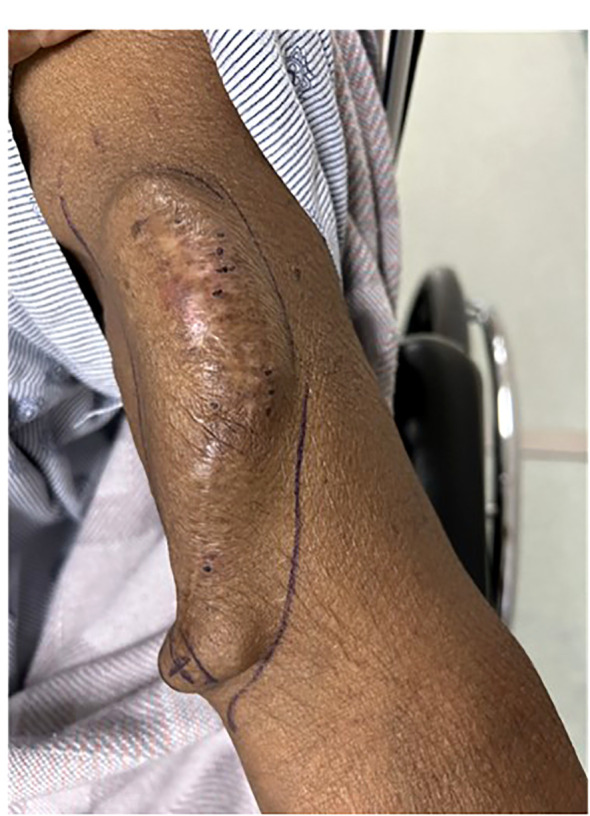
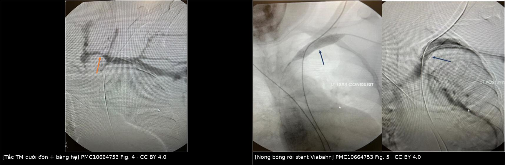
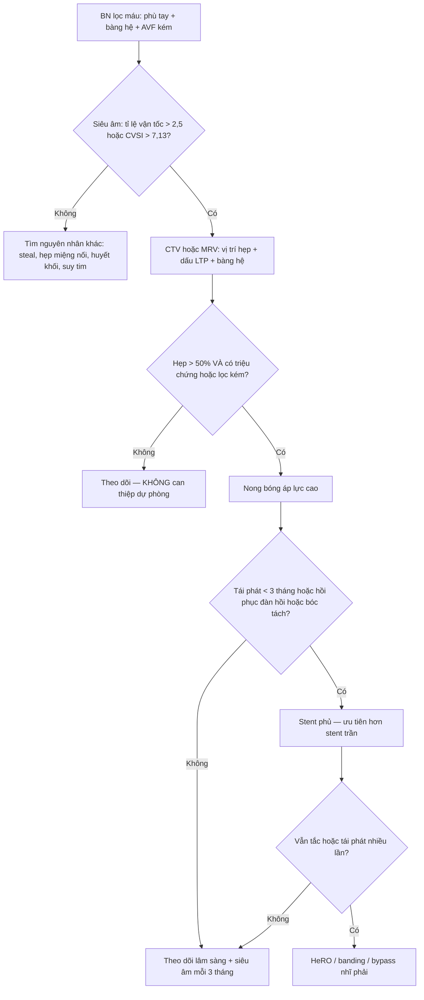
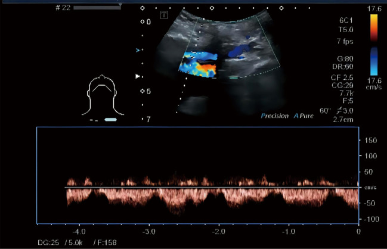

# 095 — Hẹp/tắc tĩnh mạch trung tâm ở bệnh nhân lọc máu chu kỳ: chẩn đoán, chỉ định can thiệp và giữ đường mạch máu / Central vein stenosis in hemodialysis

**Tags:** `pattern:hep-tinh-mach` `pattern:tuan-hoan-bang-he` `vung:trung-that` `vung:chi-tren` `protocol:sieutham-Doppler` `protocol:CTV-nguc` `protocol:DSA-tinh-mach` `protocol:stent-tinh-mach`
**Mức chắc chắn (certainty):** tổng hợp y văn (literature synthesis) — bài tổng quan của Echefu G et al., *Front Nephrol* 2023 (PMC10664753), nghiên cứu Doppler tĩnh mạch nách của Xu X et al., *Ann Transl Med* 2022 (PMC8848436), nghiên cứu dấu hiệu đường ngực bên trên CT liều thấp của Li G et al., *Front Med* 2026 (PMC13327934) và bài tổng quan hình ảnh AVF/AVG của Gonzalez TV et al., *Cardiovasc Diagn Ther* 2023 (PMC9971293). Số chưa kiểm chứng ghi **"chưa rõ"**, không bịa.

## 1. Tổng quan bệnh học – cơ chế hình ảnh

- **Định nghĩa thực hành:** hẹp/tắc tĩnh mạch trung tâm (central vein stenosis, CVS) là hẹp **tĩnh mạch dưới đòn, tĩnh mạch cánh tay đầu (brachiocephalic/innominate) hoặc tĩnh mạch chủ trên (SVC)** — đoạn **từ bờ trong xương sườn 1 đến cơ hoành**. Đây là "đoạn đường ra" (outflow) của cả đường mạch máu lọc máu; hẹp ở đây làm **toàn bộ cung mạch máu (access circuit) tắc nghẽn**, dù miệng nối AVF hoàn toàn bình thường.
- **TẠI SAO tĩnh mạch trung tâm bị hẹp chứ không phải tĩnh mạch ngoại vi:** thành tĩnh mạch trung tâm **ít van, lưu lượng cao, áp lực thấp**; khi có **dòng xoáy và lực cắt (shear stress)** từ catheter hoặc từ lưu lượng AVF lớn, nội mạc bị tổn thương → **tăng sinh nội mạc (intimal hyperplasia)** + tái cấu trúc thành mạch, không phải huyết khối đơn thuần. Vì vậy tổn thương là **xơ co rút, đàn hồi ngược (elastic recoil)**, đáp ứng kém với nong bóng đơn thuần và **tái hẹp đúng chỗ cũ** (Echefu G et al. 2023).
- **TẠI SAO tĩnh mạch dưới đòn là "ổ" hay gặp nhất:** đoạn dưới đòn đi qua **khe sườn–đòn (costoclavicular space)** hẹp, bị **chèn ép lặp lại khi vận động tay** → chấn thương nội mạc mạn + huyết khối trong lòng; cộng thêm catheter tì vào thành mạch. Đây là lý do KDOQI khuyến cáo **tránh đặt catheter dưới đòn**, ưu tiên **tĩnh mạch cảnh trong phải** vì đường đi thẳng vào SVC.
- **Số liệu "vì sao phải nhớ" (Echefu G et al. 2023):**

| Bối cảnh | Tần suất CVS | Nguồn/nhóm |
|---|---|---|
| Chụp tĩnh mạch vì **biến chứng của đường mạch máu** | **41%** có hẹp đáng kể | nhóm chụp vì triệu chứng |
| **Lập bản đồ tĩnh mạch** trước tạo AVF (CKD 4–5 + ESRD) | **10%** chung; **13%** nếu có catheter có cuff; **2%** ở nhóm chưa lọc máu | Tedla 2018 |
| Đoàn hệ 2.811 bệnh nhân lọc máu | **4,3%** (120 ca), thời gian lọc trung vị **2,9 năm** | loạt hồi cứu |
| **Số lần đặt catheter trung tâm trong đời** | **3,4%** (0–1 lần) · **29,4%** (2–3 lần) · **53,8%** (≥ 4 lần) | 106 bệnh nhân |
| Có catheter **dưới đòn** trước đó | **47,8% vs 22,0%** (p = 0,02) | 106 bệnh nhân |
| Catheter lọc máu **ngắn hạn**, thời gian lưu trung bình **21 ngày** | **14%** (8 ca) đã có CVS | nghiên cứu tiến cứu |
| PICC | **4,8%** hẹp + **2,7%** tắc tĩnh mạch trung tâm | 150 ca chụp trước–sau |
| CVS **de novo** không do catheter, lưu lượng AVF cao | **10%** (6/57); lưu lượng đo được **2.347 mL/phút** | nghiên cứu de novo |

- **TẠI SAO hẹp mà vẫn lọc được — và tại sao đó là bẫy:** khi hẹp tiến triển chậm, **tuần hoàn bàng hệ (collateral veins)** phát triển qua tĩnh mạch giáp, ngực trong, liên sườn, hệ azygos. Bàng hệ đủ lớn thì **áp lực tĩnh mạch sau hẹp không tăng**, bệnh nhân **không phù tay**, nhưng **lưu lượng lọc giảm, tái tuần hoàn (recirculation) tăng, chảy máu sau lọc kéo dài** và **thời gian cầm máu tại chỗ chọc tăng** — những dấu hiệu bị bỏ qua nhất. Trong nhóm có AVF/AVG còn hoạt động, **tới 29% CVS hoàn toàn không triệu chứng**.
- **Vì sao AVG dễ có triệu chứng hơn AVF:** graft có lưu lượng cao hơn và **không có mạng tĩnh mạch nông dự trữ** như fistula; cùng mức hẹp, graft dồn áp lực vào ít đường thoát hơn → phù tay rõ hơn.

## 2. Mẫu hình + chẩn đoán phân biệt theo vị trí (gamut)

**Câu hỏi thực hành:** bệnh nhân lọc máu có **phù tay cùng bên AVF + giãn tĩnh mạch nông + AVF kém hiệu quả** — hẹp ở đâu, do đâu, và có đáng can thiệp không?

- **Theo vị trí (location gamut):**
  - **Tĩnh mạch dưới đòn (subclavian):** hay gặp nhất sau catheter dưới đòn; hẹp dài, dính thành; sờ thấy dây tĩnh mạch nổi trên vai/ngực.
  - **Tĩnh mạch cánh tay đầu (brachiocephalic):** sau catheter cảnh trong, sau máy tạo nhịp/ICD; hẹp ngay chỗ dây điện bắt chéo.
  - **SVC:** hẹp/tắc thường do catheter có cuff lâu năm hoặc dây tạo nhịp; **hai bên** → hội chứng SVC (phù mặt, tuần hoàn bàng hệ thành ngực).
  - **Eo tĩnh mạch đầu (cephalic arch):** không phải "trung tâm" nhưng là chỗ hẹp kinh điển của AVF cánh tay–đầu; hẹp do xơ + van + chèn ép cân, tái hẹp rất cao.
- **Theo cơ chế (mechanism gamut) — quan trọng hơn vị trí:**
  1. **Do catheter/thiết bị trong lòng mạch** (CVC lọc máu, PICC, pacemaker/ICD, port): tổn thương cơ học + huyết khối + xơ hóa.
  2. **De novo do lưu lượng cao** (AVF/AVG lưu lượng lớn, đặc biệt AVF cánh tay): dòng xoáy → tăng sinh nội mạc, không cần catheter.
  3. **Chèn ép từ ngoài:** hội chứng lồng ngực thoát (thoracic outlet), xơ hóa trung thất (sau xạ, lao, histoplasmosis), bướu giáp sau xương ức, phình/bóc tách ĐMC.
  4. **Xâm lấn/u trong lòng:** ung thư phổi/lymphoma/hạch trung thất, huyết khối ác tính.
  5. **Sau xạ trị / sau mổ** vùng trung thất: xơ hóa, hẹp dài không vôi.
- **Theo triệu chứng (dùng để quyết định can thiệp):**
  - **Chỉ phù tay nhẹ, không ảnh hưởng lọc** → theo dõi (xem mục 5).
  - **Phù tay nặng + đau + loét da + giãn bàng hệ** → can thiệp.
  - **AVF kém: lưu lượng thấp, tái tuần hoàn cao, Kt/V giảm, huyết khối tái phát** → can thiệp.
  - **Hội chứng SVC (phù mặt, khó thở khi nằm, tuần hoàn bàng hệ thành ngực)** → xử trí cấp, ưu tiên tái thông.

### Ảnh minh họa mẫu hình

*Lâm sàng: tay có AVF cánh tay–đầu bị giãn, phồng, da căng và đổi màu do tăng áp lực tĩnh mạch — hậu quả trực tiếp của hẹp đường ra trung tâm. Nguồn: Echefu G et al., Front Nephrol 2023, PMC10664753 Fig. 3 — CC BY 4.0.*

## 3. Bảng so sánh phân biệt (ma trận đối chiếu)

| Thực thể (entity) | Hình ảnh điển hình (US/CT/DSA) | Chốt vào (rule-in) | Chốt loại (rule-out) | Gợi ý xác nhận |
|---|---|---|---|---|
| **Hẹp do catheter cũ** | Hẹp dài, nhẵn, dính thành, thường dưới đòn/cánh tay đầu; bàng hệ thành ngực | **Tiền sử catheter cùng bên + hẹp > 50% + bàng hệ** | Hẹp khu trú đúng miệng nối AVF → hẹp miệng nối, không phải trung tâm | CTV/MRV; DSA + đo gradient |
| **De novo do lưu lượng cao** | Hẹp dài ở chỗ nối tĩnh mạch, không catheter; AVF lưu lượng rất cao | **Không tiền sử catheter + lưu lượng AVF cao + hẹp tiến triển** | Có catheter/thiết bị cùng bên → quy về nhóm catheter | Đo lưu lượng AVF, siêu âm |
| **Hẹp do dây tạo nhịp/ICD** | Dây điện trong SVC/cánh tay đầu + hẹp sát dây; thường không triệu chứng | **Thấy dây + hẹp + phù tay cùng bên** | Không có thiết bị → loại | CTV ít kim loại, siêu âm |
| **Hội chứng lồng ngực thoát** | Hẹp dưới đòn khi **giơ tay/động tác**; hẹp động, hết khi tay nghỉ | **Hẹp chỉ xuất hiện ở tư thế động tác** | Hẹp cố định mọi tư thế → xơ/catheter | Siêu âm tư thế, chụp tĩnh mạch động |
| **Xơ hóa trung thất sau xạ** | Hẹp dài, đối xứng, không vôi; tiền sử xạ trung thất | **Phân bố theo trường chiếu + hẹp dài** | Hẹp khu trú + bàng hệ lớn → nguyên nhân trong lòng | CT ngực có tiền sử xạ |
| **Hội chứng SVC do u** | Khối trung thất + chèn ép/huyết khối SVC; phù mặt, tuần hoàn bàng hệ | **Khối trung thất + hẹp/tắc SVC** | Không khối, chỉ hẹp dây → nguyên nhân lành tính | CT có cản quang, sinh thiết |
| **Hẹp miệng nối AVF** | Hẹp ngay chỗ nối động–tĩnh mạch, cách trung tâm > 10 cm | **Hẹp đúng miệng nối + lưu lượng thấp** | Hẹp ở dưới đòn/cánh tay đầu → CVS | Siêu âm dọc AVF, fistulogram |

*Trái: tắc tĩnh mạch dưới đòn, thuốc chỉ tới chỗ tắc, tuần hoàn bàng hệ (mũi tên cam). Phải: nong bóng áp lực cao rồi đặt stent phủ Viabahn để giữ đường ra. Nguồn: Echefu G et al., Front Nephrol 2023, PMC10664753 Fig. 4–5 — CC BY 4.0. Ảnh ghép letterbox của repo, không crop.*

### Dấu hiệu định lượng cần đo

- **Siêu âm Doppler (first-line):** **tỉ lệ vận tốc đỉnh (peak vein velocity ratio) > 2,5** qua chỗ hẹp tương ứng **gradient 3 mmHg**; hẹp **> 50% đường kính** được coi là có ý nghĩa. **Hạn chế chết người:** siêu âm trực tiếp chỉ thấy **27,78% (5/18)** các hẹp trung tâm đã được DSA xác nhận, vì đoạn sau xương đòn không có cửa sổ (Xu X et al. 2022) — **siêu âm bình thường KHÔNG loại trừ CVS**.
- **Mô hình CVSI từ phổ tĩnh mạch nách (Xu X et al. 2022, 37 ca):** 9 tham số phổ (mất pha theo nhịp thở/tim) → **CVSI cắt 7,13, AUC 0,965, độ nhạy 100%, độ đặc hiệu 84,2%**. Đây là cách "nhìn thượng nguồn" thay vì cố thấy chỗ hẹp.
- **CT liều thấp — dấu hiệu đường ngực bên (lateral thoracic pathway, LTP):** tĩnh mạch giãn bất thường ở thành ngực trước–bên, **độ nhạy 94,1%, độ đặc hiệu 61,7%, NPV 96,3%**; **giãn tĩnh mạch thành ngực thấy trên lâm sàng** có độ đặc hiệu 97,7% nhưng độ nhạy chỉ **30,3%** (Li G et al. 2026, 355 bệnh nhân). Nghĩa là: **không thấy bàng hệ trên CT → gần như loại CVS; thấy bàng hệ → vẫn phải chụp xác định**.
- **MRV với ferumoxytol:** độ nhạy **99%**, độ đặc hiệu **98%** — hữu ích khi cần tránh iod ở bệnh nhân còn chức năng thận (Echefu G et al. 2023).
- **DSA + đo gradient:** tiêu chuẩn vàng; can thiệp khi có **hẹp > 50% + triệu chứng**, không dựa vào hình ảnh đơn thuần.

## 4. Protocol chụp + phân độ + chỉ định can thiệp

### Protocol

- **Bước 1 — siêu âm Doppler màu có đo phổ:** đầu dò linear, khảo sát tĩnh mạch từ cổ tay đến cổ; đo **vận tốc đỉnh tại chỗ hẹp và trước hẹp** (tỉ lệ > 2,5), ghi **mất pha theo nhịp thở** ở tĩnh mạch nách; đo lưu lượng AVF (mL/phút).
- **Bước 2 — CT tĩnh mạch (CTV) hoặc MRV:** CTV **lát ≤ 1 mm**, cản quang tĩnh mạch tay cùng bên, dựng MPR/MIP; đọc thêm **dấu LTP** ở thành ngực. Cân nhắc MRV nếu eGFR thấp.
- **Bước 3 — DSA tĩnh mạch (fistulogram/venogram):** bơm thuốc qua kim tại AVF hoặc catheter; **chụp toàn bộ đường ra tới SVC/nhĩ phải**, đo **gradient áp lực** qua chỗ hẹp, xác định có/không hẹp đàn hồi (recoil) sau nong.
- **Bước 4 — can thiệp ngay trong cùng buổi:** nong bóng áp lực cao (high-pressure balloon) trước; stent khi thất bại.

### Phân độ và ngưỡng (theo Echefu G et al. 2023 + KDOQI 2019)

- **Hẹp có ý nghĩa:** **> 50% đường kính** + **triệu chứng/tác động lên lọc máu**. Hẹp không triệu chứng **không can thiệp dự phòng**: trong 88 tổn thương hẹp > 50% không triệu chứng, **64 được nong bóng** tiến triển nhanh hơn và xuất hiện tổn thương mới, **24 ca không can thiệp không ca nào có triệu chứng hay cần can thiệp** (Levit 2006).
- **Nong bóng đơn thuần (PTA):** thành công kỹ thuật **70–90%**; **thông sơ cấp 23–63% ở 6 tháng**, **12–50% ở 12 tháng**; **thông tích lũy 29–100%**. Tái hẹp do **hồi phục đàn hồi + tăng sinh nội mạc**.
- **Stent:** chỉ định khi **tái phát trong 3 tháng**, **hồi phục đàn hồi**, hoặc **bóc tách gây hẹp dòng**. **Stent phủ (covered stent) > stent kim loại trần:** loạt 70 bệnh nhân của Quaretti — **thông sơ cấp 100/100/100/84% ở 3/6/12/24 tháng** so với **90/79/58/43%** của PTA (p = 0,014) và **84/80/75/46%** của stent trần (p = 0,062).
- **Stent phủ cho tổn thương kháng trị:** **97/81/67/45%** ở 3/6/12/24 tháng; **thông có hỗ trợ 100/100/80/75%** — nghĩa là vẫn phải nong lại định kỳ.
- **Bóng phủ thuốc (DCB):** thời gian không can thiệp lại **179 ngày vs 124,5 ngày** (p = 0,026) trong một RCT nhỏ 40 ca — chưa thay đổi thực hành.
- **Khi đầu cánh tay "hết đường":** **HeRO graft** (thông sơ cấp **57%** so với stent **28%**; số lần can thiệp **1,4 vs 2,3/bệnh nhân–năm**) hoặc **banding giảm lưu lượng** (chỉ hiệu quả khi lưu lượng ≥ 700–800 mL/phút) hoặc **bypass ngoài giải phẫu nối vào nhĩ phải** (thông sơ cấp **80–85% ở 1 năm** nhưng hẹp/tắc **36%**, nhiễm **18%** — biện pháp cuối).

## 5. Biến thể bình thường và cạm bẫy

- **Bàng hệ "đẹp" che mất hẹp:** tĩnh mạch giáp, ngực trong, liên sườn giãn là **dấu hiệu của hẹp trung tâm**, không phải "tuần hoàn tốt". Đừng kết luận "không hẹp" chỉ vì tay không phù.
- **Hẹp không triệu chứng:** tổn thương > 50% nhưng bệnh nhân lọc tốt, không phù → **không nong dự phòng** (bằng chứng Levit 2006 ở trên).
- **Hẹp động do tư thế (thoracic outlet):** hẹp chỉ xuất hiện khi giơ tay/động tác — nếu nong bóng sẽ tái phát ngay; phải chẩn đoán bằng siêu âm/venogram tư thế.
- **Nhầm với hẹp miệng nối AVF:** hẹp miệng nối gây **lưu lượng thấp và rung mạch yếu tại miệng nối**; hẹp trung tâm gây **phù tay + bàng hệ + áp lực tĩnh mạch cao khi lọc**. Cả hai có thể cùng tồn tại.
- **"Phù tay sau khi đặt AVF mới" không phải lúc nào cũng do hẹp:** phù do **tăng lưu lượng và suy bơm bạch huyết** thường giảm trong 2–4 tuần; phù tiến triển + bàng hệ mới là hẹp.
- **Dây tạo nhịp/ICD nằm trong SVC:** hẹp quanh dây có thể **không đáp ứng nong bóng** và dễ tái phát; cân nhắc **stent phủ** hoặc **đổi đường tạo nhịp** (điện cực epicardial, máy không dây) thay vì nong lặp lại.
- **Cạm bẫy thuốc cản quang:** bệnh nhân lọc máu còn nước tiểu có nguy cơ **bệnh thận do cản quang**; ưu tiên **CO₂ venography** hoặc **MRV ferumoxytol** khi có thể.
- **Đừng bỏ sót hội chứng SVC lành tính:** hẹp SVC hai bên do catheter lâu năm gây phù mặt, giảm thị lực, đau đầu khi cúi — dễ bị gán cho "dị ứng" hoặc "phù do lọc".

## 6. Tự lượng giá — Blind Quiz

**Ca 1 — Nam 58 tuổi, lọc máu 6 năm qua AVF cánh tay trái, trước đó đặt catheter dưới đòn trái 3 lần. Tay trái phù tăng dần 3 tháng, tĩnh mạch nổi rõ ở vai–ngực.**

- Câu hỏi: Dấu hiệu nào trên ảnh gợi ý **tăng áp lực tĩnh mạch** hơn là huyết khối cấp? Chỗ hẹp khả năng nhất ở đâu? Cần chụp gì tiếp theo?

<b>Bấm để hiện đáp án (findings + chẩn đoán)</b>

- **Dấu hiệu:** AVF và tĩnh mạch nông giãn rất mạnh, da căng, tuần hoàn bàng hệ vùng vai–ngực; không có mảng tím/đau kiểu huyết khối cấp.
- **Chẩn đoán:** **hẹp tĩnh mạch trung tâm (CVS)** sau nhiều lần catheter dưới đòn cùng bên — vị trí hay gặp nhất là **tĩnh mạch dưới đòn**. Xác nhận bằng **CTV/MRV** rồi **DSA + đo gradient** để quyết định nong bóng.
- **Vì sao:** catheter dưới đòn gây chấn thương nội mạc lặp lại ở khe sườn–đòn → tăng sinh nội mạc → hẹp; bàng hệ phát triển nhưng không đủ cho lưu lượng AVF.
- **Nguồn ảnh:** Echefu G et al., Front Nephrol 2023, PMC10664753 Fig. 3 — CC BY 4.0.

**Ca 2 — Bệnh nhân lọc máu, AVF cánh tay phải kém, phù tay. Chụp tĩnh mạch: thuốc dừng ở tĩnh mạch dưới đòn, nhiều tĩnh mạch bàng hệ.**

- Câu hỏi: Mô tả hai bên của ảnh ghép. Vì sao chọn **stent phủ** thay vì chỉ nong bóng ở tổn thương này?

<b>Bấm để hiện đáp án (findings + chẩn đoán)</b>

- **Findings:** trái — **tắc hoàn toàn tĩnh mạch dưới đòn**, cột thuốc tận cùng, mạng bàng hệ (mũi tên cam); phải — **nong bóng áp lực cao** (12 × 4 cm) rồi **đặt stent phủ Viabahn** giữ đường ra.
- **Chẩn đoán:** **tắc tĩnh mạch trung tâm do catheter cũ**, chỉ định tái thông khi có triệu chứng + AVF kém.
- **Vì sao stent phủ:** tổn thương tắc/xơ dài, đàn hồi ngược mạnh; **thông sơ cấp 100/100/100/84% ở 3/6/12/24 tháng** so với **90/79/58/43%** của PTA (Quaretti, p = 0,014). Stent trần không tốt hơn PTA.
- **Nguồn ảnh:** Echefu G et al., Front Nephrol 2023, PMC10664753 Fig. 4–5 — CC BY 4.0; composite do repo tạo, letterbox, không crop.

**Ca 3 — Bệnh nhân lọc máu qua AVF quay–đầu, siêu âm tĩnh mạch nách thấy phổ mất pha theo nhịp thở; DSA xác nhận hẹp tĩnh mạch cánh tay đầu.**

- Câu hỏi: Phổ Doppler này khác phổ bình thường ở điểm nào? Vì sao siêu âm trực tiếp chỗ hẹp lại hay âm tính?

<b>Bấm để hiện đáp án (findings + chẩn đoán)</b>

- **Findings:** phổ tĩnh mạch nách **mất biến thiên theo nhịp thở và nhịp tim**, dòng chảy liên tục, ít pha — dấu hiệu **cản trở đường ra phía sau**.
- **Chẩn đoán:** **hẹp tĩnh mạch cánh tay đầu**; mô hình **CVSI** (9 tham số phổ) đạt **AUC 0,965**, cắt **7,13**, độ nhạy **100%**, độ đặc hiệu **84,2%**.
- **Vì sao siêu âm trực tiếp âm tính:** đoạn tĩnh mạch sau xương đòn/cánh tay đầu **không có cửa sổ siêu âm**; trong loạt 18 ca DSA (+), siêu âm trực tiếp chỉ thấy **5 ca (27,78%)** — phải đánh giá **gián tiếp qua phổ thượng nguồn** hoặc CTV/MRV.
- **Nguồn ảnh:** Xu X et al., Ann Transl Med 2022, PMC8848436 Fig. 4 — CC BY-NC-ND 4.0 (nguyên bản, không ghép/crop).

## Bài liên quan chéo
- [001 – Tổng quan hệ Ngực](../001-tong-quan-he-nguc/lesson.md)
- [093 – Hội chứng tĩnh mạch chủ trên (SVCS)](../093-hoi-chung-tinh-mach-chu-tren/lesson.md) (hẹp SVC do u và do lành tính)
- [015 – Ống dây ICU: catheter trung tâm & biến chứng](../015-ong-day-ICU/lesson.md)
- [153 – Bệnh thận nặng mạn phải lọc máu](../153-benh-than-nang-mac-phai-loc-mau/lesson.md)
- [3043 – Hẹp tĩnh mạch chủ trên ở trẻ sau catheter](../3043-hep-tinh-mach-chu-tren-tre/lesson.md)

> Không dùng để chẩn đoán độc lập khi chưa có người hướng dẫn.
