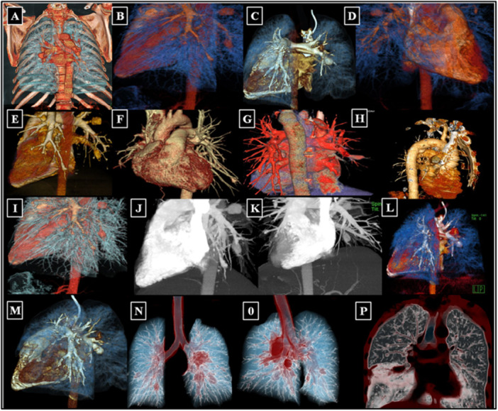
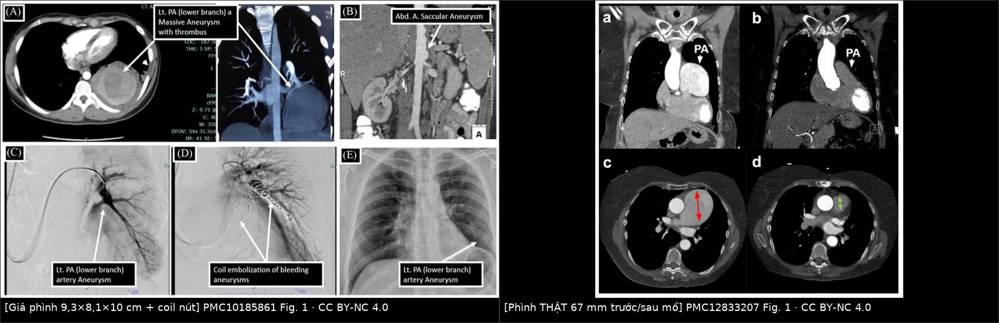
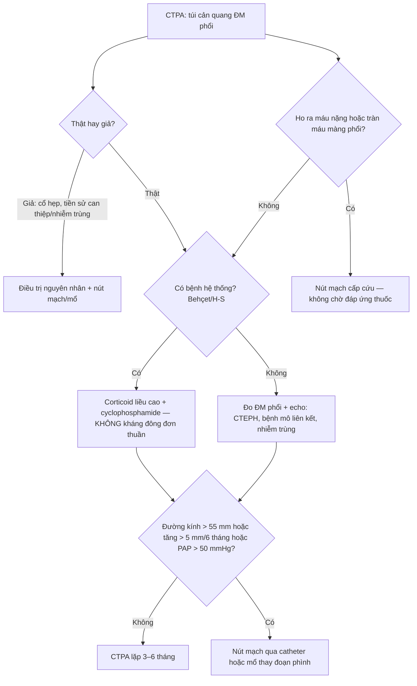
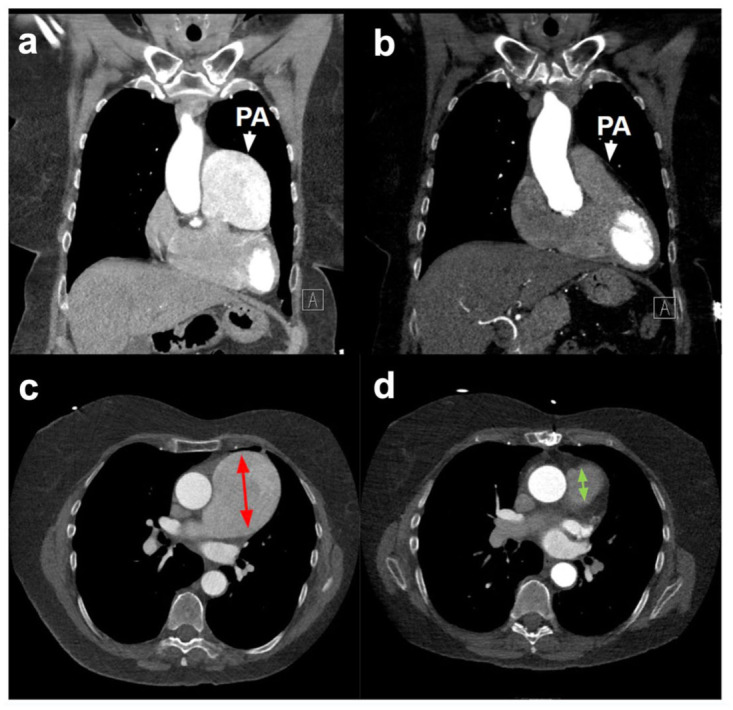
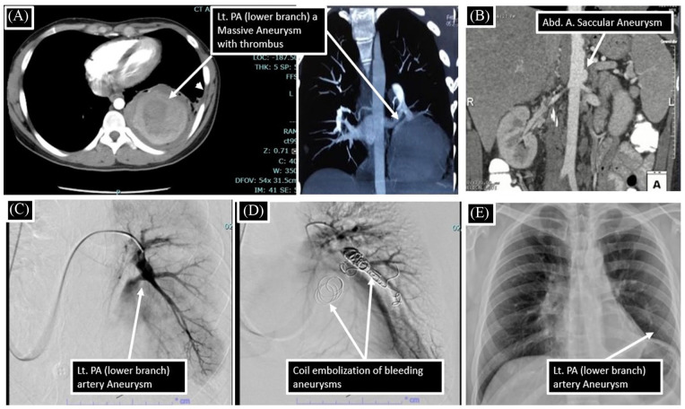
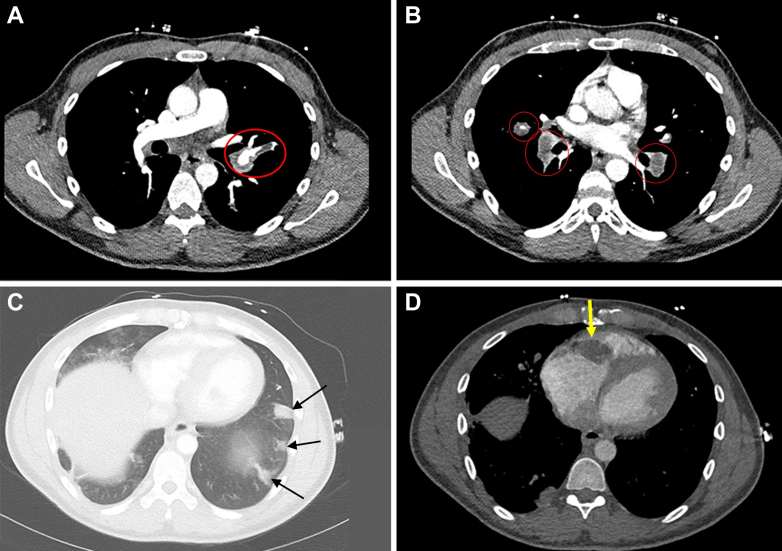

# 096 — Phình động mạch phổi THẬT & hội chứng Hughes–Stovin: ngưỡng can thiệp, bẫy huyết khối tại chỗ / True pulmonary artery aneurysm & Hughes–Stovin syndrome

**Tags:** `pattern:phinh-mach` `pattern:ho-ra-mau` `pattern:huyet-khoi` `vung:phoi` `vung:trung-that` `protocol:CTPA` `protocol:MIP-tai-dung` `protocol:DSA-nut-mach-phoi`
**Mức chắc chắn (certainty):** tổng hợp y văn (literature synthesis) — tổng quan Hughes–Stovin của Imran MM et al., *Health Sci Rep* 2025 (PMC12606038), loạt 3 ca H–S của Sachdev G et al., *J Clin Imaging Sci* 2023 (PMC10185861), loạt Behçet có phình ĐM phổi của Yigit N et al., *Ther Adv Respir Dis* 2026 (PMC13365664), 2 ca phình thật đơn độc của Cassidy-Nolan D et al., *J Investig Med High Impact Case Rep* 2026 (PMC12833207), ca Behçet–H–S có khối ở van ba lá của Naseer Z et al., *JACC Case Rep* 2026 (PMC13332666). Số chưa kiểm chứng ghi **"chưa rõ"**, không bịa.

## 1. Tổng quan bệnh học – cơ chế hình ảnh

- **Phình THẬT vs phình GIẢ — câu hỏi đầu tiên, vì tiên lượng khác nhau:** phình thật (**true aneurysm**) là giãn khu trú **còn đủ 3 lớp** thành mạch (nội mạc–trung mạc–ngoại mạc), thường do **thoái hóa trung mạc, viêm mạch, tăng áp phổi hoặc bệnh mô liên kết**. Phình giả (**pseudoaneurysm**) chỉ còn **lớp áo ngoài/mô quanh mạch** giữ máu — do **chấn thương, can thiệp (Swan–Ganz, catheter), nhiễm trùng, hoại tử**. Về mặt hình ảnh, cả hai đều là "túi cản quang", nhưng **phình giả có cổ hẹp, thành không đều, dễ vỡ hơn ở cùng đường kính**.
- **TẠI SAO thành mạch phổi giãn ra — ba cơ chế và hệ quả hình ảnh:**
  1. **Mất sợi đàn hồi trung mạc (cystic medial degeneration):** trên mô bệnh của 2 ca phình thật, nhuộm elastin cho thấy **mất cấu trúc sợi đàn hồi lớp trung mạc**; thành mạch chỉ còn mô xơ → **giãn dần theo áp lực**, thành **mỏng, căng, có thể vôi hóa viền** (Cassidy-Nolan D et al. 2026).
  2. **Viêm mạch (vasculitis):** Behçet và Hughes–Stovin gây **viêm thành mạch hoại tử** → phình **nhiều ổ, hai bên, kèm huyết khối tại chỗ**; mô bệnh 2 ca phình thật "đơn độc" lại là **viêm u hạt không hoại tử (non-necrotizing granulomatous inflammation)** — tức một thể viêm mạch khu trú.
  3. **Tăng áp lực (Laplace):** sức căng thành **T ∝ P × r / độ dày**. Khi đã có giãn, **bán kính tăng làm sức căng tăng theo cấp số**, nên phình **tự lớn nhanh dần**; đây là cơ sở của ngưỡng "đường kính + tốc độ lớn".
- **Ngưỡng định lượng cốt lõi (Cassidy-Nolan D et al. 2026):**
  - Đường kính **ĐM phổi chính bình thường ~25 mm**; **bách phân vị 90 ở nữ là 27 mm** (Framingham).
  - **< 45 mm: không coi là phình** theo cách định nghĩa có hiệu chỉnh diện tích da–tuổi–giới.
  - **Can thiệp khi: > 55 mm**, hoặc **lớn > 5 mm trong 6 tháng**, hoặc **áp lực ĐM phổi > 50 mmHg**, hoặc có biến chứng (ho ra máu, huyết khối, chèn ép).
  - **Chưa có hướng dẫn đồng thuận** cho phình không triệu chứng; nhóm tác giả đề nghị **CT lặp mỗi 6 tháng** để xác lập tốc độ lớn, sau đó giãn khoảng nếu ổn định.
- **Vì sao "huyết khối tại chỗ" là bẫy lớn nhất:** dòng máu trong túi phình chậm và xoáy → **huyết khối lót thành (mural thrombus)**. Trên CTPA, huyết khối này **giảm đậm độ lòng túi**, trông như **thuyên tắc phổi (PE)**; nếu chỉ đọc "khuyết thuốc" mà không đo đường kính mạch, sẽ **kháng đông nhầm** — và ở Behçet/H–S, kháng đông đơn thuần **làm tăng nguy cơ vỡ**.
- **Số liệu dịch tễ để không bỏ sót:**
  - **Hughes–Stovin (H–S):** **dưới 100 ca** trong y văn tiếng Anh; tuổi **12–48**, **nam trội**; tử vong **có thể tới 25%** ngay cả khi điều trị (Imran MM et al. 2025; Ascoli Marchetti A et al. 2023).
  - **Behçet:** tổn thương mạch **25–30%** bệnh nhân; tổn thương phổi **< 5%**; trong 279 bệnh nhân Behçet, **phình ĐM phổi 1,07% (3 ca)**, **huyết khối ĐM phổi 2,1% (6 ca)** (Yigit N et al. 2026).
  - **Huyết khối tại chỗ** gặp ở **~1/3** bệnh nhân Behçet có tổn thương mạch phổi.
- **Ba giai đoạn kinh điển của H–S (dùng để nhận diện sớm):** **viêm tắc tĩnh mạch (thrombophlebitis) → hình thành phình ĐM phổi → vỡ phình gây ho ra máu tử vong**. Ca minh họa 32 tuổi: huyết khối tĩnh mạch **ngày 0–26**, phình giả ĐM phổi **ngày 36–62** (8,1 mm rồi 3 ổ tới 10,0 mm), **tử vong do ho ra máu ngày 117** (Naseer Z et al. 2026).

## 2. Mẫu hình + chẩn đoán phân biệt theo vị trí (gamut)

**Câu hỏi thực hành:** trên CTPA có **"khối cản quang cạnh rốn phổi"** — đó là phình mạch, huyết khối, hay khối u? Và nếu là phình: **thật/giả, một ổ/nhiều ổ, có bệnh hệ thống không?**

- **Theo vị trí:**
  - **Thân ĐM phổi chính:** phình thật, thường **lớn (> 45–55 mm)**, có thể vôi hóa thành; gặp trong **tăng áp phổi, bệnh mô liên kết, Marfan, viêm mạch**; trên X-quang là **khối rốn phổi tròn, bờ rõ**.
  - **ĐM phổi nhánh trung tâm (lobar/segmental):** hay gặp trong **Behçet/H–S** — **nhiều ổ, hai bên, kèm huyết khối**; là vị trí dễ vỡ và ho ra máu máu.
  - **Ngoại vi (subsegmental):** phình giả sau **nhiễm trùng (mycotic), chấn thương, can thiệp**; thường nhỏ nhưng vẫn có thể vỡ.
  - **Trong hang lao/ổ hoại tử:** phình giả **Rasmussen** (xem bài 094) — bối cảnh hang lao, không phải phình thật.
- **Theo số lượng — gợi ý nguyên nhân:**
  - **Một ổ:** phình thật do thoái hóa/tăng áp phổi/bệnh mô liên kết; phình giả sau chấn thương/can thiệp.
  - **Nhiều ổ, hai bên:** **Behçet/H–S**, viêm mạch, nhiễm trùng huyết (mycotic), di căn mạch (hiếm).
- **Theo bối cảnh lâm sàng:**
  - **Nam trẻ + huyết khối tĩnh mạch tái phát + ho ra máu** → **H–S**.
  - **Loét miệng–sinh dục tái phát + viêm mắt + tổn thương da** → **Behçet** (H–S là thể "không đủ tiêu chuẩn Behçet").
  - **Tăng áp phổi mạn + phình thân ĐM phổi** → **CTEPH/IPAH**.
  - **Sốt, cấy máu (+), van tim nhân tạo/IV drug** → **phình giả nhiễm trùng**.
  - **Sau đặt Swan–Ganz, sau lobectomy, sau nút mạch** → **phình giả iatrogenic**.

### Ảnh minh họa phổ hình ảnh

*Atlas dựng MIP 3D từ nhiều bệnh nhân của Nhóm Nghiên cứu Quốc tế Hughes–Stovin: phình thân/nhánh trung tâm (A–G), phình ĐM phế quản (H), phình trung tâm và ngoại vi (I–M), phình hai bên (N–O). Nguồn: Imran MM et al., Health Sci Rep 2025, PMC12606038 Fig. 1 — CC BY-NC 4.0.*

## 3. Bảng so sánh phân biệt (ma trận đối chiếu)

| Thực thể (entity) | Hình ảnh điển hình (CTPA/MIP) | Chốt vào (rule-in) | Chốt loại (rule-out) | Gợi ý xác nhận |
|---|---|---|---|---|
| **H–S** | Nhiều phình nhánh trung tâm, hai bên, **huyết khối tại chỗ**; kèm huyết khối tĩnh mạch sâu | **Nam trẻ + DVT/tắc tĩnh mạch tái phát + PAA nhiều ổ + không loét sinh dục rõ** | Có loét miệng–sinh dục + viêm mắt đầy đủ → Behçet; một ổ đơn độc → phình thật | CTPA + siêu âm tĩnh mạch chi dưới; loại trừ nhiễm trùng, bệnh mô liên kết |
| **Behçet có PAA** | Phình **nhiều ổ, hai bên**, thành dày, **ngấm thuốc thành kéo dài (Ragab's sign)**; huyết khối trong lòng | **Tiêu chuẩn ICBD + PAA + huyết khối tại chỗ** | Không có tổn thương niêm mạc/mắt + chỉ một ổ → H–S hoặc phình thật | ICBD score; CTPA; theo dõi đường kính |
| **Phình thật đơn độc (thoái hóa/viêm u hạt)** | **Một ổ thân ĐM phổi**, thành đều, có thể vôi hóa; **không huyết khối nhiều**; CRP/ANCA bình thường | **Giãn > 45 mm, không nguyên nhân khác, mô bệnh viêm u hạt** | Nhiều ổ + huyết khối + bệnh hệ thống → Behçet/H–S | CT 6 tháng; mô bệnh sau mổ |
| **CTEPH/IPAH** | Phình **thân ĐM phổi** + **giãn thất phải**, huyết khối dạng dải bám thành, **mạng lưới/tắc nhánh** | **PAP > 50 mmHg + hình ảnh CTEPH + giãn buồng tim phải** | Không tăng áp phổi, không giãn tim phải → phình đơn độc | Echo, thông tim, CTPA |
| **Phình giả nhiễm trùng (mycotic)** | Túi **cổ hẹp**, thành không đều, khí/mô viêm quanh; **sốt + cấy máu (+)** | **Sốt + cấy máu (+) + túi mới xuất hiện** | Không nhiễm trùng, thành đều → phình thật | Cấy máu, PET-CT, kháng sinh + can thiệp |
| **Phình giả iatrogenic** | Túi tại **vị trí catheter/đầu Swan–Ganz/miệng nối**, cổ rõ | **Tiền sử can thiệp trong 30 ngày + túi mới** | Không can thiệp trước đó | So phim cũ; DSA |
| **Rasmussen trong hang lao** | Túi trong/sát **hang lao xơ**, thùy trên | **Hang lao + túi nối nhánh ĐM phổi** | Không hang, tổn thương trung tâm → phình thật | CTA + DSA (bài 094) |

*Trái: giả phình nhánh dưới phổi trái **9,3 × 8,1 × 10 cm** có huyết khối, DSA và coil nút mạch; phải: phình THẬT thân ĐM phổi **67 mm** trước và sau thay bằng ống ghép Dacron 26 mm. Nguồn: Sachdev G et al., J Clin Imaging Sci 2023, PMC10185861 Fig. 1 (CC BY-NC 4.0) và Cassidy-Nolan D et al. 2026, PMC12833207 Fig. 1 (CC BY-NC 4.0). Ảnh ghép letterbox của repo, không crop.*

### Dấu hiệu định lượng cần đo trên CTPA

- **Đường kính lớn nhất** đo trên mặt phẳng **vuông góc trục mạch**, dựng MPR; ghi cả **đường kính thân và nhánh**, so với **25 mm (trung bình)** và **27 mm (bách phân vị 90 ở nữ)**.
- **Tốc độ lớn:** tính **mm/6 tháng** từ ít nhất 2 lần chụp; **> 5 mm/6 tháng** là ngưỡng can thiệp.
- **Huyết khối trong lòng:** đo **độ dày huyết khối**, mô tả **có/không ngấm thuốc thành kéo dài** (Ragab's sign) — gợi ý **viêm mạch đang hoạt động**, không phải PE đơn thuần.
- **Áp lực ĐM phổi:** ước tính trên echo/thông tim; **> 50 mmHg** là yếu tố quyết định can thiệp.
- **Biến chứng:** **ho ra máu**, **tràn máu màng phổi**, **chèn ép phế quản**, **huyết khối lan vào nhánh**.

## 4. Protocol chụp + phân độ + thuật toán điều trị

### Protocol

- **CTPA là chuẩn:** cản quang tĩnh mạch, **lát ≤ 1 mm**, **ECG-gating** nếu phình thân ĐM phổi để tránh giả ảnh động (pulsation artifact); dựng **MPR vuông góc + MIP 3D** để đo đúng trục và thấy các ổ nhỏ.
- **Chụp toàn bộ ngực + bụng trên** ở bệnh nhân nghi Behçet/H–S: tìm **phình ĐM chủ bụng, phình ĐM gan, huyết khối tĩnh mạch** (ca H–S có kèm phình ĐM chủ bụng và phình giả ĐM gan).
- **Siêu âm Doppler tĩnh mạch chi dưới** + **echo tim** (áp lực ĐM phổi, giãn thất phải, khối trong buồng tim).
- **DSA** khi ho ra máu hoặc trước can thiệp: xác định **nhánh nuôi**, đánh giá **có nguồn ĐM phế quản** kèm theo, chuẩn bị **coil/plug/stent-graft**.
- **Theo dõi:** CTPA **3–6 tháng/lần** khi chưa can thiệp; sau can thiệp **1–3 tháng** rồi giãn dần; ghi đường kính + tốc độ lớn trong báo cáo.

### Phân tầng và thuật toán

- **Không có hệ phân độ chính thức cho PAA.** Dùng **phân tầng theo đường kính + tốc độ lớn + áp lực + biến chứng** (Cassidy-Nolan D et al. 2026):

| Tầng | Tiêu chí | Hành động |
|---|---|---|
| **Theo dõi** | **< 45 mm**, không triệu chứng, không tăng áp phổi | CT **6–12 tháng**, đo lại đường kính |
| **Cân nhắc can thiệp** | **45–55 mm**, lớn **> 5 mm/6 tháng**, có huyết khối lớn | Hội chẩn tim–mạch–hô hấp, CTPA ngắn hạn |
| **Chỉ định can thiệp** | **> 55 mm**, **PAP > 50 mmHg**, ho ra máu, vỡ/tràn máu màng phổi | **Nút mạch** (coil/plug/stent-graft) hoặc **mổ** thay đoạn phình |

### Điều trị — thứ tự ưu tiên

- **Bệnh hệ thống (Behçet/H–S): ức chế miễn dịch là nền tảng.** Corticoid liều cao + **cyclophosphamide**; thay thế bằng **azathioprine, mycophenolate, cyclosporine, colchicine**; kháng TNF (infliximab) khi kháng trị (Imran MM et al. 2025). Trong loạt 8 ca Behçet–H–S, **8/8 ca được ức chế miễn dịch sống**, ca duy nhất chỉ kháng đông **tử vong do vỡ phình** (Naseer Z et al. 2026).
- **Nút mạch (embolization):** lựa chọn cho **ho ra máu cấp**, phình **nhiều ổ/không mổ được**, hoặc **cầu nối** trước khi kiểm soát viêm. Vật liệu: **coil, plug, stent-graft, glue**; kỹ thuật **stent-assisted** khi cổ rộng.
- **Mổ:** **phình thân ĐM phổi lớn, một ổ, không đáp ứng nội khoa**, hoặc **thất bại nút mạch**; thay đoạn phình bằng **ống ghép Dacron** hoặc **van–động mạch phổi bảo tồn**. Ca 67 mm: thay bằng **Dacron 26 mm**, hậu phẫu thuận lợi.
- **Kháng đông:** **không dùng đơn thuần khi có phình ĐM phổi**; nếu cần cho huyết khối tĩnh mạch, cân nhắc **lọc tĩnh mạch chủ dưới (IVC filter)** thay vì kháng đông liều đầy đủ ở bệnh nhân nguy cơ vỡ cao (Ascoli Marchetti A et al. 2023).

## 5. Biến thể bình thường và cạm bẫy

- **"Phình" giả do lát cắt chéo:** đo trên lát trục không vuông góc trục mạch → **giãn giả**; luôn dựng MPR vuông góc và so với nhánh trên/dưới.
- **Giả ảnh động (pulsation artifact) ở thân ĐM phổi:** tạo "đường bờ đôi" giả; dùng **ECG-gating** hoặc so sánh với thì khác.
- **Huyết khối tại chỗ bị đọc thành PE:** huyết khối trong túi **bám thành, có viền cản quang quanh**, kèm **túi giãn**; PE là **khuyết thuốc trong lòng mạch có đường kính bình thường**. Đọc kèm đường kính mạch là bắt buộc.
- **Ragab's sign:** **ngấm thuốc thành túi kéo dài sang thì tĩnh mạch** gợi ý **viêm mạch hoạt động** — không phải "u thành mạch"; giúp phân biệt Behçet/H–S với phình thoái hóa.
- **Coil migration:** biến chứng muộn của nút mạch — **coil di chuyển vào phế quản**, ho ra máu lại, thậm chí khạc ra coil (Yigit N et al. 2026). Theo dõi CTPA sau nút mạch, cảnh báo bệnh nhân.
- **Khối rốn phổi trên X-quang:** phình thân ĐM phổi **bờ rõ, tròn, có thể vôi hóa viền** — dễ bị đọc là **hạch/khối u**; CTPA phân biệt trong một thì.
- **Đừng bỏ sót tổn thương ngoài phổi:** Behçet/H–S có thể kèm **phình ĐM chủ bụng, phình giả ĐM gan, huyết khối tĩnh mạch chi dưới, viêm thần kinh thị** — chụp mở rộng và khám mắt.
- **Thai kỳ:** phình ĐM phổi + thai làm tăng nguy cơ vỡ do tăng thể tích và thay đổi nội tiết; cần hội chẩn sản–tim–hô hấp, **không tự ý can thiệp** ngoài trung tâm có kinh nghiệm.

## 6. Tự lượng giá — Blind Quiz

**Ca 1 — Nữ 68 tuổi, tình cờ phát hiện phình thân ĐM phổi 59 mm khi chụp CT vì đau bụng; 3 năm sau mổ. Ảnh trước và sau mổ.**

- Câu hỏi: Đo đường kính lớn nhất ở đâu? Vì sao 59 mm chưa mổ ngay mà theo dõi? Ngưỡng nào đã thúc đẩy mổ?

<b>Bấm để hiện đáp án (findings + chẩn đoán)</b>

- **Findings:** phình **thân ĐM phổi** (a, c) đường kính **59 mm lúc phát hiện**, tăng dần tới **67 mm** trước mổ; sau mổ (b, d) thay bằng **ống ghép Dacron 26 mm**, đường kính trở về bình thường.
- **Chẩn đoán:** **phình thật thân ĐM phổi do viêm u hạt không hoại tử (clinically isolated pulmonary arteritis)** — mô bệnh có **mất sợi đàn hồi trung mạc** và **viêm u hạt**.
- **Vì sao chờ:** **< 45 mm không coi là phình**; ngưỡng mổ là **> 55 mm** hoặc **tăng > 5 mm/6 tháng** — ca này tăng **6 mm** trong vài tháng (62 → 66–67 mm), đạt ngưỡng.
- **Nguồn ảnh:** Cassidy-Nolan D et al., J Investig Med High Impact Case Rep 2026, PMC12833207 Fig. 1 — CC BY-NC 4.0.

**Ca 2 — Nam 24 tuổi, ho ra máu, thiếu máu nặng; CTPA có túi lớn chiếm gần cả thùy dưới trái. DSA và sau nút mạch.**

- Câu hỏi: Túi này là thật hay giả? Dấu hiệu nào trên ảnh gợi ý? Vì sao vẫn phải mổ bỏ thùy phổi sau nút mạch?

<b>Bấm để hiện đáp án (findings + chẩn đoán)</b>

- **Findings:** túi **9,3 × 8,1 × 10 cm** ở nhánh dưới ĐM phổi trái, **huyết khối lót thành** (A); DSA (C) xác nhận; (D) **coil nút mạch**; (E) X-quang sau **cắt thùy dưới trái**.
- **Chẩn đoán:** **giả phình ĐM phổi khổng lồ trong Hughes–Stovin** (nam 24 tuổi, kèm phình ĐM chủ bụng); ho ra máu + tràn máu màng phổi.
- **Vì sao mổ sau nút mạch:** túi quá lớn, đã gây **tràn máu màng phổi**; nút mạch cầm máu tạm nhưng **khối choán chỗ/huyết khối** vẫn cần lấy bỏ — ca này **cắt thùy dưới trái** sau coil.
- **Nguồn ảnh:** Sachdev G et al., J Clin Imaging Sci 2023, PMC10185861 Fig. 1 — CC BY-NC 4.0.

**Ca 3 — Nam 32 tuổi, tiền sử loét miệng–sinh dục, ho ra máu; CTPA thấy phình hai bên kèm huyết khối trong lòng, thành túi ngấm thuốc kéo dài.**

- Câu hỏi: Mô tả 4 bảng ảnh. Dấu hiệu nào gợi ý **viêm mạch hoạt động**? Vì sao **không** dùng kháng đông đơn thuần?

<b>Bấm để hiện đáp án (findings + chẩn đoán)</b>

- **Findings:** (A, B) **phình ĐM phổi hai bên** với **huyết khối tại chỗ** (vòng đỏ), **ngấm thuốc thành túi kéo dài sang thì tĩnh mạch** — **Ragab's sign**; (C) **tràn máu màng phổi trái** (mũi tên đen); (D) khối tổ chức hóa ở **van ba lá** (mũi tên vàng).
- **Chẩn đoán:** **Behçet – Hughes–Stovin overlap**, biến chứng **vỡ phình gây ho ra máu tử vong**; khối ở van ba lá là **máu tụ tổ chức hóa viêm**.
- **Vì sao không kháng đông đơn thuần:** phình đang viêm, thành mỏng; kháng đông **làm tăng nguy cơ vỡ**. Trong loạt 8 ca tương tự, **8/8 ca được ức chế miễn dịch sống**, ca chỉ dùng kháng đông **tử vong**.
- **Nguồn ảnh:** Naseer Z et al., JACC Case Rep 2026, PMC13332666 Fig. 1 — CC BY-NC-ND 4.0 (nguyên bản, không ghép/crop).

## Bài liên quan chéo
- [001 – Tổng quan hệ Ngực](../001-tong-quan-he-nguc/lesson.md)
- [094 – Ho ra máu từ động mạch phổi: phình giả Rasmussen & nút mạch phổi](../094-phinh-gia-rasmussen-nut-mach-dong-mach-phoi/lesson.md) (phình giả trong hang lao)
- [091 – Ho ra máu ồ ạt & nút mạch động mạch phế quản](../091-ho-ra-mau-oat-nut-mach-dong-mach-phe-quan/lesson.md) (xử trí chảy máu cấp)
- [070 – Thuyên tắc phổi & huyết khối trong lòng mạch](../070-thuyen-tac-phoi-dmc-cap/lesson.md) (phân biệt huyết khối tại chỗ)
- [049 – Theo dõi sau cắt thùy phổi bẩm sinh](../049-theo-doi-sau-cat-thuy-phoi-bam-sinh/lesson.md) (phình giả sau mổ)

> Không dùng để chẩn đoán độc lập khi chưa có người hướng dẫn.
