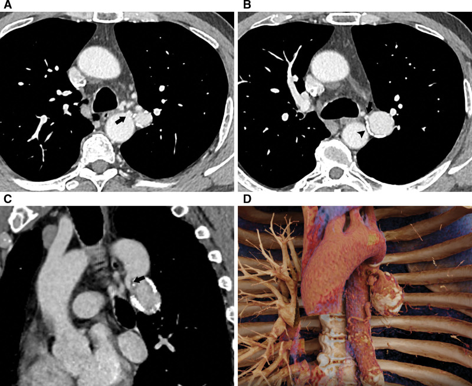
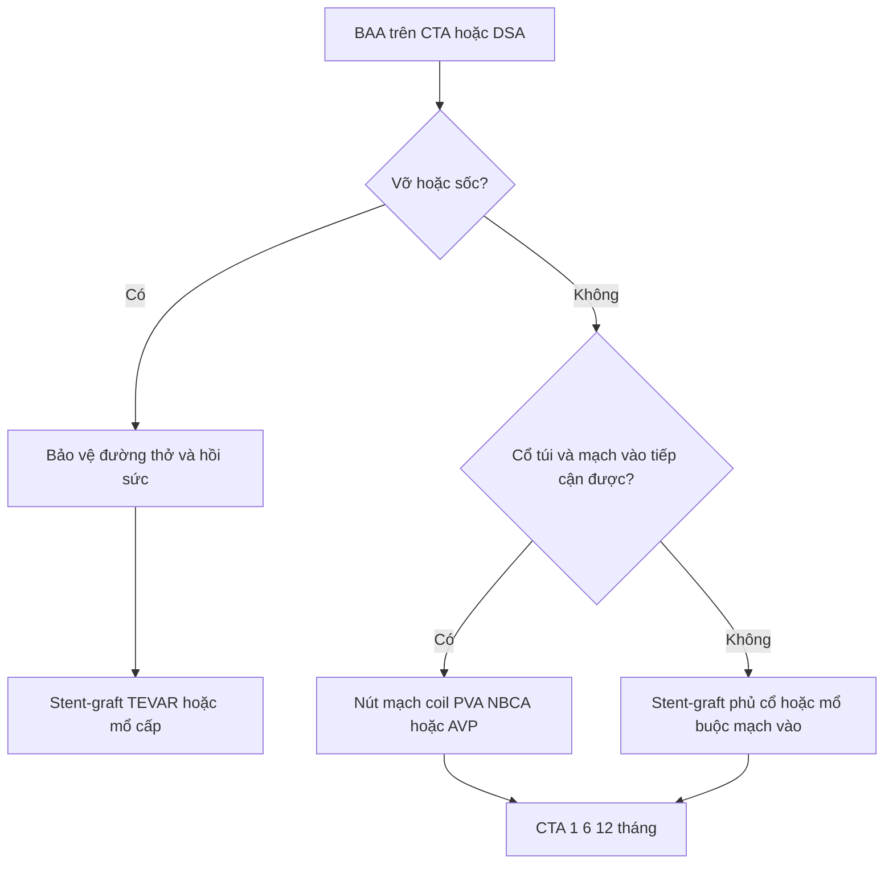
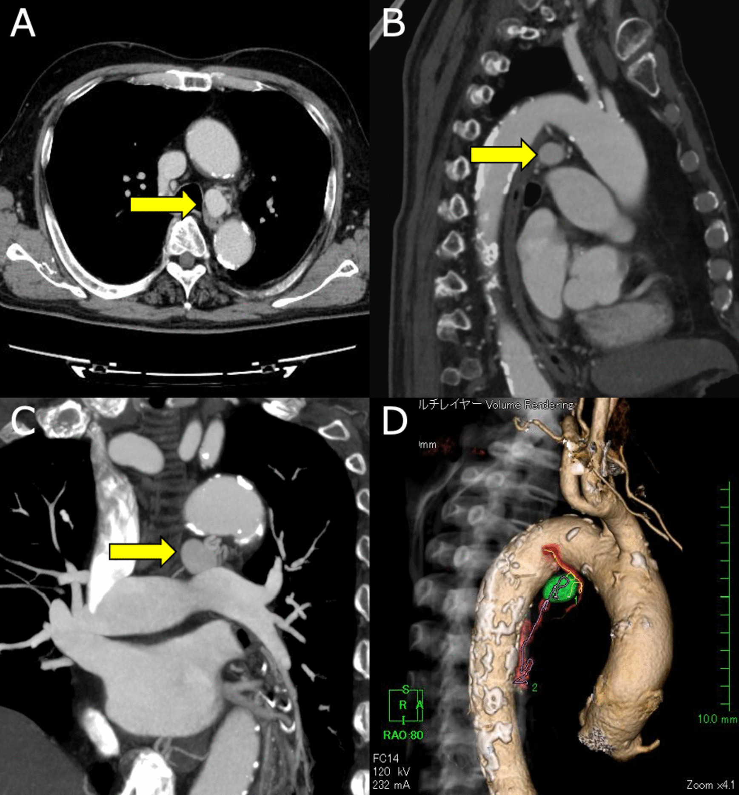
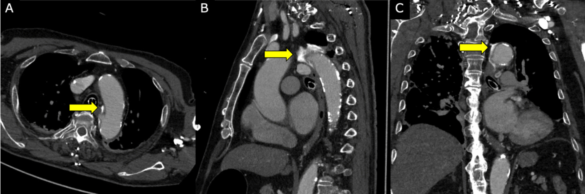

# 097 — Phình động mạch phế quản (BAA) & nút mạch trong ho ra máu / Bronchial artery aneurysm and embolization

**Tags:** `pattern:phinh-mach` `pattern:ho-ra-mau` `vung:phoi` `vung:trung-that` `protocol:CTA-nguc` `protocol:DSA-nut-mach` `protocol:TEVAR`
**Mức chắc chắn (certainty):** tổng hợp y văn (literature synthesis) — 1 loạt 5 bệnh nhân BAA được nút mạch (Fu LJ et al., *Postepy Kardiol Interwencyjnej* 2020, PMC7863811), 1 ca BAA khổng lồ bị chẩn đoán nhầm u trung thất kèm tổng quan y văn (Balar AB et al., *Radiol Case Rep* 2022, PMC8898754), 2 ca BAA trung thất lớn/cổ ngắn được can thiệp nội mạch (Wang J et al., *Medicine* 2026, PMC12826243; Higa H et al., *Gen Thorac Cardiovasc Surg Cases* 2023, PMC11533431), 1 ca BAA vỡ 9 mm được TEVAR (Kikutani K et al., *Intern Med* 2020, PMC7303459) và 1 ca BAA vỡ biểu hiện nôn máu (Kim G et al., *Curr Med Imaging* 2025, PMC13223448). Số chưa đối chiếu được ghi **"chưa rõ"**, không bịa.

## 1. Tổng quan bệnh học – cơ chế hình ảnh

- **Động mạch phế quản (bronchial artery) là mạch hệ thống, không phải mạch phổi.** Nhánh điển hình xuất phát từ **động mạch chủ xuống ngang T5–T6**, nuôi phế quản, mô kẽ và màng phổi; áp lực ~**100 mmHg** so với **15–20 mmHg** của động mạch phổi. Vì vậy khi túi phình vỡ, máu **phun vào lòng phế quản** và gây tử vong do **ngạt (asphyxia)**, không phải do mất máu ồ ạt — ưu tiên số một là bảo vệ đường thở (bài 091).
- **Vì sao BAA hiếm nhưng nguy hiểm:** BAA gặp ở **< 1%** số ca chụp động mạch phế quản chọn lọc; đến 2020 y văn tiếng Anh mới ghi nhận **khoảng 60 ca BAA** và **< 50 ca giả phình (pseudoaneurysm)** (Fu LJ et al. 2020; Balar AB et al. 2022). Số ca ít khiến bác sĩ đọc hình **không nghĩ tới**, trong khi túi vỡ có thể tử vong nhanh.
- **Bốn cơ chế làm thành mạch yếu và giãn ra:**
  1. **Tăng lưu lượng mạn:** giãn phế quản, lao, viêm phổi tái diễn → mạch phì đại, xoắn, thành mỏng dần.
  2. **Viêm – xơ hóa thành mạch:** lao hoạt động, aspergilloma, viêm mủ kéo dài phá hủy lớp áo giữa.
  3. **Xơ vữa (atherosclerosis):** mảng xơ làm thành mất đàn hồi, thường thấy **vôi hóa hình vòng** quanh túi.
  4. **Bẩm sinh / dị tật:** sequenstration phổi, bất thường phát sinh mạch; BAA có thể kèm **rò phế quản–động mạch phổi**.
- **TẠI SAO túi càng lớn càng dễ vỡ — định luật Laplace:** sức căng thành **T ∝ P × r / độ dày thành**. Túi phình có **bán kính (r) tăng**, **áp lực (P) hệ thống cao**, còn **thành mỏng gần như không có cơ trơn** → chỉ cần tăng nhẹ đường kính hoặc một cơn tăng huyết áp là đủ vượt giới hạn mô. Đây là lý do **không có ngưỡng kích thước "an toàn"**: ca vỡ nhỏ nhất trong loạt TEVAR chỉ **9 mm**, trong khi ca BAA **4,2 × 5,5 × 6,7 cm** lại được theo dõi nhầm 2 năm vì tưởng u trung thất (Kikutani K et al. 2020; Balar AB et al. 2022).
- **Vì sao CTA có thể âm tính giả:** túi nằm sát phế quản/trung thất, dòng chảy xoáy và huyết khối lót thành làm thuốc không đầy hoàn toàn. Trong tổng quan của Balar AB et al. 2022, **độ nhạy của CTA là 67%**, còn **DSA là 100%** — **CTA âm tính không loại trừ BAA** nếu lâm sàng nghi cao.
- **Hình ảnh đặc trưng trên CTA lát mỏng:** túi cản quang **nối liền với một nhánh động mạch phế quản** (mạch nuôi đi từ động mạch chủ xuống), **vôi hóa hình vòng** quanh túi, có thể có **huyết khối lót thành**; túi trung thất nằm cạnh phế quản gốc/thực quản, túi trong phổi nằm cạnh phế quản thùy. Kích thước ghi nhận trong các ca: **9 mm** (vỡ), **21 × 17 × 17 mm** (trung thất, động mạch vào 2,5 mm), **4,2 × 5,5 × 6,7 cm** (khổng lồ, chẩn đoán nhầm) (Kikutani 2020; Higa 2023; Balar 2022).

## 2. Mẫu hình + chẩn đoán phân biệt theo vị trí (gamut)

**Câu hỏi thực hành:** túi cản quang nằm ở đâu, và **mạch nuôi đến từ đâu**? Vị trí quyết định triệu chứng và đường can thiệp.

- **BAA trung thất (mediastinal BAA):** thường **không triệu chứng**, phát hiện tình cờ; khi lớn gây **nuốt nghẹn, khàn tiếng, ho** do chèn ép; khi vỡ gây **máu tụ trung thất, tràn máu màng phổi**, bệnh cảnh **giống bóc tách động mạch chủ** (đau ngực–lưng, sốc).
- **BAA trong phổi/rốn phổi (intrapulmonary/hilar BAA):** hay gặp **ho ra máu**, có thể ồ ạt; túi nằm trong nhu mô hoặc sát rốn, dễ nhầm với **phình giả Rasmussen** hoặc **phình động mạch phổi**.
- **BAA nhiều túi / hai bên:** nghĩ bệnh nền lan tỏa — **giãn phế quản, lao, sequenstration**, hoặc bệnh mô liên kết/viêm mạch.
- **Gamut theo cơ chế:** tăng lưu lượng (giãn phế quản, lao, tim bẩm sinh), viêm/nhiễm (lao, aspergillus, áp-xe), thoái hóa–xơ vữa, chấn thương/iatrogenic (đặt catheter, phẫu thuật), bẩm sinh (sequenstration).

**Mnemonic "BAA" — 4 nhóm phải loại trừ trước khi gọi là BAA:**
- **B** — **Bleeding source khác**: phình giả Rasmussen/động mạch phổi (bài 094), phình thật động mạch phổi (bài 096), phình/bóc tách động mạch chủ.
- **A** — **Aortic / esophageal lesion**: túi phình chủ, loét xuyên thành (PAU), u thực quản dưới niêm mạc.
- **A** — **Adenopathy / mass**: hạch trung thất, u trung thất, u phổi — đặc biệt trên CT không cản quang.

## 3. Bảng so sánh phân biệt (ma trận đối chiếu)

| Thực thể (entity) | Hình ảnh điển hình (CTA lát mỏng) | Chốt vào (rule-in) | Chốt loại (rule-out) | Gợi ý xác nhận |
|---|---|---|---|---|
| **BAA (phình động mạch phế quản)** | Túi cản quang cạnh phế quản/trung thất, **vôi hóa hình vòng**, mạch nuôi từ động mạch chủ xuống T5–T6 | **Thấy cổ túi nối trực tiếp với nhánh động mạch phế quản**; mạch nuôi hệ thống | Không có mạch nuôi hệ thống; túi nối với động mạch phổi → nghĩ Rasmussen/PA | CTA ≤ 1 mm + MIP/3D; DSA chọn lọc (nhạy 100%) |
| **Phình giả Rasmussen / phình giả động mạch phổi** | Túi trong hoặc sát **hang lao**, nối nhánh động mạch phổi; thường có hang ≥ 30 mm | **Túi nối nhánh động mạch phổi**, trong hang lao, ho ra máu | Mạch nuôi từ động mạch chủ/ĐM phế quản → BAA | CTA phổi + chụp động mạch phổi; **28,6% không thấy trên chụp ĐM phổi** → chụp hệ thống |
| **Phình thật động mạch phổi** | Giãn thân/nhánh ĐM phổi, thành còn 3 lớp, có thể huyết khối lót thành | **Đường kính > 45 mm** (chưa gọi phình dưới ngưỡng); > 55 mm hoặc tăng > 5 mm/6 tháng = can thiệp | Túi có cổ hẹp nối mạch hệ thống → BAA/giả phình | CTPA + MIP; đo đường kính và tốc độ lớn |
| **Phình/bóc tách động mạch chủ, PAU** | Túi/loét liên tục với lòng ĐMC, vôi hóa di lệch, flap, máu tụ trung thất | **Liên tục với lòng ĐMC**; flap/2 lòng; PAU có ổ loét xuyên thành | Có cổ riêng nối nhánh phế quản, ĐMC nguyên → BAA | CTA toàn ngực thì động mạch; TEE nếu cấp |
| **Hạch trung thất / u trung thất** | Khối mô mềm, ngấm thuốc ít–trung bình, **không có mạch nuôi hệ thống**; có thể vôi hóa dạng điểm | **Không có cổ túi, không có mạch nuôi từ ĐMC**; hình dạng ổn định nhiều tháng | Ngấm thuốc **bằng lòng ĐMC** + vôi hóa vòng + mạch nuôi = BAA | So phim cũ; PET/CT (BAA có thể **không tăng FDG**, dễ bị gọi u) |
| **U phế quản ưa mạch (carcinoid)** | Khối trong lòng phế quản, ngấm mạnh, có thể ho ra máu; **không có túi phình** | Khối lấp lòng phế quản + ngấm mạnh thì động mạch | Có túi cản quang hình cầu + cổ = BAA | Nội soi phế quản + sinh thiết; CTA |
| **U/thoát vị thực quản dưới niêm mạc** | Khối trong thành thực quản, không có mạch nuôi hệ thống; nuốt nghẹn | Khối thành thực quản, **không đập theo mạch** trên nội soi | Có mạch nuôi từ ĐMC + vôi hóa vòng = BAA | Nội soi + EUS; CTA |

*BAA lớn ở rốn phổi trái, xuất phát từ động mạch chủ ngực: (A) trục ngang — túi cạnh phế quản gốc (mũi tên đen); (B) **vôi hóa hình vòng** quanh túi (đầu mũi tên) và cổ túi hẹp; (C) coronal chếch — cổ túi ngắn, hình phễu; (D) 3D-VR — tương quan túi với ĐMC và mạch nuôi. Nguồn: Wang J et al., *Medicine* 2026, PMC12826243 Fig. 1, CC BY 4.0.*

### Đọc CTA tìm BAA theo 5 bước (tránh bỏ sót)
1. **Tìm mạch nuôi:** lần theo nhánh xuất phát từ **động mạch chủ xuống T5–T6** (hoặc nhánh ectopic từ cung ĐMC/thân sườn–phế quản); mạch phì đại khi **> 2 mm**.
2. **Đo túi:** đường kính lớn nhất, **chiều dài cổ túi**, đường kính và chiều dài đoạn động mạch vào — đây là ba số quyết định chọn coil/plug/stent-graft.
3. **Tìm vôi hóa hình vòng** và **huyết khối lót thành** (giảm đậm độ trong túi) — huyết khối không loại trừ BAA.
4. **Tìm rò động mạch phế quản – động mạch phổi** (outflow): nếu có, phải nút **cả đầu vào và đầu ra**, nếu không sẽ tái thông qua tuần hoàn phổi.
5. **Nếu CTA âm tính mà nghi cao:** chuyển **DSA chọn lọc** — CTA chỉ nhạy 67%, DSA 100%.

## 4. Protocol chụp + phân tầng & quyết định can thiệp

### Protocol
- **CTA ngực:** lát **≤ 1 mm**, thì động mạch (bolus tracking ở ĐMC xuống), tái tạo **MIP + 3D-VR**; đo túi/cổ/mạch vào trên workstation. Nếu túi ở rốn phổi, bổ sung thì muộn 30–40 giây để phân biệt **huyết khối lót thành** với thuốc đầy túi.
- **DSA:** chụp **động mạch phế quản chọn lọc** (5F Cobra/MPA), test injection trước khi nút; **bắt buộc tìm nhánh tủy sống (radiculomedullary branch)** trước khi bơm hạt/keo.
- **Đo áp lực** nếu có rò động mạch phổi hoặc nghi tăng áp phổi; ghi lại để so sau can thiệp.

### Phân tầng và thuật toán
- **Nguyên tắc cốt lõi:** **mọi BAA đều nên được điều trị, kể cả khi không triệu chứng**, vì vỡ là biến cố chết người và **không có ngưỡng kích thước an toàn** (Higa H et al. 2023). Khác với phình động mạch phổi thật (bài 096) — nơi có ngưỡng 45/55 mm — BAA không chờ "đủ lớn".
- **Nội mạch là lựa chọn đầu tay** cho BAA không triệu chứng, đặc biệt thể trung thất; **mổ cắt túi/buộc động mạch vào** dành cho: vỡ mất kiểm soát, giải phẫu không tiếp cận được, nút mạch thất bại hoặc tái thông.
- **Chọn vật liệu theo hình thái cổ túi:**
  - Cổ hẹp, mạch vào dài → **coil** ± PVA/gelatin; có thể "sandwich" (nút đầu vào và đầu ra).
  - Cổ rộng, ngắn, xoắn → **Amplatzer vascular plug (AVP)** hoặc **NBCA–lipiodol**; ca cổ ngắn 8 × 7 mm đã dùng một AVP, 6 tháng không tái phát (Wang J et al. 2026).
  - Túi sát ĐMC, cổ rất rộng/không có cổ → **stent-graft phủ (TEVAR)** để loại túi khỏi dòng máu, đặc biệt khi BAA xuất phát từ cung ĐMC (Kikutani 2020; Higa 2023).
- **Sau can thiệp:** CTA **1 tháng, 6 tháng, 12 tháng**, sau đó mỗi năm; mục tiêu là **không còn thuốc trong túi** và **đường kính túi giảm dần** (ca Higa: 21 mm → **5,6 mm** sau 6 tháng).

### Biến chứng của nút mạch — phải nói trước với bệnh nhân
- **Thiếu máu tủy sống (spinal cord ischemia):** nhánh phế quản có thể cho **nhánh tủy sống**; nút nhầm hoặc bơm hạt trôi ngược gây **liệt hai chi dưới**, không hồi phục. Đây là biến chứng thảm khốc nhất, dù hiếm.
- **Bóc tách động mạch chủ do catheter:** ca Higa 2023 — BAE gây **bóc tách cấp cục bộ** từ lỗ động mạch phế quản tới cung ĐMC, phải **TEVAR cấp cứu**; vì vậy cần sẵn sàng phương án TEVAR/mổ khi nút BAA trung thất.
- **Tái thông (recanalization) và tuần hoàn bàng hệ:** nút không hoàn toàn hoặc bỏ sót nhánh bàng hệ → túi tái đầy; theo dõi CTA và chụp lại nếu còn ho ra máu.
- **Coil migration / huyết khối mạch đích:** kiểm tra bằng fluoroscopy cuối thủ thuật; CT sau nút có **artifact kim loại** — dùng **spectral CT** để giảm artifact và đánh giá túi (Zhang S et al. 2026, PMC13380537).

## 5. Biến thể bình thường và cạm bẫy

- **Cạm bẫy số 1 — CT không cản quang:** BAA trung thất trông như **hạch hoặc khối mô mềm**; ca 4,2 × 5,5 × 6,7 cm đã bị gọi là "u trung thất" và theo dõi **2 năm** trước khi chẩn đoán đúng (Balar AB et al. 2022). Trên CT không cản quang, **không thể loại trừ BAA** — nếu khối nằm cạnh phế quản gốc/ĐMC xuống, phải chụp CTA.
- **Cạm bẫy số 2 — CTA âm tính:** độ nhạy 67% (Balar 2022). Túi huyết khối hoàn toàn hoặc dòng chảy cạnh tranh có thể **không đầy thuốc**; nếu bệnh nhân ho ra máu tái diễn và không tìm được nguồn, **chụp DSA hệ thống**.
- **Cạm bẫy số 3 — vỡ vào thực quản:** BAA vỡ có thể biểu hiện **nôn máu (hematemesis)** thay vì ho ra máu, do túi nằm sát thực quản và rò vào lòng thực quản; ca Kim G et al. 2025 phải nút **2 lần** vì còn thoát thuốc (PMC13223448). Nôn máu + đau ngực/đau lưng ở người có bệnh phổi mạn → nghĩ BAA vỡ, không chỉ loét dạ dày.
- **Cạm bẫy số 4 — "khối trung thất tăng FDG" không loại trừ BAA:** viêm thành mạch có thể tăng nhẹ FDG; PET/CT **không đủ** để phân biệt BAA với u, phải có CTA thì động mạch.
- **Cạm bẫy số 5 — bỏ sót rò động mạch phổi:** nếu chỉ nút đầu vào mà còn rò sang động mạch phổi, túi vẫn đầy qua đường phổi; luôn tìm **outflow** trên CTA/DSA trước khi kết thúc thủ thuật.
- **Biến thể bình thường:** động mạch phế quản **phì đại > 2 mm** nhưng **không có túi** trong giãn phế quản/lao — đây là "mạch nuôi tăng sinh", không phải BAA; chỉ can thiệp khi có ho ra máu và túi/nguồn chảy xác định.

## 6. Tự lượng giá — Blind Quiz

**Ca 1 — Nam 69 tuổi, tình cờ phát hiện khối cạnh rốn phổi trái khi khám sức khỏe. Không ho ra máu.**

- Hỏi: khối nằm ở đâu? Có dấu hiệu nào chứng minh đây là mạch máu chứ không phải hạch? Ba chẩn đoán phân biệt?

<b>Bấm để hiện đáp án (findings + chẩn đoán)</b>

- **Findings:** túi cản quang lớn ở rốn phổi trái, **nối với động mạch chủ ngực** qua một nhánh động mạch phế quản; **vôi hóa hình vòng** quanh túi; cổ túi ngắn, hình phễu; 3D-VR thấy rõ mạch nuôi.
- **Chẩn đoán:** **BAA (phình động mạch phế quản)** — vôi hóa vòng + mạch nuôi hệ thống là chốt.
- **Phân biệt:** phình giả Rasmussen (nối nhánh động mạch phổi, trong hang lao), phình thật động mạch phổi (thân/nhánh ĐM phổi, > 45 mm), hạch trung thất (không có mạch nuôi, không vôi hóa vòng).
- **Xử trí:** nút mạch bằng **AVP 8 × 7 mm**; CTA 6 tháng không tái phát (Wang J et al. 2026).
- Nguồn ảnh: Wang J et al., *Medicine* 2026, PMC12826243 Fig. 1, CC BY 4.0.

**Ca 2 — Nữ 79 tuổi, đau ngực–lưng dữ dội, tụt huyết áp. CTA thấy túi 9 mm cạnh cung ĐMC.**

- Hỏi: túi xuất phát từ đâu? Vì sao bệnh cảnh giống bóc tách ĐMC? Ngưỡng can thiệp có phụ thuộc kích thước không?

<b>Bấm để hiện đáp án (findings + chẩn đoán)</b>

- **Findings:** túi 21 × 17 × 17 mm phía sau trung thất của **cung ĐMC xa**, động mạch vào **2,5 mm**; 3D thấy túi (xanh) và mạch vào (đỏ).
- **Chẩn đoán:** **BAA trung thất**; vỡ gây **máu tụ trung thất** và bệnh cảnh **giống bóc tách động mạch chủ** (đau ngực–lưng, sốc).
- **Điểm cốt lõi:** **không có ngưỡng kích thước an toàn** — ca vỡ khác chỉ **9 mm** (Kikutani 2020); mọi BAA nên được điều trị (Higa 2023).
- **Xử trí:** ưu tiên nội mạch; ca này BAE gây **bóc tách ĐMC cấp**, phải **TEVAR**; 6 tháng túi còn **5,6 mm**, không endoleak.
- Nguồn ảnh: Higa H et al., *Gen Thorac Cardiovasc Surg Cases* 2023, PMC11533431 Fig. 1, CC BY 4.0.

**Ca 3 — Sau nút mạch BAA trung thất 1 giờ, bệnh nhân đau ngực dữ dội trở lại. CTA kiểm tra:**

- Hỏi: hình mũi tên vàng chỉ gì? Đây là biến chứng gì của thủ thuật? Xử trí?

<b>Bấm để hiện đáp án (findings + chẩn đoán)</b>

- **Findings:** **lóc nội mạc cục bộ (localized dissection)** với lỗ vào giả **1–5 mm**, chạy từ **lỗ động mạch phế quản tới cung ĐMC xa**; thuốc tràn vào giả lòng.
- **Chẩn đoán:** **bóc tách động mạch chủ do catheter trong BAE** — biến chứng iatrogenic của chính thủ thuật.
- **Xử trí:** **TEVAR cấp cứu** từ ngoại vi động mạch dưới đòn trái tới T7; 6 tháng không endoleak, túi BAA giảm còn 5,6 mm.
- **Bài học:** với BAA trung thất sát cung ĐMC, phải chuẩn bị sẵn **phương án TEVAR/mổ** trước khi nút.
- Nguồn ảnh: Higa H et al., *Gen Thorac Cardiovasc Surg Cases* 2023, PMC11533431 Fig. 3, CC BY 4.0.

## Bài liên quan chéo
- [001 – Tổng quan hệ Ngực](../001-tong-quan-he-nguc/lesson.md)
- [091 – Ho ra máu ồ ạt & nút mạch động mạch phế quản](../091-ho-ra-mau-oat-nut-mach-dong-mach-phe-quan/lesson.md) (nguồn chảy hệ thống, NBSA, nhồi máu tủy)
- [094 – Ho ra máu từ động mạch phổi: Rasmussen & nút mạch phổi](../094-phinh-gia-rasmussen-nut-mach-dong-mach-phoi/lesson.md) (phình giả trong hang lao)
- [096 – Phình động mạch phổi thật & Hughes–Stovin](../096-phinh-dong-mach-phoi-that-hughes-stovin/lesson.md) (ngưỡng 45/55 mm — khác BAA)
- [093 – Hội chứng tĩnh mạch chủ trên](../093-hoi-chung-tinh-mach-chu-tren/lesson.md) (khối trung thất, stent tĩnh mạch)
- [098 – Barotrauma & tràn khí màng phổi áp lực](../098-barotrauma-tran-khi-ap-luc-tho-may/lesson.md) (biến chứng đường thở)

## Ảnh
- Tên file: `097_baa_<Modality>_PMC<ID>-Fig<N>-<License>.jpg` (vd `097_baa_CT_PMC12826243-Fig1-CCBY.jpg`); nguồn + giấy phép từng ảnh trong `images/CREDITS.md`.
- Cả 4 ảnh trong bài là **CC BY 4.0** → được tải và chú thích; không crop, không kéo giãn.

> Không dùng để chẩn đoán độc lập khi chưa có người hướng dẫn.
