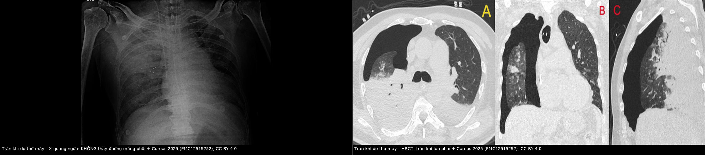
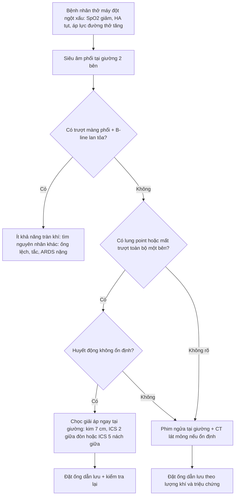
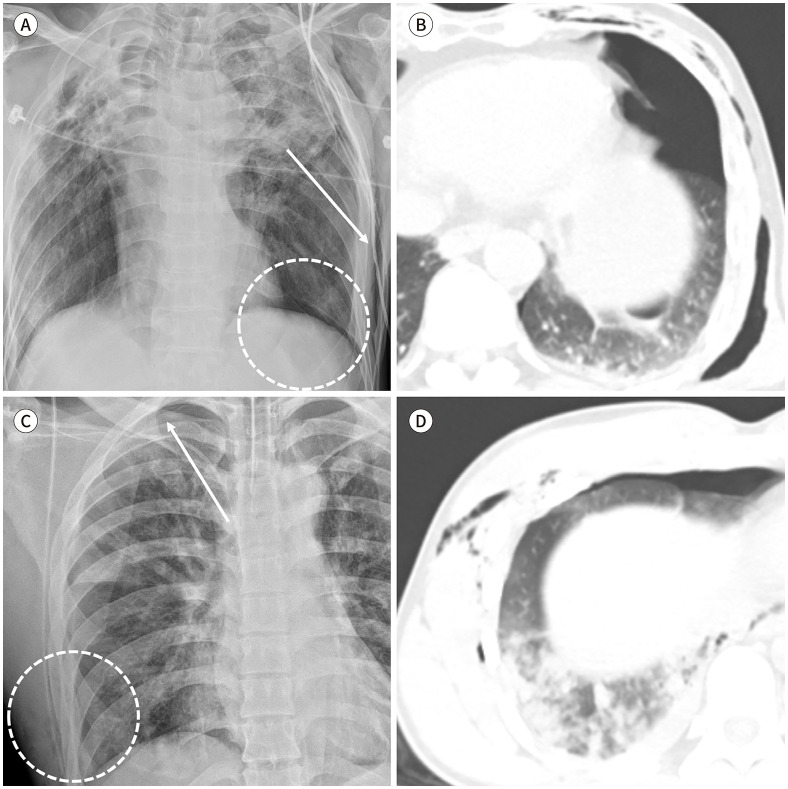
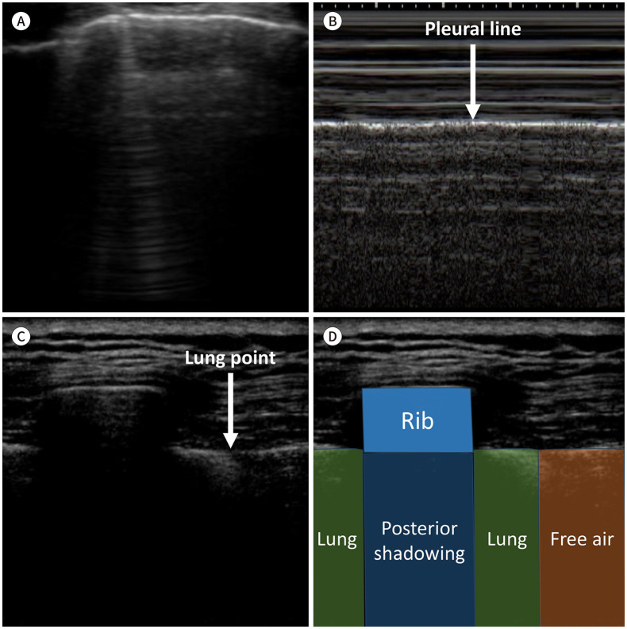

# 098 — Barotrauma & tràn khí màng phổi áp lực ở bệnh nhân thở máy: phim tại giường, siêu âm và ngưỡng chọc giải áp

**Tags:** `pattern:tran-khi-mang-phoi` `pattern:tran-khi-trung-that` `pattern:khi-ngoai-phe-nang` `vung:phoi` `vung:mang-phoi` `vung:trung-that` `protocol:Xquang-tai-giuong` `protocol:sieu-am-phoi` `protocol:CT-lat-mong` `protocol:choc-giai-ap`
**Mức chắc chắn (certainty):** tổng hợp y văn (literature synthesis) — ghép **204 bệnh nhân COVID-19 thở máy** (J Clin Med 2026, PMC13164131), **334 bệnh nhân PJP không HIV** (Front Med 2026, PMC13161121), **225 bệnh nhân ARDS với dấu Macklin** (Diagnostics 2025, PMC12523701), **110 bệnh nhân ICU thở máy so siêu âm – X-quang – CT** (Indian J Crit Care Med 2025, PMC12592945), **tổng quan hình ảnh tràn khí/tràn máu màng phổi** (J Korean Soc Radiol 2026, PMC13448134), **meta-analysis 51 nghiên cứu chọc giải áp** (World J Emerg Surg 2025, PMC12087068) và **ca tràn khí sau đặt ống ở phổi đông đặc** (Cureus 2025, PMC12515252). Không có ca do nhóm tự chụp.

> **Câu hỏi thực hành:** nam **58 tuổi**, ARDS do viêm phổi, đang thở máy **PEEP 12 cmH₂O**, đột ngột **SpO₂ 88%**, huyết áp tụt, áp lực đường thở tăng; **X-quang tại giường “không thấy tràn khí”**. Ba quyết định: **(1) vì sao phim ngửa có thể âm tính giả; (2) siêu âm phổi tại giường trả lời gì trong 2 phút; (3) khi nào chọc giải áp ngay tại giường thay vì chuyển đi CT.**
> Nối [041 – Tràn khí màng phổi](../041-tran-khi-mang-phoi/lesson.md), [061 – Tràn khí trung thất](../061-tran-khi-trung-that/lesson.md), [084 – Viêm phổi thở máy](../084-viem-phoi-tho-may/lesson.md), [040 – Tràn dịch màng phổi](../040-tran-dich-mang-phoi/lesson.md).

## 1. Tổng quan bệnh học – cơ chế hình ảnh: vì sao áp lực dương làm rách phế nang và vì sao phim ngửa giấu tràn khí

- **Định nghĩa:** barotrauma phổi (pulmonary barotrauma) = **khí ngoài phế nang (extra-alveolar air)** xuất hiện do thông khí áp lực dương: tràn khí màng phổi, tràn khí trung thất, tràn khí dưới da, tràn khí phúc mạc, tràn khí màng tim, thuyên tắc khí. Đây là **biến chứng của chính điều trị**, không phải diễn tiến tự nhiên của bệnh phổi nền.
- **TẠI SAO phế nang rách:** khi **áp lực xuyên phổi (transpulmonary pressure = P_alv − P_pleura)** vượt sức bền của vách phế nang–mao mạch, khí thoát vào **khoảng quanh phế quản–mạch (bronchovascular sheath)** rồi đi theo **dấu hiệu Macklin** lên trung thất; từ trung thất khí có thể **vỡ màng phổi trung thất → tràn khí màng phổi**, hoặc xuống **sau phúc mạc → tràn khí phúc mạc**. Vì vậy tràn khí trung thất và tràn khí màng phổi do thở máy thường **đi cùng nhau** — thấy cái này phải tìm cái kia.
- **Giá trị của dấu Macklin (khí dọc vỏ phế quản trên CT):** trong **225 bệnh nhân ARDS**, dấu Macklin có **độ nhạy 44,6% / độ đặc hiệu 90,6%** cho barotrauma; khi **loại COVID-19**, độ nhạy **34,7% / độ đặc hiệu 93,6%** (PMC12523701). Nghĩa là: **thấy Macklin = báo động đỏ** (đặc hiệu cao), **không thấy không loại trừ** (độ nhạy thấp).
- **Tần suất – con số thực:** **22,5% (46/204)** bệnh nhân COVID-19 thở máy tại một ICU (PMC13164131); **12,0% (40/334)** ở PJP không HIV, trong đó **23 tràn khí màng phổi** và **17 chỉ tràn khí dưới da/trung thất** (PMC13161121); y văn chung ghi **9–33%** tùy quần thể (dẫn trong PMC13164131).
- **Hậu quả định lượng:** nhóm barotrauma có **tử vong ICU 67,4% vs 32,6% (p = 0,009)** và **nằm ICU 17,07 ± 10,53 vs 12,34 ± 7,26 ngày (p = 0,006)** (PMC13164131). Ở PJP không HIV, barotrauma đi kèm **tử vong 72,5% vs 23,8%**, **thở máy xâm nhập 75,0% vs 20,7%** (PMC13161121) — nhưng đây là **liên quan**, không chứng minh nhân quả.
- **Yếu tố nguy cơ có số:** **PEEP tuần thứ 2 cao hơn** (11 vs 10 cmH₂O, p = 0,024), **ARDS mức độ trung bình** (OR 3,52; KTC 1,01–12,30), **thời gian thở máy dài**; nghịch lý là **CRP thấp hơn** (OR hiệu chỉnh 0,90 mỗi mg/dL; 0,81–0,99) (PMC13164131). Ở PJP không HIV, **PaO₂/FiO₂ lúc nhập viện** là yếu tố dự báo độc lập: **OR 0,993 (0,989–0,998)** mỗi mmHg, mô hình **AUC 0,751** (PMC13161121).
- **TẠI SAO tràn khí áp lực (tension pneumothorax) là sốc, không chỉ là thiếu oxy:** cơ chế **van một chiều** làm áp lực khoang màng phổi tăng dần → **đẩy trung thất sang bên đối diện, ép tĩnh mạch chủ → giảm hồi lưu tĩnh mạch → sốc tắc nghẽn**, cộng thêm xẹp phổi. Vì vậy **tụt huyết áp + tăng áp lực đường thở** ở bệnh nhân thở máy là dấu hiệu **nguy hiểm hơn cả mức SpO₂**.
- **TẠI SAO phim ngửa âm tính giả:** bệnh nhân nằm ngửa, khí tích ở **phần trước–dưới của khoang màng phổi**, không lên đỉnh phổi; dấu hiệu duy nhất có thể là **dấu rãnh sâu (deep sulcus sign)** — góc sườn–hoành sâu bất thường, hoặc **một bên ngực tăng sáng**. Gộp y văn: phim ngửa **độ nhạy 0,46–0,54, độ đặc hiệu 0,99–1,00** (PMC13448134) — **rất khó loại trừ, rất khó dương tính giả**.
- **Siêu âm phổi tại giường vượt phim ngửa:** trong **110 bệnh nhân ICU thở máy** được chụp CT làm chuẩn, siêu âm phổi phát hiện tràn khí với **độ nhạy 100% / độ đặc hiệu 97%**, còn X-quang tại giường chỉ **độ nhạy 66,7%** (PMC12592945). Ba dấu siêu âm cần thuộc: **mất trượt màng phổi (absent lung sliding)**, **mất B-line**, và **điểm phổi (lung point)** — vùng chuyển tiếp có trượt ↔ không trượt, **đặc hiệu rất cao** (PMC13448134).

## 2. Mẫu hình + chẩn đoán phân biệt theo vị trí khí ngoài phế nang (Gamut)

- **Khí trong khoang màng phổi:**
  - **Tràn khí đơn thuần do barotrauma:** đường màng phổi tạng + mất tuần hoàn phổi ngoại vi; lượng khí ít có thể chỉ thấy trên CT.
  - **Tràn khí áp lực:** thêm **lệch trung thất, hạ cơ hoành, giãn khoang sườn, chèn ép phổi đối diện** (PMC13448134) — chẩn đoán **lâm sàng**, không chờ hình ảnh.
  - **Tràn khí + tràn máu:** sau thủ thuật mạch máu trung tâm/ECMO; mức dịch–khí, cần tìm nguồn chảy máu.
  - **Rò khí dai dẳng sau đặt ống dẫn lưu:** nghĩ **tổn thương phế quản lớn** hoặc **rò phế quản–màng phổi**, không phải “tràn khí khó điều trị”.
- **Khí trong trung thất (pneumomediastinum):** dấu Macklin do thở máy; **vỡ thực quản** (Boerhaave — khí + dịch màng phổi trái + tràn khí dưới da, đau ngực sau nôn); **vỡ khí quản sau đặt ống** (tràn khí dưới da cổ, khí quanh khí quản, thường kèm tràn khí màng phổi); **nhiễm khuẩn sinh khí trung thất** (khí + dịch + sốc nhiễm khuẩn).
- **Khí dưới da:** từ trung thất lan lên cổ/mặt, hoặc từ vết mổ, catheter, chấn thương — **không tự gây suy hô hấp**, nhưng là **dấu chỉ điểm** phải tìm tổn thương nguồn.
- **Khí trong ổ bụng:** barotrauma (khí đi sau phúc mạc) vs **thủng tạng rỗng**; barotrauma thường **không có phản ứng phúc mạc**, khí có thể **dọc mạc treo**, nhưng trên phim tại giường **không phân biệt được chắc chắn** → cần CT có cản quang đường tiêu hóa khi bệnh nhân cho phép.
- **Gợi nhớ PEEP:** **P**neumothorax (tràn khí màng phổi) · **E**xtra-alveolar air in mediastinum (Macklin) · **E**sophageal/tracheal rupture (vỡ thực quản/khí quản) · **P**neumoperitoneum (tràn khí phúc mạc).

## 3. Bảng so sánh phân biệt (ma trận đối chiếu)

| Thực thể (entity) | Hình ảnh điển hình | Chốt vào (rule-in) | Chốt loại (rule-out) | Gợi ý xác nhận |
|---|---|---|---|---|
| **Tràn khí áp lực do thở máy** | Phim ngửa: một bên ngực tăng sáng, **rãnh sâu**, lệch trung thất; CT: khí nhiều + xẹp phổi + đẩy trung thất | **Tụt huyết áp + tăng áp lực đường thở + mất trượt màng phổi toàn bộ một bên** → chọc giải áp ngay | Có **trượt màng phổi lan tỏa + B-line** ở vùng đáng ngờ → gần như loại tràn khí | Siêu âm 4–6 vùng/2 bên; dấu **lung point**; không chờ CT nếu huyết động xấu |
| **Tràn khí không áp lực (kể cả occult)** | CT: khí màng phổi **< 1,0–3,5 cm** lớp khí ly tâm; phim ngửa có thể **hoàn toàn bình thường** | **CT thấy khí màng phổi**; phim ngửa có **rãnh sâu** hoặc khí dưới da/ gãy sườn đi kèm | Phim ngửa bình thường **KHÔNG loại trừ** (Se 0,46–0,54) | Siêu âm tại giường; CT khi cần quyết định dẫn lưu |
| **Tràn khí trung thất do Macklin** | Khí **dọc vỏ phế quản–mạch**, quanh khí quản, dải khí sau xương ức; có thể kèm tràn khí dưới da | **Khí dọc bronchovascular sheath** trên CT lát mỏng | Khí chỉ trong nhu mô/ hang **không** phải trung thất | CT lát mỏng; **đặc hiệu 90,6%** cho barotrauma (PMC12523701) |
| **Vỡ thực quản (Boerhaave)** | Trung thất khí + **dịch màng phổi trái**, tràn khí dưới da; CT có **thuốc cản quang thoát ra ngoài lòng** | **Thoát cản quang thực quản** hoặc khí + dịch trung thất sau nôn | Khí trung thất đơn thuần không dịch, không nhiễm trùng → Macklin | CT có uống cản quang tan trong nước; nội soi khi nghi |
| **Vỡ khí quản/phế quản lớn sau đặt ống** | Khí quanh khí quản, **tràn khí màng phổi một bên + rò khí dai dẳng** sau đặt ống dẫn lưu | **Rò khí > 24–48 giờ** dù đã dẫn lưu + khí trung thất | Tràn khí hết sau 1 lần dẫn lưu → barotrauma đơn thuần | Nội soi phế quản ống mềm; CT lát mỏng |
| **Tràn khí phúc mạc do barotrauma** | Khí tự do dưới cơ hoành **không có dịch**, bệnh nhân không đau bụng, không phản ứng phúc mạc | Khí tự do **sau đợt tăng áp lực đường thở**, không ổ nhiễm | **Khí + dịch + phản ứng phúc mạc** → thủng tạng rỗng | CT bụng có cản quang; theo dõi sát, không mổ ngay vì “khí dưới hoành” đơn thuần |

*Trái: phim ngửa tại giường — **không thấy đường màng phổi**, chỉ có đông đặc nền; phải: HRCT cùng bệnh nhân — **tràn khí lớn bên phải** với xẹp phổi. Đây là bẫy “phim âm tính” điển hình ở bệnh nhân thở máy. Nguồn: Cureus 2025 (PMC12515252), CC BY 4.0; ảnh ghép letterbox.*

### Ba dấu hiệu đọc phim ngửa và siêu âm (chốt thực hành)
- **Dấu rãnh sâu (deep sulcus sign):** góc sườn–hoành sâu, tối hơn bên đối diện, do khí tụ ở **phần trước–dưới**. Nhìn cả **hai bên** và so với phim cũ; đây là dấu **duy nhất** trên phim ngửa ở nhiều ca.
- **Điểm phổi (lung point):** trên siêu âm, chỗ **trượt màng phổi chuyển sang không trượt** theo nhịp thở; **đặc hiệu rất cao** cho tràn khí và còn **ước lượng lượng khí theo vị trí**: điểm phổi ở **thành ngực trước = ít**, **bên = trung bình**, **sau = nhiều / không còn điểm phổi kèm mất trượt hoàn toàn** (PMC13448134).
- **Barcode/stratosphere thay cho seashore:** trên M-mode, mất chuyển động màng phổi tạo các vạch ngang song song (“mã vạch”), thay cho hình “bờ biển” bình thường (PMC12515252).

## 4. Protocol chụp + phân độ + ngưỡng can thiệp

- **Bệnh nhân thở máy xấu đột ngột — thứ tự tại giường:** (1) **siêu âm phổi 2 bên, 6 vùng** (trước–bên, trên–dưới) tìm mất trượt, mất B-line, **lung point**; (2) **phim ngửa tại giường** nếu chưa có siêu âm; (3) **CT ngực lát mỏng** khi huyết động ổn và cần phân biệt tràn khí kín/trung thất/tổn thương phế quản, hoặc trước can thiệp lớn.
- **Phân lượng tràn khí có ngưỡng (theo báo cáo cấu trúc 2026, PMC13448134):**
  - **Phim thẳng đứng:** nhỏ khi **khoảng cách màng phổi–thành ngực < 2,0 cm tại rốn phổi**; trung bình–lớn khi **≥ 2,0 cm**.
  - **CT:** nhỏ **< 1,0 cm**, trung bình **1,0–3,5 cm**, lớn **> 3,5 cm** (khoảng ly tâm tối đa tại ổ khí lớn nhất).
  - **Siêu âm:** theo **vị trí lung point** (trước/bên/sau) như trên.
- **Chọc giải áp (needle decompression) — con số quyết định:**
  - Gộp **51 nghiên cứu**, dữ liệu hình ảnh **24 nghiên cứu / 8.046 ca**: **tỷ lệ thất bại chọc vào khoang màng phổi 32,84%** (I² 99,72%) (PMC12087068). Đây là lý do **không được coi “đã chọc” là “đã giải quyết”**.
  - **Kim dài hơn 1 cm giảm thất bại 7,76%**; khuyến nghị **kim 7 cm**, chọc **khoang sườn 5 đường nách giữa** hoặc **khoang sườn 2 đường giữa đòn** cho bên phải; **bên trái ưu tiên khoang sườn 2 đường giữa đòn** vì nguy cơ **tổn thương tim** khi chọc thấp (PMC12087068).
  - Thành ngực **mỏng hơn ở đường nách (5AAL/5MAL) so với 2MCL**, nhưng **tổn thương mạch máu cao hơn ở 5AAL**; tương quan chiều dài kim–tổn thương **0,88–0,91** (PMC12087068).
  - Sau chọc giải áp: **đặt ống dẫn lưu màng phổi** và kiểm tra bằng phim/ siêu âm; **không hút quá mức** ở phổi xẹp lâu (nguy cơ phù phổi tái nở).
- **Chiến lược thở máy:** giảm **thể tích khí lưu thông, PEEP và áp lực cao nguyên** khi có thể; tuy nhiên **chiến lược giới hạn áp lực đẩy (driving pressure–limited)** không làm giảm tử vong so với thông khí bảo vệ phổi thường quy trong meta-analysis 4 RCT/465 ca (**OR 1,01; 0,49–2,10**) (PMC12676841) — **driving pressure là chỉ số tiên lượng, không phải “đích điều trị thần kỳ”**.
- **Theo dõi sau can thiệp:** tìm **rò khí dai dẳng**, **tràn khí tái phát**, **viêm phổi thở máy** đi kèm; ở PJP/ARDS, barotrauma làm **kéo dài ICU và tăng tử vong** nên phải tính vào tiên lượng (PMC13161121, PMC13164131).

## 5. Biến thể bình thường và cạm bẫy

- **Nếp da (skin fold) giả đường màng phổi:** trên phim ngửa, nếp da tạo đường sáng mờ **vượt ra ngoài lồng ngực** và **còn mạch máu phổi phía ngoài**; tràn khí thật có **mất tuần hoàn ngoại vi** (PMC13448134).
- **Xẹp phổi nằm (dependent atelectasis) giả tràn khí:** vùng đáy phổi mờ, không có đường màng phổi rõ; đổi tư thế/ chụp lại giúp phân biệt.
- **Siêu âm: bóng sườn và mất trượt giả:** mất trượt **khu trú đúng dưới bóng sườn** không phải tràn khí; phải thấy **mất trượt + mất B-line** ở nhiều nhịp thở và tìm **lung point**.
- **Bẫy “bão hòa tìm kiếm”:** đã thấy tràn khí một bên thì **vẫn phải tìm trung thất, màng tim, bên đối diện và ổ bụng** — barotrauma thường **nhiều ổ khí cùng lúc**.
- **Bẫy “khí dưới hoành = thủng tạng rỗng”:** ở bệnh nhân thở máy, khí tự do **có thể từ barotrauma**; mổ ngay khi không có phản ứng phúc mạc/ dịch có thể sai. Ngược lại, **khí + dịch + sốc** thì phải mổ.
- **Bẫy sau đặt ống dẫn lưu:** ống **nằm trong nhu mô/ ngoài màng phổi**, hoặc **rò khí dai dẳng do tổn thương phế quản** — kiểm tra vị trí ống và nội soi khi nghi.
- **Barotrauma không chỉ là tràn khí:** **thuyên tắc khí** (đặc biệt khi có catheter tĩnh mạch trung tâm/ ECMO) và **tràn khí màng tim** có thể là nguyên nhân tử vong nhanh hơn cả tràn khí màng phổi.

## 6. Tự lượng giá — Blind Quiz

**Ca 1 — Nam 58 tuổi, ARDS, thở máy PEEP 12, tụt SpO₂ và huyết áp; phim ngửa tại giường “không thấy tràn khí”. Nhìn ảnh trước, mô tả trước.**

- Gợi ý lâm sàng: thở máy áp lực dương, phổi đông đặc nền, xấu đột ngột.
- Câu hỏi: Phim ngửa có loại trừ tràn khí được không? Trên CT, dấu hiệu nào chốt? Hai việc phải làm ngay tại giường?

<b>Bấm để hiện đáp án (findings + chẩn đoán)</b>

- Dấu hiệu: phim ngửa **không có đường màng phổi rõ**, chỉ đông đặc nền phải; HRCT (A–C) **tràn khí lớn bên phải**, phổi phải xẹp gần hoàn toàn, đông đặc/ xẹp phổi nền.
- Chẩn đoán: **tràn khí màng phổi do thở máy (barotrauma), có nguy cơ áp lực** — phim ngửa âm tính không loại trừ (Se 0,46–0,54; PMC13448134).
- Việc phải làm: **siêu âm phổi tìm lung point/ mất trượt**, và nếu huyết động xấu → **chọc giải áp tại giường rồi đặt ống dẫn lưu**, không chờ CT.
- Nguồn ảnh: Cureus 2025 (PMC12515252), CC BY 4.0.

**Ca 2 — Bệnh nhân chấn thương ngực, phim ngửa tại giường. Tìm dấu hiệu bất thường trước khi đọc đáp án.**

- Gợi ý lâm sàng: chấn thương tốc độ cao, đau ngực, khó thở; bệnh nhân nằm ngửa.
- Câu hỏi: Dấu hiệu ở góc sườn–hoành bên trái là gì? Nó thay đổi cách đọc phim ngửa ra sao?

<b>Bấm để hiện đáp án (findings + chẩn đoán)</b>

- Dấu hiệu: (A) **dấu rãnh sâu (deep sulcus sign)** — góc sườn–hoành trái sâu bất thường (vòng đứt nét) + **tràn khí dưới da** thành ngực bên trái (mũi tên); (B) CT tương ứng xác nhận tràn khí màng phổi + khí dưới da. (C) bệnh nhân khác: **đường màng phổi mờ ở đỉnh phổi phải** + khí dọc thành ngực dưới (vòng đứt nét); (D) CT xác nhận tràn khí + đông dập phổi.
- Chẩn đoán: **tràn khí màng phổi kín trên phim ngửa** — dấu rãnh sâu là chốt; tràn khí dưới da và gãy sườn là dấu phụ làm tăng độ tin cậy.
- Phản biện: hai bệnh nhân này **chấn thương**, không thở máy; nguyên lý đọc phim ngửa giống nhau, nhưng ở bệnh nhân thở máy phải **hạ ngưỡng nghi ngờ** vì khí tăng dần dưới áp lực.
- Nguồn ảnh: J Korean Soc Radiol 2026 (PMC13448134), CC BY-NC 4.0.

**Ca 3 — Siêu âm phổi tại giường ở bệnh nhân nghi tràn khí. Panel nào bình thường, panel nào tràn khí?**

- Gợi ý lâm sàng: bệnh nhân khó thở cấp, đang thở máy; đầu dò đặt thành ngực trước.
- Câu hỏi: Mô tả A–D; dấu nào **đặc hiệu nhất** cho tràn khí và vì sao?

<b>Bấm để hiện đáp án (findings + chẩn đoán)</b>

- Dấu hiệu: (A) **B-line** — các vạch tăng âm thẳng đứng từ đường màng phổi xuống đáy ảnh (phổi bình thường/ phù kẽ); (B) M-mode phổi bình thường = **dấu bờ biển (seashore)**, phần dưới màng phổi có hạt “cát”; (C) **điểm phổi (lung point)** — chỗ chuyển từ có trượt sang không trượt; (D) sơ đồ: phổi – bóng sườn – khí tự do.
- Chẩn đoán: **tràn khí màng phổi** khi **mất trượt + mất B-line**, và **lung point** là dấu **đặc hiệu nhất**; vị trí lung point còn giúp **ước lượng lượng khí** (trước = ít, sau = nhiều).
- Nguồn ảnh: J Korean Soc Radiol 2026 (PMC13448134), CC BY-NC 4.0; panel C–D phỏng theo tài liệu bài giảng được bài gốc dẫn nguồn.

## Bài liên quan chéo
- [001 – Tổng quan hệ Ngực](../001-tong-quan-he-nguc/lesson.md)
- [041 – Tràn khí màng phổi](../041-tran-khi-mang-phoi/lesson.md)
- [061 – Tràn khí trung thất](../061-tran-khi-trung-that/lesson.md)
- [040 – Tràn dịch màng phổi](../040-tran-dich-mang-phoi/lesson.md)
- [080 – Chấn thương ngực](../080-chan-thuong-nguc/lesson.md)
- [084 – Viêm phổi thở máy](../084-viem-phoi-tho-may/lesson.md)
- [088 – Áp-xe phổi/ mủ màng phổi sau VAP](../088-apxe-phoi-mu-mang-phoi-sau-vap/lesson.md)

## Ảnh
- `098_barotrauma_XR-deep-sulcus_PMC13448134-F1.jpg`, `098_barotrauma_US-lung-point_PMC13448134-F2.jpg` — J Korean Soc Radiol 2026 (PMC13448134), **CC BY-NC 4.0**, nguyên bản.
- `098_barotrauma_XR-an_PMC12515252-F1.jpg`, `098_barotrauma_CT-tension_PMC12515252-F2.jpg` — Cureus 2025 (PMC12515252), **CC BY 4.0**, nguyên bản.
- `composite_an-tren-xq-vs-ct.jpg` — ghép từ hai ảnh Cureus trên (cùng bệnh nhân), letterbox, giữ tỷ lệ.
- Nguồn + giấy phép từng ảnh: `images/CREDITS.md`.

> Không dùng để chẩn đoán độc lập khi chưa có người hướng dẫn.
