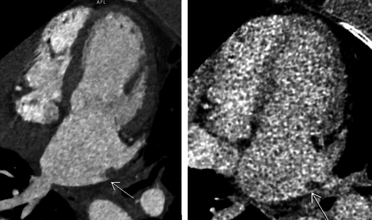
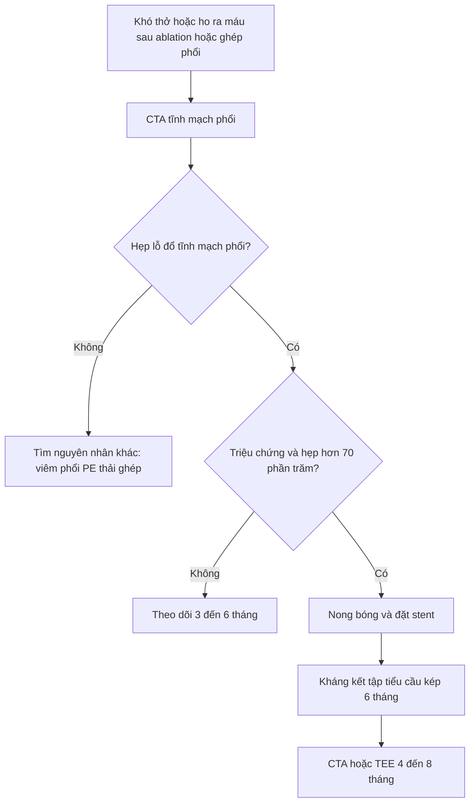
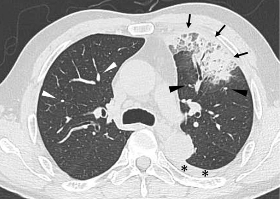
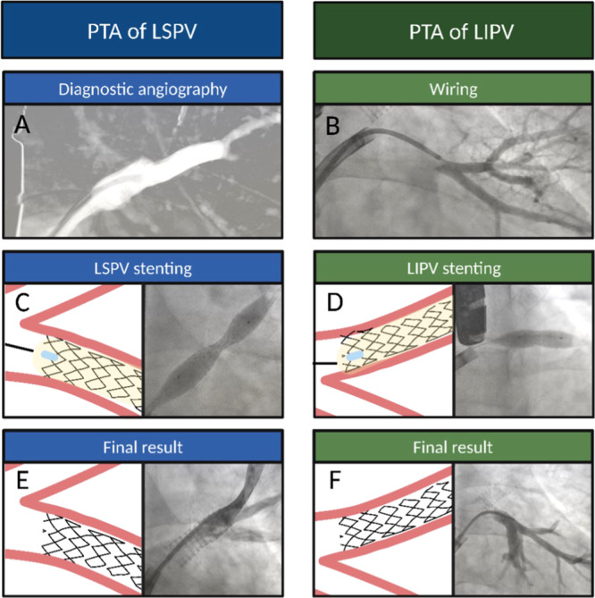

# 099 — Hẹp tĩnh mạch phổi sau cô lập tĩnh mạch & sau ghép phổi / Pulmonary vein stenosis after AF ablation and lung transplantation

**Tags:** `pattern:hep-tinh-mach` `pattern:ho-ra-mau` `pattern:phu-phoi` `vung:phoi` `vung:trung-that` `protocol:CT-tinh-mach-phoi` `protocol:stent-tinh-mach` `score:PVS-grade`
**Mức chắc chắn (certainty):** tổng hợp y văn (literature synthesis) — 1 tổng quan ca + y văn về PVS sau ablation (O'Brien G et al., *Cureus* 2026, PMC13329136), 1 bài tổng quan kỹ thuật stent (Aurigemma C et al., *Catheter Cardiovasc Interv* 2026, PMC12953203), 1 cohort 4.333 bệnh nhân ablation (Kim J et al., *Europace* 2023, PMC10558058), 1 loạt 6 ca chẩn đoán bằng CT không cản quang (Kojima S et al., *Intern Med* 2024, PMC11157311), 1 ca + tổng quan PVS sau ghép phổi (Jing L et al., *Ann Transl Med* 2021, PMC7867883) và 1 ca PVS mạn gây ho ra máu ồ ạt phải cắt phổi (Osuga F et al., *Interdiscip Cardiovasc Thorac Surg* 2025, PMC12341673). Số chưa đối chiếu được ghi **"chưa rõ"**, không bịa.

## 1. Tổng quan bệnh học – cơ chế hình ảnh

- **PVS là biến chứng do thầy thuốc gây ra, không phải bệnh phổi nguyên phát.** Sau ablation rung nhĩ, năng lượng nhiệt (RF, cryo) truyền vào **nội mạc tĩnh mạch phổi** tại lỗ đổ vào nhĩ trái → viêm nội mạc → **tăng sinh nội mạc (neointimal hyperplasia) + lắng đọng collagen + xơ hóa** → lòng tĩnh mạch hẹp dần trong nhiều tuần đến nhiều tháng. Mô bệnh ca mạn tính cho thấy **xơ hóa nội mạc không hồi phục** (Osuga F et al. 2025).
- **Vì sao triệu chứng xuất hiện MUỘN:** quá trình xơ hóa tiến triển từ từ, không đau, không sốt. Thời điểm khởi phát trong các loạt: **3–24 tháng** (trung vị **4 tháng**, Kojima 2024), **48–623 ngày** sau ablation (Kim 2023), trung vị **7,5 tuần** theo một tổng quan khác (Aurigemma 2026). Vì vậy bệnh nhân thường đi khám **sau khi đã quên lần ablation**.
- **Tần suất thật — đừng hứa "hiếm nên không cần nghĩ":**
  - PVS **có triệu chứng** sau ablation: **0,29–3,4%** (O'Brien 2026); PVS **nặng/cần can thiệp**: **0,4–0,7%** (Kim 2023).
  - Trong cohort 4.333 bệnh nhân của Kim 2023: **14 ca PVS có triệu chứng** (0,32%); **ablation năng lượng cao thời gian ngắn (HPSD) 0,8% (8/1.019)** so với **thông thường 0,2% (6/2.832)**, p = 0,001 — công nghệ "nhanh hơn" không làm giảm nguy cơ.
  - Tổng quan Aurigemma 2026 ghi nhận tần suất **1–21%** tùy cách chẩn đoán — phản ánh **dưới chẩn đoán**, không phải dao động thật.
- **Vì sao hẹp tĩnh mạch phổi gây hình ảnh "giống viêm phổi":** tĩnh mạch hẹp → **áp lực mao mạch phổi tăng** → phù kẽ/phù phế nang khu trú → **kính mờ, đông đặc, dày vách liên tiểu thùy, tràn dịch màng phổi**; đồng thời **giảm tưới máu** vùng hẹp → **mạch phổi một bên nhỏ lại, giảm thể tích thùy**. Đây là lý do **5/6 ca** của Kojima 2024 bị chẩn đoán nhầm **viêm phổi, xuất huyết phế nang, ung thư phổi hoặc viêm phổi tổ chức hóa**.
- **Dấu hiệu định lượng cốt lõi:**
  - **Phân độ hẹp trên CT** (Kojima 2024): **grade 1 ≤ 50%**, **grade 2 51–75%**, **grade 3 76–99%**, **grade 4 tắc hoàn toàn**.
  - **Chỉ định can thiệp:** **có triệu chứng + hẹp > 70%** lòng mạch (Aurigemma 2026).
  - **Siêu âm tim qua thực quản (TEE):** vận tốc đỉnh **2 m/s**, gradient đỉnh **14 mmHg** ở ca hẹp nặng (Aurigemma 2026); sau đặt stent, gradient tĩnh mạch phổi **40 → 15 mmHg** (Jing 2021).
  - **Sau ghép phổi:** gợi ý PVS khi **vận tốc đỉnh tại miệng nối ≥ 1 m/s**, **đường kính tĩnh mạch < 0,5 cm**, hoặc **giảm > 50% so với bên đối diện** (Jing 2021).
- **Sau ghép phổi, PVS là biến chứng mạch máu hiếm nhưng chết người:** biến chứng mạch sau ghép phổi gặp **1–3%**; PVS tại **miệng nối** làm tăng sức cản, phù thùy, giảm oxy máu và **tràn dịch màng phổi tái phát**. Trong loạt tổng quan nhỏ, **không điều trị tử vong 50% (1/2)** so với **11,8% (2/17) ở nhóm được can thiệp** — con số rất nhỏ, chỉ nên đọc như tín hiệu, không phải tỷ lệ chính xác (Jing 2021).

## 2. Mẫu hình + chẩn đoán phân biệt theo vị trí (gamut)

**Câu hỏi thực hành:** bệnh nhân khó thở/ho ra máu sau ablation hoặc sau ghép phổi — tổn thương ở **tĩnh mạch phổi**, **động mạch phổi**, **nhu mô** hay **màng phổi**?

- **PVS sau ablation (ostial PVS):** hẹp **ngay tại lỗ đổ** của một hoặc nhiều tĩnh mạch phổi, thường **một bên**, cách lần ablation vài tháng; kèm **mạch phổi bên hẹp nhỏ hơn**, **giảm thể tích thùy**, kính mờ/đông đặc, tràn dịch.
- **PVS sau ghép phổi (anastomotic PVS):** hẹp tại **miệng nối tĩnh mạch phổi – nhĩ trái**, có thể sớm (vài ngày) hoặc muộn (nhiều tháng–năm); biểu hiện **giảm oxy máu tiến triển, tràn dịch màng phổi tái phát, dày vách liên tiểu thùy**; có thể kèm hẹp động mạch phổi cùng bên.
- **Huyết khối tĩnh mạch phổi:** khuyết thuốc **trong lòng** tĩnh mạch, không phải hẹp thành; bối cảnh ung thư, tăng đông, catheter.
- **Thuyên tắc phổi (PE):** khuyết thuốc **động mạch phổi**, cấp tính; không gây hẹp lỗ tĩnh mạch mạn.
- **Viêm phổi/viêm phổi tổ chức hóa:** đông đặc/kính mờ nhưng **không có hẹp tĩnh mạch**, mạch phổi bình thường, đáp ứng kháng sinh (hoặc corticoid).
- **Ung thư phổi:** khối đặc, **tăng FDG**, có thể xâm lấn tĩnh mạch nhưng không tạo hẹp lỗ đối xứng sau ablation.
- **Tăng áp phổi nguyên phát:** giãn thân động mạch phổi, **không có hẹp tĩnh mạch khu trú**.
- **PVS bẩm sinh:** hẹp lan tỏa/giảm sản nhiều tĩnh mạch ở trẻ, không có tiền sử ablation/ghép.

**Mnemonic "PVS" — 3 câu hỏi trước khi kết luận:**
- **P** — **Prior procedure?** Ablation rung nhĩ, ghép phổi, hay can thiệp tĩnh mạch phổi trong 3–24 tháng qua?
- **V** — **Vessel asymmetry?** Mạch phổi một bên nhỏ hơn + giảm thể tích thùy — dấu hiệu **rẻ tiền nhất** trên CT không cản quang.
- **S** — **Stenosis at the ostium?** Hẹp **lỗ đổ**, không phải hẹp lan tỏa trong nhu mô.

## 3. Bảng so sánh phân biệt (ma trận đối chiếu)

| Thực thể (entity) | Hình ảnh điển hình (CT/echo) | Chốt vào (rule-in) | Chốt loại (rule-out) | Gợi ý xác nhận |
|---|---|---|---|---|
| **PVS sau ablation** | Hẹp **lỗ đổ** một/nhiều tĩnh mạch phổi; mạch phổi bên hẹp nhỏ, giảm thể tích thùy; kính mờ/đông đặc/tràn dịch | **Tiền sử ablation + hẹp lỗ > 70% + mạch phổi một bên nhỏ** | Không hẹp lỗ, không bất đối xứng mạch → nghĩ viêm phổi | CTA tĩnh mạch phổi thì tĩnh mạch; TEE gradient; V/Q |
| **PVS sau ghép phổi** | Hẹp tại **miệng nối**, tràn dịch màng phổi tái phát, dày vách liên tiểu thùy, giảm oxy máu | **Miệng nối hẹp + gradient qua miệng nối + tràn dịch tái phát** | Không hẹp miệng nối; thải ghép/infection có hình ảnh khác | CTA/CTV, TEE, chụp tĩnh mạch phổi đo gradient |
| **Huyết khối tĩnh mạch phổi** | Khuyết thuốc **trong lòng**, thành mạch không hẹp; có thể lan từ nhĩ trái | **Khuyết thuốc lòng mạch + bối cảnh tăng đông/ung thư/catheter** | Hẹp lỗ đối xứng, không khuyết thuốc → PVS | CTV thì muộn; siêu âm; D-dimer |
| **Thuyên tắc phổi** | Khuyết thuốc **động mạch phổi**, cấp; thất phải giãn | **Khuyết thuốc động mạch + cấp tính + D-dimer** | Tĩnh mạch phổi bình thường → không phải PVS | CTPA; siêu âm tim |
| **Viêm phổi / viêm phổi tổ chức hóa** | Đông đặc, kính mờ, dày vách; **mạch phổi bình thường**, không giảm thể tích | **Đáp ứng kháng sinh/corticoid; không hẹp tĩnh mạch** | Hẹp lỗ + mạch một bên nhỏ → PVS | Theo dõi X-quang/CT; BAL nếu cần |
| **Ung thư phổi / di căn** | Khối đặc, bờ gai, **tăng FDG**; có thể xâm lấn tĩnh mạch | **FDG dương + khối + sinh thiết** | Đông đặc dạng khối **không FDG** + giảm thể tích = PVS | PET/CT; sinh thiết |
| **Tăng áp phổi** | Giãn thân/nhánh động mạch phổi, dày thành; **không hẹp tĩnh mạch khu trú** | **PAP trung bình ≥ 20 mmHg + không hẹp tĩnh mạch** | Hẹp lỗ tĩnh mạch rõ → PVS là nguyên nhân | Siêu âm tim, catheter phải |

*Nữ 65 tuổi, 5 tháng sau ablation: (trái) thì động mạch — **hẹp nặng lỗ đổ tĩnh mạch phổi trên trái** (mũi tên); (phải) thì muộn — chỉ còn **một vệt thuốc mảnh** ở lòng xa, chứng tỏ dòng chảy gần như tắc. Nguồn: O'Brien G et al., *Cureus* 2026, PMC13329136 Fig. 3, CC BY 4.0.*

### Đọc CTA tĩnh mạch phổi theo 4 bước
1. **Xác định 4 lỗ đổ** (trên/phải, trên/trái, dưới/phải, dưới/trái) trên mặt cắt ngang và reformat theo trục tĩnh mạch; đo **đường kính chỗ hẹp nhất** và **đường kính đoạn xa**.
2. **Tính % hẹp** và xếp grade: **≤ 50% / 51–75% / 76–99% / tắc hoàn toàn** (Kojima 2024).
3. **Tìm dấu hiệu gián tiếp:** mạch phổi một bên nhỏ hơn, **giảm thể tích thùy**, kính mờ/đông đặc, dày vách liên tiểu thùy, tràn dịch màng phổi.
4. **Loại trừ huyết khối:** khuyết thuốc trong lòng vs hẹp thành; nếu cần, CTV thì muộn hoặc siêu âm tim qua thực quản.

## 4. Protocol chụp + phân độ & quyết định can thiệp

### Protocol
- **CTA tĩnh mạch phổi (pulmonary venography):** lát **≤ 1 mm**, **ECG-gated** nếu có, thì động mạch phổi + **thì muộn 30–40 giây** để thấy thuốc vào nhĩ trái và đánh giá lỗ đổ; reformat **theo trục từng tĩnh mạch**, đo lỗ và đoạn xa.
- **TEE:** đo **vận tốc đỉnh** và **gradient đỉnh** qua lỗ hẹp; giá trị gợi ý khi **vận tốc ≥ 2 m/s / gradient ≥ 10–14 mmHg** (Aurigemma 2026; Jing 2021).
- **V/Q scan:** đánh giá **mismatch giảm tưới máu** vùng hẹp — hữu ích khi CT không rõ hoặc để theo dõi chức năng (Bollos 2025, PMC11682475).
- **DSA tĩnh mạch phổi + đo gradient:** tiêu chuẩn vàng trước can thiệp; đo áp lực **đoạn xa lỗ hẹp – nhĩ trái** (ca Jing: **40 → 15 mmHg** sau stent).

### Phân độ & thuật toán
- **Không triệu chứng + hẹp nặng:** theo dõi hình ảnh **mỗi 3–6 tháng**, can thiệp khi xuất hiện triệu chứng hoặc hẹp tiến triển (Aurigemma 2026).
- **Có triệu chứng + hẹp > 70%:** **nong bóng + đặt stent** là lựa chọn ưu tiên. Nong bóng đơn thuần có **tái hẹp 47–61%**; stent giảm còn **0–47%**, kết quả tốt hơn khi stent **> 9 mm** (Aurigemma 2026).
- **Sau stent:** **kháng kết tập tiểu cầu kép ≥ 6 tháng** (aspirin + clopidogrel); CTA/TEE theo dõi **4–8 tháng** rồi mỗi năm; phát hiện tái hẹp trong stent.
- **Ngoại khoa:** **vá tĩnh mạch phổi (patch angioplasty)**, tái tạo miệng nối, hoặc **cắt phổi** khi phổi đã hư/mất chức năng và ho ra máu ồ ạt không kiểm soát (Osuga 2025: cắt phổi trái 18 tháng sau ablation vì ho ra máu ồ ạt).
- **Sau ghép phổi:** ưu tiên **stent** hơn nong bóng đơn thuần; can thiệp sớm khi có gradient và tràn dịch tái phát; phối hợp chống thải ghép.

## 5. Biến thể bình thường và cạm bẫy

- **Cạm bẫy số 1 — CT không cản quang bị đọc là viêm phổi:** trong 6 ca của Kojima 2024, **5/6** bị chẩn đoán nhầm viêm phổi/xuất huyết phế nang/ung thư/viêm phổi tổ chức hóa. Dấu hiệu **rẻ tiền nhất** là **mạch phổi một bên nhỏ hơn** — có ở **100% (6/6)** ca, kèm **giảm thể tích thùy** ở phần lớn; đừng chỉ nhìn đám mờ.
- **Cạm bẫy số 2 — "khối giống ung thư" không tăng FDG:** PVS mạn có thể tạo **đám đông đặc dạng khối + xẹp + dày rãnh liên thùy**, PET **không tăng FDG** (Kojima ca 5). Nếu bệnh nhân có tiền sử ablation và đám mờ **một bên + giảm thể tích**, nghĩ PVS trước khi sinh thiết.
- **Cạm bẫy số 3 — CTA "bình thường" vì chụp sai thì:** nếu chỉ chụp thì động mạch phổi, thuốc chưa vào nhĩ trái, lỗ đổ tĩnh mạch có thể **không đánh giá được**. Luôn có **thì muộn** và reformat theo trục tĩnh mạch.
- **Cạm bẫy số 4 — sau ghép phổi, tràn dịch + dày vách bị gọi là thải ghép/nhiễm:** PVS tại miệng nối gây **tràn dịch tái phát, giảm oxy máu**, trong khi sinh thiết phế quản âm tính; phải đo **gradient qua miệng nối** (Jing 2021).
- **Cạm bẫy số 5 — ho ra máu do PVS bị gọi là PE/nhiễm:** ho ra máu trong PVS do **tăng áp tĩnh mạch + nhồi máu phổi**, không phải thuyên tắc động mạch; kháng đông không giải quyết, phải **giải áp tĩnh mạch**.
- **Biến thể bình thường:** tĩnh mạch phổi **trên và dưới cùng đổ chung một lỗ** (common ostium) — biến thể giải phẫu, không phải hẹp; đừng đo nhầm "hẹp" ở chỗ tách đôi.

## 6. Tự lượng giá — Blind Quiz

**Ca 1 — Nữ 65 tuổi, khó thở tăng dần và ho ra máu 5 tháng sau ablation rung nhĩ. Đã điều trị "viêm phổi" 2 lần không đỡ.**

- Hỏi: tổn thương ở đâu? Vì sao đã điều trị viêm phổi mà không đỡ? Cần đo gì để quyết định can thiệp?

<b>Bấm để hiện đáp án (findings + chẩn đoán)</b>

- **Findings:** **hẹp nặng (> 90%) lỗ đổ tĩnh mạch phổi trên trái**; thì muộn chỉ còn **vệt thuốc mảnh** ở lòng xa → dòng chảy gần như tắc. Không có khuyết thuốc trong lòng kiểu huyết khối.
- **Chẩn đoán:** **PVS sau ablation** — hẹp lỗ đổ do xơ hóa nội mạc, không phải viêm phổi.
- **Vì sao "viêm phổi" không đỡ:** đám mờ là **phù do tăng áp tĩnh mạch**, không phải nhiễm khuẩn; kháng sinh không thể mở hẹp.
- **Quyết định:** có triệu chứng + hẹp > 70% → **nong bóng + stent**; ca này đặt stent cả hai tĩnh mạch trái, theo dõi CTA 4 và 8 tháng, kháng kết tập tiểu cầu kép ≥ 6 tháng.
- Nguồn ảnh: O'Brien G et al., *Cureus* 2026, PMC13329136 Fig. 3, CC BY 4.0.

**Ca 2 — Nam 61 tuổi, ho ra máu, sốt nhẹ; CT không cản quang thấy đám mờ thùy trên trái. Chẩn đoán ban đầu: viêm phổi.**

- Hỏi: ngoài đám mờ, còn dấu hiệu nào trên CT không cản quang gợi ý nguyên nhân mạch máu? Ba phân biệt?

<b>Bấm để hiện đáp án (findings + chẩn đoán)</b>

- **Findings:** đông đặc + kính mờ + dày vách liên tiểu thùy thùy trên trái (mũi tên), tràn dịch màng phổi (dấu \*); **mạch phổi thùy trên trái nhỏ hơn bên phải** (đầu mũi tên đen vs trắng) và **giảm thể tích thùy**.
- **Chẩn đoán:** **PVS sau ablation** (ca 3 trong loạt Kojima 2024) — hẹp grade 4 tĩnh mạch phổi trên trái, ban đầu bị gọi viêm phổi.
- **Phân biệt:** viêm phổi (mạch phổi bình thường, không giảm thể tích), xuất huyết phế nang (thường hai bên, không hẹp lỗ), ung thư (khối + FDG, không hẹp lỗ).
- **Bài học:** **mạch phổi một bên nhỏ + giảm thể tích** là dấu hiệu gợi ý trên CT không cản quang; cần CTA tĩnh mạch phổi thì muộn.
- Nguồn ảnh: Kojima S et al., *Intern Med* 2024, PMC11157311 Fig. 3, **CC BY-NC-ND 4.0** — dùng nguyên bản, không cắt/ghép.

**Ca 3 — Bệnh nhân PVS được can thiệp. Hình dưới là các bước nong bóng và đặt stent.**

- Hỏi: vì sao chọn stent thay vì chỉ nong bóng? Theo dõi gì sau thủ thuật?

<b>Bấm để hiện đáp án (findings + chẩn đoán)</b>

- **Findings:** (A) chụp tĩnh mạch phổi trên trái — hẹp lỗ; (B–C) nong bóng và đặt stent; (D–F) tĩnh mạch dưới trái — nong bóng, stent, kết quả cuối lòng mạch rộng.
- **Vì sao stent:** nong bóng đơn thuần có **tái hẹp 47–61%**; stent giảm còn **0–47%**, tốt hơn khi stent **> 9 mm** (Aurigemma 2026).
- **Theo dõi:** kháng kết tập tiểu cầu kép **≥ 6 tháng**; CTA/TEE **4–8 tháng** rồi mỗi năm; phát hiện **tái hẹp trong stent** — yếu tố quyết định can thiệp lại.
- Nguồn ảnh: Aurigemma C et al., *Catheter Cardiovasc Interv* 2026, PMC12953203 Fig. 5, CC BY 4.0.

## Bài liên quan chéo
- [001 – Tổng quan hệ Ngực](../001-tong-quan-he-nguc/lesson.md)
- [040 – Tràn dịch màng phổi](../040-tran-dich-mang-phoi/lesson.md) (tràn dịch tái phát sau ghép/PVS)
- [070 – Thuyên tắc phổi cấp](../070-thuyen-tac-phoi-dmc-cap/lesson.md) (phân biệt khuyết thuốc động mạch vs tĩnh mạch)
- [091 – Ho ra máu ồ ạt & nút mạch động mạch phế quản](../091-ho-ra-mau-oat-nut-mach-dong-mach-phe-quan/lesson.md) (ho ra máu từ hệ thống)
- [093 – Hội chứng tĩnh mạch chủ trên](../093-hoi-chung-tinh-mach-chu-tren/lesson.md) (hẹp tĩnh mạch, stent)
- [095 – Hẹp/tắc tĩnh mạch trung tâm ở bệnh nhân lọc máu](../095-hep-tac-tinh-mach-trung-tam-loc-mau/lesson.md) (hẹp tĩnh mạch do catheter, PTA vs stent)

## Ảnh
- Tên file: `099_pvs_Modality_SourceID-FigN-License.jpg`; nguồn + giấy phép từng ảnh trong `images/CREDITS.md`.
- Ảnh **CC BY 4.0** được tải và chú thích; ảnh **CC BY-NC-ND 4.0** dùng **nguyên bản**, không cắt/ghép.

> Không dùng để chẩn đoán độc lập khi chưa có người hướng dẫn.
