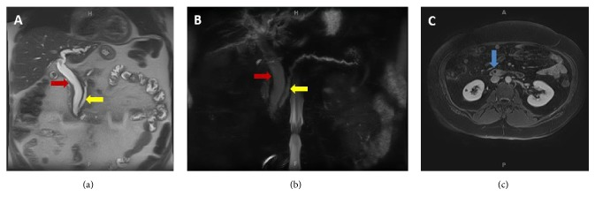
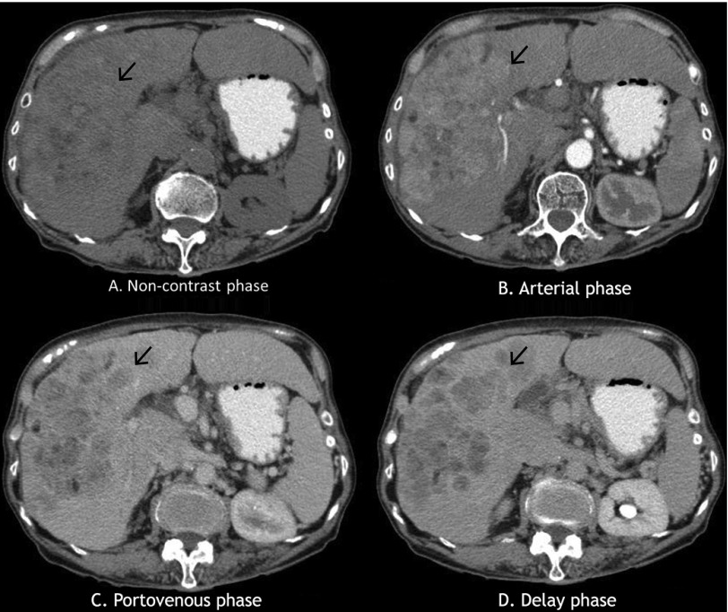
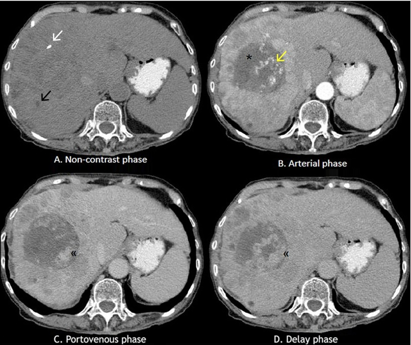
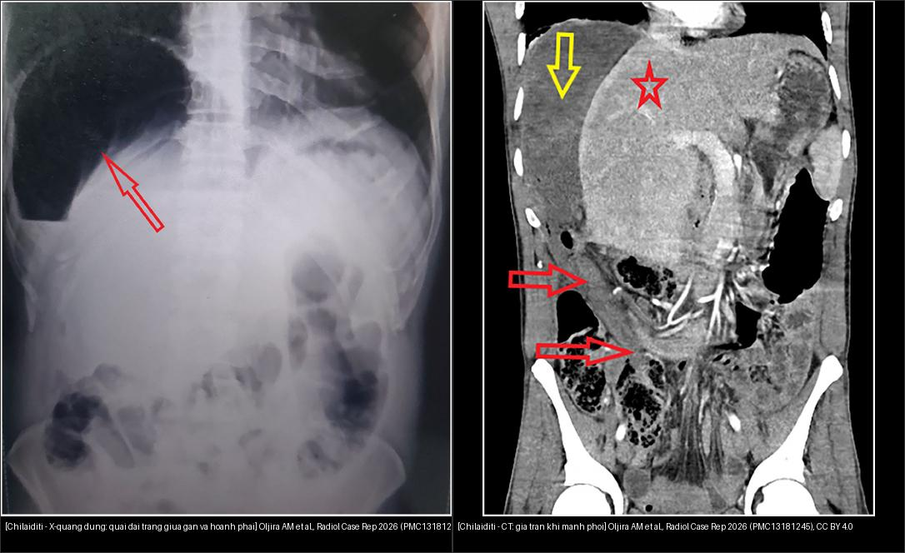

# 100 — Tổng quan hệ Bụng / Abdomen overview

**Tags:** `tong-quan`
**Mức chắc chắn (certainty):** tổng hợp y văn (literature synthesis).

## Bảng so sánh phân biệt bắt buộc (Hệ Bụng)
| Mẫu hình (pattern) | Vị trí (location) | Gamut chính (DDx) | Phân biệt nhanh (Chốt định lượng/động học) | Bài chi tiết |
|---|---|---|---|---|
| Khối ngấm thuốc mạnh thì ĐM (Hypervascular) | Gan (liver) | HCC, FNH, Adenoma, Hemangioma | Thải thuốc (washout) + vỏ = HCC; Sẹo T2 sáng ngấm muộn + giữ thuốc Primovist = FNH; Ngấm nốt ngoại vi hướng tâm = Hemangioma; Nốt MỚI nhỏ, nhiều ổ, sau oxaliplatin = FNH-like (`1733`); ở trẻ sau hóa trị/HSCT, HBP tăng 11/16 hoặc đồng 5/16, không washout = FNH-like (`1793`) | `120`, `121`, `122`, `1733`, `1793` |
| **Lách to + giảm tiểu cầu sau oxaliplatin** (splenomegaly with thrombocytopenia) | Lách – hệ cửa – gan | SOS/PSVD do oxaliplatin · di căn lách · ITP · ức chế tủy (CIT) · huyết khối TM lách/cửa · lymphoma | **Thể tích lách tăng > 30% (hoặc > 12 cm) + tiểu cầu tương quan nghịch (p < 0,001) + không ổ khu trú = SOS**; **ổ giảm tỷ trọng trong lách = di căn lách** (37 ca y văn, 86,5% muộn); **lách bình thường = ITP/CIT**; **ngưỡng trước cắt gan: tăng thể tích lách > 8,6% (AUC 0,62)** | `1792`, `1910`, `140`, `146` |
| Nang gan (một/nhiều) | Gan (nang) | Nang gan đơn thuần, PLD (ADPKD/ADPLD), bệnh Caroli, u mô đệm đường mật (von Meyenburg), di căn nang, **nang sán (CE1–CE5)**, MCN-L | Dịch thuần nhất + 0–15 HU + không ngấm = nang đơn thuần; **≥ 10 nang gan + nang thận = PLD**; **nốt < 1,5 cm T2 "trời sao" + không thông mật = von Meyenburg**; **giãn đường mật thông cây mật + central dot = Caroli**; **màng tách/nang con/vôi hóa vỏ = nang sán**; **vách ngấm + nữ trung niên + nang lớn = MCN-L** | `123`, `126`, `139`, `129` |
| **Nang gan NHIỄM TRÙNG** trong gan đa nang | Gan (nang) | Nhiễm trùng nang, xuất huyết nang, áp-xe gan, u hoại tử, viêm đường mật | **Sốt + CRP > 50 mg/L + ổ FDG trong nang = nhiễm trùng** (PET dương 96%; CT chỉ gợi ý 39%); **T1 sáng + không ngấm FDG = xuất huyết cũ**; **DWI sáng/ADC thấp = mủ**; kháng sinh **≥ 28 ngày** giảm tái phát (OR 0,12); **ở người ghép thận: ciprofloxacin 4,2% / trimethoprim 12,2% vào nang vs piperacillin 0,3%, chỉ 9% ca phải giảm IS (116)** | `104`, `116`, `157`, `164` |
| Khối giảm đậm độ / Ngấm thuốc viền (Hypovascular / Rim) | Gan | Di căn (đại-trực tràng, dạ dày), CCC đường mật, Áp-xe gan | Ngấm viền + thải ngoại vi + co kéo bao gan = CCC (LR-M); Dấu bia bắn đôi (double target) + sốt = Áp-xe | `120`, `121` |
| **Tăng men gan sau hóa trị ở bệnh nhân ung thư vú** (post-chemo transaminitis) | Gan – khoảng cửa – túi mật | **Bùng phát HBV** · DILI · tiến triển/di căn gan · SOS · gan nhiễm mỡ do hóa trị · pseudocirrhosis | **HBV DNA tăng ≥ 2 log10 (hoặc dương lại) + ALT ≥ 3× nền và > 100 U/L = bùng phát HBV**; **R ≥ 5 = DILI tế bào gan, R ≤ 2 = ứ mật**; **phù khoảng cửa 0–20 HU + thành túi mật > 3 mm** chỉ gợi ý, không chẩn đoán; **không chờ men gan giảm mới kháng virus** | `1790`, `1732`, `1910`, `1918` |
| **Ổ giảm đậm độ trong gan CÓ KHÍ / VÁCH (áp-xe sinh mủ)** | Gan (chủ yếu thùy phải) ± TM gan/phổi/mắt | **Áp-xe do *K. pneumoniae* (hvKP)** vs áp-xe đường mật/ESBL vs áp-xe sinh khí vs **nhiễm trùng nang (104)** vs HCC hoại tử vs amíp vs nang sán bội nhiễm | **Bờ không đều 96,4% + trong không đồng nhất 89,2% + trung tâm giảm đậm độ MỌI thì = áp-xe** (u còn mô sống ngấm thì ĐM + thải thuốc); **khí → aOR tử vong 10,16**; **khuyết ngấm TM gan = thể xâm lấn → soi đáy mắt**; dẫn lưu **> 5 cm**, kháng sinh đơn thuần **< 3 cm** | `103`, `104`, `121`, `163`, `475` |
| Giãn đường mật / Dấu ống đôi (Double-duct) | Mật – Tụy | U đầu tụy (PDAC), U bóng Vater, U Klatskin, Sỏi OMC | Cắt cụt đột ngột ống mật + ống tụy (double-duct) = U đầu tụy; Giãn chỉ trong gan hợp lưu = Klatskin | `130`, `131`, `136` |
| Hẹp đường mật KHÔNG xác định (lành vs ác) | Mật (rốn/xa/lan tỏa) | Klatskin/CCA, PDAC, PSC, IgG4-SC, cholangiopathy sau mổ/ghép, eosinophilic cholangitis, AIP | Coi là ÁC (~70%) tới khi chứng minh ngược; thành ≥ 3 mm + ngấm mạnh + hạch > 1 cm + hẹp dài/bất đối xứng = ác; hẹp nhẵn liên tục + IgG4 ≥ 135 mg/dL + tổn thương nhiều tạng = IgG4-SC; nhiều đoạn bỏ nhảy + IBD = PSC | `132`, `131`, `136` |
| Hẹp đường mật SAU MỔ/GHÉP (lành) | Đường mật sau ghép gan | Hẹp miệng nối, cholangiopathy thiếu máu (tắc ĐM gan), tái phát PSC, tái phát u/PTLD, sỏi đường mật, rò/nang mật | 1 ổ tại miệng nối + bờ nhẵn thuôn = **miệng nối**; **nhiều ổ trong gan + tắc/hẹp ĐM gan + hoại tử quanh mật = cholangiopathy thiếu máu**; **khối/hạch ngấm mạnh = tái phát u/PTLD**; ổ dịch ngấm mật trên thì gan–mật = rò mật | `133`, `132`, `124`, `107` |
| **Tăng men gan MUỘN sau ghép gan ở trẻ (> 6 tháng)** | Mảnh ghép gan – khoảng cửa/tiểu thùy | **dn AIH/plasma cell-rich rejection** · TCMR muộn · AMR · tái phát AIH · hẹp miệng nối mật · HAT/HAS · CMV/EBV/adenovirus/HEV · DILI · de novo MASLD · PTLD | **Hình ảnh KHÔNG đặc hiệu — chỉ để LOẠI TRỪ** (MRCP hẹp miệng nối; Doppler HAT/HAS); **chốt = sinh thiết**: viêm khoảng cửa giàu tương bào + viêm giao diện ± **C4d mao mạch khoảng cửa**, **viêm tĩnh mạch trung tâm 85,7%**; **anti-GSTT1 dương 100%** khi làm; trẻ **5–10%** (đoàn hệ PCRR **15,3%**), trung vị **20,6 tháng** | `1945`, `1916`, `1917`, `1913`, `1918`, `1933` |
| Hẹp đường mật sau can thiệp NANG SÁN | Đường mật (vùng nang) | Xơ hóa do chất diệt đầu sán, hẹp do rò/mảnh màng, tái phát nang, CCA, PSC | **Tiền sử PAIR/mổ nang + hẹp khu trú + không khối = xơ hóa do chất diệt**; hẹp lan tỏa chuỗi hạt + IBD = PSC; khối + CA 19-9 tăng = CCA; kiểm tra thông mật–nang trước khi bơm chất diệt | `106`, `139`, `132`, `133` |
| **Rò mật sau mổ/ghép** (bile leak) | Đường mật – khoang mổ | Rò miệng nối, rò ống túi mật, rò sau cắt gan, tụ dịch không thông, rò do stent | **Tụ dịch T2 sáng KHÔNG chứng minh rò**; **thuốc gadoxetic tràn vào tụ dịch ở 60–180 phút = rò hoạt động** (Se 96,4%, Sp 100% khi đủ 3 mốc); **không thấy thuốc ở 20–25 phút chưa loại trừ** (Se chỉ 42,9%); **sau cắt gan: bilirubin dịch ≥ 3× huyết thanh từ ngày 3 = rò (ISGLS), gặp 5–15% (B/C 7,0%), ống phân thùy đứt hoàn toàn → ERCP thất bại** | `107`, `108`, `133`, `137`, `1814` |
| **Rò mật–màng phổi** (bilothorax) | Gan – cơ hoành phải – khoang màng phổi | Rò mật–màng phổi sau cắt/ghép gan · sau PVE/PTBD/đốt u · tràn dịch đơn thuần · empyema · chylothorax · hemothorax · **bilothorax giả (thoát vị hoành/máu tan)** | **CT 0–20 HU KHÔNG phân biệt mật với dịch**; **tỷ lệ bilirubin dịch/huyết thanh > 1** nhưng **dương tính giả khi tràn máu/thoát vị hoành**; **tràn dịch > 4 tuần sau ghép = nghi rò**; **phải dẫn lưu màng phổi + giải áp đường mật song song** (chỉ hút ngực → rò tiếp tục) | `1814`, `1820`, `040`, `108`, `137` |
| **Gan còn lại không đủ** trước cắt gan lớn (insufficient FLR) | Gan – thùy mang u và thùy còn lại | PVE · **radiation lobectomy Y-90** · LVD · ALPPS · hai thì · cắt gan nhỏ hơn | **sFLR 20% gan lành / 30% sau hóa trị / 40% xơ gan** và **HBS < 2,7%/min/m²** = không đủ; **PVE +37,9% trong ~26 ngày rồi chững**; **RL 26–45% trong 44 ngày–9 tháng**, đủ chức năng **75 vs 31 ngày**; **PVT cùng bên = PVE không làm được, RL vẫn làm được**; **phì đại thể tích ≠ hồi phục chức năng** | `1821`, `1856`, `1825`, `930` |
| **Rò dưỡng trấp sau cắt/ghép gan** (chylothorax) | Bạch mạch rốn gan/ống ngực – cơ hoành – khoang màng phổi | Dưỡng trấp màng bụng đơn thuần · dưỡng trấp màng phổi · dưỡng trấp hai khoang · bilothorax · rò tụy–màng phổi · hepatic chylothorax (xơ gan) | **CT 0–20 HU KHÔNG gọi tên được**; **triglyceride dịch > 110 mg/dL (1,24 mmol/L) = chốt**, **50–110 = vùng xám cần chylomicron**, **< 50 gần như loại**; **dịch trong không loại trừ** khi nhịn ăn; **đo cả triglyceride + bilirubin + amylase** trên cùng mẫu; **MCT → TPN/octreotide → chụp bạch mạch/nút mạch → mổ** | `1839`, `1820`, `1822`, `1823`, `1737` |
| **Khối dịch quanh thận ghép** (perigraft fluid) | Sau phúc mạc hố chậu – quanh thận ghép/bàng quang | Nang bạch huyết · urinoma · máu tụ · áp-xe · seroma · ứ nước bể thận · giả phình miệng nối | **Creatinin dịch = huyết thanh → nang bạch huyết; > huyết thanh → urinoma**; **0–20 HU = dịch, 50–70 HU = máu tụ cấp**; **< 5 cm không triệu chứng theo dõi; hút đơn thuần tái phát tới 59%**; xơ hóa → **nút bạch huyết INL–LE** → **cửa sổ phúc mạc** | `3088`, `3011`, `1750`, `1839` |
| **Rò mật–phế quản** (bronchobiliary fistula) | Gan – cơ hoành phải – cây phế quản phải | BBF sau cắt/ghép gan, đốt nhiệt/TACE, sán gan, chấn thương, tắc mật · áp-xe phổi · rò phế quản–màng phổi · viêm phổi hít | **Ho ra mật vàng–xanh + bilirubin đờm dương = chốt**; **CT/MRI chỉ thấy đường rò 52,9%, giãn đường mật 94,1%; hình ảnh âm không loại trừ**; **giải áp mật (PTCD/ERCP) trước, bít phế quản (spigot/plug) khi còn rò**; tử vong **47,1%** (17 ca) | `1824`, `1820`, `930`, `934` |
| **Rò mật–nang dai dẳng sau PAIR** (cystobiliary fistula) | Nang sán – đường mật trong gan | Rò lưu lượng thấp · rò lưu lượng cao (≥ 400 mL/ngày) · rò ẩn (occult) · vỡ nang vào đường mật · biloma không thông · hẹp do chất diệt | **Bilirubin dịch dẫn lưu cao + lưu lượng 24 giờ = mật**; **nang ≥ 8,85 cm + bilirubin trực tiếp ≥ 0,7 mg/dL → CBC 42%**; **≥ 400 mL/ngày hoặc > 10 ngày → ERCP cắt cơ thắt + stent**; **S-CAT chỉ bơm chất diệt khi < 10 mL/ngày**; CT có thể bỏ sót đường hầm | `1809`, `106`, `1814` |
| Giãn đường mật TRONG GAN khu trú ± sỏi | Đường mật trong gan | Sỏi trong gan (hepatolithiasis/RPC), bệnh Caroli, clonorchiasis, PSC (chuỗi hạt), IPNB, iCCA, HCC xâm lấn ống (BDTT) | Sỏi tăng đậm độ CT + T2 tối trong ống giãn = **sỏi trong gan**; **giãn nang thông với cây mật + central dot = Caroli**; **khối NGẤM trong lòng ống + giãn không tương xứng = IPNB**; teo thùy + khối ngấm = iCCA; sỏi trong gan lâu năm → **nguy cơ iCCA**; **nang lớn vách ngấm không thông mật = MCN-L**; **giãn ống nhỏ ngoại vi + khuyết lòng ống dạng sợi KHÔNG ngấm thuốc + vùng ăn cá sống = sán lá gan nhỏ**; **Caroli/CHF + khối đặc/vách dày mới + CA 19-9 tăng = iCCA (LR-M)** | `138`, `128`, `123`, `131`, `132`, `129`, `173` |
| **Ống mật "giả giãn" sau can thiệp u gan** | Đường mật trong gan sau TACE/TARE/RFA | Hoại tử ống mật (BDN)/cholangiopathy thiếu máu, giãn ống thật do tắc, huyết khối TM cửa, nang quanh ống mật, Caroli, biloma dạng phân nhánh | **CT thấy "ống giãn" nhưng siêu âm/MRCP KHÔNG giãn thật = BDN**; **ống giãn thuôn ngoại vi + thấy nguyên nhân tắc = giãn thật**; **cavernous transformation + ngấm bàng hệ = huyết khối cửa**; **nối với ổ dịch + sau TACE = biloma**; **ALP > 200 U/L ở 76,2%** ca tổn thương đường mật; **biloma 20–65% có triệu chứng, tử vong 5–10%** | `179`, `930`, `133`, `137` |
| **Thành túi mật dày sau can thiệp gan** | Túi mật – động mạch túi mật | Viêm túi mật thiếu máu sau TACE, viêm túi mật do xạ sau TARE, viêm túi mật do sỏi, phù thành do xơ gan/suy tim, hoại tử/thủng, ung thư túi mật, adenomyomatosis | **Vật liệu tắc trong thành trên CBCT sau TACE + thành ≥ 4 mm + thâm nhiễm mỡ = viêm túi mật thiếu máu** (10% nhóm có lipiodol trong thành cần can thiệp; catheter trực tiếp ĐM túi mật OR 52); **dày thành đều, KHÔNG thâm nhiễm mỡ, có cổ trướng = phù thành do xơ gan**; **mất ngấm thành/khí/màng trong lòng = hoại tử, dẫn lưu ngay**; **lipiodol trong thành đơn thuần tự rửa trôi 1–2 tháng** | `180`, `179`, `130`, `102` |
| **Loét dạ dày–tá tràng MỚI sau TACE/TARE** | Dạ dày – tá tràng (theo nhánh ĐM: vị phải, GDA, vị trái/phụ) | Loét do xạ (TARE), loét thiếu máu do hạt/thuốc (TACE/DEB), loét H. pylori/NSAID, loét ác tính do u xâm lấn, viêm tụy do trào ngược, hội chứng sau can thiệp | **Loét muộn 1–12 tháng sau TARE + đau dai dẳng dù PPI = loét do xạ** (1,9–3,2%; **6%** phải mổ); **loét 3 ngày–4 tuần sau TACE = thiếu máu** (biến chứng ĐM gộp 1,1–7,2%, **62% < 72 giờ**); **coil GDA/vị phải KHÔNG bảo đảm**; chốt bằng **vi cầu trong mô bệnh** | `1811` |
| **Suy gan + cổ trướng MỚI sau TARE** | Gan – nhu mô không u (non-tumoral liver) | REILD (Sangro), tiến triển u, tắc mật sau xạ, nhiễm trùng, SOS do hóa chất, suy tim phải/PVT, hội chứng sau thuyên tắc | **Bilirubin > 3 mg/dL + cổ trướng trong 4–8 tuần, không u sống/không giãn ống mật = REILD** (1,0–5,4%; **60,6% khi TARE cả gan một lần**; sống 5,2 vs 22,1 tháng); **nốt ngấm mạnh thì ĐM mới = tiến triển**; **giãn ống mật = tắc mật**; **sốt/đau 7 ngày đầu tự hết = hội chứng sau thuyên tắc** | `1801`, `179`, `124`, `121`, `127` |
| **Khuyết lòng DÀI trong ống mật** | Đường mật (lòng ống) | Giun đũa đường mật, sỏi OMC, cục máu đông (hemobilia), khí đường mật sau cắt cơ Oddi, IPNB/u nhú, stent nhựa | **Khuyết lòng dài–trơn–không bóng lưng–CỬ ĐỘNG (hoặc đổi vị trí giữa 2 lần MRCP) = giun**; **bóng lưng + bờ rõ = sỏi**; **bám thành, không di động, ống giãn không tương xứng = IPNB**; **rất sáng trên CT, không thấy trên MRCP = khí**; **tiền sử can thiệp + thay đổi nhanh vài ngày = máu đông** | `174`, `138`, `129`, `131` |
| Tăng áp lực cửa nhưng chức năng gan còn tốt | Gan & hệ cửa | Xơ hóa gan bẩm sinh (CHF), hội chứng Caroli, PSVD, sán máng, huyết khối tĩnh mạch cửa, tắc tĩnh mạch lách, xơ gan sớm | **Varices + lách to + tiểu cầu thấp nhưng bilirubin/albumin/INR còn tốt = tăng áp cửa trước xoang**; **HVPG thường bình thường (chỉ ~30% > 10 mmHg)**; **Caroli: túi giãn thông mật + central dot**; **CHF: xơ khoảng cửa + ống mật bất thường, kiến trúc tiểu thùy còn nguyên**; CSLD khi varices cần can thiệp + tiểu cầu < 150, có cholangitis hoặc LSM > 15 kPa | `149`, `166`, `127`, `124`, `176` |
| **Nốt gan + amoniac cao + MỘT mạch lớn cửa→chủ ở gan KHÔNG xơ** | Gan – tĩnh mạch cửa & hệ thống (shunt ngoài gan) | CEPS type I/II (Abernethy), huyết khối cửa mạn + cavernoma, dò động–cửa, xơ gan có shunt lạc chỗ, TIPS cũ | **Thân shunt lớn + nhánh cửa trong gan giảm sản còn thấy khi chẹn bóng = type II (bít được)**; **không nhánh cửa kể cả khi chẹn = type I (hướng ghép gan)**; **áp lực sau chẹn ≥ 24–32 mmHg → bít nhiều thì**; **nốt gan tới 65%**, **PAH tử vong 50%** | `1907`, `149`, `187`, `124` |
| **Ngấm thuốc KHÔNG ĐỒNG NHẤT sau ghép gan + tĩnh mạch gan giãn/đậm hơn IVC** | Gan – miệng nối TM gan–IVC | HVOO (hẹp miệng nối, hẹp IVC), huyết khối TM gan/tĩnh mạch cầu nối, SOS/VOD, mảnh ghép quá to/xoắn, hẹp tĩnh mạch cửa, tái phát Budd–Chiari | **Chênh áp HV–IVC ≥ 5 mmHg = HVOO** (bình thường **1–3 mmHg**); **tỉ lệ vận tốc chỗ hẹp/trước hẹp > 4:1** (ca **202 vs 18 cm/s**) + **mất sóng ba pha** (phổ một pha chỉ chính xác **66,2%**; **ba pha liên tục loại trừ**); **HV đậm hơn IVC + periportal collar** = ứ huyết; **SOS: toàn gan, mạch ra thông, không chênh áp khu trú**; **miệng nối ≤ 30 mm → OR 14,286**; **hẹp cửa: tỉ lệ vận tốc ≥ 3:1 + gradient > 5 mmHg**; **SOS: HBP lưới, MRE ≥ 2,82 kPa** | `1906`, `1909`, `1910`, `1901`, `127`, `133` |
| **Tĩnh mạch cửa đậm sớm ở thì ĐỘNG MẠCH + tăng áp cửa mới sau can thiệp/ghép** | Gan – động mạch gan ↔ tĩnh mạch cửa | Rò động–cửa (APF type 1/2/3), THAD, shunt trong HCC, giả phình ĐM gan, huyết khối cửa, HHT | **Cửa ≈ ĐMC thì động mạch = APF**; **THAD hình nêm, mất thì cửa, không đảo dòng = không phải rò**; **RI < 0,5 + đảo dòng cửa** trên Doppler; can thiệp khi **shunt > 1 cm** hoặc có triệu chứng; nút mạch **64,9%**, mổ **13,4%**, bảo tồn **19,6%** (97 ca) | `1841`, `1913`, `1827`, `1912` |
| **Mất dòng ĐỘNG MẠCH gan sau ghép → men gan tăng ngày 1–7, có thể nhồi máu** | Gan – động mạch gan (miệng nối + nhánh trong gan) | HAT (4–12%), HAS miệng nối (2–13%; trẻ **1,2%**), cướp máu lách, giả phình, rò động–cửa, co thắt do thuốc | **RI < 0,5 + SAT > 0,08 giây + PSV > 200 cm/s** = hẹp; **PSV ≤ 48 cm/s** (Se 69%/Sp 99%); phổ **"water-hammer"** = tắc; **RI > 0,8 trong 3 ngày đầu ở ~50% là bình thường**, về **ngày 4**; **đảo dòng tâm trương + RI > 0,8 = cướp máu lách**; **hẹp dài + mở lại sau papaverine = co thắt**; nhồi máu gắn tắc mạch **85%**; ở trẻ **PSV ngày 0 24–142 cm/s → năm 1 24–91** | `1913`, `1947`, `1915`, `1914`, `1906`, `133` |
| **Men gan tăng sau ghép gan mà mạch–mật ĐÃ loại trừ** | Gan – nhu mô & khoảng cửa | ACR/TCMR (**15–25%**), EAD, CMV, viêm gan do thuốc, tái phát bệnh nền, thải ghép thể dịch | **Sinh thiết + Banff RAI** (1–2/3–5/6–7/8–9); **ADC < 1,133 × 10⁻³ mm²/s** và **LSM 12,2 kPa** chỉ gợi ý, **không chẩn đoán** | `1916`, `1914`, `1913`, `1918` |
| **Men gan tăng + giảm tiểu cầu + DSA dương, mạch–mật đã loại trừ** | Gan – vi tuần hoàn khoảng cửa & xoang | AMR cấp (ABO tương thích **< 5%**), AMR + TCMR hỗn hợp, AMR mạn, AMR giả dạng SOS, DSA đơn độc, dn AIH/plasma cell rejection | **Banff 2016: C4d lan tỏa score 3 (> 50% khoảng cửa) + h-score ≥ 1 + DSA + loại trừ** = AMR chắc chắn; **C4d+h = 3–4** = nghi ngờ; cAMR cần **C4d ≥ 10%** + **DSA trong 3 tháng**; ảnh chỉ **loại trừ** (Dodd: PSV > 200, RI < 0,5, SAT > 0,08 giây; MRCP **LBSC ≥ 3**, Se > 90%) | `1917`, `1916`, `1913`, `133` |
| **Gan ứ huyết ngoại vi + hạch đuôi sáng ("flip-flop")** | Gan – tĩnh mạch gan & TM chủ dưới | Budd–Chiari (nguyên phát/thứ phát), xơ gan, gan tim, SOS/VOD, huyết khối TM cửa | **Ngoại vi giảm ngấm + trung tâm/hạch đuôi tăng ngấm + KHÔNG thấy TM gan = BCS** (hạch đuôi to ~50%; TM hạch đuôi > 3 mm; US dấu trực tiếp + hạch đuôi to Sp 100%); **IVC + TM gan giãn + reflux = gan tim**; **TM gan thông + nốt/bờ gồ ghề = xơ gan**; **không huyết khối lớn + bối cảnh hóa trị = SOS** | `1901`, `127`, `149` |
| **T1 sáng đối xứng hạch nền (globus pallidus)** | Não – hạch nền (neurohepatology) | Bệnh não gan/HE thể ẩn, bệnh não–não mắc phải (AHD), TPN dài hạn, gadolinium tích lũy, ngộ độc mangan; dementia (SI thường GIẢM) | **T1 sáng + T2 KHÔNG sáng + bối cảnh xơ gan/shunt = mangan** (SI ≥ 0,994; Se 80%/Sp 90,9%; 12,5% xơ gan không HE vẫn vượt ngưỡng); **MRI cấu trúc bình thường KHÔNG loại trừ CHE** — chốt bằng PHES < −4 / S-ANT1 < 20; **thể tích gan LV/BSA < 620 mL/m² → CHE cao 2,9 lần** | `1902`, `188`, `183` |
| **Giãn tĩnh mạch ĐÁY VỊ (GV): chọn BRTO hay TIPS?** | Dạ dày – đáy vị & shunt cửa–chủ | GOV1/GOV2/IGV1/IGV2; GRS (80–85%), LIPV (10–15%), PCV (~5%) | **Có shunt dạ dày–thận lớn + BRTV đầy túi giãn (Hirota 1–2) = BRTO** (thành công 97,3%, tắc hoàn toàn ngày 90 93%); **không có nhánh thoát (Kiyosue D) hoặc cần hạ áp toàn hệ = TIPS**; **tăng áp cửa TRÁI do tắc TM lách + gan bình thường = nút keo xuyên lách/cắt lách**; **đang chảy ồ ạt = cầm máu tạm trước** (bịt đường thoát làm tăng áp trong túi giãn) | `181`, `176`, `146`, `149` |
| **Bệnh nhân XẤU ĐI trong 30 ngày sau TIPS** | Gan – đường mật – màng bụng – tim | Hemoperitoneum (thủng bao gan), hemobilia, suy gan tiến triển nhanh, suy đa cơ quan/suy tim cung lượng cao, endotipsitis, stent sai vị trí | **24 giờ đầu tụt HA + dịch ổ bụng 35–70 HU = máu (không phải báng < 20 HU)**; **nôn máu + vàng da + khối tăng đậm độ trong OMC = hemobilia**; **sốt + cấy máu dương + FDG trong stent = endotipsitis**; **bilirubin ≥ 3 lần/INR ≥ 2 lần trong 30 ngày = suy gan tiến triển nhanh**; biến chứng nặng 3,2%, tử vong 0,84% (948 ca) | `182`, `176`, `127`, `105` |
| Sau khi đặt stent/dẫn lưu đường mật — theo dõi | Đường mật & stent (biliary tree & stents) | Tắc stent (cặn bùn), u mọc xuyên/phủ qua đầu, di trú stent (gần/xa), thủng tá tràng sau phúc mạc, viêm đường mật tái phát (MDRO) | **Khuyết KHÔNG ngấm trong lòng stent = cặn bùn**; **khối ngấm lấp lòng = u mọc xuyên/phủ**; **đầu stent tụt + thấy stent ở tá tràng/dạ dày/gan = di trú**; **khí ngoài lòng quanh D2–D3 = thủng sau phúc mạc**; **kháng sinh < 7 ngày → tái phát 50% vs 33%** | `137`, `131`, `133` |
| **Vàng da tắc mật: có chỉ định dẫn lưu TRƯỚC mổ không?** | Đường mật – đầu tụy (biliary – pancreatic head) | Tắc xa do u (PBD qua ERCP), tắc rốn gan (PTBD/EUS-BD, chỉ dẫn lưu FLR), sỏi OMC (ERCP lấy sỏi), viêm đường mật cấp | **TB ≥ 15 mg/dL (≥ 14,6 mg/dL = yếu tố tiên lượng tử vong 90 ngày) + cholangitis/albumin < 3 g/dL/mổ hoãn/tân bổ trợ → DẪN LƯU**, đích **TB < 8,9 mg/dL**; **vàng da 10–15 mg/dL không biến chứng → mổ thẳng** (PBD tăng SSI 70,8% vs 18,7%, cấy mật dương 75% vs 25%, biến chứng nặng RR 1,65) | `925`, `102`, `137`, `910`, `131` |
| **Viêm đường mật cấp ở THAI PHỤ** | Đường mật trong + ngoài gan (intra/extrahepatic biliary tree) + thai | Sỏi ống mật chủ · sỏi kẹt bóng Vater · Mirizzi · hẹp sau cắt túi mật · ký sinh trùng · u đường mật/tụy · ICP · HELLP · AFLP · viêm gan · viêm túi mật · viêm tụy | **TG18: xác định = A (sốt/BC–CRP tăng) + B (bilirubin ≥ 2 mg/dL hoặc men ứ mật) + C (giãn đường mật/nguyên nhân)**; **độ III = suy tạng (dopamine ≥ 5 µg/kg/phút, PaO₂/FiO₂ < 300, creatinin > 2,0, PT-INR > 1,5, tiểu cầu < 100.000) → dẫn lưu trong 6 giờ**; **ERCP < 24 giờ giảm 20% tử vong**; **tử vong 1,9% (84.063 ca), tới 20% khi kháng đa thuốc**; **thai: ERCP 1.307 ca — biến cố thai 5,2–6,2%, fluoroscopy 15 giây/< 0,5 mGy**; kháng sinh **2–3 ngày sau dẫn lưu** (OR 0,78) | `1929`, `1925`, `138`, `108` |
| Quai **tịt đầu** giãn + thâm nhiễm mỡ hố chậu phải | Hố chậu phải – ruột thừa | Viêm ruột thừa cấp (đơn thuần/phức tạp) vs viêm túi thừa ruột thừa vs viêm mào mỡ vs sỏi niệu quản vs PID/TOA vs mucocele | **> 6 mm + thâm nhiễm mỡ + ngấm thành = viêm cấp**; **khí ngoài lòng/áp-xe/appendicolith ngoài lòng/mất ngấm thành = phức tạp**; **giãn > 15 mm + vôi hóa + KHÔNG thâm nhiễm = mucocele**; **nốt mỡ viền mảnh, không có quai giãn = viêm mào mỡ**; **khí trong lòng gặp 31% ca viêm — không loại trừ**; **thiếu dấu phụ → xác suất ~2%** | `161`, `134`, `160`, `165` |
| **Áp-xe ruột thừa ở thai phụ** | Hố chậu phải – ruột thừa (đã di chuyển theo tuổi thai) | Áp-xe ruột thừa · đám quánh · thai ngoài tử cung · xoắn phần phụ · u bì biến chứng · ứ nước thận phải | **Ổ > 40 mm + WBC không giảm sau 24 giờ = nguy cơ chuyển mổ**; **bảo tồn thất bại ~30%, đã đặt dẫn lưu vẫn mổ 25,4%**; **MRI Se 92%/Sp 98%**; **ERAT khi dẫn lưu qua da thất bại** | `109` |
| Giãn quai ruột / Thâm nhiễm mỡ khu trú | Ống tiêu hóa (GI) | Viêm ruột thừa, Viêm túi thừa, Tắc ruột non (SBO), Tắc quai kín | Ruột thừa > 6 mm; Ruột non > 3 cm; Xoắn mạch (whirl) + chữ C + mất ngấm thành = Tắc quai kín thiếu máu (mổ tối khẩn) | `160`, `162` |
| **Giãn ruột non + tiêu chảy mỡ/đầy hơi sau cắt ruột** (SBS – SIBO) | Ruột non còn lại – hỗng tràng/hồi tràng | SIBO · giãn thích nghi · hẹp miệng nối/dính · CIPO · bệnh celiac · tiêu chảy muối mật · IMO | **Không có dấu hiệu hình ảnh đặc hiệu của SIBO**; **giãn lan tỏa không điểm chuyển tiếp = thích nghi/CIPO**, **có điểm chuyển tiếp = hẹp/tắc**; H₂ **≥ 20 ppm/90 phút** hoặc CH₄ **≥ 10 ppm**; cấy **≥ 10³ CFU/mL**; SIBO **40–80%** ở trẻ SBS, **76%** đợt bùng phát | `1960`, `3053`, `3006`, `162` |
| **Tắc ruột non ở người ĐÃ XẠ tiểu khung** | Ruột non – tiểu khung (trong trường chiếu) | Hẹp do xạ · dính sau mổ · tái phát u/phúc mạc · sỏi ruột tại chỗ hẹp · rò/áp-xe do xạ | **Thành dày 6–12 mm ĐỐI XỨNG + đoạn ≥ 5 cm + ngấm kém = hẹp do xạ** (khác dính: chuyển tiếp đột ngột, thành mỏng); tắc do xạ vs dính: bảo tồn thành công **33,9% vs 58,4%**, phải cắt ruột **44,0% vs 5,6%**, tái nhập **28,8% vs 13,2%**; **Gastrografin AUC 0,860** | `111`, `162`, `1667` |
| **Chảy máu trực tràng MUỘN sau xạ** | Trực tràng (trong trường chiếu) | Viêm trực tràng xạ mạn (telangiectasia) · tái phát u · loét/rò do xạ · ung thư thứ phát · trĩ/angiodysplasia | **Niêm mạc nhợt + mạch giãn ngoằn ngoèo + không khối = viêm xạ** (xác nhận **25,7%** sau xạ ung thư cổ tử cung); **KHÔNG sinh thiết mù** mô đã xạ; APC **80–90%**, formalin **81%**, RFA **83,3%**; **nổ đại tràng khi APC: 12 ca, 50% thủng — do chuẩn bị kém** | `112`, `1665`, `162` |
| Nang & Ổ dịch quanh tụy | Tụy (pancreas) | Tụ dịch cấp quanh tụy (APFC), tụ dịch hoại tử cấp (ANC), nang giả tụy, hoại tử có vỏ (WON), u nhầy nhú nội ống tụy (IPMN), u nang thanh dịch (SCN), u nang nhầy (MCN) | < 4 tuần vs ≥ 4 tuần + có hoại tử hay không (Atlanta 2012); Thông ống tụy chính = IPMN | `135`, `136` |
| **Đau thượng vị dữ dội + TG rất cao + tụy hoại tử** | Tụy thân/đuôi – khoang quanh tụy – túi mạc nối | **HTG-AP** · viêm tụy mật · rượu · tăng canxi · thuốc (asparaginase, corticoid, estrogen) · IPMN/u nang | **TG ≥ 11,3 mmol/L (1.000 mg/dL) hoặc 5,65–11,3 + huyết thanh đục = HTG-AP**; **TG ≥ 200 mg/dL: hoại tử OR 3,27**; **hoại tử 29,5% → 52,3% → 85,7%** theo TG; **CT 72–96 giờ mới đánh giá được hoại tử**; **khí trong ổ = nhiễm khuẩn**; **tái phát 64,8%/1 năm** → kiểm soát TG sau ra viện | `1680`, `135`, `628`, `684`, `136` |
| **Ổ hoại tử tụy CÓ KHÍ / sốt + suy tạng sau 2–4 tuần** | Tụy – khoang quanh tụy – sau phúc mạc | Hoại tử **nhiễm khuẩn** sinh hơi · **rò tiêu hóa** vào ổ · **khí sau can thiệp** (catheter/stent) · **viêm tụy khí thũng vô khuẩn** (khí **< 7 ngày**, tử vong **44,1%**) · thủng tạng rỗng | **Khí đặc hiệu cao nhưng ĐỘ NHẠY THẤP → không có khí KHÔNG loại trừ nhiễm khuẩn**; **khí ngay sau dẫn lưu/stent = do can thiệp**, không nâng bậc; **hoãn can thiệp tới khi bao vỏ (≥ 4 tuần)**, **1/3–40% khỏi chỉ bằng kháng sinh**; **sau 72 giờ dẫn lưu không cải thiện → bóc hoại tử tối thiểu xâm lấn**; **không kháng sinh dự phòng**; luôn đọc **thì động mạch** tìm **giả phình** (vỡ tử vong **> 50%**) | `1683`, `1680`, `135`, `146` |
| **Ổ dịch tụy DAI DẲNG/TÁI PHÁT dù đã dẫn lưu** | Tụy thân – đuôi thượng nguồn – khoang quanh tụy | **Hội chứng ống tụy đứt (DPDS)** · WON chưa lành · nang giả · rò tụy nội bộ · u nang (IPMN/SPN) | **Đuôi tụy còn ngấm thuốc trong/ven ổ dịch + đoạn ống mất tín hiệu ≥ 2 cm + ống thượng nguồn giãn = DPDS**; MRCP 3D (Se 83,3%) tốt hơn CT khi ống không giãn; **rút stent sớm → tái phát 7–42%**; **DPS 1 năm: 23,3% vs 70,8%**; **transpapillary chỉ 20%** | `1730`, `1683`, `135`, `136` |

| **Viêm phổi TÁI PHÁT cùng một thùy + nang giả tụy dưới hoành** | Tụy → lỗ hoành/trung thất → phế quản đáy | **Rò tụy–phế quản (PBF)** · rò tụy–màng phổi · viêm phổi hít/giãn phế quản · lao · áp-xe phổi | **Nang giả tụy CHỨA KHÍ + đường rò xuyên hoành + tree-in-bud đáy cùng bên + amylase đờm rất cao** (ca: **57.500 U/L**) = PBF; **PPF 0,4%** viêm tụy, **4,5%** nang giả; chẩn đoán muộn **12–49 ngày** | `1934`, `1737`, `1730`, `031` |
| Gan ứ trệ mạch máu (vào–xoang–ra) | Gan & mạch cửa | **Gan tim (cardiac hepatopathy)**, Budd-Chiari (tắc dòng RA), SOS/VOD (tắc XOANG), huyết khối tĩnh mạch cửa/PVTT/khi TM cửa (tắc dòng VÀO) | **Thùy đuôi to giữ ngấm + không thấy TM gan = Budd-Chiari**; **TM gan giãn + còn dòng + CVP cao = gan tim**; **sau ghép < 21 ngày + tăng cân > 5% + không giãn đường mật = SOS**; **ngấm mạch + phì đại mạch + mật độ iod ≥ 0,9–1,14 mg/mL = PVTT** | `127`, `124`, `121` |
| **Khó thở + giảm oxy ở bệnh nhân xơ gan (HPS vs PoPH)** | Gan – tuần hoàn phổi (liver – pulmonary circulation) | HPS (giãn mạch, shunt phải–trái), PoPH (co mạch/tái cấu trúc), tràn dịch màng phổi do gan, thuyên tắc phổi, shunt trong tim (PFO/ASD), Abernethy | **PaO₂ < 80 + A–a ≥ 15 mmHg (≥ 20 nếu > 64 tuổi) + bọt ở tim trái sau ≥ 3 chu chuyển (hoặc MAA não > 6%) = HPS**; **bọt < 3 chu chuyển = shunt trong tim**; **mPAP > 20 + PVR ≥ 2 WU + PAWP ≤ 15 trên thông tim = PoPH** (RVSP > 50 trên siêu âm: ~1/3 có PVR bình thường); **mPAP ≥ 45 = chống chỉ định ghép** | `186`, `196`, `070`, `127`, `149` |
| Vạt nội mạc / liềm tăng tỷ trọng thành ĐMC bụng | ĐMC bụng (abdominal aorta) | Bóc tách ĐMC bụng đơn độc (IAAD), IMH, PAU, huyết khối thành trong phình, viêm ĐMC, vỡ phình | **Vạt nội mạc + hai lòng = bóc tách**; **liềm tăng tỷ trọng 5–15 mm trên không cản quang + không ngấm = IMH**; **ổ loét đối quang sâu > 20 mm = PAU nguy cơ cao**; **di lệch vôi hóa nội mạc 78% ca IAAD**; can thiệp khi **≥ 50–55 mm, malperfusion hoặc vỡ** | `171`, `1807`, `170`, `070` |
| Theo dõi sau can thiệp bóc tách ĐMC bụng | ĐMC bụng (abdominal aorta) | Endoleak I–V, Hẹp/tắc nhánh tạng, Lòng giả còn thông/giãn, Di trú/gãy stent, Nhiễm trùng graft/rò chủ–ruột | **Túi tăng ≥ 5 mm = tăng có ý nghĩa**; **type I/III → can thiệp; type II → chỉ can thiệp khi túi tăng**; **FEVAR: mất nhánh 9,9% ở 5 năm, can thiệp lại 37,2%**; **type II dai dẳng: vỡ/tử vong do phình ~2% ở 10 năm**; **CTA 3 pha (muộn 70–120 giây) + 30 ngày rồi 12 tháng/lần** | `172`, `171`, `840` |
| Sốt + huyết khối trong hệ cửa–mạc treo | Gan & mạch cửa/mạc treo | Pylephlebitis (huyết khối mủ), huyết khối lành, huyết khối u, MVT, khí tĩnh mạch cửa, áp-xe gan | **Sốt + đau bụng + khuyết thuốc cửa + ổ nhiễm (ruột thừa/túi thừa/viêm tụy) = pylephlebitis**; **khuyết thuốc SMV + phù mạc treo "lược" = MVT**; **không sốt, không ngấm thành mạch = huyết khối lành**; **khí ra ngoại vi tới dưới bao gan = khí TM cửa, không phải huyết khối** | `163`, `124`, `135` |
| **Khuyết thuốc trong tĩnh mạch lách ± nhồi máu lách** | Lách – tĩnh mạch lách – tụy | Huyết khối lành sau viêm tụy, huyết khối u (PDAC thân/đuôi), huyết khối mủ, mõm cụt sau mổ, tăng đông (MPN), nhồi máu lách, rách lách, áp-xe lách | **Viêm tụy + khuyết thuốc + tụy bệnh lý = huyết khối lành (tái thông 46% khi chống đông vs 15%)**; **mạch giãn + mô ngấm trong lòng = huyết khối u**; **nêm giảm đậm độ đáy ở vỏ = nhồi máu (CT 100% vs siêu âm 29,9%)**; **khí trong ổ + thành ngấm = áp-xe** | `146`, `135`, `163`, `140` |
| **Hố lách trống + khối di động + dấu xoáy** | Lách – cuống lách (spleen – splenic pedicle) | Lách lạc chỗ/xoắn cuống, nhồi máu lách do thuyên tắc, splenosis/đa lách, tự cắt lách (hồng cầu liềm), khối phần phụ, xoắn dạ dày | **Hố lách trống + khối giống lách + dấu xoáy cuống = lách lạc chỗ xoắn**; **lách 49 HU (24–64) so với gan 92 HU thì TM cửa = nhồi máu**; **động mạch còn ngấm nhưng tĩnh mạch không đọng thuốc = tắc TM trước ĐM**; **< 0,2% ca cắt lách**; còn ngấm → splenopexy, mất ngấm → cắt lách | `119`, `146`, `140`, `160` |
| **Sốt > 3 tuần không rõ ổ (FUO) + tổn thương trong bụng** | Đa khoang (gan–mật, hồi manh tràng, sau phúc mạc, tiểu khung) | Áp-xe gan, lao phúc mạc/hồi manh tràng, Crohn, áp-xe cơ thắt lưng chậu, nhiễm endograft ĐMC, lymphoma, di căn giả áp-xe | **Siêu âm 86% → CT bụng 92% → PET/CT (dương thật 47,9%)**; **nhiều ổ nhỏ 2–5 mm + giảm bạch cầu = nấm**; **"áp-xe" không đáp ứng kháng sinh + khối tụy = di căn**; **PET âm không loại trừ (âm giả 19%)** | `147`, `163`, `161`, `141` |
| **Đái máu đại thể khó cầm sau xạ trị khung chậu (bàng quang co nhỏ, thành dày đều)** | Bàng quang – mạch chậu trong (bladder, internal iliac) | Viêm bàng quang xạ · u niệu mạc thứ phát · máu cục · viêm bàng quang do cyclophosphamide · **rò động mạch chậu – niệu quản** | **Thành dày đều + giãn mạch trên nội soi + không khối = viêm xạ**; **máu cục 50–70 HU không ngấm, đổi hình theo tư thế**; **khối ngấm thuốc/hạn chế khuếch tán = u** (bài 1608); **nút mạch bàng quang: kỹ thuật 100%, lâm sàng 85–90%, Hb 7,8 → 12,2 g/dL, tái phát 18,7%**; **alum 1% 66–100% · formalin 89% nhưng 31% biến chứng nặng · HBOT 60–92%** | `1633`, `582`, `1608`, `910` |
| **Stent niệu quản "vẫn nằm đúng chỗ" nhưng đau/tắc** | Niệu quản – bể thận – bàng quang (K/U/B segments) | Kết vôi stent (FECal 1–5) · sỏi niệu quản mới · **cản quang tồn dư** · vôi hóa mạch chậu · stent gãy/di trú · sỏi bàng quang | **Vôi hóa bám theo ống stent, dày ở coil, đủ 3 đoạn K/U/B**; **NCCT lát mỏng là chuẩn (76,1%)**, KUB không lập bản đồ được; **KUB score ≥ 9 = nguy cơ nhiều thì**; **không kéo mù** → dừng, chụp lại | `1620`, `1660`, `152` |
| **Stent niệu quản + sốt: khuẩn niệu hay nhiễm stent?** | Niệu quản – bể thận – quanh thận/cơ chậu (stent, collecting system, retroperitoneum) | Nhiễm stent/biofilm · khuẩn niệu không triệu chứng · sỏi tắc trên stent · áp-xe cơ chậu do stent di trú · nhiễm nấm · viêm thận–bể thận sinh hơi · thải ghép | **"Stent đúng vị trí" ≠ "stent thông": ứ nước + sốt = can thiệp**; **biofilm 42% trên stent vs 3,2% nước tiểu** → cấy nước tiểu âm không loại trừ; **FUSAUTI trẻ 9,01%** (nữ OR 2,15, tiền sử UTI OR 7,31, mỗi ngày +1,05); **PCN ≈ stent** khi tắc nhiễm; **rút stent ≤ 3 tuần ở thận ghép (UTI OR 0,53)**; **cấy theo cấy không hơn kinh nghiệm (4% vs 7%)**; **đổi/rút stent mới cắt biofilm** | `1721`, `1660`, `1620`, `152` |
| **Sỏi đường niệu trên ở bàng quang thần kinh / sỏi thận ghép** | Thận – niệu quản – bể chuyển lưu (kidney, ureter, diversion) | Sỏi nhiễm trùng (struvite/sanh hoa) · sỏi calci · sỏi acid uric · đóng vôi stent · canxi hóa mạch chậu · sỏi bàng quang | **Sỏi san hô đúc khuôn + nước tiểu kiềm = struvite**; **thận ghép KHÔNG đau → tăng creatinin/tiểu máu là tín hiệu**; **sỏi ghép 1,4% (128/8.835), 6,2 năm, 5,7 mm; theo dõi < 5 mm, PCNL > 2 cm**; **URS ở bàng quang thần kinh: nhiễm trùng sau mổ 33,3% vs 4,0%**; **đóng vôi stent: vỏ cản quang toàn chu vi = phải lấy sỏi + thay stent** | `190`, `189`, `152`, `691` |
| Nang thận phức tạp | Thận (kidney) | Bosniak I, II, IIF, III, IV | Ngấm thuốc thật = tăng ≥ 20 HU; Vách dày ≥ 4 mm = Bosniak III; Nốt đặc ngấm thuốc = Bosniak IV | `150` |
| Nang thận phức tạp trong ADPKD | Thận (kidney) | Nang xuất huyết, nang nhiễm trùng, RCC, sỏi, Wunderlich/Page kidney | **T1 sáng 30–100 HU không ngấm + không tăng thể tích = xuất huyết cũ**; **sốt + CRP > 15 mg/dL + thành dày/viêm mỡ = nhiễm trùng** (PET/CT Se 84,6%); **máu tụ quanh thận + Hb giảm = Wunderlich → CTA/TAE** | `164`, `157`, `150` |
| U thận đặc | Thận | ccRCC, pRCC, chRCC, oncocytoma, AML | Mỡ đại thể −10 đến −100 HU = AML; T2W sáng + mỡ vi thể + ngấm mạnh rồi thải = ccRCC (ccLS ≥ 4); T2W tối đồng nhất + ngấm kém = pRCC; sẹo trung tâm KHÔNG đặc hiệu | `151` |
| Nang thận trên thận teo (bệnh nhân lọc máu) | Thận | ACKD, ACD-RCC, nang phức tạp (Bosniak) | ≥3 nang/thận + thận nhỏ (~81–85 mm) + đang lọc máu = ACKD; **nốt đặc ngấm trong nền nang** = ACD-RCC (nguy cơ RCC ×100); thận khổng lồ + nang gan = ADPKD | `153` |
| Thận đa nang hai bên (to) | Thận & Gan | ADPKD, ARPKD/CHF, TSC, VHL, HNF1B, nephronophthisis, ACKD, nang đơn thuần nhiều ổ | **≥ 3 nang (15–39t)/≥ 2 nang mỗi thận (40–59t)/≥ 4 (≥ 60t)** + tiền sử gia đình = ADPKD; **thận to tăng âm vi nang ở trẻ + xơ gan (CHF)** = ARPKD; **báo htTKV + phân độ Mayo 1A–1E** (1C–1E = tiến triển nhanh → cân nhắc tolvaptan) | `157`, `123`, `156` |
| Sau cắt thận/điều trị RCC — theo dõi tái phát | Thận & di căn (phổi/xương/não/gan) | Tái phát tại chỗ (giường thận), di căn phổi, di căn xương tiêu xương, di căn não, di căn tạng/phúc mạc | **Nốt ngấm mới/tăng kích thước so phim cũ** ở giường thận = tái phát; **di căn xương T1 thấp + tiêu xương + ngấm**; **RECIST 1.1: PD = +20% VÀ +5 mm**; ~30% tái phát sau điều trị triệt căn | `154`, `151` |
| U thận HAI BÊN/đa ổ ở người trẻ | Thận | Hội chứng di truyền: VHL, BHD, HLRCC, TSC, SDH | Mỡ đại thể (−10 đến −100 HU) = AML (TSC); nang phổi đáy + tràn khí tự phát = BHD; u cơ trơn da/tử cung + RCC nhú typ 2 = HLRCC; u mạch máu TKTW + pheo + nang tụy = VHL; RCC + PGL/pheo/GIST = SDH | `156` |
| Khối tuyến thượng thận tình cờ | Thượng thận (adrenal) | Adenoma giàu/nghèo mỡ, u tủy thượng thận (pheochromocytoma), di căn, ung thư vỏ thượng thận (ACC) | Không tiêm ≤ 10 HU = Adenoma giàu mỡ; > 10 HU nhưng thải thuốc APW ≥ 60% / RPW ≥ 40% ở 15 phút = Adenoma nghèo mỡ | `155` |
| Khối ngấm mạnh thượng thận/cạnh ĐMC (u tủy thượng thận & u cận hạch) | Thượng thận & hạch cận giao cảm (đầu-cổ, bàng quang, cạnh ĐMC) | Pheochromocytoma, PGL giao cảm (Zuckerkandl), PGL bàng quang, PGL thân cảnh, di căn, adenoma nghèo mỡ | **Ngấm mạnh thì ĐM + T2 "bóng đèn" + không tụt tín hiệu fat-sat = pheo/PGL** (thải thuốc "chuẩn adenoma" KHÔNG loại trừ); **cơn THA khi đi tiểu + khối dưới niêm mạc bàng quang = PGL bàng quang**; **tách chạc ba cảnh = PGL thân cảnh**; **metanephrine + alpha-block trước mọi can thiệp** | `168`, `155`, `156` |
| Biến chứng tim mạch của pheochromocytoma (bệnh cơ tim do catecholamine/takotsubo) | Tim & thượng thận | Takotsubo (đỉnh/đảo ngược), viêm cơ tim, ACS, thuyên tắc phổi, bóc tách ĐMC, sốc nhiễm khuẩn | **Mạch vành sạch + rối loạn vận động vùng + metanephrine tăng = takotsubo do pheo**; biến chứng tới **68%**, sốc tim **37,7%**, tử vong PMC **13,8%**; **chẹn alpha trước, beta sau** | `167`, `168`, `177` |
| Điều trị & theo dõi PPGL | Thượng thận & cận hạch | Mổ triệt căn, bảo tồn vỏ, alpha-block ± metyrosine, PRRT, ¹³¹I-MIBG, CVD, temozolomide, TKI, belzutifan | **Alpha-block 7–14 ngày, đích ngồi < 130/80; mổ nội soi ≤ 6 cm; tái phát 14,7–47,5%; theo dõi ≥ 10 năm** | `177`, `168`, `169` |
| Biến chứng THẦN KINH của pheochromocytoma (PRES, RCVS, đột quỵ, xuất huyết não) | Não & thượng thận | PRES (phù mạch, hồi phục), PRES trung tâm, RCVS (co mạch từng đoạn), nhồi máu vùng phân thủy, xuất huyết não do THA, TMA do THA ác tính | **Phù mạch: DWI âm/ADC CAO + hồi phục sau hạ áp; nhồi máu: ADC THẤP**; **SWI bắt buộc** (vi chảy máu chỉ thấy trên SWI); **PRES trung tâm 18,4% ở thân não**; **mổ sau đột quỵ ≥ 6 tuần + ≥ 2 tuần hạ HA tư thế**; không bao giờ chẹn beta đơn thuần | `184`, `167`, `177` |
| Độc tính sau PRRT/¹³¹I-MIBG ở PPGL | Thượng thận, tủy xương, thận, tim mạch | Cơn catecholamine (17–18% độ ≥ 3), suy tủy (thiếu máu/giảm tiểu cầu/giảm lympho), độc thận, tMN/MDS–AML 2–6%, suy giáp sau MIBG | **Độc tính theo 3 đồng hồ: cấp ≤ 48 giờ, bán cấp 4–6 tuần, mạn > 1 năm**; **HA tâm thu > 200 mmHg dù đã điều trị → ICU**; **thận ≤ 23 Gy, tủy < 2 Gy/chu kỳ**; CBC mỗi 2–4 tuần, creatinin/eGFR hằng năm | `185`, `177`, `184` |
| Ung thư vỏ thượng thận (ACC) ở TRẺ: nam hóa/Cushing, phân giai đoạn COG & mitotane | Thượng thận (adrenal, nhi) | ACC (Wieneke 1–3), u tuyến vỏ thượng thận, tăng sản thượng thận bẩm sinh (CAH), pheochromocytoma, neuroblastoma, Wilms | **Khối lớn không đồng nhất + hoại tử + nam hóa/Cushing + DHEA-S/testosteron tăng, ACTH thấp = ACC**; **ACC trung bình 9,9 cm vs adenoma 4,4 cm (AUC 0,92); không đồng nhất OR 45,5**; **u 3,2 cm vẫn là ACC**; **Weiss gọi quá mức ở trẻ → dùng Wieneke**; R0 là trụ cột | `193`, `155`, `169`, `198` |
| **Huyết khối & tăng đông do Cushing (VTE chu phẫu)** | Thượng thận + tĩnh mạch/động mạch toàn thân | VTE chi dưới/phổi, huyết khối **tĩnh mạch cửa/thận/xoang não**, huyết khối **động mạch chủ**, tăng đông di truyền (FV Leiden, PT G20210A), Trousseau, phù do cortisol | **VTE 7,7%, 14,6/1.000 người–năm, gấp 10–20 lần dân số chung; OR gộp ~18; CS-VTE ≥ 3 → 46%, ≥ 4 → 85%; ~50% biến cố sau ra viện → LMWH 4–12 tuần sau xuất viện** | `1697`, `194`, `163`, `155` |
| **Thượng thận teo HAI BÊN (Cushing ngoại sinh / suy tuyến yên)** | Thượng thận hai bên | Cushing do glucocorticoid (uống/bôi/hít/nhỏ mắt/tiêm khớp) · suy tuyến yên · Addison muộn (teo + vôi hóa) · thiểu sản bẩm sinh · sau cắt hai bên | **Nhánh ≤ 2–3 mm, thân < 5 mm (nhánh bình thường 4,1–4,9 mm; thân 7,2–8,8 mm) + ACTH BỊ ỨC CHẾ = ngoại sinh**; **ACTH rất cao + vôi hóa = Addison**; **GIAI sau corticoid hít 7,8%, > 12 tháng 27,4%; cortisol sáng < 150 nmol/L (< 5 µg/dL) = còn suy; cơn suy thượng thận 13,75% ca nhập viện, tử vong 62,75% vs 44,06%** | `1694`, `1697`, `155`, `246` |
| **Microadenoma tuyến yên + ACTH phụ thuộc (bệnh Cushing)** | Tuyến yên/hố yên + thượng thận hai bên | Bệnh Cushing (u tuyến yên) · ACTH lạc chỗ · giả Cushing · u tuyến yên không chức năng (10% dân số) · tăng sản tuyến yên · Nelson | **U < 10 mm, trung bình 5 mm; MRI không kết luận tới 30%, độ nhạy ~70% → u < 6 mm phải BIPSS**; **IPS:P ≥ 2 trước / ≥ 3 sau kích thích; PRL IPS:P ≥ 1,8 để kiểm tra catheter**; **lui bệnh sớm 72% (cortisol ngày 1–3 < 5 µg/dL), tái phát ~25%/10 năm, Nelson 30% sau cắt thượng thận hai bên** | `1696`, `1694`, `1697`, `245` |
| **ACTH lạc chỗ ẨN (Cushing phụ thuộc ACTH, không thấy u)** | Tuyến yên – thượng thận hai bên – u NET lạc chỗ | Bệnh Cushing (u tuyến yên) · carcinoid phổi · SCLC · u tuyến ức · NET tụy · pheo · u giáp thể tủy · nguồn ẩn 8–20% | **ACTH ≥ 20 pg/mL + thượng thận to HAI BÊN = phụ thuộc ACTH, không phải u thượng thận**; **MRI "nhân 4 mm" không đủ chẩn đoán → BIPSS IPS:P ≥ 2/≥ 3**; **SSTR PET nhạy 57–82%, FDG thấp ở carcinoid**; **u ẩn 15% (26/173) sống 3–5 năm 58%; BLA 27,2%** | `1709`, `1696`, `1700`, `1699`, `155` |
| **Khối gan giả u: vi nang + vôi hóa + KHÔNG ngấm thuốc** | Gan (liver) – rốn gan | Sán thể hang (AE) · nang sán dạng nang (CE) · iCCA · di căn niêm dịch · u máu xơ hóa · áp-xe xơ hóa | **Vi nang T2 sáng trong nền xơ tối + vôi hóa rải rác + trung tâm không ngấm (≈27,7 HU giai đoạn sớm) = AE**; **vỏ xơ rõ + vôi hóa vỏ = CE (PAIR được, AE thì KHÔNG)**; **ngấm thuốc tiến triển + xâm lấn đường mật = iCCA**; vôi hóa không đồng nghĩa bất hoạt; PET âm ≠ ký sinh chết | `144`, `139`, `121`, `173` |
| Tổn thương khu trú tiền liệt tuyến (PI-RADS v2.1) | Tiền liệt tuyến (prostate) | Ung thư có ý nghĩa lâm sàng (csPCa), viêm, BPH, vùng trung tâm (CZ) | PZ đọc DWI/ADC (b ≥ 1.400), TZ đọc T2W (vỏ bao); 1,5 cm tách 4/5; DCE chỉ nâng 3→4 ở PZ; PI-RADS 3 + PSAD ≥ 0,15 = sinh thiết; ria mép CZ đối xứng = bình thường | `158` |
| **Ổ dịch vỏ dày sau bàng quang (áp-xe túi tinh)** | Túi tinh (seminal vesicle) — sau bàng quang, trên tuyến tiền liệt | Áp-xe túi tinh · nang bẩm sinh/Zinner · nang ống phóng tinh/Müllerian · u túi tinh · áp-xe tuyến tiền liệt lan · viêm túi tinh · xuất huyết túi tinh | **Sốt + CRP cao + vỏ dày ngấm thuốc viền + cặn trong ổ = áp-xe**; **DWI cao/ADC thấp** (mủ) vs **nang thành mỏng, ADC cao, không ngấm**; **thận cùng bên bất sản + nang = Zinner, KHÔNG dẫn lưu**; ổ **≥ 2 cm/sepsis/không đáp ứng 48–72 giờ** → dẫn lưu; < 100 ca từ 1978 | `3077` |
| **Áp-xe tuyến tiền liệt & áp-xe khí thũng** | Tiền liệt tuyến (prostate) — có thể lan túi tinh/đáy chậu | Viêm tiền liệt tuyến cấp, ung thư hoại tử giả áp-xe, nang utricle/Müllerian, áp-xe túi tinh, viêm u hạt (BCG/GPA) | **Ổ dịch 0–20 HU không ngấm thuốc + vỏ/vách dày ngấm thuốc; T2 sáng + DWI sáng + ADC 0,61–0,63 ×10⁻³ mm²/s (chồng lấp ung thư)**; không đáp ứng kháng sinh **48 giờ** → chụp; **< 1 cm** kháng sinh 4–6 tuần, **1–2 cm** chọc hút, **> 2 cm/đa ổ/khí** → bóc nắp (tái phát **4% vs 31,6%**, p < 0,03); **khí + đái tháo đường = tử vong tới 25%**; dịch hút ra MÁU → sinh thiết | `3055`, `158`, `103` |
| Giãn quai ruột / Thâm nhiễm mỡ khu trú | Ống tiêu hóa (GI) | Viêm ruột thừa, Viêm túi thừa, Tắc ruột non (SBO), Tắc quai kín | Ruột thừa > 6 mm; Ruột non > 3 cm; Xoắn mạch (whirl) + chữ C + mất ngấm thành = Tắc quai kín thiếu máu (mổ tối khẩn) | `160`, `162` |
| Dịch tự do ổ bụng vs Đáy ngực | Phúc mạc (peritoneum) | Cổ trướng (Ascites) vs Tràn dịch màng phổi | Dịch màng phổi đẩy chân cơ hoành ra trước (displaced crus) và len vào vùng trần của gan (bare area); Ascites thì không | `110`, `141` |
| Dịch báng **đục như sữa** | Phúc mạc – hệ bạch huyết ổ bụng | Dưỡng trấp ổ bụng (sau nạo hạch/cắt tụy/ghép gan, lymphoma, lao, xơ gan), báng xơ gan, báng ác tính, báng tụy/mật/niệu | **TG dịch > 200 mg/dL (hỗ trợ), > 110 mg/dL (ngưỡng nghiên cứu), < 50 mg/dL loại trừ + lympho ưu thế + SAAG < 1,1 = dưỡng trấp**; **amylase rất cao = báng tụy**; **creatinine dịch cao = báng niệu**; CT **không** đặc hiệu | `078`, `040`, `079` |
| Nốt đặc phúc mạc/mạc nối không xác định (indeterminate peritoneal nodule) | Phúc mạc – mạc nối – túi cùng (peritoneum/omentum/pouch of Douglas) | Splenosis · lao phúc mạc · di căn/carcinomatosis · LPD · peritoneal loose body · nhồi máu mạc nối · lạc nội mạc | **Tiền sử vỡ/cắt lách + nốt 0,8–2,5 cm ngấm như lách → Tc-99m HDRBC (không sinh thiết)**; **vôi hóa trung tâm “vỏ trứng” + di động = loose body**; **PCI ≤ 20 dự báo cắt u tối ưu (AUC 0,94)**; **CA-125 cao KHÔNG loại trừ lao (ADA 30–40 U/L)** | `549`, `141`, `192`, `539`, `518` |
| **Dày phúc mạc dạng mảng/nốt + dịch khu trú** | Phúc mạc – mạc nối (peritoneum/omentum) | MPM · carcinomatosis (dạ dày/buồng trứng/đại tràng) · PMP · lao phúc mạc · WDPM · splenosis | **Dịch khu trú + mảng canxi không khối + không ổ nguyên phát = nghĩ MPM/WDPM**; **omental cake + khối nguyên phát = carcinomatosis**; **BAP1 mất + p16/CDKN2A mất = ác tính**; **CT bỏ sót nốt < 1 cm (Se 9,1–50%)** | `143`, `549`, `141`, `539` |
| **Tổn thương phúc mạc MỚI sau CRS/HIPEC** | Phúc mạc – mạc nối – mạc treo | Tái phát carcinosis · xơ/dính hậu phẫu · xơ hóa sau PIPAC · biến chứng (áp-xe, rò, tắc ruột) | **Phải so PHIM NỀN chụp 3 tháng sau mổ**: tổn thương **mới/tăng** = tái phát; **ổn định, bờ không lồi** = xơ. Đáp ứng PIPAC **chỉ** chấm bằng **PRGS** trên sinh thiết 4 góc (trung bình ≤ 2 = đáp ứng lớn), **không** bằng CT/RECIST | `1903`, `143`, `141` |
| **Khí/dịch quanh mảnh ghép ĐMC sau EVAR** | Động mạch chủ bụng – mảnh ghép nội mạch (aorta, endograft) | Thay đổi lành sau EVAR · nhiễm mảnh ghép · endoleak type I–III · máu tụ/seroma · rò động mạch–ruột | **Khí ≥ 7 tuần HOẶC dịch ≥ 3 tháng sau EVAR = tiêu chuẩn MAGIC chính**; **khí/dịch TĂNG dần dù kháng sinh + giả phình miệng nối = nhiễm, phải lấy mảnh ghép**; **ngấm FDG đều dọc thành = phản ứng lành**, khu trú mới nghi (PET Se 91%/Sp 72%) | `148`, `170`, `171`, `172`, `147` |
| **Sốt/đau bụng sau PIPAC** (can thiệp phúc mạc) | Thành bụng (lỗ trocar) – khoang phúc mạc | Thủng ruột do trocar · áp-xe lỗ trocar · viêm phúc mạc hóa chất · tắc ruột do u/dính · nhiễm trùng huyết do giảm bạch cầu · tiến triển bệnh | **Khí tự do TĂNG + dịch cạnh ruột/khí trong thành ruột = thủng → mổ**; khí tồn dư **ổn định** sau bơm **12 mmHg/30 phút** là bình thường; **non-access 3,5–7,3%**, **CTCAE ≥ 3 ~4%**, **tử vong 30 ngày 1,3–3,4%**; **bạch kim trên 100% mẫu bề mặt, không khí dưới ngưỡng phát hiện** | `1905`, `1903`, `910`, `162` |
| **Nốt đặc MỚI ở đường trocar cũ** (sau nội soi/PIPAC) | Thành bụng – đường trocar (abdominal wall, trocar tract) | Di căn lỗ trocar · áp-xe lỗ trocar · tụ máu · u hạt chỉ khâu · xơ cơ · lạc nội mạc · thoát vị lỗ trocar | **PSM 0,16–2,3% chung; ở ung thư buồng trứng 1,18% (hình ảnh) nhưng 46,7–49% khi cắt lỗ trocar hàng loạt + mô học**; **cổ trướng ≥ 500 mL OR 3,9; pT3 OR 13,5; pN1 OR 2,97**; **95% có bệnh phúc mạc kèm**; nốt đặc ngấm thuốc đúng trục trocar = PSM tới khi chứng minh ngược; **cắt toàn thành da → phúc mạc** nếu đơn độc; **vôi hóa/thời gian 10 năm không loại trừ ác** | `3061`, `1905`, `141` |
| **Nốt rốn ở người lớn** (umbilical nodule) | Rốn – thành bụng trước | Di căn rốn (Sister Mary Joseph) · Thoát vị rốn · U mỡ · Lạc nội mạc · Viêm/áp-xe rốn · U hạt quanh lỗ mở · Nang noãn hoàng/ống niệu rốn · Sẹo lồi | **1–3%** ung thư ổ bụng–chậu, **17,7%** không rõ nguyên phát, sống trung vị **7,9 tháng**; nốt **30–50 HU**, ngấm thuốc, **xâm lấn cân**; **khuyết cân + nội dung di động = thoát vị**, **−40 đến −120 HU = mỡ**; **sinh thiết + CK7/CK20/PAX8/CDX2 TRƯỚC khi mổ** | `3085`, `3061`, `143`, `141`, `1618` |
| **Huyết khối tĩnh mạch cửa/chậu nhiễm khuẩn lan tới phổi** | Tĩnh mạch cửa – mạc treo – tĩnh mạch buồng trứng/tĩnh mạch chậu → phổi | Pylephlebitis · septic pelvic thrombophlebitis · nhiễm catheter/mảnh ghép · Lemierre · viêm nội tâm mạc tim phải | **CT bụng có huyết khối + nốt/hang ngoại vi phổi = SPE**; **cấy máu tối đa ~60%**; **kháng sinh 4–6 tuần, kháng đông cá thể hóa** | `1904`, `163`, `1623` |
| **Dày thành đại tràng TỪNG ĐOẠN ở người > 60 tuổi, đau bụng trái + đi máu** | Đại tràng – vùng bản lề (góc lách, xích ma) | Viêm đại tràng thiếu máu (IC) · thiếu máu mạc treo cấp (SMA) · viêm đại tràng nhiễm/C. difficile · IBD · viêm túi thừa · viêm đại tràng do tắc nghẽn (ung thư) · stercoral colitis | **Từng đoạn + chừa trực tràng + mạch thông = IC**; **thành MỎNG (71,9%) = chưa tái tưới máu, nặng hơn thành dày (86,4% ở bán cấp)**; **mất ngấm thuốc = hoại tử (OR 10,7)**; **dịch quanh đại tràng 100% ở cấp**; **luôn tìm chỗ hẹp phía trên** | `1911`, `1908`, `162` |
| **Hẹp ruột ĐƠN ĐỘC vài tuần sau một đợt thiếu máu/nút mạch** | Hồi tràng – hỗng tràng – đại tràng vùng bản lề | Hẹp do thiếu máu · Crohn · NSAID/CMUSE · lao ruột · u ruột non · hẹp do dính/sau xạ | **1 ổ ở 8/8 ca, dài trung bình 7,4 cm, xuất hiện trung bình 57 ngày (14–144) sau biến cố; dày chu vi 87,5%, ngấm vừa, thì TM > thì ĐM ≥ 15 HU (66,7%); mạch thẳng nổi; KHÔNG loét dọc/không khối**; **thiếu giãn ruột phía trên không loại trừ hẹp** | `1847`, `1835`, `1911`, `163` |

| **Nhiều hẹp RẤT NGẮN hình màng ngăn, tái diễn, KHÔNG sẹo mổ** | Ruột non (hồi tràng giữa–xa), ít gặp đại tràng phải | Màng ngăn do NSAID · CMUSE/CNSU · Crohn · lao ruột · hẹp thiếu máu (một ổ dài) · dính | **Màng 2–4 mm, lỗ 1–4 mm, 3–70 ổ; NSAID ≥ 1 năm = màng ngăn; nhiều ổ < 2 cm + CRP bình thường + không NSAID = CMUSE** | [1984](../1984-hep-ruot-nsaid-mang-ngan-va-cmuse/lesson.md) |
| **Khuyết lòng niệu quản/bể thận + ứ nước phía trên** | Niệu quản – bể thận (ureter – renal pelvis) | UTUC nhú/thâm nhiễm · sỏi · máu cục · nhú thận bong · u lành (nephrogenic adenoma) · lạc nội mạc · RCC xâm lấn | **Goblet/stipple sign + ngấm thuốc thì vỏ–tủy (30 → 75 HU) = u trong lòng**; **không ngấm, đổi hình giữa các thì = máu cục/sỏi**; **CTU Se 92%/Sp 95% nhưng u < 3 mm chỉ Se 40%**; **2,9% cắt thận–niệu quản vì tổn thương lành**; goblet cũng gặp ở u lành → phải sinh thiết | `1724`, `159`, `151` |
| **Hẹp niệu quản mảnh ghép khởi phát MUỘN + ứ nước** | Niệu quản ghép, đoạn sát miệng nối UVJ | Hẹp do BK polyomavirus · hẹp thiếu máu miệng nối · lymphocele chèn · sỏi/stent vôi · UTUC thận ghép | **Hẹp > 3 tháng + đoạn dài/thành dày + BK PCR máu dương = nghĩ BK** (hẹp thiếu máu thường **ngắn < 1 cm, đúng miệng nối**); ngưỡng BK **> 1.000 copies/mL kéo dài > 2 tuần** = "probable", **> 10.000** = "presumptive"; hẹp muộn > 3 tháng → nội soi thất bại **RR 2,00**; hẹp **6,37%** (30/471), sống mảnh ghép 3 năm **79,7% vs 93,3%** | `3067`, `3011`, `1750` |
| **Thận ghép + khuyết lòng/khối "giả viêm" ở cực dưới** | Thận ghép – bể thận/niệu quản ghép (graft kidney) | UTUC thận ghép · viêm thận–bể thận/áp-xe · hẹp do BK · máu cục/nấm · RCC thận ghép · phản ứng BCG · nephrogenic adenoma | **UTUC sau ghép: 3,7/100.000 người–năm (dân số chung 3,3), 67% ở thận ghép, 87% HG, 47% pT3, trung vị 91 tháng; ứ nước thận nguyên bản OR 35,32**; **khuyết lòng cố định + ngấm thuốc ở thì bài tiết = u; tổn thương "viêm" không nhỏ sau 4–6 tuần kháng sinh = phải loại u**; **BK+ 90,9% nguy cơ cao** | `1750`, `1724`, `190`, `3011` |
| **Thận ghép + THA mới hoặc creatinin tăng trong năm đầu** | Động mạch thận ghép – động mạch chậu ngoài (transplant renal artery) | Hẹp miệng nối (TRAS) · hẹp động mạch chậu người nhận · gập mạch · thải ghép cấp · độc CNI · huyết khối tĩnh mạch ghép · tắc niệu quản | **PSV > 200 cm/s + tỉ lệ PSV > 2:1 + tardus parvus = hẹp có ý nghĩa** (ngưỡng chặt **PSV > 300 + tỉ lệ > 3:1**); **RI bình thường KHÔNG loại trừ** (RI trung bình 0,71–0,73; chỉ 54% > 0,7); **DSA gradient > 15 mmHg** mới nong/stent; tái hẹp sau can thiệp **4,2%**, thành công **65–94%** | `3087`, `1750`, `3011`, `190` |
| **Khối tăng đậm độ trong cơ thẳng bụng ± "bụng cấp"** | Thành bụng trước – bao cơ thẳng (rectus sheath) | Tụ máu bao cơ thẳng (Berna I–III) · thoát vị bẹn/đùi nghẹt · áp-xe cơ · u mô mềm/di căn · tụ máu sau phúc mạc · lạc nội mạc thành bụng | **Máu lỏng ~45 HU, cục ~85 HU; CT đúng 95–100% vs siêu âm 75–95%**; **thoát cản quang OR 17,46 cho can thiệp**; **dưới đường cung không có lá sau → lan khoang trước bàng quang, "bụng cấp" giả**; **27,1% nút mạch, tử vong 90 ngày 22,0%** | `1936`, `160`, `110`, `3061` |
| **Khối vùng bẹn/đùi/rốn đau, không đẩy lên được** (incarcerated groin hernia) | Ống bẹn – ống đùi – rốn | Littre (túi thừa Meckel) · Amyand (ruột thừa) · Richter · Maydl · quai ruột giam đơn thuần · túi thừa bàng quang · nang mạc treo | **Chỉ 0,09% thoát vị nghẹt là Littre; trong 98 ca: đùi 50%, bẹn 27,55%, rốn 11,22%; nghẹt 38,46%, hoại tử 25,93%**; **cấu trúc ống CÙNG TẬN trong túi = túi thừa Meckel**; **chẩn đoán xác định trong mổ — soi 60–100 cm hồi tràng** | `1872`, `1740`, `160`, `162` |
| **Đái ra phân/khí sau xạ hoặc mổ tiền liệt tuyến** (fecaluria/pneumaturia) | Trực tràng trước – tiền liệt/niệu đạo màng (rectourethral) | Rò trực tràng–niệu đạo (RUF) · rò trực tràng–bàng quang · rò đại tràng–bàng quang · rò trực tràng–âm đạo · áp-xe/hoại tử tiền liệt · viêm trực tràng xạ có loét | **Tỷ lệ RUF 0,4–3%; > 50% do xạ/brachy/cryo; vá kín 50% (đã xạ) vs 100% (chỉ mổ); rò muộn lành 42,9% vs 83,8%**; **cản quang đi từ niệu đạo/bàng quang sang trực tràng = chốt**; **đã xạ > 3 cm → rất khó lành, tính cắt tiểu khung** | `3103`, `1665`, `1666`, `112` |
| **Thận ghép + creatinin tăng + BK-DNAemia, KHÔNG ứ nước** | Nhu mô thận ghép – ống thận/kẽ (graft tubulointerstitium) | **BKPyVAN** · thải ghép tế bào cấp · ABMR · ATN · độc CNI · viêm thận–bể thận · tắc niệu quản/lymphocele · bệnh cầu thận tái phát | **BK-DNA huyết tương > 1.000 copies/mL kéo dài > 2 tuần = probable, > 10.000 = presumptive → giảm ức chế miễn dịch ngay**; **hình ảnh chỉ để loại trừ**, siêu âm có thể thấy **vùng giảm âm dưới bao + ứ nước lệch trục** (AUC 0,90 khi phối hợp); chốt bằng sinh thiết **≥ 2 core có tủy + SV40-T**, phân độ **Banff pvl/ci class 1–3**; **C4d màng đáy ống 81%** không đồng nghĩa ABMR | `3096`, `3067`, `3011`, `3087`, `116` |
| **Ổ dịch ĐƯỜNG GIỮA sau bàng quang, thành mỏng** (midline retrovesical cyst) | Tuyến tiền liệt – niệu đạo sau (prostatic utricle), giữa bàng quang và trực tràng | Nang ống utricle · nang ống Müllerian · nang ống phóng tinh · nang túi tinh/Zinner · túi thừa bàng quang · nang niệu rốn · áp-xe tuyến tiền liệt | **Nang đổ đầy từ niệu đạo sau trên VCUG/MCUG + lỗ đổ ở gò tinh = nang ống utricle** (grade **0–III** theo độ vượt cổ bàng quang); **nang tròn, KHÔNG thông niệu đạo, nam 20–40 tuổi = nang Müllerian**; **bất sản thận cùng bên 32%**, ở trẻ hẹp niệu đạo thể gần nang gặp **73,5%**, **≥ 20 mm** mới dễ có triệu chứng; grade 0–I/< 20 mm → theo dõi | `3078`, `3077`, `3055`, `158` |
| **Nang LỆCH BÊN sau–bên bàng quang + BẤT SẢN thận cùng bên** | Túi tinh cùng bên (paramedian retrovesical) | Zinner (nang túi tinh + tắc ống phóng tinh) · nang ống phóng tinh · ureterocele lạc chỗ · nang túi tinh đơn thuần | **Lệch bên + hố thận trống cùng bên + ống phóng tinh giãn = Zinner; 13/280.000 siêu âm sàng lọc, tuổi chẩn đoán ~29** | [3097](../3097-zinner-nang-tui-tinh-than-bat-san/lesson.md) |
| **Nốt mới dọc đường kim sau sinh thiết/đốt u** (needle tract seeding) | Thành ngực/thành bụng/thành dạ dày – dọc đường kim | Di căn đường kim · tái phát tại chỗ · di căn mới · sẹo xơ/u hạt · áp-xe/tụ máu · di căn lỗ trocar | **Nốt ngấm thuốc đúng đường kim từ tạng ra da, xuất hiện 4 tháng–2,5 năm = seeding**; **sinh thiết HCC 0–5,1% (0,76% tại trung tâm), PEIT 1,9%, RFA 0–4,4%; EUS-TA gộp 0,3% trên 13.238 ca**; **PET âm không loại trừ u nhầy/nốt < 5 mm** | `3084`, `3061`, `121`, `910`, `1629` |

| **Đã mổ Whipple, đau bụng từng đợt + ống tụy chính giãn** (PJ stricture) | Miệng nối tụy–hỗng tràng – ống tụy còn lại | Hẹp miệng nối PJ · u tái phát tại miệng nối · tắc quai tới · viêm tụy mỏm/PPAP · ổ dịch–giả phình quanh mỏm tụy · PEI đơn thuần | **MPD > 3 mm + thắt đột ngột tại miệng nối + teo nhu mô = hẹp** (MPD sau PD trung vị **4 mm** là bình thường); **hẹp có triệu chứng 0,9% (3/314), y văn < 3%**; **MRCP là khảo sát tốt nhất**, EUS rendezvous thất bại **tới 25%**, redo PJ rò **~5%**; **elastase thấp 98% sau PD → không dùng để chẩn đoán hẹp** | [1981](../1981-hep-mieng-noi-tuy-ruot-sau-whipple/lesson.md) |
| **Sụt cân + phân mỡ/lỏng sau mổ tụy** (PEI sau cắt tụy) | Nhu mô tụy còn lại – quai nối tụy–ruột | PEI sau cắt tụy · SIBO · bile acid malabsorption · hẹp miệng nối PJ · tái phát u · đái tháo đường do cắt tụy (T3cDM) | **68% cần PERT sau PD** (breath test **32,84 → 15,80%**); elastase **< 200 µg/g**, **cPDR-6h < 23%**; liều tối ưu sau cắt tụy **75.000 PhU/bữa** + **240.000 PhU/ngày**; **chỉ 56,2% đạt mục tiêu với liều đầu → 93,7% sau chuẩn độ**; **hình ảnh không chẩn đoán được PEI** — chỉ loại trừ hẹp/u | [1941](../1941-pert-sau-phau-thuat-tuy/lesson.md) |
| **Máu dẫn lưu/nôn máu 5–14 ngày sau Whipple** (PPH muộn) | Mỏm động mạch vị–tá tràng – động mạch gan – ổ mổ | Giả phình mỏm GDA/ĐM gan · chảy máu sớm ≤ 24 giờ · loét miệng nối · hemobilia · tăng áp cửa do huyết khối TM lách · rò động mạch–ruột | **sentinel bleed 45%** + **62% có rò tụy/áp-xe**; **CTA chỉ 9% (6/39) thoát cản quang → âm không loại trừ**; DSA + nút mạch/stent-graft; tử vong **22% (nội mạch) vs 47% (mổ)**; stent gan **tắc 5/7** | [1942](../1942-chay-mau-muon-sau-cat-tuy-ta-trang/lesson.md) |

## Ảnh minh họa & Blind Quiz (đọc nhanh 4 mẫu hình chủ chốt)
> Ảnh trơn ở ngoài, dấu hiệu + chẩn đoán giấu trong thẻ bấm-mở. Mở trên Pages: tự đoán trước rồi bấm mở đáp án.

**Ca 1 — BN vàng da tắc mật, MRI/MRCP:**

- Câu hỏi: Hai ống nào giãn? Đường kính? Nghĩ nhóm bệnh nào? Bước tiếp theo?

<b>Bấm để hiện đáp án (findings + chẩn đoán)</b>

- **Dấu hiệu:** giãn đường mật trong gan + **ống mật chủ 1,5 cm** + **ống tụy đầu tụy 0,6 cm** cắt cụt cùng chỗ → **dấu ống đôi (double-duct sign)**; không thấy khối lấp lòng.
- **Chẩn đoán (ca gốc):** u thần kinh nội tiết bóng Vater (somatostatinoma) — nhưng **dấu ống đôi là mẫu hình, không phải chẩn đoán**: gamut gồm **u đầu tụy, u bóng Vater, sỏi OMC, viêm tụy, u thần kinh nội tiết, Lemmel (túi thừa cạnh bóng)**. Bước tiếp theo: **EUS + sinh thiết/f NA**, MRCP; nếu không thấy u vẫn phải theo dõi.
- Nguồn: **Zakaria A et al.**, Case Rep Gastrointest Med 2019 (PMC6532322), CC BY 4.0.

**Ca 2 — BN xơ gan, CT 4 thì (không cản quang → ĐM → TM cửa → muộn):**

- Câu hỏi: Tổn thương ở phân thùy nào? Động học bắt thuốc? Chẩn đoán theo LI-RADS?

<b>Bấm để hiện đáp án</b>

- **Dấu hiệu:** khối **ngấm mạnh KHÔNG đồng nhất thì ĐM** (B) rồi **thải thuốc (washout) thì TM cửa (C) và thì muộn (D)** — điển hình **HCC**.
- **Chẩn đoán:** **ung thư biểu mô tế bào gan (HCC)** — nền xơ gan → ngấm-ĐM + thải = **LI-RADS 5**. Chi tiết: [121 – LI-RADS & HCC](../121-khoi-gan-LIRADS/lesson.md).
- Nguồn: **Aumpansub P et al.**, ACG Case Rep J 2016 (PMC5018225), CC BY-NC-ND 4.0 (nguyên bản).

**Ca 3 — Cùng BN, thì ĐM có ổ tăng đậm độ + ổ giảm đậm độ (cạm bẫy):**

- Câu hỏi: Vì sao khối này dễ bị đọc nhầm là u mạch máu (hemangioma) lành? Dấu hiệu nào giữ đúng chẩn đoán?

<b>Bấm để hiện đáp án</b>

- **Dấu hiệu:** **ổ tăng đậm độ khu trú thì ĐM (canxi hóa) + ổ giảm đậm độ (mỡ)**, vùng **không ngấm (hoại tử)** và **ổ ngấm kiểu peliosis**, **vùng xơ ngấm thì MUỘN** — bắt chước u mạch máu.
- **Chẩn đoán:** **HCC không điển hình**. Mấu chốt: **tổn thương ở BN xơ gan + có THÀNH PHẦN HOẠI TỬ/PELIOSIS + mô bệnh xác nhận**; u mạch máu thật ngấm **hướng tâm từng nốt ngoại vi** rồi đầy dần. Kết luận: **"ngấm muộn" một mình không loại trừ HCC** — cần bối cảnh + LI-RADS.
- Nguồn: **Aumpansub P et al.**, ACG Case Rep J 2016 (PMC5018225), CC BY-NC-ND 4.0 (nguyên bản).

**Ca 4 — BN đau bụng; X-quang bụng đứng có quầng sáng dưới hoành phải:**

- Câu hỏi: "Khí tự do" này có thật là tràn khí màng phổi/màng bụng không? Dấu hiệu phân biệt?

<b>Bấm để hiện đáp án</b>

- **Dấu hiệu:** **quai đại tràng giãn chèn GIỮA gan và cơ hoành phải**, trong quầng sáng có **các dải haustra (ngấn đại tràng)** → **dấu Chilaiditi** (giả tràn khí màng phổi/màng bụng). CT xác nhận quai đại tràng nằm trên gan + **dấu xoáy (whirl sign)** do **xoắn đại tràng sigma** — nguyên nhân thực sự.
- **Chốt phân biệt:** **có ngấn đại tràng trong quầng sáng = ruột, KHÔNG phải khí tự do**; tràn khí tự do thật **không có ngấn** và đẩy gan xuống. Không mổ vì "tràn khí" — nhưng phải xử trí **xoắn sigma**.
- Nguồn: **Oljira AM et al.**, Radiol Case Rep 2026 (PMC13181245), CC BY 4.0. Ảnh ghép letterbox.

## Bài liên quan chéo
- [3087 – Hẹp động mạch thận ghép (TRAS): **1–3%** ca ghép, đa số trong **3–6 tháng** đầu; **PSV > 200 cm/s + tỉ lệ > 2:1 + tardus parvus**; **RI trung bình 0,71–0,73** (chỉ **54%** > 0,7) nên RI bình thường không loại trừ; **DSA gradient > 15 mmHg**; nong/stent thành công **65–94%**, tái hẹp **4,2%**](../3087-hep-dong-mach-than-ghep/lesson.md) *(mới — trẻ: 6,32% ca ghép, thận hiến chết 11,11% vs sống 3,39%; nối 1750/3011/190/116)*
- [3085 – Nốt rốn (Sister Mary Joseph): 1–3% ung thư ổ bụng–chậu, sống trung vị 7,9 tháng, sinh thiết trước khi mổ “thoát vị”](../3085-not-ron-sister-mary-joseph/lesson.md) *(mới — 17,7% không rõ nguyên phát; CT 30–50 HU; nối 3061/143/1618)*
- [1790 – Bùng phát viêm gan B khi điều trị ung thư vú: HBsAg/anti-HBc trước hóa trị, HBV DNA ≥ 2 log10, tenofovir/entecavir, phù khoảng cửa & double-wall túi mật](../1790-bung-phat-viem-gan-b-sau-hoa-tri/lesson.md) *(mới — nối 1732/1910/1918)*
- [111 – Tắc ruột non do xơ hóa sau xạ trị tiểu khung: hẹp **đối xứng ≥ 5 cm**, cắt ruột **44%** vs dính **5,6%**, Gastrografin **AUC 0,860**](../111-tac-ruot-non-sau-xa-tri-tieu-khung/lesson.md) *(mới — nối 162/1667/1665)*
- [112 – Chảy máu trực tràng muộn do viêm trực tràng xạ: telangiectasia **25,7%** sau xạ CTC, APC **80–90%**, formalin **81%**, RFA **83,3%**, nổ đại tràng khi APC **12 ca**](../112-chay-mau-truc-trang-muon-sau-xa-tri/lesson.md) *(mới — nối 1665/162/111)*
- [3067 – Hẹp niệu quản do BK sau ghép thận: hẹp **6,37%**, BK niệu **26,7% vs 7,0%**, ngưỡng **> 1.000/> 10.000 copies/mL**, hẹp muộn > 3 tháng → nội soi thất bại **RR 2,00**, tạo hình sau khi kiểm soát virus](../3067-hep-nieu-quan-do-bk-sau-ghep-than/lesson.md)
- [3096 – Bệnh thận do BK polyomavirus sau ghép thận: **BKPyVAN 1–10%**, **Banff pvl/ci class 1–3**, suy ghép **5/30/50%** (lịch sử) và **8%** (hiện đại); **C4d màng đáy ống 81%** không = ABMR; hình ảnh chỉ loại trừ](../3096-benh-than-do-bk-polyomavirus/lesson.md) *(mới — nối 3067/3011/116/1721)*
- [3077 – Áp-xe túi tinh: ổ vỏ dày sau bàng quang, **DWI cao/ADC thấp**, phân biệt Zinner/nang, dẫn lưu khi **≥ 2 cm/sepsis/không đáp ứng 48–72 giờ**](../3077-ap-xe-tui-tinh/lesson.md)
- [3097 – Hội chứng Zinner: nang túi tinh + **bất sản thận cùng bên** + tắc ống phóng tinh; **13/280.000** siêu âm sàng lọc, tuổi ~**29**, tiểu nhiều **24,3%**, đau tầng sinh môn **20,2%**; MRI là chuẩn](../3097-zinner-nang-tui-tinh-than-bat-san/lesson.md) *(mới — nối 3077/3078)*
- [1750 – UTUC ở bệnh nhân thận ghép: khuyết lòng bể thận ghép, kẻ bắt chước "viêm thận–bể thận", BK virus, bảo tồn vs cắt thận ghép](../1750-utuc-than-ghep/lesson.md) *(mới — nối 1724/190/3011)*
- [1733 – Nốt FNH-like sau hóa trị: **38 bệnh nhân/63 nốt**, xuất hiện **30,4 tháng** sau hóa trị (oxaliplatin **36,0** vs cyclophosphamide **12,9**), nhiều nốt **55,3%**, **11,5 mm**, ngấm động mạch **63/63** nhưng **washout 0/63**, HBP tăng tín hiệu **78,8%**/viền tăng **57,6%**, **42%** nốt to lên — "di căn giả" trên MRI gan mật](../1733-not-tai-tao-fnh-like-sau-hoa-tri/lesson.md) *(mới — nối 1648/1910/122)*
- [1792 – Lách to & giảm tiểu cầu do oxaliplatin: **lách to tới ~90%** (trung bình **+31%** thể tích), **> 30%** hoặc **> 12 cm** = lách to, **> 8,6%** dự báo biến chứng sau cắt gan (AUC 0,62); giảm tiểu cầu **65,2%** (n = 181), CTCAE độ 1 **75–100** → độ 4 **< 25 × 10⁹/L**; **PSE nhồi 388–540 mL**, tránh nhồi toàn bộ](../1792-lach-to-giam-tieu-cau-do-oxaliplatin/lesson.md) *(mới — nối 1910/1733/140/146)*
- [118 – Kháng đông DOAC ở người ghép tạng dùng ức chế calcineurin: tương tác P-gp/CYP3A4, ngưỡng ngừng thuốc quanh sinh thiết & CTA 2 thì phát hiện chảy máu hoạt động](../118-doac-ghep-tang-uc-che-calcineurin/lesson.md) *(mới — nối 117/116/172)*
- [1906 – Hẹp dòng ra tĩnh mạch gan sau ghép gan (HVOO): chênh áp **≥ 5 mmHg**, tỉ lệ vận tốc **> 4:1**, phổ một pha chỉ **66,2%**; nong bóng trẻ **12,0 ± 8,8 → 1,1 ± 1,5 mmHg** nhưng tái hẹp **33–47%**, stent 5 năm **72%/94%**](../1906-hep-dong-ra-tm-gan-sau-ghep-gan/lesson.md) *(mới — nối 1901/127/133)*
- [1909 – Hẹp–tắc tĩnh mạch cửa sau ghép gan: PVS **2–14%** (trẻ **7,58%**), tỉ lệ vận tốc **3,21 → 1,01**, gradient **> 5 mmHg**, nong bóng đơn thuần **81,25%**, tái hẹp **18,75%**, **PVDr OR 5,7**](../1909-hep-tinh-mach-cua-sau-ghep-gan/lesson.md) *(mới — nối 1906/124/176)*
- [1910 – Hội chứng tắc xoang gan (SOS/VOD): **66%** ca "probable" **không vàng da**, HBP **lưới > 50% = nặng**, MRE cut-off **2,82 kPa**, defibrotide **6,25 mg/kg q6h ≥ 21 ngày**](../1910-hoi-chung-tac-xoang-gan-sos/lesson.md) *(mới — nối 1906/1909/149)*
- [1913 – Hẹp & huyết khối động mạch gan sau ghép gan: HAT **4–12%**, HAS miệng nối **2–13%**, **RI < 0,5 + SAT > 0,08 giây + PSV > 200 cm/s**, phổ **"water-hammer"**; **RI > 0,8 trong 3 ngày đầu ở ~50%** là bình thường; stent giảm can thiệp lại **RR 0,57**](../1913-hep-huyet-khoi-hep-dong-mach-gan-sau-ghep/lesson.md) *(mới — nối 1914/1906/133)*
- [1914 – Suy chức năng mảnh ghép gan sớm (EAD) & PNF: Olthoff **bilirubin ≥ 10 mg/dL / INR ≥ 1,6 ngày 7 / AST-ALT > 2.000 IU/L**, EAD **21,5%**, CĐHA chỉ để **loại trừ mạch–mật**; **dấu dải sáng** = nhồi máu; HOPE giảm EAD **RR 0,54**](../1914-suy-chuc-nang-manh-ghep-som/lesson.md) *(mới — nối 1913/1906/1909)*
- [1918 – Nhiễm CMV sau ghép gan ở trẻ: **D+/R− nhiễm 44–65%**, trung vị **42 ngày**; CMV làm tăng thải ghép **OR 4,43** ở gan; bệnh mô có thể **PCR máu âm**; **giảm ức chế miễn dịch trước**, ganciclovir **5 mg/kg q12h**, đích **< 200 IU/mL**](../1918-nhiem-cmv-sau-ghep-gan-o-tre/lesson.md) *(mới — nối 1916/1914/1915/133)*
- [1980 – Dự phòng nhiễm trùng cơ hội sau ghép tạng (PJP–CMV–toxoplasma): **27%–33%–23%** nhiễm theo 0–1/1–6/6–12 tháng; PJP **≥ 6–12 tháng**, CMV **3–6 tháng** (D+/R− nguy cơ cao nhất), toxoplasma **D+/R− lây 57–75%**; TMP-SMX **OR 0,30** (liều chuẩn) / **0,08** (liều thấp), ngừng do tác dụng phụ **12,3%**](../1980-du-phong-nhiem-trung-co-hoi-sau-ghep-tang/lesson.md) *(mới — nối 1788/1789/3096)*
- [1904 – Thuyên tắc phổi nhiễm khuẩn từ ổ tĩnh mạch bụng–chậu](../1904-thuyen-tac-phoi-nhiem-khuan-o-bung-chau/lesson.md) *(mới: nốt/hang ngoại vi + feeding vessel; pylephlebitis 15 ca — áp-xe gan 80%, cấy máu 53%, 2 tử vong; kháng sinh 4–6 tuần)*
- [1847 – Hẹp ruột do thiếu máu sau nút mạch/thiếu máu mạc treo: **1 ổ 8/8**, dài **7,4 cm**, xuất hiện **57 ngày (14–144)**, **thì TM > thì ĐM ≥ 15 HU (66,7%)**, đại tràng **luôn ở watershed**; nong bóng vs cắt nối](../1847-hep-ruot-thieu-mau-sau-nut-mach/lesson.md) *(mới — nối 1835/1911/163)*
- [1984 – Bệnh màng ngăn ruột non do NSAID & CMUSE: **màng 2–4 mm, lỗ 1–4 mm, 3–70 ổ**, tỷ lệ **2%** người dùng NSAID dài hạn; **nhiều ổ ngắn** vs **một ổ dài** (1847); nong bóng – khâu tạo hình – cắt đoạn](../1984-hep-ruot-nsaid-mang-ngan-va-cmuse/lesson.md) *(mới — nối 1847/162/160)*
- [1908 – Thiếu máu mạc treo cấp–mạn & bóc tách động mạch tạng (ISMAD): CTA 3 thì Se 92,0%/Sp 98,8%, hẹp lòng thật > 66,8%, phân biệt FMD/SAM](../1908-thieu-mau-mac-treo-va-boc-tach-dong-mach-tang/lesson.md) *(mới — nối 163/162/850)*
- [1911 – Viêm đại tràng thiếu máu: thành mỏng 71,9% ở cấp (nặng hơn thành dày), mất ngấm thuốc OR 10,7, dịch quanh 100%, CTA không đổi xử trí](../1911-viem-dai-trang-thieu-mau/lesson.md) *(mới — 22,9/100.000 người–năm, 80–85% không hoại tử, Favier 1/2/3 = 21/45/34%; nối 1908/162/163)*
- [1912 – Phình động mạch tạng (lách/gan/thân tạng/SMA/tá tụy–tá tràng): **giả phình can thiệp mọi cỡ**; thật **> 3 cm (lách) · > 2 cm (gan, thân tạng) · > 3 cm (thận) · mọi cỡ (SMA, thai)**; vỡ trong thai **mẹ ~75–80% / thai > 90%**, nút mạch khi vỡ **4,1% vs mổ 31%**](../1912-phinh-dong-mach-tang/lesson.md) *(mới — ngưỡng theo vị trí + cạm bẫy "giả nang tụy" trên CT không cản quang; nối 1908/1819/1831)*
- [1919 – Phình ĐMC bụng nhiễm khuẩn (INAA/mycotic): **1–3%** mọi phình động mạch; chốt = **túi lệch tâm + viêm/mỡ quanh ĐMC + khí quanh ĐMC + mất liên tục vôi hóa**; **3,9 cm vẫn vỡ**; **EVAR** sống 30 ngày **90%**, 2 năm **82%**; phình to **13 mm/4 tuần** khi đang kháng sinh = thất bại nội khoa; kháng sinh **12 tuần–12 tháng**](../1919-phinh-dong-mach-chu-bung-nhiem-khuan/lesson.md) *(mới — phân biệt với nhiễm mảnh ghép 148: MAGIC chỉ dùng cho mảnh ghép; nối 148/171/147)*
- [6163 – Viêm đĩa đệm–thân sống + phình ĐMC nhiễm khuẩn (hai ổ liền kề): **3/15 (20%)** ca viêm ĐMC có viêm đĩa đệm kèm; **đường kính không phải ngưỡng** (3–4 cm vẫn vỡ) — **tốc độ to + hình thái túi**; mổ **một thì**: cắt lọc + **ghép tự thân/không dụng cụ** + **đường mạch tránh ổ nhiễm** + phủ mạc nối; kháng sinh tĩnh mạch **51 ± 28,6 ngày**](../6163-viem-dia-dem-than-song-va-phinh-dmc-nhiem-khuan/lesson.md) *(mới — nối 1919/148/171/3012)*
- [1818 – Sỏi niệu quản ở thai phụ: **0,49% (1/204)**, ứ nước **Sp 1,5%**, sỏi **< 4 mm tự ra 55% · 4–8 mm 42% · > 8 mm 0%**; **URS sạch sỏi 91% vs JJ stent biến chứng 45%**, EAU 2025 URS hàng đầu khi nội thất bại](../1818-soi-nieu-quan-thai/lesson.md) *(mới — siêu âm → MRU → LDCT; dẫn lưu tạm vs nội soi; nối 1817/152/190)*
- [1809 – Rò mật–nang dai dẳng sau PAIR: ngưỡng 400 mL/ngày, S-CAT, ERCP + stent](../1809-ro-mat-nang-sau-pair/lesson.md) · [1810 – Cắt gan & ghép gan trong sán thể hang (AE): R0, biên cắt, recEm18](../1810-cat-ghep-gan-trong-san-the-hang/lesson.md)
- [1929 – Viêm đường mật cấp ở thai phụ: TG18 (bilirubin ≥ 2 mg/dL, độ III = suy tạng), dẫn lưu 6 giờ khi sốc, ERCP < 24 giờ giảm 20% tử vong, fluoroscopy 15 giây/< 0,5 mGy, kháng sinh 2–3 ngày](../1929-viem-duong-mat-cap-thai-ky/lesson.md) *(mới — nối 1925/138/108)*
- [078 – Dưỡng trấp ổ bụng: TG 110, lymphangiography & bậc thang điều trị](../078-duong-trap-o-bung/lesson.md) · [079 – Tràn dịch dưỡng trấp màng phổi](../079-tran-dich-duong-trap-chylothorax/lesson.md) · [141 – Phúc mạc](../141-phuc-mac/lesson.md) · [107 – MRCP & gadoxetic acid thì gan–mật (HBP)](../107-mrcp-gadoxetic-acid-hbp/lesson.md) · [108 – Tổn thương đường mật sau cắt túi mật (Strasberg–Bismuth, CE-MRCP, nong–stent vs RYHJ)](../108-ton-thuong-duong-mat-sau-cat-tui-mat/lesson.md) · [106 – Xơ hóa đường mật do chất diệt đầu sán (caustic sclerosing cholangitis)](../106-xo-hoa-duong-mat-do-chat-diet-dau-san/lesson.md) · [110 – Giải phẫu bụng](../110-giai-phau-bung/lesson.md) · [121 – LI-RADS](../121-khoi-gan-LIRADS/lesson.md) · [123 – Nang gan & bệnh gan đa nang](../123-nang-gan-va-benh-gan-da-nang/lesson.md) · [124 – Bệnh mạch máu gan](../124-benh-mach-mau-gan/lesson.md) · [129 – IPNB & u nhầy đường mật](../129-IPNB-va-u-nhay-duong-mat/lesson.md) · [131 – Tắc mật](../131-tac-mat/lesson.md) · [132 – Hẹp đường mật không xác định](../132-hop-duong-mat-khong-xac-dinh/lesson.md) · [133 – Hẹp miệng nối & cholangiopathy thiếu máu sau ghép](../133-hep-mieng-noi-duong-mat-sau-ghep/lesson.md) · [134 – U nhầy ruột thừa chưa vỡ (LAMN/HAMN) & gốc u nhầy bằng IHC](../134-u-nhay-ruot-thua-chua-vo/lesson.md) · [161 – Viêm ruột thừa cấp: CT/siêu âm, ngưỡng 6 mm & dấu hiệu phức tạp](../161-viem-ruot-thua-cap/lesson.md) · [135 – Viêm tụy](../135-viem-tuy-Atlanta/lesson.md) · [1680 – Viêm tụy cấp do tăng triglyceride ở người lớn](../1680-viem-tuy-tang-triglyceride-nguoi-lon/lesson.md) · [1683 – Hoại tử tụy nhiễm khuẩn & step-up (khí ≠ nhiễm, hoãn ≥ 4 tuần, 72 giờ, giả phình)](../1683-hoai-tu-tuy-nhiem-khuan-step-up/lesson.md) · [1730 – Hội chứng ống tụy đứt (DPDS): đuôi tụy sống, MRCP 3D, DPS lưu ≥ 12 tháng](../1730-hoi-chung-ong-tuy-dut/lesson.md) · [138 – Sỏi trong gan & viêm đường mật mủ tái phát](../138-soi-trong-gan-viem-duong-mat-mu/lesson.md) · [139 – Sán lá gan](../139-san-la-gan/lesson.md) · [137 – Theo dõi sau stent/dẫn lưu đường mật](../137-theo-doi-stent-dan-luu-duong-mat-di-tru-tac-nhiem-trung/lesson.md) · [105 – Theo dõi ống dẫn lưu mật qua da (PTBD): chăm sóc, rút ống theo đường hầm & tắc/hemobilia](../105-theo-doi-ong-dan-luu-mat-qua-da/lesson.md) · [102 – Viêm túi mật & viêm tụy sau ERCP](../102-viem-tui-mat-va-viem-tuy-sau-stent-mat-ercp/lesson.md) · [128 – Ký sinh trùng đường mật](../128-ky-sinh-trung-duong-mat/lesson.md) · [149 – Tăng áp cửa KHÔNG do xơ gan (PSVD/NCPF, sán máng)](../149-tang-ap-cua-khong-xo-gan/lesson.md) · [150 – Bosniak](../150-nang-than-Bosniak/lesson.md) · [151 – U thận đặc](../151-u-than-dac/lesson.md) · [153 – ACKD](../153-benh-than-nang-mac-phai-loc-mau/lesson.md) · [154 – RCC di căn & theo dõi sau cắt thận](../154-rcc-di-can-va-theo-doi-sau-cat-than/lesson.md) · [156 – Hội chứng di truyền u thận](../156-hoi-chung-di-truyen-u-than/lesson.md) · [157 – Thận đa nang ADPKD/ARPKD & gan đa nang](../157-benh-than-da-nang-adpkd-arpkd/lesson.md) · [155 – Thượng thận](../155-thuong-than-tinh-co/lesson.md) · [1694 – Cushing do glucocorticoid ngoại sinh (thượng thận teo hai bên)](../1694-cushing-do-glucocorticoid-ngoai-sinh/lesson.md) · [1696 – Bệnh Cushing do u tuyến yên (MRI 3T, BIPSS, Nelson)](../1696-benh-cushing-u-tuyen-yen/lesson.md) · [1709 – ACTH lạc chỗ ẩn: u tuyến yên 4 mm giả, SSTR PET 57–82%, BLA 27,2%](../1709-acth-lac-cho-an/lesson.md) · [168 – U tủy thượng thận & u cận hạch](../168-pheo-paraganglioma/lesson.md) · [167 – Biến chứng tim mạch của pheo](../167-bien-chung-tim-mach-pheo-pgl/lesson.md) · [177 – Điều trị & theo dõi PPGL](../177-dieu-tri-va-theo-doi-ppgl/lesson.md) · [169 – PPGL ở trẻ em & thai kỳ](../169-ppgl-tre-em-va-thai-ky/lesson.md) · [184 – Biến chứng thần kinh của PPGL (PRES, RCVS, đột quỵ)](../184-bien-chung-than-kinh-ppgl/lesson.md) · [185 – Độc tính & theo dõi sau PRRT/¹³¹I-MIBG ở PPGL](../185-doc-tinh-va-theo-doi-sau-prrt-mibg-ppgl/lesson.md) · [193 – Ung thư vỏ thượng thận (ACC) ở trẻ](../193-ung-thu-vo-thuong-than-o-tre/lesson.md) · [1697 – Hội chứng tăng đông của Cushing (VTE chu phẫu)](../1697-cushing-tang-dong-vte/lesson.md) · [171 – Bóc tách ĐMC bụng & IMH](../171-boc-tach-dong-mach-chu-bung-va-IMH/lesson.md) · [160 – Bụng cấp GI](../160-bung-cap-GI/lesson.md) · [126 – Đo thể tích gan & điều trị nội khoa PLD](../126-the-tich-gan-dieu-tri-noi-khoa-PLD/lesson.md) · [142 – Can thiệp giảm thể tích gan trong PLD (TAE/xơ hóa/fenestration)](../142-can-thiep-giam-the-tich-gan-pld/lesson.md) · [127 – Gan tim & tăng áp cửa do tắc nghẽn dòng ra](../127-gan-tim-suy-tim-phai/lesson.md) · [163 – Pylephlebitis & huyết khối tĩnh mạch mạc treo (MVT)](../163-pylephlebitis-huyet-khoi-tm-mac-treo/lesson.md) · [164 – Nang thận ADPKD có biến chứng: xuất huyết, nhiễm trùng, sỏi & Wunderlich](../164-nang-than-adpkd-bien-chung/lesson.md) · [104 – Nhiễm trùng nang gan trong PLD/ADPKD](../104-nhiem-trung-nang-gan-pld-adpkd/lesson.md) · [116 – Nhiễm trùng nang gan ở người ghép thận](../116-nhiem-trung-nang-gan-ghep-than/lesson.md) · [166 – Tăng áp lực cửa trong CHF & bệnh Caroli](../166-tang-ap-luc-cua-xo-gan-bam-sinh-caroli/lesson.md) · [176 – TIPS/DIPS: theo dõi shunt](../176-tips-dips-theo-doi-shunt/lesson.md) · [178 – Di căn xương RCC & biến chứng cơ học](../178-di-can-xuong-RCC-bien-chung-co-hoc/lesson.md) · [199 – Xét nghiệm gen & tầm soát gia đình (WB-MRI)](../199-quy-trinh-xet-nghiem-gen-tam-soat-gia-dinh/lesson.md) · [174 – Giun đũa đường mật](../174-giun-duc-duong-mat/lesson.md) · [179 – Hoại tử ống mật sau can thiệp u gan](../179-bien-chung-duong-mat-sau-can-thiep-u-gan/lesson.md) · [925 – Dẫn lưu đường mật trước phẫu thuật (PBD): chỉ định, chọn stent & biến chứng](../925-dan-luu-duong-mat-truoc-phau-thuat/lesson.md) · [146 – Huyết khối TM lách & nhồi máu lách](../146-huyet-khoi-tm-lach-va-nhoi-mau-lach/lesson.md) · [147 – Sốt kéo dài (FUO) & ổ nhiễm ẩn trong bụng](../147-sot-keo-dai-fuo-o-nhiem-an-trong-bung/lesson.md) · [189 – Đánh giá tiết niệu trước ghép thận ở bàng quang thần kinh/bàng quang tái tạo](../189-danh-gia-truoc-ghep-than-bang-quang-than-kinh/lesson.md) · [190 – Sỏi đường niệu trên & sỏi thận ghép ở bàng quang thần kinh: CT liều thấp, URS/PCNL & phòng tái phát](../190-soi-nieu-quan-than-ghep-bang-quang-than-kinh/lesson.md) · [3011 – Biến chứng niệu quản sau ghép thận: hẹp 0,6–10,5% & rò 0–9,3%, CT niệu đồ ngược dòng 5–7%/240 mL, nong < 1 cm vs tạo hình > 3 cm](../3011-bien-chung-nieu-quan-sau-ghep-than/lesson.md) · [144 – Sán thể hang ở gan (AE): vi nang, vôi hóa, PNM & albendazole](../144-san-the-hang-o-gan/lesson.md) · [103 – Áp-xe gan sinh mủ do *Klebsiella* & hvKP: bờ không đều, khí, ngưỡng dẫn lưu](../103-ap-xe-gan-klebsiella/lesson.md) · [148 – Nhiễm trùng mảnh ghép nội mạch ĐMC: MAGIC, PET/CT & lấy hay giữ mảnh ghép](../148-nhiem-trung-manh-ghep-noi-mach-dmc/lesson.md) · [187 – Giãn tĩnh mạch lạc chỗ: TIPS/BATO/PTO & PSG thấp](../187-can-thiep-gian-tinh-mach-lac-cho/lesson.md) · [188 – Bệnh tủy do gan sau shunt cửa–chủ/TIPS](../188-benh-tuy-do-gan-sau-shunt-cua-chu/lesson.md) · [1903 – Theo dõi sau CRS/HIPEC & PIPAC: PCI/CCR/PRGS, cạm bẫy hậu phẫu](../1903-theo-doi-sau-crs-hipec-va-pipac/lesson.md) · [1905 – Biến chứng & an toàn PIPAC: non-access 3,5–7,3%, thủng ruột 0–3%, khí tồn dư vs thủng, phơi nhiễm bề mặt](../1905-bien-chung-va-an-toan-thu-thuat-pipac/lesson.md) · [1695 – ²²⁵Ac-DOTATATE (hạt alpha) sau thất bại ¹⁷⁷Lu ở PPGL: SSTR Krenning ≥ 3, liều ≤ 44 MBq/đơn, độc tủy–thận](../1695-ac225-dotatate-ppgl-sau-lu177/lesson.md) · [1660 – Stent niệu quản lưu quên & kết vôi (FECal/KUB score, CT lát mỏng, không kéo mù)](../1660-stent-nieu-quan-luu-quen/lesson.md) · [1721 – Nhiễm khuẩn stent niệu quản: biofilm 42% vs 3,2% nước tiểu, FUSAUTI 9,01%, PCN ≈ stent, rút ≤ 3 tuần ở thận ghép (OR 0,53), đổi/rút stent mới cắt biofilm](../1721-nhiem-khuan-stent-nieu-quan/lesson.md) · [1736 – Cổ trướng tụy & rò tụy nội bộ: amylase dịch báng > 1.000, SAAG < 1,1, stent bắc qua chỗ rò OR 6,5, scalloping gan lành tính](../1736-co-truong-tuy-ro-tuy-noi-bo/lesson.md) · [1737 – Rò tụy–màng phổi: tràn dịch tái phát giàu amylase > 1.000 U/L, trái 57%/phải 34%, ERCP đóng rò 86–95%](../1737-ro-tuy-mang-phoi/lesson.md) · [1934 – Rò tụy–phế quản: viêm phổi tái phát cùng thùy + nang giả tụy chứa khí xuyên hoành, amylase đờm 57.500 U/L, nội soi 79,2% – mổ 98,8%](../1934-ro-tuy-phe-quan/lesson.md) · [1827 – Hẹp tĩnh mạch cửa sau ghép gan: PSV > 125 cm/s hoặc tỉ lệ ≥ 3–4, gradient ≥ 5 mmHg, nong bóng 81,25%, hẹp lại 18,75%](../1827-hep-tinh-mach-cua-sau-ghep-gan/lesson.md) · [1861 – Hẹp động mạch gan sau ghép gan: biến chứng mạch 7% (hiến chết)/13% (ghép sống), hẹp miệng nối 2–13%; PSV > 200 cm/s, RI hạ lưu < 0,5–0,55, SAT > 80 ms; DES/BMS 71% vs 46% ở 3 năm](../1861-hep-dong-mach-gan-ghep-gan/lesson.md) · [1947 – Co thắt động mạch gan & cướp máu lách sau ghép gan: **ba nguyên nhân "mất dòng"** với xử trí ngược nhau (co thắt – cướp máu lách – HAT); RI **0,53** (hẹp) vs **0,64** (nút tạng), **p = 0,008**; ĐM lách **> 4 mm** / tỷ lệ **> 1,5** / lách **> 830 cm³**; nút lách **100% thành công kỹ thuật**](../1947-co-that-dong-mach-gan-va-cuop-mau-lach-sau-ghep-gan/lesson.md)

- [1841 – Rò động mạch gan–tĩnh mạch cửa (APF) sau sinh thiết/cắt/ghép gan: **cửa đậm sớm thì động mạch**, **RI < 0,5 + đảo dòng**, can thiệp khi **shunt > 1 cm**/triệu chứng; 97 ca: HCC **80,1%**, nút mạch **64,9%**, bảo tồn **19,6%**; trẻ sau ghép **13 ca do sinh thiết**, thành công lâm sàng **73%**](../1841-ro-dong-dong-mach-cua-sau-ghep-gan/lesson.md) *(mới — nối 1827/1913/1906)*

## Ghi chú 180–199 — Đa hệ / Ung thư di truyền & định lượng
- 198 – Li-Fraumeni (TP53): tiêu chuẩn Chompret, phổ u lõi & tư vấn di truyền *(đã có — [bài học](../198-li-fraumeni-tp53-chompret-tu-van/lesson.md))*
- 199 – Quy trình xét nghiệm gen & tầm soát người thân (WB-MRI, ONCO-RADS, cascade) *(đã có — [bài học](../199-quy-trinh-xet-nghiem-gen-tam-soat-gia-dinh/lesson.md))*

## Quy hoạch Master Curriculum Hệ Bụng (100–180)
> Đã viết có link; chưa viết là text dự kiến. ID ổn định, không đánh lại số.

**100–119 — Tổng quan, Giải phẫu cắt lớp & Kỹ thuật đa thì**
- **100** – Tổng quan hệ Bụng / Abdomen overview *(bài này)*
- 101 – Protocol đa thì & Primovist *(đã có — [bài học](../101-protocol-bung/lesson.md))*
- 102 – Viêm túi mật cấp & viêm tụy cấp sau stent mật/ERCP: PEP, TG18 & cạm bẫy khí trong đường mật *(đã có — [bài học](../102-viem-tui-mat-va-viem-tuy-sau-stent-mat-ercp/lesson.md))*
- 106 – Xơ hóa đường mật do chất diệt đầu sán (caustic sclerosing cholangitis): kiểm tra thông mật–nang trước PAIR, hẹp khu trú & ERCP/ghép gan *(đã có — [bài học](../106-xo-hoa-duong-mat-do-chat-diet-dau-san/lesson.md))*
- 110 – Giải phẫu cắt lớp bụng *(đã có — [bài học](../110-giai-phau-bung/lesson.md))*
- 115 – Khí tự do: Rigler & giả khí *(đã có — [bài học](../115-khi-tu-do/lesson.md))*

**120–129 — Gan: lan tỏa, Khối u & LI-RADS**
- 120 – Khối gan nền lành vs xơ *(đã có — [bài học](../120-khoi-gan-nen/lesson.md))*
- 121 – LI-RADS & HCC *(đã có — [bài học](../121-khoi-gan-LIRADS/lesson.md))*
- 122 – U lành & áp-xe gan *(đã có — [bài học](../122-u-lanh-gan/lesson.md))*
- 123 – Nang gan & bệnh gan đa nang (PLD/Caroli/von Meyenburg) *(đã có — [bài học](../123-nang-gan-va-benh-gan-da-nang/lesson.md))*
- 124 – Bệnh mạch máu gan: Budd-Chiari, SOS/VOD & huyết khối tĩnh mạch cửa *(đã có — [bài học](../124-benh-mach-mau-gan/lesson.md))*
- 125 – Gan mỡ-xơ & tăng áp cửa *(đã có — [bài học](../125-gan-mo-xo/lesson.md))*
- 126 – Đo thể tích gan & điều trị nội khoa PLD (thể tích, Schnelldorfer, somatostatin, ghép gan) *(đã có — [bài học](../126-the-tich-gan-dieu-tri-noi-khoa-PLD/lesson.md))*
- 127 – Gan tim (cardiac hepatopathy) & tăng áp cửa do tắc nghẽn dòng ra: phân biệt với Budd-Chiari/xơ gan khi KHÔNG có huyết khối *(đã có — [bài học](../127-gan-tim-suy-tim-phai/lesson.md))*
- 129 – IPNB & u nhầy đường mật (MCN-L): khối trong lòng ống vs nang có vách *(đã có — [bài học](../129-IPNB-va-u-nhay-duong-mat/lesson.md))*
- 128 – Ký sinh trùng đường mật (sán lá gan nhỏ): giãn ống mật ngoại vi, khuyết lòng ống không ngấm thuốc, praziquantel & nguy cơ CCA *(đã có — [bài học](../128-ky-sinh-trung-duong-mat/lesson.md))*
- 104 – Nhiễm trùng nang gan trong ADPKD/PLD: PET/CT, DWI, kháng sinh ≥ 28 ngày & chỉ định dẫn lưu *(đã có — [bài học](../104-nhiem-trung-nang-gan-pld-adpkd/lesson.md))*
- 107 – MRCP & gadoxetic acid thì gan–mật (HBP): kỹ thuật, FLIS, ngưỡng bilirubin 2,1–3 mg/dL, rò mật & hẹp miệng nối *(đã có — [bài học](../107-mrcp-gadoxetic-acid-hbp/lesson.md))*

**130–139 — Đường mật, Túi mật & Tụy**
- 130 – Túi mật *(đã có — [bài học](../130-tui-mat/lesson.md))*
- 131 – Tắc mật *(đã có — [bài học](../131-tac-mat/lesson.md))*
- 132 – Hẹp đường mật không xác định & cholangioscopy *(đã có — [bài học](../132-hop-duong-mat-khong-xac-dinh/lesson.md))*
- 133 – Hẹp miệng nối & cholangiopathy thiếu máu sau ghép gan *(đã có — [bài học](../133-hep-mieng-noi-duong-mat-sau-ghep/lesson.md))*
- 134 – U nhầy ruột thừa CHƯA vỡ (LAMN/HAMN) & phân biệt gốc u nhầy ruột thừa vs buồng trứng bằng IHC *(đã có — [bài học](../134-u-nhay-ruot-thua-chua-vo/lesson.md))*
- 135 – Viêm tụy Atlanta *(đã có — [bài học](../135-viem-tuy-Atlanta/lesson.md))*
- 136 – U/nang tụy *(đã có — [bài học](../136-u-nang-tuy/lesson.md))*
- 137 – Theo dõi sau dẫn lưu/stent đường mật: tắc (cặn bùn/u mọc xuyên), di trú, thủng tá tràng & viêm đường mật tái phát *(đã có — [bài học](../137-theo-doi-stent-dan-luu-duong-mat-di-tru-tac-nhiem-trung/lesson.md))*
- 138 – Sỏi trong gan & viêm đường mật mủ tái phát (hepatolithiasis/RPC) *(đã có — [bài học](../138-soi-trong-gan-viem-duong-mat-mu/lesson.md))*
- 139 – Sán lá gan (CE1–CE5, PAIR, albendazole) *(đã có — [bài học](../139-san-la-gan/lesson.md))*
- 174 – Giun đũa đường mật: dấu "bốn đường", ống mật giả tắc, ERCP & tẩy giun *(đã có — [bài học](../174-giun-duc-duong-mat/lesson.md))*
- 166 – Tăng áp lực cửa trong xơ hóa gan bẩm sinh (CHF) & bệnh Caroli: CSLD/CiSLD, varices, ghép gan *(đã có — [bài học](../166-tang-ap-luc-cua-xo-gan-bam-sinh-caroli/lesson.md))*
- 173 – Ung thư đường mật trong gan trên nền Caroli/CHF: tầm soát MRCP + CA 19-9, LR-M, sinh thiết & chỉ định ghép gan *(đã có — [bài học](../173-ung-thu-duong-mat-trong-gan-caroli/lesson.md))*

**140–149 — Lách, Phúc mạc & Sau phúc mạc**
- 140 – Lách & chấn thương tạng *(đã có — [bài học](../140-lach-tang-dac/lesson.md))*
- 119 – Lách lạc chỗ & xoắn lách: hố lách trống, dấu xoáy cuống, mức ngấm thuốc quyết định splenopexy hay cắt lách *(mới — [bài học](../119-lach-lac-cho-va-xoan-lach/lesson.md))*
- 141 – Phúc mạc *(đã có — [bài học](../141-phuc-mac/lesson.md))*
- 142 – Can thiệp giảm thể tích gan trong PLD: TAE, chọc hút–xơ hóa nang & fenestration *(đã có — [bài học](../142-can-thiep-giam-the-tich-gan-pld/lesson.md))*
- 143 – U trung biểu mô phúc mạc ác vs carcinomatosis: mảng canxi hóa, BAP1 & PCI *(đã có — [bài học](../143-u-trung-bieu-mo-phuc-mac-vs-carcinomatosis/lesson.md))*
- 144 – Sán thể hang ở gan (AE): vi nang + vôi hóa + không ngấm thuốc, PNM & albendazole *(mới — [bài học](../144-san-the-hang-o-gan/lesson.md))*
- 146 – Huyết khối tĩnh mạch lách & nhồi máu lách: tăng áp cửa bên trái, giả u và khi nào cắt lách *(đã có — [bài học](../146-huyet-khoi-tm-lach-va-nhoi-mau-lach/lesson.md))*
- 149 – Tăng áp cửa KHÔNG do xơ gan: PSVD/NCPF (đồng thuận 2026), sán máng, huyết khối cửa mạn & HVPG bình thường giả tạo *(đã có — [bài học](../149-tang-ap-cua-khong-xo-gan/lesson.md))*

**150–159 — Tiết niệu & Thượng thận (GU)**
- 150 – Bosniak & u thận *(đã có — [bài học](../150-nang-than-Bosniak/lesson.md))*
- 151 – U thận đặc: RCC vs oncocytoma vs AML *(đã có — [bài học](../151-u-than-dac/lesson.md))*
- 152 – Sỏi niệu & ứ nước *(đã có — [bài học](../152-soi-nieu/lesson.md))*
- 153 – Thận nang mắc phải trên lọc máu & ACD-RCC *(đã có — [bài học](../153-benh-than-nang-mac-phai-loc-mau/lesson.md))*
- 154 – RCC di căn & theo dõi sau cắt thận *(đã có — [bài học](../154-rcc-di-can-va-theo-doi-sau-cat-than/lesson.md))*
- 155 – Thượng thận tình cờ *(đã có — [bài học](../155-thuong-than-tinh-co/lesson.md))*
- 156 – Hội chứng di truyền u thận: VHL/BHD/HLRCC/TSC/SDH *(đã có — [bài học](../156-hoi-chung-di-truyen-u-than/lesson.md))*
- 157 – Bệnh thận đa nang ADPKD/ARPKD & gan đa nang *(đã có — [bài học](../157-benh-than-da-nang-adpkd-arpkd/lesson.md))*
- 158 – Tiền liệt tuyến & PI-RADS v2.1 *(đã có — [bài học](../158-tien-liet-tuyen-PIRADS/lesson.md))*
- 159 – Bàng quang & đường niệu trên: VI-RADS, xâm lấn cơ & UTUC *(đã có — [bài học](../159-bang-quang-virads-u-duong-nieu-tren/lesson.md))*
- 1724 – UTUC: dấu **goblet** & **stipple**, đài ma; CTU **Se 92%/Sp 95%** nhưng **< 3 mm chỉ 40%**; **2,9%** cắt thận–niệu quản vì tổn thương lành; sinh thiết niệu quản đúng giai đoạn chỉ **54,69%**, nâng giai đoạn **39,06%** *(đã có — [bài học](../1724-utuc-goblet-sign/lesson.md))*
- 1608 – Ung thư niệu mạc thứ phát sau xạ trị tiểu khung: đái máu muộn, ngưỡng soi & phân biệt viêm bàng quang xạ *(đã có — [bài học](../1608-ung-thu-nieu-mac-thu-phat-sau-xa-tri-tieu-khung/lesson.md))*
- 1633 – Viêm bàng quang xạ chảy máu nặng: bậc thang cầm máu, nút mạch động mạch bàng quang & khi nào cắt bàng quang *(mới — [bài học](../1633-viem-bang-quang-xa-chay-mau-nang/lesson.md))*
- 168 – U tủy thượng thận & u cận hạch (pheochromocytoma/paraganglioma) *(đã có — [bài học](../168-pheo-paraganglioma/lesson.md))*

**160–169 — Ống tiêu hóa (GI)**
- 160 – Bụng cấp GI *(đã có — [bài học](../160-bung-cap-GI/lesson.md))*
- 109 – Áp-xe ruột thừa ở thai phụ: dẫn lưu qua da / ERAT vs mổ *(mới — [bài học](../109-ap-xe-ruot-thua-o-thai-phu/lesson.md))*
- 162 – Tắc ruột & mạc treo *(đã có — [bài học](../162-tac-ruot/lesson.md))*
- 163 – Pylephlebitis & huyết khối tĩnh mạch mạc treo (MVT): cấp cứu bụng *(đã có — [bài học](../163-pylephlebitis-huyet-khoi-tm-mac-treo/lesson.md))*
- 164 – Nang thận ADPKD có biến chứng: xuất huyết, nhiễm trùng, sỏi & Wunderlich *(đã có — [bài học](../164-nang-than-adpkd-bien-chung/lesson.md))*
- 165 – Dày thành: Crohn vs K *(đã có — [bài học](../165-day-thanh-ruot/lesson.md))*
- 1762 – Hội chứng ruột ngắn ở người lớn: **< 200 cm**, còn đại tràng cứu **~1.000 kcal/ngày**; **citrulline < 20 µmol/L** → khó cai TPN; **tá tràng giãn ≥ 3,5 cm** là tiền đề STEP (**+33 cm**, **80%** độc lập nuôi ăn); teduglutide **63% vs 30%**; ghép khi IFALD/mất đường truyền/CRBSI *(mới — [bài học](../1762-hoi-chung-ruot-ngan-nguoi-lon/lesson.md))* *(nối 3006/3053/162)*
- 1960 – SIBO sau cắt ruột ngắn: **không có dấu hiệu hình ảnh đặc hiệu**, CT/MRE chỉ đo chiều dài và loại trừ hẹp/tắc; SIBO **40–80%** ở trẻ SBS (**tới 70%** trong đoàn hệ Bắc Mỹ), **76%** đợt bùng phát; H₂ **≥ 20 ppm/90 phút**, CH₄ **≥ 10 ppm** = IMO, cấy **≥ 10³ CFU/mL**; **56%** khỏi sau 1 đợt kháng sinh, **44%** cần nhiều đợt; rifaximin **20–30 mg/kg/ngày** *(mới — [bài học](../1960-sibo-sau-cat-ruot-ngan/lesson.md))* *(nối 3053/3006/162/163/6168)*

**170–182 — Mạch máu ổ bụng, Can thiệp & Dự trữ**
- 170 – Phình ĐMC bụng *(đã có — [bài học](../170-phinh-DMC-bung/lesson.md))*
- 171 – Bóc tách ĐMC bụng & khối máu tụ trong thành (IMH) *(đã có — [bài học](../171-boc-tach-dong-mach-chu-bung-va-IMH/lesson.md))*
- 1807 – Bóc tách ĐMC bụng do CHẤN THƯƠNG & sau THỦ THUẬT: phân độ Shalhub–Rabin, CTA 2 thì, can thiệp nội mạch *(đã có — [bài học](../1807-boc-tach-dmc-bung-do-chan-thuong-va-sau-thu-thuat/lesson.md))*
- 172 – Theo dõi & biến chứng sau can thiệp bóc tách ĐMC bụng (EVAR/TEVAR/FEVAR): endoleak, hẹp nhánh tạng, lòng giả, CTA 3 pha *(đã có — [bài học](../172-theo-doi-sau-can-thiep-boc-tach-dmc-bung/lesson.md))*
- 175 – Chèn ép mạch & nút mạch *(đã có — [bài học](../175-chen-ep-mach/lesson.md))*
- 176 – TIPS/DIPS: chỉ định, kỹ thuật & theo dõi shunt (thông – hẹp – huyết khối, bệnh não gan) *(đã có — [bài học](../176-tips-dips-theo-doi-shunt/lesson.md))*
- 178 – Di căn xương RCC & biến chứng cơ học: chèn ép tủy, gãy xương bệnh lý, SINS/Mirels/Bilsky, separation surgery + SBRT *(đã có — [bài học](../178-di-can-xuong-RCC-bien-chung-co-hoc/lesson.md))*
- 179 – Hoại tử ống mật & cholangiopathy thiếu máu sau TACE/TARE/RFA: ống mật "giả giãn", biloma & dẫn lưu *(đã có — [bài học](../179-bien-chung-duong-mat-sau-can-thiep-u-gan/lesson.md))*
- 180 – Viêm túi mật thiếu máu sau TACE/TARE: lipiodol trong thành trên CBCT, ngưỡng thành 4 mm & khi nào dẫn lưu/cắt túi mật *(đã có — [bài học](../180-viem-tui-mat-thieu-mau-sau-tace/lesson.md))*
- 1811 – Loét dạ dày–tá tràng do trào ngược vi cầu KHÔNG ĐÍCH sau TACE/TARE: loét do xạ 1,9–3,2%, muộn 1–12 tháng, 6% phải mổ, coil GDA/vị phải không bảo đảm, chốt bằng vi cầu trong mô bệnh *(mới — [bài học](../1811-loet-da-day-ta-trang-sau-tace-tare/lesson.md))*
- 1819 – Chảy máu tiêu hóa MUỘN do giả phình động mạch tạng (GDA/tụy–tá tràng): 4–17% sau viêm tụy, ~3,5 tuần, CTA nhạy 95%, sentinel bleed, nút mạch *(mới — [bài học](../1819-chay-mau-muon-gia-phinh-mach-tang/lesson.md))*
- 1801 – REILD sau TARE Y-90: cổ trướng – vàng da 4–8 tuần, teo gan & phân biệt với tiến triển u *(đã có — [bài học](../1801-benh-gan-do-thuyen-tac-phong-xa-reild/lesson.md))*
- 181 – BRTO/RTO cho giãn tĩnh mạch dạ dày: nhánh thoát (Kiyosue), Hirota, PARTO/CARTO, cạm bẫy *(đã có — [bài học](../181-brto-thuyen-tac-nguoc-tm-than-trai-gian-tm-da-day/lesson.md))*
- 182 – Biến chứng SỚM sau TIPS: thủng bao gan, hemobilia, endotipsitis, suy tim cung lượng cao *(đã có — [bài học](../182-bien-chung-som-sau-tips/lesson.md))*
- 183 – Giảm đường kính shunt & bệnh não gan kháng trị sau TIPS *(đã có — [bài học](../183-giam-duong-kinh-shunt-va-HE-khang-tri-sau-tips/lesson.md))*
- 186 – Hội chứng gan–phổi (HPS) & tăng áp phổi do tăng áp cửa (PoPH): bubble study, MAA, thông tim, tiêu chuẩn ghép gan *(đã có — [bài học](../186-hoi-chung-gan-phoi-hps-va-poph/lesson.md))*
- 196 – HPS tồn tại dai dẳng sau ghép gan: quán tính +6,5 mmHg/tháng, trung vị 149 ngày, pRH 12%, NO hít *(mới — [bài học](../196-hps-ton-tai-sau-ghep-gan/lesson.md))*
- 192 – Splenosis & lách phụ phì đại sau cắt lách: CEUS ngấm ≥ 5 phút, HDRBC, pha gan mật, bẫy PSMA/DOTATATE *(mới — [bài học](../192-splenosis-va-lach-phu-sau-cat-lach/lesson.md))*
- 187 – Giãn tĩnh mạch lạc chỗ: chọn TIPS, BATO/ATO hay PTO — PSG thấp vẫn vỡ, nút tại chỗ vs hạ áp toàn thể *(mới — [bài học](../187-can-thiep-gian-tinh-mach-lac-cho/lesson.md))*
- 188 – Bệnh tủy do gan sau shunt cửa–chủ/TIPS: chẩn đoán loại trừ, MRI tủy thường âm & khi nào giảm đường kính shunt *(mới — [bài học](../188-benh-tuy-do-gan-sau-shunt-cua-chu/lesson.md))*
- 1901 – Hội chứng Budd–Chiari: "flip-flop", hạch đuôi phì đại, mạng nhện tĩnh mạch & bậc thang nong bóng → TIPS → ghép gan *(mới — [bài học](../1901-hoi-chung-budd-chiari/lesson.md))*
- 1820 – Rò mật–màng phổi sau cắt/ghép gan (bilothorax): tỷ lệ bilirubin dịch/máu > 1, tràn dịch > 4 tuần sau ghép = nghi rò, dẫn lưu pigtail + ERCP/PTBD, bẫy MRCP âm *(mới — [bài học](../1820-ro-mat-mang-phoi/lesson.md))*
- 1839 – Chylothorax sau cắt/ghép gan: **triglyceride dịch > 110 mg/dL** là chốt, **50–110** cần chylomicron, **< 50** gần như loại; **dịch trong không loại trừ**; **dưỡng trấp bụng 1.571 → màng phổi 483 mg/dL**, tràn dịch phải **ngày 42** sau cắt gan; **MCT → TPN/octreotide → chụp bạch mạch (6/10 khỏi) → mổ**; luôn đo **bilirubin + amylase** cùng mẫu *(mới — [bài học](../1839-chylothorax-sau-cat-gan/lesson.md))*
- 1824 – Rò mật–phế quản (bronchobiliary fistula): biliptysis + bilirubin đờm, CT/MRI chỉ thấy rò **52,9%**, giãn mật **94,1%**, giải áp mật → bít phế quản → mổ; tử vong **47,1%** *(mới — [bài học](../1824-ro-mat-phe-quan/lesson.md))*
- 1821 – Suy gan sau cắt gan (PHLF): ISGLS **độ A/B/C (tử vong 0 → 54%)**, **50-50 59% vs 1,2%**, **sFLR 20/30/40%**, **KGR ≥ 2%/tuần**, **FLIS/HUI** trên MRI gan mật, **PVE–LVD–ALPPS** *(mới — [bài học](../1821-suy-gan-sau-cat-gan/lesson.md))*
- 1825 – Hội chứng gan nhỏ (SFSS): **GRWR < 0,8% / GV-SLV < 40%**, **PVP > 20 mmHg → PIM**, **PVF > 250–300 mL/phút/100 g**, **18,2% vẫn SFSS độ B/C dù đã cắt lách**, sai số thể tích CT **12,7–17,1%**, tách **tắc dòng ra (gradient gan–IVC > 3 mmHg)** *(mới — [bài học](../1825-hoi-chung-gan-nho/lesson.md))*
- 1856 – Radiation lobectomy Y-90 tăng gan còn lại: phì đại FLR **26–45%** trong **44 ngày–9 tháng**, **~70%** ca không mổ được trước đó đã mổ; đủ chức năng **75 vs 31 ngày** so với PVE; liều nhu mô lành **> 70 Gy (resin) / ≥ 88 Gy (glass)**, u **> 150 Gy**; **phì đại thể tích ≠ hồi phục chức năng**, RILD **< 5%** *(mới — [bài học](../1856-radiation-lobectomy-y90-tang-flr/lesson.md))*
- 1822 – DCMRL (MRI bạch huyết động): tiêm nội hạch + chuỗi THRIVE, **ống ngực 78,6% vs 50%** chụp huỳnh quang, **rò hiện ở phút 5–20**, **47,7%** can thiệp được, nút ống ngực **coil + keo** *(mới — [bài học](../1822-dcmrl-bach-huyet/lesson.md))*
- 1902 – Bệnh não gan thể ẩn/tối thiểu: MRI bình thường không loại trừ, T1 globus pallidus (0,994), thể tích gan & ngưỡng test *(mới — [bài học](../1902-benh-nao-gan-an-tinh/lesson.md))*
- 1936 – Tụ máu bao cơ thẳng bụng (RSH): **"bụng cấp" giả**, CT **95–100%** vs siêu âm **75–95%**, **27,1% nút mạch**, tử vong 90 ngày **22,0%**, thoát cản quang **OR 17,46**; Berna I–III, dưới đường cung → khoang trước bàng quang *(mới — [bài học](../1936-tu-mau-bao-co-thang-bung/lesson.md))*
- 1907 – Shunt cửa–chủ lớn KHÔNG xơ gan (CEPS/Abernethy): type I/II, nốt gan **65%**, PAH **tử vong 50%**, **ngưỡng áp lực chẹn bóng ≥ 24–32 mmHg → bít nhiều thì** *(mới — [bài học](../1907-shunt-cua-chu-lon-khong-xo-gan/lesson.md))*
- 1711 – Dosimetry cá thể hóa ²²⁵Ac: chụp **²²¹Fr 218 keV (11,4%)** + **²¹³Bi 440 keV (25,9%)** ở **4/24/168 giờ**; ACTION-1 **thận 22,3 Gy & tủy 1,1 Gy RBE=5 sau 4 chu kỳ** (¹⁷⁷Lu tương đương **19,4/1,0 Gy**), u **488–8.775 mGy/MBq**; **recoil 100–200 keV** làm hạt nhân con rời chelator; ngưỡng dừng **chưa có tiền cứu** *(mới — [bài học](../1711-dosimetry-ca-the-hoa-ac225/lesson.md))*

**Sốt kéo dài & ổ nhiễm ẩn (đa khoang)**
- 147 – Sốt kéo dài không rõ nguyên nhân (FUO) & ổ nhiễm ẩn trong bụng: tiếp cận hình ảnh theo bậc *(đã có — [bài học](../147-sot-keo-dai-fuo-o-nhiem-an-trong-bung/lesson.md))*

**Dị tật bẩm sinh đường niệu dưới (mới)**
- 3078 – Nang ống utricle & nang ống Müllerian: ổ dịch **đường giữa** sau bàng quang; **đổ đầy từ niệu đạo sau + lỗ đổ ở gò tinh = utricle**, **nang tròn không thông = Müllerian**; grade **0–III**, **bất sản thận cùng bên 32%**, trẻ hẹp niệu đạo thể gần **73,5%** có nang, **≥ 20 mm** mới dễ có triệu chứng; grade 0–I/< 20 mm → theo dõi *(mới — [bài học](../3078-nang-ong-utricle-mullerian/lesson.md))* *(nối 3055/3077/158)*
- 1840 – Huyết khối mảnh ghép tụy: **1–40%** tùy định nghĩa, chiếm **29%** mảnh ghép mất trong 6 tháng; **CPAT 0–3** theo vị trí; **dSMA nuôi đầu tụy, dSA nuôi thân–đuôi** nên tắc nhánh SMA = **mất tưới máu đầu tụy/tá tràng** trong khi thân–đuôi còn ngấm; mất mảnh ghép 30 ngày **14,4% vs 2,9%**; **grade 1–2 động mạch và grade 1 tĩnh mạch không cần kháng đông điều trị**, grade 2 tĩnh mạch → heparin/VKA **3–6 tháng**, grade 3 → lấy huyết khối hoặc cắt; CTA **3 thì** + Doppler *(mới — [bài học](../1840-huyet-khoi-manh-ghep-tuy/lesson.md); nối 118/117/1861/1827)*

- 1848 – Nút mạch lách trong chấn thương bụng kín: **ba kiểu tổn thương mạch** (thoát mạch hoạt động, giả phình, rò ĐTM); nút gần **Type II (giữa DPA–GPA) 100%** thành công lâm sàng vs **88% Type III**; cứu lách **90,3%**, cắt lách sau nút **9,6%**, nhồi máu **5,7%**; nút mạch **87,1%** cứu lách vs mổ **32,1%** *(mới — [bài học](../1848-nut-mach-lach-trong-chan-thuong/lesson.md))* *(nối 901/1833/1834/101)*

- 1853 – Rò – hoại tử tá tràng mảnh ghép sau ghép tụy: mỏm tá tràng chỉ sống bằng **cung tá tụy của mảnh ghép** nên rò là **thiếu máu/hoại tử**, không chỉ hở chỉ; **6,3%** (18/284), **67% trong 100 ngày**, **PAK OR 3,526**, **ức chế miễn dịch trước ghép OR 3,328**, **33%** cứu được nhờ cắt đoạn tá tràng; **dẫn lưu tá tràng–tá tràng 1,6% vs tá tràng–hỗng tràng 7%**; ổ dịch quanh tụy **16%**, **dẫn lưu qua da chỉ 6%** thành công, sống mảnh ghép **68% vs 85%**/5 năm; **9/15** ca rò phải cắt mảnh ghép có **thải ghép cấp**; CT: **khí trong ổ dịch sát miệng nối**, **thoát cản quang uống** = chốt, **không khí không loại trừ** *(mới — [bài học](../1853-ro-ta-trang-sau-ghep-tuy/lesson.md); nối 1840/1913/163/118)*

> Không dùng để chẩn đoán độc lập khi chưa có người hướng dẫn.
