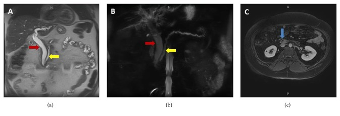
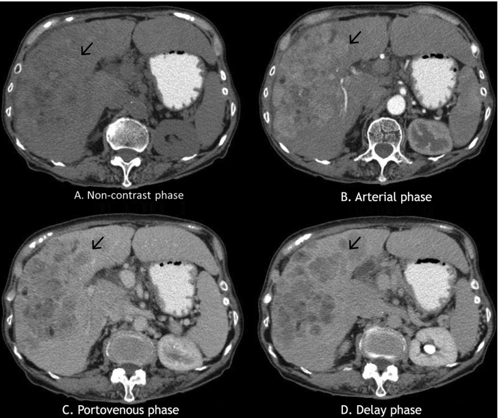
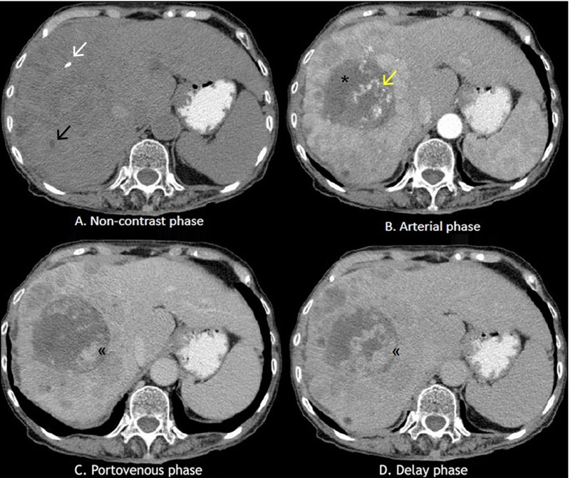
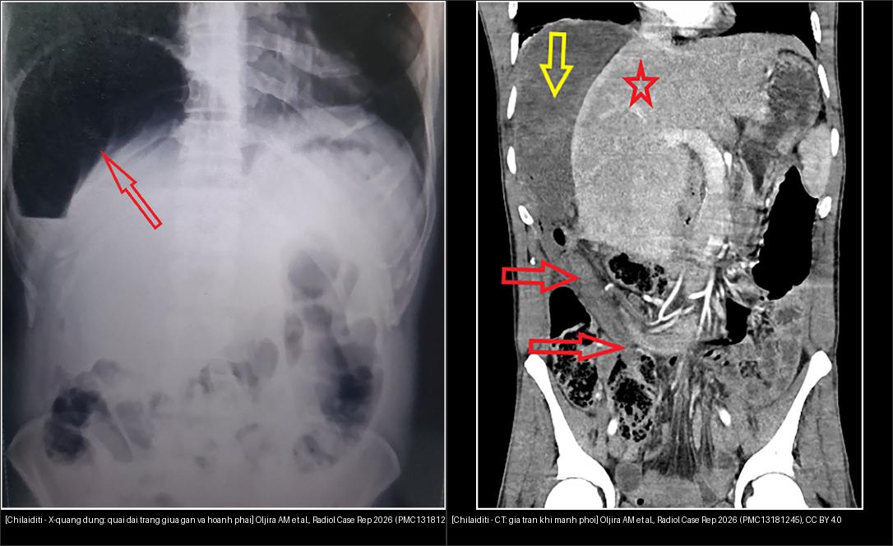

# 100 — Tổng quan hệ Bụng / Abdomen overview

**Tags:** `tong-quan`
**Mức chắc chắn (certainty):** tổng hợp y văn (literature synthesis).

## Bảng so sánh phân biệt bắt buộc (Hệ Bụng)
| Mẫu hình (pattern) | Vị trí (location) | Gamut chính (DDx) | Phân biệt nhanh (Chốt định lượng/động học) | Bài chi tiết |
|---|---|---|---|---|
| Khối ngấm thuốc mạnh thì ĐM (Hypervascular) | Gan (liver) | HCC, FNH, Adenoma, Hemangioma | Thải thuốc (washout) + vỏ = HCC; Sẹo T2 sáng ngấm muộn + giữ thuốc Primovist = FNH; Ngấm nốt ngoại vi hướng tâm = Hemangioma | `120`, `121`, `122` |
| Nang gan (một/nhiều) | Gan (nang) | Nang gan đơn thuần, PLD (ADPKD/ADPLD), bệnh Caroli, u mô đệm đường mật (von Meyenburg), di căn nang, **nang sán (CE1–CE5)**, MCN-L | Dịch thuần nhất + 0–15 HU + không ngấm = nang đơn thuần; **≥ 10 nang gan + nang thận = PLD**; **nốt < 1,5 cm T2 "trời sao" + không thông mật = von Meyenburg**; **giãn đường mật thông cây mật + central dot = Caroli**; **màng tách/nang con/vôi hóa vỏ = nang sán**; **vách ngấm + nữ trung niên + nang lớn = MCN-L** | `123`, `126`, `139`, `129` |
| **Nang gan NHIỄM TRÙNG** trong gan đa nang | Gan (nang) | Nhiễm trùng nang, xuất huyết nang, áp-xe gan, u hoại tử, viêm đường mật | **Sốt + CRP > 50 mg/L + ổ FDG trong nang = nhiễm trùng** (PET dương 96%; CT chỉ gợi ý 39%); **T1 sáng + không ngấm FDG = xuất huyết cũ**; **DWI sáng/ADC thấp = mủ**; kháng sinh **≥ 28 ngày** giảm tái phát (OR 0,12); **ở người ghép thận: ciprofloxacin 4,2% / trimethoprim 12,2% vào nang vs piperacillin 0,3%, chỉ 9% ca phải giảm IS (116)** | `104`, `116`, `157`, `164` |
| Khối giảm đậm độ / Ngấm thuốc viền (Hypovascular / Rim) | Gan | Di căn (đại-trực tràng, dạ dày), CCC đường mật, Áp-xe gan | Ngấm viền + thải ngoại vi + co kéo bao gan = CCC (LR-M); Dấu bia bắn đôi (double target) + sốt = Áp-xe | `120`, `121` |
| **Ổ giảm đậm độ trong gan CÓ KHÍ / VÁCH (áp-xe sinh mủ)** | Gan (chủ yếu thùy phải) ± TM gan/phổi/mắt | **Áp-xe do *K. pneumoniae* (hvKP)** vs áp-xe đường mật/ESBL vs áp-xe sinh khí vs **nhiễm trùng nang (104)** vs HCC hoại tử vs amíp vs nang sán bội nhiễm | **Bờ không đều 96,4% + trong không đồng nhất 89,2% + trung tâm giảm đậm độ MỌI thì = áp-xe** (u còn mô sống ngấm thì ĐM + thải thuốc); **khí → aOR tử vong 10,16**; **khuyết ngấm TM gan = thể xâm lấn → soi đáy mắt**; dẫn lưu **> 5 cm**, kháng sinh đơn thuần **< 3 cm** | `103`, `104`, `121`, `163`, `475` |
| Giãn đường mật / Dấu ống đôi (Double-duct) | Mật – Tụy | U đầu tụy (PDAC), U bóng Vater, U Klatskin, Sỏi OMC | Cắt cụt đột ngột ống mật + ống tụy (double-duct) = U đầu tụy; Giãn chỉ trong gan hợp lưu = Klatskin | `130`, `131`, `136` |
| Hẹp đường mật KHÔNG xác định (lành vs ác) | Mật (rốn/xa/lan tỏa) | Klatskin/CCA, PDAC, PSC, IgG4-SC, cholangiopathy sau mổ/ghép, eosinophilic cholangitis, AIP | Coi là ÁC (~70%) tới khi chứng minh ngược; thành ≥ 3 mm + ngấm mạnh + hạch > 1 cm + hẹp dài/bất đối xứng = ác; hẹp nhẵn liên tục + IgG4 ≥ 135 mg/dL + tổn thương nhiều tạng = IgG4-SC; nhiều đoạn bỏ nhảy + IBD = PSC | `132`, `131`, `136` |
| Hẹp đường mật SAU MỔ/GHÉP (lành) | Đường mật sau ghép gan | Hẹp miệng nối, cholangiopathy thiếu máu (tắc ĐM gan), tái phát PSC, tái phát u/PTLD, sỏi đường mật, rò/nang mật | 1 ổ tại miệng nối + bờ nhẵn thuôn = **miệng nối**; **nhiều ổ trong gan + tắc/hẹp ĐM gan + hoại tử quanh mật = cholangiopathy thiếu máu**; **khối/hạch ngấm mạnh = tái phát u/PTLD**; ổ dịch ngấm mật trên thì gan–mật = rò mật | `133`, `132`, `124`, `107` |
| Hẹp đường mật sau can thiệp NANG SÁN | Đường mật (vùng nang) | Xơ hóa do chất diệt đầu sán, hẹp do rò/mảnh màng, tái phát nang, CCA, PSC | **Tiền sử PAIR/mổ nang + hẹp khu trú + không khối = xơ hóa do chất diệt**; hẹp lan tỏa chuỗi hạt + IBD = PSC; khối + CA 19-9 tăng = CCA; kiểm tra thông mật–nang trước khi bơm chất diệt | `106`, `139`, `132`, `133` |
| **Rò mật sau mổ/ghép** (bile leak) | Đường mật – khoang mổ | Rò miệng nối, rò ống túi mật, rò sau cắt gan, tụ dịch không thông, rò do stent | **Tụ dịch T2 sáng KHÔNG chứng minh rò**; **thuốc gadoxetic tràn vào tụ dịch ở 60–180 phút = rò hoạt động** (Se 96,4%, Sp 100% khi đủ 3 mốc); **không thấy thuốc ở 20–25 phút chưa loại trừ** (Se chỉ 42,9%) | `107`, `108`, `133`, `137` |
| Giãn đường mật TRONG GAN khu trú ± sỏi | Đường mật trong gan | Sỏi trong gan (hepatolithiasis/RPC), bệnh Caroli, clonorchiasis, PSC (chuỗi hạt), IPNB, iCCA, HCC xâm lấn ống (BDTT) | Sỏi tăng đậm độ CT + T2 tối trong ống giãn = **sỏi trong gan**; **giãn nang thông với cây mật + central dot = Caroli**; **khối NGẤM trong lòng ống + giãn không tương xứng = IPNB**; teo thùy + khối ngấm = iCCA; sỏi trong gan lâu năm → **nguy cơ iCCA**; **nang lớn vách ngấm không thông mật = MCN-L**; **giãn ống nhỏ ngoại vi + khuyết lòng ống dạng sợi KHÔNG ngấm thuốc + vùng ăn cá sống = sán lá gan nhỏ**; **Caroli/CHF + khối đặc/vách dày mới + CA 19-9 tăng = iCCA (LR-M)** | `138`, `128`, `123`, `131`, `132`, `129`, `173` |
| **Ống mật "giả giãn" sau can thiệp u gan** | Đường mật trong gan sau TACE/TARE/RFA | Hoại tử ống mật (BDN)/cholangiopathy thiếu máu, giãn ống thật do tắc, huyết khối TM cửa, nang quanh ống mật, Caroli, biloma dạng phân nhánh | **CT thấy "ống giãn" nhưng siêu âm/MRCP KHÔNG giãn thật = BDN**; **ống giãn thuôn ngoại vi + thấy nguyên nhân tắc = giãn thật**; **cavernous transformation + ngấm bàng hệ = huyết khối cửa**; **nối với ổ dịch + sau TACE = biloma**; **ALP > 200 U/L ở 76,2%** ca tổn thương đường mật; **biloma 20–65% có triệu chứng, tử vong 5–10%** | `179`, `930`, `133`, `137` |
| **Thành túi mật dày sau can thiệp gan** | Túi mật – động mạch túi mật | Viêm túi mật thiếu máu sau TACE, viêm túi mật do xạ sau TARE, viêm túi mật do sỏi, phù thành do xơ gan/suy tim, hoại tử/thủng, ung thư túi mật, adenomyomatosis | **Vật liệu tắc trong thành trên CBCT sau TACE + thành ≥ 4 mm + thâm nhiễm mỡ = viêm túi mật thiếu máu** (10% nhóm có lipiodol trong thành cần can thiệp; catheter trực tiếp ĐM túi mật OR 52); **dày thành đều, KHÔNG thâm nhiễm mỡ, có cổ trướng = phù thành do xơ gan**; **mất ngấm thành/khí/màng trong lòng = hoại tử, dẫn lưu ngay**; **lipiodol trong thành đơn thuần tự rửa trôi 1–2 tháng** | `180`, `179`, `130`, `102` |
| **Loét dạ dày–tá tràng MỚI sau TACE/TARE** | Dạ dày – tá tràng (theo nhánh ĐM: vị phải, GDA, vị trái/phụ) | Loét do xạ (TARE), loét thiếu máu do hạt/thuốc (TACE/DEB), loét H. pylori/NSAID, loét ác tính do u xâm lấn, viêm tụy do trào ngược, hội chứng sau can thiệp | **Loét muộn 1–12 tháng sau TARE + đau dai dẳng dù PPI = loét do xạ** (1,9–3,2%; **6%** phải mổ); **loét 3 ngày–4 tuần sau TACE = thiếu máu** (biến chứng ĐM gộp 1,1–7,2%, **62% < 72 giờ**); **coil GDA/vị phải KHÔNG bảo đảm**; chốt bằng **vi cầu trong mô bệnh** | `1811` |
| **Suy gan + cổ trướng MỚI sau TARE** | Gan – nhu mô không u (non-tumoral liver) | REILD (Sangro), tiến triển u, tắc mật sau xạ, nhiễm trùng, SOS do hóa chất, suy tim phải/PVT, hội chứng sau thuyên tắc | **Bilirubin > 3 mg/dL + cổ trướng trong 4–8 tuần, không u sống/không giãn ống mật = REILD** (1,0–5,4%; **60,6% khi TARE cả gan một lần**; sống 5,2 vs 22,1 tháng); **nốt ngấm mạnh thì ĐM mới = tiến triển**; **giãn ống mật = tắc mật**; **sốt/đau 7 ngày đầu tự hết = hội chứng sau thuyên tắc** | `1801`, `179`, `124`, `121`, `127` |
| **Khuyết lòng DÀI trong ống mật** | Đường mật (lòng ống) | Giun đũa đường mật, sỏi OMC, cục máu đông (hemobilia), khí đường mật sau cắt cơ Oddi, IPNB/u nhú, stent nhựa | **Khuyết lòng dài–trơn–không bóng lưng–CỬ ĐỘNG (hoặc đổi vị trí giữa 2 lần MRCP) = giun**; **bóng lưng + bờ rõ = sỏi**; **bám thành, không di động, ống giãn không tương xứng = IPNB**; **rất sáng trên CT, không thấy trên MRCP = khí**; **tiền sử can thiệp + thay đổi nhanh vài ngày = máu đông** | `174`, `138`, `129`, `131` |
| Tăng áp lực cửa nhưng chức năng gan còn tốt | Gan & hệ cửa | Xơ hóa gan bẩm sinh (CHF), hội chứng Caroli, PSVD, sán máng, huyết khối tĩnh mạch cửa, tắc tĩnh mạch lách, xơ gan sớm | **Varices + lách to + tiểu cầu thấp nhưng bilirubin/albumin/INR còn tốt = tăng áp cửa trước xoang**; **HVPG thường bình thường (chỉ ~30% > 10 mmHg)**; **Caroli: túi giãn thông mật + central dot**; **CHF: xơ khoảng cửa + ống mật bất thường, kiến trúc tiểu thùy còn nguyên**; CSLD khi varices cần can thiệp + tiểu cầu < 150, có cholangitis hoặc LSM > 15 kPa | `149`, `166`, `127`, `124`, `176` |
| **Gan ứ huyết ngoại vi + hạch đuôi sáng ("flip-flop")** | Gan – tĩnh mạch gan & TM chủ dưới | Budd–Chiari (nguyên phát/thứ phát), xơ gan, gan tim, SOS/VOD, huyết khối TM cửa | **Ngoại vi giảm ngấm + trung tâm/hạch đuôi tăng ngấm + KHÔNG thấy TM gan = BCS** (hạch đuôi to ~50%; TM hạch đuôi > 3 mm; US dấu trực tiếp + hạch đuôi to Sp 100%); **IVC + TM gan giãn + reflux = gan tim**; **TM gan thông + nốt/bờ gồ ghề = xơ gan**; **không huyết khối lớn + bối cảnh hóa trị = SOS** | `1901`, `127`, `149` |
| **T1 sáng đối xứng hạch nền (globus pallidus)** | Não – hạch nền (neurohepatology) | Bệnh não gan/HE thể ẩn, bệnh não–não mắc phải (AHD), TPN dài hạn, gadolinium tích lũy, ngộ độc mangan; dementia (SI thường GIẢM) | **T1 sáng + T2 KHÔNG sáng + bối cảnh xơ gan/shunt = mangan** (SI ≥ 0,994; Se 80%/Sp 90,9%; 12,5% xơ gan không HE vẫn vượt ngưỡng); **MRI cấu trúc bình thường KHÔNG loại trừ CHE** — chốt bằng PHES < −4 / S-ANT1 < 20; **thể tích gan LV/BSA < 620 mL/m² → CHE cao 2,9 lần** | `1902`, `188`, `183` |
| **Giãn tĩnh mạch ĐÁY VỊ (GV): chọn BRTO hay TIPS?** | Dạ dày – đáy vị & shunt cửa–chủ | GOV1/GOV2/IGV1/IGV2; GRS (80–85%), LIPV (10–15%), PCV (~5%) | **Có shunt dạ dày–thận lớn + BRTV đầy túi giãn (Hirota 1–2) = BRTO** (thành công 97,3%, tắc hoàn toàn ngày 90 93%); **không có nhánh thoát (Kiyosue D) hoặc cần hạ áp toàn hệ = TIPS**; **tăng áp cửa TRÁI do tắc TM lách + gan bình thường = nút keo xuyên lách/cắt lách**; **đang chảy ồ ạt = cầm máu tạm trước** (bịt đường thoát làm tăng áp trong túi giãn) | `181`, `176`, `146`, `149` |
| **Bệnh nhân XẤU ĐI trong 30 ngày sau TIPS** | Gan – đường mật – màng bụng – tim | Hemoperitoneum (thủng bao gan), hemobilia, suy gan tiến triển nhanh, suy đa cơ quan/suy tim cung lượng cao, endotipsitis, stent sai vị trí | **24 giờ đầu tụt HA + dịch ổ bụng 35–70 HU = máu (không phải báng < 20 HU)**; **nôn máu + vàng da + khối tăng đậm độ trong OMC = hemobilia**; **sốt + cấy máu dương + FDG trong stent = endotipsitis**; **bilirubin ≥ 3 lần/INR ≥ 2 lần trong 30 ngày = suy gan tiến triển nhanh**; biến chứng nặng 3,2%, tử vong 0,84% (948 ca) | `182`, `176`, `127`, `105` |
| Sau khi đặt stent/dẫn lưu đường mật — theo dõi | Đường mật & stent (biliary tree & stents) | Tắc stent (cặn bùn), u mọc xuyên/phủ qua đầu, di trú stent (gần/xa), thủng tá tràng sau phúc mạc, viêm đường mật tái phát (MDRO) | **Khuyết KHÔNG ngấm trong lòng stent = cặn bùn**; **khối ngấm lấp lòng = u mọc xuyên/phủ**; **đầu stent tụt + thấy stent ở tá tràng/dạ dày/gan = di trú**; **khí ngoài lòng quanh D2–D3 = thủng sau phúc mạc**; **kháng sinh < 7 ngày → tái phát 50% vs 33%** | `137`, `131`, `133` |
| **Vàng da tắc mật: có chỉ định dẫn lưu TRƯỚC mổ không?** | Đường mật – đầu tụy (biliary – pancreatic head) | Tắc xa do u (PBD qua ERCP), tắc rốn gan (PTBD/EUS-BD, chỉ dẫn lưu FLR), sỏi OMC (ERCP lấy sỏi), viêm đường mật cấp | **TB ≥ 15 mg/dL (≥ 14,6 mg/dL = yếu tố tiên lượng tử vong 90 ngày) + cholangitis/albumin < 3 g/dL/mổ hoãn/tân bổ trợ → DẪN LƯU**, đích **TB < 8,9 mg/dL**; **vàng da 10–15 mg/dL không biến chứng → mổ thẳng** (PBD tăng SSI 70,8% vs 18,7%, cấy mật dương 75% vs 25%, biến chứng nặng RR 1,65) | `925`, `102`, `137`, `910`, `131` |
| Quai **tịt đầu** giãn + thâm nhiễm mỡ hố chậu phải | Hố chậu phải – ruột thừa | Viêm ruột thừa cấp (đơn thuần/phức tạp) vs viêm túi thừa ruột thừa vs viêm mào mỡ vs sỏi niệu quản vs PID/TOA vs mucocele | **> 6 mm + thâm nhiễm mỡ + ngấm thành = viêm cấp**; **khí ngoài lòng/áp-xe/appendicolith ngoài lòng/mất ngấm thành = phức tạp**; **giãn > 15 mm + vôi hóa + KHÔNG thâm nhiễm = mucocele**; **nốt mỡ viền mảnh, không có quai giãn = viêm mào mỡ**; **khí trong lòng gặp 31% ca viêm — không loại trừ**; **thiếu dấu phụ → xác suất ~2%** | `161`, `134`, `160`, `165` |
| **Áp-xe ruột thừa ở thai phụ** | Hố chậu phải – ruột thừa (đã di chuyển theo tuổi thai) | Áp-xe ruột thừa · đám quánh · thai ngoài tử cung · xoắn phần phụ · u bì biến chứng · ứ nước thận phải | **Ổ > 40 mm + WBC không giảm sau 24 giờ = nguy cơ chuyển mổ**; **bảo tồn thất bại ~30%, đã đặt dẫn lưu vẫn mổ 25,4%**; **MRI Se 92%/Sp 98%**; **ERAT khi dẫn lưu qua da thất bại** | `109` |
| Giãn quai ruột / Thâm nhiễm mỡ khu trú | Ống tiêu hóa (GI) | Viêm ruột thừa, Viêm túi thừa, Tắc ruột non (SBO), Tắc quai kín | Ruột thừa > 6 mm; Ruột non > 3 cm; Xoắn mạch (whirl) + chữ C + mất ngấm thành = Tắc quai kín thiếu máu (mổ tối khẩn) | `160`, `162` |
| Nang & Ổ dịch quanh tụy | Tụy (pancreas) | Tụ dịch cấp quanh tụy (APFC), tụ dịch hoại tử cấp (ANC), nang giả tụy, hoại tử có vỏ (WON), u nhầy nhú nội ống tụy (IPMN), u nang thanh dịch (SCN), u nang nhầy (MCN) | < 4 tuần vs ≥ 4 tuần + có hoại tử hay không (Atlanta 2012); Thông ống tụy chính = IPMN | `135`, `136` |
| Gan ứ trệ mạch máu (vào–xoang–ra) | Gan & mạch cửa | **Gan tim (cardiac hepatopathy)**, Budd-Chiari (tắc dòng RA), SOS/VOD (tắc XOANG), huyết khối tĩnh mạch cửa/PVTT/khi TM cửa (tắc dòng VÀO) | **Thùy đuôi to giữ ngấm + không thấy TM gan = Budd-Chiari**; **TM gan giãn + còn dòng + CVP cao = gan tim**; **sau ghép < 21 ngày + tăng cân > 5% + không giãn đường mật = SOS**; **ngấm mạch + phì đại mạch + mật độ iod ≥ 0,9–1,14 mg/mL = PVTT** | `127`, `124`, `121` |
| **Khó thở + giảm oxy ở bệnh nhân xơ gan (HPS vs PoPH)** | Gan – tuần hoàn phổi (liver – pulmonary circulation) | HPS (giãn mạch, shunt phải–trái), PoPH (co mạch/tái cấu trúc), tràn dịch màng phổi do gan, thuyên tắc phổi, shunt trong tim (PFO/ASD), Abernethy | **PaO₂ < 80 + A–a ≥ 15 mmHg (≥ 20 nếu > 64 tuổi) + bọt ở tim trái sau ≥ 3 chu chuyển (hoặc MAA não > 6%) = HPS**; **bọt < 3 chu chuyển = shunt trong tim**; **mPAP > 20 + PVR ≥ 2 WU + PAWP ≤ 15 trên thông tim = PoPH** (RVSP > 50 trên siêu âm: ~1/3 có PVR bình thường); **mPAP ≥ 45 = chống chỉ định ghép** | `186`, `070`, `127`, `149` |
| Vạt nội mạc / liềm tăng tỷ trọng thành ĐMC bụng | ĐMC bụng (abdominal aorta) | Bóc tách ĐMC bụng đơn độc (IAAD), IMH, PAU, huyết khối thành trong phình, viêm ĐMC, vỡ phình | **Vạt nội mạc + hai lòng = bóc tách**; **liềm tăng tỷ trọng 5–15 mm trên không cản quang + không ngấm = IMH**; **ổ loét đối quang sâu > 20 mm = PAU nguy cơ cao**; **di lệch vôi hóa nội mạc 78% ca IAAD**; can thiệp khi **≥ 50–55 mm, malperfusion hoặc vỡ** | `171`, `1807`, `170`, `070` |
| Theo dõi sau can thiệp bóc tách ĐMC bụng | ĐMC bụng (abdominal aorta) | Endoleak I–V, Hẹp/tắc nhánh tạng, Lòng giả còn thông/giãn, Di trú/gãy stent, Nhiễm trùng graft/rò chủ–ruột | **Túi tăng ≥ 5 mm = tăng có ý nghĩa**; **type I/III → can thiệp; type II → chỉ can thiệp khi túi tăng**; **FEVAR: mất nhánh 9,9% ở 5 năm, can thiệp lại 37,2%**; **type II dai dẳng: vỡ/tử vong do phình ~2% ở 10 năm**; **CTA 3 pha (muộn 70–120 giây) + 30 ngày rồi 12 tháng/lần** | `172`, `171`, `840` |
| Sốt + huyết khối trong hệ cửa–mạc treo | Gan & mạch cửa/mạc treo | Pylephlebitis (huyết khối mủ), huyết khối lành, huyết khối u, MVT, khí tĩnh mạch cửa, áp-xe gan | **Sốt + đau bụng + khuyết thuốc cửa + ổ nhiễm (ruột thừa/túi thừa/viêm tụy) = pylephlebitis**; **khuyết thuốc SMV + phù mạc treo "lược" = MVT**; **không sốt, không ngấm thành mạch = huyết khối lành**; **khí ra ngoại vi tới dưới bao gan = khí TM cửa, không phải huyết khối** | `163`, `124`, `135` |
| **Khuyết thuốc trong tĩnh mạch lách ± nhồi máu lách** | Lách – tĩnh mạch lách – tụy | Huyết khối lành sau viêm tụy, huyết khối u (PDAC thân/đuôi), huyết khối mủ, mõm cụt sau mổ, tăng đông (MPN), nhồi máu lách, rách lách, áp-xe lách | **Viêm tụy + khuyết thuốc + tụy bệnh lý = huyết khối lành (tái thông 46% khi chống đông vs 15%)**; **mạch giãn + mô ngấm trong lòng = huyết khối u**; **nêm giảm đậm độ đáy ở vỏ = nhồi máu (CT 100% vs siêu âm 29,9%)**; **khí trong ổ + thành ngấm = áp-xe** | `146`, `135`, `163`, `140` |
| **Hố lách trống + khối di động + dấu xoáy** | Lách – cuống lách (spleen – splenic pedicle) | Lách lạc chỗ/xoắn cuống, nhồi máu lách do thuyên tắc, splenosis/đa lách, tự cắt lách (hồng cầu liềm), khối phần phụ, xoắn dạ dày | **Hố lách trống + khối giống lách + dấu xoáy cuống = lách lạc chỗ xoắn**; **lách 49 HU (24–64) so với gan 92 HU thì TM cửa = nhồi máu**; **động mạch còn ngấm nhưng tĩnh mạch không đọng thuốc = tắc TM trước ĐM**; **< 0,2% ca cắt lách**; còn ngấm → splenopexy, mất ngấm → cắt lách | `119`, `146`, `140`, `160` |
| **Sốt > 3 tuần không rõ ổ (FUO) + tổn thương trong bụng** | Đa khoang (gan–mật, hồi manh tràng, sau phúc mạc, tiểu khung) | Áp-xe gan, lao phúc mạc/hồi manh tràng, Crohn, áp-xe cơ thắt lưng chậu, nhiễm endograft ĐMC, lymphoma, di căn giả áp-xe | **Siêu âm 86% → CT bụng 92% → PET/CT (dương thật 47,9%)**; **nhiều ổ nhỏ 2–5 mm + giảm bạch cầu = nấm**; **"áp-xe" không đáp ứng kháng sinh + khối tụy = di căn**; **PET âm không loại trừ (âm giả 19%)** | `147`, `163`, `161`, `141` |
| **Đái máu đại thể khó cầm sau xạ trị khung chậu (bàng quang co nhỏ, thành dày đều)** | Bàng quang – mạch chậu trong (bladder, internal iliac) | Viêm bàng quang xạ · u niệu mạc thứ phát · máu cục · viêm bàng quang do cyclophosphamide · **rò động mạch chậu – niệu quản** | **Thành dày đều + giãn mạch trên nội soi + không khối = viêm xạ**; **máu cục 50–70 HU không ngấm, đổi hình theo tư thế**; **khối ngấm thuốc/hạn chế khuếch tán = u** (bài 1608); **nút mạch bàng quang: kỹ thuật 100%, lâm sàng 85–90%, Hb 7,8 → 12,2 g/dL, tái phát 18,7%**; **alum 1% 66–100% · formalin 89% nhưng 31% biến chứng nặng · HBOT 60–92%** | `1633`, `582`, `1608`, `910` |
| **Sỏi đường niệu trên ở bàng quang thần kinh / sỏi thận ghép** | Thận – niệu quản – bể chuyển lưu (kidney, ureter, diversion) | Sỏi nhiễm trùng (struvite/sanh hoa) · sỏi calci · sỏi acid uric · đóng vôi stent · canxi hóa mạch chậu · sỏi bàng quang | **Sỏi san hô đúc khuôn + nước tiểu kiềm = struvite**; **thận ghép KHÔNG đau → tăng creatinin/tiểu máu là tín hiệu**; **sỏi ghép 1,4% (128/8.835), 6,2 năm, 5,7 mm; theo dõi < 5 mm, PCNL > 2 cm**; **URS ở bàng quang thần kinh: nhiễm trùng sau mổ 33,3% vs 4,0%**; **đóng vôi stent: vỏ cản quang toàn chu vi = phải lấy sỏi + thay stent** | `190`, `189`, `152`, `691` |
| Nang thận phức tạp | Thận (kidney) | Bosniak I, II, IIF, III, IV | Ngấm thuốc thật = tăng ≥ 20 HU; Vách dày ≥ 4 mm = Bosniak III; Nốt đặc ngấm thuốc = Bosniak IV | `150` |
| Nang thận phức tạp trong ADPKD | Thận (kidney) | Nang xuất huyết, nang nhiễm trùng, RCC, sỏi, Wunderlich/Page kidney | **T1 sáng 30–100 HU không ngấm + không tăng thể tích = xuất huyết cũ**; **sốt + CRP > 15 mg/dL + thành dày/viêm mỡ = nhiễm trùng** (PET/CT Se 84,6%); **máu tụ quanh thận + Hb giảm = Wunderlich → CTA/TAE** | `164`, `157`, `150` |
| U thận đặc | Thận | ccRCC, pRCC, chRCC, oncocytoma, AML | Mỡ đại thể −10 đến −100 HU = AML; T2W sáng + mỡ vi thể + ngấm mạnh rồi thải = ccRCC (ccLS ≥ 4); T2W tối đồng nhất + ngấm kém = pRCC; sẹo trung tâm KHÔNG đặc hiệu | `151` |
| Nang thận trên thận teo (bệnh nhân lọc máu) | Thận | ACKD, ACD-RCC, nang phức tạp (Bosniak) | ≥3 nang/thận + thận nhỏ (~81–85 mm) + đang lọc máu = ACKD; **nốt đặc ngấm trong nền nang** = ACD-RCC (nguy cơ RCC ×100); thận khổng lồ + nang gan = ADPKD | `153` |
| Thận đa nang hai bên (to) | Thận & Gan | ADPKD, ARPKD/CHF, TSC, VHL, HNF1B, nephronophthisis, ACKD, nang đơn thuần nhiều ổ | **≥ 3 nang (15–39t)/≥ 2 nang mỗi thận (40–59t)/≥ 4 (≥ 60t)** + tiền sử gia đình = ADPKD; **thận to tăng âm vi nang ở trẻ + xơ gan (CHF)** = ARPKD; **báo htTKV + phân độ Mayo 1A–1E** (1C–1E = tiến triển nhanh → cân nhắc tolvaptan) | `157`, `123`, `156` |
| Sau cắt thận/điều trị RCC — theo dõi tái phát | Thận & di căn (phổi/xương/não/gan) | Tái phát tại chỗ (giường thận), di căn phổi, di căn xương tiêu xương, di căn não, di căn tạng/phúc mạc | **Nốt ngấm mới/tăng kích thước so phim cũ** ở giường thận = tái phát; **di căn xương T1 thấp + tiêu xương + ngấm**; **RECIST 1.1: PD = +20% VÀ +5 mm**; ~30% tái phát sau điều trị triệt căn | `154`, `151` |
| U thận HAI BÊN/đa ổ ở người trẻ | Thận | Hội chứng di truyền: VHL, BHD, HLRCC, TSC, SDH | Mỡ đại thể (−10 đến −100 HU) = AML (TSC); nang phổi đáy + tràn khí tự phát = BHD; u cơ trơn da/tử cung + RCC nhú typ 2 = HLRCC; u mạch máu TKTW + pheo + nang tụy = VHL; RCC + PGL/pheo/GIST = SDH | `156` |
| Khối tuyến thượng thận tình cờ | Thượng thận (adrenal) | Adenoma giàu/nghèo mỡ, u tủy thượng thận (pheochromocytoma), di căn, ung thư vỏ thượng thận (ACC) | Không tiêm ≤ 10 HU = Adenoma giàu mỡ; > 10 HU nhưng thải thuốc APW ≥ 60% / RPW ≥ 40% ở 15 phút = Adenoma nghèo mỡ | `155` |
| Khối ngấm mạnh thượng thận/cạnh ĐMC (u tủy thượng thận & u cận hạch) | Thượng thận & hạch cận giao cảm (đầu-cổ, bàng quang, cạnh ĐMC) | Pheochromocytoma, PGL giao cảm (Zuckerkandl), PGL bàng quang, PGL thân cảnh, di căn, adenoma nghèo mỡ | **Ngấm mạnh thì ĐM + T2 "bóng đèn" + không tụt tín hiệu fat-sat = pheo/PGL** (thải thuốc "chuẩn adenoma" KHÔNG loại trừ); **cơn THA khi đi tiểu + khối dưới niêm mạc bàng quang = PGL bàng quang**; **tách chạc ba cảnh = PGL thân cảnh**; **metanephrine + alpha-block trước mọi can thiệp** | `168`, `155`, `156` |
| Biến chứng tim mạch của pheochromocytoma (bệnh cơ tim do catecholamine/takotsubo) | Tim & thượng thận | Takotsubo (đỉnh/đảo ngược), viêm cơ tim, ACS, thuyên tắc phổi, bóc tách ĐMC, sốc nhiễm khuẩn | **Mạch vành sạch + rối loạn vận động vùng + metanephrine tăng = takotsubo do pheo**; biến chứng tới **68%**, sốc tim **37,7%**, tử vong PMC **13,8%**; **chẹn alpha trước, beta sau** | `167`, `168`, `177` |
| Điều trị & theo dõi PPGL | Thượng thận & cận hạch | Mổ triệt căn, bảo tồn vỏ, alpha-block ± metyrosine, PRRT, ¹³¹I-MIBG, CVD, temozolomide, TKI, belzutifan | **Alpha-block 7–14 ngày, đích ngồi < 130/80; mổ nội soi ≤ 6 cm; tái phát 14,7–47,5%; theo dõi ≥ 10 năm** | `177`, `168`, `169` |
| Biến chứng THẦN KINH của pheochromocytoma (PRES, RCVS, đột quỵ, xuất huyết não) | Não & thượng thận | PRES (phù mạch, hồi phục), PRES trung tâm, RCVS (co mạch từng đoạn), nhồi máu vùng phân thủy, xuất huyết não do THA, TMA do THA ác tính | **Phù mạch: DWI âm/ADC CAO + hồi phục sau hạ áp; nhồi máu: ADC THẤP**; **SWI bắt buộc** (vi chảy máu chỉ thấy trên SWI); **PRES trung tâm 18,4% ở thân não**; **mổ sau đột quỵ ≥ 6 tuần + ≥ 2 tuần hạ HA tư thế**; không bao giờ chẹn beta đơn thuần | `184`, `167`, `177` |
| Độc tính sau PRRT/¹³¹I-MIBG ở PPGL | Thượng thận, tủy xương, thận, tim mạch | Cơn catecholamine (17–18% độ ≥ 3), suy tủy (thiếu máu/giảm tiểu cầu/giảm lympho), độc thận, tMN/MDS–AML 2–6%, suy giáp sau MIBG | **Độc tính theo 3 đồng hồ: cấp ≤ 48 giờ, bán cấp 4–6 tuần, mạn > 1 năm**; **HA tâm thu > 200 mmHg dù đã điều trị → ICU**; **thận ≤ 23 Gy, tủy < 2 Gy/chu kỳ**; CBC mỗi 2–4 tuần, creatinin/eGFR hằng năm | `185`, `177`, `184` |
| Ung thư vỏ thượng thận (ACC) ở TRẺ: nam hóa/Cushing, phân giai đoạn COG & mitotane | Thượng thận (adrenal, nhi) | ACC (Wieneke 1–3), u tuyến vỏ thượng thận, tăng sản thượng thận bẩm sinh (CAH), pheochromocytoma, neuroblastoma, Wilms | **Khối lớn không đồng nhất + hoại tử + nam hóa/Cushing + DHEA-S/testosteron tăng, ACTH thấp = ACC**; **ACC trung bình 9,9 cm vs adenoma 4,4 cm (AUC 0,92); không đồng nhất OR 45,5**; **u 3,2 cm vẫn là ACC**; **Weiss gọi quá mức ở trẻ → dùng Wieneke**; R0 là trụ cột | `193`, `155`, `169`, `198` |
| **Khối gan giả u: vi nang + vôi hóa + KHÔNG ngấm thuốc** | Gan (liver) – rốn gan | Sán thể hang (AE) · nang sán dạng nang (CE) · iCCA · di căn niêm dịch · u máu xơ hóa · áp-xe xơ hóa | **Vi nang T2 sáng trong nền xơ tối + vôi hóa rải rác + trung tâm không ngấm (≈27,7 HU giai đoạn sớm) = AE**; **vỏ xơ rõ + vôi hóa vỏ = CE (PAIR được, AE thì KHÔNG)**; **ngấm thuốc tiến triển + xâm lấn đường mật = iCCA**; vôi hóa không đồng nghĩa bất hoạt; PET âm ≠ ký sinh chết | `144`, `139`, `121`, `173` |
| Tổn thương khu trú tiền liệt tuyến (PI-RADS v2.1) | Tiền liệt tuyến (prostate) | Ung thư có ý nghĩa lâm sàng (csPCa), viêm, BPH, vùng trung tâm (CZ) | PZ đọc DWI/ADC (b ≥ 1.400), TZ đọc T2W (vỏ bao); 1,5 cm tách 4/5; DCE chỉ nâng 3→4 ở PZ; PI-RADS 3 + PSAD ≥ 0,15 = sinh thiết; ria mép CZ đối xứng = bình thường | `158` |
| Giãn quai ruột / Thâm nhiễm mỡ khu trú | Ống tiêu hóa (GI) | Viêm ruột thừa, Viêm túi thừa, Tắc ruột non (SBO), Tắc quai kín | Ruột thừa > 6 mm; Ruột non > 3 cm; Xoắn mạch (whirl) + chữ C + mất ngấm thành = Tắc quai kín thiếu máu (mổ tối khẩn) | `160`, `162` |
| Dịch tự do ổ bụng vs Đáy ngực | Phúc mạc (peritoneum) | Cổ trướng (Ascites) vs Tràn dịch màng phổi | Dịch màng phổi đẩy chân cơ hoành ra trước (displaced crus) và len vào vùng trần của gan (bare area); Ascites thì không | `110`, `141` |
| Dịch báng **đục như sữa** | Phúc mạc – hệ bạch huyết ổ bụng | Dưỡng trấp ổ bụng (sau nạo hạch/cắt tụy/ghép gan, lymphoma, lao, xơ gan), báng xơ gan, báng ác tính, báng tụy/mật/niệu | **TG dịch > 200 mg/dL (hỗ trợ), > 110 mg/dL (ngưỡng nghiên cứu), < 50 mg/dL loại trừ + lympho ưu thế + SAAG < 1,1 = dưỡng trấp**; **amylase rất cao = báng tụy**; **creatinine dịch cao = báng niệu**; CT **không** đặc hiệu | `078`, `040`, `079` |
| Nốt đặc phúc mạc/mạc nối không xác định (indeterminate peritoneal nodule) | Phúc mạc – mạc nối – túi cùng (peritoneum/omentum/pouch of Douglas) | Splenosis · lao phúc mạc · di căn/carcinomatosis · LPD · peritoneal loose body · nhồi máu mạc nối · lạc nội mạc | **Tiền sử vỡ/cắt lách + nốt 0,8–2,5 cm ngấm như lách → Tc-99m HDRBC (không sinh thiết)**; **vôi hóa trung tâm “vỏ trứng” + di động = loose body**; **PCI ≤ 20 dự báo cắt u tối ưu (AUC 0,94)**; **CA-125 cao KHÔNG loại trừ lao (ADA 30–40 U/L)** | `549`, `141`, `539`, `518` |
| **Dày phúc mạc dạng mảng/nốt + dịch khu trú** | Phúc mạc – mạc nối (peritoneum/omentum) | MPM · carcinomatosis (dạ dày/buồng trứng/đại tràng) · PMP · lao phúc mạc · WDPM · splenosis | **Dịch khu trú + mảng canxi không khối + không ổ nguyên phát = nghĩ MPM/WDPM**; **omental cake + khối nguyên phát = carcinomatosis**; **BAP1 mất + p16/CDKN2A mất = ác tính**; **CT bỏ sót nốt < 1 cm (Se 9,1–50%)** | `143`, `549`, `141`, `539` |
| **Tổn thương phúc mạc MỚI sau CRS/HIPEC** | Phúc mạc – mạc nối – mạc treo | Tái phát carcinosis · xơ/dính hậu phẫu · xơ hóa sau PIPAC · biến chứng (áp-xe, rò, tắc ruột) | **Phải so PHIM NỀN chụp 3 tháng sau mổ**: tổn thương **mới/tăng** = tái phát; **ổn định, bờ không lồi** = xơ. Đáp ứng PIPAC **chỉ** chấm bằng **PRGS** trên sinh thiết 4 góc (trung bình ≤ 2 = đáp ứng lớn), **không** bằng CT/RECIST | `1903`, `143`, `141` |
| **Khí/dịch quanh mảnh ghép ĐMC sau EVAR** | Động mạch chủ bụng – mảnh ghép nội mạch (aorta, endograft) | Thay đổi lành sau EVAR · nhiễm mảnh ghép · endoleak type I–III · máu tụ/seroma · rò động mạch–ruột | **Khí ≥ 7 tuần HOẶC dịch ≥ 3 tháng sau EVAR = tiêu chuẩn MAGIC chính**; **khí/dịch TĂNG dần dù kháng sinh + giả phình miệng nối = nhiễm, phải lấy mảnh ghép**; **ngấm FDG đều dọc thành = phản ứng lành**, khu trú mới nghi (PET Se 91%/Sp 72%) | `148`, `170`, `171`, `172`, `147` |

## Ảnh minh họa & Blind Quiz (đọc nhanh 4 mẫu hình chủ chốt)
> Ảnh trơn ở ngoài, dấu hiệu + chẩn đoán giấu trong thẻ bấm-mở. Mở trên Pages: tự đoán trước rồi bấm mở đáp án.

**Ca 1 — BN vàng da tắc mật, MRI/MRCP:**

- Câu hỏi: Hai ống nào giãn? Đường kính? Nghĩ nhóm bệnh nào? Bước tiếp theo?

<b>Bấm để hiện đáp án (findings + chẩn đoán)</b>

- **Dấu hiệu:** giãn đường mật trong gan + **ống mật chủ 1,5 cm** + **ống tụy đầu tụy 0,6 cm** cắt cụt cùng chỗ → **dấu ống đôi (double-duct sign)**; không thấy khối lấp lòng.
- **Chẩn đoán (ca gốc):** u thần kinh nội tiết bóng Vater (somatostatinoma) — nhưng **dấu ống đôi là mẫu hình, không phải chẩn đoán**: gamut gồm **u đầu tụy, u bóng Vater, sỏi OMC, viêm tụy, u thần kinh nội tiết, Lemmel (túi thừa cạnh bóng)**. Bước tiếp theo: **EUS + sinh thiết/f NA**, MRCP; nếu không thấy u vẫn phải theo dõi.
- Nguồn: **Zakaria A et al.**, Case Rep Gastrointest Med 2019 (PMC6532322), CC BY 4.0.

**Ca 2 — BN xơ gan, CT 4 thì (không cản quang → ĐM → TM cửa → muộn):**

- Câu hỏi: Tổn thương ở phân thùy nào? Động học bắt thuốc? Chẩn đoán theo LI-RADS?

<b>Bấm để hiện đáp án</b>

- **Dấu hiệu:** khối **ngấm mạnh KHÔNG đồng nhất thì ĐM** (B) rồi **thải thuốc (washout) thì TM cửa (C) và thì muộn (D)** — điển hình **HCC**.
- **Chẩn đoán:** **ung thư biểu mô tế bào gan (HCC)** — nền xơ gan → ngấm-ĐM + thải = **LI-RADS 5**. Chi tiết: [121 – LI-RADS & HCC](../121-khoi-gan-LIRADS/lesson.md).
- Nguồn: **Aumpansub P et al.**, ACG Case Rep J 2016 (PMC5018225), CC BY-NC-ND 4.0 (nguyên bản).

**Ca 3 — Cùng BN, thì ĐM có ổ tăng đậm độ + ổ giảm đậm độ (cạm bẫy):**

- Câu hỏi: Vì sao khối này dễ bị đọc nhầm là u mạch máu (hemangioma) lành? Dấu hiệu nào giữ đúng chẩn đoán?

<b>Bấm để hiện đáp án</b>

- **Dấu hiệu:** **ổ tăng đậm độ khu trú thì ĐM (canxi hóa) + ổ giảm đậm độ (mỡ)**, vùng **không ngấm (hoại tử)** và **ổ ngấm kiểu peliosis**, **vùng xơ ngấm thì MUỘN** — bắt chước u mạch máu.
- **Chẩn đoán:** **HCC không điển hình**. Mấu chốt: **tổn thương ở BN xơ gan + có THÀNH PHẦN HOẠI TỬ/PELIOSIS + mô bệnh xác nhận**; u mạch máu thật ngấm **hướng tâm từng nốt ngoại vi** rồi đầy dần. Kết luận: **"ngấm muộn" một mình không loại trừ HCC** — cần bối cảnh + LI-RADS.
- Nguồn: **Aumpansub P et al.**, ACG Case Rep J 2016 (PMC5018225), CC BY-NC-ND 4.0 (nguyên bản).

**Ca 4 — BN đau bụng; X-quang bụng đứng có quầng sáng dưới hoành phải:**

- Câu hỏi: "Khí tự do" này có thật là tràn khí màng phổi/màng bụng không? Dấu hiệu phân biệt?

<b>Bấm để hiện đáp án</b>

- **Dấu hiệu:** **quai đại tràng giãn chèn GIỮA gan và cơ hoành phải**, trong quầng sáng có **các dải haustra (ngấn đại tràng)** → **dấu Chilaiditi** (giả tràn khí màng phổi/màng bụng). CT xác nhận quai đại tràng nằm trên gan + **dấu xoáy (whirl sign)** do **xoắn đại tràng sigma** — nguyên nhân thực sự.
- **Chốt phân biệt:** **có ngấn đại tràng trong quầng sáng = ruột, KHÔNG phải khí tự do**; tràn khí tự do thật **không có ngấn** và đẩy gan xuống. Không mổ vì "tràn khí" — nhưng phải xử trí **xoắn sigma**.
- Nguồn: **Oljira AM et al.**, Radiol Case Rep 2026 (PMC13181245), CC BY 4.0. Ảnh ghép letterbox.

## Bài liên quan chéo
- [078 – Dưỡng trấp ổ bụng: TG 110, lymphangiography & bậc thang điều trị](../078-duong-trap-o-bung/lesson.md) · [079 – Tràn dịch dưỡng trấp màng phổi](../079-tran-dich-duong-trap-chylothorax/lesson.md) · [141 – Phúc mạc](../141-phuc-mac/lesson.md) · [107 – MRCP & gadoxetic acid thì gan–mật (HBP)](../107-mrcp-gadoxetic-acid-hbp/lesson.md) · [108 – Tổn thương đường mật sau cắt túi mật (Strasberg–Bismuth, CE-MRCP, nong–stent vs RYHJ)](../108-ton-thuong-duong-mat-sau-cat-tui-mat/lesson.md) · [106 – Xơ hóa đường mật do chất diệt đầu sán (caustic sclerosing cholangitis)](../106-xo-hoa-duong-mat-do-chat-diet-dau-san/lesson.md) · [110 – Giải phẫu bụng](../110-giai-phau-bung/lesson.md) · [121 – LI-RADS](../121-khoi-gan-LIRADS/lesson.md) · [123 – Nang gan & bệnh gan đa nang](../123-nang-gan-va-benh-gan-da-nang/lesson.md) · [124 – Bệnh mạch máu gan](../124-benh-mach-mau-gan/lesson.md) · [129 – IPNB & u nhầy đường mật](../129-IPNB-va-u-nhay-duong-mat/lesson.md) · [131 – Tắc mật](../131-tac-mat/lesson.md) · [132 – Hẹp đường mật không xác định](../132-hop-duong-mat-khong-xac-dinh/lesson.md) · [133 – Hẹp miệng nối & cholangiopathy thiếu máu sau ghép](../133-hep-mieng-noi-duong-mat-sau-ghep/lesson.md) · [134 – U nhầy ruột thừa chưa vỡ (LAMN/HAMN) & gốc u nhầy bằng IHC](../134-u-nhay-ruot-thua-chua-vo/lesson.md) · [161 – Viêm ruột thừa cấp: CT/siêu âm, ngưỡng 6 mm & dấu hiệu phức tạp](../161-viem-ruot-thua-cap/lesson.md) · [135 – Viêm tụy](../135-viem-tuy-Atlanta/lesson.md) · [138 – Sỏi trong gan & viêm đường mật mủ tái phát](../138-soi-trong-gan-viem-duong-mat-mu/lesson.md) · [139 – Sán lá gan](../139-san-la-gan/lesson.md) · [137 – Theo dõi sau stent/dẫn lưu đường mật](../137-theo-doi-stent-dan-luu-duong-mat-di-tru-tac-nhiem-trung/lesson.md) · [105 – Theo dõi ống dẫn lưu mật qua da (PTBD): chăm sóc, rút ống theo đường hầm & tắc/hemobilia](../105-theo-doi-ong-dan-luu-mat-qua-da/lesson.md) · [102 – Viêm túi mật & viêm tụy sau ERCP](../102-viem-tui-mat-va-viem-tuy-sau-stent-mat-ercp/lesson.md) · [128 – Ký sinh trùng đường mật](../128-ky-sinh-trung-duong-mat/lesson.md) · [149 – Tăng áp cửa KHÔNG do xơ gan (PSVD/NCPF, sán máng)](../149-tang-ap-cua-khong-xo-gan/lesson.md) · [150 – Bosniak](../150-nang-than-Bosniak/lesson.md) · [151 – U thận đặc](../151-u-than-dac/lesson.md) · [153 – ACKD](../153-benh-than-nang-mac-phai-loc-mau/lesson.md) · [154 – RCC di căn & theo dõi sau cắt thận](../154-rcc-di-can-va-theo-doi-sau-cat-than/lesson.md) · [156 – Hội chứng di truyền u thận](../156-hoi-chung-di-truyen-u-than/lesson.md) · [157 – Thận đa nang ADPKD/ARPKD & gan đa nang](../157-benh-than-da-nang-adpkd-arpkd/lesson.md) · [155 – Thượng thận](../155-thuong-than-tinh-co/lesson.md) · [168 – U tủy thượng thận & u cận hạch](../168-pheo-paraganglioma/lesson.md) · [167 – Biến chứng tim mạch của pheo](../167-bien-chung-tim-mach-pheo-pgl/lesson.md) · [177 – Điều trị & theo dõi PPGL](../177-dieu-tri-va-theo-doi-ppgl/lesson.md) · [169 – PPGL ở trẻ em & thai kỳ](../169-ppgl-tre-em-va-thai-ky/lesson.md) · [184 – Biến chứng thần kinh của PPGL (PRES, RCVS, đột quỵ)](../184-bien-chung-than-kinh-ppgl/lesson.md) · [185 – Độc tính & theo dõi sau PRRT/¹³¹I-MIBG ở PPGL](../185-doc-tinh-va-theo-doi-sau-prrt-mibg-ppgl/lesson.md) · [193 – Ung thư vỏ thượng thận (ACC) ở trẻ](../193-ung-thu-vo-thuong-than-o-tre/lesson.md) · [171 – Bóc tách ĐMC bụng & IMH](../171-boc-tach-dong-mach-chu-bung-va-IMH/lesson.md) · [160 – Bụng cấp GI](../160-bung-cap-GI/lesson.md) · [126 – Đo thể tích gan & điều trị nội khoa PLD](../126-the-tich-gan-dieu-tri-noi-khoa-PLD/lesson.md) · [142 – Can thiệp giảm thể tích gan trong PLD (TAE/xơ hóa/fenestration)](../142-can-thiep-giam-the-tich-gan-pld/lesson.md) · [127 – Gan tim & tăng áp cửa do tắc nghẽn dòng ra](../127-gan-tim-suy-tim-phai/lesson.md) · [163 – Pylephlebitis & huyết khối tĩnh mạch mạc treo (MVT)](../163-pylephlebitis-huyet-khoi-tm-mac-treo/lesson.md) · [164 – Nang thận ADPKD có biến chứng: xuất huyết, nhiễm trùng, sỏi & Wunderlich](../164-nang-than-adpkd-bien-chung/lesson.md) · [104 – Nhiễm trùng nang gan trong PLD/ADPKD](../104-nhiem-trung-nang-gan-pld-adpkd/lesson.md) · [116 – Nhiễm trùng nang gan ở người ghép thận](../116-nhiem-trung-nang-gan-ghep-than/lesson.md) · [166 – Tăng áp lực cửa trong CHF & bệnh Caroli](../166-tang-ap-luc-cua-xo-gan-bam-sinh-caroli/lesson.md) · [176 – TIPS/DIPS: theo dõi shunt](../176-tips-dips-theo-doi-shunt/lesson.md) · [178 – Di căn xương RCC & biến chứng cơ học](../178-di-can-xuong-RCC-bien-chung-co-hoc/lesson.md) · [199 – Xét nghiệm gen & tầm soát gia đình (WB-MRI)](../199-quy-trinh-xet-nghiem-gen-tam-soat-gia-dinh/lesson.md) · [174 – Giun đũa đường mật](../174-giun-duc-duong-mat/lesson.md) · [179 – Hoại tử ống mật sau can thiệp u gan](../179-bien-chung-duong-mat-sau-can-thiep-u-gan/lesson.md) · [925 – Dẫn lưu đường mật trước phẫu thuật (PBD): chỉ định, chọn stent & biến chứng](../925-dan-luu-duong-mat-truoc-phau-thuat/lesson.md) · [146 – Huyết khối TM lách & nhồi máu lách](../146-huyet-khoi-tm-lach-va-nhoi-mau-lach/lesson.md) · [147 – Sốt kéo dài (FUO) & ổ nhiễm ẩn trong bụng](../147-sot-keo-dai-fuo-o-nhiem-an-trong-bung/lesson.md) · [189 – Đánh giá tiết niệu trước ghép thận ở bàng quang thần kinh/bàng quang tái tạo](../189-danh-gia-truoc-ghep-than-bang-quang-than-kinh/lesson.md) · [190 – Sỏi đường niệu trên & sỏi thận ghép ở bàng quang thần kinh: CT liều thấp, URS/PCNL & phòng tái phát](../190-soi-nieu-quan-than-ghep-bang-quang-than-kinh/lesson.md) · [144 – Sán thể hang ở gan (AE): vi nang, vôi hóa, PNM & albendazole](../144-san-the-hang-o-gan/lesson.md) · [103 – Áp-xe gan sinh mủ do *Klebsiella* & hvKP: bờ không đều, khí, ngưỡng dẫn lưu](../103-ap-xe-gan-klebsiella/lesson.md) · [148 – Nhiễm trùng mảnh ghép nội mạch ĐMC: MAGIC, PET/CT & lấy hay giữ mảnh ghép](../148-nhiem-trung-manh-ghep-noi-mach-dmc/lesson.md) · [187 – Giãn tĩnh mạch lạc chỗ: TIPS/BATO/PTO & PSG thấp](../187-can-thiep-gian-tinh-mach-lac-cho/lesson.md) · [188 – Bệnh tủy do gan sau shunt cửa–chủ/TIPS](../188-benh-tuy-do-gan-sau-shunt-cua-chu/lesson.md) · [1903 – Theo dõi sau CRS/HIPEC & PIPAC: PCI/CCR/PRGS, cạm bẫy hậu phẫu](../1903-theo-doi-sau-crs-hipec-va-pipac/lesson.md)

## Ghi chú 180–199 — Đa hệ / Ung thư di truyền & định lượng
- 198 – Li-Fraumeni (TP53): tiêu chuẩn Chompret, phổ u lõi & tư vấn di truyền *(đã có — [bài học](../198-li-fraumeni-tp53-chompret-tu-van/lesson.md))*
- 199 – Quy trình xét nghiệm gen & tầm soát người thân (WB-MRI, ONCO-RADS, cascade) *(đã có — [bài học](../199-quy-trinh-xet-nghiem-gen-tam-soat-gia-dinh/lesson.md))*

## Quy hoạch Master Curriculum Hệ Bụng (100–180)
> Đã viết có link; chưa viết là text dự kiến. ID ổn định, không đánh lại số.

**100–119 — Tổng quan, Giải phẫu cắt lớp & Kỹ thuật đa thì**
- **100** – Tổng quan hệ Bụng / Abdomen overview *(bài này)*
- 101 – Protocol đa thì & Primovist *(đã có — [bài học](../101-protocol-bung/lesson.md))*
- 102 – Viêm túi mật cấp & viêm tụy cấp sau stent mật/ERCP: PEP, TG18 & cạm bẫy khí trong đường mật *(đã có — [bài học](../102-viem-tui-mat-va-viem-tuy-sau-stent-mat-ercp/lesson.md))*
- 106 – Xơ hóa đường mật do chất diệt đầu sán (caustic sclerosing cholangitis): kiểm tra thông mật–nang trước PAIR, hẹp khu trú & ERCP/ghép gan *(đã có — [bài học](../106-xo-hoa-duong-mat-do-chat-diet-dau-san/lesson.md))*
- 110 – Giải phẫu cắt lớp bụng *(đã có — [bài học](../110-giai-phau-bung/lesson.md))*
- 115 – Khí tự do: Rigler & giả khí *(đã có — [bài học](../115-khi-tu-do/lesson.md))*

**120–129 — Gan: lan tỏa, Khối u & LI-RADS**
- 120 – Khối gan nền lành vs xơ *(đã có — [bài học](../120-khoi-gan-nen/lesson.md))*
- 121 – LI-RADS & HCC *(đã có — [bài học](../121-khoi-gan-LIRADS/lesson.md))*
- 122 – U lành & áp-xe gan *(đã có — [bài học](../122-u-lanh-gan/lesson.md))*
- 123 – Nang gan & bệnh gan đa nang (PLD/Caroli/von Meyenburg) *(đã có — [bài học](../123-nang-gan-va-benh-gan-da-nang/lesson.md))*
- 124 – Bệnh mạch máu gan: Budd-Chiari, SOS/VOD & huyết khối tĩnh mạch cửa *(đã có — [bài học](../124-benh-mach-mau-gan/lesson.md))*
- 125 – Gan mỡ-xơ & tăng áp cửa *(đã có — [bài học](../125-gan-mo-xo/lesson.md))*
- 126 – Đo thể tích gan & điều trị nội khoa PLD (thể tích, Schnelldorfer, somatostatin, ghép gan) *(đã có — [bài học](../126-the-tich-gan-dieu-tri-noi-khoa-PLD/lesson.md))*
- 127 – Gan tim (cardiac hepatopathy) & tăng áp cửa do tắc nghẽn dòng ra: phân biệt với Budd-Chiari/xơ gan khi KHÔNG có huyết khối *(đã có — [bài học](../127-gan-tim-suy-tim-phai/lesson.md))*
- 129 – IPNB & u nhầy đường mật (MCN-L): khối trong lòng ống vs nang có vách *(đã có — [bài học](../129-IPNB-va-u-nhay-duong-mat/lesson.md))*
- 128 – Ký sinh trùng đường mật (sán lá gan nhỏ): giãn ống mật ngoại vi, khuyết lòng ống không ngấm thuốc, praziquantel & nguy cơ CCA *(đã có — [bài học](../128-ky-sinh-trung-duong-mat/lesson.md))*
- 104 – Nhiễm trùng nang gan trong ADPKD/PLD: PET/CT, DWI, kháng sinh ≥ 28 ngày & chỉ định dẫn lưu *(đã có — [bài học](../104-nhiem-trung-nang-gan-pld-adpkd/lesson.md))*
- 107 – MRCP & gadoxetic acid thì gan–mật (HBP): kỹ thuật, FLIS, ngưỡng bilirubin 2,1–3 mg/dL, rò mật & hẹp miệng nối *(đã có — [bài học](../107-mrcp-gadoxetic-acid-hbp/lesson.md))*

**130–139 — Đường mật, Túi mật & Tụy**
- 130 – Túi mật *(đã có — [bài học](../130-tui-mat/lesson.md))*
- 131 – Tắc mật *(đã có — [bài học](../131-tac-mat/lesson.md))*
- 132 – Hẹp đường mật không xác định & cholangioscopy *(đã có — [bài học](../132-hop-duong-mat-khong-xac-dinh/lesson.md))*
- 133 – Hẹp miệng nối & cholangiopathy thiếu máu sau ghép gan *(đã có — [bài học](../133-hep-mieng-noi-duong-mat-sau-ghep/lesson.md))*
- 134 – U nhầy ruột thừa CHƯA vỡ (LAMN/HAMN) & phân biệt gốc u nhầy ruột thừa vs buồng trứng bằng IHC *(đã có — [bài học](../134-u-nhay-ruot-thua-chua-vo/lesson.md))*
- 135 – Viêm tụy Atlanta *(đã có — [bài học](../135-viem-tuy-Atlanta/lesson.md))*
- 136 – U/nang tụy *(đã có — [bài học](../136-u-nang-tuy/lesson.md))*
- 137 – Theo dõi sau dẫn lưu/stent đường mật: tắc (cặn bùn/u mọc xuyên), di trú, thủng tá tràng & viêm đường mật tái phát *(đã có — [bài học](../137-theo-doi-stent-dan-luu-duong-mat-di-tru-tac-nhiem-trung/lesson.md))*
- 138 – Sỏi trong gan & viêm đường mật mủ tái phát (hepatolithiasis/RPC) *(đã có — [bài học](../138-soi-trong-gan-viem-duong-mat-mu/lesson.md))*
- 139 – Sán lá gan (CE1–CE5, PAIR, albendazole) *(đã có — [bài học](../139-san-la-gan/lesson.md))*
- 174 – Giun đũa đường mật: dấu "bốn đường", ống mật giả tắc, ERCP & tẩy giun *(đã có — [bài học](../174-giun-duc-duong-mat/lesson.md))*
- 166 – Tăng áp lực cửa trong xơ hóa gan bẩm sinh (CHF) & bệnh Caroli: CSLD/CiSLD, varices, ghép gan *(đã có — [bài học](../166-tang-ap-luc-cua-xo-gan-bam-sinh-caroli/lesson.md))*
- 173 – Ung thư đường mật trong gan trên nền Caroli/CHF: tầm soát MRCP + CA 19-9, LR-M, sinh thiết & chỉ định ghép gan *(đã có — [bài học](../173-ung-thu-duong-mat-trong-gan-caroli/lesson.md))*

**140–149 — Lách, Phúc mạc & Sau phúc mạc**
- 140 – Lách & chấn thương tạng *(đã có — [bài học](../140-lach-tang-dac/lesson.md))*
- 119 – Lách lạc chỗ & xoắn lách: hố lách trống, dấu xoáy cuống, mức ngấm thuốc quyết định splenopexy hay cắt lách *(mới — [bài học](../119-lach-lac-cho-va-xoan-lach/lesson.md))*
- 141 – Phúc mạc *(đã có — [bài học](../141-phuc-mac/lesson.md))*
- 142 – Can thiệp giảm thể tích gan trong PLD: TAE, chọc hút–xơ hóa nang & fenestration *(đã có — [bài học](../142-can-thiep-giam-the-tich-gan-pld/lesson.md))*
- 143 – U trung biểu mô phúc mạc ác vs carcinomatosis: mảng canxi hóa, BAP1 & PCI *(đã có — [bài học](../143-u-trung-bieu-mo-phuc-mac-vs-carcinomatosis/lesson.md))*
- 144 – Sán thể hang ở gan (AE): vi nang + vôi hóa + không ngấm thuốc, PNM & albendazole *(mới — [bài học](../144-san-the-hang-o-gan/lesson.md))*
- 146 – Huyết khối tĩnh mạch lách & nhồi máu lách: tăng áp cửa bên trái, giả u và khi nào cắt lách *(đã có — [bài học](../146-huyet-khoi-tm-lach-va-nhoi-mau-lach/lesson.md))*
- 149 – Tăng áp cửa KHÔNG do xơ gan: PSVD/NCPF (đồng thuận 2026), sán máng, huyết khối cửa mạn & HVPG bình thường giả tạo *(đã có — [bài học](../149-tang-ap-cua-khong-xo-gan/lesson.md))*

**150–159 — Tiết niệu & Thượng thận (GU)**
- 150 – Bosniak & u thận *(đã có — [bài học](../150-nang-than-Bosniak/lesson.md))*
- 151 – U thận đặc: RCC vs oncocytoma vs AML *(đã có — [bài học](../151-u-than-dac/lesson.md))*
- 152 – Sỏi niệu & ứ nước *(đã có — [bài học](../152-soi-nieu/lesson.md))*
- 153 – Thận nang mắc phải trên lọc máu & ACD-RCC *(đã có — [bài học](../153-benh-than-nang-mac-phai-loc-mau/lesson.md))*
- 154 – RCC di căn & theo dõi sau cắt thận *(đã có — [bài học](../154-rcc-di-can-va-theo-doi-sau-cat-than/lesson.md))*
- 155 – Thượng thận tình cờ *(đã có — [bài học](../155-thuong-than-tinh-co/lesson.md))*
- 156 – Hội chứng di truyền u thận: VHL/BHD/HLRCC/TSC/SDH *(đã có — [bài học](../156-hoi-chung-di-truyen-u-than/lesson.md))*
- 157 – Bệnh thận đa nang ADPKD/ARPKD & gan đa nang *(đã có — [bài học](../157-benh-than-da-nang-adpkd-arpkd/lesson.md))*
- 158 – Tiền liệt tuyến & PI-RADS v2.1 *(đã có — [bài học](../158-tien-liet-tuyen-PIRADS/lesson.md))*
- 159 – Bàng quang & đường niệu trên: VI-RADS, xâm lấn cơ & UTUC *(đã có — [bài học](../159-bang-quang-virads-u-duong-nieu-tren/lesson.md))*
- 1608 – Ung thư niệu mạc thứ phát sau xạ trị tiểu khung: đái máu muộn, ngưỡng soi & phân biệt viêm bàng quang xạ *(đã có — [bài học](../1608-ung-thu-nieu-mac-thu-phat-sau-xa-tri-tieu-khung/lesson.md))*
- 1633 – Viêm bàng quang xạ chảy máu nặng: bậc thang cầm máu, nút mạch động mạch bàng quang & khi nào cắt bàng quang *(mới — [bài học](../1633-viem-bang-quang-xa-chay-mau-nang/lesson.md))*
- 168 – U tủy thượng thận & u cận hạch (pheochromocytoma/paraganglioma) *(đã có — [bài học](../168-pheo-paraganglioma/lesson.md))*

**160–169 — Ống tiêu hóa (GI)**
- 160 – Bụng cấp GI *(đã có — [bài học](../160-bung-cap-GI/lesson.md))*
- 109 – Áp-xe ruột thừa ở thai phụ: dẫn lưu qua da / ERAT vs mổ *(mới — [bài học](../109-ap-xe-ruot-thua-o-thai-phu/lesson.md))*
- 162 – Tắc ruột & mạc treo *(đã có — [bài học](../162-tac-ruot/lesson.md))*
- 163 – Pylephlebitis & huyết khối tĩnh mạch mạc treo (MVT): cấp cứu bụng *(đã có — [bài học](../163-pylephlebitis-huyet-khoi-tm-mac-treo/lesson.md))*
- 164 – Nang thận ADPKD có biến chứng: xuất huyết, nhiễm trùng, sỏi & Wunderlich *(đã có — [bài học](../164-nang-than-adpkd-bien-chung/lesson.md))*
- 165 – Dày thành: Crohn vs K *(đã có — [bài học](../165-day-thanh-ruot/lesson.md))*

**170–182 — Mạch máu ổ bụng, Can thiệp & Dự trữ**
- 170 – Phình ĐMC bụng *(đã có — [bài học](../170-phinh-DMC-bung/lesson.md))*
- 171 – Bóc tách ĐMC bụng & khối máu tụ trong thành (IMH) *(đã có — [bài học](../171-boc-tach-dong-mach-chu-bung-va-IMH/lesson.md))*
- 1807 – Bóc tách ĐMC bụng do CHẤN THƯƠNG & sau THỦ THUẬT: phân độ Shalhub–Rabin, CTA 2 thì, can thiệp nội mạch *(đã có — [bài học](../1807-boc-tach-dmc-bung-do-chan-thuong-va-sau-thu-thuat/lesson.md))*
- 172 – Theo dõi & biến chứng sau can thiệp bóc tách ĐMC bụng (EVAR/TEVAR/FEVAR): endoleak, hẹp nhánh tạng, lòng giả, CTA 3 pha *(đã có — [bài học](../172-theo-doi-sau-can-thiep-boc-tach-dmc-bung/lesson.md))*
- 175 – Chèn ép mạch & nút mạch *(đã có — [bài học](../175-chen-ep-mach/lesson.md))*
- 176 – TIPS/DIPS: chỉ định, kỹ thuật & theo dõi shunt (thông – hẹp – huyết khối, bệnh não gan) *(đã có — [bài học](../176-tips-dips-theo-doi-shunt/lesson.md))*
- 178 – Di căn xương RCC & biến chứng cơ học: chèn ép tủy, gãy xương bệnh lý, SINS/Mirels/Bilsky, separation surgery + SBRT *(đã có — [bài học](../178-di-can-xuong-RCC-bien-chung-co-hoc/lesson.md))*
- 179 – Hoại tử ống mật & cholangiopathy thiếu máu sau TACE/TARE/RFA: ống mật "giả giãn", biloma & dẫn lưu *(đã có — [bài học](../179-bien-chung-duong-mat-sau-can-thiep-u-gan/lesson.md))*
- 180 – Viêm túi mật thiếu máu sau TACE/TARE: lipiodol trong thành trên CBCT, ngưỡng thành 4 mm & khi nào dẫn lưu/cắt túi mật *(đã có — [bài học](../180-viem-tui-mat-thieu-mau-sau-tace/lesson.md))*
- 1811 – Loét dạ dày–tá tràng do trào ngược vi cầu KHÔNG ĐÍCH sau TACE/TARE: loét do xạ 1,9–3,2%, muộn 1–12 tháng, 6% phải mổ, coil GDA/vị phải không bảo đảm, chốt bằng vi cầu trong mô bệnh *(mới — [bài học](../1811-loet-da-day-ta-trang-sau-tace-tare/lesson.md))*
- 1801 – REILD sau TARE Y-90: cổ trướng – vàng da 4–8 tuần, teo gan & phân biệt với tiến triển u *(đã có — [bài học](../1801-benh-gan-do-thuyen-tac-phong-xa-reild/lesson.md))*
- 181 – BRTO/RTO cho giãn tĩnh mạch dạ dày: nhánh thoát (Kiyosue), Hirota, PARTO/CARTO, cạm bẫy *(đã có — [bài học](../181-brto-thuyen-tac-nguoc-tm-than-trai-gian-tm-da-day/lesson.md))*
- 182 – Biến chứng SỚM sau TIPS: thủng bao gan, hemobilia, endotipsitis, suy tim cung lượng cao *(đã có — [bài học](../182-bien-chung-som-sau-tips/lesson.md))*
- 183 – Giảm đường kính shunt & bệnh não gan kháng trị sau TIPS *(đã có — [bài học](../183-giam-duong-kinh-shunt-va-HE-khang-tri-sau-tips/lesson.md))*
- 186 – Hội chứng gan–phổi (HPS) & tăng áp phổi do tăng áp cửa (PoPH): bubble study, MAA, thông tim, tiêu chuẩn ghép gan *(đã có — [bài học](../186-hoi-chung-gan-phoi-hps-va-poph/lesson.md))*
- 187 – Giãn tĩnh mạch lạc chỗ: chọn TIPS, BATO/ATO hay PTO — PSG thấp vẫn vỡ, nút tại chỗ vs hạ áp toàn thể *(mới — [bài học](../187-can-thiep-gian-tinh-mach-lac-cho/lesson.md))*
- 188 – Bệnh tủy do gan sau shunt cửa–chủ/TIPS: chẩn đoán loại trừ, MRI tủy thường âm & khi nào giảm đường kính shunt *(mới — [bài học](../188-benh-tuy-do-gan-sau-shunt-cua-chu/lesson.md))*
- 1901 – Hội chứng Budd–Chiari: "flip-flop", hạch đuôi phì đại, mạng nhện tĩnh mạch & bậc thang nong bóng → TIPS → ghép gan *(mới — [bài học](../1901-hoi-chung-budd-chiari/lesson.md))*
- 1902 – Bệnh não gan thể ẩn/tối thiểu: MRI bình thường không loại trừ, T1 globus pallidus (0,994), thể tích gan & ngưỡng test *(mới — [bài học](../1902-benh-nao-gan-an-tinh/lesson.md))*

**Sốt kéo dài & ổ nhiễm ẩn (đa khoang)**
- 147 – Sốt kéo dài không rõ nguyên nhân (FUO) & ổ nhiễm ẩn trong bụng: tiếp cận hình ảnh theo bậc *(đã có — [bài học](../147-sot-keo-dai-fuo-o-nhiem-an-trong-bung/lesson.md))*

> Không dùng để chẩn đoán độc lập khi chưa có người hướng dẫn.
