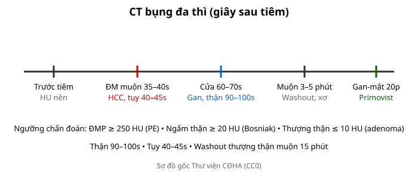
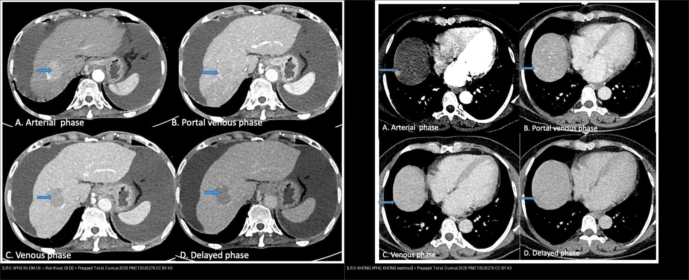
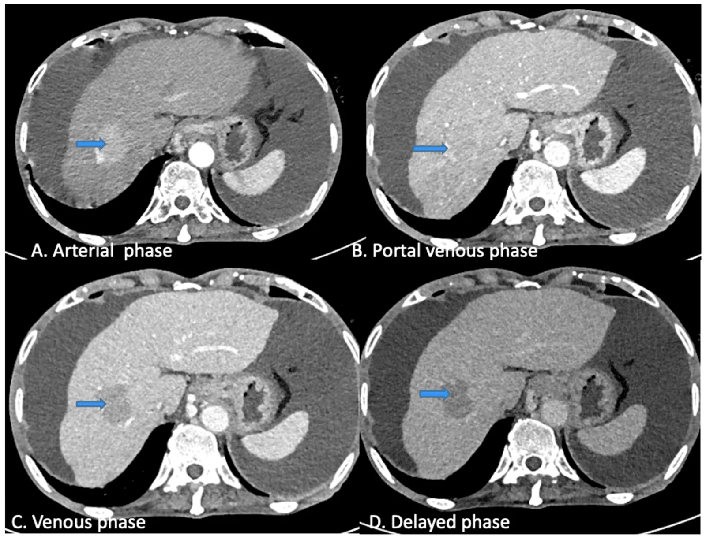

# 101 — Protocol CT/MRI bụng đa thì & Primovist / Multiphasic abdomen protocol

**Tags:** `pattern:protocol-bung` `vung:bung` `protocol:CT-MRI-bung`
**Mức chắc chắn (certainty):** tổng hợp y văn (literature synthesis) — nhóm tự biên từ y văn mở, chưa gắn ca nguyên văn đơn lẻ.

## 1. Tổng quan — đúng thì mới thấy bệnh + 4 mốc giây

- Mỗi tạng có thì ngấm cực đại riêng: động mạch gan 35–40s, tụy 40–45s, cửa gan 60–70s, thận 90–100s, muộn 3–5p, gan-mật Primovist 20p.
- TẠI SAO sai thì mất bệnh: HCC chỉ sáng 35–40s (chụp muộn thành đẳng đậm độ giả âm); hoại tử tụy chỉ lộ thì tụy 40–45s; washout thượng thận cần muộn đúng 15p.

*Sơ đồ gốc Thư viện CĐHA, CC0.*

## 2. Gamut chỉ định theo thì

- **Động mạch muộn:** HCC, pNET, chảy máu hoạt tính (thoát thuốc), PE (ĐMP ≥ 250 HU).
- **Cửa + thận:** u gan/thận, viêm, áp-xe, ruột (thành + mạch mạc treo).
- **Muộn:** washout (gan/thượng thận), xơ, sẹo, niệu (bài tiết).
- **Primovist 20p:** FNH giữ thuốc vs HCC thải; đường mật.

## 3. Bảng thì-chỉ định

| Thì (giây) | Tạng đích | Tìm gì | Bẫy nếu sai thì |
|---|---|---|---|
| ĐM muộn 35–40s | Gan/ĐM | APHE HCC, chảy máu hoạt tính | Chụp sớm = ĐM chưa lên; muộn = mất APHE |
| Tụy 40–45s | Tụy | Hoại tử (không ngấm), pNET ngấm | Cửa mới chụp = bỏ sót hoại tử |
| Cửa 60–70s | Gan/ruột | Washout, thành ruột, TM cửa | — (thì chuẩn đa số) |
| Thận 90–100s | Thận | Ngấm Bosniak (≥ 20 HU) | Sớm = giả không ngấm |
| Muộn 3–5p / 15p TT | Gan/TT | Washout, APW/RPW | Sai phút = sai công thức |
| Gan-mật 20p | Gan/mật | FNH giữ, HCC thải | Suy gan = ngấm kém |

*Cùng là một nốt gan, chỉ KHÁC động học ngấm thuốc: **trái = LR-5** — ngấm mạnh thì động mạch (A, APHE) rồi thải thuốc dần ở thì cửa/tĩnh mạch/muộn (B–D, washout); **phải = LR-3** — không APHE, không washout. Chụp thiếu thì động mạch HOẶC thiếu thì muộn thì CẢ HAI đều không phân loại được — đó là lý do bắt buộc protocol đủ thì. Nguồn: Prajapati T et al., Cureus 2026 (PMC13526276), CC BY 4.0. Ảnh ghép letterbox.*

## 4. Protocol chuẩn + Primovist

- CT: trước tiêm (HU nền) + ĐM muộn + cửa + muộn (+ thận khi cần); MPR coronal.
- MRI + Gadoxetate: ĐM/cửa/muộn + gan-mật 20p (FNH/HCC nhỏ, đường mật).
- Bụng cấp: cửa 1 thì đủ đa số (trừ chảy máu → thêm ĐM, sỏi → thêm trước tiêm).

## 5. Cạm bẫy

- **Không thì trước tiêm** = không tính washout/APW/Bosniak — protocol thiếu là vô dụng.
- **Bệnh nhân nín thở kém** lệch thì — bolus-tracking + dặn trước.
- **Suy thận/suy gan** đổi động học thuốc — giảm liều + MRI thay thế.

## 6. Tự lượng giá — Blind Quiz

**Ca 1 — Nghi HCC, CT chỉ có thì cửa:** đủ kết luận không? Thiếu gì? *(Bảng mục 3.)*

<b>Bấm để hiện đáp án</b>

- **Không đủ:** thiếu ĐM muộn (APHE) + muộn (washout) — chụp lại đủ 4 thì.

**Ca 2 — Thượng thận 2,5 cm + 25 HU, cần tính APW:** cần thêm thì nào, lúc nào? *(Bảng mục 3.)*

<b>Bấm để hiện đáp án</b>

- **Cửa 70s + muộn đúng 15p** — sai phút là sai công thức.

**Ca 3 — CT bụng 4 thì cho một nốt gan (ảnh trơn ngoài). Nhìn trước, tự phân loại.**

- Gợi ý lâm sàng: bệnh nhân ung thư gan được chụp CT 4 thì (không lộ chẩn đoán).
- Câu hỏi: Nốt (mũi tên) thay đổi thế nào qua thì động mạch → cửa/tĩnh mạch/muộn? Thuộc nhóm LI-RADS nào và vì sao?

<b>Bấm để hiện đáp án</b>

- Dấu hiệu (findings): (A) thì động mạch — nốt (mũi tên) **ngấm mạnh hơn nhu mô gan (APHE)**; (B–D) thì cửa/tĩnh mạch/muộn — nốt **trở nên giảm đậm độ so với gan (washout)**.
- Chẩn đoán (diagnosis): **LR-5 — HCC chắc chắn** — vì **APHE + washout** là hai đặc điểm chính của LI-RADS (nếu chỉ có thì cửa sẽ mất cả hai). Bài học: **chụp thiếu thì = không phân loại được**.
- Nguồn ảnh: Prajapati T et al., Cureus 2026 (PMC13526276), CC BY 4.0 — Fig 5 (LR-5).

**Ca 4 — Nốt gan 12 mm, CT chỉ có thì cửa (không APHE, không washout), nền gan xơ:** xếp nhóm nào? *(Bảng mục 3 + bài 121.)*

<b>Bấm để hiện đáp án</b>

- **LR-3 (không đủ đặc điểm chính)** — cần chụp lại đủ thì động mạch + muộn, theo dõi 3–6 tháng; **thiếu thì không được phép đẩy lên LR-5**.
- Nguồn số liệu: Prajapati T et al., Cureus 2026 (PMC13526276), CC BY 4.0 (Fig 4 = ví dụ LR-3).

## Bài liên quan chéo
- [100 – Tổng quan hệ Bụng](../100-tong-quan-he-bung/lesson.md)
- [110 – Giải phẫu bụng](../110-giai-phau-bung/lesson.md) (mốc Cantlie)
- [121 – LI-RADS](../121-khoi-gan-LIRADS/lesson.md) (APHE/washout)

> Không dùng để chẩn đoán độc lập khi chưa có người hướng dẫn.
