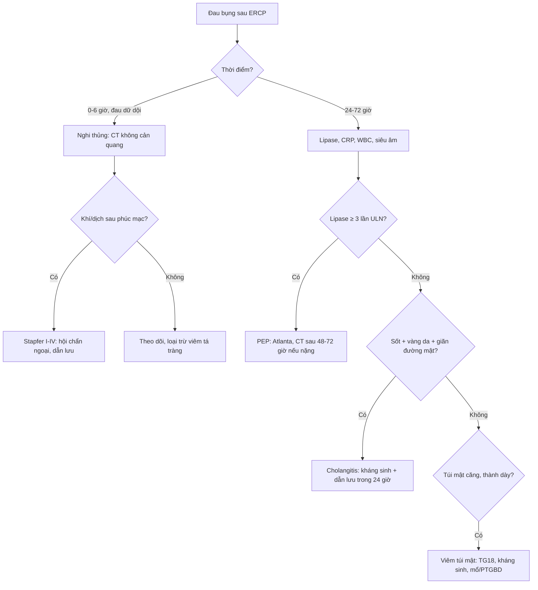
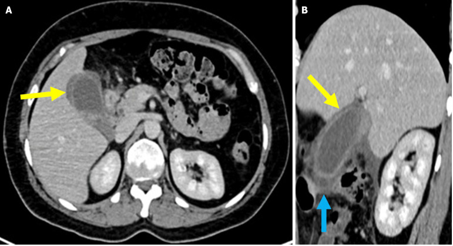
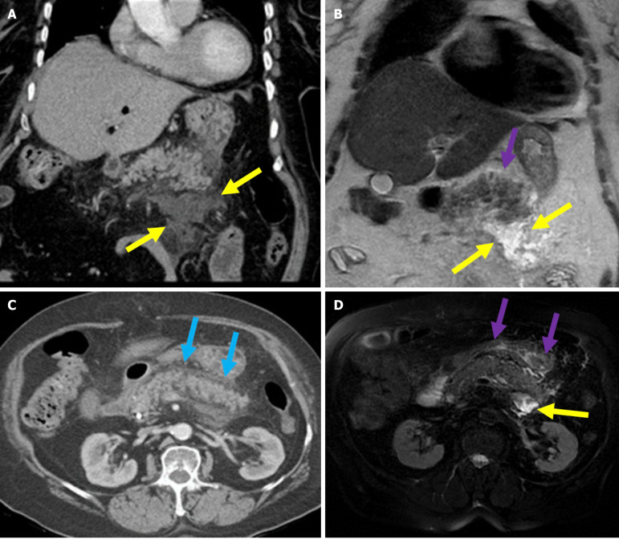
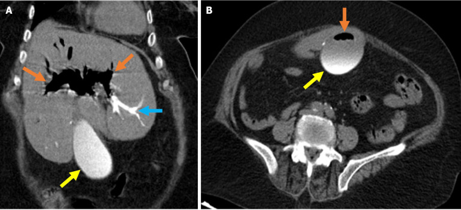

# 102 — Viêm túi mật cấp & viêm tụy cấp sau đặt stent mật/ERCP / Post-ERCP cholecystitis & pancreatitis

**Tags:** `pattern:viem-tui-mat` `pattern:viem-tuy` `vung:tui-mat` `vung:tuy` `protocol:CT-bung-da-thi` `protocol:ERCP` `score:Atlanta` `score:TG18`
**Mức chắc chắn (certainty):** tổng hợp y văn (literature synthesis) — nhóm tự biên từ y văn mở (CC BY, CC BY-NC), có 3 ca nguyên văn (verbatim case) của bài gốc, giữ đúng tuổi/thời điểm trong chú thích.

> **Câu chốt:** sau ERCP, **đau bụng + sốt + vàng da** có **3 ổ** phải nghĩ cùng lúc: **tụy (PEP)**, **túi mật (cholecystitis)**, **đường mật (cholangitis)** — cộng thêm **thủng tá tràng/ống mật**. Đừng gọi tất cả là "viêm tụy": **cholecystitis sau ERCP hay bị bỏ sót vì đau được quy cho thủ thuật**, và **khí trong đường mật sau ERCP là bình thường**, không phải thủng.

## 1. Tổng quan bệnh học – cơ chế hình ảnh

### 1.1 Dịch tễ và ngưỡng định lượng

- **Tần suất biến chứng ERCP** (gộp 2025, theo tổng quan hình ảnh 2025 — PMC12476729): **viêm tụy (PEP) 4,6%**; **viêm đường mật 2,5%**; **chảy máu 1,5%**; **viêm túi mật 0,8%**; **thủng 0,5%**; **tử vong liên quan ERCP 0,2%**.
- **PEP:** trung bình **3–10%**; trong các thử nghiệm ngẫu nhiên có nhóm chứng, **10–13%**; nhóm nguy cơ cao (rối loạn cơ vòng Oddi, can thiệp tụy, đặt stent phủ) có thể **10–22%** (PMC13669755; PMC13355881).
- **Cholecystitis sau ERCP** hiếm hơn (**~0,8%** chung), nhưng tăng rõ khi **stent kim loại phủ toàn bộ (FCSEMS) che ống túi mật**; bài 137 ghi nhận **~5%** ở nhóm stent có thiết kế liên quan.
- **Tiêu chuẩn Cotton cho PEP:** đau bụng kiểu tụy + **amylase ≥ 3 lần giới hạn trên** + kéo dài/nhập viện **≥ 2 đêm**. Nếu chỉ dùng Cotton mà **không có lipase và hình ảnh**, có thể **bỏ sót tới 41,9%** ca PEP (PMC12476729).
- **Phân độ nặng:** dùng **Atlanta sửa đổi 2012** (xem bài 135): thể **phù nề kẽ (interstitial edematous)** vs **hoại tử (necrotizing)**; biến chứng tại chỗ **APFC, pseudocyst, ANC, WON**; suy cơ quan **> 48 giờ** = nặng.

### 1.2 TẠI SAO PEP xảy ra (cơ chế → hình ảnh)

- **Cơ chế:** đặt catheter/tiêm thuốc cản quang vào **ống tụy** → **tăng áp lực ống tụy** + tổn thương **hóa học/nhiệt** + phù nhú → **tắc dòng chảy ra** → hoạt hóa enzyme tiêu hóa tại chỗ → **viêm tụy tự tiêu**.
- **Hình ảnh:** tụy **to, phù, tăng tín hiệu T2**, **mờ các dải mỡ quanh tụy (peripancreatic fat stranding)**, **dịch quanh tụy**; thể hoại tử: vùng **không ngấm thuốc** (thiếu máu) + **khí** (nhiễm trùng) muộn.
- **Vì sao CT sớm có thể bình thường:** phù nề và hoại tử cần **24–72 giờ** mới rõ; CT ngay sau ERCP **không loại trừ PEP** — chẩn đoán dựa **lâm sàng + lipase/amylase**, CT để **tìm biến chứng/tìm nguyên nhân khác**.

### 1.3 TẠI SAO viêm túi mật sau ERCP/stent

- **Cơ chế chính:** **stent phủ (FCSEMS) bít ống túi mật (cystic duct)** → ứ mật + nhiễm khuẩn → viêm túi mật cấp; hoặc **sỏi/bùn** di chuyển trong lúc thủ thuật; hoặc **tắc ống túi mật do phù nề/khí/nhiễm trùng**.
- **Hình ảnh (giống viêm túi mật thông thường):** túi mật **căng**, **thành dày ≥ 3 mm**, **ngấm thuốc niêm mạc**, **dịch quanh túi mật**, **mờ mỡ quanh túi mật**, **dấu Murphy trên siêu âm**; có thể **khí trong thành/lòng túi mật** (viêm túi mật khí thũng — thể nặng).
- **Vì sao dễ bỏ sót:** đau sau ERCP được quy cho **viêm tụy/đau thủ thuật**; men gan tăng nhẹ; **không có sỏi** trên siêu âm → tưởng "không phải túi mật". **Stent phủ nằm ngay ống túi mật** là manh mối.

### 1.4 TẠI SAO viêm đường mật và thủng

- **Cholangitis:** tắc dòng mật (sỏi, u, stent hỏng) + **vi khuẩn từ tá tràng** → **sốt, vàng da, đau**, có thể **sốc**. Hình ảnh: giãn đường mật, **thành ống dày ngấm thuốc**, có thể **khí trong đường mật**, áp-xe gan.
- **Thủng (Stapfer):** **I** thành tá tràng bên (khí sau phúc mạc nhiều); **II** quanh nhú (khí/dịch sau phúc mạc); **III** ống mật (thoát thuốc cản quang); **IV** vi thủng (chỉ khí sau phúc mạc ít, thường bảo tồn). **Khí sau phúc mạc + dịch** là chốt; **khí trong lòng đường mật đơn thuần thì không**.

## 2. Mẫu hình + chẩn đoán phân biệt theo thời gian (gamut)

**Mẫu hình:** bệnh nhân **đau bụng sau ERCP**; thời điểm xuất hiện **thu hẹp gamut**:

- **Trong/ngay sau thủ thuật (0–6 giờ):** **thủng tá tràng/ống mật (Stapfer I–IV)** — đau dữ dội, tràn khí/dịch; **viêm tá tràng cấp (duodenitis)** — đau nhiều nhưng CT chỉ dày niêm mạc tá tràng, tự hồi phục; **chảy máu** (sau cắt cơ vòng) — máu trong tá tràng, hemobilia.
- **24–72 giờ:** **PEP** (phù nề/hoại tử), **cholangitis** (sốt, vàng da), **viêm túi mật** sớm.
- **3–30 ngày:** **viêm túi mật do stent**, **áp-xe gan**, **pseudocyst/APFC**, **hẹp ống mật sau cắt cơ vòng**, **di trú stent**.
- **> 30 ngày:** **hẹp lành tính**, **sỏi tái phát**, **u tiến triển**, **di trú stent muộn**.

**Gamut theo cơ quan (khi CT có bất thường):**

- **Tụy:** PEP thể phù nề, thể hoại tử, APFC/pseudocyst/WON.
- **Túi mật:** viêm túi mật cấp (do stent/sỏi), viêm túi mật khí thũng, hoại tử túi mật.
- **Đường mật:** cholangitis, áp-xe gan, hẹp sau thủ thuật, rò mật.
- **Tá tràng/phúc mạc:** duodenitis, thủng sau phúc mạc, khí phúc mạc.
- **Mạch máu:** giả phình động mạch gan (hemobilia), máu tụ sau phúc mạc.

**Mnemonic "PAIN after ERCP":** **P**ancreatitis, **A**bscess/cholangitis, **I**atrogenic perforation, **N**eoplasia/u tắc mật (không phải biến chứng nhưng là nguyên nhân nền), **after ERCP** = luôn hỏi **thời điểm, loại stent, kỹ thuật cắt cơ vòng**.

## 3. Bảng so sánh phân biệt (ma trận đối chiếu)

| Thực thể (entity) | Hình ảnh điển hình (CT/MRI) | Chốt vào (rule-in) | Chốt loại (rule-out) | Gợi ý xác nhận |
|---|---|---|---|---|
| **PEP thể phù nề** | Tụy **to, phù, tăng T2**, **mờ mỡ quanh tụy**, dịch quanh tụy, **còn ngấm thuốc đều** | **Đau kiểu tụy + amylase/lipase ≥ 3× ULN + mờ mỡ quanh tụy** | Có **vùng không ngấm thuốc**/khí → thể hoại tử, không chỉ phù nề | Lipase, CT sau 48–72 giờ; Atlanta 2012 |
| **PEP thể hoại tử** | **Vùng tụy không ngấm thuốc**, mờ mỡ lan rộng, **ANC/WON**; khí = nhiễm trùng | **Không ngấm thuốc + dịch quanh tụy > 4 tuần (WON)** | Chỉ phù nề, ngấm thuốc đều → thể nhẹ | CT đa thì; MRI; theo dõi 48–72 giờ |
| **Viêm túi mật sau ERCP/stent** | **Túi mật căng, thành dày ≥ 3 mm, ngấm thuốc niêm mạc, dịch/mờ mỡ quanh túi mật** | **Murphy + sốt + thành dày + dịch quanh túi mật + stent phủ gần ống túi mật** | Không dày thành, không dịch quanh túi mật → nghĩ nguyên nhân khác | US là đầu tay; CT xác nhận biến chứng; TG18 |
| **Viêm đường mật (cholangitis)** | Giãn đường mật, **thành ống dày ngấm thuốc**, khí trong đường mật, áp-xe gan | **Sốt + vàng da + đau + giãn đường mật** (Charcot/Reynolds) | Không giãn, không dày thành ống → ít nghĩ cholangitis | CT/MRCP; cấy máu; TG18 |
| **Thủng Stapfer I–IV** | **Khí sau phúc mạc**, dịch sau phúc mạc, **thoát thuốc cản quang** (III), khí phúc mạc (I) | **Khí/dịch sau phúc mạc mới + đau dữ dội sau thủ thuật** | Khí **chỉ trong lòng đường mật**, không có dịch/khí ngoài ống → bình thường sau ERCP | CT không cản quang + cản quang; nội soi; phân loại Stapfer |
| **Viêm tá tràng cấp (duodenitis)** | **Dày niêm mạc tá tràng**, phù nề, tăng ngấm thuốc; không có khí/dịch ngoài lòng | **Đau 24 giờ sau ERCP + dày niêm mạc tá tràng + tự giảm** | Có mờ mỡ quanh tụy/dịch quanh tụy → nghĩ PEP kèm | CT; theo dõi lâm sàng 24–48 giờ |
| **Hemobilia/giả phình mạch gan** | Máu tụ trong đường mật, **giả phình ngấm thuốc thì động mạch**, máu trong túi mật/tá tràng | **Đau + vàng da + chảy máu tiêu hóa sau ERCP** | Không có khối ngấm thuốc, không máu trong đường mật → loại | CTA; DSA + nút mạch |

**Đọc ma trận theo 3 câu hỏi:** (1) **thời điểm** sau ERCP? (2) **khí/dịch ở đâu** (trong lòng ống ≠ ngoài ống)? (3) **tụy còn ngấm thuốc đều không**? Trả lời 3 câu này phân được 80% ca.

## 4. Protocol chụp + hệ phân độ/điểm chuẩn hóa

### 4.1 Protocol

- **Siêu âm bụng:** đầu tay khi đau hạ sườn phải/sốt; đánh giá **túi mật (thành, sỏi, dịch quanh)**, **đường mật**, **tụy** (thường bị che khí).
- **CT bụng:** **không cản quang** ngay khi nghi thủng/chảy máu; **CT có cản quang đa thì** sau **48–72 giờ** để đánh giá **hoại tử tụy** và biến chứng. Lát **1–3 mm**, cửa sổ mỡ.
- **MRI/MRCP:** khi nghi **hẹp/rò đường mật**, **sỏi sót**, hoặc bệnh nhân trẻ cần tránh xạ; **T2 + DWI + MRCP**; tụy **T2 fat-sat** đánh giá phù/hoại tử.
- **CTA/DSA:** khi có **máu trong đường mật/tá tràng** hoặc **giả phình** — không chờ.
- **Xét nghiệm:** **lipase/amylase** (lipase nhạy hơn, không cần lặp nhiều), **CRP**, **WBC**, **bilirubin/ALP/GGT**, **cấy máu** khi sốt; **nhóm máu** nếu chảy máu.

### 4.2 Phân độ và ngưỡng xử trí

- **PEP — Atlanta sửa đổi 2012:** nhẹ (không suy cơ quan, không biến chứng tại chỗ) / trung bình (suy cơ quan thoáng qua **< 48 giờ** hoặc biến chứng tại chỗ) / nặng (suy cơ quan **> 48 giờ**). **CT sớm không cần** ở thể nhẹ; **CT/MRI sau 48–72 giờ** nếu không cải thiện sau **48–72 giờ** hoặc sốt.
- **Viêm túi mật — Tokyo Guidelines 2018 (TG18):** chẩn đoán = **1 dấu hiệu tại chỗ** (Murphy, đau/khối hạ sườn phải) + **1 dấu hiệu toàn thân** (sốt, CRP/WBC tăng) + **hình ảnh**; phân độ **I** (nhẹ), **II** (WBC **> 18.000/mm³**, khối sờ thấy, triệu chứng **> 72 giờ**, viêm tại chỗ rõ), **III** (rối loạn chức năng cơ quan). **Độ III/không mổ được → dẫn lưu túi mật (PTGBD/endoscopic) + kháng sinh**; **độ I–II mổ nội soi sớm trong 72 giờ**.
- **Cholangitis — TG18:** kháng sinh + **dẫn lưu đường mật** (ERCP/PTBD) trong **24 giờ** nếu độ III, **24–48 giờ** nếu không đáp ứng.
- **Kháng sinh:** cephalosporin phổ rộng ± metronidazol (hoặc piperacillin–tazobactam) theo mức độ; **cấy máu/mật** trước khi dùng nếu có thể.

### 4.3 Dự phòng PEP (ngưỡng từ nguồn)

- **NSAID đặt trực tràng:** **indomethacin hoặc diclofenac 100 mg** ngay trước/sau thủ thuật — giảm PEP, đặc biệt nhóm nguy cơ trung bình–cao (khuyến cáo ASGE 2023).
- **Bù dịch tích cực bằng lactated Ringer's:** **3 mL/kg/giờ trong thủ thuật + 20 mL/kg bolus ngay sau + 3 mL/kg/giờ × 8 giờ** (giảm còn **1,5 mL/kg/giờ** nếu không đau). Thử nghiệm 126 bệnh nhân: PEP **6,3% vs 22,2%** (RR **0,29**; KTC 95%: 0,10–0,82), thời gian nằm viện **1,8 vs 3,0 ngày** (PMC13355881).
- **Stent tụy dự phòng (PPS):** đặt ở nhóm nguy cơ cao (tiêm tụy nhiều lần, cắt cơ vòng qua tụy, khó đặt ống); giảm PEP còn **5–7%**; **PPS + NSAID** tốt hơn NSAID đơn thuần (**11% vs 15%**) (PMC13669755). Stent **5 Fr, dài 3–5 cm**, lưu **3–5 ngày** (thực hành chuẩn; theo dõi di trú).
- **Giảm nguy cơ do thủ thuật:** **hạn chế tiêm cản quang vào ống tụy**, dùng **hướng dẫn dây dẫn (guidewire-assisted cannulation)**, tránh cắt cơ vòng không cần thiết; **rối loạn cơ vòng Oddi** làm tăng nguy cơ **~10 lần** sau đo áp lực (PMC13669755).
- **Stent phủ (FCSEMS):** làm tăng PEP (**7,8% vs 3,4%** với stent nhựa; **2,4%** không stent; OR **5,49**) (PMC12968636) → cân nhắc khi chỉ định.

## 5. Biến thể bình thường và cạm bẫy

- **Khí và thuốc cản quang trong đường mật sau ERCP là BÌNH THƯỜNG:** khí **nổi phía trước**, thuốc cản quang **lắng phía sau**; gặp ở **70 tuổi** sau lấy sỏi, xét nghiệm bình thường (PMC12476729, Fig 1). **Chỉ gọi thủng khi có khí/dịch NGOÀI lòng ống** (sau phúc mạc, quanh tá tràng).
- **Viêm tá tràng cấp sau ERCP** gây đau nhiều, có thể **bắt chước PEP**; CT chỉ **dày niêm mạc tá tràng**, không mờ mỡ quanh tụy → **không tăng liều điều trị PEP**.
- **CT ngay sau ERCP có thể bình thường trong PEP** — đừng loại trừ bằng CT sớm; chẩn đoán bằng **lipase + lâm sàng**, CT để tìm **hoại tử/biến chứng**.
- **Amylase tăng đơn thuần không phải PEP:** sau ERCP **hyperamylasemia** gặp ở **14–41%** tùy nhóm (PMC13355881); PEP cần **đau + amylase ≥ 3× ULN + ≥ 2 đêm**.
- **Viêm túi mật sau ERCP không cần có sỏi:** stent phủ che ống túi mật là nguyên nhân đủ; **đừng loại trừ vì siêu âm không thấy sỏi**.
- **Stent kim loại gây giả ảnh (beam-hardening)** che mô xung quanh → đọc **MRCP** bổ sung khi nghi hẹp/u; **đừng đo đường kính ống ngay sát stent**.
- **Cạm bẫy "một nguyên nhân":** PEP + cholangitis + cholecystitis có thể **cùng lúc**; sau khi xử trí một ổ vẫn phải **khám lại bụng và chụp lại** nếu sốt kéo dài.

## 6. Tự lượng giá — Blind Quiz

**Ca 1 — Nữ 33 tuổi, 10 ngày sau ERCP: đau bụng, buồn nôn, Murphy dương tính, AST/ALT và CRP tăng:**

- Hỏi: dấu hiệu chính? Vì sao sau ERCP? Chẩn đoán phân biệt và xử trí?

<b>Bấm để hiện đáp án (findings + chẩn đoán)</b>

- **Dấu hiệu:** **thành túi mật dày**, **niêm mạc tăng ngấm thuốc** (mũi tên vàng), **mờ mỡ quanh túi mật** (mũi tên xanh); không thấy sỏi cản quang.
- **Chẩn đoán:** **viêm túi mật cấp sau ERCP** — cơ chế thường do **phù nề/tắc ống túi mật**, hoặc **stent phủ che ống túi mật**.
- **Vì sao:** viêm thành + mờ mỡ quanh túi mật = viêm cấp; không có sỏi không loại trừ.
- **Xử trí:** nhập viện, kháng sinh, **mổ nội soi sớm trong 72 giờ** nếu đủ điều kiện; nếu không mổ được → **dẫn lưu túi mật qua da/nội soi** (TG18).
- **Nguồn ảnh:** World Journal of Radiology 2025 (PMC12476729), Fig 7, CC BY-NC 4.0.

**Ca 2 — Nữ 81 tuổi, đau thượng vị sau ERCP, amylase và CRP tăng:**

- Hỏi: thể bệnh? Có hoại tử không? Khi nào chụp lại?

<b>Bấm để hiện đáp án</b>

- **Dấu hiệu:** **tụy to, phù**, **mờ mỡ quanh tụy** (mũi tên xanh), **dịch quanh tụy (APFC)**; **tụy vẫn ngấm thuốc đều** → **không hoại tử**; MRI T2 cho thấy **tăng tín hiệu phù nề** (mũi tên tím).
- **Chẩn đoán:** **PEP thể phù nề kẽ (interstitial edematous)** kèm **APFC** — Atlanta 2012.
- **Vì sao:** còn ngấm thuốc đều = chưa hoại tử; dịch quanh tụy < 4 tuần = APFC (không phải pseudocyst).
- **Theo dõi:** CT/MRI lại sau **48–72 giờ** nếu không cải thiện/sốt để tìm **hoại tử/WON**; điều trị hỗ trợ (dịch, giảm đau, ăn sớm khi dung nạp).
- **Nguồn ảnh:** World Journal of Radiology 2025 (PMC12476729), Fig 4, CC BY-NC 4.0.

**Ca 3 — Nữ 70 tuổi, đau bụng và ấn đau nhẹ sau ERCP lấy sỏi; xét nghiệm bình thường. CT không cản quang:**

- Hỏi: đây là bình thường hay thủng? Dấu hiệu nào phân biệt?

<b>Bấm để hiện đáp án</b>

- **Dấu hiệu:** **khí trong đường mật trong gan và túi mật** (mũi tên cam), **thuốc cản quang lắng trong đường mật và túi mật** (mũi tên xanh/vàng); **không có khí/dịch sau phúc mạc**, không mờ mỡ quanh tá tràng.
- **Chẩn đoán:** **hình ảnh sau ERCP bình thường** (khí + cản quang tồn dư) — không phải thủng, không phải sán.
- **Vì sao:** khí **trong lòng ống** và **nổi phía trước**; thủng cần **khí/dịch ngoài lòng ống** (sau phúc mạc) hoặc **thoát thuốc**.
- **Xử trí:** theo dõi lâm sàng; không kháng sinh chỉ vì có khí trong đường mật.
- **Nguồn ảnh:** World Journal of Radiology 2025 (PMC12476729), Fig 1, CC BY-NC 4.0.

## Bài liên quan chéo
- [100 – Tổng quan hệ Bụng](../100-tong-quan-he-bung/lesson.md)
- [130 – Túi mật: sỏi, viêm cấp/mạn, adenomyomatosis vs K](../130-tui-mat/lesson.md)
- [135 – Viêm tụy cấp Atlanta 2012 & Balthazar](../135-viem-tuy-Atlanta/lesson.md)
- [131 – Tắc mật](../131-tac-mat/lesson.md)
- [137 – Theo dõi stent/dẫn lưu đường mật](../137-theo-doi-stent-dan-luu-duong-mat-di-tru-tac-nhiem-trung/lesson.md)
- [910 – Dẫn lưu áp-xe & đường mật qua da](../910-abscess-biliary-nephrostomy/lesson.md)

## Ảnh
- `102_viem-tui-mat-sau-ercp_CT_WorldJRadiology2025-Fig7.jpg` — CT có cản quang, ca 33 tuổi, CC BY-NC 4.0 (PMC12476729).
- `102_viem-tuy-sau-ercp_CT_WorldJRadiology2025-Fig4.jpg` — CT/MRI, ca 81 tuổi, CC BY-NC 4.0 (PMC12476729).
- `102_khi-duong-mat-sau-ercp_CT_WorldJRadiology2025-Fig1.jpg` — CT không cản quang, ca 70 tuổi, CC BY-NC 4.0 (PMC12476729).
- Chi tiết giấy phép từng ảnh: `images/CREDITS.md`.

> Không dùng để chẩn đoán độc lập khi chưa có người hướng dẫn.
