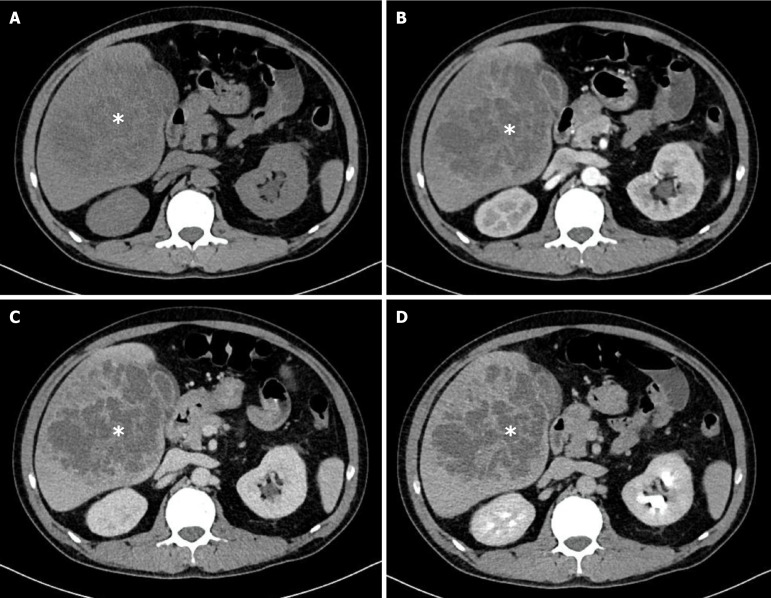
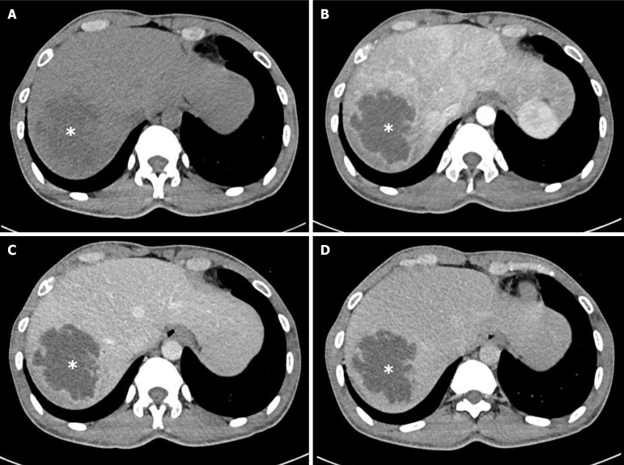
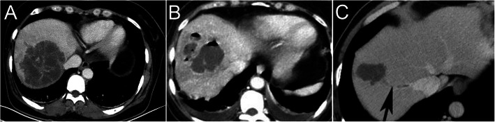
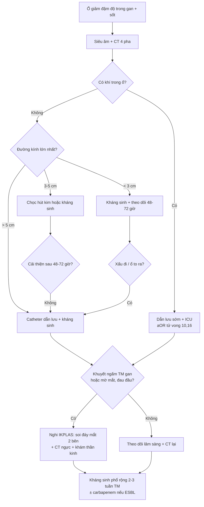
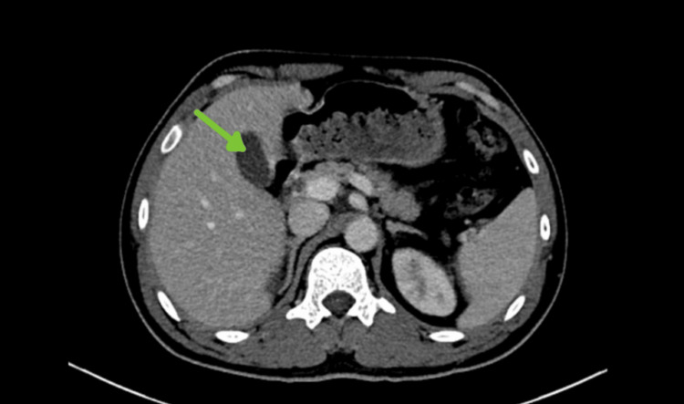

# 103 — Áp-xe gan sinh mủ do *Klebsiella pneumoniae* & thể tăng độc lực (hvKP): đọc CT, phân tầng nguy cơ và ngưỡng dẫn lưu / *Klebsiella* pyogenic liver abscess

**Tags:** `pattern:ap-xe` `pattern:khong-dong-nhat` `pattern:hoai-tu` `vung:gan` `vung:duong-mat` `score:CT-features` `protocol:CT-4-pha` `protocol:choc-hut-dan-luu`
**Mức chắc chắn (certainty):** tổng hợp y văn (literature synthesis) — 1 loạt cohort Việt Nam 106 ca (World J Hepatol 2026, PMC12968706), 1 loạt 100 ca KPLA (BMC Infect Dis 2020, PMC7296744), 2 phân tích gộp (Gastroenterol Res Pract 2022 — PMC9033355; Int J Med Sci 2026 — PMC13133893), 2 bài tổng quan (Gastroenterol Res Pract 2013 — PMC3806164; Mol Med Rep 2026 — PMC12829308) và 2 ca nguyên văn (Cureus 2026 — PMC13270909; Pak J Med Sci 2026 — PMC13170020). Số liệu lấy nguyên từ bài gốc, tên tác giả đối chiếu PMCID.

> **Bài này trả lời 4 câu hỏi khi gặp một ổ giảm đậm độ trong gan:**
> (1) **Dấu hiệu CT nào khiến nghĩ áp-xe do *K. pneumoniae* chứ không phải tụ dịch/u hoại tử?** (2) **Có khí, có vách, có huyết khối tĩnh mạch gan thì thay đổi xử trí thế nào?** (3) **Ai phải khám mắt/soi đáy mắt ngay?** (4) **Ngưỡng nào thì chọc hút, đặt catheter hay mổ?**
> Nối [104 – Nhiễm trùng nang gan trong PLD/ADPKD](../104-nhiem-trung-nang-gan-pld-adpkd/lesson.md) (thể nang), [163 – Pylephlebitis & huyết khối TM mạc treo](../163-pylephlebitis-huyet-khoi-tm-mac-treo/lesson.md) (huyết khối tĩnh mạch cửa) và [475 – Viêm nội nhãn nội sinh do vi khuẩn](../475-viem-noi-nhan-noi-sinh-vi-khuan/lesson.md) (biến chứng mắt — đường lan của chính bài này).

## 1. Tổng quan bệnh học – cơ chế hình ảnh

### 1.1 Vì sao *K. pneumoniae* tạo ra áp-xe "vách dày, không đều, không đồng nhất"

- **Vỏ polysaccharide (K1/K2) + yếu tố tăng độc lực:** *Klebsiella* có vỏ polysaccharide dày chống thực bào và chống ly giải bởi bổ thể; thể **tăng nhầy (hypermucoviscous)** — điều hòa bởi **rmpA/rmpA2** trên plasmid độc lực, mang **hệ lấy sắt aerobactin (iuc locus)**, salmochelin, yersiniabactin — là nền của **hvKP** (Mol Med Rep 2026, PMC12829308). Vỏ nhầy làm ổ nhiễm **lan nhanh, hoại tử rộng, nhiều vách** thay vì một ổ mủ đơn thuần.
- **Vì sao CT thấy "vách ≥ 1 mm" và "cấu trúc không đồng nhất":** hoại tử hóa lỏng không đều trong một ổ lớn → mô đệm hoại tử còn lại tạo **vách không hoàn chỉnh**; sản phẩm mủ – mảnh mô – huyết khối nhỏ tạo **đậm độ hỗn hợp** thay vì một "túi dịch" thuần nhất. Định nghĩa **đa ổ (multilocular)** trong y văn CT là **có ≥ 1 vách dày ≥ 1 mm** (BMC Infect Dis 2020, PMC7296744).
- **Vì sao ngấm viền và "ngấm quanh tổn thương" (perilesional enhancement):** viền là **vỏ xơ + nhu mô gan bị ép viêm** còn tưới máu, trong khi **trung tâm mủ hoại tử không có mao mạch** → ngấm viền, trung tâm luôn giảm đậm độ ở **mọi thì**. Đây là điểm khác cốt lõi với u: u ác có **mô sống** nên vẫn có phần ngấm ở thì nào đó (xem mục 2).
- **Vì sao có khí:** lên men acid hỗn hợp trong ổ mủ (xúc tác **formic hydrogenlyase**) sinh khí — gặp chủ yếu ở bệnh nhân **đái tháo đường kiểm soát kém**, và khí là **yếu tố tiên lượng tử vong độc lập** (mục 4).
- **Vì sao lan mắt/não/phổi:** vi khuẩn xâm nhập **tiểu tĩnh mạch gan** → **huyết khối viêm tĩnh mạch gan (septic thrombophlebitis)** → tắc mạch nhiễm khuẩn tới phổi (thuyên tắc phổi nhiễm khuẩn) và qua tuần hoàn hệ thống tới **mắt, màng não**. Đây là cơ chế của **hội chứng áp-xe gan do *Klebsiella* xâm lấn (invasive KPLA syndrome — IKPLAS)**. Trên CT, dấu hiệu tương ứng là **khuyết ngấm thuốc trong tĩnh mạch gan/tĩnh mạch chủ dưới** (BMC Infect Dis 2020, PMC7296744).

### 1.2 Ngưỡng định lượng nằm lòng (bắt buộc nhớ)

| Chỉ số | Con số | Nguồn |
|---|---|---|
| Tỷ lệ mắc áp-xe gan sinh mủ | **2,3–3,6/100.000** (Âu – Mỹ) so với **14–18/100.000** (châu Á) | World J Hepatol 2026 (PMC12968706) |
| *K. pneumoniae* chiếm bao nhiêu ca áp-xe gan sinh mủ (miền Nam Việt Nam, 2021–2024) | **78,3% (83/106)**; cấy mủ **71,9%**, cấy máu **78,6%** | *cùng nguồn* |
| Đái tháo đường trong nhóm *K. pneumoniae* so với nhóm khác | **55,4%** so với **30,4%** (P = 0,034) | *cùng nguồn* |
| Bờ tổn thương **không đều/đa cung** | **96,4%** (nhóm *K. pneumoniae*) so với **82,6%** (P = 0,038) | *cùng nguồn* |
| Cấu trúc trong **không đồng nhất** | **89,2%** so với **60,9%** (P = 0,003) | *cùng nguồn* |
| Ngấm quanh tổn thương / khí trong ổ / khí đường mật | **61,3% / 11,3% / 7,5%** | *cùng nguồn* |
| Số ổ: đơn độc / nhiều ổ | **79,2% / 20,8%** | *cùng nguồn* |
| Vị trí: thùy phải / thùy trái / hai thùy | **56,6% / 29,2% / 14,2%** | *cùng nguồn* |
| Tử vong trong viện (toàn bộ / nhóm *K. pneumoniae*) | **10,4% (11/106)** / **13,3%** so với **0%** | *cùng nguồn* |
| Đường kính lớn nhất trung bình (loạt 100 ca KPLA) | **7,93 ± 2,32 cm** (ESBL **8,17 ± 2,79 cm**) | BMC Infect Dis 2020 (PMC7296744) |
| Đa ổ / có khí / vỡ tự phát / viêm tắc TM gan | **82,6% / 17,4% / 9,3% / 4,65%** | *cùng nguồn* |
| Tử vong chung của áp-xe gan do *K. pneumoniae* | **2–18%** | Gastroenterol Res Pract 2013 (PMC3806164) |
| Tử vong khi **có** so với **không có** ổ nhiễm di căn | **16–17%** so với **0–1,1%** | *cùng nguồn* |
| Tỷ lệ có ổ nhiễm di căn (màng não/mắt) | **10–45%** | *cùng nguồn* |
| Thuyên tắc phổi nhiễm khuẩn trong KPLA (gộp 6 nghiên cứu, 1.158 ca) | **6% (KTC 95%: 3–9%)**; tử vong **12%**; dấu **feeding vessel** **52%** | Gastroenterol Res Pract 2022 (PMC9033355) |
| **Áp-xe có khí** — yếu tố tiên lượng tử vong (gộp 57 nghiên cứu, 126.056 ca) | **aOR 10,16 (KTC 95%: 4,01–25,7)** | Int J Med Sci 2026 (PMC13133893) |
| Ngưỡng dẫn lưu kinh điển | **> 5 cm: dẫn lưu qua da là first-line**; **< 5 cm: có thể chỉ kháng sinh**; **< 3 cm: kháng sinh + theo dõi sát** | Pak J Med Sci 2026 (PMC13170020); Mol Med Rep 2026 (PMC12829308) |

## 2. Mẫu hình + chẩn đoán phân biệt theo hình thái & vị trí (Gamut)

**Câu hỏi lọc:** *"Ổ giảm đậm độ trong gan + sốt + đau hạ sườn phải + đái tháo đường, bờ không đều, trong không đồng nhất, trung tâm không ngấm ở MỌI thì?"* → **áp-xe gan**, và ở Việt Nam nghĩ ***K. pneumoniae*** trước.

- **Một ổ lớn thùy phải, bờ không đều, không có bệnh đường mật:** thể **cryptogenic – hvKP** điển hình (nhóm *K. pneumoniae* trong loạt Việt Nam: thùy phải 55,4%, đơn độc 78,3%). Bệnh nhân thường **không có sỏi mật**.
- **Nhiều ổ, có bệnh đường mật hoặc sau ERCP:** nghĩ nguồn **đường mật** (*E. coli*, *Enterococcus*, kỵ khí) hoặc **ESBL** — loạt 100 ca: tiền sử bệnh đường mật **78,6%** ở nhóm ESBL so với **26,7%** (P < 0,001); ung thư tiêu hóa **50%** so với **7,0%**.
- **Có khí trong ổ:** **áp-xe sinh khí** (gần như luôn là *Klebsiella* ở người đái tháo đường) — **aOR tử vong 10,16**; đây là dấu hiệu **phải đọc và ghi vào báo cáo**, không phải chi tiết phụ.
- **Kèm khuyết ngấm trong tĩnh mạch gan / tĩnh mạch cửa:** nghĩ **IKPLAS** → tầm soát **mắt (soi đáy mắt), màng não, phổi** ngay; nối [163](../163-pylephlebitis-huyet-khoi-tm-mac-treo/lesson.md).
- **Ổ trong nang gan có sẵn (ADPKD/PLD):** **nhiễm trùng nang** — bờ nhẵn theo thành nang, không vách; nối [104](../104-nhiem-trung-nang-gan-pld-adpkd/lesson.md).
- **Ổ "giả áp-xe" do u hoại tử:** ung thư biểu mô tế bào gan (HCC) hoại tử, di căn hoại tử, u mô đệm đường tiêu hóa — có **phần mô sống ngấm thuốc thì động mạch**, không có khí, không có huyết khối viêm.
- **Ổ do amíp (Entamoeba histolytica):** bờ **nhẵn, vỏ mỏng, không vách**, thường **thùy phải đơn độc**, không có tiền sử bệnh đường mật; chẩn đoán bằng **huyết thanh/kháng nguyên**, không dẫn lưu trừ khi bội nhiễm/sắp vỡ.
- **Nang sán (Echinococcus) bội nhiễm:** có **vỏ/màng** đặc trưng, vôi hóa, tiền sử dịch tễ — **cấm chọc mù** (nguy cơ sốc phản vệ/sóng giống); nối [139](../139-san-la-gan/lesson.md).
- **Tụ máu/biloma/seroma sau can thiệp:** có tiền sử can thiệp, đậm độ theo thời gian (máu **35–70 HU** thì không cản quang), không có vỏ ngấm mạnh.

## 3. Bảng so sánh phân biệt (ma trận đối chiếu)

| Thực thể (entity) | Hình ảnh điển hình | Chốt vào (rule-in) | Chốt loại (rule-out) | Gợi ý xác nhận |
|---|---|---|---|---|
| **Áp-xe gan do *K. pneumoniae*** | Ổ thùy phải, **bờ không đều/đa cung (96,4%)**, **trong không đồng nhất (89,2%)**, vách ≥ 1 mm, ngấm viền, ngấm quanh tổn thương | **Sốt + ĐTĐ + bờ không đều + trong không đồng nhất + trung tâm giảm đậm độ ở MỌI thì** | Có mô ngấm thuốc thì động mạch rõ + thải thuốc (→ HCC); bờ nhẵn vỏ mỏng (→ amíp/nang) | Cấy máu **trước** kháng sinh (dương 78,6% trong nhóm KP); cấy mủ khi dẫn lưu |
| **Áp-xe đường mật / ESBL** | Nhiều ổ, thùy trái, **giãn đường mật**, có sỏi/khí đường mật | **Tiền sử bệnh đường mật (78,6%) + nhiều ổ + giãn đường mật** | Ổ đơn độc thùy phải không giãn mật → nghĩ hvKP | Cấy mủ + cấy mật; MRCP nếu nghi tắc mật |
| **Áp-xe sinh khí** | **Khí trong ổ** (mức khí-dịch hoặc bóng khí), thường ĐTĐ kiểm soát kém | **Khí trong ổ + ĐTĐ + nhiễm trùng huyết** | Khí chỉ trong đường mật (sau ERCP) → không phải áp-xe sinh khí | **aOR tử vong 10,16** → dẫn lưu sớm, ICU sớm |
| **IKPLAS (có ổ di căn)** | Ổ gan + **thuyên tắc phổi nhiễm khuẩn**, viêm nội nhãn, viêm màng não | **Khuyết ngấm trong TM gan + khí + đau mắt/mờ mắt + đau đầu** | Chỉ ổ gan, không khuyết mạch, không triệu chứng mắt/thần kinh | **Soi đáy mắt 2 bên**; CT ngực; chọc dịch não tủy nếu có dấu màng não |
| **Nhiễm trùng nang gan (PLD/ADPKD)** | Nang có sẵn **thành dày, dịch tăng đậm độ**, không vách mới | **Sốt + CRP > 50 mg/L + ổ FDG trong nang** | Bờ/vách không theo thành nang → áp-xe nguyên phát | PET/CT, DWI; nối bài 104 |
| **HCC hoại tử** | Khối có **mô sống ngấm thì động mạch + thải thuốc**, xơ gan, AFP tăng | **Ngấm động mạch + washout + xơ gan** | Trung tâm giảm đậm độ **mọi thì**, không mô sống → áp-xe | LI-RADS (bài 121), AFP, sinh thiết chọn lọc |
| **Áp-xe amíp** | Ổ **bờ nhẵn, vỏ mỏng, không vách**, thùy phải, đơn độc | **Bờ nhẵn + dịch tễ + huyết thanh amíp dương** | Bờ không đều + vách + khí → vi khuẩn | Huyết thanh/kháng nguyên *E. histolytica*; đáp ứng metronidazole |
| **Nang sán bội nhiễm** | Nang có **màng/vỏ**, vôi hóa thành, có thể nang con | **Vôi hóa + màng + dịch tễ + huyết thanh** | Không vỏ/màng, không vôi hóa → áp-xe thường | Huyết thanh/ELISA; **không chọc mù** |

*Hình thái áp-xe do **K. pneumoniae**: nhiều ổ, bờ không đều/đa cung, cấu trúc trong không đồng nhất (dấu \*), từ thì không cản quang (A) → động mạch (B) → tĩnh mạch cửa (C) → muộn (D). Nguồn: World J Hepatol 2026 (PMC12968706), Fig 3, **CC BY-NC 4.0**, nguyên bản.*

*Cùng khung 4 pha, áp-xe do **Streptococcus**: bờ hơi không đều nhưng **trong đồng nhất, không vách**, ngấm viền (dấu \*). Đặt cạnh hình trên để thấy "không đồng nhất" là dấu gợi ý *K. pneumoniae* chứ không phải thuộc tính của mọi áp-xe. Nguồn: World J Hepatol 2026 (PMC12968706), Fig 4, **CC BY-NC 4.0**, nguyên bản.*

### Ba dấu hiệu phải ghi trong báo cáo (vì chúng đổi xử trí, không chỉ đổi chữ)

1. **Khí trong ổ** → aOR tử vong **10,16** → dẫn lưu sớm + theo dõi ICU, không "kháng sinh rồi chờ".
2. **Vách ≥ 1 mm / nhiều ổ** → ổ khó dẫn lưu bằng kim đơn thuần; **catheter** hiệu quả hơn **chọc hút kim** (thành công lâm sàng cao hơn, cải thiện nhanh hơn) — World J Hepatol 2026 (PMC12968706) dẫn lại bằng chứng ngẫu nhiên/gộp.
3. **Khuyết ngấm trong tĩnh mạch gan / TM chủ dưới** → **IKPLAS** → khám mắt + thần kinh ngay trong 24 giờ.

*(A) Áp-xe **đa ổ** thùy phải, vách dày. (B) Áp-xe có **khí** trong ổ (đen hoàn toàn) ở thùy trái. (C) Áp-xe đơn ổ nhưng thì tĩnh mạch có **khuyết ngấm trong tĩnh mạch gan** (mũi tên) — dấu hiệu của thể xâm lấn. Nguồn: BMC Infect Dis 2020 (PMC7296744), Fig 2, **CC BY 4.0**.*

## 4. Protocol + phân tầng + sơ đồ xử trí

### 4.1 Protocol chụp

- **Siêu âm là đầu tay** (rẻ, tại giường, định hướng chọc): ổ **giảm âm, bờ không đều, có vách**, đôi khi có **echo trong lòng** (mảnh hoại tử/khí).
- **CT bụng 4 pha, lát ≤ 5 mm** khi: nghi áp-xe phức tạp, đã có khí, nghi u hoại tử, hoặc trước can thiệp: **không cản quang → động mạch (~35–40 giây) → tĩnh mạch cửa (~70 giây) → muộn (3–5 phút)**. Bốn pha là điều kiện để **chốt "trung tâm không ngấm ở mọi thì"** (loại u) và **thấy khuyết ngấm tĩnh mạch** (chốt IKPLAS).
- **Đo và ghi:** đường kính lớn nhất (cm), số ổ, vị trí thùy, **vách ≥ 1 mm có/không**, **khí**, **khuyết ngấm TM gan/TM cửa/TM chủ dưới**, **ngấm quanh tổn thương**, có **giãn đường mật** kèm theo (gợi ý nguồn đường mật).
- **Không cần** MRI thường quy; MRI/DWI hữu ích khi phân biệt với u hoại tử hoặc nang bội nhiễm (DWI sáng/ADC thấp = mủ đặc).
- **X-quang/CT ngực** khi có khó thở, ho ra máu, hoặc nghi thuyên tắc phổi nhiễm khuẩn (**dấu feeding vessel 52%**).

### 4.2 Phân tầng và ngưỡng xử trí

| Tình huống | Việc phải làm | Ngưỡng / số |
|---|---|---|
| Ổ **< 3 cm**, bệnh nhân tỉnh, không nhiễm trùng huyết | **Kháng sinh đơn thuần + theo dõi sát** (siêu âm/CT lại 48–72 giờ) | Mol Med Rep 2026 (PMC12829308) |
| Ổ **3–5 cm** | Cân nhắc **chọc hút kim** hoặc kháng sinh; **catheter** nếu không cải thiện sau 48–72 giờ | Pak J Med Sci 2026 (PMC13170020) |
| Ổ **> 5 cm** | **Dẫn lưu qua da (catheter) là first-line** + kháng sinh | *cùng nguồn* |
| **Đa ổ / vách dày ≥ 1 mm / dịch chưa hóa lỏng hết** | Ưu tiên **catheter** (hiệu quả hơn chọc hút kim); có thể cần **dẫn lưu nhiều lần/theo kế hoạch** | World J Hepatol 2026 (PMC12968706) |
| **Có khí** | Dẫn lưu sớm + **ICU/theo dõi sát** | **aOR tử vong 10,16** (PMC13133893) |
| **Nghi IKPLAS** | **Soi đáy mắt 2 bên + khám thần kinh** trong 24 giờ; CT ngực; chọc DNT nếu có dấu màng não | Ổ di căn **10–45%**; tử vong **16–17%** (PMC3806164) |
| **Thất bại catheter / vỡ ổ / đa ổ không dẫn lưu được** | **Mổ** (nội soi hoặc mở) | Mổ ở loạt Việt Nam: **3,8%** (PMC12968706) |
| Kháng sinh | Theo ổ dịch: **cephalosporin phổ rộng ± aminoglycoside**; **carbapenem** khi nghi ESBL; thời gian **≥ 2–3 tuần** tĩnh mạch rồi uống | PMC3806164 (loạt Đài Loan: 3 tuần TM + 1–2 tháng uống) |

## 5. Biến thể bình thường & cạm bẫy

- **"Trung tâm không ngấm" không đồng nghĩa áp-xe:** u hoại tử lớn (HCC, di căn) cũng có trung tâm không ngấm; chốt là **có mô sống ngấm thì động mạch + thải thuốc** quanh ổ, và **bối cảnh** (xơ gan, AFP, tiền sử ung thư).
- **Khí sau ERCP/đốt nhiệt không phải khí áp-xe:** khí **trong đường mật** hoặc trong **khoang đốt** sau RFA/MWA là bình thường trong 2–4 tuần; khí **trong lòng ổ mủ có vách** mới là dấu hiệu xấu.
- **Ổ nhỏ < 1 cm có thể bị bỏ sót ("satisfaction of search"):** khi đã thấy một ổ lớn, phải **quét toàn bộ gan ở thì tĩnh mạch cửa** để tìm ổ thứ hai — 20,8% ca có nhiều ổ.
- **Thùy trái hay bị đọc nhầm là dạ dày/tá tràng đầy dịch:** dấu phân biệt là **ngấm viền** và **đẩy các quai ruột**, không có niêm mạc.
- **Áp-xe gan + tràn dịch màng phổi phải:** đừng chỉ gọi "tràn dịch phản ứng" — với *K. pneumoniae* phải loại **thủng cơ hoành/vỡ ổ** và **thuyên tắc phổi nhiễm khuẩn** (6%).
- **Bệnh nhân đái tháo đường "chỉ sốt, không đau bụng":** thể cryptogenic hay gặp ở người lớn tuổi; đừng chờ đau hạ sườn phải mới chỉ định siêu âm.
- **Người đã dùng kháng sinh trước khi cấy:** cấy máu âm tính **không loại trừ** *Klebsiella* — vẫn phải lấy mủ khi dẫn lưu (cấy máu dương 78,6% chỉ khi lấy **trước** kháng sinh).

## 6. Tự lượng giá — Blind Quiz

**Ca 1 — Nam 58 tuổi, đái tháo đường type 2, sốt 39 °C 4 ngày, đau hạ sườn phải. Nhìn hình, mô tả trước khi đọc đáp án.**

- Hỏi: ổ ở thùy nào? Bờ và cấu trúc trong ra sao? Ngấm viền hay ngấm toàn bộ? Chẩn đoán và 3 việc phải làm trong 24 giờ?

<b>Bấm để hiện đáp án</b>

- **Ổ giảm đậm độ lớn ở thùy phải gan, bờ không đều, ngấm viền, trung tâm hoại tử không ngấm** → **áp-xe gan sinh mủ**; ở bệnh nhân **đái tháo đường** tại Việt Nam, nghĩ ***K. pneumoniae*** đầu tiên (78,3% ca).
- Việc phải làm: (1) **cấy máu trước kháng sinh**; (2) **siêu âm/CT đánh giá khí, vách, khuyết ngấm tĩnh mạch**; (3) **soi đáy mắt 2 bên** để loại viêm nội nhãn nội sinh (ổ di căn 10–45%).
- Đo đường kính lớn nhất: nếu **> 5 cm** → **catheter dẫn lưu** + kháng sinh; nếu **< 3 cm** và bệnh nhân ổn → kháng sinh + theo dõi 48–72 giờ.
- Nguồn: Cureus 2026 (PMC13270909), Fig 1, CC BY 4.0.

**Ca 2 — Nữ 62 tuổi, sốt, đường huyết 22 mmol/L, CT có ổ gan "lấm tấm đen" trong lòng. Câu hỏi: dấu hiệu đen đó là gì và nó đổi tiên lượng thế nào?**

<b>Bấm để hiện đáp án</b>

- "Lấm tấm đen" là **khí trong ổ mủ** (hình B) — hậu quả của lên men acid hỗn hợp, gặp chủ yếu ở **đái tháo đường kiểm soát kém**.
- **Áp-xe sinh khí là yếu tố tiên lượng tử vong độc lập: aOR 10,16 (KTC 95%: 4,01–25,7)** trong phân tích gộp 57 nghiên cứu / 126.056 bệnh nhân → **dẫn lưu sớm**, không chờ kháng sinh đơn thuần; theo dõi ICU.
- Hình A cho thấy ổ **đa ổ có vách** (khó dẫn lưu bằng kim → chọn **catheter**); hình C cho thấy **khuyết ngấm trong tĩnh mạch gan** — dấu hiệu của thể xâm lấn, phải khám mắt/thần kinh.
- *Phản biện nguồn:* phân tích gộp trên **không** xác nhận *K. pneumoniae* là yếu tố tiên lượng tử vong (khác với loạt Việt Nam 106 ca: 13,3% so với 0%), có thể do khác biệt quần thể và cỡ mẫu — dùng bờ/cấu trúc để **gợi ý tác nhân**, nhưng **khí + ổ di căn** mới là yếu tố **chốt tiên lượng**.
- Nguồn: BMC Infect Dis 2020 (PMC7296744), Fig 2, CC BY 4.0; Int J Med Sci 2026 (PMC13133893).

## Bài liên quan chéo
- [100 – Tổng quan hệ Bụng](../100-tong-quan-he-bung/lesson.md)
- [104 – Nhiễm trùng nang gan trong PLD/ADPKD](../104-nhiem-trung-nang-gan-pld-adpkd/lesson.md)
- [120 – Khối gan nền: tiếp cận ổ giảm đậm độ](../120-khoi-gan-nen/lesson.md)
- [121 – LI-RADS (loại u hoại tử)](../121-khoi-gan-LIRADS/lesson.md)
- [139 – Sán lá gan](../139-san-la-gan/lesson.md)
- [147 – Sốt kéo dài & ổ nhiễm ẩn trong bụng](../147-sot-keo-dai-fuo-o-nhiem-an-trong-bung/lesson.md)
- [163 – Pylephlebitis & huyết khối tĩnh mạch mạc treo](../163-pylephlebitis-huyet-khoi-tm-mac-treo/lesson.md)
- [475 – Viêm nội nhãn nội sinh do vi khuẩn](../475-viem-noi-nhan-noi-sinh-vi-khuan/lesson.md)
- [1422 – hvKP bacteremia KHÔNG có ổ gan: bản đồ ổ di căn ẩn & tầm soát mắt–não–phổi](../1422-hvkp-khong-o-gan-va-di-can-an/lesson.md)

> Không dùng để chẩn đoán độc lập khi chưa có người hướng dẫn.
