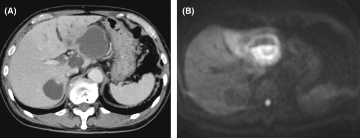
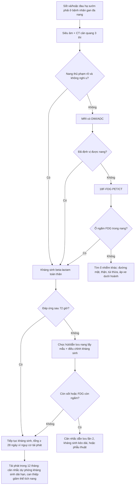
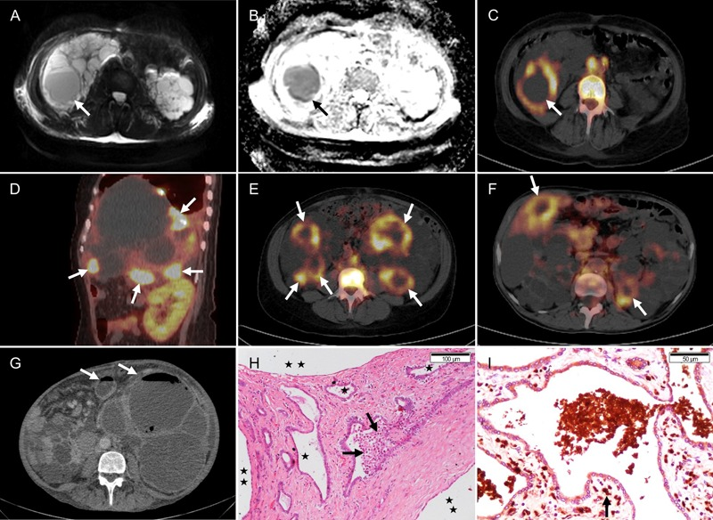
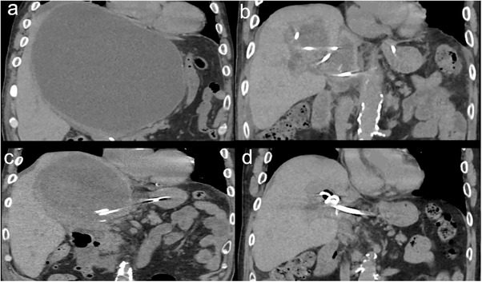
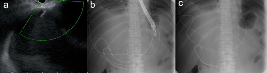

# 104 — Nhiễm trùng nang gan trong bệnh gan đa nang (ADPKD/PLD) / Infected hepatic cyst

**Tags:** `pattern:nang-phuc-tap` `vung:gan` `vung:than` `protocol:PET-CT-nang-gan` `incidentaloma:nang-gan`
**Mức chắc chắn (certainty):** tổng hợp y văn (literature synthesis) — nhóm tự biên từ y văn mở (Kidney Int Rep 2026, Braz J Med Biol Res 2014, J Gen Fam Med 2022, DEN Open 2026, Clin Kidney J 2019–2020), đối chiếu khuyến cáo KDIGO 2025 và EASL mà các bài gốc trích dẫn; không gắn một ca nguyên văn duy nhất.

## 1. Tổng quan bệnh học – cơ chế hình ảnh

- **Bối cảnh:** nang gan có ở **> 90% bệnh nhân ADPKD trên 35 tuổi**; **nhiễm trùng nang gan (liver cyst infection — LCI)** xảy ra ở **≤ 3%** bệnh nhân ADPKD nhưng là biến chứng **nặng nhất của gan đa nang (polycystic liver disease — PLD)**: nhập viện nhiều lần, suy dinh dưỡng, có ca phải **cắt gan bán phần hoặc ghép gan** (PMC12799584).
- **Vì sao nang bị nhiễm:** biểu mô lót nang có kiểu hình **biểu mô đường mật** tăng tiết và tăng sinh; khi có **nhiễm khuẩn huyết thoáng qua** (hay từ **đường tiêu hóa**, nhất là túi thừa đại tràng — **36%** bệnh nhân trong loạt có túi thừa) hoặc **can thiệp đường mật**, vi khuẩn vào dịch nang tù đọng → **viêm thành nang + ứ mủ** (PMC12799584).
- **Tiêu chuẩn chẩn đoán kinh điển (Sallée 2009, đang được dùng trong các loạt lớn):** **sốt > 38,5 °C kéo dài 3 ngày + đau/ấn đau gan + CRP > 50 mg/L + KHÔNG có bằng chứng xuất huyết nang trên CT** (PMC7367107). Tiêu chuẩn này **không đặc hiệu** — chính vì vậy hình ảnh giữ vai trò quyết định.
- **TẠI SAO đọc được trên từng phương thức (vật lý + mô bệnh):**
  - **CT:** dịch nang đơn giản **0–15 HU**; dịch mủ có **thành phần tế bào + protein** nên **đậm độ cao hơn nước** — thực hành dùng **ngưỡng chênh ≥ 10 HU so với nang đơn giản kề bên** (dữ liệu ngưỡng này xây trên nang thận — xem [bài 164](../164-nang-than-adpkd-bien-chung/lesson.md)). Dấu hiệu phụ: **thành nang dày, viêm mỡ quanh nang, bóng khí trong nang** (thể sinh hơi). **Hạn chế cốt tử:** thành nang mỏng, không ngấm thuốc rõ, và trong gan đa nang có **hàng chục nang nằm sát nhau** → CT **âm tính ở 7/7 đợt** trong một loạt, và chỉ **gợi ý 5/13 đợt (39%)** trong loạt lớn (PMC7367107, PMC12799584).
  - **MRI:** mủ **nhớt, nhiều tế bào** → **hạn chế khuếch tán: DWI sáng, ADC thấp**; T2 **không đồng nhất** (khác nang đơn giản T2 rất sáng, đồng nhất); T1 có thể **tăng nhẹ do protein**, nhưng **không mất tín hiệu khi fat-sat** (khác mỡ). Trong loạt 112 đợt, MRI chỉ được làm **2 đợt** — số liệu quá nhỏ để nói độ nhạy, nhưng cơ chế DWI là chốt để **phân biệt mủ với nước**.
  - **¹⁸F-FDG PET/CT:** bạch cầu trung tính trong **thành và dịch nang** tiêu thụ glucose mạnh → **ổ ngấm FDG khu trú**. Đây là phương thức **nhạy nhất**: **94/98 đợt (96%)** có PET dương tính, và **65% (61/94) có nhiều nang nhiễm cùng lúc** (PMC12799584). Vì vậy PET/CT không chỉ "chẩn đoán có/không" mà **định vị nang thủ phạm** — điều CT/MRI thường không làm được trong gan đa nang.
  - **Siêu âm:** rẻ, đầu tay, nhưng trong PLD **rất khó** vì vô số nang; chỉ dùng để chọc hút/dẫn lưu dưới hướng dẫn.

## 2. Mẫu hình + chẩn đoán phân biệt theo vị trí (gamut)

- **Mẫu hình A — một nang "đặc hơn" các nang còn lại:** nhiễm trùng nang, **xuất huyết nang**, nang đạm/mucin, nang có vách, **u nhầy nhú trong ống mật (IPNB)** hoặc **u nang nhầy buồng trứng di căn phúc mạc**.
- **Mẫu hình B — nang + khí:** nhiễm trùng sinh hơi (*E. coli*, *Klebsiella*), **rò nang–đường mật/ruột** sau can thiệp, áp-xe gan trên nền nang, khí do thủ thuật trước đó.
- **Mẫu hình C — tổn thương gan "dạng nang" nhưng KHÔNG phải nang:** áp-xe gan (không có vỏ biểu mô), **ung thư biểu mô tế bào gan (HCC) hoại tử**, di căn hoại tử, **u mạch máu khổng lồ** (ngấm thuốc lan tỏa), **nang sán lá gan** (vỏ canxi, nang con).
- **Mẫu hình D — sốt + đau hạ sườn phải ở bệnh nhân ADPKD:** nhiễm trùng nang gan, **nhiễm trùng nang thận** (đi kèm ở 3% đợt), **viêm đường mật**, viêm túi mật, **áp-xe dưới hoành**, viêm túi thừa.
- **Mnemonic "SỐT–NANG–PET":** **S**ốt/CRP cao · **Ố** (ổ nang lớn nhất, căng, thành dày) · **T**ăng đậm độ dịch + hạn chế khuếch tán · **N**ang nhiều ổ (65% nhiều nang cùng lúc) · **A**nh hưởng cả thận · **G**as (thể sinh hơi) · **PET** là chốt định vị.
- **Bối cảnh quyết định gamut:** **sốt + CRP 197 ± 96 mg/L** → nhiễm trùng; **đau + Hb giảm, không sốt** → xuất huyết; **sốt nhẹ + vàng da + giãn đường mật** → viêm đường mật; **không triệu chứng, tình cờ** → nang đơn giản/xuất huyết cũ.

## 3. Bảng so sánh phân biệt (ma trận đối chiếu)

| Thực thể (entity) | Hình ảnh điển hình (US/CT/MRI/PET) | Chốt vào (rule-in) | Chốt loại (rule-out) | Gợi ý xác nhận |
|---|---|---|---|---|
| **Nang gan nhiễm trùng (LCI)** | Nang đậm độ cao hơn nang bên cạnh (chênh **≥ 10 HU**), thành dày, viêm mỡ quanh nang; **DWI sáng/ADC thấp**; **PET ngấm FDG khu trú** | **Sốt + CRP > 50 mg/L + ổ FDG trong nang** (PET dương **96%** các đợt) | Nang T1 sáng đồng nhất, không ngấm FDG, CRP bình thường → không phải nhiễm trùng | **PET/CT** là chốt; cấy máu (**dương 80%** ca có vi khuẩn); chọc hút nang khi cần |
| **Xuất huyết nang** | CT **30–100 HU**, không ngấm; MRI **T1 sáng, không mất tín hiệu fat-sat**, mức dịch–dịch; **không ngấm FDG** | **T1 sáng + không ngấm + không sốt/CRP thấp** | Sốt + CRP cao + FDG dương → nhiễm trùng | So phim cũ; MRI T1 ± fat-sat |
| **Nang đơn giản** | **0–15 HU**, thành không thấy, T2 rất sáng đồng nhất, không vách/nốt | Đồng nhất, không thành, không triệu chứng | Thành dày, vách, nốt, đậm độ cao → không đơn giản | Không cần làm gì thêm |
| **Áp-xe gan (không do nang)** | Ổ dịch **có vỏ ngấm thuốc**, khí, viêm mỡ; bệnh nhân nhiễm trùng rõ | **Vỏ ngấm thuốc + khí + sốt cao** | Không thấy vỏ ngấm, nằm đúng vị trí nang cũ → nghĩ nang nhiễm | Chọc hút dưới hướng dẫn, cấy |
| **HCC hoại tử / di căn hoại tử** | Phần đặc **ngấm thuốc thì động mạch + washout**, vỏ không đều; **FDG dương** nhưng không theo hình nang | **Thành phần đặc ngấm thuốc** trong "nang" | Nang thuần dịch, không có nốt ngấm → loại u | MRI đa thì (HBP), sinh thiết |
| **IPNB / u nang nhầy** | Nang **nhiều vách**, thành dày không đều, **giãn ống mật thông với nang**, nốt trong lòng | **Thông với cây mật + nốt/vách dày** | Nang đơn thuần không thông mật, không nốt | MRCP, nội soi siêu âm |
| **Viêm đường mật** | Giãn ống mật trong gan, dày thành ống mật, có thể sỏi; **không có ổ nang đơn độc** | **Giãn đường mật + tam chứng Charcot** | Không giãn mật, có nang thủ phạm rõ → LCI | MRCP; ERCP khi cần giải áp |
| **Nang sán lá gan** | Nang **vỏ canxi**, **nang con**, không ngấm; bờ rõ | **Vỏ canxi + nang con + dịch tễ** | Không canxi, không nang con → không phải sán | Huyết thanh chẩn đoán; **không chọc khi chưa loại sán** |

*(A) CT cản quang: nang lớn thùy trái, thành không ngấm thuốc rõ; (B) DWI: nang **tăng tín hiệu mạnh** do dịch mủ hạn chế khuếch tán. Nguồn: Yoshino Y, Ishida T. — J Gen Fam Med 2022 (PMC9634129), CC BY 4.0.*

### Ba dấu hiệu quyết định trên mặt cắt
- **"Nang sáng hơn hàng xóm" trên CT:** so **cùng một lát cắt**, cùng cửa sổ với nang đơn giản bên cạnh — chênh **≥ 10 HU** là gợi ý (không tự chốt).
- **DWI/ADC:** mủ **hạn chế khuếch tán**; nang xuất huyết cũ **không** hạn chế rõ → đây là cách phân biệt mủ/máu **không cần tiêm thuốc**, hữu ích khi bệnh nhân suy thận.
- **FDG:** ổ ngấm **khu trú đúng thành/dịch nang**, không phải ngấm lan tỏa của nhu mô gan bị viêm — và **luôn đối chiếu với nang thủ phạm nghi ngờ trên CT/MRI** để tránh dương tính giả do viêm quanh nang.

## 4. Protocol chụp + phân tầng điều trị

**Chuỗi hình ảnh (từ rẻ đến đắt, theo câu hỏi lâm sàng):**

1. **Siêu âm bụng:** xác định có nang, có thành dày/dịch "không trong"; **không đủ để loại trừ** trong PLD.
2. **CT bụng có cản quang 3 thì** (lát **1–2 mm**): thì động mạch – tĩnh mạch cửa – muộn; mục tiêu là **loại u đặc ngấm thuốc** và tìm **khí, vách, thành dày**. Không dùng CT đơn thuần để "trấn an": trong loạt 112 đợt, CT chỉ gợi ý **39%** và **âm tính 7/7** ở loạt nhỏ (PMC12799584, PMC7367107).
3. **MRI gan (T1 in/out-phase, T1 fat-sat, T2, DWI/ADC, sau tiêm thì muộn):** khi CT không kết luận hoặc cần phân biệt mủ–máu–u; **không cần gadolinium nếu chỉ cần DWI** (thận yếu).
4. **¹⁸F-FDG PET/CT:** chỉ định khi **sốt/CRP cao kéo dài mà CT/MRI không định vị được nang thủ phạm**, hoặc khi cân nhắc dẫn lưu/sinh thiết. Nhịn ăn **≥ 6 giờ**, glucose máu **< 11 mmol/L** trước tiêm; đọc sau **60 phút**. Giá trị: dương tính **96%** các đợt; **hạn chế**: viêm quanh nang, nhiễm trùng ổ khác, mô ghép thận viêm → dương tính giả.
5. **Chọc hút/dẫn lưu qua da:** vừa **điều trị** vừa **lấy mẫu** (nhuộm Gram, cấy, tế bào); ưu tiên nang **lớn, nông, dễ tiếp cận**, có **thành dày** hoặc **khí**; **luôn loại trừ nang sán** trước khi chọc.

**Ngưỡng điều trị (số liệu từ loạt 112 đợt, PMC12799584):**

- Kháng sinh **≥ 14 ngày** là yếu tố bảo vệ với **thất bại điều trị/tái phát sớm** (**OR 0,03**; 95% CI 0–0,23); **≥ 28 ngày** bảo vệ với **tái phát trong 12 tháng** (**OR 0,12**; 95% CI 0,02–0,65). Thời gian thực tế trong loạt: **trung vị 40 ngày (28–42)**; khuyến cáo **≥ 4 tuần**, kéo dài tùy ca (KDIGO 2025/EASL).
- **Vi khuẩn:** xác định được tác nhân **63%** (cấy máu **80%** ca dương); **E. coli 56%**, *K. pneumoniae* **14%**, đa loài **7%**. **E. coli kháng** cotrimoxazole **34%**, amoxicillin–clavulanate **19%**, fluoroquinolone **16%**, cephalosporin thế hệ 3 **13%**, piperacillin–tazobactam **9%** → **beta-lactam là lựa chọn khởi đầu hợp lý**, chuyển fluoroquinolone khi có kháng sinh đồ (tác giả không thấy fluoroquinolone vượt trội về kết cục).
- **Kết cục:** thất bại điều trị **14%**, tăng bậc kháng sinh **13%**, **dẫn lưu nang 5%**, cắt gan bán phần **1%**; tái phát sớm (< 2 tháng) **16%**; gộp thất bại + tái phát sớm **27%**; **tái phát muộn 45% số đợt**, **39% bệnh nhân** có ≥ 1 lần; nguy cơ tích lũy **24% ở 1 năm** và **55% ở 5 năm**.
- **Theo dõi sau điều trị:** PET/CT lặp lại có giá trị định hướng: **8 đợt còn ngấm FDG** → **75% (6/8)** tái phát/tái phát sớm trong 12 tháng, so với **33% (3/9)** ở nhóm hết ngấm (khác biệt **chưa có ý nghĩa thống kê**, p = 0,15) — dùng để **cân nhắc kéo dài kháng sinh**, không dùng để chốt.

## 5. Biến thể bình thường và cạm bẫy

- **CT âm tính KHÔNG loại trừ nhiễm trùng nang:** trong loạt 7 đợt có đo CA 19-9, **CT âm tính cả 7** nhưng PET dương **6/6** (PMC7367107). Đừng "trấn an" bằng CT ở bệnh nhân sốt dai dẳng.
- **CA 19-9 không dùng để chẩn đoán:** trung vị **29,7 kU/L** (IQR 16,2–81,5), **4/7 đợt trong giới hạn bình thường**, và **3/6 đợt lại GIẢM so với nền**; CA 19-9 còn tăng theo **thể tích nang gan và GGT** nên dễ gây nhiễu (PMC7367107). Tăng CA 19-9 **không đồng nghĩa ung thư đường mật** ở người gan đa nang.
- **T1 sáng ≠ mủ:** máu cũ (methemoglobin) cũng T1 sáng và **không mất tín hiệu khi fat-sat**; mủ thường **không T1 sáng đặc hiệu** mà chốt bằng **DWI + FDG**. Đọc T1 sáng là "nhiễm trùng" sẽ dẫn tới kháng sinh vô ích.
- **Nhiều nang cùng nhiễm (65%):** dẫn lưu một nang mà bỏ nang thứ hai là nguyên nhân thất bại điều trị — PET/CT giúp liệt kê **tất cả** ổ.
- **Không sốt, không đau:** **18%** đợt không sốt và **44%** không đau; ở người ghép thận hoặc lớn tuổi, bệnh có thể chỉ biểu hiện **CRP cao + mệt** (PMC12799584).
- **Dương tính giả FDG:** nang cạnh ổ viêm, sau chọc hút/dẫn lưu (viêm thành nang), mô ghép thận, nhiễm trùng tiểu — luôn đọc **cùng CT** và đối chiếu **hình dạng nang**.
- **Bẫy can thiệp:** chọc nang khi chưa loại **nang sán** (nguy cơ sốc phản vệ/sống sán lan) hoặc khi "nang" thực ra là **u nhầy/IPNB** (nguy cơ gieo mầm phúc mạc).

## 6. Tự lượng giá — Blind Quiz

**Ca 1 — Nam 58 tuổi, ADPKD, sốt 39 °C ba ngày, đau hạ sườn phải, CRP 210 mg/L. CT bụng có nang thùy trái "khác các nang còn lại".**

- Câu hỏi: Nang nào là "thủ phạm"? Dấu hiệu nào trên DWI giúp phân biệt mủ với nước? Ba chẩn đoán phân biệt?

<b>Bấm để hiện đáp án</b>

- **Findings:** (A) nang lớn thùy trái, thành không ngấm thuốc rõ, đậm độ cao hơn nang đơn giản thùy phải; (B) **DWI tăng tín hiệu mạnh** tại nang thùy trái → **hạn chế khuếch tán**.
- **Chẩn đoán:** nang gan nhiễm trùng. Cơ chế: dịch mủ nhớt + nhiều tế bào → chuyển động Brown của nước bị hạn chế → DWI sáng, ADC thấp; nang đơn giản thì DWI tối.
- **Phân biệt:** xuất huyết nang (T1 sáng, không hạn chế khuếch tán), áp-xe gan (vỏ ngấm thuốc), u hoại tử (phần đặc ngấm thuốc).
- Nguồn: Yoshino Y, Ishida T., *J Gen Fam Med* 2022 (PMC9634129), CC BY 4.0.

**Ca 2 — Nữ 61 tuổi, PLD, đã mở cửa sổ nang gan 2 năm trước, sốt kéo dài, CRP 180 mg/L, CT không chỉ rõ nang nào.**

- Câu hỏi: Vì sao CT thất bại ở đây? PET/CT thêm được thông tin gì? Bước tiếp theo?

<b>Bấm để hiện đáp án</b>

- **Findings:** PET/CT cho thấy **nhiều ổ ngấm FDG trong các nang gan** sau mở cửa sổ nang (panel D) — tức **nhiều nang nhiễm cùng lúc**, không phải một ổ.
- **Vì sao CT mờ:** trong gan đa nang, hàng chục nang sát nhau, thành mỏng, dịch chênh đậm độ ít → khó chỉ ra nang thủ phạm.
- **Bước tiếp theo:** kháng sinh toàn thân ≥ 4 tuần; **dẫn lưu nang lớn/dễ tiếp cận** nếu không đáp ứng sau 72 giờ; cấy máu + cấy dịch nang.
- Nguồn: Balbo BEP et al., *Braz J Med Biol Res* 2014 (PMC4123838), CC BY-NC — ảnh giữ nguyên bản.

**Ca 3 — Nam 47 tuổi, PLD, nang gan trái 20 × 16 cm, sốt và đau bụng; CT đợt này khác đợt cũ.**

- Câu hỏi: Hai dấu hiệu mới trên CT gợi ý nhiễm trùng? Khi nào chọn dẫn lưu qua da thay vì chỉ kháng sinh?

<b>Bấm để hiện đáp án</b>

- **Findings:** (a) **thành nang dày lên** và **dịch trong nang tăng đậm độ** so với lần chụp trước; (b) sau dẫn lưu ngoài, nang **xẹp dần** — xác nhận ổ mủ.
- **Chẩn đoán:** nang gan nhiễm trùng trên nền PLD; dẫn lưu ngoài + kháng sinh.
- **Chỉ định dẫn lưu:** không đáp ứng sau **72 giờ** kháng sinh đủ liều, nang lớn dễ tiếp cận, có khí trong nang, cần lấy mẫu vi sinh, hoặc nhiễm trùng tái phát. Lưu ý: loạt 112 đợt chỉ dẫn lưu **5%** — **không dẫn lưu thường quy** mọi nang nhiễm.
- Nguồn: Endo K et al., *DEN Open* 2026 (PMC12816876), CC BY 4.0.

*Đường dẫn lưu nang gan qua dạ dày dưới hướng dẫn nội soi siêu âm (EUS) — lựa chọn khi nang nằm sát dạ dày và không tiếp cận được qua da an toàn. Nguồn: Endo K et al., DEN Open 2026 (PMC12816876), CC BY 4.0.*

## Bài liên quan chéo
- [157 – Bệnh thận đa nang ADPKD/ARPKD & gan đa nang](../157-benh-than-da-nang-adpkd-arpkd/lesson.md) (bản đồ bệnh nền)
- [164 – Nang thận ADPKD có biến chứng](../164-nang-than-adpkd-bien-chung/lesson.md) (nhiễm trùng/xuất huyết nang thận)
- [126 – Thể tích gan & điều trị nội khoa PLD](../126-the-tich-gan-dieu-tri-noi-khoa-PLD/lesson.md)
- [142 – Can thiệp giảm thể tích gan PLD](../142-can-thiep-giam-the-tich-gan-pld/lesson.md)
- [139 – Sán lá gan](../139-san-la-gan/lesson.md) (loại trừ trước khi chọc nang)

> Không dùng để chẩn đoán độc lập khi chưa có người hướng dẫn.
