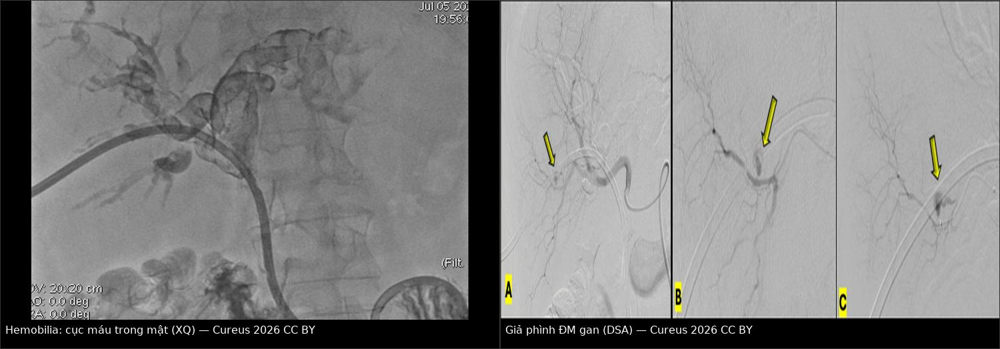
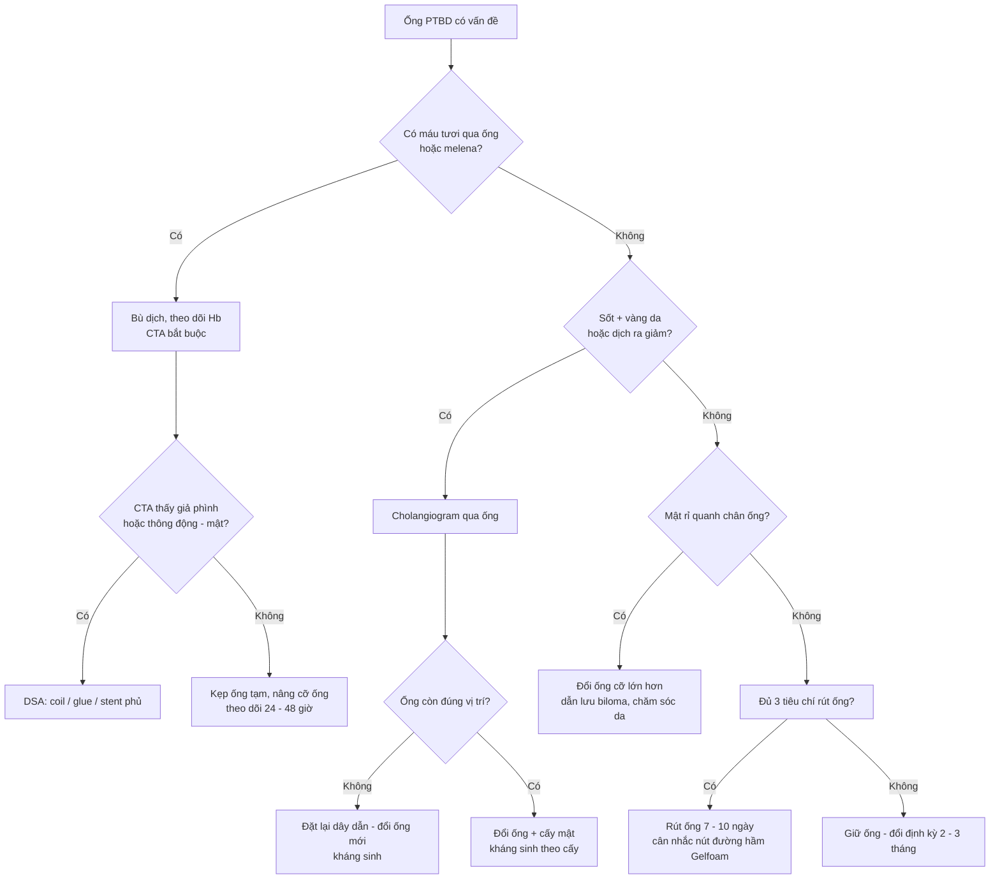
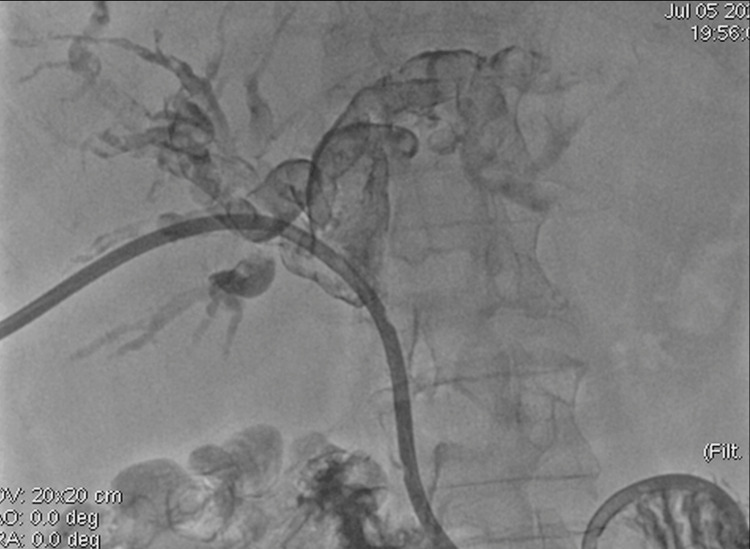
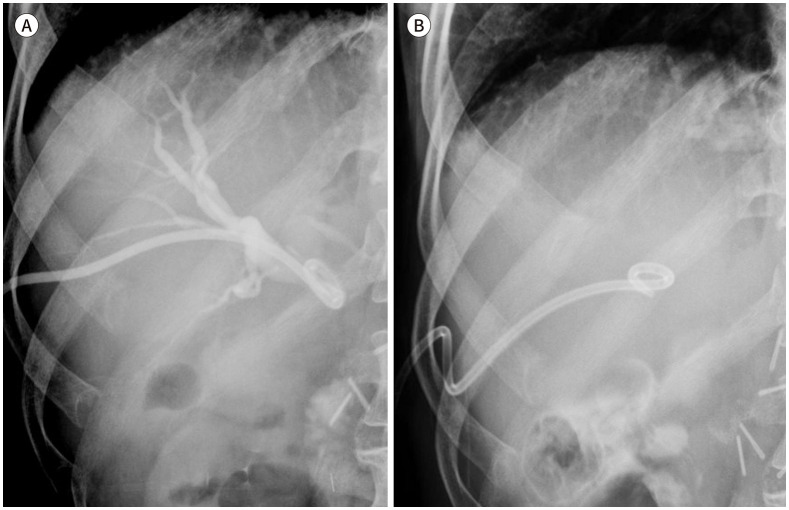
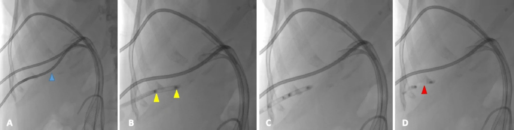

# 105 — Theo dõi ống dẫn lưu mật qua da: chăm sóc, rút ống theo đường hầm & biến chứng muộn / Follow-up of percutaneous transhepatic biliary drainage: care, tract removal & late complications

**Tags:** `pattern:tac-mat` `pattern:di-tru-catheter` `pattern:hemobilia` `pattern:ro-mat` `vung:duong-mat` `protocol:PTBD` `incidentaloma:catheter-di-tru`
**Mức chắc chắn (certainty):** tổng hợp y văn (literature synthesis) — tự biên từ y văn mở (CC BY 4.0, CC BY-NC 4.0, CC BY-NC-ND 4.0); các ca minh họa là **ca nguyên văn** của bài gốc (giữ đúng tuổi/thời điểm trong chú thích).

> **Đây là bài "sau khi đặt ống", không phải bài "đặt ống".**
> [910 – Dẫn lưu: áp-xe, PTBD & thận qua da](../910-abscess-biliary-nephrostomy/lesson.md) phủ **kỹ thuật chọc – Seldinger – xác nhận vị trí**; [137 – Theo dõi stent/dẫn lưu đường mật](../137-theo-doi-stent-dan-luu-duong-mat-di-tru-tac-nhiem-trung/lesson.md) phủ **stent kim loại/nhựa và tắc stent**; [131 – Tắc mật](../131-tac-mat/lesson.md) phủ **chẩn đoán tắc mật**. Bài này trả lời 4 câu hỏi của **tuần thứ 2 trở đi**: ống còn thông không? còn đúng chỗ không? chăm sóc tại nhà thế nào? **rút ống lúc nào và rút như thế nào để không rò mật?**

## 1. Tổng quan bệnh học – cơ chế hình ảnh

### 1.1 Ống PTBD là gì và "sống" nhờ đâu

- **PTBD (percutaneous transhepatic biliary drainage)** = catheter **8–10 Fr** đưa qua nhu mô gan vào đường mật. Ba kiểu: **dẫn lưu ngoài (external)** — mật chỉ ra túi; **dẫn lưu trong–ngoài (internal–external, "ring catheter")** — đầu ống qua chỗ hẹp xuống tá tràng, mật chảy theo 2 đường; **chuyển sang stent trong (internal stent)** — bỏ phần ra da.
- **Ống PTBD không "cắm" vào đường mật — nó được GIỮ bởi 3 thứ:** (1) **vòng pigtail** mở trong lòng ống mật, (2) **đường hầm xuyên nhu mô gan** (tract) siết quanh thân ống, (3) **neo da** (khâu/chốt cố định). Mất **một** trong ba → ống di trú; mất **cả ba** → ống rơi ra ngoài.
- **TẠI SAO ống tắc (vật lý + mô bệnh):** lòng ống 8–10 Fr chỉ ~2,7–3,3 mm; mật là dịch giàu **muối mật + protein + canxi**; tiếp xúc vật liệu lạ → **màng sinh học (biofilm) vi khuẩn** bám thành ống rồi **kết tủa cặn bùn (sludge)**, kèm **máu đông** (sau hemobilia), **mảnh u** hoặc **thức ăn trào ngược (duodenobiliary reflux)** → tắc dần trong **vài tuần**. Đây là lý do ống phải được **rửa định kỳ** và **đổi định kỳ** dù bệnh nhân hoàn toàn không triệu chứng.
- **TẠI SAO hemobilia (cơ chế giải phẫu):** nhánh **động mạch gan** và **tĩnh mạch cửa** chạy sát đường mật trong khoảng cửa; đầu ống cứng hoặc mũi chọc xuyên qua thành ống mật vào mạch → **thông động–mật (arterio-biliary fistula)** hoặc **giả phình (pseudoaneurysm)**. Máu vào đường mật theo **gradient áp lực** (động mạch ~90–100 mmHg ≫ đường mật ~10–15 cmH₂O) nên chảy **thành tia, ồ ạt**, đông lại trong lòng mật thành **cục máu (clot)** — vừa gây **thiếu máu**, vừa **bít ống** → chẩn đoán dễ bị "đổ lỗi cho ống tắc" và bỏ sót nguồn chảy.
- **TẠI SAO rút ống có thể gây rò mật:** đường hầm xuyên gan **chưa có vỏ xơ vững** trong những tuần đầu. Khi rút, lỗ hổng giữa **đường mật ↔ bao gan ↔ khoang phúc mạc/màng phổi** còn mở; nếu áp lực đường mật cao hoặc đường vào **quá cao xuyên qua màng phổi**, mật chảy vào **ổ phúc mạc (biloma, viêm phúc mạc mật)** hoặc **màng phổi (biliothorax)**.

### 1.2 Ngưỡng định lượng bắt buộc

| Đại lượng | Con số | Nguồn |
|---|---|---|
| Biến chứng chung khi đặt PTBD | **~10%** ca (nhẹ: đau, di trú ống; nặng: có thể tử vong) | World J Radiol 2026 (PMC13527549) |
| Nhiễm trùng sau PTBD | **7,4%** (337 BN); yếu tố độc lập: **cổ trướng, nhiều mũi chọc, neutrophil cao, Hb thấp**; AUC mô hình **0,825** | BMC Surg 2026 (PMC13343715) |
| Xuất huyết sau PTBD | **9,5%** (337 BN); yếu tố độc lập: **Hb thấp, prealbumin thấp**; AUC **0,866** | BMC Surg 2026 (PMC13343715) |
| Xuất huyết sau can thiệp mật qua da (tổng quan) | **1,1–9,9%** | World J Radiol 2026 (PMC13527549) |
| Di trú ống PTBD | **30,56%** (224/733 lần đặt); **có triệu chứng 19,92%**; trung vị **32 ngày** (1–233 ngày) | J Korean Soc Radiol 2023 (PMC10721429) |
| Yếu tố dự báo di trú có triệu chứng | nam **OR 1,64**; đường vào **bên phải OR 1,57**; **góc vào tăng OR 1,015/độ**; **pigtail không khép kín OR 1,67** | J Korean Soc Radiol 2023 (PMC10721429) |
| Rò mật quanh ống (pericatheter leak) | **tới 33%** BN PTBD | ICRI guideline 2021 (PMC8448229) |
| Rửa ống tại nhà | **20 mL NaCl 0,9% vô khuẩn × 2–3 lần/ngày** | ICRI guideline 2021 (PMC8448229) |
| Đổi ống định kỳ | **mỗi 2–3 tháng**, dưới che phủ kháng sinh (giảm viêm đường mật) | ICRI guideline 2021 (PMC8448229) |
| Rút ống sớm (đủ tiêu chí) | **7–10 ngày**: biến chứng sau rút **2,5%** vs **1,9%** (p > 0,999); nằm viện **12 vs 17 ngày** (p < 0,001) | J Clin Med 2026 (PMC13607037) |
| Nút đường hầm khi rút | kỹ thuật thành công **100%** (84 lần/54 BN); thành công lâm sàng **87%**; **5/54** tràn dịch màng phổi/cổ trướng do plug di trú, kéo dài nằm viện **4,5 ± 0,9 ngày** | Interv Radiol 2026 (PMC13572925) |
| Chăm sóc tăng cường sau xuất viện (meta-analysis 9 RCT, 854 BN) | giảm **nhiễm trùng đường mật RR 0,42**; **tắc ống RR 0,23**; **di trú ống RR 0,31**; **nhiễm trùng da quanh ống RR 0,30**; **tái nhập viện RR 0,34** | World J Clin Cases 2024 (PMC11235434) |

## 2. Mẫu hình + chẩn đoán phân biệt theo cơ chế hỏng ống (Gamut)

### 2.1 Bốn cơ chế hỏng ống — hỏi "ống hỏng theo kiểu gì?" trước khi hỏi "bệnh gì?"

- **TẮC (occlusion):** cặn bùn/biofilm, cục máu, mảnh u, thức ăn trào ngược. Biểu hiện: **dịch ra giảm đột ngột + vàng da/bilirubin tăng lại + sốt**, hoặc **mật rỉ quanh chân ống** (vì mật tìm đường khác).
- **DI TRÚ (migration/dislodgement):** ống tụt ra ngoài da, hoặc tụt sâu vào trong gan, hoặc **đầu pigtail bật khỏi lòng ống mật**. Biểu hiện: **chân ống ướt, đau tăng, sốt, dịch ra ít** — bệnh nhân thường mô tả "ống dài ra".
- **XUẤT HUYẾT (hemobilia):** máu **tươi** trong túi/qua ống, có khi **melena**; tam chứng Quincke (**vàng da – đau hạ sườn phải – melena**) chỉ gặp một phần.
- **RÒ (leak):** mật rỉ **quanh** ống ra da (pericatheter leak) → **kích ứng da, nhiễm trùng da**; hoặc mật tích trong **ổ phúc mạc (biloma)** / **khoang màng phổi (biliothorax)** khi đường hầm hở.

### 2.2 Gamut theo THỜI ĐIỂM (quyết định nguyên nhân)

- **< 48 giờ:** biến chứng **thủ thuật** — chảy máu/hemobilia, tràn dịch màng phổi, thủng, đau, nhiễm trùng huyết do bơm mật nhiễm khuẩn.
- **3 ngày – 4 tuần:** **di trú ống** (trung vị 32 ngày), **tắc sớm do cục máu/sludge**, **viêm đường mật do dẫn lưu chưa đủ** (còn phân thùy chưa dẫn lưu).
- **> 1 tháng – nhiều tháng:** **tắc mạn do biofilm/sludge**, **u phát triển bít đầu ống**, **ống gãy/lão hóa vật liệu**, **tái hẹp**.

### 2.3 Gamut theo TRIỆU CHỨNG dẫn đường

| Bệnh cảnh | Nghĩ trước tiên |
|---|---|
| Sốt + vàng da tái phát, ống còn tại chỗ | **Viêm đường mật do ống tắc** hoặc **dẫn lưu chưa đủ** (còn thùy chưa chọc) |
| Sốt + chân ống ướt + ống "dài ra" | **Di trú ống** |
| Máu tươi qua ống / melena / Hb tụt | **Hemobilia** (giả phình, thông động–mật) |
| Dịch ra rất ít, ống cứng, bơm rửa thấy cản | **Tắc ống** (sludge/clot) |
| Đau ngực/khó thở sau rút hoặc đổi ống | **Biliothorax / tràn dịch màng phổi** |
| Không triệu chứng, ống quá hạn đổi | **Tắc "âm thầm"** — chỉ phát hiện khi bilirubin tăng |

## 3. Bảng so sánh phân biệt (ma trận đối chiếu)

| Thực thể (entity) | Hình ảnh/lâm sàng điển hình | Chốt vào (rule-in) | Chốt loại (rule-out) | Gợi ý xác nhận |
|---|---|---|---|---|
| **Tắc ống do cặn bùn** | Dịch ra giảm, bilirubin tăng lại, **không sốt hoặc sốt nhẹ**; cholangiogram qua ống: **khuyết đổ đầy trong lòng ống**, không thấy mật xuống tá tràng | **Bơm rửa thấy lực cản + cholangiogram qua ống cho thấy ống không thông** | Mật chảy tốt qua ống xuống tá tràng + bilirubin giảm → **không tắc** | Bơm rửa ấm; **đổi ống** (đừng chỉ tăng kháng sinh) |
| **Di trú ống** | So **phim cũ**: đầu pigtail **tụt khỏi ống mật**, ống ngắn/rút ra ngoài; chân ống ướt, đau | **Thay đổi vị trí đầu ống so phim trước + mất lưu thông mật** | Đầu ống **không đổi vị trí** trên 2 phim → không di trú | X-quang bụng/fluoroscopy; đặt lại dây dẫn qua ống cũ nếu còn đường |
| **Hemobilia – giả phình ĐM gan** | Máu tươi qua ống ± melena; **CTA thấy giả phình**; cholangiogram có **cục máu hình khuyết** | **Máu tươi qua ống + Hb tụt + CTA/DSA có giả phình hoặc thông động–mật** | Chỉ **váng máu nhẹ, tự hết, Hb ổn định** → theo dõi, không can thiệp | **CTA bắt buộc**; **DSA + coil/glue/stent phủ** |
| **Hemobilia do thông TĨNH MẠCH CỬA** | Máu **sẫm**, chảy chậm, áp lực thấp; cholangiogram thấy **nhánh cửa hiện hình** | **Nhánh tĩnh mạch cửa hiện trên cholangiogram + máu sẫm** | Máu tươi phun thành tia → nghĩ **động mạch** | Kẹp ống tạm thời/nâng cỡ ống; nếu không hết → can thiệp |
| **Rò mật quanh ống** | Da quanh chân ống **đỏ, ướt, đau**; gạc thấm mật; ± biloma | **Mật rỉ quanh thân ống + ống vẫn thông** | Không rỉ + ống thông tốt → không rò | Đổi ống cỡ lớn hơn, đặt lại đúng vị trí, dẫn lưu biloma, túi hút dán |
| **Viêm đường mật tái phát** | Sốt, vàng da, CRP/bili tăng; CT: **giãn mật lại dù còn ống** | **Sốt + giãn mật tái phát + ống tắc/di trú** | Giãn mật không tăng + CRP bình thường → theo dõi | Cấy máu + cấy mật; kháng sinh; **đổi/nâng ống** |
| **Ống gãy (fracture)** | X-quang: ống **đứt thành nhiều đoạn**, có mảnh trong đường mật; bơm rửa không được | **Đứt ống trên X-quang + không rửa được** | Ống còn liền, chỉ gập → nắn lại | Nội soi lấy mảnh trong mật + đặt ống mới |
| **Biliothorax / tràn dịch sau rút** | Đau ngực, khó thở, tràn dịch **mới** sau rút/đổi ống; dịch màu mật | **Tràn dịch mới + bilirubin dịch cao hơn huyết thanh** | Tràn dịch cũ không đổi → không do thủ thuật | CT ngực; dẫn lưu màng phổi; nút đường hầm |

*Trái: cholangiogram qua ống dẫn lưu — **khuyết đổ đầy trong lòng đường mật** do cục máu. Phải (A→C): chụp mạch gan chọn lọc thấy **giả phình nhánh động mạch gan** (A, mũi tên), thoát mạch thì sớm (B), và **coil loại bỏ hoàn toàn giả phình** (C). Bệnh nhân nữ 74 tuổi, hemobilia 36 giờ sau đặt PTBD. Nguồn: Latorre Pinto A, Cureus 2026 (PMC13102264), CC BY 4.0 — ảnh ghép letterbox giữ nguyên tỷ lệ.*

## 4. Protocol theo dõi + thuật toán xử trí

### 4.1 Lịch theo dõi chuẩn (sau khi xuất viện)

| Thời điểm | Việc phải làm |
|---|---|
| **Hằng ngày (bệnh nhân/người nhà)** | Ghi **lượng mật ra (mL/24h)**, màu mật (vàng trong / sẫm / có máu), **rửa ống 20 mL NaCl 0,9% × 2–3 lần**, kiểm tra **neo da**, chăm sóc da quanh chân ống, thay túi |
| **1 tuần đầu** | Bilirubin, CRP, công thức máu; kiểm tra vị trí ống; **siêu âm** nếu dịch ra bất thường |
| **Mỗi 2–3 tháng** | **Đổi ống định kỳ** dưới che phủ kháng sinh (giảm viêm đường mật) |
| **Mỗi 3–6 tháng + khi có triệu chứng** | Bilirubin/ALP; **cholangiogram qua ống** hoặc MRCP nếu nghi tắc; CT nếu nghi u tiến triển |
| **Bất kỳ lúc nào có sốt/đau/máu** | Khám ngay — không chờ lịch |

### 4.2 Tiêu chí RÚT ỐNG (3 tiêu chí + nghiệm pháp kẹp)

1. **Viêm đã lắng:** sốt hết, WBC và CRP **giảm so với lúc đặt ống**.
2. **Tắc mật đã giải:** cholangiogram qua ống **không còn khuyết tắc, không thoát mạch ra ngoài** (so với phim lúc đặt).
3. **Nghiệm pháp kẹp (clamp test) âm tính:** kẹp ống đủ thời gian theo dõi mà **không đau, không sốt, không xấu đi về sinh hóa, huyết động ổn**.
- **Đủ 3 tiêu chí → rút được ở ngày 7–10** (nguyên nhân thường gặp: sỏi ống mật chủ, hẹp lành tính, một số tắc mật ác tính chọn lọc) — tỉ lệ biến chứng sau rút **2,5%**, chủ yếu **biloma 1,5%**, viêm phúc mạc mật 0,5%, hemobilia 0,5%.
- **Thiếu bất kỳ tiêu chí nào → KHÔNG rút:** giữ ống, đổi ống, hoặc chuyển **stent trong** nếu tắc không thể giải (xem [137](../137-theo-doi-stent-dan-luu-duong-mat-di-tru-tac-nhiem-trung/lesson.md)).

### 4.3 Rút ống "theo đường hầm" — vì sao phải nghĩ tới nút đường hầm

- **Đường hầm xuyên gan** là một lỗ thật giữa đường mật và **bao gan/bề mặt gan**; rút ống ra là **mở lỗ đó**. Nếu đường vào **cao, sát vòm hoành**, lỗ hổng thông với **khoang màng phổi** → **biliothorax**.
- **Kỹ thuật nút đường hầm bằng Gelfoam (kinh nghiệm 84 lần/54 BN):** cuộn Gelfoam thành **trụ**, đánh dấu **Lipiodol 2 đầu** để thấy trên fluoroscopy, đẩy qua **sheath mạch máu 8 Fr** đặt trong đường hầm, kéo sheath và đẩy plug sao cho plug **vươn tới bao gan**. Kết quả: **bít kín 100%**, **không rò mật/chảy máu 87%**; biến chứng nhẹ: **2 ca chảy máu đường hầm tự hết**; **5 ca tràn dịch màng phổi/cổ trướng do plug di trú** (nằm viện thêm 4,5 ± 0,9 ngày).
- **Nguyên tắc chọn:** nút đường hầm khi (a) đã đặt stent trong và không cần đường vào nữa, (b) đường vào **xuyên qua màng phổi/ngực bụng**, (c) bệnh nhân **cổ trướng** (mật rò vào dịch cổ trướng dễ viêm phúc mạc), (d) rút ống ở bệnh nhân **đông máu xấu** (nguy cơ chảy máu đường hầm).

### 4.4 Thuật toán "ống có vấn đề"

## 5. Biến thể bình thường và cạm bẫy

- **Khí trong đường mật (aerobilia) sau PTBD là BÌNH THƯỜNG** — ống nối đường mật với không khí ngoài da. **Đừng** gọi là "đường mật hoại tử" hay "áp-xe khí"; chỉ lo khi có **sốt + khí trong nhu mô/thành mạch** (nhiễm khuẩn sinh khí).
- **Bọt khí giả khuyết đổ đầy:** khi bơm mật qua ống, bọt khí tạo **khuyết tròn, di động, thay đổi khi bơm thêm** — khác **cục máu/sỏi** (cố định, bờ rõ, không đổi). Bơm chậm, bơm lặp lại để phân biệt; **đừng mổ vì bọt khí**.
- **Giả ảnh beam-hardening của ống/vật liệu kim loại** trên CT che mất tổn thương sát ống — đọc thêm **MRCP** hoặc **cửa sổ khác** thay vì kết luận "không thấy u".
- **Cạm bẫy "thỏa mãn tìm kiếm" (satisfaction of search):** đã thấy ống đúng vị trí là dừng — bỏ sót **giả phình động mạch**, **biloma**, **áp-xe phân thùy chưa dẫn lưu** ở thì tĩnh mạch. Luôn đọc **toàn bộ gan** trên thì động mạch + tĩnh mạch, không chỉ nhìn ống.
- **Cạm bẫy "ống tắc = tăng kháng sinh":** tắc cơ học **không** đáp ứng kháng sinh. Nếu sốt mà **không đổi/nâng ống** → viêm đường mật tái phát và có thể **sốc nhiễm khuẩn**.
- **Cạm bẫy thời gian đổi ống:** bệnh nhân bỏ lịch đổi ống **11 tháng** (lịch 3 tháng) đã **gãy ống thành 3 mảnh** trong đường mật, phải lấy qua nội soi — hậu quả của **"ống không đau nên không cần đổi"**.
- **Rút ống ở bệnh nhân cổ trướng/đông máu xấu:** tăng nguy cơ **rò mật vào dịch cổ trướng** và **chảy máu đường hầm** → ưu tiên **nút đường hầm** + bù đông máu trước.

## 6. Tự lượng giá — Blind Quiz

**Ca 1 — Nữ 74 tuổi, vàng da do u rốn gan, đặt PTBD. 36 giờ sau: máu tươi qua ống, Hb tụt, cần truyền 2 đơn vị hồng cầu.**

- Câu hỏi: (1) Dấu hiệu trên cholangiogram là gì? (2) Nguồn chảy nằm ở đâu? (3) Bước chẩn đoán và điều trị tiếp theo?

<b>Bấm để hiện đáp án</b>

- **Dấu hiệu:** nhiều **khuyết đổ đầy dạng đường và dạng tròn** trong lòng đường mật = **cục máu đông** trong hemobilia (không phải sỏi: sỏi có bờ rõ, không xuất hiện sau thủ thuật 36 giờ).
- **Nguồn chảy:** **giả phình nhánh động mạch gan** (xác nhận bằng chụp mạch gan chọn lọc — ảnh trong phần 3).
- **Điều trị:** bù dịch/máu + **DSA can thiệp** (coil ± glue ± stent phủ) để loại giả phình. Tỉ lệ xuất huyết sau can thiệp mật qua da **1,1–9,9%**; **CTA là bắt buộc** để tìm nguồn và lập kế hoạch.
- **Phản biện:** hemobilia có thể **tự cầm** nếu chỉ rỉ máu nhẹ, huyết động ổn — nhưng **máu tươi + Hb tụt** thì không chờ.
- Nguồn ảnh: Latorre Pinto A, Cureus 2026 (PMC13102264), CC BY 4.0.

**Ca 2 — Nam 68 tuổi, PTBD vì hẹp đường mật ác tính. 5 tuần sau: sốt 38,8 °C, vàng da tăng, túi mật ra chỉ 80 mL/24h (trước 400 mL).**

- Câu hỏi: (1) Hai khả năng hàng đầu? (2) Dấu hiệu nào trên phim phân biệt? (3) Xử trí?

<b>Bấm để hiện đáp án</b>

- **Hai khả năng:** **tắc ống** và **di trú ống** (kèm viêm đường mật do dẫn lưu không đủ).
- **Phân biệt:** so **phim ngay sau đặt** — nếu **đầu pigtail tụt khỏi ống mật/ống ngắn đi** → di trú; nếu vị trí **không đổi** mà cholangiogram qua ống **không thấy mật xuống tá tràng** → tắc.
- **Xử trí:** cấy máu + kháng sinh, **cholangiogram qua ống**; di trú → **đặt lại dây dẫn/đổi ống**; tắc → **đổi ống** (không chỉ tăng kháng sinh). Di trú gặp ở **30,56%** lần đặt, **19,92% có triệu chứng**, trung vị **32 ngày**; nguy cơ cao hơn với **pigtail không khép kín (OR 1,67)** và **đường vào bên phải (OR 1,57)**.
- Nguồn ảnh: Yu HJ et al., J Korean Soc Radiol 2023 (PMC10721429), CC BY-NC 4.0 — giữ nguyên bản.

**Ca 3 — Nữ 55 tuổi, sỏi ống mật chủ đã lấy qua PTBD, hết sốt, bilirubin về bình thường. Cholangiogram qua ống trước khi rút.**

- Câu hỏi: (1) Hai ảnh khác nhau ở đâu? (2) Đủ tiêu chí rút ống chưa? (3) Rút sớm có an toàn không — số liệu nào bảo vệ quyết định của bạn?

<b>Bấm để hiện đáp án</b>

- **(A)** lúc đặt: **khuyết đổ đầy + tắc đoạn cuối ống mật chủ** (mũi tên). **(B)** trước rút: **khuyết đã mất, không còn tắc, không thoát mạch**.
- **Đủ tiêu chí** khi cộng thêm: viêm đã lắng (hết sốt, WBC/CRP giảm) **và** nghiệm pháp kẹp ống âm tính (không đau, không sốt, không xấu sinh hóa).
- **Rút ngày 7–10 an toàn:** biến chứng sau rút **2,5%** (biloma 1,5%, viêm phúc mạc mật 0,5%, hemobilia 0,5%) so với **1,9%** khi rút muộn hơn 10 ngày (p > 0,999) — nhưng **nằm viện ngắn hơn 5,36 ngày** (12 vs 17 ngày).
- **Phản biện:** đây là nghiên cứu **hồi cứu một trung tâm** ở **viêm đường mật cấp**; không được suy ra "rút sớm cho mọi bệnh nhân" — tắc mật **ác tính chưa giải** vẫn cần ống/stent.
- Nguồn ảnh: Lee JM et al., J Clin Med 2026 (PMC13607037), CC BY 4.0.

**Ca 4 (nâng cao) — Bệnh nhân đã được đặt stent trong, cần rút ống PTBD. Đường vào xuyên qua màng phổi.**

- Câu hỏi: (1) Vì sao không rút ống "trần"? (2) Kỹ thuật nút đường hầm gồm các bước nào?

<b>Bấm để hiện đáp án</b>

- **Vì sao:** đường hầm nối đường mật với **khoang màng phổi** → rút trần dễ **biliothorax/rò mật**; nút đường hầm bít lỗ hổng ngay khi rút.
- **Các bước:** thay ống bằng **sheath mạch máu 8 Fr**, kéo sheath về **đường hầm xuyên gan ngay trên chỗ chọc ống mật**; đưa **trụ Gelfoam** (2 đầu đánh dấu **Lipiodol**) vào sheath; đẩy plug tới **bao gan**; kiểm tra fluoroscopy **bít kín hoàn toàn**.
- **Số liệu:** kỹ thuật thành công **100%** (84 lần), lâm sàng **87%**; biến chứng hay gặp là **plug di trú → tràn dịch màng phổi/cổ trướng (5/54)**, kéo dài nằm viện ~4,5 ngày.
- Nguồn ảnh: Singhal S et al., Interv Radiol 2026 (PMC13572925), CC BY-NC 4.0 — giữ nguyên bản.

## Bài liên quan chéo

- [910 – Dẫn lưu: áp-xe, PTBD & thận qua da](../910-abscess-biliary-nephrostomy/lesson.md) — **kỹ thuật đặt ống** (bài trước của bài này)
- [137 – Theo dõi stent/dẫn lưu đường mật: di trú, tắc, viêm đường mật tái phát](../137-theo-doi-stent-dan-luu-duong-mat-di-tru-tac-nhiem-trung/lesson.md)
- [131 – Tắc mật](../131-tac-mat/lesson.md) — chẩn đoán tắc mật
- [132 – Hẹp đường mật không xác định](../132-hop-duong-mat-khong-xac-dinh/lesson.md)
- [925 – Dẫn lưu đường mật trước phẫu thuật](../925-dan-luu-duong-mat-truoc-phau-thuat/lesson.md)
- [920 – Nút mạch cầm máu tiêu hóa](../920-vascular-embolization-gi-bleed/lesson.md) — kỹ thuật coil/glue dùng lại trong hemobilia
- [100 – Tổng quan hệ Bụng](../100-tong-quan-he-bung/lesson.md)

## Ảnh

- Tên file: `105_slug_Modality_SourceID.jpg`; nguồn + giấy phép từng ảnh trong `images/CREDITS.md`.
- **CC BY-NC** (Yu HJ 2023; Singhal S 2026): **giữ nguyên bản**, không crop/ghép.
- **CC BY 4.0** (Lee JM 2026; Latorre Pinto A 2026): được ghép letterbox kèm attribution.

> Không dùng để chẩn đoán độc lập khi chưa có người hướng dẫn.
