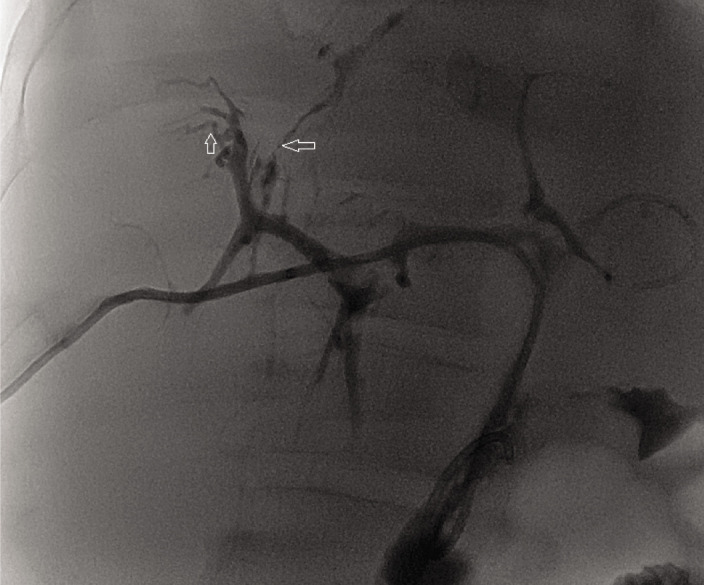
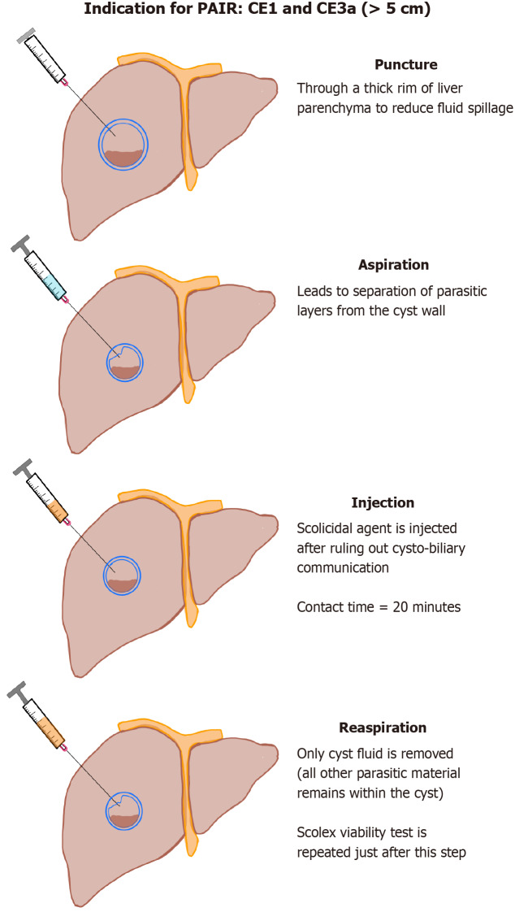
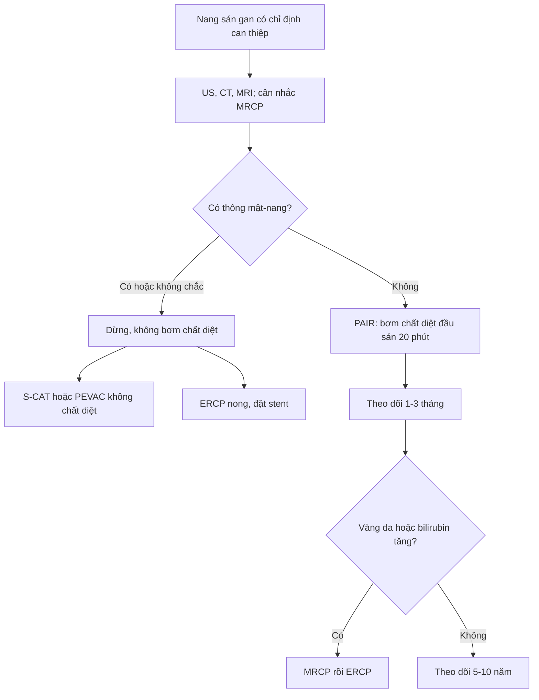
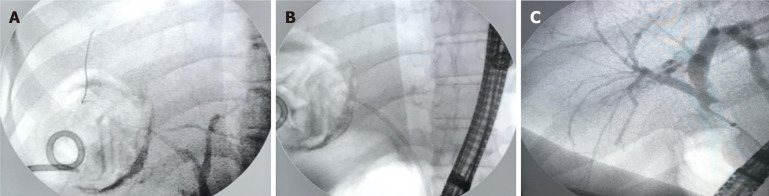
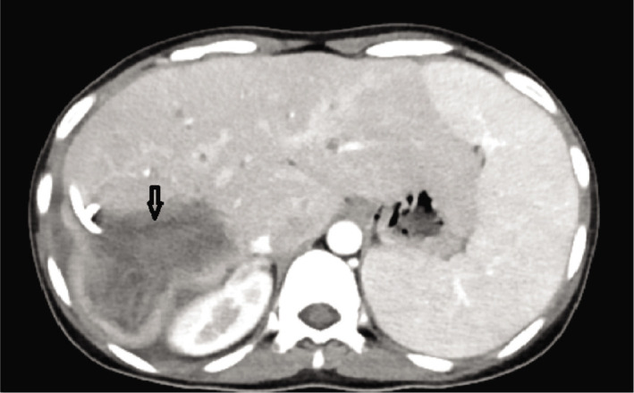

# 106 — Xơ hóa đường mật do chất diệt đầu sán (caustic sclerosing cholangitis): hẹp lan tỏa sau PAIR/mổ nang sán

**Tags:** `pattern:hep-duong-mat` `pattern:xo-hoa` `vung:duong-mat` `vung:gan` `protocol:MRCP` `protocol:ERCP` `protocol:PAIR` `incidentaloma:hep-sau-can-thiep`
**Mức chắc chắn (certainty):** tổng hợp y văn (literature synthesis) — bài tổng hợp từ hai ca nguyên văn có mô bệnh + loạt ca biến chứng + review kỹ thuật, chưa phải một thử nghiệm đối chứng.

## 1. Tổng quan — vì sao thuốc diệt đầu sán lại làm hẹp đường mật

- **Bối cảnh:** nang sán gan do *Echinococcus granulosus* (cystic echinococcosis, CE) được điều trị bằng albendazole, phẫu thuật hoặc can thiệp qua da. Trong **PAIR (puncture–aspiration–injection–reaspiration)** và các biến thể, người ta bơm **chất diệt đầu sán (scolicidal agent)** vào lòng nang để diệt đầu sán: **NaCl ưu trương 20–30%**, **ethanol 95%**, **cetrimide 0,1–0,5%**, **povidone-iodine 10%**; formalin gần như không còn dùng vì độc.
- **Cơ chế tổn thương:** các chất này diệt ký sinh trùng bằng **sốc thẩm thấu, biến tính protein, phá màng tế bào**. Nếu nang **thông với đường mật (cysto-biliary communication, CBC)**, thuốc tràn vào ống mật → **bỏng hóa học biểu mô đường mật**: loét niêm mạc, viêm xuyên thành, rồi **xơ hóa quanh ống mật** và hẹp. Hẹp tiến triển có thể dẫn tới **xơ gan mật thứ phát, tăng áp cửa, suy gan** — phải ghép gan.
- **TẠI SAO hình ảnh có dạng "hẹp nhiều đoạn":** mô xơ co kéo làm lòng ống mật hẹp không đều, trong khi đoạn trên hẹp giãn ra vì ứ mật. Trên **MRCP**, chất lỏng trong lòng ống mật tăng tín hiệu mạnh trên T2, nên hẹp hiện ra như **khoảng trống/giảm tín hiệu** giữa các đoạn ống giãn; mô xơ quanh ống **giảm tín hiệu T1/T2, ngấm thuốc muộn**, không tạo khối. Trên **CT**, hẹp thường không thấy trực tiếp, chỉ thấy **giãn đường mật trên hẹp, teo nhu mô** và loại trừ khối. **ERCP** là chuẩn vàng vì vừa thấy lòng ống vừa điều trị được.
- **Bốn yếu tố quyết định (Belghiti 1986, được nhắc lại trong Hepatology Forum 2024, PMC10936115):** (1) có bơm chất diệt vào nang; (2) có **thông mật–nang**; (3) **thời gian tiếp xúc kéo dài**; (4) **cơ địa nhạy cảm** với chất đó. Thêm vào đó, **tắc nghẽn đường mật dưới** (mảnh màng/mảnh đầu sán sót) làm thuốc lưu lâu hơn và tăng áp lực trong ống mật.
- **Định lượng nằm lòng:**
  - **CBC trong PAIR: 5,4%** (Bakdik, trích trong PMC10936115).
  - Biến chứng chung của can thiệp qua da khoảng **9%**; **sốc phản vệ 0,38%**; **sán hóa phúc mạc thứ phát 1,3%** (trích trong PMC10936115).
  - Loạt **209 bệnh nhân** (Hepatology Forum 2025, PMC11999902): biến chứng **33% (69/209)**; **rò mật 18,2%**; **biloma 5,3%**; **áp-xe gan 1,9%**; **tràn dịch màng phổi 2,9%**; **sốc phản vệ 1%**; **hẹp đường mật 0,5%**; **tái phát 5,7%**. PAIR có biến chứng **65,4%** so với mổ **28,4%** (p < 0,001).
  - **Nang ≥ 9,5 cm** dự báo biến chứng: độ nhạy **70%**, độ đặc hiệu **60%**, AUC **0,624**. Yếu tố nguy cơ rò mật–nang: **> 7,5 cm**, nang ở **phân thùy trung tâm**, **Gharbi 3–4**.
  - **Vỡ đường mật do nang: 3–17%**. **27%** các hẹp đường mật sau mổ là do bệnh nang sán (Yılmaz, trích trong PMC11999902).
  - **Thời gian:** xơ hóa do chất diệt tiến triển **vài tháng đến vài năm**; PSC nguyên phát thường **10–14 năm** mới phải ghép gan. Tổn thương do chất diệt **khu trú ở đoạn đường mật tiếp xúc thuốc**, không lan toàn bộ cây mật như PSC.
  - **Hai ca ghép gan** (PMC10936115): ca 1 — nam 50 tuổi, PAIR với **NaCl 20%**, **8 tháng** sau vàng da, đặt stent **5 năm**, MELD **13 → 26**, ghép gan năm thứ 6, tử vong sau 4 tháng vì nhiễm trùng bilioma; ca 2 — nữ 26 tuổi, PAIR với **ethanol**, ngay sau thủ thuật sốt, đau, tăng bilirubin, **26 ngày** nằm viện rồi được chuyển trung tâm ghép và ghép gan (MELD **31,5**), mô bệnh học có **loét niêm mạc đường mật ngoài gan + dày mô liên kết**, ổn định sau **31 tháng**.

## 2. Mẫu hình + chẩn đoán phân biệt theo vị trí (gamut)

**Mẫu hình chính:** hẹp **nhiều đoạn, không đều**, giới hạn trong vùng đường mật dẫn lưu của nang đã can thiệp; **giãn đường mật trên hẹp**; **không có khối**; có thể kèm **nang sán còn lại, mảnh màng, hơi trong đường mật** sau can thiệp.

**Gamut theo vị trí:**

- **Rốn gan/ống mật ngoài gan:** xơ hóa do chất diệt (thường đoạn gần nang), tổn thương sau cắt túi mật (Strasberg), ung thư biểu mô đường mật rốn gan (Klatskin), IgG4-SC type 3–4, hẹp miệng nối sau ghép.
- **Trong gan lan tỏa:** PSC, thiếu máu (SSC-CIP sau sốc/hồi sức, sau ghép gan), xơ hóa do chất diệt, IgG4-SC type 2/5, cholangiopathy do AIDS, viêm đường mật mủ tái phát, Caroli.
- **Ổ hẹp đơn độc:** tổn thương sau cắt túi mật, hẹp miệng nối, xạ trị, ischema khu trú, ung thư đường mật.
- **Kèm nang/hang:** nang sán còn lại, rò mật–nang, áp-xe, biloma — các "bẫy" làm hẹp khó đánh giá.

**Mẹo nhớ:** *tiền sử PAIR/mổ nang sán + vàng da xuất hiện sau vài tuần đến vài tháng + hẹp khu trú đúng vùng nang* → nghĩ **xơ hóa do chất diệt** trước khi nghĩ PSC. *Hẹp lan tỏa cả trong và ngoài gan + bệnh viêm ruột* → nghĩ **PSC**. *Hẹp trong gan lan tỏa, ống mật chủ xa bình thường, sau sốc/hồi sức* → nghĩ **thiếu máu**.

## 3. Bảng so sánh phân biệt (ma trận đối chiếu)

| Thực thể (entity) | Hình ảnh điển hình | Chốt vào (rule-in) | Chốt loại (rule-out) | Gợi ý xác nhận |
|---|---|---|---|---|
| **Xơ hóa do chất diệt đầu sán** | Hẹp nhiều đoạn **khu trú** đúng đoạn đường mật dẫn lưu nang; giãn trên hẹp; không khối; có thể thấy nang/mảnh màng | **Tiền sử bơm chất diệt + hẹp khu trú + loại trừ khối** | Hẹp lan tỏa toàn cây mật, bệnh viêm ruột → PSC; khối ngấm thuốc → ung thư | MRCP; ERCP + brush cytology; đối chiếu vị trí nang cũ |
| **PSC (primary sclerosing cholangitis)** | **Hẹp và giãn xen kẽ "chuỗi hạt"** trong và ngoài gan; thành ống dày; không khối | **Bệnh viêm ruột (80% viêm loét đại tràng ở PSC ống lớn) + hình chuỗi hạt + tuổi < 50** | Hẹp khu trú sau can thiệp nang sán → xơ hóa do chất diệt | MRCP; p-ANCA; nội soi đại tràng; loại trừ nguyên nhân thứ phát |
| **Thiếu máu (SSC-CIP, sau ghép gan)** | **Hẹp trong gan lan tỏa**, ống mật chủ xa **bình thường**; cast đường mật (dải sáng trong lòng); "cây bị tỉa" giai đoạn muộn | **Sau sốc/hồi sức, tụt HA < 65 mmHg ≥ 60 phút, hoặc sau ghép gan; cast 87–93%** | Hẹp khu trú + tiền sử nang sán → không phải thiếu máu | MRCP/ERCP; bệnh sử hồi sức; loại trừ hẹp do mạch máu |
| **IgG4-SC** | Hẹp **thành dày đồng tâm**, thường đoạn ống mật chủ xa hoặc rốn gan; tụy to; không chuỗi hạt điển hình | **IgG4 huyết thanh > 135–140 mg/dL (78–88% ca) hoặc > 270–280 mg/dL (70%); viêm tụy tự miễn 83–92%; đáp ứng corticoid** | IgG4 bình thường, không tổn thương tụy, hẹp khu trú sau nang sán | IgG4/IgG1 > 0,24 (độ đặc hiệu 95%); sinh thiết; thử corticoid có kiểm soát |
| **Tổn thương đường mật sau cắt túi mật** | Hẹp **khu trú** tại kẹp/vùng rốn gan; rò mật; giãn trên hẹp | **Tiền sử cắt túi mật + hẹp khu trú + rò mật** | Hẹp nhiều đoạn sau nang sán → xơ hóa do chất diệt | MRCP; ERCP; phân độ Strasberg–Bismuth |
| **Ung thư biểu mô đường mật** | Khối/ngấm thuốc bất thường, hẹp **một đoạn tiến triển**, giãn mạnh trên hẹp; teo thùy | **Khối + CA 19-9 tăng + hẹp tiến triển + ngấm thuốc** | Không khối, hẹp ổn định, tiền sử can thiệp nang sán | CT/MRI động học; ERCP brush cytology; PET/CT |
| **Nang sán còn lại/rò mật–nang** | Nang có vỏ, mảnh màng nổi, hơi/mức dịch; rò thuốc từ nang vào đường mật | **Còn nang + thấy thuốc từ nang vào ống mật** | Không còn nang, không rò → hẹp đơn thuần | US/CT/MRI; ERCP; xét nghiệm dịch nang |

*Chụp đường mật qua ERCP: các nhánh trong gan bị hẹp không đều, mũi tên chỉ đoạn hẹp/gián đoạn — hình ảnh xơ hóa đường mật sau khi chất diệt đầu sán vào cây mật. Nguồn: Hepatology Forum 2024, PMC10936115, Fig. 1, CC BY-NC 4.0.*

## 4. Protocol chụp + hệ phân độ/điểm chuẩn hóa

- **Trước can thiệp:** siêu âm + CT hoặc MRI để phân loại nang theo **WHO CE1–CE5**, đo kích thước, xác định vị trí so với rốn gan/ống mật chính. **MRCP** khi nghi thông mật–nang hoặc nang ở trung tâm; MRCP giúp thấy đường mật mà không cần cản quang.
- **Trong PAIR (nguyên tắc chống xơ hóa):**
  1. Chọc kim **18 G** qua một lớp nhu mô gan lành dày để giảm tràn dịch.
  2. Hút **20%** thể tích nang; bơm **thuốc cản quang 10%** thể tích (hoặc nửa thể tích vừa hút) dưới fluoroscopy/CT để **kiểm tra thông mật–nang**.
  3. Kiểm tra dịch hút: **màu vàng mật**, **que thử bilirubin**, soi tìm đầu sán; nếu thấy mật/bilirubin dương/tắc mật–nang trên phim → **DỪNG, không bơm chất diệt**.
  4. Nếu **không** thông: bơm chất diệt (NaCl 20% hoặc ethanol 95%), **thời gian tiếp xúc 20 phút**, thể tích **35–50%** thể tích nang ban đầu; sau đó hút hết, rửa NaCl 0,9%, kiểm tra lại sức sống đầu sán.
  5. Nếu có thông mật–nang: chuyển **S-CAT** (catheter 6–8 F, dẫn lưu trọng lực 24 giờ; chỉ bơm chất diệt khi dịch ra **< 10 mL/24 giờ** và không còn dịch mật) hoặc **PEVAC** (hút, **không dùng chất diệt**), hoặc mổ + ERCP.
- **Sau can thiệp:** theo dõi đau, sốt, vàng da, bilirubin/ALP/GGT; **MRCP** nếu cholestasis kéo dài hoặc xuất hiện vàng da. Với hẹp đã hình thành: **ERCP nong bóng + đặt stent nhựa** (thay stent định kỳ), kháng sinh khi có viêm đường mật, dẫn lưu áp-xe; hẹp kháng trị/xơ gan → **phẫu thuật hoặc ghép gan**.
- **Theo dõi dài hạn:** sau khi nang đạt CE4/CE5, theo dõi **5–10 năm**; với hẹp do xơ hóa, theo dõi định kỳ bằng MRCP và xét nghiệm gan vì có thể tiến triển thành xơ gan mật.
- **Không có RADS riêng.** Phân loại dùng trong bài: **WHO CE1–CE5** cho nang; **Strasberg–Bismuth A–E** cho tổn thương đường mật sau cắt túi mật (không dùng cho xơ hóa do chất diệt); mô tả hẹp theo **vị trí + số đoạn + mức giãn trên hẹp**.

*Sơ đồ PAIR: chọc → hút → bơm chất diệt **sau khi loại trừ thông mật–nang**, thời gian tiếp xúc **20 phút** → hút lại. Nguồn: World J Radiol 2026, PMC13122038, Fig. 4, CC BY-NC 4.0.*

*(A) Bơm cản quang vào nang: chỉ thấy lòng nang, **không thấy đường mật** → không có thông mật–nang, được phép bơm chất diệt. (B) Sau khi hút. (C) Sau khi bơm chất diệt. Nguồn: World J Radiol 2026, PMC13122038, Fig. 6, CC BY-NC 4.0.*

- **Khi đã có hẹp:** ERCP là bước điều trị chính. Trong loạt **88 bệnh nhân rò mật sau can thiệp nang sán**, ERCP đóng rò **100%**, trung vị **20 ngày**; **cắt cơ thắt + stent** tốt hơn cắt cơ thắt đơn thuần (OR **5,27**; 95% CI 1,30–21,37), và lưu lượng rò **< 400 mL/ngày** dự báo đóng sớm (OR **3,43**; 95% CI 1,37–8,55). Biến chứng ERCP **15,3%**, chủ yếu viêm tụy nhẹ **5,9%**, chảy máu **4,7%**, viêm đường mật **4,7%**.

*(A) Thuốc thoát từ nhánh đường mật trong gan phải; (B) đặt stent nhựa 7 F; (C) ERCP kiểm tra lại thấy nhánh phải rõ. Nguồn: World J Gastrointest Surg 2025, PMC12679019, Fig. 2, CC BY-NC 4.0.*

## 5. Biến thể bình thường và cạm bẫy

- **Thông mật–nang "ẩn":** lưu lượng thấp, kiểu van một chiều, hoặc bơm cản quang không đủ thể tích/áp lực → phim âm tính giả. Vì vậy phải kết hợp **màu dịch + que thử bilirubin + cản quang**, và nếu còn nghi ngờ thì **không bơm chất diệt**.
- **Hẹp xuất hiện muộn:** hình ảnh ngay sau PAIR có thể bình thường; vàng da có thể xuất hiện sau **vài tuần đến vài tháng**. Không loại trừ xơ hóa chỉ vì MRCP lúc đầu bình thường.
- **Nhầm với PSC:** PSC có **chuỗi hạt toàn cây mật**, liên quan viêm loét đại tràng, tuổi < 50; xơ hóa do chất diệt **khu trú** và có tiền sử can thiệp nang. Gán nhầm PSC → tiên lượng và chỉ định ghép sai.
- **Bỏ sót ung thư đường mật:** hẹp "lành tính" vẫn có thể che ung thư; nếu hẹp tiến triển, có khối/ngấm thuốc, CA 19-9 tăng → **brush cytology/sinh thiết**.
- **Sốt/đau sau PAIR:** đừng mặc định là "hội chứng sau PAIR"; sốt + vàng da + tăng bilirubin có thể là **viêm đường mật do xơ hóa/hẹp đang hình thành**.
- **Nang trung tâm/gần rốn gan:** nguy cơ thông mật–nang và trào thuốc cao hơn; cân nhắc **S-CAT/PEVAC** thay vì PAIR có chất diệt.
- **MRCP:** hơi trong đường mật sau ERCP, clip kim loại, dòng chảy có thể tạo giả hẹp; đọc cùng T2 mỏng và ảnh ERCP khi cần.
- **Biến thể giải phẫu:** ống gan phải sau đổ vào ống gan chung/ống gan trái — có thể giả "hẹp" trên MRCP; đọc chuỗi liên tục trước khi kết luận.

## 6. Tự lượng giá — Blind Quiz

**Ca 1 — Nam 50 tuổi, 8 tháng sau PAIR nang sán gan phải bằng NaCl 20%, nay vàng da và đau hạ sườn phải tái diễn.**

- Hỏi: mô tả bất thường đường mật? Chẩn đoán nào giải thích vàng da muộn sau PAIR? Hai chẩn đoán phân biệt và bước xử trí?

<b>Bấm để hiện đáp án</b>

- **Dấu hiệu:** nhiều đoạn hẹp không đều ở các nhánh đường mật trong gan, giãn nhẹ trên hẹp, **không có khối**; mũi tên chỉ đoạn hẹp/gián đoạn.
- **Chẩn đoán:** **xơ hóa đường mật do chất diệt đầu sán (caustic sclerosing cholangitis)** sau PAIR với NaCl 20% — thuốc vào cây mật qua thông mật–nang, gây bỏng hóa học rồi xơ hóa.
- **Phân biệt:** PSC (chuỗi hạt toàn cây, bệnh viêm ruột), ung thư đường mật (khối, CA 19-9), hẹp lành tính sau can thiệp.
- **Xử trí:** ERCP nong + stent nhựa, kháng sinh khi viêm đường mật; theo dõi tiến triển xơ gan; nếu xơ gan mất bù → ghép gan. Ca nguyên văn đặt stent 5 năm rồi ghép gan ở năm thứ 6.
- Nguồn ảnh: Hepatology Forum 2024, PMC10936115, Fig. 1, CC BY-NC 4.0.

**Ca 2 — Nữ 26 tuổi, ngay sau PAIR nang sán phân thùy 7 bằng ethanol: đau bụng tăng, sốt, bilirubin tăng. CT cho thấy nang còn catheter.**

- Hỏi: vì sao triệu chứng xuất hiện **ngay** sau thủ thuật? Cơ chế tổn thương? Điều gì quyết định tiên lượng?

<b>Bấm để hiện đáp án</b>

- **Dấu hiệu:** nang sán lớn ở gan phải, có catheter trong lòng nang (mũi tên); không thấy khối đặc mới.
- **Vì sao ngay sau thủ thuật:** ethanol 95% gây **bỏng hóa học trực tiếp** biểu mô đường mật khi có thông mật–nang; phù/loét niêm mạc và tăng áp lực mật gây đau, sốt, vàng da sớm.
- **Cơ chế:** biến tính protein + phá màng tế bào → loét niêm mạc, viêm xuyên thành, xơ hóa quanh ống mật. Mô bệnh ca này có **loét niêm mạc đường mật ngoài gan + dày mô liên kết**.
- **Tiên lượng:** phụ thuộc mức tổn thương đường mật và chức năng gan; ca nguyên văn tiến triển suy gan (MELD 31,5), sau 26 ngày nằm viện được chuyển trung tâm ghép và ghép gan.
- Nguồn ảnh: Hepatology Forum 2024, PMC10936115, Fig. 2, CC BY-NC 4.0.

**Ca 3 — Nữ 45 tuổi, nang CE1 8 cm gan phải, chuẩn bị PAIR. Sau khi bơm cản quang vào nang, phim fluoroscopy chỉ thấy lòng nang, không thấy đường mật.**

- Hỏi: có được bơm chất diệt đầu sán không? Nếu có, thời gian và thể tích bao nhiêu? Nếu phim thấy đường mật thì làm gì?

<b>Bấm để hiện đáp án</b>

- **Kết luận:** không thấy đường mật sau bơm cản quang → **không có thông mật–nang**, được phép bơm chất diệt.
- **Kỹ thuật:** NaCl 20% hoặc ethanol 95%, **tiếp xúc 20 phút**, thể tích **35–50%** thể tích nang ban đầu; sau đó hút hết, rửa NaCl 0,9%, kiểm tra sức sống đầu sán.
- **Nếu thấy đường mật:** **dừng**, không bơm chất diệt; chuyển **S-CAT/PEVAC** hoặc mổ + ERCP; nếu đã bơm nhầm → theo dõi sát cholestasis, MRCP/ERCP sớm.
- Nguồn ảnh: World J Radiol 2026, PMC13122038, Fig. 6, CC BY-NC 4.0.

## Bài liên quan chéo
- [100 – Tổng quan hệ Bụng](../100-tong-quan-he-bung/lesson.md)
- [107 – MRCP với gadoxetic acid & HBP](../107-mrcp-gadoxetic-acid-hbp/lesson.md)
- [108 – Tổn thương đường mật sau cắt túi mật (Strasberg–Bismuth)](../108-ton-thuong-duong-mat-sau-cat-tui-mat/lesson.md)
- [132 – Hẹp đường mật không xác định & cholangioscopy](../132-hop-duong-mat-khong-xac-dinh/lesson.md)
- [133 – Hẹp miệng nối đường mật sau ghép gan](../133-hep-mieng-noi-duong-mat-sau-ghep/lesson.md)
- [137 – Theo dõi stent/dẫn lưu đường mật: di trú, tắc, nhiễm trùng](../137-theo-doi-stent-dan-luu-duong-mat-di-tru-tac-nhiem-trung/lesson.md)
- [139 – Sán lá gan (hepatic hydatid): phân độ WHO, PAIR + albendazole](../139-san-la-gan/lesson.md)
- [179 – Biến chứng đường mật sau can thiệp u gan](../179-bien-chung-duong-mat-sau-can-thiep-u-gan/lesson.md)
- [633 – Nang sán đa cơ quan ở trẻ](../633-nang-san-da-co-quan-o-tre/lesson.md)

## Ảnh
- Tên file theo quy ước `106_slug_Modality_SourceID.jpg`; nguồn và giấy phép từng ảnh ở `images/CREDITS.md`.
- Ảnh minh họa PAIR và kiểm tra thông mật–nang dùng sơ đồ/fluoroscopy từ review mở; không crop, không kéo giãn.

> Không dùng để chẩn đoán độc lập khi chưa có người hướng dẫn.
