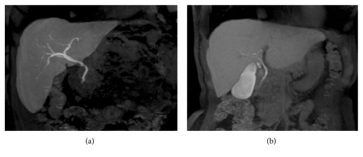
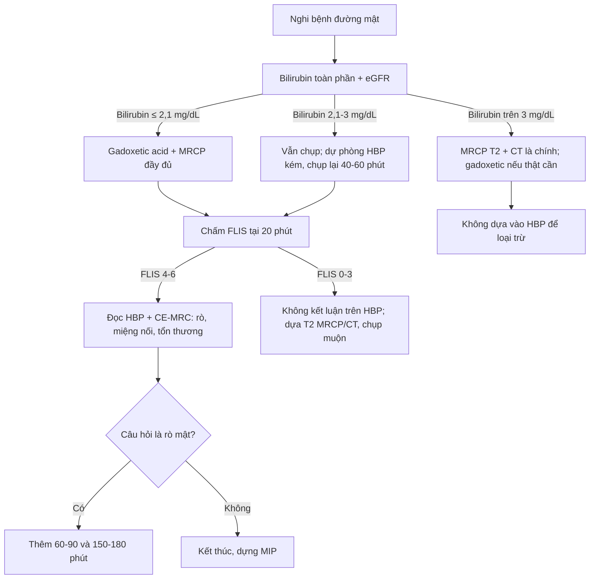
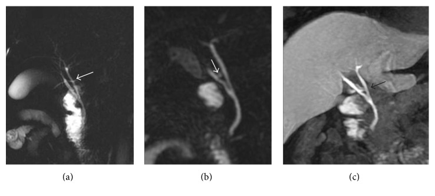
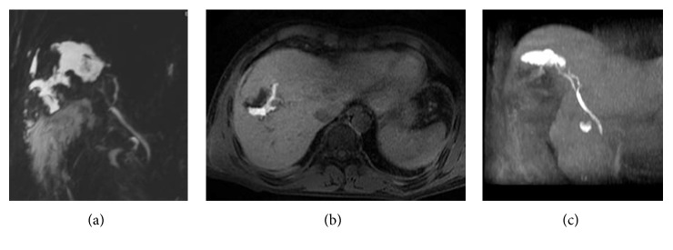
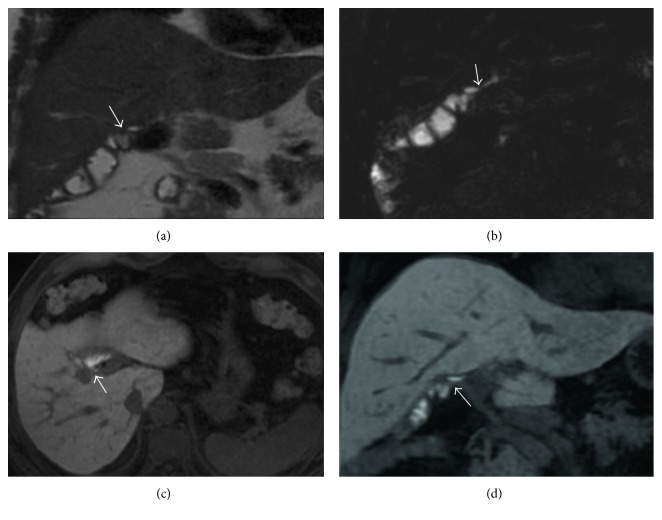

# 107 — MRCP & gadoxetic acid thì gan–mật (HBP): kỹ thuật, ngưỡng và cách đọc / MRCP & gadoxetic acid hepatobiliary phase: technique, thresholds and interpretation

**Tags:** `protocol:MRCP` `protocol:MRI-gan` `protocol:gadoxetic-acid` `pattern:hep-duong-mat` `vung:duong-mat` `incidentaloma:hep-duong-mat`
**Mức chắc chắn (certainty):** tổng hợp y văn (literature synthesis) — tổng hợp từ 1 review kỹ thuật có ảnh (PMC5350537, CC BY), 1 nghiên cứu 259 bệnh nhân về chất lượng HBP (PMC8961017, CC BY-NC), 1 review ảnh đường mật trong gan (PMC13652791, CC BY), 1 bài về fMRC sau phẫu thuật đường mật (PMC7007050, CC BY); chưa gắn một ca nguyên văn duy nhất của nhóm.

> **Bài này là bài KỸ THUẬT NỀN của cụm mật.** Các bài [131 – Tắc mật](../131-tac-mat/lesson.md), [132 – Hẹp đường mật không xác định](../132-hop-duong-mat-khong-xac-dinh/lesson.md), [133 – Hẹp miệng nối sau ghép gan](../133-hep-mieng-noi-duong-mat-sau-ghep/lesson.md), [137 – Theo dõi stent/dẫn lưu mật](../137-theo-doi-stent-dan-luu-duong-mat-di-tru-tac-nhiem-trung/lesson.md), [138 – Sỏi trong gan](../138-soi-trong-gan-viem-duong-mat-mu/lesson.md) dùng MRCP/HBP như công cụ; bài 107 giải thích **vì sao chọn chuỗi xung nào, tiêm thuốc gì, chờ bao lâu, và khi nào KHÔNG được tin ảnh HBP**.

## 1. Tổng quan — hai "công cụ" khác bản chất, đừng đánh đồng

- **MRCP (magnetic resonance cholangiopancreatography) — hình ảnh T2 nặng:** dựa trên **chuỗi xung T2-weighted rất nặng (heavily T2-weighted)**, dịch mật **tăng tín hiệu rất mạnh** còn mô đặc/tĩnh mạch **tối**. Vì **nước đứng yên** có T2 dài, mật trong lòng ống sáng; **sỏi, khí, mô u, cục máu** không có proton linh động → **khuyết tín hiệu (signal void)** trong lòng ống. **Không cần thuốc cản quang** cho MRCP T2.
  - **2D thick-slab (single-shot FSE):** một lát dày **20–60 mm**, chụp nhanh, ít nhiễu chuyển động; tốt để **nhìn toàn cảnh cây mật**, nhưng **không đánh giá được chi tiết thành ống** và dễ **chồng hình ruột/dịch**.
  - **3D thin-slab (respiratory-triggered 3D FRFSE):** lát **1–2 mm**, dựng **MIP**; **không gian phân giải cao hơn**, thấy **nhánh nhỏ, biến thể giải phẫu, hẹp không hoàn toàn**; nhược điểm **thời gian chụp dài**, nhạy với **chuyển động/thở**.
  - **TẠI SAO sỏi tối trên MRCP:** sỏi **sắc tố canxi bilirubinate** hoặc sỏi cholesterol **mất tín hiệu** vì **không có proton tự do**; bản thân canxi cũng **không phát tín hiệu**. Sỏi **rất nhỏ (< 2–3 mm)** có thể bị **bỏ sót**; **bóng khí, clip kim loại, dòng chảy** có thể **giả sỏi**.
- **Gadoxetic acid (Gd-EOB-DTPA; Primovist/Eovist) — thuốc đối quang đặc hiệu gan:** sau tiêm, **khoảng 50%** được **tế bào gan lành bắt qua OATP1B1/B3**, **50%** thải qua thận; trong gan, thuốc **thải vào ống mật qua MRP2**. Vì **Gd làm ngắn T1**, mô gan và **mật** trở nên **sáng trên T1**.
  - **Thời gian:** thuốc vào tế bào gan **từ ~3 phút**, **bắt đầu thải vào mật ~10 phút**, **thì gan–mật (hepatobiliary phase — HBP) đạt rõ ở 10–20 phút**, **đỉnh 20–40 phút**, **nửa đời ~2 giờ**. Vì vậy **HBP chuẩn = 20 phút** sau tiêm; có thể **chụp lại 40–60 phút** khi chức năng gan kém.
  - **Liều chuẩn 0,025 mmol/kg (0,1 mL/kg)** — liều thấp hơn thuốc ngoại bào (0,1 mmol/kg), nên **thì động mạch yếu hơn** và dễ **giả ảnh do thở (transient dyspnea)** ở thì động mạch.
  - **Vì sao HBP đặc hiệu:** tổn thương **không có tế bào gan** (di căn, u đường mật, nang, áp-xe) **không bắt thuốc** → **tối (hypointense)** trên nền gan sáng; **HCC/HCA** có thể bắt hoặc không tùy mức biệt hóa. HBP **không thay thế** động học bắt thuốc (arterial hyperenhancement + washout).
- **Ngưỡng định lượng nằm lòng:**
  - **Bilirubin toàn phần > 3 mg/dL** làm **giảm bắt thuốc và giảm thải mật** → HBP **muộn/kém**, cần **chụp 20–180 phút** hoặc **liều gấp đôi** (theo kinh nghiệm từng trung tâm; **chưa có khuyến cáo thống nhất**).
  - **Ngưỡng dự báo HBP kém (FLIS thấp) = bilirubin 2,1 mg/dL**: **độ nhạy 95,1%**, **độ đặc hiệu 89,0%** ở tập phân tích (n = 184); tập kiểm chứng (n = 75): **92,1% / 83,8%** (Hwang JA et al., *Korean J Radiol* 2022, PMC8961017). Mỗi **1 mg/dL** bilirubin tăng làm **OR 1,62** (KTC 95% 1,32–1,98) cho HBP kém.
  - **FLIS (functional liver imaging score) 0–6** = tổng **3 thành phần**, mỗi thành phần **0–2**: **(1) mức tăng tín hiệu nhu mô gan, (2) mức thải thuốc vào đường mật, (3) tín hiệu tĩnh mạch cửa**. **FLIS 0–3 = thấp**, **4–6 = cao**. Trong 259 bệnh nhân ung thư đường mật ngoài gan: **54,1% FLIS thấp**; **47,1% nhóm FLIS thấp có ảnh HBP dưới mức chấp nhận**, so với **6,1%** ở nhóm FLIS cao (p < 0,001).
  - **Góc lật (flip angle):** tối ưu cho **đường mật 35–40°**, cho **nhu mô gan 25–30°**; **góc > 20°** được khuyến cáo để tăng SNR/CNR đường mật.

## 2. Mẫu hình + chẩn đoán phân biệt theo câu hỏi lâm sàng (gamut)

**Đừng bắt đầu bằng "chẩn đoán bệnh"; hãy bắt đầu bằng "câu hỏi cần trả lời".** Sáu câu hỏi quyết định chuỗi xung:

1. **Giải phẫu có bất thường không?** (trước mổ cắt túi mật/ghép gan/cắt gan): **biến thể ống gan phải, ống gan phụ, chỗ đổ ống túi mật**, hội chứng **Mirizzi**. → **3D MRCP** + **HBP MIP**.
2. **Trong lòng ống có gì?** **Sỏi ống mật chủ**, **sỏi trong gan**, **bùn mật**, **khí**, **u nhú (IPNB)**, **cục máu**, **ký sinh trùng**. → **MRCP T2** là chính; **HBP** giúp phân biệt **khối đặc không bắt thuốc** với **sỏi**.
3. **Có hẹp không? Ở đâu? Dài bao nhiêu?** **Hẹp miệng nối (anastomotic stricture)**, **PSC**, **hẹp do thiếu máu**, **hẹp ác tính**. → **MRCP T2** đo chiều dài/hình dạng; **HBP không đáng tin để chẩn đoán hẹp** (xem mục 3).
4. **Có rò mật không?** Sau **cắt túi mật, cắt gan, ghép gan, chấn thương**: dịch quanh ống mật **không chứng minh rò**; chỉ **thuốc từ đường mật tràn vào khoang dịch** mới chứng minh **rò hoạt động**. → **HBP muộn 20–25, 60–90, 150–180 phút**.
5. **Nang/dãn có thông với đường mật không?** **Nang ống mật chủ (Todani)**, **bệnh Caroli**, **nang đường mật (biliary hamartoma)**, **nang quanh ống mật (peribiliary cyst)**. → **MRCP T2** thấy cấu trúc; **HBP** thấy **thuốc vào nang** nếu **có thông**.
6. **Miệng nối còn thông và còn chức năng không?** Sau **Roux-en-Y**, **ghép gan**: **HBP** thấy **mật thuốc qua miệng nối**, **mức thuốc trong quai ruột** phản ánh **độ thông**.

- **Gợi nhớ "ABCDEF" cho chỉ định MRCP/HBP:** **A**natomy (giải phẫu), **B**ile leak (rò mật), **C**alculus (sỏi), **D**uct stricture (hẹp), **E**ctasia/cyst (dãn/nang), **F**unction (chức năng miệng nối/thải mật).

## 3. Bảng so sánh phân biệt (ma trận đối chiếu)

### 3.1. So sánh phương thức — chọn gì cho câu hỏi nào

| Phương thức | Điểm mạnh | Chốt vào (rule-in) | Chốt loại (rule-out) | Giới hạn/ghi chú |
|---|---|---|---|---|
| **MRCP T2 (2D + 3D)** | Không thuốc, nhanh, toàn cảnh cây mật; độ chính xác **tương đương ERCP** cho hẹp lành/ác ngoài gan | **Khuyết tín hiệu trong lòng ống + ống giãn phía trên** = sỏi/hẹp | **Cây mật bình thường, không giãn, không khuyết tín hiệu** gần như loại trừ tắc hoàn toàn | **Giả sỏi** do khí/clip/dòng chảy; **bỏ sót sỏi < 2–3 mm**; không đánh giá thành ống |
| **CE-MRC / HBP (T1 sau gadoxetic)** | **Chứng minh thông/thải mật**, phát hiện **rò hoạt động**, đánh giá **chức năng miệng nối** | **Thuốc vào khoang dịch/nang** = rò/thông; **thuốc qua miệng nối** = còn thông | **Không thấy thuốc trong khoang dịch** khi đã đủ thì muộn = **không rò hoạt động** | **Phụ thuộc chức năng gan/bilirubin**; **kém nhạy với hẹp**; cần **20–180 phút** |
| **CT bụng có cản quang** | Nhanh, phát hiện **vôi hóa, khí, biến chứng, tụy** | **Sỏi vôi hóa, khí trong ống, tụ dịch, giãn ống** | **Không thấy sỏi cản quang** không loại trừ sỏi sắc tố | **Bỏ sót sỏi không vôi hóa**; bức xạ |
| **ERCP** | Điều trị được (lấy sỏi, đặt stent), lấy dịch/mô | **Nhìn trực tiếp + can thiệp** | — | **Xâm lấn**, viêm tụy sau ERCP **5–10%**, thủng/nhiễm trùng |
| **Cholangioscopy (SpyGlass)** | Nhìn trực tiếp + sinh thiết | **Tổn thương trong lòng ống** nghi IPNB/ung thư | **Niêm mạc bình thường** trong vùng nghi ngờ | Xâm lấn, chi phí, không phải tuyến đầu |

### 3.2. Ma trận bệnh — dấu hiệu chốt trên MRCP/HBP

| Thực thể (entity) | Hình ảnh điển hình | Chốt vào (rule-in) | Chốt loại (rule-out) | Gợi ý xác nhận |
|---|---|---|---|---|
| **Sỏi ống mật chủ (choledocholithiasis)** | **Khuyết tín hiệu tròn/bầu dục** trong ống giãn, có **meniscus** mật quanh sỏi | **Khuyết tín hiệu trong lòng ống + ống giãn phía trên + không bắt thuốc trên HBP** | **Khuyết tín hiệu di chuyển/đổi hình theo tư thế hoặc có đuôi khí** → khí, không phải sỏi | MRCP 3D + CT đối chiếu; ERCP nếu triệu chứng |
| **Rò mật sau mổ (bile leak)** | Tụ dịch **T2 sáng** quanh ống mật/miệng nối; **HBP: thuốc tràn vào tụ dịch** | **Thuốc gadoxetic vào trong khoang dịch** = rò hoạt động; **kết hợp MRCP T2 + HBP: Se 79% vs 59%** so với MRCP T2 đơn thuần, **accuracy 84% vs 58%** | **Tụ dịch T2 sáng nhưng KHÔNG có thuốc ở 60–90 phút** → không chứng minh rò | HBP 20–25 + 60–90 phút (**Se 92,9%**); đủ 3 mốc 20–25/60–90/150–180: **Se 96,4%, Sp 100%, Acc 97,1%** |
| **Hẹp miệng nối mật–ruột (anastomotic stricture)** | Chỗ hẹp + giãn ống mật trong gan; **HBP có thể thấy thuốc qua chỗ hẹp** | **MRCP T2: Se 94,4%, Sp 80%, PPV 94,4%, NPV 80%** | **CE-MRC T1: Se chỉ 40%, Sp 75%, PPV 80%, NPV 33,3%** → **KHÔNG dùng CE-MRC đơn thuần để loại trừ hẹp** | MRCP 3D + HBP bổ trợ; nong/thử stent nếu triệu chứng |
| **Viêm xơ đường mật nguyên phát (PSC)** | **Hẹp và giãn xen kẽ** kiểu **"chuỗi hạt" (beaded)** và **"cây tỉa" (pruned tree)** | **Nhiều hẹp ngắn + giãn xen kẽ + thành ống dày** | **Một chỗ hẹp đơn độc, không giãn xen kẽ** → nghĩ ác tính/nguyên nhân khác | MRCP 3D; HBP đánh giá chức năng; CA 19-9/ERC nếu nghi CCA |
| **Nang ống mật chủ (choledochal cyst)** | **Dãn hình túi/hình nang** thông với cây mật; **Todani I–V** | **Nang thông với đường mật + thuốc vào nang trên HBP** = có thông | **Nang không thông** (nang gan đơn thuần) | MRCP + HBP; **nguy cơ ung thư đường mật tăng theo tuổi** — cần theo dõi |
| **U nhú trong lòng ống (IPNB)** | **Khối đặc trong lòng ống**, có thể **bắt thuốc**, gây **dãn ống không tương xứng** | **Khối trong lòng ống bắt thuốc + dãn ống phía trên** | **Khuyết tín hiệu không bắt thuốc, di động** → sỏi/bùn | MRCP + DWI + HBP; cholangioscopy/sinh thiết |
| **HCC/khối gan trên HBP** | **Nhân tối trên HBP** (không có tế bào gan bắt thuốc) | **Tối trên HBP + bắt mạnh thì động mạch + washout** = HCC | **Tối trên HBP nhưng không bắt động mạch/washout** → không đủ chẩn đoán HCC | Động học DCE + DWI + HBP; phân độ LI-RADS (bài 121) |

*(a) Sau **Gd-EOB-DTPA**, thì gan–mật **20 phút**: cây mật trong gan sáng rõ trên nền gan sáng. (b) Ở bệnh nhân khác dùng **gadobenate dimeglumine**, thì thải mật cần **≥ 60 phút** và đường mật không nét bằng. Nguồn: Palmucci S et al., Gastroenterol Res Pract 2017 (PMC5350537), Fig. 1, CC BY 4.0.*

### 3.3. Vì sao HBP giỏi "chứng minh thông" nhưng kém "chứng minh hẹp"
- **Nguyên lý:** HBP chỉ cho biết **có thuốc đến được vị trí đó hay không**. Nếu thuốc **qua được chỗ hẹp**, điều đó chứng minh **còn thông**, nhưng **không đo được mức độ hẹp** và **không loại trừ hẹp có ý nghĩa** (dòng mật vẫn có thể qua khi hẹp < 70–80%). Vì vậy trong nghiên cứu 21 bệnh nhân, **CE-MRC chỉ đạt Se 40%** cho hẹp miệng nối, thấp hơn nhiều so với **MRCP T2 (94,4%)**.
- **Hệ quả thực hành:** **MRCP T2 là phương thức chính để đánh giá hẹp**; **HBP là phương thức chính để đánh giá rò và chức năng**. Đừng đảo vai trò.

## 4. Protocol chụp + cách chấm chất lượng HBP

### 4.1. Chuẩn bị
- **Nhịn ăn 4–6 giờ** (giảm nhu động ruột/dịch dạ dày), uống nước nhỏ giọt nếu không chống chỉ định.
- **Xét nghiệm trước chụp:** **bilirubin toàn phần**, **creatinin/eGFR**, **men gan**, **INR**; hỏi **dị ứng thuốc cản quang**, **thai kỳ**, **máy tạo nhịp/thiết bị cấy**, **tiền sử phẫu thuật đường mật**.
- **Thận trọng:** **eGFR < 30 mL/phút/1,73 m²** — cân nhắc theo chính sách cơ sở (nguy cơ xơ hóa hệ thống do gadolinium rất thấp với gadoxetic nhưng không bằng 0); **thai kỳ** tránh nếu không thật cần.
- **Đường truyền tĩnh mạch** 20–22 G; **không dùng thuốc ngoại bào thay thế** nếu câu hỏi là chức năng đường mật.

### 4.2. Trình tự chuỗi xung tối thiểu

| Thì/chuỗi | Mục đích | Ghi chú kỹ thuật |
|---|---|---|
| **T2 SSFSE/HASTE axial + coronal** | Phát hiện dịch, giãn ống, nang, tụy, tổn thương gan | Lát **4–6 mm**; fat-sat; nín thở nếu được |
| **3D MRCP (FRFSE, respiratory-triggered)** | Cây mật 3D, biến thể, sỏi, hẹp | Lát **1–2 mm**, **MIP**; chụp trước thuốc |
| **DWI (b=50/400/800)** | Khối đặc/áp-xe; hỗ trợ phân biệt | ADC map; không thay thế HBP |
| **T1 3D GRE fat-sat trước thuốc** | Nền gan, máu, mỡ, canxi | In/opposed phase nếu cần |
| **Động học sau gadoxetic: động mạch 20–30 giây, cửa 60–70 giây, chuyển tiếp 3 phút** | Động học bắt thuốc của u, mạch, nhu mô | **Gadoxetic 0,025 mmol/kg**, tốc độ **1 mL/s**, rửa **20–30 mL NaCl**; **pha loãng/chậm** để giảm giả ảnh do thở |
| **HBP 20 phút** (chụp lại **40–60 phút** nếu chức năng gan kém) | Gan sáng, tổn thương không có tế bào gan tối; **MIP đường mật** | Góc lật **25–30°** cho nhu mô; **35–40°** cho đường mật |
| **HBP muộn 60–90 và 150–180 phút** (khi nghi rò) | Chứng minh **rò hoạt động**, đánh giá **miệng nối** | Không bỏ giai đoạn muộn nếu câu hỏi là rò |

- **Dựng ảnh:** **MIP dày** cho cây mật, **MIP mỏng/curved planar** cho chỗ hẹp; so sánh **T2 MRCP và HBP** trên cùng mặt phẳng.
- **Thời gian chụp tối thiểu:** **25–30 phút** cho bộ cơ bản; **60–180 phút** nếu cần đánh giá rò.

### 4.3. Chấm FLIS và quyết định đọc HBP

| Thành phần FLIS | 0 điểm | 1 điểm | 2 điểm |
|---|---|---|---|
| **Tăng tín hiệu nhu mô gan** | Không thấy/gan không sáng hơn cơ | Trung bình | Gan sáng rõ, đồng nhất |
| **Thải thuốc vào đường mật** | Không thấy mật sáng | Mờ, chỉ thấy ống chính | Thấy rõ ống trong gan |
| **Tín hiệu tĩnh mạch cửa** | TM cửa sáng hơn gan (dấu TM cửa muộn) | Trung bình | TM cửa tối hơn gan |

- **Cách tính:** cộng 3 thành phần = **0–6**; **0–3 = FLIS thấp** → ảnh HBP **không đáng tin**, **47,1%** trường hợp dưới mức chấp nhận; **4–6 = FLIS cao** → **chỉ 6,1%** dưới mức chấp nhận.
- **Quy tắc vàng:** **không kết luận "không có tổn thương/không rò" trên một HBP FLIS thấp**; chuyển sang **MRCP T2 + CT + theo dõi**, hoặc **chụp lại muộn**.

## 5. Biến thể bình thường và cạm bẫy

- **Biến thể giải phẫu hay gặp (đừng gọi là bệnh):** **ống gan phải sau (right posterior sectoral duct)** đổ vào **ống gan trái** hoặc **ống gan chung**; **ống gan phụ (accessory duct)**; **ống túi mật đổ thấp/cao**; **ống gan phải trước–sau hội lưu muộn**. Trước mổ cắt gan/cắt túi mật, **phải mô tả biến thể** — 3D MRCP + HBP MIP giúp thấy rõ.
- **Cạm bẫy 1 — "khuyết tín hiệu = sỏi" trên MRCP T2:** **bóng khí** (sau ERCP/đặt stent), **clip kim loại**, **dòng chảy mạnh**, **van ống mật**, **cục máu** đều tối. **Đối chiếu CT** và **hình dạng/đuôi khí**; khí thường **di chuyển** và **có mức nằm ngang**.
- **Cạm bẫy 2 — "tụ dịch cạnh miệng nối = rò":** **T2 chỉ thấy dịch**, không chứng minh **thông**. Chỉ **thuốc từ đường mật vào khoang dịch** mới là **rò hoạt động**; nếu **không có thuốc ở 60–90 phút**, vẫn cần **thì 150–180 phút** khi giãn ống/gan kém.
- **Cạm bẫy 3 — dùng CE-MRC để loại trừ hẹp:** **Se 40%** — bỏ sót hẹp là **sai lầm thường gặp**. **MRCP T2** mới là chìa khóa.
- **Cạm bẫy 4 — bilirubin cao vẫn tin HBP:** **> 3 mg/dL** làm **giảm thải mật**; **FLIS thấp**; **không kết luận "không rò/không tổn thương"**.
- **Cạm bẫy 5 — nhầm HBP tối với HCC:** **nhân tối HBP** có thể là **di căn, áp-xe nhỏ, nang, u lành, vùng xơ**. Cần **động học động mạch + washout + DWI**; HBP đơn thuần **không đủ** (xem LI-RADS, bài 121).
- **Cạm bẫy 6 — clip/bơm khí sau ERCP:** gây **khuyết tín hiệu giả sỏi** và **giả hẹp** trên MIP; **chụp lại sau khi khí tan** hoặc đối chiếu CT.
- **Cạm bẫy 7 — MIP che mất tổn thương:** MIP dày có thể **che sỏi nhỏ/hẹp ngắn**; **luôn đọc lát mỏng gốc**, không chỉ MIP.
- **Cạm bẫy 8 — tương tác thuốc/thận:** **eGFR < 30** cân nhắc; **không dùng gadoxetic** khi có **chống chỉ định gadolinium**; **an toàn thai kỳ chưa được thiết lập**.

*(a, b) MRCP 2D/3D thấy hội lưu thấp và nghi **ống gan phải phụ** (mũi tên trắng). (c) **HBP** làm rõ **ống gan phải phụ** và **ống túi mật** (mũi tên đen) đổ riêng vào ống gan trái. Đây là biến thể cần mô tả trước mổ, không phải bệnh. Nguồn: Palmucci S et al., PMC5350537, Fig. 3, CC BY 4.0.*

*(a) MRCP T2: tụ dịch lớn **tăng tín hiệu** ở phần cao gan. (b, c) Thì thải mật: **thuốc vào trong tụ dịch** → chứng minh **rò mật hoạt động**. Nguồn: Palmucci S et al., PMC5350537, Fig. 6, CC BY 4.0.*

## 6. Tự lượng giá — Blind Quiz

**Ca 1 — Bệnh nhân 52 tuổi, cắt túi mật nội soi 5 ngày trước, sốt nhẹ, đau hạ sườn phải, dịch quanh gan. MRCP T2 có tụ dịch; HBP 20 phút chưa thấy thuốc trong tụ dịch.**

- Gợi ý lâm sàng: sau cắt túi mật, có tụ dịch nhưng chưa rõ có thông với đường mật.
- Câu hỏi: Tụ dịch T2 sáng có đủ chẩn đoán rò? Bước tiếp theo là gì?

<b>Bấm để hiện đáp án (findings + chẩn đoán)</b>

- **Dấu hiệu:** MRCP T2 thấy **tụ dịch** nhưng **không chứng minh thông**; HBP **20 phút** chưa thấy thuốc vào tụ dịch.
- **Chẩn đoán:** **chưa loại trừ rò mật hoạt động** — cần **thì muộn 60–90 phút**, và nếu vẫn âm, **150–180 phút**. Trong nghiên cứu 34 bệnh nhân, **20–25 phút đơn thuần chỉ đạt Se 42,9%**, còn **20–25 + 60–90 phút đạt 92,9%**; đủ 3 mốc đạt **Se 96,4%, Sp 100%, Acc 97,1%**.
- **Xử trí:** nếu thuốc vào tụ dịch → **rò hoạt động**, cần **dẫn lưu/ERCP stent**; nếu không thấy thuốc sau 150–180 phút và lâm sàng ổn → theo dõi.
- Nguồn số: Palmucci S et al., Gastroenterol Res Pract 2017 (PMC5350537), CC BY 4.0.

**Ca 2 — Bệnh nhân 60 tuổi, Roux-en-Y sau cắt nang ống mật chủ; MRCP T2 thấy miệng nối, HBP 20 phút thấy thuốc qua miệng nối và một ít trong quai ruột.**

- Gợi ý lâm sàng: không sốt, không vàng da; câu hỏi là miệng nối còn thông không.
- Câu hỏi: HBP bổ sung gì so với MRCP T2? Có loại trừ được hẹp không?

<b>Bấm để hiện đáp án (findings + chẩn đoán)</b>

- **Dấu hiệu:** (a) T2 coronal và (b) 3D MRCP cho **hình thái** miệng nối; (c, d) HBP cho **thuốc qua miệng nối** và **mức thuốc trong quai ruột** — bằng chứng **còn thông và còn chức năng**.
- **Chẩn đoán:** **miệng nối mật–ruột còn thông, còn chức năng**.
- **Giới hạn:** HBP **không loại trừ hẹp có ý nghĩa** — CE-MRC chỉ đạt **Se 40%** cho hẹp miệng nối, so với **MRCP T2 94,4%**. Nếu còn triệu chứng viêm đường mật tái diễn, cần **MRCP T2 lát mỏng + đánh giá thêm** (bài 133).
- Nguồn: Palmucci S et al., PMC5350537, Fig. 9, CC BY 4.0.

**Ca 3 — Bệnh nhân 68 tuổi, vàng da, bilirubin toàn phần 8 mg/dL. Yêu cầu "chụp HBP để xem có rò sau mổ không".**

- Gợi ý lâm sàng: vàng da rõ, chức năng gan/bilirubin cao; câu hỏi là rò mật.
- Câu hỏi: Có nên tin HBP ở bệnh nhân này? Chọn protocol nào?

<b>Bấm để hiện đáp án (findings + chẩn đoán)</b>

- **Dấu hiệu:** **bilirubin 8 mg/dL** — cao hơn ngưỡng **3 mg/dL** làm giảm thải mật, và cao hơn ngưỡng dự báo FLIS thấp **2,1 mg/dL** (Se 95,1%, Sp 89,0%).
- **Chẩn đoán:** **HBP sẽ kém/không đáng tin**; **không được kết luận "không rò"** dựa trên HBP.
- **Xử trí:** ưu tiên **MRCP T2 + CT bụng** để đánh giá giãn ống/tụ dịch; nếu vẫn cần chứng minh rò, **chụp HBP muộn 60–90 và 150–180 phút** và chấp nhận **chất lượng thấp**; cân nhắc **ERCP/chụp đường mật qua ống dẫn lưu**.
- Nguồn số: Hwang JA et al., Korean J Radiol 2022 (PMC8961017), CC BY-NC 4.0; Palmucci S et al., PMC5350537.

## Bài liên quan chéo
- [100 – Tổng quan hệ Bụng](../100-tong-quan-he-bung/lesson.md)
- [101 – Protocol chụp bụng](../101-protocol-bung/lesson.md)
- [110 – Giải phẫu bụng cắt lớp](../110-giai-phau-bung/lesson.md)
- [123 – Nang gan & bệnh gan đa nang (PLD, Caroli) vs nang đường mật](../123-nang-gan-va-benh-gan-da-nang/lesson.md)
- [129 – IPNB & u nhầy đường mật](../129-IPNB-va-u-nhay-duong-mat/lesson.md)
- [130 – Túi mật: viêm, sỏi, polyp](../130-tui-mat/lesson.md)
- [131 – Tắc mật: phân biệt trong/ngoài gan](../131-tac-mat/lesson.md)
- [132 – Hẹp đường mật không xác định & cholangioscopy](../132-hop-duong-mat-khong-xac-dinh/lesson.md)
- [133 – Hẹp miệng nối đường mật sau mổ/ghép gan](../133-hep-mieng-noi-duong-mat-sau-ghep/lesson.md)
- [137 – Theo dõi stent/dẫn lưu mật: di trú, tắc, nhiễm trùng](../137-theo-doi-stent-dan-luu-duong-mat-di-tru-tac-nhiem-trung/lesson.md)
- [138 – Sỏi trong gan & viêm đường mật mủ tái phát](../138-soi-trong-gan-viem-duong-mat-mu/lesson.md)
- [910 – Dẫn lưu áp-xe & đường mật qua da](../910-abscess-biliary-nephrostomy/lesson.md)

## Ảnh
- Tên file `107_<mô tả>_<modality>_PMC...-<Fig>-<license>.jpg`; nguồn + giấy phép từng ảnh trong `images/CREDITS.md`.
- Tất cả ảnh dùng ở đây là **CC BY 4.0**; giữ nguyên bản, không crop/kéo giãn.
- Không tải ảnh từ AuntMinnie/paywall; nguồn đóng chỉ dẫn link ở `sources.md`.

> Không dùng để chẩn đoán độc lập khi chưa có người hướng dẫn.
