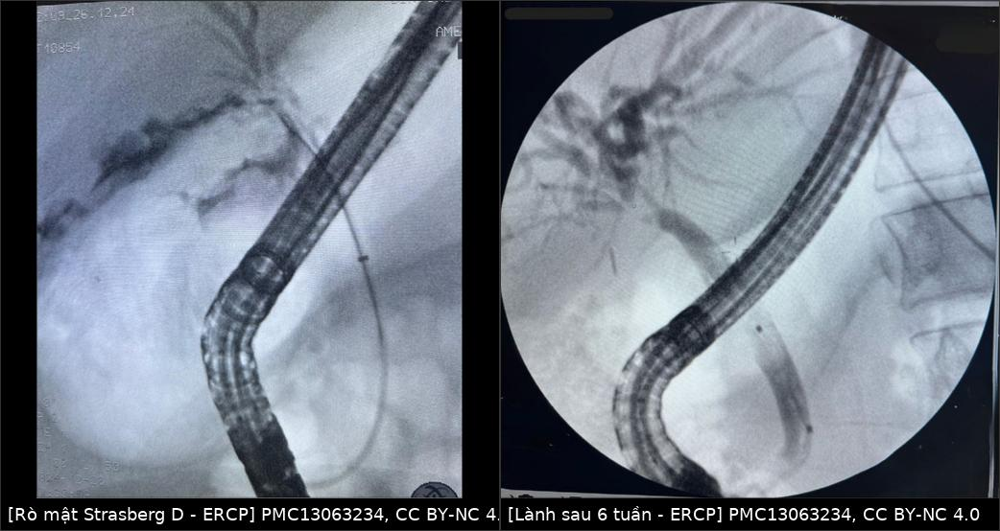
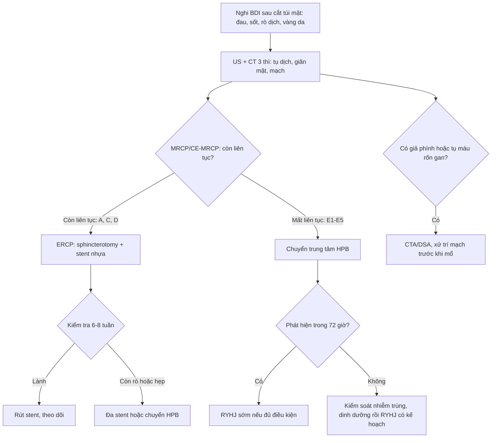
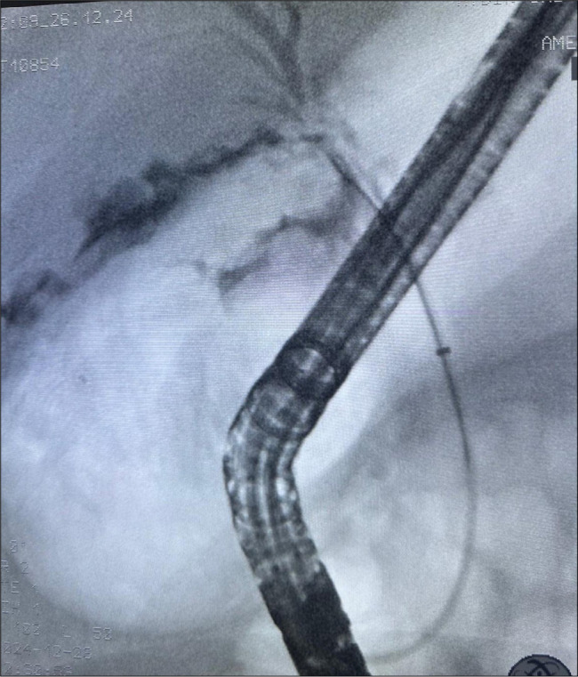
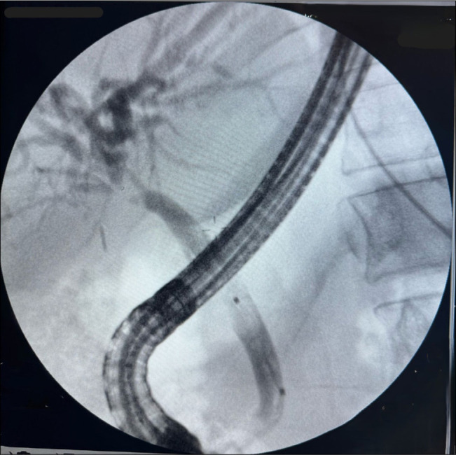

# 108 — Tổn thương đường mật sau cắt túi mật: Strasberg–Bismuth, MRCP/CE-MRCP, khi nào nong–stent vs mổ lại / Post-cholecystectomy bile duct injury (BDI)

**Tags:** `pattern:ro-mat` `pattern:hep-duong-mat` `pattern:hep-sau-mo` `vung:duong-mat` `vung:gan` `score:Strasberg` `score:Bismuth` `protocol:MRCP` `protocol:CE-MRCP` `protocol:ERCP` `incidentaloma:hep-sau-cat-tui-mat`
**Mức chắc chắn (certainty):** tổng hợp y văn (literature synthesis) — số liệu lấy từ hướng dẫn **WSES 2020** về phát hiện–xử trí BDI (PMC8190978, CC BY 4.0), nghiên cứu 33 ca ERCP về **Strasberg dự báo mất thông đường mật 30 ngày** (PMC13418495, CC BY-NC 4.0), loạt 106 ca của hội đồng giám định Đức về **phân loại và tỷ lệ vị trí tổn thương** (PMC12857022, CC BY 4.0) và một **ca nguyên văn** Strasberg D điều trị bằng stent qua ERCP (PMC13063234, CC BY-NC 4.0). Không có ca nguyên văn riêng của nhóm.

> **Bài này là bài "đọc đúng tổn thương" của cụm mật sau mổ.** [107](../107-mrcp-gadoxetic-acid-hbp/lesson.md) dạy **kỹ thuật** MRCP/HBP; [133](../133-hep-mieng-noi-duong-mat-sau-ghep/lesson.md) dạy hẹp **sau ghép gan**; [137](../137-theo-doi-stent-dan-luu-duong-mat-di-tru-tac-nhiem-trung/lesson.md) dạy **theo dõi stent**; [179](../179-bien-chung-duong-mat-sau-can-thiep-u-gan/lesson.md) dạy hoại tử ống mật **sau can thiệp u gan**. Bài 108 trả lời câu hỏi của bác sĩ CĐHA khi nhận bệnh nhân **vừa cắt túi mật, sốt/đau/vàng da/rò dịch**: tổn thương **loại gì, ở đâu, còn liên tục hay không** — vì đó là thứ quyết định **nội soi hay mổ lại**.

## 1. Tổng quan bệnh học – cơ chế hình ảnh

- **Định nghĩa:** **tổn thương đường mật (bile duct injury — BDI)** là tổn thương cây mật trong hoặc ngay sau cắt túi mật, biểu hiện sớm bằng **rò mật (bile leak)** và muộn bằng **hẹp (stricture)**. Đây là biến chứng nặng nhất của cắt túi mật: **tử vong liên quan BDI 1,8–4,6%**, **xơ gan mật thứ phát 2,4–10,9%**, **hẹp miệng nối sau mổ 4,1–69% (đa số 10–20%, trung vị 11–30 tháng)** (WSES 2020, PMC8190978).
- **Tần suất — con số phải nhớ:** cắt túi mật **nội soi (laparoscopic cholecystectomy — LC)** **0,4–1,5%**, **mổ mở 0,2–0,3%**; thể **nặng (major)** **0,1%** ở mổ phiên và **0,3%** ở mổ cấp cứu; tính mọi thể thì **0,4%** và **0,8%** (WSES 2020). Gộp **151 nghiên cứu / 505.292 bệnh nhân**: BDI **0,32–0,52%**, trong đó **major 0,28%** và **rò mật 0,46%** (tổng 0,74%) (WSES 2020 dẫn Pucher và cs).
- **TẠI SAO tổn thương hay bị bỏ sót — và vì sao hình ảnh là mấu chốt:** trong **106 ca** được giám định, **chỉ 30,2% phát hiện trong mổ** (PMC12857022); y văn ghi **25–32%** (PMC13063234). Nghĩa là **~70%** biểu hiện **sau mổ** bằng một hội chứng mơ hồ: đau bụng, chướng, sốt, rò dịch qua dẫn lưu, vàng da, tăng bilirubin/ALP. **Không có triệu chứng nào đặc hiệu** → chẩn đoán hình ảnh phải trả lời 3 câu: **(1) có rò đang hoạt động không? (2) rò ở đâu? (3) đường mật còn liên tục không?**
- **Vật lý — vì sao CT không đủ để gọi tên "rò mật":** dịch mật có **tỷ trọng gần nước (khoảng 0–20 HU)**, gần như **trùng dải HU của dịch thanh mạc, dịch tụ sau mổ và mủ**; máu tụ **35–70 HU** mới tách được. WSES nói thẳng: **US và CT không phân biệt được rò mật với tụ máu/mủ/dịch thanh mạc**, cũng **không xác định được vị trí và tính "hoạt động" của rò** (PMC8190978). Vì vậy:
  - **MRCP T2 nặng (heavily T2-weighted):** mật là **nước đứng yên → T2 rất dài → tín hiệu rất cao**, mô đặc/tĩnh mạch **tối**; cho **hình thái cây mật** nhưng **không cho biết rò có hoạt động** (dịch tự do ngoài ống cũng sáng).
  - **CE-MRCP với thuốc cản quang đào thải qua mật (gadoxetate, hepatobiliary phase — HBP):** thuốc vào **tế bào gan → bài tiết vào ống mật**, nên **chỉ mật mới sáng dần theo thời gian**; chỗ **thoát ra ngoài lòng ống** chính là **rò thật**. Thời điểm chụp tốt nhất **60–90 phút**; so với MRCP thường, CE-MRCP nâng **độ nhạy 53–63% → 76–82%**, **độ đặc hiệu 51–66% → 100%**, **độ chính xác 55–63% → 75–91%** (WSES 2020 dẫn chuỗi 99 bệnh nhân).
  - **HIDA (hepatobiliary scintigraphy):** cho biết **rò còn hoạt động** và **đường đi của mật**, nhưng **độ phân giải không gian kém**; có 3 bẫy: **không thấy hoạt tính ở tá tràng → dễ đọc nhầm thành tắc hoàn toàn**; **kém nhạy khi suy gan**; **khiếm khuyết lớn thì mật chảy theo đường ít cản nhất** (WSES 2020).
- **TẠI SAO hẹp xuất hiện MUỘN (11–30 tháng):** cơ chế chính là **thiếu máu thành ống** (kẹp/clip, đốt điện, bóc tách rốn gan) → **viêm xơ → hẹp**; kèm **tổn thương mạch** (trong 106 ca giám định, **13,2% có tổn thương động mạch kèm theo**, và tổn thương mạch là yếu tố tiên lượng xấu) (PMC12857022, PMC8190978). Vì quá trình xơ hóa cần thời gian, **ảnh "bình thường" ngay sau mổ không loại trừ hẹp** — bệnh nhân có thể quay lại sau **hàng tháng đến hàng năm** với **giãn đường mật trong gan + teo thùy gan**.
- **TẠI SAO phân độ quyết định điều trị (số liệu 30 ngày):** trong 33 ca được ERCP, **Strasberg là yếu tố DUY NHẤT** gắn với **mất thông đường mật trong 30 ngày**: nhóm **major (E)** mất thông **75,0%** so với **25,0%** ở nhóm minor (**p = 0,021**); **trung vị mất thông 24 ngày** ở nhóm major, nhóm minor **không đạt trung vị** trong 30 ngày (log-rank **p = 0,030**) (PMC13418495). Tuổi, giới, AST/ALT, bilirubin, đường mổ, thời điểm chẩn đoán và thời điểm sửa **đều không** dự báo (p > 0,05).
  - **Phản biện (cửa 3 — trung thành nguồn):** bài này **tự mâu thuẫn** — phần Methods ghi minor **A–D**, major **E**, còn phần Abstract ghi minor **A–C**, major **D–E**. Con số 75% vs 25% vì thế phải đọc theo **Methods/WSES** (major = **E**), và cỡ mẫu **33 ca** là rất nhỏ. Không dùng bài này để "chốt" tiên lượng từng bệnh nhân; dùng nó để nhớ rằng **mức độ giải phẫu mới là biến số có ý nghĩa**, không phải men gan.
- **Phân loại — bộ khung tối thiểu (Strasberg 1995, phổ biến nhất):**

| Kiểu | Tổn thương giải phẫu | Còn liên tục? | Hướng xử trí điển hình |
|---|---|---|---|
| **A** | Rò từ **mỏm ống túi mật** hoặc **ống nhỏ ở giường gan (duct of Luschka)** | Có | Dẫn lưu ± ERCP stent |
| **B** | **Tắc** một nhánh (thường **ống ngành phải lạc chỗ** bị clip), **không rò** | Có (nhánh bị tắc thì không) | Theo dõi/teo thùy; can thiệp nếu có triệu chứng |
| **C** | **Rò** từ nhánh bị tắc (nhánh lạc chỗ bị cắt không buộc) | Có | ERCP/stent hoặc mổ tùy mức |
| **D** | **Tổn thương BÊN** ống mật chủ/ống gan chủ (rách một phần chu vi) | Có | ERCP + stent ± sphincterotomy |
| **E** | **Đứt/hoại tử chu vi** ống mật chủ–ống gan chủ; **E1** mỏm > 2 cm, **E2** mỏm < 2 cm, **E3** trần chỗ hợp lưu còn, **E4** trần chỗ hợp lưu mất, **E5** E1–E3 + hẹp một ống gan phải biệt lập | **Không** | **Roux-en-Y hepaticojejunostomy (RYHJ)** |

  Nguồn bảng: định nghĩa A–D và E1–E5 theo bảng phân loại của WSES 2020 (PMC8190978); ca nguyên văn Strasberg **D** = "khuyết một phần thành sau ống gan chủ, còn rò" (PMC13063234).
- **Phân loại khác — biết để không "lạc ngôn ngữ":** **Bismuth** (1982) chia theo **vị trí hẹp so với chỗ hợp lưu**; **ATOM** (2013) gộp **giải phẫu + thời điểm phát hiện + cơ chế** và được WSES khuyến cáo "nên phổ biến" nhưng **quá phức tạp cho thực hành thường quy**; **BABD** (2026) phân loại tổn thương **cấp** theo **vị trí + mức độ**, phân được **99%** ca trong khi 11 hệ cũ tốt nhất chỉ **82–86%** (PMC12857022). Bài này dùng **Strasberg** làm ngôn ngữ chính vì đó là hệ ERCP/mổ cùng dùng.

## 2. Mẫu hình + chẩn đoán phân biệt theo vị trí (gamut)

- **Mẫu hình 1 — rò mật, đường mật KHÔNG giãn:** tụ dịch dưới gan/phải, dịch quanh gan, hoặc **dịch tự do**; mật vẫn xuống tá tràng. Nghĩ tới **A** (mỏm ống túi mật/ống Luschka), **C** (nhánh lạc chỗ), **D** (rách bên).
- **Mẫu hình 2 — hẹp có giãn đường mật TRÊN chỗ hẹp, dưới xẹp:** hẹp lành tính sau mổ, hẹp do clip, hoặc **B** (tắc một nhánh → giãn **khu trú** một phân thùy, thường **phải**).
- **Mẫu hình 3 — mất liên tục / không thấy ống mật chủ dưới chỗ tổn thương:** **E**; trên MRCP thấy **mỏm cụt trên** và **không opacify đoạn dưới**, thường kèm **tụ dịch lớn** hoặc **đường hầm rò**.
- **Mẫu hình 4 — ứ mật + tổn thương mạch:** giãn đường mật + **nhồi máu/teo thùy gan**, **giả phình động mạch gan phải** hoặc **tụ máu quanh rốn gan**; nghĩ **tổn thương mạch kết hợp** (13,2%) — đây là nhóm làm hẹp tái phát và mổ khó.
- **Gamut theo vị trí (từ dưới lên):**
  - **Mỏm ống túi mật / giường gan:** A (rò ống túi mật, ống Luschka), **máu tụ giường gan**, **áp-xe giường gan**.
  - **Ống gan chủ / ống mật chủ:** D (rách bên), E1–E2 (đứt, mỏm dài/ngắn), **hẹp do clip**, **hẹp do đốt điện**.
  - **Chỗ hợp lưu / rốn gan:** E3–E4, **tổn thương ống gan phải lạc chỗ** (B/C), **tổn thương động mạch gan phải**.
  - **Ngoài đường mật nhưng cùng bối cảnh:** **rò ống tiêu hóa**, **rò tá tràng**, **tụ dịch quanh tụy**, **huyết khối tĩnh mạch cửa**.
- **Gợi nhớ 3 câu hỏi của gamut:** **(1) Còn liên tục không? (2) Rò đang hoạt động không? (3) Có tổn thương mạch kèm theo không?** Trả lời được 3 câu này là đã chọn được **ERCP hay RYHJ**.

## 3. Bảng so sánh phân biệt (ma trận đối chiếu)

| Thực thể (entity) | Hình ảnh điển hình | Chốt vào (rule-in) | Chốt loại (rule-out) | Gợi ý xác nhận |
|---|---|---|---|---|
| **Strasberg A — rò mỏm ống túi mật / ống Luschka** | Tụ dịch **dưới gan phải**, đường mật **không giãn**; MRCP: cây mật bình thường + dịch ngoài ống | **Rò xuất hiện ngay sau mổ, đường mật còn liên tục, không giãn** | Mất liên tục ống mật chủ hoặc giãn đường mật trong gan → không phải A đơn thuần | ERCP: thấy mật thoát từ mỏm ống túi mật; HIDA dương tính |
| **Strasberg B — tắc nhánh lạc chỗ** | **Giãn khu trú một phân thùy** (thường VI–VII), **không rò**, ống mật chủ bình thường | **Giãn một vùng gan + không rò + tiền sử clip rốn gan** | Giãn lan cả hai thùy → nghĩ hẹp ống chính, không phải B | MRCP/CE-MRCP; CT tĩnh mạch cửa thấy nhánh không nối |
| **Strasberg C — rò từ nhánh bị tắc** | **Rò + giãn khu trú** cùng một phân thùy; dịch tụ quanh gan phải | **Rò kèm giãn một phân thùy** | Chỉ rò mà không giãn khu trú → nghĩ A/D | ERCP có thể **không thấy** nhánh lạc chỗ — cần MRCP |
| **Strasberg D — rách bên ống chính** | **Rò từ thành ống** (thường thành sau ống gan chủ), ống còn liên tục, đoạn dưới vẫn opacify | **Thấy thuốc thoát ra nhưng vẫn thấy ống phía dưới** | Không thấy ống dưới chỗ tổn thương → nghi E | ERCP (vừa chẩn đoán vừa đặt stent); CE-MRCP |
| **Strasberg E1–E2 — đứt ống, mỏm dài/ngắn** | **Mất liên tục**, mỏm trên cụt, **không opacify đoạn dưới**; tụ dịch lớn hoặc đường hầm rò | **Mất liên tục hoàn toàn + mỏm cụt rõ** | Còn dòng mật qua chỗ hẹp (dù hẹp) → không phải đứt | MRCP + ERCP/PTC; **chuyển trung tâm HPB** |
| **Strasberg E3–E5 — tổn thương chỗ hợp lưu** | Mất liên tục **tại rốn gan**, **không thấy ống gan phải/trái**; có thể teo thùy | **Mất hình chỗ hợp lưu + giãn đường mật trong gan hai bên** | Còn trần chỗ hợp lưu → E1–E2 | CE-MRCP + MRCP 3D; PTC hai bên nếu cần bản đồ |
| **Biloma (tụ mật) đơn thuần** | Khối dịch **0–20 HU**, bờ rõ, **không ngấm**, dưới gan/phải | **Dịch mật ngoài ống + không thấy thoát thuốc trên CE-MRCP** | Thấy thuốc thoát từ ống → rò đang hoạt động | US/CT theo dõi; HIDA nếu còn nghi |
| **Máu tụ / áp-xe sau mổ** | Máu **35–70 HU**, có thể **tăng đậm độ**; áp-xe có **vách ngấm + khí** | **HU cao (máu) hoặc khí + vách ngấm (áp-xe) + sốt** | Dịch đồng nhất 0–20 HU, không khí, không vách → nghĩ biloma | CT có cản quang; cấy dịch |
| **Hẹp lành tính KHÔNG do mổ** | Hẹp dài, nhiều ổ (PSC), hoặc hẹp do viêm tụy | **Bối cảnh không mổ, hẹp nhiều ổ, thành dày** | Hẹp đơn độc đúng vị trí mổ, bờ nhẵn → hậu phẫu | MRCP + CA 19-9/cytology nếu nghi ác |

*Trái: **ERCP trong mổ** — thuốc thoát ra từ **thành sau ống gan chủ**, ống còn liên tục = **Strasberg D**. Phải: **ERCP kiểm tra sau 6 tuần** — cây mật opacify đều, **không còn thoát thuốc**. Nguồn: *Turk J Trauma Emerg Surg* 2026 (PMC13063234) Fig. 2 và Fig. 4, CC BY-NC 4.0; ghép bằng `tools/make_composite.py` (letterbox, không crop/kéo giãn).*

### Ba dấu hiệu quyết định trên phim
- **Còn liên tục hay không:** nếu **thấy được ống mật chủ phía dưới chỗ tổn thương** → còn liên tục (A/C/D); **không thấy** → nghi **E** và **không được** đặt stent qua nội soi như một "giải pháp cuối".
- **Rò "hoạt động" chỉ chứng minh được bằng chất đánh dấu:** **thuốc cản quang bài tiết qua mật** (CE-MRCP) hoặc **HIDA** hoặc **ERCP/PTC**; **dịch tụ đơn thuần trên CT không phải bằng chứng rò**.
- **Tổn thương mạch kèm theo:** tìm **giả phình động mạch gan phải**, **tụ máu rốn gan**, **nhồi máu/teo thùy** — vì nhóm này hẹp tái phát và mổ lại khó hơn.

## 4. Protocol chụp + hệ phân độ/điểm chuẩn hóa

- **Bước 1 — siêu âm (US):** công cụ đầu tay, rẻ, tại giường: tìm **dịch tự do/dịch khu trú**, **giãn đường mật**, và **Doppler** đánh giá mạch gan (WSES 2020). Hạn chế: **không phân biệt bản chất dịch**, **không định vị được chỗ rò**.
- **Bước 2 — CT bụng 3 thì (triphasic CT) có cản quang:** WSES khuyến cáo **là hình ảnh đầu tay** để tìm **tụ dịch trong/ quanh gan**, **giãn đường mật**, **tổn thương mạch** (giả phình, huyết khối), **teo thùy gan** và biến chứng muộn (**xơ gan mật thứ phát**). CT **nhạy hơn US** với tụ dịch nhỏ và biến chứng mạch.
- **Bước 3 — MRCP ± CE-MRCP (gadoxetate, HBP 60–90 phút):** "tiêu chuẩn vàng" cho **hình thái** cây mật trên và dưới chỗ tổn thương; CE-MRCP để **chứng minh rò** và **định vị** (Se **76–82%**, Sp **100%**). **Hạn chế:** khi có **tắc hoàn toàn**, đoạn dưới **không opacify** → dễ đọc quá mức "đứt"; ống ngoại vi **không hiện rõ** (WSES 2020).
- **Bước 4 — HIDA:** khi nghi **rò lượng ít**, đường mật **không giãn**, muốn biết **rò còn hoạt động**; nhớ bẫy **"không thấy tá tràng = tắc"** và **kém nhạy khi suy gan**.
- **Bước 5 — ERCP (nội soi mật–tụy ngược dòng) hoặc PTC:** **vừa chẩn đoán vừa điều trị**. Chọn ERCP khi **còn liên tục** hoặc **hai mỏm rất gần** trên MRCP; kỹ thuật **đa stent (multistenting)** cho hẹp/rò. Với **E** (mất liên tục) ERCP **không sửa được** — chỉ để **giải áp tạm** nếu cần.
- **Ngưỡng thời gian — "cửa sổ" của phẫu thuật:** tổn thương **E1–E2 phát hiện trong 72 giờ** → **chuyển trung tâm HPB**, có thể **RYHJ cấp cứu**; sửa **sớm trong 48 giờ** cho kết quả tốt, sau **48–72 giờ** bước vào pha **tăng sinh–lành sẹo** làm mổ khó hơn (WSES 2020). **Sửa muộn có kế hoạch** (sau khi kiểm soát nhiễm trùng, dinh dưỡng) cho **hẹp miệng nối ít hơn**; sửa **ngay tại chỗ bởi phẫu thuật viên không chuyên HPB** là **yếu tố nguy cơ độc lập** cho hẹp/tái mổ (WSES 2020).
- **Kết quả định lượng để tư vấn:**
  - **ERCP + stent** cho **C/D** (còn liên tục): thành công **89–96%** (PMC13063234 dẫn y văn); ca nguyên văn: **stent nhựa, kiểm tra 6 tuần, lành hoàn toàn, rút stent**.
  - **Strasberg E** qua ERCP: **75% mất thông trong 30 ngày**, trung vị **24 ngày** → **phải theo dõi sát tháng đầu** (PMC13418495).
  - **RYHJ** cho E: hẹp miệng nối **10–20%** (trung vị 11–30 tháng) → **theo dõi chức năng gan + MRCP khi nghi**.
- **Sơ đồ quyết định (Mermaid):**

## 5. Biến thể bình thường và cạm bẫy

- **Biến thể giải phẫu dễ gây tổn thương (và dễ đọc sai):** **ống gan phải lạc chỗ** đổ vào ống túi mật/ống gan chủ thấp; **ống Luschka** (ống nhỏ giường gan) — rò sau mổ **không phải** tổn thương ống chính; **ống túi mật cắm thấp**. Trên MRCP, các ống này **nhỏ, dễ bị bỏ qua** → luôn đọc **hệ thống 3D** chứ không chỉ một lát.
- **Cạm bẫy 1 — "dịch 0–20 HU là mật":** sai. **Dịch thanh mạc, mủ, dịch tụ sau mổ** đều cùng dải HU. Muốn gọi **biloma/rò mật** phải có **bằng chứng mật thoát ra** (CE-MRCP, HIDA, ERCP) hoặc **dịch mật qua dẫn lưu**.
- **Cạm bẫy 2 — HIDA âm giả:** khi **khiếm khuyết lớn** hoặc **suy gan**, mật đi theo **đường ít cản nhất** và **không xuống tá tràng** → dễ đọc thành **tắc hoàn toàn**. Đừng loại trừ rò chỉ vì HIDA không thấy hoạt tính ở ruột.
- **Cạm bẫy 3 — MRCP đọc quá "đứt":** khi **tắc hoàn toàn**, đoạn dưới **không opacify** dù vẫn còn về giải phẫu → cần **CE-MRCP/PTC** hoặc **ERCP** trước khi kết luận E.
- **Cạm bẫy 4 — mặt cắt ngang: dịch màng phổi vs dịch dưới hoành vs cổ trướng.** Dịch dưới hoành phải nằm **sau phúc mạc gan** (khoảng bare area) và **đẩy cơ hoành lên**; dịch màng phổi nằm **ngoài cơ hoành**, **dấu crus lệch (displaced crus sign)** dương tính; cổ trướng **ôm bờ gan/lách** và **chảy vào rãnh quanh gan**. Cùng độ đậm, **vị trí tương đối với cơ hoành/crus** mới quyết định tên.
- **Cạm bẫy 5 — clip kim loại:** gây **giả khuyết tín hiệu** trên MRCP (như sỏi) và **giả ứ** trên CT; đối chiếu **vị trí clip** với **đoạn ống giãn ở trên** để không gọi nhầm sỏi.
- **Cạm bẫy 6 — "rò nhỏ, tự hết":** rò từ **mỏm ống túi mật/ống Luschka** thường **tự bít hoặc đáp ứng dẫn lưu**; **không** vội mổ. Ngược lại, **rò kèm mất liên tục** thì **không chờ** — chờ chỉ làm tăng nhiễm trùng và xơ hóa.
- **Cạm bẫy 7 — thoả mãn tìm kiếm (satisfaction of search):** thấy tụ dịch là dừng, bỏ **tổn thương mạch** (13,2%) và **giãn đường mật trên** — hai thứ đổi hoàn toàn kế hoạch điều trị.

## 6. Tự lượng giá — Blind Quiz (không cần app)

**Ca 1 — Bệnh nhân đau bụng và sốt 5 ngày sau cắt túi mật nội soi; dịch qua dẫn lưu màu vàng.**

- Gợi ý lâm sàng: tổn thương được nhận ra **trong mổ**, xử trí **cùng lúc**; không có vàng da.
- Câu hỏi: (1) Thuốc thoát ra ở đâu, từ **thành ống** hay từ **mỏm cụt**? (2) Đường mật còn liên tục không? (3) Xếp **Strasberg** kiểu gì, và vì sao **không** cần RYHJ?

<b>Bấm để hiện đáp án (findings + chẩn đoán)</b>

- **Dấu hiệu:** ống soi ERCP nằm trong tá tràng–ống mật; **thuốc thoát ra từ thành sau ống gan chủ** thành một **đám mờ ngoài lòng ống**, trong khi **đoạn ống phía dưới vẫn thấy thuốc**.
- **Chẩn đoán:** **Strasberg D** (rách bên, một phần chu vi, **còn liên tục**) — đúng như mô tả ca nguyên văn: "partial defect with bile leakage on the posterior wall of the common hepatic duct".
- **Vì sao không RYHJ:** **còn liên tục** nên **nội soi + stent** đủ; RYHJ dành cho **E** (mất liên tục/hoại tử chu vi).
- **Nguồn ảnh:** *Turk J Trauma Emerg Surg* 2026, PMC13063234 Fig. 2, CC BY-NC 4.0.

**Ca 2 — Cùng bệnh nhân, 6 tuần sau.**

- Câu hỏi: (1) Còn rò không? (2) Dấu hiệu nào trên ảnh cho phép **rút stent**? (3) Nếu 6 tuần vẫn còn thoát thuốc thì bước tiếp theo là gì?

<b>Bấm để hiện đáp án</b>

- **Dấu hiệu:** cây mật **opacify đều**, **không còn đám mờ ngoài lòng ống**, không hẹp đoạn ống gan chủ.
- **Kết luận:** **lành hoàn toàn** → **rút stent**; ca nguyên văn: stent nhựa rút sau 6 tuần, xét nghiệm 6 tuần bình thường, theo dõi 4 và 8 tháng không biến chứng.
- **Nếu còn rò/hẹp:** **đa stent** hoặc **chuyển trung tâm HPB** — đừng "đặt stent mãi"; hẹp hậu phẫu muộn có thể xuất hiện **11–30 tháng** sau.
- **Nguồn ảnh:** *Turk J Trauma Emerg Surg* 2026, PMC13063234 Fig. 4, CC BY-NC 4.0.

**Ca 3 — Bệnh nhân 52 tuổi, 8 tháng sau cắt túi mật, đau hông lưng phải tái diễn + ALP tăng; CT có giãn đường mật trong gan phải, ống mật chủ không giãn.**

- Câu hỏi: (1) Hai chẩn đoán phân biệt hàng đầu? (2) Cần chuỗi xung/chất cản quang nào để phân biệt? (3) Khi nào gọi là "major" và đổi hướng điều trị?

<b>Bấm để hiện đáp án</b>

- **Phân biệt:** (a) **Strasberg B** — tắc **một nhánh lạc chỗ** gây giãn **khu trú** một phân thùy; (b) **hẹp ống chính** hoặc **hẹp miệng nối** — nhưng khi đó giãn thường **lan hai bên**, không khu trú.
- **Chuỗi xung:** **MRCP 3D** để thấy nhánh không nối + **CE-MRCP (HBP 60–90 phút)** để xác định còn thông và tìm rò; **CT 3 thì** để loại **giả phình/tổn thương mạch** và **teo thùy**.
- **Đổi hướng:** nếu **mất liên tục ống chính** hoặc **tổn thương chỗ hợp lưu** (E3–E5) → **major**, **không** đặt stent qua nội soi như điều trị triệt để; **chuyển HPB** để **RYHJ**.
- **Nguồn số liệu:** WSES 2020 (PMC8190978); loạt 106 ca (PMC12857022).

## Bài liên quan chéo
- [107 – MRCP & gadoxetic acid HBP: kỹ thuật và ngưỡng](../107-mrcp-gadoxetic-acid-hbp/lesson.md)
- [133 – Hẹp miệng nối & cholangiopathy thiếu máu sau ghép gan](../133-hep-mieng-noi-duong-mat-sau-ghep/lesson.md)
- [137 – Theo dõi stent/dẫn lưu đường mật, di trú, tắc, nhiễm trùng](../137-theo-doi-stent-dan-luu-duong-mat-di-tru-tac-nhiem-trung/lesson.md)
- [179 – Hoại tử ống mật & biloma sau can thiệp u gan](../179-bien-chung-duong-mat-sau-can-thiep-u-gan/lesson.md)
- [100 – Tổng quan hệ Bụng](../100-tong-quan-he-bung/lesson.md)

> Không dùng để chẩn đoán độc lập khi chưa có người hướng dẫn.
