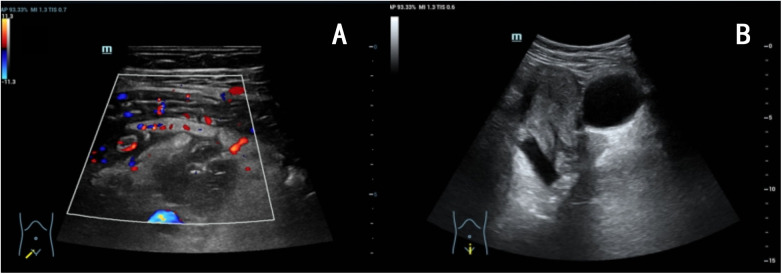
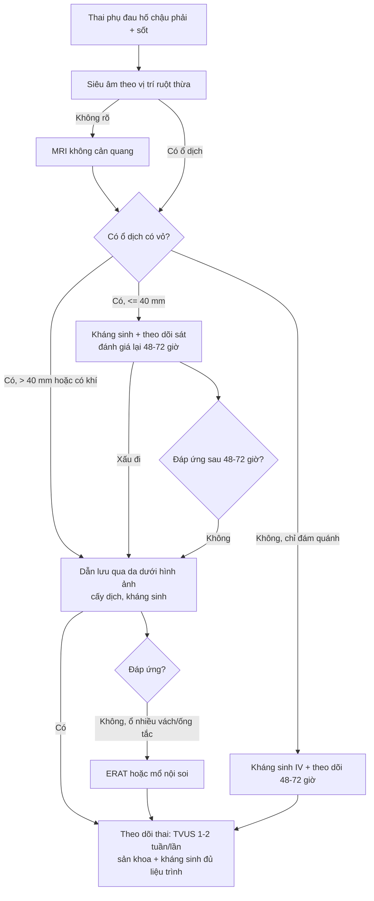
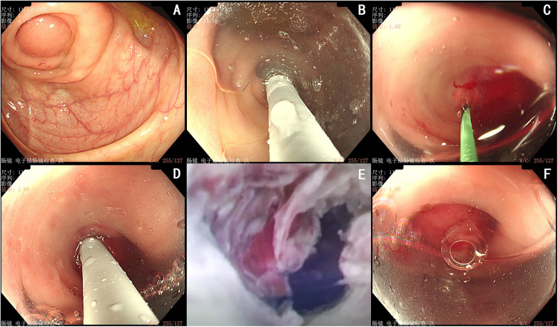
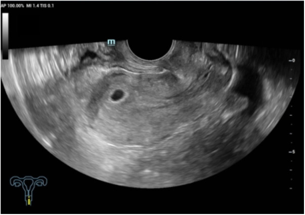

# 109 — Áp-xe ruột thừa ở thai phụ: chọn dẫn lưu qua da / ERAT thay vì mổ, ngưỡng kích thước và theo dõi sản khoa

**Tags:** `pattern:ap-xe-o-bung` `pattern:viem-ruot-thua` `pattern:dich-ho-chau` `vung:ho-chau` `vung:o-bung` `protocol:sieu-am-bung` `protocol:MRI-bung-khong-can-quang` `protocol:ERAT-noi-soi` `score:AIR` `score:Alvarado`
**Mức chắc chắn (certainty):** tổng hợp y văn (literature synthesis) — **ca nguyên văn** thai 3 tuần 4 ngày có áp-xe ruột thừa 41 × 25 × 29 mm được **dẫn lưu qua da + ERAT**, thai tiếp tục sống (Front Surg 2026, **PMC13216021**), ghép với **tổng quan hệ thống MRI ở thai phụ** (26 nghiên cứu, **PMC9676701**), **meta sánh nội soi – mổ mở** (**PMC8495069**), **network meta ERAT – mổ – kháng sinh** (**PMC12495716**), **hướng dẫn SAGES 2024** (**PMC11133165**) và **loạt 34 áp-xe ruột thừa người lớn** dự báo thất bại bảo tồn (**PMC6768819**). Không có RCT riêng ở thai phụ → mọi ngưỡng là **suy luận từ người lớn + ca nhi**.

> **Câu hỏi thực hành:** thai phụ **24 tuổi**, thai **3 tuần 4 ngày** (β-hCG 240 IU/L, chưa thấy túi thai), **đau hố chậu phải 5 ngày, sốt 39,0 °C**. Siêu âm: **khối 41 × 25 × 29 mm** cạnh ruột thừa, có tín hiệu mạch trong khối; **WBC 13,74 × 10⁹/L, IL-6 80,7 pg/mL, PCT 0,17 ng/mL**.
> Câu hỏi: **khối này là áp-xe hay là thai ngoài tử cung/khối phần phụ? có nên mổ nội soi cắt ruột thừa ngay ở tam cá nguyệt I không? dẫn lưu qua da đủ chưa, và khi nào thêm ERAT? theo dõi thai bằng gì sau can thiệp?**
> Bài chốt **bốn việc**: **(1) viêm ruột thừa cấp gặp ở 1/1.000–2.000 thai kỳ, và 4–20% tiến triển thành áp-xe/đám quánh — nhóm này mới là nhóm cần bàn "mổ hay không mổ"; (2) điều trị bảo tồn (kháng sinh ± dẫn lưu qua da) thất bại ~30%, và ~25,4% ca đã đặt dẫn lưu vẫn phải mổ — nên phải có mốc đánh giá lại ở 48–72 giờ; (3) ổ áp-xe > 40 mm và WBC không giảm sau 24 giờ là hai yếu tố dự báo chuyển mổ; (4) ở tam cá nguyệt I–II, nội soi ổ bụng với áp lực 10–12 mmHg là lựa chọn an toàn (SAGES 2024), còn ERAT là bổ sung nội soi khi dẫn lưu qua da không đủ — nhưng ERAT chưa có chuẩn chỉ định và chưa có dữ liệu thai kỳ ngoài ca báo cáo.** Nối [145 – Viêm ruột thừa trong thai kỳ](../145-viem-ruot-thua-trong-thai-ky/lesson.md), [161 – Viêm ruột thừa cấp](../161-viem-ruot-thua-cap/lesson.md), [160 – Bụng cấp tiêu hóa](../160-bung-cap-GI/lesson.md).

## 1. Tổng quan bệnh học – cơ chế hình ảnh: vì sao thai phụ dễ bị "che" áp-xe

- **Dịch tễ:** viêm ruột thừa cấp là **cấp cứu ngoại khoa không sản khoa phổ biến nhất** khi mang thai, gặp ở **~1/1.000–2.000 thai kỳ** (0,063% trong dữ liệu tổng hợp của PMC13216021). **4–20%** ca viêm ruột thừa không được xử lý sớm sẽ tiến triển thành **áp-xe hoặc đám quánh quanh ruột thừa (phlegmon)**.
- **TẠI SAO vị trí và hình ảnh thay đổi theo tuổi thai:** tử cung lớn dần **đẩy manh tràng – ruột thừa lên trên và ra ngoài**; từ **tuần 20** ruột thừa thường nằm **trên gai chậu trước trên**, đến tam cá nguyệt III có thể ở **hạ sườn phải**. Vì vậy **đau không khu trú ở hố chậu phải** và **siêu âm hố chậu phải "bình thường" không loại trừ** — phải quét **theo vị trí ruột thừa đã di chuyển**.
- **TẠI SAO dễ bỏ sót áp-xe:** bạch cầu và CRP **tăng sinh lý** trong thai kỳ; **buồng trứng/khối phần phụ** nằm cùng vùng; **thai ngoài tử cung** cũng gây đau + dịch hố chậu. Bộ ba này là lý do bài này phải có **ma trận phân biệt với khối phần phụ và thai ngoài tử cung** ở mục (3).
- **TẠI SAO hình ảnh thấy được (vật lý):**
  - **Siêu âm:** áp-xe là **khối echo hỗn hợp/giảm âm, có vỏ không đều**, bên trong có **echo dày (mủ đặc)** và **bóng khí lấm tấm** (khí sinh hơi từ vi khuẩn); **đè đầu dò thấy đau khu trú**; Doppler màu: **tăng sinh mạch ở vỏ**, **không có mạch trong lòng mủ** (khác khối đặc/u).
  - **MRI không cản quang:** dịch mủ **T1 thấp – T2 cao**, **vỏ dày ngấm thuốc thì muộn**, **hạn chế khuếch tán ở vỏ và mủ đặc** (DWI sáng, ADC tối — mủ giàu tế bào và protein). **Khí trong ổ** = điểm đen mọi chuỗi xung. Đây là lý do **MRI được ưu tiên hơn CT ở thai phụ**: **không ion hóa**, độ tương phản mô mềm cao, và theo meta **26 nghiên cứu**, MRI chẩn đoán viêm ruột thừa ở thai phụ với **Se 92% / Sp 98%** (AUC 99%) (PMC9676701).
  - **Vì sao KHÔNG dùng CT làm đầu tay:** liều bức xạ thai nhi và **giảm độ chính xác của siêu âm khi tử cung lớn**; CT chỉ dành cho ca **không thể MRI** và khi kết quả sẽ đổi xử trí ngay.
- **Số liệu định lượng phải thuộc:**
  - Bảo tồn (kháng sinh ± dẫn lưu qua da) ở áp-xe: **thất bại ~30%**, **~10%** cuối cùng phải mổ; riêng nhóm đã đặt **dẫn lưu qua da**, **25,4%** vẫn phải mổ (PMC13216021 dẫn y văn).
  - Loạt **34 áp-xe ruột thừa người lớn** điều trị bảo tồn: **8/34 (23,4%) chuyển mổ**, trung bình **sau 5,5 ngày**; **ổ > 40 mm** và **WBC ngày 1 không giảm** là yếu tố dự báo độc lập; chuyển mổ **sớm < 5 ngày** rút ngắn nằm viện và giảm chi phí (PMC6768819).
  - Sau bảo tồn thành công, **tái phát gộp 9,9% (KTC 4,8–20,6)** ở trẻ — dùng để tư vấn nguy cơ tái phát khi giữ ruột thừa (PMC12486442).
  - **Network meta 23 RCT:** ERAT ít biến chứng hơn mổ (**OR 6,33; 2,35–17,03** theo hướng mổ nhiều biến chứng hơn), tái phát **thấp hơn kháng sinh (OR 0,22; 0,08–0,57)** nhưng **cao hơn mổ (OR 0,27; 0,12–0,64)**; tỉ lệ thất bại của kháng sinh cao hơn mổ (**OR 0,05; 0,02–0,15**) (PMC12495716).
  - **Nội soi so với mổ mở ở thai phụ:** sẩy thai **OR 1,93 (1,39–2,69)** trong meta 2021 — nhưng **đây là so sánh quan sát, chịu nhiễu do ca nội soi thường nặng hơn**; hướng dẫn **SAGES 2024** vẫn khuyến cáo **có điều kiện: nội soi hơn mổ mở** và **mổ hơn điều trị bảo tồn** ở viêm ruột thừa cấp (PMC8495069, PMC11133165).
  - **Kỹ thuật nội soi theo tuổi thai:** áp lực bơm hơi **10–12 mmHg**, tư thế **nằm ngửa ≤ 20 tuần**, **nghiêng trái ≥ 21 tuần**, 3 trocar; 6 ca, trung vị 21 tuần, không chuyển mổ, không biến chứng sản khoa (PMC13402063).

*(A) Siêu âm bụng có Doppler: **khối echo hỗn hợp 41 × 25 × 29 mm** ở hố chậu phải, **có tín hiệu mạch trong khối** (vỏ viêm tăng sinh mạch); (B) siêu âm đầu dò âm đạo: **nội mạc 9 mm, chưa thấy túi thai** — ở tuần 3–4 điều này **bình thường**, không được vì thế mà loại trừ thai ngoài tử cung. Nguồn: Front Surg 2026 (PMC13216021), CC BY 4.0, nguyên bản.*

## 2. Mẫu hình + chẩn đoán phân biệt theo vị trí và thành phần khối (gamut)

- **Gamut theo hình thái khối:**
  - **Ổ dịch có vỏ dày + bóng khí lấm tấm** → **áp-xe** (khí sinh hơi: *E. coli*, *Klebsiella*, kỵ khí).
  - **Đám quánh (phlegmon) không hóa lỏng** → **không chọc/dẫn lưu** (không có ổ để dẫn lưu, chỉ kháng sinh).
  - **Ổ dịch thuần nhất, thành mỏng, không khí** → **nang/giả nang**, hoặc **dịch túi cùng** — không phải áp-xe.
  - **Khối đặc có mạch trong lòng + cấu trúc nang/dịch trong** → nghĩ **khối phần phụ** (u bì, u nang xuất huyết, xoắn) hoặc **thai ngoài tử cung**.
  - **Dịch tự do + khí tự do ngoài lòng ruột** → **thủng ruột thừa**, chỉ định **mổ**, không dẫn lưu đơn thuần.
- **Gamut theo vị trí (thay đổi vì tử cung lớn):** **hố chậu phải** (tam cá nguyệt I) · **cạnh gai chậu trước trên** (tuần 12–20) · **hạ sườn phải/cạnh thận phải** (tam cá nguyệt III) · **túi cùng Douglas** (áp-xe chảy xuống, dễ nhầm với khối phần phụ).
- **Gamut theo bối cảnh thai:** **thai trong tử cung sống** (ưu tiên can thiệp tối thiểu) · **chưa xác định vị trí thai** (phải loại thai ngoài tử cung **trước** mọi can thiệp) · **thai ngoài tử cung đồng thời** (chẩn đoán kép hiếm, không được bỏ) · **thai lưu/sẩy** (nguy cơ nhiễm trùng tử cung làm nhiễu hình ảnh).
- **Gợi nhớ "ABSCESS":** **A**ppendix (ruột thừa đã di chuyển) · **B**lood flow ở vỏ (không mạch trong lòng) · **S**ize > 40 mm (nguy cơ thất bại) · **C**avity with gas (khí = vi khuẩn) · **E**ctopic phải loại trừ · **S**econd look 48–72 giờ · **S**urvey thai sau can thiệp.

## 3. Bảng so sánh phân biệt (ma trận đối chiếu)

| Thực thể (entity) | Hình ảnh điển hình (US/MRI) | Chốt vào (rule-in) | Chốt loại (rule-out) | Gợi ý xác nhận |
|---|---|---|---|---|
| **Áp-xe ruột thừa** | Khối **echo hỗn hợp, vỏ dày**, **bóng khí**, **đau khu trú khi đè đầu dò**, mạch ở vỏ | **Khối cạnh ruột thừa + khí trong khối + sốt/CRP cao** | Khối **thuần đặc, có mạch trong lòng** → không phải áp-xe | US → **MRI**; dẫn lưu qua da **> 40 mm** |
| **Đám quánh (phlegmon)** | Khối **đặc, không hóa lỏng**, mờ mỡ quanh ruột thừa, **không có vỏ rõ** | **Khối đặc không dịch + ruột thừa dày > 6 mm kèm mờ mỡ** | **Có ổ dịch rõ** → áp-xe (cần dẫn lưu) | **Kháng sinh, không chọc**; MRI lại sau 48–72 giờ |
| **Thai ngoài tử cung** | Khối **dạng vòng/đặc cạnh buồng trứng**, **dịch túi cùng**, **β-hCG không tăng đôi** | **β-hCG + khối phần phụ + không túi thai trong tử cung** | Túi thai trong tử cung sống → không phải | **β-hCG 48 giờ + TVUS**; **không dẫn lưu trước khi loại** |
| **Xoắn phần phụ** | Buồng trứng **to, nhiều nang nhỏ ngoại vi**, **dấu xoáy (whirlpool)**, **không có mạch tĩnh mạch** | **Đau đột ngột + buồng trứng to + mất dòng tĩnh mạch** | Có mạch bình thường + khối có khí → áp-xe | Doppler; **mổ nội soi** khi nghi |
| **U bì (dermoid) biến chứng** | Khối **T1 sáng, mất tín hiệu trên T1 fat-sat**, mỡ lỏng, **mức dịch–mỡ** | **T1 sáng + triệt mỡ** | T1 thấp, T2 cao, hạn chế khuếch tán → mủ | MRI; **không chọc** vì nguy cơ viêm phúc mạc hóa học |
| **Viêm ruột thừa chưa biến chứng** | Ruột thừa **> 6 mm, không đè xẹp**, mờ mỡ, **appendicolith** | **Đường kính > 6 mm + không xẹp khi đè + mờ mỡ** | Có ổ dịch có vỏ → đã biến chứng | **Mổ nội soi** (SAGES 2024) |
| **Nhiễm trùng tiết niệu/ứ nước thận phải** | **Thận ứ nước**, niệu quản giãn, **không có khối cạnh ruột thừa** | **Ứ nước + đau hông lưng + nitrit/leukocyte niệu** | Có khối hố chậu phải độc lập → nghĩ áp-xe | Siêu âm thận; **không dẫn lưu ổ bụng** |
| **Viêm mô tế bào thành bụng/khối thành bụng** | Tổn thương **trong thành bụng**, không trong phúc mạc | **Khối khu trú trong cơ thành bụng** | Khối **trong phúc mạc, di động theo ruột** | MRI; kháng sinh ± dẫn lưu thành bụng |

- **Không tạo ảnh ghép:** cả 3 ảnh đều **cùng một bệnh nhân** nhưng **khác chuỗi/thời điểm** (siêu âm trước can thiệp; nội soi ERAT; siêu âm kiểm tra sau 5 ngày) — giữ riêng để người đọc thấy **diễn tiến**, không ghép thành một khung dễ gây hiểu sai là ba bệnh nhân.

## 4. Protocol chụp + ngưỡng can thiệp + bậc thang xử trí

- **Chẩn đoán hình ảnh theo bậc (thai phụ):**
  1. **Siêu âm bụng – hố chậu phải** (đầu dò cong + đầu dò thẳng), **quét theo vị trí ruột thừa đã di chuyển**; đo **đường kính ruột thừa**, tìm **appendicolith**, **mờ mỡ**, **ổ dịch**, **khí**.
  2. **MRI bụng–khung chậu không cản quang** (không gadolinium trừ khi bắt buộc): **T2 SSFSE/HASTE**, **T1**, **DWI + ADC**, **T2 FS**; đọc 4 câu: **ổ dịch ở đâu, kích thước? có vỏ ngấm thuốc? có khí? có khối phần phụ/thai ngoài tử cung kèm?**
  3. **CT** chỉ khi **MRI không có/chống chỉ định** và kết quả đổi xử trí ngay.
  4. **Không chọc dẫn lưu** trước khi **loại trừ thai ngoài tử cung** và **không có rối loạn đông máu**.
- **Ngưỡng quyết định (tổng hợp, ghi rõ mức chắc chắn):**
  - **Ổ ≤ 30–40 mm, không nhiễm trùng nặng, thai ổn:** **kháng sinh IV + theo dõi**; MRI/US lại **48–72 giờ**. (Ngưỡng 40 mm là từ loạt người lớn, chưa có nghiên cứu riêng thai phụ — nhãn **suy luận**.)
  - **Ổ > 40 mm hoặc có khí hoặc không đáp ứng sau 48–72 giờ:** **dẫn lưu qua da (PCD)** dưới siêu âm/CT; **kim 8–10 Fr**, **không đi xuyên tử cung/thai**, đường vào **ngoài phúc mạc hoặc qua thành bụng bên**; cấy dịch **luôn**.
  - **PCD thất bại (dịch đặc, nhiều vách, ống tắc) hoặc nghi thủng:** **ERAT** (nội soi ruột thừa ngược dòng: đặt guidewire, catheter, **rửa lòng ruột thừa**, có thể **stent**), hoặc **mổ nội soi**.
  - **Có biến chứng toàn thân (nhiễm khuẩn huyết, suy cơ quan), thủng, hoặc không kiểm soát được:** **mổ** — nội soi **10–12 mmHg** nếu ≤ 20 tuần, **mở** nếu tam cá nguyệt III phức tạp.
- **Sơ đồ quyết định:**

- **Chi tiết ERAT (khi chọn):** nội soi **qua hậu môn** tới manh tràng, **kéo van Gerlach**, **đặt guidewire 0,035 in** vào lòng ruột thừa, **catheter imaging 9 Fr** (đường kính ngoài ≤ 3,2 mm), **rửa sạch mủ**, có thể đặt **stent**. Trong ca chỉ điểm: **PCD ngày 2 chỉ ra 13 mL dịch nâu đục**, sốt và đau **không giảm**, **WBC tăng lại 12,96 × 10⁹/L** → **ERAT ngày 5**; sau ERAT hết sốt, **WBC 5,38**, **PCT 0,04**, **IL-6 34,3**; cấy dịch **E. coli** nhạy ertapenem; rút dẫn lưu sau **4 ngày không ra dịch** (PMC13216021). **Không đặt dẫn lưu trong lòng ruột thừa** trong ca này — hiệu quả đến từ **rửa trực tiếp ổ mủ**.
- **Theo dõi sản khoa sau can thiệp (bắt buộc, đừng bỏ):**
  - **TVUS kiểm tra túi thai/thai sống 3–7 ngày sau can thiệp** (ca chỉ điểm: **5 ngày sau ERAT**, túi thai **10 × 6 × 7 mm** trong buồng tử cung).
  - **Kháng sinh đủ liệu trình** theo ổ nhiễm (thường **7–10 ngày**), ưu tiên thuốc **an toàn thai** (beta-lactam; **tránh quinolone/aminoglycoside kéo dài** khi không cần).
  - **Theo dõi sản khoa mỗi 2–4 tuần** tới khi hết nguy cơ sinh non; cảnh báo **dọa sinh non, vỡ ối, chorioamnionitis**.
  - **Siêu âm lại ổ áp-xe sau 2–4 tuần**; nếu còn ổ dịch > 30 mm hoặc tái phát → cân nhắc **ERAT/mổ**.

## 5. Biến thể bình thường và cạm bẫy

- **Cạm bẫy 1 — "chưa thấy túi thai" bị đọc là thai ngoài tử cung rồi mổ cắt ruột thừa:** ở **tuần 3–4**, **không thấy túi thai là bình thường** (β-hCG 240 IU/L còn quá thấp). Ngược lại, **không được dẫn lưu ổ bụng khi chưa loại thai ngoài tử cung** — đặt ống qua khối thai ngoài tử cung gây chảy máu.
- **Cạm bẫy 2 — đọc "khối có mạch" là u đặc:** áp-xe có **mạch ở vỏ** nhưng **không có mạch trong lòng mủ**; u đặc có mạch **xuyên trong tổn thương**. Doppler là chốt phân biệt, không phải kích thước.
- **Cạm bẫy 3 — dùng kháng sinh rồi mổ quá muộn:** bảo tồn thất bại **~30%**; **WBC không giảm sau 24 giờ** và **ổ > 40 mm** là dấu hiệu chuyển mổ **sớm**, không phải chờ hết liệu trình.
- **Cạm bẫy 4 — coi "dẫn lưu qua da là xong":** **25,4%** ca đã đặt dẫn lưu vẫn phải mổ; ống nhỏ dễ tắc khi mủ đặc/nhiều vách. Luôn có **kế hoạch B (ERAT hoặc mổ nội soi)** và **mốc đánh giá 48–72 giờ**.
- **Cạm bẫy 5 — quên vị trí ruột thừa đã di chuyển:** siêu âm "hố chậu phải trống" ở tam cá nguyệt III **không loại trừ**; phải quét **dưới bờ sườn phải/cạnh thận**.
- **Cạm bẫy 6 — dùng CT vì "nhanh":** MRI có **Se 92/Sp 98%** và **không bức xạ**; CT chỉ khi MRI không khả dụng.
- **Cạm bẫy 7 — bỏ theo dõi thai sau can thiệp:** ca chỉ điểm mất theo dõi sau **24 tuần**, **kết cục cuối không rõ** — đây là **hạn chế thật của bằng chứng**, phải nói với gia đình rằng **ERAT ở thai kỳ mới có ca báo cáo**, không có chuẩn.
- **Biến thể bình thường:** **ruột thừa dưới 6 mm, đè xẹp được**, **một ít dịch túi cùng** ở thai phụ khỏe mạnh; **hạch mạc treo nhỏ** cạnh manh tràng; **không khí trong ruột non** không phải khí trong ổ dịch.

## 6. Tự lượng giá — Blind Quiz

**Ca 1 — Thai 3 tuần 4 ngày, đau hố chậu phải 5 ngày, sốt 39 °C:**

- Gợi ý: WBC 13,74 × 10⁹/L; β-hCG 240 IU/L; chưa thấy túi thai.
- Câu hỏi: khối đo bao nhiêu? Hai đặc điểm nào nói **áp-xe** chứ không phải u? Có nên mổ nội soi ngay không?

<b>Bấm để hiện đáp án (findings + chẩn đoán)</b>

- Dấu hiệu: khối **41 × 25 × 29 mm**, **echo hỗn hợp**, **vỏ dày có tín hiệu mạch**, **không có mạch trong lòng**; nội mạc **9 mm**, **chưa thấy túi thai**.
- Chẩn đoán: **áp-xe ruột thừa ở thai rất sớm (3 tuần 4 ngày)**.
- Vì sao không mổ ngay: ở tam cá nguyệt I, **mổ/nội soi có nguy cơ sẩy thai**; chọn **kháng sinh + dẫn lưu qua da** trước, đánh giá lại 48–72 giờ; **mổ khi thất bại hoặc có biến chứng**.
- Nguồn ảnh: Front Surg 2026 (PMC13216021), CC BY 4.0.

**Ca 2 — Sau dẫn lưu 3 ngày, sốt lại, WBC tăng:**

- Gợi ý: PCD ra **13 mL dịch nâu đục**, sau đó dịch **vàng đục**, **đau tăng**, **WBC 12,96 × 10⁹/L**, **PCT 0,20 ng/mL**.
- Câu hỏi: (A)–(F) là các bước gì? Vì sao chọn ERAT thay vì mổ nội soi ở thai 4–5 tuần? Tiêu chí thành công sau ERAT là gì?

<b>Bấm để hiện đáp án (findings + chẩn đoán)</b>

- Dấu hiệu: **(A)** lỗ ruột thừa phù nề, xung huyết, tắc; **(B)** đẩy van Gerlach bằng cap trong; **(C)** đặt guidewire 0,035 in, mủ chảy ra; **(D)** catheter imaging 9 Fr vào lòng ruột thừa; **(E)** nội soi độ phóng đại thấy **phù nề, hẹp lòng**; **(F)** rửa sạch lòng ruột thừa.
- Chẩn đoán: **áp-xe ruột thừa không kiểm soát bằng PCD** → **ERAT** (dẫn lưu trong qua nội soi).
- Vì sao: tránh **mổ/nội soi ổ bụng** ở thai sớm (nguy cơ sẩy thai, gây mê); ERAT **không xuyên tử cung**, **không bơm hơi ổ bụng**.
- Thành công: hết sốt, giảm đau, **WBC/PCT/IL-6 giảm**, dịch dẫn lưu **< 10 mL/ngày trong 4 ngày** rồi rút; **thai sống trên TVUS**.
- Nguồn ảnh: Front Surg 2026 (PMC13216021), CC BY 4.0.

**Ca 3 — Kiểm tra 5 ngày sau ERAT:**

- Gợi ý: bệnh nhân hết sốt, không ra máu âm đạo, dẫn lưu đã rút.
- Câu hỏi: cấu trúc trong buồng tử cung là gì, đo bao nhiêu? Vì sao phải chụp lại đúng lúc này? Bước theo dõi tiếp theo?

<b>Bấm để hiện đáp án (findings + chẩn đoán)</b>

- Dấu hiệu: **túi thai echo trống trong buồng tử cung, ~10 × 6 × 7 mm**, không dịch túi cùng, không khối cạnh tử cung.
- Chẩn đoán: **thai trong tử cung sống, tiếp tục phát triển** sau ERAT — xác nhận can thiệp **không ảnh hưởng thai**.
- Vì sao chụp lại: lúc chẩn đoán **chưa thấy túi thai** (3 tuần 4 ngày), nên phải chứng minh **thai nằm trong tử cung** trước khi kết luận "không phải thai ngoài tử cung"; đây cũng là mốc an toàn sản khoa sau can thiệp.
- Tiếp theo: kháng sinh đủ liệu trình, **theo dõi sản khoa 2–4 tuần/lần**, siêu âm ổ áp-xe sau 2–4 tuần; cảnh báo dọa sinh non.
- Nguồn ảnh: Front Surg 2026 (PMC13216021), CC BY 4.0.

## Bài liên quan chéo
- [145 – Viêm ruột thừa trong thai kỳ](../145-viem-ruot-thua-trong-thai-ky/lesson.md)
- [161 – Viêm ruột thừa cấp](../161-viem-ruot-thua-cap/lesson.md)
- [160 – Bụng cấp tiêu hóa](../160-bung-cap-GI/lesson.md)
- [500 – Tổng quan Vú & Sản phụ khoa](../500-tong-quan-vu-san-phu-khoa/lesson.md)

## Ảnh
- 3 ảnh, **tất cả CC BY 4.0** từ **PMC13216021** (cùng một ca) — nguồn, giấy phép, phái sinh trong `images/CREDITS.md`.
- **Không tạo ảnh ghép**: giữ riêng từng thời điểm để thấy **diễn tiến trước – can thiệp – sau**.

> Không dùng để chẩn đoán độc lập khi chưa có người hướng dẫn.
