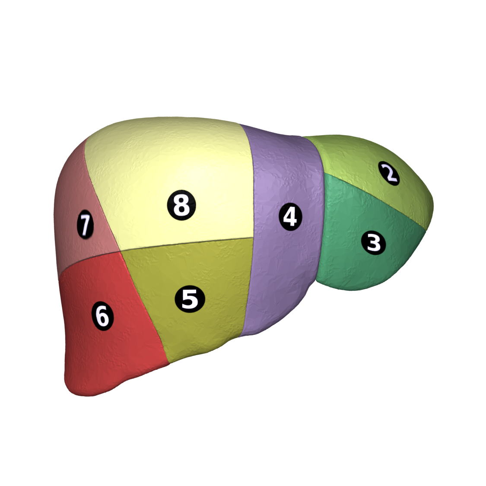
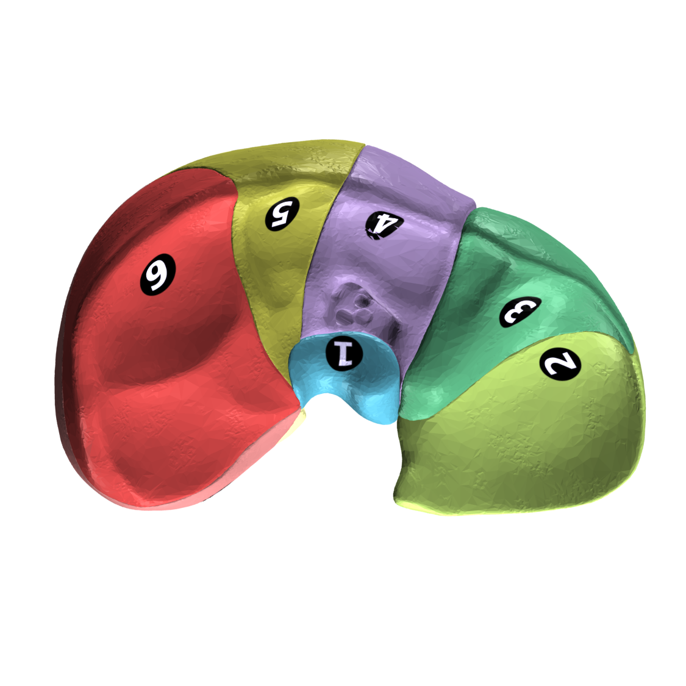

# 110 — Giải phẫu bụng cắt lớp: Couinaud, khoang sau phúc mạc & dịch MP-cổ trướng / Abdominal cross-sectional anatomy

**Tags:** `pattern:binh-thuong` `vung:bung` `anatomy:bung`
**Mức chắc chắn (certainty):** tổng hợp y văn (literature synthesis) — nhóm tự biên từ y văn mở, chưa gắn ca nguyên văn đơn lẻ.

## 1. Tổng quan — 8 phân thùy + 3 khoang + mốc Cantlie

- **Phân thùy gan Couinaud (I–VIII):** mặt phẳng ngang qua chạc ba tĩnh mạch cửa (portal bifurcation) chia tầng trên (VII, VIII, IVa, II) và tầng dưới (VI, V, IVb, III); 3 mặt phẳng dọc qua 3 tĩnh mạch gan (phải, giữa, trái).
- **Mốc thực chiến:** tĩnh mạch gan giữa (MHV) cùng mặt phẳng với **giường túi mật + tĩnh mạch chủ dưới** = đường Cantlie (chia gan phải và gan trái thật sự); **dây chằng liềm** tách phân thùy IV với II/III.
- **3 khoang sau phúc mạc:** trước thận (anterior pararenal: tụy, tá tràng D2–D4, đại tràng lên/xuống) — quanh thận (perirenal: thận, thượng thận, giới hạn cân Gerota–Zuckerkandl) — sau thận (posterior pararenal: chỉ mỡ).

*Phân thùy I–VIII. Nguồn: DBCLS/Anatomography, CC BY-SA 2.1 JP.*

## 2. Gamut vị trí tổn thương theo khoang

- **Trong gan + phân thùy rõ:** HCC/di căn/áp-xe — ghi phân thùy (quyết định mổ).
- **Trước thận:** viêm tụy (dịch quanh tụy), tá tràng (thủng D2), đại tràng (viêm túi thừa).
- **Quanh thận:** nang/u thận, thượng thận, máu sau phúc mạc (vỡ).
- **Sau thận:** chỉ mỡ — dày/mờ = lan từ khoang khác.

## 3. Bảng: dịch màng phổi vs cổ trướng (Cửa 4 bắt buộc)

| Tiêu chí | Dịch màng phổi (pleural effusion) | Cổ trướng (ascites) |
|---|---|---|
| Chân cơ hoành (crus) | **Đẩy ra trước (displaced crus sign)** | Áp cột sống |
| Vùng trần gan (bare area) | **Len vào bare area** | Không vào được |
| Mặt phân cách | Meniscus cong | Ôm gan/lách, rãnh Morrison |
| Chốt | **Crus lệch + bare area = màng phổi** | Quanh gan dưới hoành = cổ trướng |

## 4. Protocol CT bụng đa thì

- **Động mạch muộn 35–40s** (HCC, tuyến tụy 40–45s) — **tĩnh mạch cửa 60–70s** (nhu mô gan, thận 90–100s) — **muộn 3–5p** (washout, xơ) — **thì gan-mật 20p** (Primovist/Gadoxetate).
- Lát mỏng ≤ 1,5 mm + MPR coronal (đường mật, mạch mạc treo, ruột thừa).

## 5. Cạm bẫy

- **Giả khí tự do Chilaiditi** (đại tràng kẹt gan-hoành) — haustra + không Rigler, đừng mổ oan.
- **Nhu mô gan nhiễm mỡ** che tổn thương thì cửa — thêm MRI Primovist.
- **Biến thể mạch tạng** (gan phải từ SMA, trái từ vị trái) — đọc trước mổ/ghép.

## 6. Tự lượng giá — Blind Quiz

**Ca 1 — Nhìn sơ đồ, kể tên 8 phân thùy + đường Cantlie.**

<b>Bấm để hiện đáp án</b>

- I (đuôi) – II/III (trái ngoài) – IVa/IVb (trái trong) – V/VIII (phải trước) – VI/VII (phải sau); Cantlie = MHV + giường túi mật + TMC dưới.

**Ca 2 — Dịch đáy ngực phải + crus lệch trước + vào bare area:** màng phổi hay cổ trướng? *(Bảng mục 3.)*

<b>Bấm để hiện đáp án</b>

- **Dịch màng phổi:** displaced crus + bare area (+).

## Bài liên quan chéo
- [100 – Tổng quan hệ Bụng](../100-tong-quan-he-bung/lesson.md)
- [121 – LI-RADS & HCC](../121-khoi-gan-LIRADS/lesson.md) (động học 4 thì)
- [040 – Tràn dịch màng phổi](../040-tran-dich-mang-phoi/lesson.md) (meniscus/decubitus)

> Không dùng để chẩn đoán độc lập khi chưa có người hướng dẫn.
