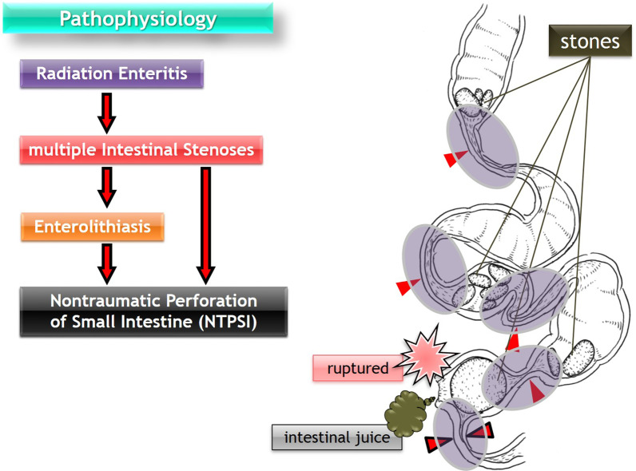
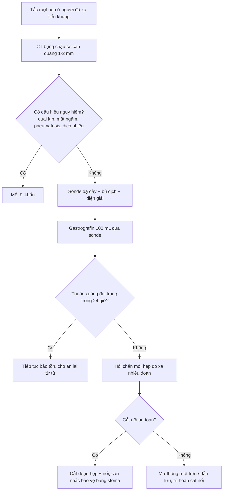
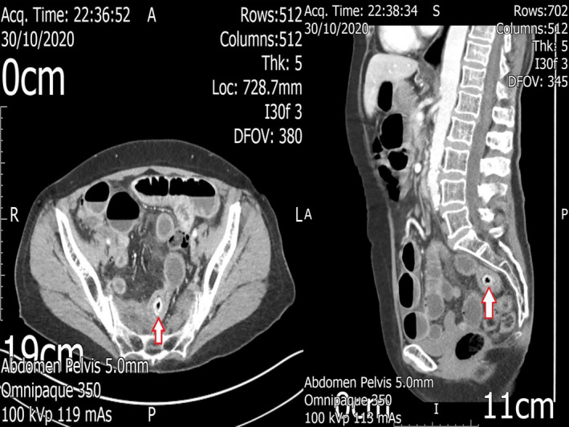

# 111 — Tắc ruột non do xơ hóa sau xạ trị tiểu khung / Radiation-induced small bowel obstruction

**Tags:** `pattern:tac-ruot` `vung:ruot-non` `protocol:CT-bung-cap`
**Mức chắc chắn (certainty):** tổng hợp y văn (literature synthesis) — tự biên từ các nghiên cứu đoàn hệ, tổng quan và ca bệnh mở có số liệu; không gắn một ca nguyên văn duy nhất.

> **Câu chốt:** ở người đã xạ tiểu khung, tắc ruột non **không phải** "dính sau mổ" mặc định. Xơ hóa do xạ (radiation enteropathy) tạo **hẹp đối xứng, đoạn dài, thành dày, ngấm thuốc kém** nằm trong trường chiếu — và tỉ lệ phải mổ, phải cắt ruột, tái nhập viện đều **cao hơn hẳn** tắc do dính.

## 1. Tổng quan — xơ hóa sau xạ hình thành thế nào + ngưỡng hình ảnh

- **Hai pha của tổn thương ruột do xạ (radiation enteropathy):**
  - **Cấp (trong 4–6 tuần):** phù niêm mạc, mất tế bào nhung mao, tiêu chảy, đau quặn — thường tự khỏi.
  - **Mạn (từ 6 tháng, đỉnh 1–3 năm, có thể > 10 năm):** viêm nội mạc động mạch tắc nghẽn (obliterative endarteritis) → thiếu máu mạn thành ruột → **xơ hóa dưới niêm mạc và lớp cơ**, hyalin hóa collagen, dày thanh mạc, dính các quai vào thành chậu ("frozen pelvis") → **hẹp lòng, tắc ruột**.
- **TẠI SAO hình ảnh trông như vậy (vật lý + mô bệnh):** sợi collagen xơ có tỉ trọng thấp và **ngấm thuốc kém** hơn niêm mạc viêm; xơ lan đều theo chu vi nên thành dày **đối xứng, đoạn dài**, không tạo khối lệch tâm. Mạc treo bị xơ co kéo → quai ruột **cố định, kéo thẳng, dính thành bụng/chậu**. Thiếu máu mạn làm niêm mạc mất ngấm thuốc nhưng **không có khối** — đây là điểm phân biệt cốt lõi với tái phát u.
- **Ngưỡng định lượng trên CT:**
  - Thành ruột non bình thường **≤ 3 mm**; **> 5 mm** = dày bất thường (ở bệnh cảnh xạ: thường 6–12 mm, đối xứng).
  - Lòng hẹp còn **< 10 mm** kèm quai trước hẹp giãn **> 3 cm** = tắc có ý nghĩa.
  - Đoạn tổn thương do xạ thường **≥ 5 cm chiều dài**, nhiều đoạn kế tiếp trong cùng trường chiếu.
- **Ngưỡng liều:** dung nạp ruột non **TD5/5 khoảng 45 Gy** (liều gây 5% biến chứng nặng trong 5 năm); nguy cơ tăng khi liều **> 50 Gy**, thể tích ruột non nhận liều cao lớn, **hóa trị đồng thời**, BMI thấp và có dính sau mổ trước đó. Ngưỡng thể tích (V15/V45) áp dụng chung **chưa rõ — cần tra theo protocol từng trung tâm**.

## 2. Mẫu hình + chẩn đoán phân biệt theo vị trí (gamut)

Ở bệnh nhân **đã xạ tiểu khung** vào cấp cứu vì tắc ruột non, gamut xếp theo tần suất và mức nguy hiểm:

1. **Hẹp do xạ (radiation stricture)** — một hoặc nhiều đoạn, trong trường chiếu, thành dày đối xứng, ngấm kém.
2. **Dính sau mổ (adhesive SBO)** — tiền sử mổ bụng, **điểm chuyển tiếp đột ngột**, thành không dày, không ngấm kém.
3. **Tái phát u/phúc mạc (recurrence/carcinomatosis)** — khối lệch tâm, hạch, dịch, dày không đều, xâm lấn mỡ.
4. **Sỏi ruột/enterolith tại chỗ hẹp** — cấu trúc cản quang trong lòng, hiếm nhưng điển hình ở ruột đã xạ hẹp.
5. **Rò/áp-xe do xạ (radiation fistula/abscess)** — khí ngoài lòng, tụ dịch, đường rò, viêm phúc mạc.
6. **Liệt ruột do thuốc/điện giải** — quai giãn đều, không có điểm chuyển tiếp thật.

Gợi nhớ **R-A-T-E**: **R**adiation stricture, **A**dhesion, **T**umor recurrence, **E**nterolith/fistula.

*Sơ đồ: viêm ruột do xạ gây nhiều đoạn hẹp → ứ trệ → sỏi ruột (enterolith) → thủng ruột non không do chấn thương. Nguồn: Surgical Case Reports 2021 (PMC8065084), CC BY 4.0 — ảnh nguyên bản, không chỉnh sửa.*

## 3. Bảng so sánh phân biệt (ma trận đối chiếu)

| Thực thể (entity) | Hình ảnh điển hình trên CT | Chốt vào (rule-in) | Chốt loại (rule-out) | Gợi ý xác nhận |
|---|---|---|---|---|
| **Hẹp do xạ** | Thành dày **6–12 mm đối xứng**, đoạn **≥ 5 cm**, ngấm thuốc kém, quai cố định trong tiểu khung, mạc treo xơ | **Vị trí trong trường chiếu + đối xứng + đoạn dài + không khối** | Khối lệch tâm, hạch to, dày < 3 mm từng đoạn ngắn → nghĩ u/dính | So phim cũ, đối chiếu bản đồ liều xạ; nội soi/CT lặp sau 4–6 tuần |
| **Dính sau mổ** | Điểm chuyển tiếp **đột ngột**, quai giãn trước, thành mỏng, không dày, không ngấm kém | **Tiền sử mổ + chuyển tiếp tức thì + thành bình thường** | Thành dày đối xứng đoạn dài + trong trường xạ → hẹp do xạ | Không cần sinh thiết; theo dõi đáp ứng sonde/dịch |
| **Tái phát u/phúc mạc** | Khối lệch tâm, dày không đều, hạch, nốt phúc mạc, dịch cổ trướng, xâm lấn mỡ | **Khối + hạch + dày không đối xứng** | Thành dày đối xứng, không khối, không hạch → xơ lành | PET-CT, sinh thiết nếu ảnh hưởng quyết định |
| **Sỏi ruột tại chỗ hẹp** | Cấu trúc **cản quang trong lòng** (thường 2–5 cm), quai trước giãn, thành dày quanh | **Sỏi cản quang + hẹp phía dưới + quai giãn** | Không thấy cản quang trong lòng → hẹp đơn thuần | CT đa bình diện, đôi khi X-quang bụng |
| **Rò/áp-xe do xạ** | Tụ dịch có vỏ, **khí ngoài lòng**, đường rò tới bàng quang/âm đạo/da, viêm phúc mạc | **Khí ngoài lòng + tụ dịch + đường rò** | Chỉ dày thành, không khí ngoài lòng → chưa rò | CT có cản quang, soi bàng quang/âm đạo, MRI nếu cần |

- **Ảnh ghép đối chiếu:** không ghép ảnh CT với sơ đồ (khác loại hình, khác chuỗi xung) — giữ nguyên từng ảnh để không sai lệch nội dung.

## 4. Protocol chụp + phân tầng xử trí

- **CT bụng–chậu có cản quang tĩnh mạch**, lát **1–2 mm**, thì cửa (khoảng 60–70 giây). **Không cần cản quang uống dương tính**; nước uống 500–1.000 mL nếu cần phân biệt quai ruột. Bệnh nhân nôn nhiều: đặt sonde dạ dày trước khi chụp để giảm nguy cơ hít.
- **Đọc theo 6 câu hỏi:** (1) điểm chuyển tiếp ở đâu? (2) mấy đoạn hẹp? (3) thành dày bao nhiêu mm, đối xứng không? (4) ngấm thuốc còn hay mất? (5) có dấu quai kín/xoắn mạch không? (6) có khối/hạch/dịch/rò không?
- **Nghiệm pháp Gastrografin (water-soluble contrast challenge):** 100 mL Gastrografin qua sonde mũi–hỗng tràng, chụp X-quang bụng đứng sau 4–24 giờ. Trong tắc ruột do bệnh ruột xạ mạn, nghiệm pháp dự báo cần mổ với **AUC 0,860**; ở tắc do dính AUC 0,749.
- **Vì sao phải phân tầng sớm — số liệu đoàn hệ 59 ca tắc ruột do xạ so 53 ca tắc do dính:**

| Kết cục | Tắc do xạ (n = 59) | Tắc do dính (n = 53) | Ý nghĩa |
|---|---|---|---|
| Điều trị bảo tồn thành công | **33,9%** | **58,4%** | xạ thất bại bảo tồn gấp ~1,7 lần |
| Phải mổ | **66,1%** | **41,6%** | nguy cơ mổ cao hơn hẳn |
| Hoại tử/phải cắt ruột | **44,0%** | **5,6%** | **gấp ~8 lần** — chốt nguy hiểm |
| Tái nhập viện vì tắc lại | **28,8%** | **13,2%** | bệnh tái diễn, không "mổ là xong" |

- **Chỉ định mổ tối khẩn (không chờ Gastrografin):** dấu quai kín/xoắn mạch, mất ngấm thành, pneumatosis, khí tĩnh mạch cửa, dịch ổ bụng nhiều mới xuất hiện, đau liên tục không giảm, toan chuyển hóa, sốc.
- **Không có hệ phân độ RADS cho tắc ruột non.** Dùng phân tầng hình thái + đáp ứng điều trị; ghi rõ số đoạn hẹp và chiều dài đoạn hẹp vì quyết định cắt nối.

## 5. Biến thể bình thường và cạm bẫy

- **"Frozen pelvis" là xơ lành, không phải tái phát:** dày thanh mạc + dính quai + mạc treo xơ đối xứng trong trường chiếu; **đừng** gọi carcinomatosis khi không có khối/hạch/nốt.
- **Nhiều đoạn hẹp:** cắt một đoạn không giải quyết tắc nếu còn đoạn hẹp thứ hai phía dưới — phải đếm và đo **tất cả** đoạn trên CT trước mổ.
- **Bệnh nhân quên tiền sử xạ:** xạ tiểu khung có thể cách đây 10–20 năm; hỏi cả xạ trị ung thư cổ tử cung/trực tràng/tiền liệt tuyến, ghi liều và năm.
- **Sỏi ruột cản quang bị đọc thành "dị vật":** ở ruột đã xạ hẹp, sỏi hình thành do ứ trệ; hỏi tiền sử ăn hồng/đồ ăn nhiều xơ, nhưng **không loại trừ hẹp do xạ** phía dưới.
- **CT không cản quang bỏ sót mất ngấm thành** — luôn chụp có cản quang nếu chức năng thận cho phép.
- **Mổ trong trường xạ:** miệng nối trên ruột đã xạ dễ rò, hẹp và tái tắc; cân nhắc **mở thông ruột trên** thay vì cắt nối thì đầu ở bệnh nhân suy kiệt.
- **Đừng chờ quá lâu:** tỉ lệ hoại tử/phải cắt ruột **44%** ở nhóm tắc do xạ — trì hoãn vì "chỉ là dính" là sai lầm chết người.

## 6. Tự lượng giá — Blind Quiz

**Ca 1 — Nữ 62 tuổi, xạ trị ung thư cổ tử cung 8 năm trước, nôn và bí trung đại tiện 2 ngày. CT bụng–chậu có cản quang:**

- Hỏi: mô tả 3 dấu hiệu chính? Nguyên nhân tắc? Vì sao đây không phải "dính đơn thuần"?

<b>Bấm để hiện đáp án (findings + chẩn đoán)</b>

- **Dấu hiệu:** nhiều quai ruột non giãn chứa khí–dịch; một **cấu trúc cản quang hình bầu dục trong lòng** quai hồi tràng thành dày (mũi tên đỏ); đoạn ruột quanh đó **dày đối xứng, ngấm thuốc kém**, không có khối lệch tâm.
- **Chẩn đoán:** **sỏi ruột (enterolith) bị kẹt tại chỗ hẹp do xạ** — biến chứng hiếm nhưng điển hình của ruột non đã xạ: hẹp → ứ trệ → sỏi hình thành → tắc hoàn toàn.
- **Vì sao không phải dính đơn thuần:** thành dày đối xứng + đoạn dài + trong trường chiếu + có sỏi tại chỗ hẹp; tắc do dính thường có chuyển tiếp đột ngột và thành mỏng bình thường.
- **Xử trí:** hội chẩn mổ sớm; nếu mổ, phải xử lý **cả đoạn hẹp phía dưới** chứ không chỉ lấy sỏi.
- **Phản biện nguồn:** ca gốc là ca bệnh đơn lẻ (Clin Case Rep 2021, PMC7981604); sỏi ruột là nguyên nhân **hiếm**, không đại diện cho phần lớn tắc ruột do xạ (thường chỉ do hẹp). Không vì thấy sỏi mà bỏ qua đánh giá hẹp do xạ.
- Nguồn ảnh: *Clinical Case Reports* 2021 (PMC7981604), CC BY 4.0.

**Ca 2 — Cùng bệnh nhân, hỏi về cơ chế: tại sao ruột đã xạ lại tạo sỏi và thủng?**

- Hỏi: sắp xếp đúng chuỗi bệnh sinh? Vì sao thủng xảy ra ở đoạn hẹp nhất?

<b>Bấm để hiện đáp án</b>

- **Chuỗi:** viêm ruột do xạ → **nhiều đoạn hẹp** → ứ trệ → **sỏi ruột** → tắc/thủng tại đoạn hẹp nhất.
- **Vì sao thủng:** đoạn hẹp nhất chịu áp lực cao nhất (Laplace: áp lực thành ∝ áp suất × bán kính) trên nền thành ruột đã xơ, mỏng và thiếu máu → dễ rách; sỏi cứng cọ sát làm mỏng thêm.
- Nguồn ảnh: *Surgical Case Reports* 2021 (PMC8065084), CC BY 4.0.

## Bài liên quan chéo
- [100 – Tổng quan hệ Bụng](../100-tong-quan-he-bung/lesson.md)
- [162 – Tắc ruột non/già, quai kín & thiếu máu mạc treo](../162-tac-ruot/lesson.md)
- [1667 – Tắc ruột non do dính trong thai phụ](../1667-tac-ruot-non-do-dinh-thai-phu/lesson.md)
- [1665 – Rò trực tràng–âm đạo sau xạ trị](../1665-ro-truc-trang-am-dao-sau-xa-tri/lesson.md)
- [112 – Chảy máu trực tràng muộn do viêm trực tràng xạ](../112-chay-mau-truc-trang-muon-sau-xa-tri/lesson.md)

> Không dùng để chẩn đoán độc lập khi chưa có người hướng dẫn.
