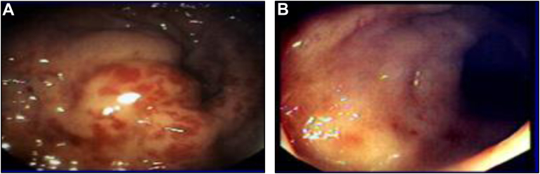
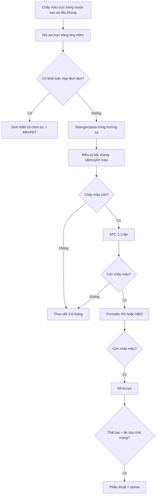
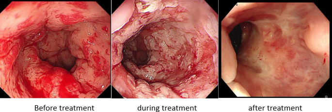

# 112 — Chảy máu trực tràng muộn do viêm trực tràng xạ / Chronic radiation proctopathy

**Tags:** `pattern:xuat-huyet` `vung:truc-trang` `protocol:noi-soi-truc-trang`
**Mức chắc chắn (certainty):** tổng hợp y văn (literature synthesis) — tự biên từ tổng quan, đoàn hệ cắt ngang và ca bệnh mở có số liệu; không gắn một ca nguyên văn duy nhất.

> **Câu chốt:** chảy máu trực tràng ở người đã xạ tiểu khung **thường là mạch giãn do xạ (telangiectasia)**, không phải tái phát u. Nội soi thấy **niêm mạc nhợt, teo, mạch máu giãn ngoằn ngoèo** trong trường chiếu là đủ chẩn đoán — **không sinh thiết mù**, vì mô đã xạ dễ thủng/rò.

## 1. Tổng quan — vì sao trực tràng chảy máu nhiều tháng đến nhiều năm sau xạ

- **Hai pha:**
  - **Cấp (trong 3 tháng đầu):** viêm niêm mạc, phù, chảy máu nhẹ, tiêu chảy — phần lớn tự khỏi.
  - **Mạn (sau 3 tháng, thường 6–12 tháng, có thể nhiều năm–hàng chục năm):** **viêm nội mạc động mạch tắc nghẽn (obliterative endarteritis)** → thiếu máu mạn niêm mạc → **teo niêm mạc + tân mạch** (telangiectasia) → mạch nông, thành mỏng, dễ vỡ → chảy máu tái diễn; xơ hóa tiến triển → **hẹp**, loét sâu → **rò**.
- **TẠI SAO nội soi thấy mạch giãn trên nền niêm mạc nhợt:** thiếu máu mạn kích thích yếu tố sinh mạch (VEGF) làm mọc mạch tân tạo nông dưới biểu mô; các mạch này **không có lớp cơ đủ dày** nên chỉ cần cọ xát/đại tiện là rỉ máu. Niêm mạc teo mất các nếp bình thường nên nhìn **nhợt, bóng, dễ chảy máu khi chạm**.
- **Ngưỡng định lượng:**
  - Tần suất viêm trực tràng xạ mạn sau xạ tiểu khung: **5–20%**; trong một đoàn hệ 226 bệnh nhân ung thư cổ tử cung, **38,5%** có triệu chứng chảy máu trực tràng và **25,7%** được xác nhận viêm trực tràng xạ.
  - Chảy máu trực tràng kháng trị sau xạ được báo cáo tới **29–89,6%** (khoảng rất rộng do khác định nghĩa và thời gian theo dõi).
  - **Thiếu máu** là đặc trưng của thể **telangiectasia** (khác biệt có ý nghĩa, p = 0,002 trong phân loại mô bệnh 111 ca).
  - **Ngưỡng truyền máu:** chiến lược hạn chế, **Hb 7–8 g/dL** ở bệnh nhân ổn định; ưu tiên bổ sung sắt trước.

## 2. Mẫu hình + chẩn đoán phân biệt theo vị trí (gamut)

Chảy máu trực tràng muộn sau xạ tiểu khung — gamut theo **hình thái nội soi**:

1. **Viêm trực tràng xạ mạn (telangiectasia)** — mạch giãn nông, niêm mạc nhợt, trong trường chiếu, không khối.
2. **Tái phát u trực tràng/ống hậu môn** — khối loét, bờ cứng, dễ chảy máu, ngoài vùng xạ hoặc lệch.
3. **Loét/rò do xạ** — ổ loét sâu, có thể rò trực tràng–âm đạo/bàng quang, đau, sốt.
4. **Ung thư thứ phát do xạ** — hiếm, tiềm tàng **10–20 năm**, tổn thương khu trú, cần sinh thiết có chọn lọc.
5. **Bệnh trĩ/angiodysplasia/viêm túi thừa** — mạch giãn nhưng ngoài trường xạ, phân bố khác.
6. **Viêm đại tràng thiếu máu cục bộ** — đau bụng + tiêu chảy máu, phân bố theo bờ mạch.
7. **Chảy máu miệng nối/loét sau mổ** — tiền sử cắt nối, thời điểm gần mổ.

Gợi nhớ **R-A-D-I-S**: **R**adiation telangiectasia, **A**ngiodysplasia/hemorrhoid, **D**iverticular/ischemic, **I**atrogenic (anastomosis), **S**econd malignancy/recurrence.

*Nội soi: (A) thành trực tràng chưa điều trị — **mạch giãn (vascular ectasia) nổi rõ** trên nền niêm mạc viêm; (B) sau điều trị — tổn thương giảm rõ. Nguồn: Gastro Hep Advances 2023 (PMC11308657), CC BY 4.0 — ảnh nguyên bản.*

## 3. Bảng so sánh phân biệt (ma trận đối chiếu)

| Thực thể (entity) | Hình ảnh nội soi/CT điển hình | Chốt vào (rule-in) | Chốt loại (rule-out) | Gợi ý xác nhận |
|---|---|---|---|---|
| **Viêm trực tràng xạ mạn** | Niêm mạc **nhợt, teo**, mạch giãn ngoằn ngoèo, dễ chảy máu khi chạm; CT: thành trực tràng dày đối xứng, xơ quanh trực tràng | **Trong trường chiếu + mạch giãn + không khối** | Khối loét bờ cứng, hạch, dày lệch tâm → nghĩ u | Nội soi ống mềm; **không sinh thiết mù**; so bản đồ liều xạ |
| **Tái phát u** | Khối loét bờ cứng, dễ chảy máu, hẹp lệch tâm; CT: khối + hạch + xâm lấn mỡ | **Khối + hạch + dày không đối xứng** | Niêm mạc nhợt đối xứng, không khối → xạ lành | Sinh thiết có chọn lọc, MRI trực tràng, PET-CT |
| **Loét/rò do xạ** | Ổ loét sâu, có thể thấy lỗ rò; CT: khí/dịch ngoài lòng, đường rò | **Loét sâu + khí ngoài lòng + dịch** | Chỉ mạch giãn nông, không loét sâu → chưa rò | CT có cản quang, soi bàng quang/âm đạo, MRI |
| **Ung thư thứ phát do xạ** | Tổn thương khu trú, loét, cứng; tiềm tàng 10–20 năm | **Tổn thương khu trú mới + tiền sử xạ xa** | Mạch giãn lan tỏa đối xứng → lành | Sinh thiết đúng vị trí, CT/MRI |
| **Trĩ/angiodysplasia** | Mạch giãn nhưng **ngoài trường xạ**, phân bố theo búi trĩ/niêm mạc lành | **Vị trí ngoài vùng xạ + không teo niêm mạc** | Lan tỏa trong trực tràng đã xạ → viêm xạ | Nội soi, hỏi tiền sử xạ |

## 4. Protocol nội soi + phân độ + thang điều trị

- **Nội soi trực tràng ống mềm (flexible sigmoidoscopy)** là tiêu chuẩn chẩn đoán: xác định **vị trí, mức lan, mức độ mạch giãn, có loét/rò không**. Không cần chuẩn bị đại tràng toàn bộ nếu chỉ soi trực tràng; **thụt tháo nhẹ** trước soi.
- **Sinh thiết:** chỉ khi nghi u/thứ phát; **tránh sinh thiết sâu** mô đã xạ (nguy cơ thủng, rò, chảy máu không cầm). Mô xạ lành cho hình ảnh xơ, mạch giãn — không đặc hiệu để chẩn đoán ung thư.
- **Phân độ muộn RTOG/EORTC (late radiation morbidity):**

| Độ | Biểu hiện |
|---|---|
| 1 | Tiêu chảy nhẹ, đau quặn nhẹ, < 5 lần đại tiện/ngày, rỉ máu nhẹ |
| 2 | Tiêu chảy vừa, > 5 lần/ngày, chất nhầy nhiều hoặc **chảy máu từng đợt** |
| 3 | **Tắc hoặc chảy máu cần phẫu thuật** |
| 4 | Hoại tử, thủng, rò |

- **Thang nội soi Zinicola (2–5 điểm):** phân bố mạch giãn (1–2) + diện tích tổn thương (1–2) + máu tươi (0–1); **2 = nhẹ, 3 = vừa, 4–5 = nặng**. Dùng để theo dõi trước–sau điều trị.
- **Thang điều trị (bậc thang):**
  1. **Sắt uống/truyền + truyền máu** nếu Hb < 7–8 g/dL; ngừng/giảm thuốc chống đông nếu phù hợp.
  2. **Sucralfate thụt, metronidazole, acid aminocaproic** — bằng chứng yếu, dùng hỗ trợ.
  3. **Đốt argon plasma (APC):** hiệu quả **70–100%**, làm sạch máu 80–90% trong các series; **1–3 lần, cách 4–6 tuần**; biến chứng loét, hẹp, thủng < 1%.
  4. **Formalin 4% tại chỗ (2–3 phút):** hiệu quả khoảng **81%** trong series của Biswal; biến chứng đau, hoại tử, hẹp.
  5. **Oxy cao áp (hyperbaric oxygen):** đáp ứng tới **~90%** trong một số series; dùng cho thể kháng trị.
  6. **RFA/cryotherapy:** RFA đạt thành công **83,3% (15/18)**, điểm nội soi trung bình **3,44 → 1,06** (p < 0,001), không thủng; đau hậu môn nhẹ.
  7. **Phẫu thuật (proctectomy + stoma):** biến chứng cao, chỉ khi thất bại tất cả và chảy máu đe dọa tính mạng.
- **An toàn APC — bắt buộc nhớ:** đã có **12 ca nổ đại tràng** trong y văn, **một nửa thủng phải mổ**; yếu tố nguy cơ là **chuẩn bị đại tràng kém/thụt tháo đơn thuần** (khí hydro/methane tích tụ). Phòng ngừa: **uống PEG đủ liều**, tránh bơm khí dư, dùng lưu lượng argon thấp.

## 5. Biến thể bình thường và cạm bẫy

- **Đừng sinh thiết mọi mạch giãn:** mô đã xạ mỏng, dễ thủng/rò; chẩn đoán bằng bối cảnh + hình thái nội soi.
- **Đừng gọi tái phát khi chỉ thấy niêm mạc nhợt + mạch giãn:** tái phát cần **khối/hạch/dày lệch tâm**; gọi nhầm dẫn tới mổ oan trên mô đã xạ.
- **Chảy máu có thể từ trĩ/angiodysplasia đi kèm:** soi tới trên vùng xạ, tìm nguồn ngoài trường chiếu.
- **Thiếu máu thiếu sắt mạn:** kiểm ferritin, không chỉ dựa Hb; bổ sung sắt trước khi truyền máu.
- **APC ở đại tràng chưa làm sạch:** nguy cơ nổ — luôn chuẩn bị PEG đầy đủ, kể cả khi chỉ đốt trực tràng.
- **Thời điểm:** chảy máu có thể xuất hiện **nhiều năm sau xạ**; bệnh nhân có thể quên — hỏi tiền sử xạ trị vùng chậu.
- **Đừng nhầm với bệnh Crohn/viêm loét đại tràng:** phân bố trong trường chiếu, không lan liên tục ngoài vùng xạ, không có tổn thương miệng/ruột non đi kèm.

## 6. Tự lượng giá — Blind Quiz

**Ca 1 — Nam 70 tuổi, xạ trị ung thư tiền liệt tuyến 2 năm trước, đi cầu ra máu tươi tái diễn, Hb 9,2 g/dL. Nội soi trực tràng:**

- Hỏi: mô tả tổn thương? Chẩn đoán? Có nên sinh thiết không? Ba bước điều trị đầu?

<b>Bấm để hiện đáp án (findings + chẩn đoán)</b>

- **Dấu hiệu:** niêm mạc **nhợt, teo**, nhiều **mạch máu giãn ngoằn ngoèo (telangiectasia)** nông, dễ chảy máu khi chạm; không thấy khối loét bờ cứng.
- **Chẩn đoán:** **viêm trực tràng xạ mạn (chronic radiation proctopathy)** — mạch giãn trên nền thiếu máu mạn và tân mạch, trong trường chiếu.
- **Sinh thiết:** **không** — tổn thương đối xứng, không khối; sinh thiết sâu mô đã xạ có nguy cơ thủng/rò.
- **Ba bước đầu:** (1) bổ sung sắt/truyền máu nếu Hb < 7–8 g/dL; (2) **APC** 1–3 lần cách 4–6 tuần; (3) nếu thất bại → formalin 4% hoặc HBO.
- Nguồn ảnh: *Gastro Hep Advances* 2023 (PMC11308657), CC BY 4.0.

**Ca 2 — Cùng bệnh nhân, chảy máu tái phát sau 2 lần APC. Nội soi trước – trong – sau RFA:**

- Hỏi: hình nào là trước điều trị? Vì sao chọn RFA thay vì APC lần 3? Kết quả và biến chứng cần biết?

<b>Bấm để hiện đáp án</b>

- **Trước điều trị:** khung trái — niêm mạc viêm đỏ, nhiều mạch giãn và máu tươi; giữa là trong khi đốt; phải là sau điều trị — niêm mạc lành, giảm mạch giãn.
- **Vì sao RFA:** tổn thương lan rộng, APC lặp lại không kiểm soát được; RFA phủ **diện rộng hơn mỗi lần**, ít biến chứng.
- **Kết quả:** thành công **83,3% (15/18)**, điểm nội soi **3,44 → 1,06** (p < 0,001), không thủng; đau hậu môn nhẹ là biến chứng thường gặp.
- **Lưu ý:** đây là series nhỏ (18 ca), theo dõi trung vị 20 tháng — chưa thay thế được APC là lựa chọn đầu tay.
- Nguồn ảnh: *Journal of Gastrointestinal Cancer* 2026 (PMC13102748), CC BY-NC-ND 4.0 — ảnh nguyên bản, không crop/ghép.

## Bài liên quan chéo
- [100 – Tổng quan hệ Bụng](../100-tong-quan-he-bung/lesson.md)
- [111 – Tắc ruột non do xơ hóa sau xạ trị tiểu khung](../111-tac-ruot-non-sau-xa-tri-tieu-khung/lesson.md)
- [1665 – Rò trực tràng–âm đạo sau xạ trị](../1665-ro-truc-trang-am-dao-sau-xa-tri/lesson.md)
- [162 – Tắc ruột non/già, quai kín & thiếu máu mạc treo](../162-tac-ruot/lesson.md)

> Không dùng để chẩn đoán độc lập khi chưa có người hướng dẫn.
