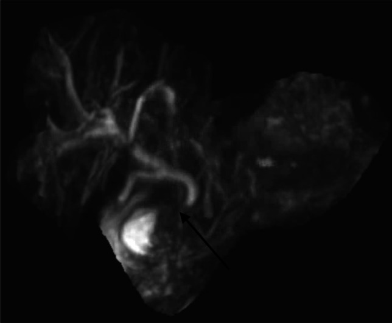
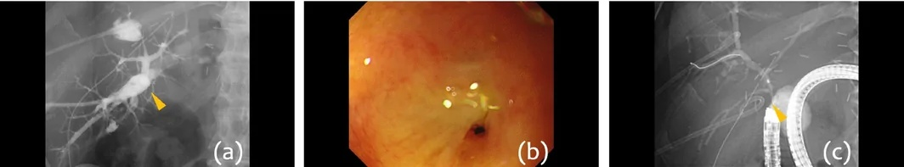
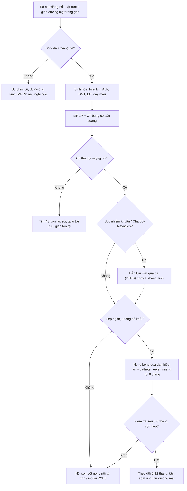

# 113 — Hẹp miệng nối mật–ruột sau cắt nang ống mật chủ (hepaticojejunostomy stricture): "giãn đường mật + sốt" ở người đã mổ 5 năm trước

**Tags:** `pattern:hep-mieng-noi` `pattern:gian-duong-mat-trong-gan` `pattern:khuyet-thuoc` `vung:duong-mat` `vung:gan` `anatomy:duong-mat` `protocol:MRCP` `protocol:CT-bung-co-can-quang` `protocol:US-bung` `protocol:PTC` `score:Todani` `incidentaloma:gian-duong-mat`
**Mức chắc chắn (certainty):** tổng hợp y văn (literature synthesis) — ghép **loạt 100 ca Roux-en-Y hepaticojejunostomy (RYHJ) lành tính** (BMC 2026, PMC12989140), **loạt 40 ca hẹp miệng nối mật–ruột (BBAS) điều trị qua da** (PMC12968610), **meta-analysis 1.903 trẻ cắt nang ống mật chủ** (PMC41636754), 3 ca minh hoạ có ảnh (PMC13108644, PMC13650495, PMC13444531). Không có ca do nhóm tự chụp.

> **Câu hỏi thực hành:** nam **32 tuổi**, **cắt nang ống mật chủ + Roux-en-Y hepaticojejunostomy** cách đây **6 năm**. Nay **sốt 39 °C, đau hạ sườn phải, vàng da nhẹ**, bạch cầu **16,2 G/L**, bilirubin toàn phần **3,8 mg/dL**, ALP **410 U/L**, GGT **520 U/L**. Siêu âm: **đường mật trong gan hai bên giãn**, **không thấy ống mật chủ** (đã cắt), **không thấy sỏi**. Câu hỏi: **giãn đường mật này là hẹp miệng nối, sỏi, hay "bình thường sau mổ"? Cần chụp gì tiếp và xử trí ra sao?**
> Bài chốt **ba quyết định**: **(1) ở người đã có miệng nối mật–ruột, "giãn đường mật + sốt + đau" gần như mặc định là hẹp miệng nối cho tới khi chứng minh khác — hẹp gặp 20% trong loạt 100 ca RYHJ, viêm đường mật tái diễn 39% (PMC12989140); (2) MRCP là cửa chốt không xâm lấn (hẹp khu trú tại miệng nối + giãn trên hẹp), CT để tìm ổ áp-xe/sỏi/khối; (3) đường vào điều trị phụ thuộc giải phẫu Roux-en-Y: nong bóng qua da (PTC) là mặc định, nội soi ruột non (single-balloon) hoặc mổ lại khi thất bại — không chờ "tự hết".**

## 1. Tổng quan bệnh học – cơ chế hình ảnh: vì sao miệng nối lại hẹp, và vì sao hình ảnh "nói" được điều đó

- **Bối cảnh giải phẫu:** **nang ống mật chủ** (choledochal cyst / congenital biliary dilatation, Todani I–V — xem bài 107) được điều trị chuẩn bằng **cắt toàn bộ nang + Roux-en-Y hepaticojejunostomy (RYHJ)**. Sau mổ, **không còn ống mật chủ**: đường mật trong gan đổ trực tiếp vào **quai hỗng tràng biệt lập (Roux limb)** qua **miệng nối tận–bên ở rốn gan**. Đây là lý do **không thể đo "ống mật chủ"** và **không thể soi ERCP thường quy** (phải đi qua 60–100 cm quai Roux).
- **Cơ chế hẹp (4 cơ chế, xếp theo tần suất thực hành):**
  1. **Thiếu máu miệng nối:** nguồn máu đường mật là **đám rối quanh ống mật** (axial blood supply) — bóc tách quá cao ở rốn gan hoặc đốt điện làm mất cấp máu → **xơ hóa, co rút** trong 6–24 tháng.
  2. **Rò mật / nhiễm khuẩn quanh miệng nối:** dịch mật kích thích + viêm → **xơ**; đây là yếu tố **dự báo độc lập** trong loạt 100 ca: **rò mật sau mổ p = 0,021**, **viêm đường mật sớm p < 0,001** (PMC12989140).
  3. **Kỹ thuật:** miệng nối **nhỏ, căng, không niêm mạc–niêm mạc**; **miệng nối cao ở rốn gan** khó làm rộng (Hepp–Couinaud được cho là bảo vệ).
  4. **Ứ mật → sỏi → viêm → hẹp thêm (vòng xoắn bệnh lý):** hẹp nhẹ làm chậm dòng mật → **sỏi bùn/sỏi sắc tố** trên hẹp → **viêm đường mật tái diễn** → xơ thêm.
- **Tần suất — bốn con số phải nhớ:**
  - **Hẹp miệng nối 20% (20/100)** trong loạt RYHJ lành tính (52% chỉ định là nang ống mật chủ), **viêm đường mật tái diễn 39%** (PMC12989140).
  - Hẹp **cao hơn ở nhóm tổn thương đường mật sau cắt túi mật** so với nang ống mật chủ (cùng loạt) — tức **chất lượng mô đường mật tại miệng nối** quan trọng hơn "kỹ thuật miệng nối" đơn thuần.
  - **Viêm đường mật sau HJ 3,05%** (meta-analysis 1.903 trẻ, HD 1,55%; HJ được ưu tiên vì **viêm dạ dày–trào ngược chỉ 0,87%** so với 8,83% ở hepaticoduodenostomy) (PMC41636754).
  - **Thời điểm:** phần lớn hẹp có triệu chứng trong **6–24 tháng đầu**, nhưng hẹp muộn **nhiều năm** vẫn gặp; **trung vị chính xác theo thời gian: chưa rõ — cần tra** (các loạt theo dõi ngắn, trung vị 9 tháng trong PMC12989140 nên chưa đủ để mô tả đuôi muộn).
- **TẠI SAO MRCP thấy hẹp — vật lý đơn giản:** MRCP dùng chuỗi **T2 rất nặng (heavily T2-weighted, TE 600–1.000 ms)** → **dịch mật (nước tự do) sáng**, **mô xơ/sợi collagen tối**. Hẹp = **đoạn mất tín hiệu hoặc thắt nhỏ** tại miệng nối; trên hẹp = **cột dịch giãn**. Vì **không dùng thuốc cản quang**, MRCP không phụ thuộc chức năng gan/thận — chụp được cả khi bilirubin cao (khác CT có cản quang và HBP với gadoxetate).
- **TẠI SAO CT vẫn cần:** CT **1–2 mm có cản quang thì cổng tĩnh mạch** cho **thành ống mật, nhu mô gan, ổ áp-xe, sỏi calci, hạch và khối u**. Sỏi sắc tố thường **đồng đậm độ mật (isodense)** → **CT có thể bỏ sót**, MRCP tốt hơn. Khí trong đường mật (**pneumobilia**) là **bình thường sau HJ**, không phải dấu viêm.
- **TẠI SAO "giãn đường mật" không đồng nghĩa "tắc":** sau khi cắt nang, **kho dự trữ ngoài gan mất đi**, đôi khi đường mật trong gan **giãn dai dẳng không tắc**; ngưỡng thực hành: **đường mật trong gan ngoại vi > 2 mm** hoặc **> 40% so với phim cũ** mới gọi là giãn bệnh lý. Chẩn đoán hẹp cần **hình ảnh hẹp tại miệng nối + triệu chứng/sinh hóa**, không chỉ số đo.

## 2. Mẫu hình + chẩn đoán phân biệt theo vị trí (Gamut)

- **Mẫu hình cốt lõi:** bệnh nhân **đã có miệng nối mật–ruột**, đến với **sốt ± đau hạ sườn phải ± vàng da** (Charcot), **bilirubin/ALP/GGT tăng**, trên hình ảnh có **giãn đường mật trong gan hai bên** và **một chỗ thắt tại rốn gan**.
- **Gamut theo vị trí tổn thương:**
  - **Tại miệng nối (rốn gan):** hẹp xơ lành tính (thể hay gặp nhất), hẹp do **staple/clip kim loại** cắm vào lòng (ca PMC13108644), hẹp do **tái phát u/ung thư đường mật** tại miệng nối.
  - **Trong đường mật trên hẹp:** **sỏi/sỏi bùn sắc tố** (thường nhiều ổ, khu trú thùy trái hoặc hai bên), **hẹp thứ phát do viêm xơ quanh ống** (secondary sclerosing cholangitis), **áp-xe đường mật (cholangitic abscess)**.
  - **Ngoài miệng nối:** **hội chứng quai tới (afferent loop syndrome)** sau Roux-en-Y — quai hỗng tràng ứ dịch, giãn, có thể chèn miệng nối; **hẹp/malrotation của quai Roux**; **thoát vị nội (internal hernia)** sau mổ.
  - **Nhu mô gan:** **xơ gan ứ mật thứ phát** (khi hẹp kéo dài nhiều năm), **ung thư đường mật trong gan** trên nền ứ mật mạn.
- **Mnemonic 4S cho "giãn đường mật sau miệng nối mật–ruột":** **S**ẹo (hẹp miệng nối) – **S**ỏi (sỏi/sỏi bùn trên hẹp) – **S**ump (ứ quai tới) – **S**inh u (tái phát/ung thư đường mật). Thêm **S** thứ năm khi cấp cứu: **S**ốc nhiễm khuẩn đường mật (Charcot–Reynolds) — cần dẫn lưu mật trong 24 giờ, không chờ chẩn đoán đầy đủ.
- **Phân biệt với hẹp miệng nối sau ghép gan (bài 133):** cùng là "hẹp miệng nối", nhưng sau ghép còn **động học mạch gan, thải ghép, cholangiopathy thiếu máu** — ở bài 113 (nang ống mật chủ) **không có mạch ghép**, nên hẹp là **biến chứng cơ học/xơ tại chỗ**, và **ung thư đường mật** là mối lo riêng (nền nang ống mật chủ).

## 3. Bảng so sánh phân biệt (ma trận đối chiếu)

| Thực thể (entity) | Hình ảnh điển hình (US/CT/MRCP) | Chốt vào (rule-in) | Chốt loại (rule-out) | Gợi ý xác nhận |
|---|---|---|---|---|
| **Hẹp miệng nối xơ lành tính** | MRCP: **thắt khu trú ngắn tại rốn gan**, giãn đường mật trong gan hai bên; CT: thành dày nhẹ tại chỗ nối, không khối | **Thắt ngắn tại đúng vị trí miệng nối + giãn trên hẹp + sốt/ALP tăng** | **Không có chỗ thắt** (giãn đều, không chênh) → nghĩ giãn tồn tại sau mổ; **khối mềm ngấm thuốc** → nghĩ u | MRCP; đáp ứng nong bóng (test điều trị) |
| **Sỏi/sỏi bùn trên hẹp** | MRCP: **khuyết tín hiệu trong lòng ống giãn**, bờ tròn, có thể "đầy" cả nhánh; CT: sỏi calci **chỉ 1/3** trường hợp thấy | **Khuyết tín hiệu di động/đa ổ trong ống giãn + tiền sử viêm đường mật tái diễn** | **Không khuyết tín hiệu** trên MRCP 3D chất lượng tốt → ít khả năng sỏi | MRCP + cholangioscopy qua da (bài 138) nếu cần lấy sỏi |
| **Hội chứng quai tới (afferent loop)** | CT: **quai hỗng tràng giãn chứa dịch, hình chữ U/C**, không có hẹp tại miệng nối; MRCP: **cột dịch dừng ở miệng nối do ứ, không do thắt** | **Quai ruột giãn > 3 cm + mức dịch–khí, nôn dịch mật không có thức ăn** | **Có chỗ thắt thực sự tại miệng nối** → không phải thuần quai tới | CT có cản quang; so sánh MRCP trước/sau khi đặt dẫn lưu |
| **Tái phát/ung thư đường mật tại miệng nối** | CT: **khối mềm ngấm thuốc thì muộn**, dày thành **không đều > 5 mm**; MRCP: **hẹp dài, bờ nham nhở**; có thể hạch rốn gan | **Hẹp dài + khối + hạch + giãn tiến triển nhanh, không đáp ứng nong** | **Hẹp ngắn, bờ nhẵn, đáp ứng nong nhiều lần** (vẫn cần theo dõi) | CT/MRI có cản quang + **sinh thiết qua da** khi nghi ngờ |
| **Áp-xe đường mật (cholangitic abscess)** | CT: **ổ dịch trong gan, vỏ ngấm thuốc**, khí trong ổ; MRCP: ổ T2 cao nối với nhánh mật hẹp | **Sốt cao + ổ dịch trong gan + bạch cầu tăng mạnh** | **Không ổ dịch**, chỉ giãn ống → chưa áp-xe | CT; **dẫn lưu qua da** (bài 910) |

- Ảnh minh hoạ 1 — **MRCP** ca hẹp miệng nối do **staple phẫu thuật** cắm vào lòng (mũi tên):

*MRCP xung nặng T2: cột dịch giãn trong gan, **thắt tại miệng nối** (mũi tên) và quai hỗng tràng phía dưới. Nguồn: ACG Case Rep J 2026 (PMC13108644), CC BY-NC-ND 4.0 — nguyên bản, không crop.*

- Ảnh minh hoạ 2 — **cholangiography qua da** cho thấy **không có thuốc qua miệng nối** dù bơm đủ, kèm hình nội soi chỗ sẹo và bóng nội soi ruột non:

*(a) Cholangiography nhánh hậu – bên: **cột thuốc dừng tại miệng nối** (mũi tên vàng), không vào hỗng tràng. (b) Nội soi: **sẹo trắng, không thấy lòng miệng nối**. (c) Nội soi ruột non một bóng tiếp cận miệng nối. Nguồn: Digestive Endoscopy 2026 (PMC13650495), CC BY 4.0 — chuyển WebP → JPEG, giữ nguyên khung 3 ô.*

## 4. Protocol chụp + phân loại/phân độ

- **Siêu âm (đầu tay, mọi ca):** đo **đường kính đường mật trong gan** (bình thường **≤ 2 mm** ở ngoại vi, **≤ 6 mm** ở rốn gan), tìm **sỏi, khí trong đường mật, ổ dịch trong gan**, đánh giá **dịch quanh gan**. Giới hạn: **không thấy miệng nối** ở phần lớn bệnh nhân (hơi ruột che), **không loại trừ hẹp**.
- **MRCP (chuẩn không xâm nhập):** nhịn ăn **4–6 giờ**, chuỗi **SSFSE/HASTE 3D heavily T2W**, lát **1–3 mm**, **MIP 3D** + **ảnh nguồn axial**; **không cần cản quang**. Đọc theo 4 câu: **(1) có chỗ thắt tại miệng nối không? (2) dài bao nhiêu mm? (3) trên hẹp giãn bao nhiêu? (4) có khuyết tín hiệu (sỏi) không?** Cảnh báo: **quai hỗng tràng không đầy dịch** có thể tạo **"hẹp giả"** — luôn đối chiếu ảnh nguồn và ảnh T2 axial.
- **CT bụng có cản quang (khi sốt/đau, nghi biến chứng):** thì **cổng tĩnh mạch 1–2 mm** + thì muộn; tìm **áp-xe, sỏi calci, khối, hạch, hẹp quai Roux, thoát vị nội**. Không dùng CT để "loại trừ hẹp" khi MRCP đã thấy thắt.
- **Cholangiography qua da (PTC):** vừa **chẩn đoán** (đo độ dài hẹp, số nhánh bị ảnh hưởng) vừa **điều trị** (nong bóng, đặt catheter xuyên miệng nối). Chỉ định: **nhiễm khuẩn đường mật nặng (Charcot–Reynolds)**, hẹp không tiếp cận được bằng nội soi, hoặc cần **dẫn lưu trước mổ**.
- **Nội soi ruột non (single-balloon enteroscopy) + ERCP:** đường vào **ngược dòng** qua quai Roux; thành công phụ thuộc **độ dài quai và giải phẫu**. Khi **tắc hoàn toàn**, có thể dùng **nối từ tính (magnetic compression anastomosis)** sau khi tạo đường qua da (ca PMC13650495).
- **Hệ phân loại dùng trong bài:**
  - **Todani I–V** cho **nang ống mật chủ** (chi tiết ở bài 107) — quyết định **kiểu cắt nang và vị trí miệng nối**, do đó ảnh hưởng nguy cơ hẹp (Todani IVa có thành phần trong gan → miệng nối phức tạp hơn).
  - **Không có RADS/điểm chuẩn cho hẹp miệng nối mật–ruột.** Thực hành ghi **4 tham số**: **(1) vị trí** (miệng nối / trên hẹp / quai tới), **(2) chiều dài hẹp** (khu trú **< 5 mm** vs **dài ≥ 5 mm**), **(3) đường kính chỗ hẹp so với ống trên hẹp**, **(4) biến chứng** (sỏi, áp-xe, xơ gan ứ mật). Ngưỡng mm chính thức: **chưa có đồng thuận — cần tra**.
- **Kết quả định lượng của hai chiến lược (để tư vấn):**
  - **Qua da (PTCS-assisted):** **90,6% (29/32)** đạt "điều trị thành công"; **thông suốt ban đầu 58,1% (1 năm) và 41,9% (2 năm)**; **thông suốt tích lũy 74,3% – 59,7% – 49,8% – 34,8% ở 1–3–5–7 năm**; **thời gian lưu catheter trung vị 6 tháng (2–109)** — nghĩa là **phải giữ catheter xuyên miệng nối hàng tháng**, không phải "nong một lần là xong" (PMC12968610).

## 5. Biến thể bình thường và cạm bẫy

- **Khí trong đường mật (pneumobilia) là bình thường sau HJ** — thấy khí lan trong nhánh mật **không** đồng nghĩa viêm đường mật/áp-xe khí. Chỉ gọi bệnh lý khi có **dịch quanh, thành dày, sốt**.
- **Giãn đường mật "tồn tại" sau cắt nang:** một số bệnh nhân giãn dai dẳng **không tắc**; nếu **không triệu chứng, bilirubin/ALP bình thường**, chỉ theo dõi. Đừng đặt stent "vì hình ảnh đẹp".
- **"Hẹp giả" trên MRCP:** quai Roux **không chứa đủ dịch** hoặc **không nằm trong trường chụp** → cột dịch dừng ở miệng nối, trông như tắc hoàn toàn. Xem **ảnh axial nguồn** + chụp **thì muộn/3D khác**; đối chiếu với **cholangiography** khi cần.
- **Sỏi sắc tố đồng đậm độ trên CT:** **không loại trừ sỏi** khi CT âm tính; MRCP là chuẩn. Ngược lại, **bóng khí nhỏ** có thể giả làm khuyết tín hiệu trên MRCP → đọc cả ảnh nguồn.
- **Staple/clip tại miệng nối:** gây **hẹp thực sự** (ca PMC13108644) và **artifact** trên CT/MRCP; **artifact kim loại** có thể che một hẹp ngắn. Nếu lâm sàng mạnh mà hình ảnh "không rõ", **cholangiography qua da** là chốt.
- **Hẹp + giãn tiến triển nhanh, không đáp ứng nong = phải lo ung thư đường mật**: nền nang ống mật chủ vẫn là **yếu tố nguy cơ ung thư đường mật** dù đã cắt nang; **khối tại miệng nối** phải **sinh thiết**, không "nong rồi theo dõi" nhiều lần. Tỷ lệ chính xác sau cắt nang: **chưa rõ — cần tra**.
- **Sai vị trí đo:** đo "đường mật giãn" ở **nhánh gần rốn gan** luôn lớn hơn ngoại vi; dùng **cùng một mốc giải phẫu** khi so phim cũ và ghi **mm** vào báo cáo.

## 6. Tự lượng giá — Blind Quiz

**Ca 1 — Nam 32 tuổi, mổ cắt nang ống mật chủ 6 năm trước, nay sốt – đau hạ sườn phải – vàng da nhẹ. Nhìn ảnh, mô tả trước khi mở đáp án.**

- Gợi ý: bệnh nhân **không còn ống mật chủ**; đường mật trong gan giãn; có **một chỗ thắt** ở rốn gan.
- Câu hỏi: (1) Dấu hiệu chính? (2) Ba chẩn đoán phân biệt? (3) Dấu hiệu nào chốt chẩn đoán? (4) Bước tiếp theo?

<b>Bấm để hiện đáp án (findings + chẩn đoán)</b>

- Dấu hiệu: **giãn đường mật trong gan**, **thắt khu trú tại miệng nối** (mũi tên), phía dưới là **quai hỗng tràng**; không có khuyết tín hiệu lớn trong lòng ống giãn.
- Chẩn đoán: **hẹp miệng nối mật–ruột (HJ stricture)** — trong ca nguồn, nguyên nhân là **staple phẫu thuật cắm vào lòng miệng nối** (ACG Case Rep J 2026, PMC13108644); hình ảnh fluoroscopy sau đó xác nhận staple, và gỡ staple qua nội soi làm hết tắc.
- Vì sao: mô xơ/staple chiếm lòng → cột dịch mật dừng lại → giãn trên hẹp; MRCP T2 nặng làm dịch sáng, mô xơ/kim loại tối.
- Phân biệt: sỏi/sỏi bùn trên hẹp (khuyết tín hiệu), hội chứng quai tới (quai giãn, không thắt), tái phát/ung thư đường mật (khối, hẹp dài).
- Nguồn ảnh: ACG Case Rep J 2026, PMCID PMC13108644, **CC BY-NC-ND 4.0** — nguyên bản.

**Ca 2 — Cùng bệnh cảnh, nhưng MRCP không kết luận được vì quai Roux không đầy dịch. Cholangiography qua da được thực hiện.**

- Câu hỏi: (1) Thuốc cản quang đi tới đâu? (2) Vì sao phải dùng đường qua da thay vì ERCP thường? (3) Hai lựa chọn điều trị khi hẹp **hoàn toàn**?

<b>Bấm để hiện đáp án</b>

- (a) Bơm thuốc qua **nhánh hậu – bên phải**: **cột thuốc dừng tại miệng nối** (mũi tên vàng), **không có thuốc vào hỗng tràng** → tắc hoàn toàn tại miệng nối; (b) nội soi thấy **sẹo trắng**, không thấy lòng; (c) **nội soi ruột non một bóng** tiếp cận.
- Vì sao qua da: giải phẫu **Roux-en-Y** làm ERCP thường **không tới được** miệng nối; đường qua da vừa **chẩn đoán** vừa **dẫn lưu**.
- Điều trị hẹp hoàn toàn: **nong bóng + catheter xuyên miệng nối** nhiều lần, hoặc **nối từ tính (magnetic compression)** qua nội soi ruột non (ca nguồn), hoặc **mổ lại RYHJ** khi thất bại.
- Nguồn ảnh: Digestive Endoscopy 2026, PMCID PMC13650495, **CC BY 4.0** (đã chuyển WebP → JPEG).

**Ca 3 — Không có ảnh (ca lâm sàng – hình ảnh):** nữ 45 tuổi, RYHJ 12 năm trước; **không sốt, không đau**, nhưng **ALP 320 U/L**, GGT 290 U/L; siêu âm **giãn đường mật trong gan độ 2**, MRCP **không thấy chỗ thắt**, không sỏi; CT **không khối**. Câu hỏi: gọi là hẹp miệng nối được không, và làm gì tiếp?

<b>Bấm để hiện đáp án</b>

- **Không** — không có chỗ thắt trên MRCP chất lượng tốt, không triệu chứng nhiễm khuẩn; đây có thể là **giãn đường mật tồn tại sau cắt nang** hoặc **xơ gan ứ mật sớm**.
- Việc làm: **so phim cũ** (đo cùng mốc), **xét nghiệm bilirubin/albumin/tiểu cầu**, **đàn hồi gan (FibroScan)** để tầm soát xơ gan ứ mật; **theo dõi 6–12 tháng** bằng MRCP; chỉ can thiệp khi có **hẹp thực sự + triệu chứng/sinh hóa tiến triển**.
- Bài học: **"giãn" không phải "hẹp"**; điều trị hình ảnh không triệu chứng là can thiệp oan.

## Bài liên quan chéo
- [108 – Tổn thương đường mật sau cắt túi mật](../108-ton-thuong-duong-mat-sau-cat-tui-mat/lesson.md) (Strasberg–Bismuth, bối cảnh miệng nối)
- [133 – Hẹp miệng nối đường mật sau ghép gan](../133-hep-mieng-noi-duong-mat-sau-ghep/lesson.md) (cùng mẫu hình, khác cơ chế)
- [107 – MRCP & MRI gadoxetate](../107-mrcp-gadoxetic-acid-hbp/lesson.md) (Todani I–V, kỹ thuật MRCP)
- [137 – Theo dõi stent/dẫn lưu đường mật](../137-theo-doi-stent-dan-luu-duong-mat-di-tru-tac-nhiem-trung/lesson.md)
- [138 – Soi trong gan, viêm đường mật mủ](../138-soi-trong-gan-viem-duong-mat-mu/lesson.md)
- [1940 – Sỏi mật sót/tái phát sau cắt túi mật](../1940-soi-mat-sot-tai-phat-sau-cat-tui-mat/lesson.md)
- [910 – Dẫn lưu áp-xe/dẫn lưu mật qua da](../910-abscess-biliary-nephrostomy/lesson.md)

## Ảnh
- `images/113_hep-mien-noi_MRCP_ACGCaseRep2026-PMC13108644.jpg` — ACG Case Rep J 2026 (PMC13108644), **CC BY-NC-ND 4.0** (nguyên bản, không crop/ghép).
- `images/113_hep-mien-noi_Cholangiography-DigEndosc2026-PMC13650495.jpg` — Digestive Endoscopy 2026 (PMC13650495), **CC BY 4.0** (chuyển WebP → JPEG).
- Chi tiết nguồn/giấy phép/phái sinh: `images/CREDITS.md`.

> Không dùng để chẩn đoán độc lập khi chưa có người hướng dẫn.
