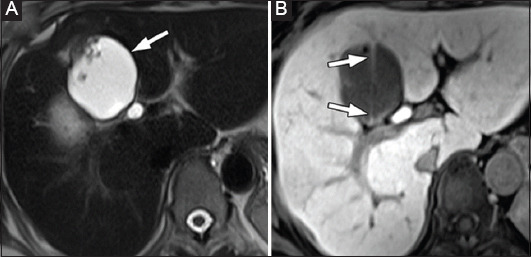
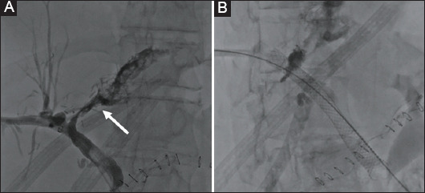
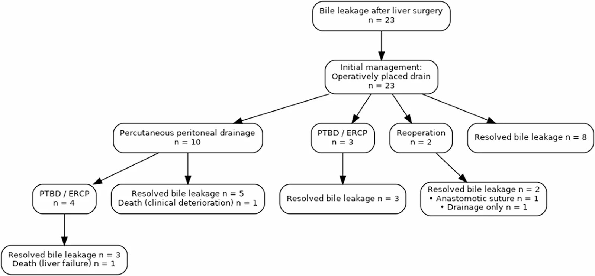
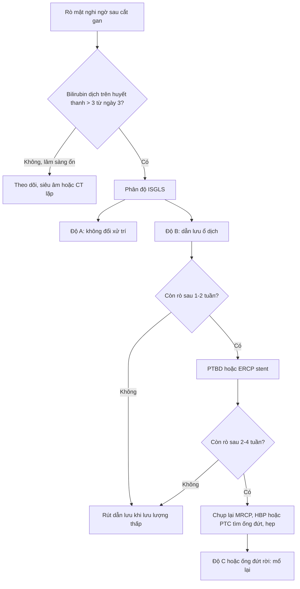
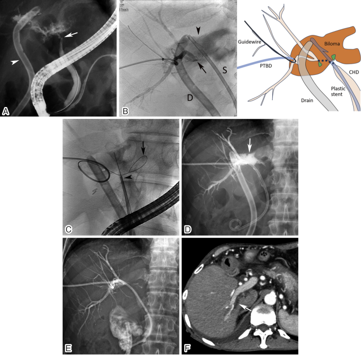
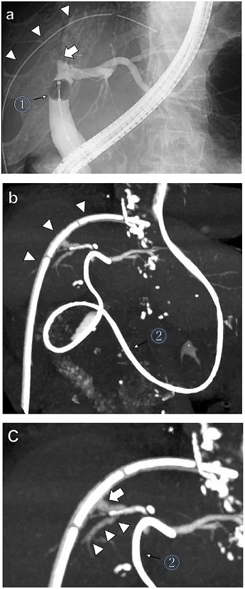

# 114 — Rò mật sau cắt gan & rò miệng nối mật–ruột (post-hepatectomy / bilioenteric anastomotic bile leak): "dịch dẫn lưu vàng, bilirubin gấp 3 lần" — phân độ ISGLS, khi nào chỉ dẫn lưu, khi nào stent, khi nào mổ lại

**Tags:** `pattern:ro-mat` `pattern:tu-dich-quanh-gan` `pattern:thoat-thuoc` `pattern:gian-duong-mat-trong-gan` `vung:duong-mat` `vung:gan` `protocol:MRCP` `protocol:MRI-gadoxetate` `protocol:HIDA` `protocol:CT-bung-co-can-quang` `protocol:PTC` `protocol:ERCP` `score:ISGLS` `score:Nagano` `incidentaloma:tu-dich-sau-mo`
**Mức chắc chắn (certainty):** tổng hợp y văn (literature synthesis) — ghép **loạt 100 ca cắt gan lớn + cắt ống mật ngoài gan** (Langenbeck's Arch Surg 2026, PMC13782112), **576 ca cắt gan** phản biện định nghĩa ISGLS (PMC9898433), **59 ca rò mật được nội soi dẫn lưu** (DEN Open 2025, PMC12151791), **meta-analysis 673 bệnh nhân HIDA** (PMC12854172), **nghiên cứu HBP gadoxetate** (PMC5350537) và các ca minh họa có ảnh (PMC12643787, PMC7599347, PMC13687923). Không có ca do nhóm tự chụp.

> **Câu hỏi thực hành:** nam **58 tuổi**, **cắt gan phải mở + cắt ống gan chung + nối mật–ruột** vì ung thư đường mật rốn gan. Ngày hậu phẫu **4**, dịch dẫn lưu **180 mL/24 giờ, màu vàng mật**, sốt **38,6 °C**, bụng mềm, bạch cầu **15,8 G/L**, CRP **148 mg/L**, bilirubin toàn phần **1,1 mg/dL**. **Bilirubin dịch dẫn lưu 13,2 mg/dL** (tỷ lệ **12:1**). CT: **tụ dịch 7,5 cm ở mặt cắt gan**, không khí trong ổ, **giãn nhẹ đường mật trong gan**. Câu hỏi: **đây là rò mật độ mấy theo ISGLS, có cần mổ lại không, và thứ tự can thiệp nào (dẫn lưu ổ dịch, PTBD, ERCP stent)?**
> Bài chốt **ba quyết định**: **(1) chẩn đoán rò mật là bằng số — bilirubin dịch/huyết thanh > 3 từ ngày 3 (ISGLS), nhưng ngưỡng > 2 ở ngày 2 có ROC tốt hơn; (2) phân độ A/B/C theo *thay đổi xử trí*, không theo thể tích dịch — phần lớn rò sau cắt gan là B và nửa số ca lành chỉ với dẫn lưu; (3) "rò + hẹp/miệng nối/ống đứt" là bài toán giải phẫu, phải chụp đường mật trước khi đặt stent mù.**

## 1. Tổng quan bệnh học – cơ chế hình ảnh: vì sao mật rò ra, và vì sao hình ảnh "thấy" được

- **Bốn đường rò sau cắt gan** (thứ tự tần suất thực hành):
  1. **Ống mật nhỏ trên mặt cắt gan** (cut-surface / peripheral duct): ống phân thùy bị cắt mà không buộc/đốt kín; lưu lượng thường thấp, có thể tự lành.
  2. **Ống gan trung tâm bị đứt hoặc thắt hẹp** (central duct): tổn thương ống gan phải/trái tại rốn gan — lưu lượng cao, **không tự lành**, phải dẫn lưu đường mật ± mổ.
  3. **Bục miệng nối mật–ruột** (bilioenteric anastomosis dehiscence): thiếu máu đầu ống mật + căng miệng nối; đây là cơ chế hay gặp nhất sau cắt gan lớn có cắt ống mật ngoài gan.
  4. **Ống phụ/ống Luschka** (duct of Luschka) sau cắt túi mật: rò nhỏ ở giường túi mật, ống mật chủ bình thường.
- **Tần suất — bốn con số phải nhớ:**
  - **3,6–11%** là tỷ lệ gộp của rò mật sau cắt gan trong meta-analysis 2023 (PMC10417307); **4,8–7,6%** là khoảng sau cắt gan trong loạt can thiệp qua da (PMC12643787).
  - **17%** khi **đo bilirubin dịch dẫn lưu thường quy ngày 3**, nhưng chỉ **7%** là rò có ý nghĩa lâm sàng — tức **một nửa "rò" là bất thường sinh hóa không triệu chứng** (PMC11599820).
  - **23% (23/100)** sau **cắt gan lớn + cắt ống mật ngoài gan/nối mật–ruột**; **21 ca độ B, 2 ca độ C**, và **tất cả được phát hiện trong 2 ngày đầu** (PMC13782112).
  - **18,9% (109/576)** trong loạt phản biện ISGLS; **88%** trong số đó là độ B/C và **11%** phải mổ lại (PMC9898433).
- **Sinh lý bệnh:** mật là dịch **vô khuẩn nhưng có tính tẩy rửa** (muối mật phá màng tế bào); mật thoát vào phúc mạc gây **viêm phúc mạc hóa học**, sau đó bội nhiễm → **áp-xe/tụ dịch nhiễm** → **nhiễm khuẩn huyết** → **suy gan sau cắt gan (post-hepatectomy liver failure, PHLF)**. Đây là lý do **kiểm soát ổ nhiễm (source control) phải làm trước khi bàn đến stent đường mật**.
- **Vì sao rò không tự cầm:** áp lực đường mật **10–15 cm H₂O** lớn hơn áp lực ổ bụng; nếu có **hẹp/miệng nối hẹp hoặc ống đứt rời**, dòng mật vẫn chảy theo đường ít trở lực nhất ra da/ổ dịch. Chỉ khi **giảm chênh áp** (stent qua chỗ hẹp, cắt bỏ nhu mô cô lập) thì vết rò mới đóng.
- **TẠI SAO chẩn đoán bằng bilirubin dịch:** bilirubin trong mật **cao hơn huyết thanh nhiều bậc**, nên một lượng mật nhỏ trộn vào dịch dẫn lưu đã kéo **tỷ lệ bilirubin dịch/huyết thanh** vượt **3** (ISGLS 2011, DOI 10.1016/j.surg.2010.12.002). Đây là **xét nghiệm chức năng**, không phải hình ảnh: tụ dịch có thể là **seroma/máu cũ/áp-xe** mà không thông đường mật.
- **TẠI SAO MRI gadoxetate thấy rò — vật lý:** gadoxetate bị **OATP1B1/B3** bắt vào tế bào gan rồi thải qua **MRP2** vào tiểu quản mật; thì gan–mật (hepatobiliary phase, HBP) **20–25 phút** mới đủ thuốc trong mật. Nếu tụ dịch **sáng lên và có "tia" thuốc** chảy vào, đó là **bằng chứng thông trực tiếp** với đường mật, không chỉ là tụ dịch cạnh gan. Giá trị theo thời điểm: **chỉ 20–25 phút: Se 42,9%**; **20–25 + 60–90 phút: Se 92,9%**; **đủ 3 mốc 20–25/60–90/150–180 phút: Se 96,4%, Sp 100%, Acc 97,1%** (PMC5350537). Vì vậy **"HBP 20 phút âm tính" không loại trừ rò**.
- **TẠI SAO HIDA vẫn hữu ích:** **99mTc-IDA** được tế bào gan bắt và thải liên tục, chụp động **60 phút** → thấy thuốc rời đường mật vào ổ dịch theo thời gian thực; meta-analysis 16 nghiên cứu/673 bệnh nhân: **Se 88,2% (95% CI 81–93), Sp 93% (83–97), NPV 96,5%, AUC 0,94** (PMC12854172). HIDA **loại trừ rò tốt** nhưng **đặc hiệu giảm** ở bệnh nhân cắt gan/ghép gan phức tạp.
- **TẠI SAO CT vẫn là đầu tay:** CT **1–2 mm có cản quang thì cổng** trả lời **ba câu**: (1) ổ dịch ở đâu, có khí/áp-xe không; (2) đường mật trên có giãn không (gợi ý hẹp/miệng nối); (3) có biến chứng mạch/máu tụ/hoại tử gan không. Nhưng **đậm độ dịch không phân biệt mật với seroma** — không được chẩn đoán rò chỉ vì "tụ dịch 0–20 HU".

## 2. Mẫu hình + chẩn đoán phân biệt theo vị trí (Gamut)

- **Mẫu hình cốt lõi:** hậu phẫu **ngày 2–7**, dịch dẫn lưu **vàng mật, tăng dần**, sốt/đau hạ sườn phải, **ileus**, bạch cầu và CRP tăng; CT có **tụ dịch ở mặt cắt gan/rốn gan ± giãn đường mật trong gan**.
- **Gamut theo vị trí:**
  - **Mặt cắt gan (ngoại vi):** rò ống nhỏ, lưu lượng thấp, **thường đáp ứng dẫn lưu ổ dịch**; nếu kéo dài > 2–4 tuần phải tìm **ống đứt rời/nhu mô cô lập**.
  - **Rốn gan (trung tâm):** đứt **ống gan phải/trái** — lưu lượng cao, **không tự lành**, cần **PTBD/rendezvous ± stent**, đôi khi **mổ nối mật–ruột**.
  - **Miệng nối mật–ruột:** bục miệng nối do thiếu máu/căng; hay **kèm hẹp miệng nối** (bài 113) — phải đánh giá **cả rò và hẹp**, không chỉ bịt rò.
  - **Giường túi mật (ống Luschka):** rò nhỏ sau cắt túi mật, **ống mật chủ bình thường**, HIDA/CE-MRCP xác nhận.
  - **Không phải rò:** **seroma/hematoma/áp-xe** (không có thuốc vào ổ dịch), **cổ trướng** (dịch tự do, không khu trú), **rò tụy** (amylase dịch rất cao, bilirubin không tăng).
- **Mnemonic theo vị trí "M-R-M-L":** **M**ặt cắt — **R**ốn gan — **M**iệng nối — **L**uschka. Mỗi vị trí có **lưu lượng và cách xử trí khác nhau**, nên câu hỏi đầu tiên trên hình ảnh không phải "có rò không" mà **"rò từ đâu"**.

## 3. Bảng so sánh phân biệt (ma trận đối chiếu)

| Thực thể (entity) | Hình ảnh điển hình | Chốt vào (rule-in) | Chốt loại (rule-out) | Gợi ý xác nhận |
|---|---|---|---|---|
| **Rò mặt cắt gan (peripheral/cut-surface)** | Tụ dịch **sát mặt cắt**, hình thấu kính/ổ; đường mật trên **không giãn**; HBP thấy thuốc chảy vào ổ | **Bilirubin dịch/huyết thanh > 3 từ ngày 3** + ổ dịch liền mặt cắt + **thuốc vào ổ ở 60–180 phút** | Không thấy thuốc ở **150–180 phút** và tỷ lệ **< 2** → không phải rò hoạt động | Siêu âm/CT; HBP 3 mốc; theo dõi lưu lượng |
| **Đứt ống gan trung tâm (Nagano C)** | **Rò lưu lượng cao**, ổ dịch ở rốn gan; **một phân thùy không được bơm thuốc** trên ERCP/PTC; ống gan cụt | **Phân thùy mất tín hiệu + ống cụt + rò > 2 tuần** | ERCP thấy **đủ mọi ống gan** và chỉ rò mặt cắt → không phải ống trung tâm | MRCP + PTC; rendezvous |
| **Rò miệng nối mật–ruột** | Bục miệng nối, **khí trong ổ dịch**, giãn đường mật trên; có thể kèm hẹp miệng nối | **Thuốc thoát đúng miệng nối** + sốt/đau ngày 2–7 + tăng bilirubin dịch | Miệng nối kín, không thoát thuốc; rò chỉ ở mặt cắt | PTBD/ERCP (nội soi ruột non nếu Roux-en-Y) |
| **Rò ống Luschka / ống phụ** | Ổ dịch nhỏ ở **giường túi mật**; đường mật bình thường; lưu lượng thấp | **Rò mật + ống mật chủ bình thường** trên MRCP/ERCP | Có **hẹp/đứt ống gan chính** (Strasberg E) → không gọi Luschka | HIDA/CE-MRCP; ERCP |
| **Tụ dịch không thông (seroma/áp-xe/máu tụ)** | Ổ dịch **không có thuốc vào**, có thể có khí/nhiễm; không giãn đường mật | **Bilirubin dịch ≈ huyết thanh** + **không thuốc vào ổ** ở 3 mốc | Có thuốc vào ổ hoặc bilirubin dịch > 3 → là rò | Chọc hút đo bilirubin/amylase/cấy |
| **Rò + hẹp miệng nối (hẹp trên rò)** | Rò kèm **giãn đường mật trong gan** và **thắt tại miệng nối**; sốt tái diễn | **Hẹp khu trú + rò cùng chỗ** + viêm đường mật | Hẹp đơn thuần, không rò (bài 113) | MRCP; PTBD; nong/stent |

*Trái (A): tụ dịch **T2 rất sáng** ở giường cắt gan — chưa chứng minh thông đường mật. Phải (B): thì gan–mật **60 phút**, thuốc gadoxetate **chảy thành tia vào tụ dịch** (mũi tên) = **rò hoạt động**. Nguồn: Ann Gastroenterol 2020 (PMC7599347), CC BY-NC-SA 4.0; ảnh nguyên bản, không crop.*

*A: cholangiography qua da — thuốc thoát ra từ **ống mật bên phải** sau cắt gan (mũi tên). B: **stent phủ + plug** che chỗ rò, thuốc không còn thoát. Nguồn: Ann Gastroenterol 2020 (PMC7599347), CC BY-NC-SA 4.0; ảnh nguyên bản, không crop.*

## 4. Protocol chụp + hệ phân độ/điểm chuẩn hóa

### 4.1 Trình tự chẩn đoán (không nhảy cóc)

1. **Xét nghiệm trước hình ảnh:** đo **bilirubin dịch dẫn lưu + bilirubin huyết thanh cùng lúc** (tỷ lệ), **amylase dịch** (loại rò tụy), cấy dịch, lactate, CRP. Giữ **dẫn lưu hiện có** — rút sớm làm mất cả "cửa sổ" chẩn đoán và tạo ổ dịch kín.
2. **Siêu âm tại giường:** xác định ổ dịch, hướng chọc; không phân biệt được mật với dịch khác.
3. **CT bụng 1–2 mm có cản quang thì cổng:** bản đồ ổ dịch, khí, giãn đường mật, biến chứng mạch/máu tụ; dùng để **đặt dẫn lưu qua da**.
4. **MRCP + gadoxetate HBP** (nếu chức năng gan cho phép): chụp **20–25, 60–90 và 150–180 phút**; tìm **tia thuốc vào ổ dịch** và **ống cụt**. **Không kết luận âm tính nếu mới chụp 20–25 phút** (Se chỉ 42,9%).
5. **HIDA** khi MRI chống chỉ định/không kết luận: Se **88,2%**, NPV **96,5%** — hữu ích để **loại trừ**.
6. **Chụp đường mật xâm lấn có điều trị:** **PTBD/PTC** (ưu tiên khi rò trong gan, ống đứt, hoặc giải phẫu Roux-en-Y), **ERCP** (rò ngoài gan, miệng nối nối thẳng), **rendezvous** khi cần bắc cầu ống đứt.

### 4.2 ISGLS 2011 — định nghĩa và phân độ (bắt buộc thuộc)

- **Định nghĩa:** dịch dẫn lưu/ổ bụng có **bilirubin ≥ 3 lần huyết thanh** vào **ngày 3 trở đi**, **hoặc** cần can thiệp (dẫn lưu/chọc hút) vì **tụ dịch mật**, **hoặc** mổ lại vì **viêm phúc mạc mật** (Koch 2011, DOI 10.1016/j.surg.2010.12.002).
- **Độ A:** không thay đổi xử trí (theo dõi, chụp lặp).
- **Độ B:** **thay đổi xử trí nhưng không mổ lại** — dẫn lưu qua da, PTBD, ERCP/stent, kháng sinh.
- **Độ C:** **phải mổ lại** (viêm phúc mạc mật, ống đứt rời không thể bắc cầu, bục miệng nối lớn).
- **Bằng chứng phản biện ngưỡng:** 576 ca cắt gan, ROC cho thấy **AUC cao nhất ở ngày 1–2** (0,841 và 0,846) và **giảm ở ngày 3** (0,734); **tỷ lệ 2,0 ở ngày 2** cho **Se 77%/Sp 79%** (toàn bộ độ A–C) — tốt hơn ngưỡng 3,0 ngày 3. Tác giả đề nghị **hạ ngưỡng xuống 2,0 ở ngày 2** và **thêm vị trí rò theo Nagano** vào định nghĩa (PMC9898433).
- **Nagano — vị trí quyết định điều trị:** bài dùng hai thể có ca minh họa rõ: **thể C = đứt ống gan phải/trái tại rốn gan** (rò trung tâm, lưu lượng cao); **thể D = đứt ống phân thùy ngoại vi, phần gan cô lập không còn thông với hệ mật trung tâm** (ca ống B5 trong PMC12643787). Với **thể D**, đặt stent qua chỗ đứt là vô ích — phải **dẫn lưu ổ dịch ± gây tắc/xơ hóa ống ngoại vi**.

### 4.3 Khi nào chỉ dẫn lưu, khi nào stent, khi nào mổ lại

- **Độ A:** theo dõi, siêu âm/CT lặp; không can thiệp đường mật.
- **Độ B:** **dẫn lưu ổ dịch trước** (kiểm soát nhiễm), sau đó **PTBD/ERCP stent** nếu rò kéo dài > 1–2 tuần hoặc lưu lượng cao. Trong loạt 100 ca cắt gan lớn + nối mật–ruột: **8/23 lành chỉ với dẫn lưu đặt trong mổ** (trung vị **12 ngày**), **5/10 lành sau thêm dẫn lưu qua da** (trung vị **25 ngày**), **6/7 lành sau stent** (trung vị **24 ngày**) — **hơn nửa số ca lành mà không cần stent hay mổ lại** (PMC13782112). Trong loạt 36 ca can thiệp qua da: **thành công lâm sàng cuối cùng 100%**, nhưng **36,1%** cần can thiệp lần hai (PMC7599347).
- **Độ C:** **mổ lại** — ống đứt rời không bắc cầu được, bục miệng nối lớn, viêm phúc mạc mật. Trong loạt nội soi 59 ca: **2/2 độ C phải mổ lại**, còn **37/40 độ B** được dẫn lưu nội soi và **lành 100%**, thời gian dẫn lưu trung vị **18 ngày (13–35)** (PMC12151791).
- **Yếu tố dự báo nặng:** **tuổi** (UOR **1,09**/năm) và **khoảng cách từ mổ đến lúc phát hiện rò** (UOR **1,18**/ngày) — rò xuất hiện muộn nặng hơn (PMC12151791). Vì vậy **rút dẫn lưu sớm rồi phát hiện muộn là sai lầm có giá**.

*23 ca rò: **8** lành chỉ với dẫn lưu mổ; **10** thêm dẫn lưu qua da → **5** lành; **3** PTBD/ERCP → **3** lành; **2** mổ lại → **2** lành. Nguồn: Langenbeck's Arch Surg 2026 (PMC13782112), CC BY 4.0; WebP → JPEG, không crop.*

## 5. Biến thể bình thường và cạm bẫy

- **"Rò sinh hóa" không triệu chứng:** đo bilirubin thường quy làm **17%** bệnh nhân có tỷ lệ > 3, nhưng chỉ **7%** có ý nghĩa lâm sàng (PMC11599820). Không can thiệp chỉ vì con số — phải có **ổ dịch, sốt, tăng bạch cầu, hoặc lưu lượng tăng**.
- **Tỷ lệ bilirubin âm tính giả:** khi **huyết thanh bilirubin cao** (suy gan, vàng da), **dịch bị pha loãng** bởi dịch báng/dịch rửa, hoặc **dẫn lưu không nằm trong ổ dịch**. Ngược lại, **máu trong dẫn lưu** làm loãng mật → tỷ lệ giảm.
- **Chỉ số âm tính giả khi mất dẫn lưu:** rò xuất hiện **sau khi rút dẫn lưu** thường đến muộn và **nặng hơn** (UOR 1,18/ngày) — bệnh nhân vào với **áp-xe/sốt** thay vì "dịch vàng ra da".
- **HBP chụp quá sớm:** **20–25 phút đơn thuần chỉ Se 42,9%**; "không thấy thuốc" ở mốc này **không loại trừ** (PMC5350537). Phải chụp đến **150–180 phút** khi lâm sàng còn nghi.
- **ERCP "bình thường" không loại trừ ống đứt rời:** nếu ống gan phải/trái bị đứt hoàn toàn, **ERCP không bơm được phần ngoại vi** — cần **PTC/MRCP** và có thể phải **rendezvous** (PMC13687923).
- **Đặt stent khi chưa dẫn lưu ổ nhiễm:** stent làm giảm rò nhưng **không diệt ổ áp-xe**; thứ tự đúng là **dẫn lưu ổ dịch + kháng sinh → stent**. Bỏ qua bước đầu dẫn tới **nhiễm khuẩn huyết/suy gan**.
- **Dịch quanh gan vs cổ trướng (cạm bẫy mặt cắt):** dịch màng phổi đẩy **chân cơ hoành ra trước (displaced crus)** và len vào **vùng trần gan (bare area)**; cổ trướng thì ôm gan/lách, **không có dấu crus lệch**. Cùng đậm độ dịch, **vị trí tương đối với cơ hoành** quyết định gọi tên.
- **Satisfaction of search:** thấy ổ dịch lớn rồi dừng — phải tìm thêm **hẹp miệng nối, ống cụt, huyết khối tĩnh mạch cửa, giãn đường mật** vì chúng đổi hoàn toàn kế hoạch điều trị.

## 6. Tự lượng giá — Blind Quiz

**Ca 1 — Nam 62 tuổi, cắt gan trái ngày 5, dịch dẫn lưu 200 mL vàng, sốt 38,5 °C. CT có tụ dịch; MRI gadoxetate được chụp 20 phút và 90 phút.**

- Gợi ý: bilirubin dịch **9,8 mg/dL**, huyết thanh **0,9 mg/dL**; ổ dịch **6 cm** sát mặt cắt.
- Câu hỏi: Tụ dịch T2 sáng đã đủ chẩn đoán rò chưa? Mốc nào của HBP là chốt? Phân độ ISGLS và bước xử trí đầu tiên?

<b>Bấm để hiện đáp án (findings + chẩn đoán)</b>

- **Dấu hiệu:** T2 có tụ dịch nhưng **không chứng minh thông**; HBP **90 phút** thấy **tia thuốc vào ổ dịch** (mũi tên) → **rò hoạt động**.
- **Chẩn đoán:** **rò mật mặt cắt gan, ISGLS độ B** (có chỉ định can thiệp, không mổ lại) — tỷ lệ bilirubin **> 10 lần**.
- **Xử trí:** **dẫn lưu ổ dịch** (nếu chưa có) + kháng sinh; theo dõi 1–2 tuần, nếu còn rò → **PTBD/ERCP stent**. Không cần mổ lại ngay.
- **Cạm bẫy:** nếu chỉ chụp **20 phút** và thấy âm tính, vẫn **chưa loại trừ** (Se 42,9%).
- Nguồn ảnh: Ann Gastroenterol 2020 (PMC7599347), CC BY-NC-SA 4.0.

**Ca 2 — Nam 55 tuổi, cắt gan phải + nối mật–ruột; rò mật kéo dài 3 tuần, ERCP không thấy ống gan phải.**

- Gợi ý: dịch dẫn lưu **300–400 mL/ngày**; CT có ổ dịch ở rốn gan; không sốc.
- Câu hỏi: Vì sao ERCP không bơm được ống gan phải? Đây là thể Nagano nào? Hai lựa chọn can thiệp nào có thể bắc cầu?

<b>Bấm để hiện đáp án (findings + chẩn đoán)</b>

- **Dấu hiệu:** A: ERCP thấy **thoát thuốc + hẹp ống gan chung**, ống gan phải **không được bơm**. B: PTBD xác nhận **ống gan phải đứt**, thuốc vào **ổ dịch (biloma)**, dẫn lưu mổ (D) và stent nhựa (S). C: **rendezvous** — dây dẫn từ PTBD được snare nội soi kéo qua. D–E: thuốc còn thoát qua chỗ đứt rồi **hết thoát** sau khi đặt catheter bắc cầu. F: CT sau 8 năm 9 tháng — không còn giãn đường mật.
- **Chẩn đoán:** **đứt ống gan phải, Nagano thể C** — rò trung tâm, lưu lượng cao; **ERCP đơn thuần không đủ** vì phần ngoại vi bị cô lập.
- **Xử trí:** **PTBD + catheter bắc qua chỗ đứt (internal–external)** hoặc **rendezvous**; nếu thất bại → **mổ nối mật–ruột**.
- Nguồn ảnh: Interv Radiol 2025 (PMC12643787), CC BY-NC 4.0.

**Ca 3 — Nữ 78 tuổi, cắt phân thùy trước gan ngày 9, rò mật dai dẳng; ERCP bóng chặn không thấy ống gan phải; DIC-CT thấy ống sau phải giãn, ổ dịch cạnh đó.**

- Gợi ý: bilirubin dịch **20,3 mg/dL** từ ngày 3; cấy dịch **Enterococcus faecium**; ổ dịch 4 cm.
- Câu hỏi: Vì sao ERCP không thấy ống gan phải? "Rò đứt rời hoàn toàn" khác rò thông thường ở điểm nào? Có nhất thiết mổ lại không?

<b>Bấm để hiện đáp án (findings + chẩn đoán)</b>

- **Dấu hiệu:** a: ERCP bóng chặn — **ống gan phải không hiện**, chỗ đứt (mũi tên), dẫn lưu qua da (arrowhead). b–c: DIC-CT xác nhận **ống sau phải giãn, cô lập** với ổ dịch; sau đó **EUS dẫn lưu xuyên thành** ổ nhiễm vào đường tiêu hóa.
- **Chẩn đoán:** **rò mật đứt rời hoàn toàn (completely disconnected)** — phần gan thoát lưu không còn thông với hệ mật trung tâm; **stent qua chỗ đứt không thể**.
- **Xử trí:** dẫn lưu ổ dịch (đã có) + **dẫn lưu trong qua EUS** hoặc **PTBD ống cô lập**; nếu phần gan cô lập **< 200 mL** và không nhiễm nặng, có thể **gây tắc ống ngoại vi**; mổ chỉ khi thất bại/hoại tử.
- **Cạm bẫy:** gọi đây là "rò mặt cắt" và chỉ nâng liều kháng sinh → **áp-xe tái phát**.
- Nguồn ảnh: DEN Open 2026 (PMC13687923), CC BY 4.0; WebP → JPEG, không crop.

## 7. Câu hỏi nghiên cứu & điểm chưa đồng thuận (tính đến 11/2026)

1. **[Tranh cãi] Ngưỡng bilirubin dịch/huyết thanh để định nghĩa rò mật sau cắt gan nên là > 3 ở ngày 3 (ISGLS) hay > 2 ở ngày 2?**
   - **Đã biết:** 576 ca cắt gan cho AUC **0,841–0,846** ở ngày 1–2 và **0,734** ở ngày 3; tỷ lệ **2,0 ngày 2** đạt **Se 77%/Sp 79%** (toàn bộ độ A–C) (PMC9898433).
   - **Chưa rõ:** ngưỡng tối ưu theo **loại cắt gan/miệng nối**, theo **bilirubin huyết thanh cao**, và giá trị tiên lượng của việc phát hiện sớm hơn 24 giờ.
   - **Hướng nghiên cứu:** cohort tiến cứu đa trung tâm + ROC/decision-curve, đối chiếu ISGLS sửa đổi với can thiệp thực tế.
   - **Nguồn:** PMC9898433 (2023); DOI 10.1016/j.surg.2010.12.002 (ISGLS 2011).

2. **[Khoảng trống] Ở bệnh nhân nghi rò mật mà MRCP/ERCP/PTBD không kết luận, PET/CT cholangio 68Ga-DAZA có thay đổi được quyết định điều trị và có đủ chính xác để thay thế CE-MRCP?**
   - **Đã biết:** 10 ca tiến cứu, **9/10 (90%)** định vị được rò, thời gian phát hiện trung bình **28,7 phút**, không tác dụng phụ (PMC13633389).
   - **Chưa rõ:** độ chính xác so với CE-MRCP/HIDA, chi phí, tính sẵn có, và giá trị ở rò lưu lượng thấp/ống Luschka.
   - **Hướng nghiên cứu:** nghiên cứu chẩn đoán so sánh trực tiếp, cỡ mẫu đủ cho phân nhóm theo vị trí Nagano.
   - **Nguồn:** PMC13633389 (2026).

3. **[Khác biệt thực hành] Rò miệng nối mật–ruột nên ưu tiên dẫn lưu qua da rồi ERCP stent, hay nội soi dẫn lưu sớm?**
   - **Đã biết:** 37/40 ca độ B được dẫn lưu nội soi, **lành 100%**, trung vị **18 ngày (13–35)** (PMC12151791); loạt cắt gan lớn + nối mật–ruột có **hơn nửa** lành chỉ với dẫn lưu, **6/7** lành sau stent (PMC13782112).
   - **Chưa rõ:** chọn đường vào theo **giải phẫu Roux-en-Y**, thể tích gan còn lại, và **thời điểm mổ lại** khi có hẹp kèm rò.
   - **Hướng nghiên cứu:** registry đa trung tâm phân tầng theo Nagano + giải phẫu miệng nối; thử nghiệm ngẫu nhiên so sánh chiến lược.
   - **Nguồn:** PMC12151791 (2025); PMC13782112 (2026).

## Bài liên quan chéo
- [100 – Tổng quan hệ Bụng](../100-tong-quan-he-bung/lesson.md)
- [107 – MRCP & gadoxetic acid thì gan–mật (HBP)](../107-mrcp-gadoxetic-acid-hbp/lesson.md)
- [108 – Tổn thương đường mật sau cắt túi mật (Strasberg–Bismuth)](../108-ton-thuong-duong-mat-sau-cat-tui-mat/lesson.md)
- [113 – Hẹp miệng nối mật–ruột sau cắt nang ống mật chủ](../113-hep-mien-noi-mat-ruot/lesson.md)
- [133 – Hẹp miệng nối & cholangiopathy thiếu máu sau ghép gan](../133-hep-mieng-noi-duong-mat-sau-ghep/lesson.md)
- [137 – Theo dõi sau stent/dẫn lưu đường mật](../137-theo-doi-stent-dan-luu-duong-mat-di-tru-tac-nhiem-trung/lesson.md)
- [105 – Theo dõi ống dẫn lưu mật qua da (PTBD)](../105-theo-doi-ong-dan-luu-mat-qua-da/lesson.md)
- [1809 – Rò mật–nang dai dẳng sau PAIR](../1809-ro-mat-nang-sau-pair/lesson.md)

## Ảnh
- Tên file: `114_ro-mat_<Modality>_<Tạp chí><Năm>-<PMCID>-Fig<N>.jpg`; nguồn + giấy phép từng ảnh trong `images/CREDITS.md`.
- Không dùng ảnh paywall/AuntMinnie; cả 5 ảnh đều từ bài open access, giữ nguyên khung, chỉ đổi WebP → JPEG khi cần.

> Không dùng để chẩn đoán độc lập khi chưa có người hướng dẫn.
