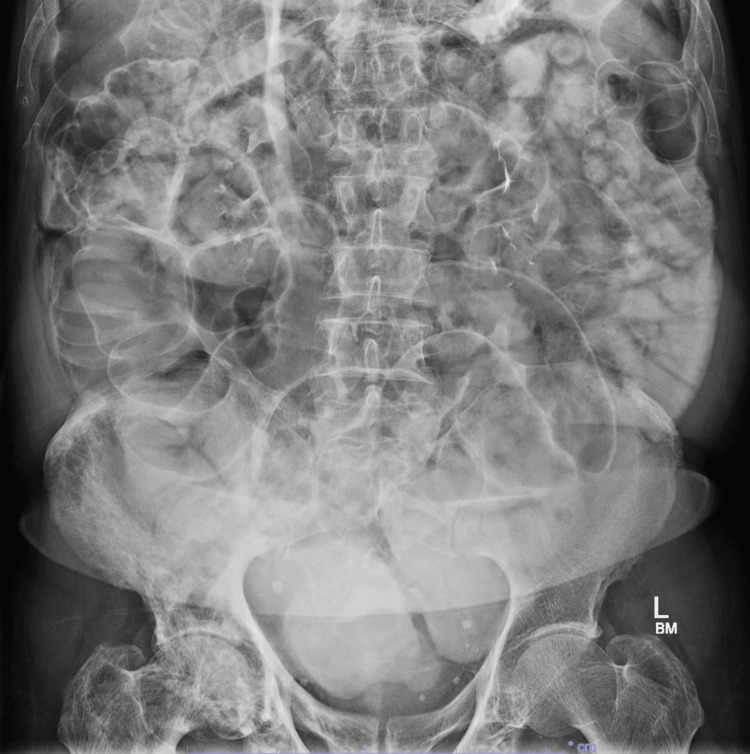
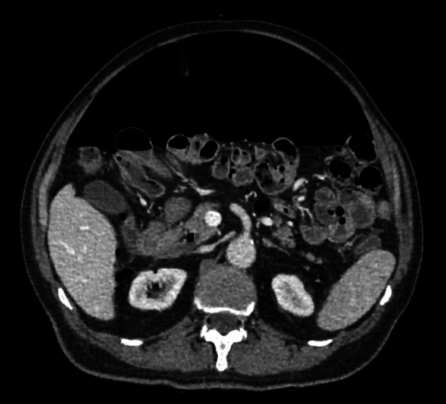

# 115 — Khí tự do ổ bụng: Rigler, bóng đá & giả khí / Pneumoperitoneum

**Tags:** `pattern:khi-tu-do` `vung:bung`
**Mức chắc chắn (certainty):** tổng hợp y văn (literature synthesis) — nhóm tự biên từ y văn mở, chưa gắn ca nguyên văn đơn lẻ.

## 1. Tổng quan — 90% thủng tạng rỗng + 10% lành tính

- Khí tự do = thủng tạNG rỗng đến khi chứng minh ngược lại (loét, túi thừa, u, sau nội soi). TẠI SAO X-quang đứng thấy: khí lên vòm hoành; nằm ngửa tìm **Rigler (2 thành ruột cùng hiện)** + **bóng đá (football)** + dây chằng liềm.
- Lành tính (không mổ): sau mổ/nội soi, Chilaiditi (đại tràng kẹt gan-hoành có haustra), thông khí áp lực, đường sinh dục nữ.
- Ngưỡng CT: khí < 5 mm đã thấy; **thuốc uống thoát ra ngoài = thủng chắc chắn**.

## 2. Gamut khí tự do theo bối cảnh

- **Đau bụng dữ + viêm phúc mạc:** thủng (loét/túi thừa/u) — mổ cấp cứu.
- **Sau mổ/nội soi + ổn định:** tồn dư — theo dõi, đừng mổ lại vội.
- **Không đau + ổn định + 2,2 lít khí:** lành tính/vô căn (ca dưới) — kháng sinh + nhịn ăn + theo dõi.
- **Chilaiditi:** haustra đại tràng + không Rigler — đừng gọi khí tự do.

## 3. Bảng dấu hiệu

| Dấu hiệu | Phim | Chốt |
|---|---|---|
| Rigler/double-wall (2 thành ruột) | X-quang nằm | **2 thành cùng hiện = khí 2 bên thành** |
| Bóng đá + dây chằng liềm | X-quang nằm (khí nhiều) | Khí lượng lớn |
| Vòm hoành (đứng/nghiêng) | X-quang đứng | Nhạy nhất X-quang |
| Thuốc uống thoát | CT | **Thủng chắc chắn, định vị điểm vỡ** |
| Chilaiditi | CT/X-quang | **Haustra + không Rigler = giả khí** |

*Dấu Rigler. Nguồn: Liu et al., Cureus 2026 Fig. 2, CC BY 4.0.*

*Khí tự do lượng lớn, không thủng (lành tính). Nguồn: Liu et al., Fig. 1, CC BY 4.0.*

## 4. Protocol

- **X-quang đứng/nghiêng** đầu tay (vòm hoành); nằm ngửa tìm Rigler/bóng đá.
- **CT + thuốc uống:** khí + thoát thuốc + dày thành + dịch khu trú = điểm vỡ.
- Ổn định + không viêm phúc mạc + không thoát thuốc → bảo tồn có kiểm soát.

## 5. Cạm bẫy

- **Chilaiditi** mổ oan — haustra + lâm sàng êm là chốt.
- **Khí sau mổ** tồn tại 1–2 tuần — hỏi mổ gần đây trước khi kết luận thủng.
- **Nằm ngửa bỏ sót khí ít** — nghi ngờ cao thì CT (nhạy hơn X-quang nhiều).

## 6. Tự lượng giá — Blind Quiz

**Ca 1 — Không đau + ổn định + X-quang 2 thành ruột. Gọi tên dấu + xử trí?**

<b>Bấm để hiện đáp án</b>

- **Rigler/double-wall:** khí tự do nhưng lâm sàng êm + CT không thoát thuốc (đối chiếu dưới) → **lành tính, bảo tồn** (2,2 lít khí vẫn khỏi không mổ).
- Nguồn: Liu et al., Fig. 1–2, CC BY 4.0.

**Ca 2 — Đau dữ + co cứng + khí + thoát thuốc + dày thành sigma:** chẩn đoán + xử trí? *(Bảng mục 3.)*

<b>Bấm để hiện đáp án</b>

- **Thủng túi thừa:** mổ cấp cứu (khác khí lành tính lâm sàng êm).

## Bài liên quan chéo
- [100 – Tổng quan hệ Bụng](../100-tong-quan-he-bung/lesson.md)
- [110 – Giải phẫu bụng](../110-giai-phau-bung/lesson.md) (Chilaiditi)
- [160 – Bụng cấp GI](../160-bung-cap-GI/lesson.md) (thủng túi thừa)

> Không dùng để chẩn đoán độc lập khi chưa có người hướng dẫn.
