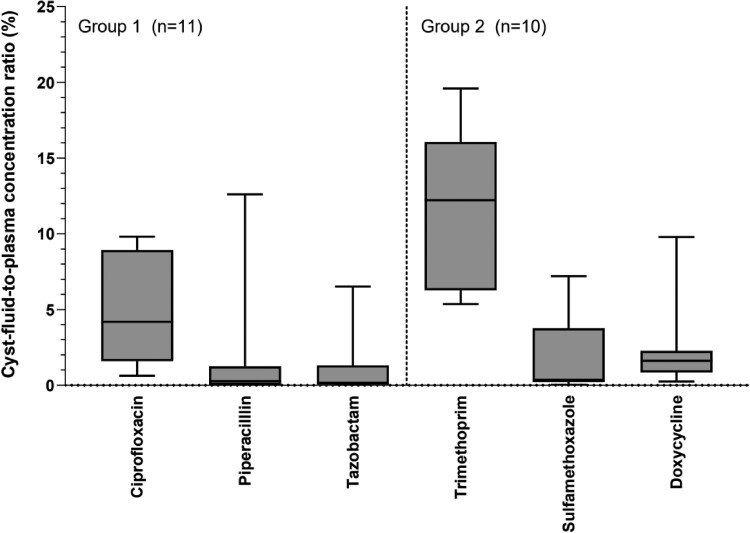
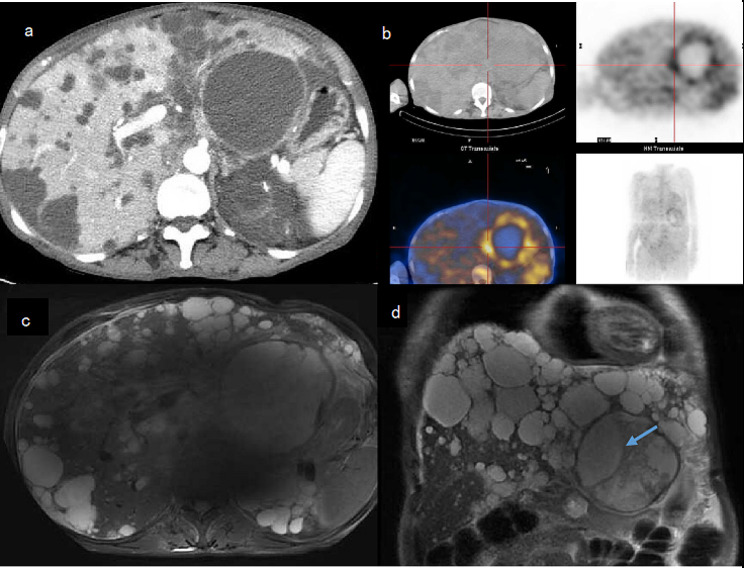
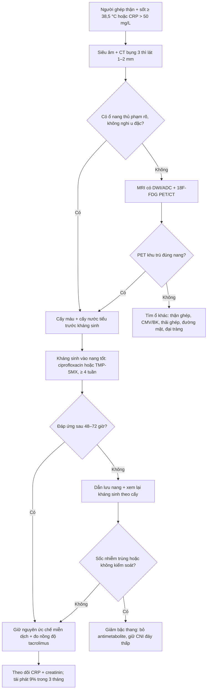

# 116 — Nhiễm trùng nang gan ở người ghép thận: chỉnh ức chế miễn dịch, tương tác thuốc & dự phòng tái phát / Liver cyst infection in kidney transplant recipients

**Tags:** `pattern:nang-phuc-tap` `vung:gan` `vung:than` `protocol:PET-CT-nang-gan` `protocol:chinh-uc-che-mien-dich`
**Mức chắc chắn (certainty):** tổng hợp y văn (literature synthesis) — nhóm tự biên từ loạt 296 người ghép thận ADPKD (Kidney Int Rep 2022), thử nghiệm dược động học xâm nhập nang gan (J Antimicrob Chemother 2025), meta-analysis PET/CT (Diagnostics 2024) và tổng quan tương tác thuốc kháng sinh (Rev Esp Quimioter 2024); **không** gắn một ca nguyên văn duy nhất.

## 1. Tổng quan bệnh học – cơ chế hình ảnh

- **Nối tiếp [bài 104](../104-nhiem-trung-nang-gan-pld-adpkd/lesson.md):** bài 104 phủ *chẩn đoán* nhiễm trùng nang gan trong gan đa nang (PLD); bài này phủ **bối cảnh ghép thận** — nơi câu hỏi thực hành không còn là "có nhiễm nang không" mà là **giữ hay chỉnh ức chế miễn dịch (immunosuppression — IS), chọn kháng sinh nào vào được nang, và bao lâu**.
- **Dịch tễ (loạt 296 người ghép thận ADPKD, theo dõi trung vị 4 năm [2–7]):** 21 bệnh nhân / **22 đợt** nhiễm trùng nang; tỷ lệ tích lũy **3% (1 năm) – 6% (5 năm) – 12% (10 năm)**; **> 1/3 số đợt xảy ra trong năm đầu sau ghép** — đúng giai đoạn IS mạnh nhất (PMC9039903). Tỷ lệ này **gần bằng** người không ghép (~1/100 người–năm, dẫn trong bài gốc) → **ghép thận không làm bùng nổ nhiễm nang**, nhưng làm **ca bệnh khó hơn** vì triệu chứng bị che lấp.
- **Yếu tố nguy cơ duy nhất có ý nghĩa:** **tiền sử nhiễm trùng nang TRƯỚC ghép** — **HR 3,47 (95% CI 1,29–9,31; P = 0,014)**. Ngược với trực giác, **không** liên quan: thymoglobulin khởi đầu, phác đồ không corticoid, phơi nhiễm corticoid ≥ 1 năm (PMC9039903) → **không thể "đoán" ca nguy cơ từ mức IS**; phải hỏi **tiền sử nhiễm nang**.
- **Vì sao nang bị nhiễm:** biểu mô lót nang kiểu **biểu mô đường mật** tiết dịch, nang là **khoang kín không thông với tuần hoàn**; vi khuẩn từ **đường tiêu hóa** (túi thừa, viêm ruột) hoặc **can thiệp đường niệu–mật** vào dịch tù đọng → viêm thành nang + ứ mủ. **Hệ quả dược lý:** muốn khỏi phải có **nồng độ kháng sinh tự do trong dịch nang** vượt MIC — mà đây chính là điểm yếu nhất của điều trị.
- **TẠI SAO kháng sinh khó vào nang (số liệu, không phải cảm tính):** thử nghiệm PK ngẫu nhiên trên **20 bệnh nhân / 21 nang gan KHÔNG nhiễm** (thể tích nang trung vị **700 mL**, thời gian truyền → chọc hút **139 phút [120–188]**), tỷ lệ **nồng độ dịch nang / huyết tương**:

| Kháng sinh | Tỷ lệ vào dịch nang (trung vị, IQR) |
|---|---|
| **Trimethoprim** | **12,2% (6,3–16,1)** |
| **Ciprofloxacin** | **4,2% (1,6–8,9)** |
| Doxycycline | 1,6% (0,9–2,3) |
| Sulfamethoxazole | 0,4% (0,2–3,8) |
| **Piperacillin** | **0,3% (0,0–1,3)** |
| **Tazobactam** | **0,2% (0,0–1,3)** |

  Nguồn: PMC11695873 (CC BY 4.0). **Đọc đúng:** đây là nang **không viêm** ở người **không nhiễm** — màng nang viêm có thể thấm hơn, nên số này là **cận dưới/tham chiếu tương đối**, không phải nồng độ tuyệt đối trong ca nhiễm. Nhưng **thứ hạng** rất ổn định và khớp thực hành: **beta-lactam (piperacillin/tazobactam) gần như không vào nang (0,2–0,3%)**, trong khi **ciprofloxacin gấp ~14 lần** và **trimethoprim gấp ~40 lần** piperacillin. Đây là lý do **EASL coi fluoroquinolone (FQ) uống hoặc cephalosporin thế hệ 3 IV là first-line**, và là lý do **thất bại kháng sinh buộc leo thang điều trị ở 48% ca** (dẫn trong PMC11695873).
- **TẠI SAO PET/CT dương còn CT thì âm:** bạch cầu trung tính trong **thành và dịch nang** đường phân mạnh → tích **¹⁸F-FDG**; màng nang mỏng, **không có mô mạch máu**, lại nằm cạnh hàng chục nang khác cùng đậm độ → CT **không có gì để bắt**. Trong loạt ghép thận: siêu âm gợi ý **3/19 (16%)**, CT **5/12 (33%)**, **PET/CT 14/16 (87%)** (PMC9039903). Gộp 10 nghiên cứu / 282 lần chụp: **Se 84,6% (75,4–90,7), Sp 94,9% (72,6–99,2)**, và PET **đổi xử trí ở hơn nửa** bệnh nhân (PMC11312050).
- **TẠI SAO người ghép biểu hiện "nghèo nàn":** sốt đơn thuần **23%**, dấu hiệu không điển hình **32%** (không sốt hoặc chỉ sốt mà không đau); **55% có tổn thương thận cấp (AKI)** — vừa do nhiễm trùng, vừa do **ức chế calcineurin (CNI) + giảm thể tích**; **14% sốc nhiễm trùng**. Vị trí: **thận gốc 63%**, **gan 37%**; thể gan gặp ở người **lớn tuổi hơn (64 ± 4 vs 58 ± 7 tuổi, P = 0,023)** và **nữ nhiều hơn (63% vs 25%, P = 0,043)** (PMC9039903).

*Tỷ lệ nồng độ dịch nang/huyết tương (%) theo từng thuốc — hộp = IQR, thanh = toàn dải. Nhóm 1 (n = 11 nang): ciprofloxacin, piperacillin, tazobactam; nhóm 2 (n = 10 nang): trimethoprim/sulfamethoxazole, doxycycline. Trimethoprim và ciprofloxacin vào nang tốt nhất; piperacillin/tazobactam gần như bằng 0. Nguồn: Bernts LHP et al., J Antimicrob Chemother 2025 (PMC11695873), CC BY 4.0.*

## 2. Mẫu hình + chẩn đoán phân biệt theo vị trí (gamut)

- **Mẫu A — "sốt đơn thuần" ở người ghép thận có tiền sử nang:** nhiễm trùng nang (gan hoặc thận gốc), **nhiễm trùng thận ghép (viêm thận–bể thận)**, nhiễm CMV/BK, **thải ghép cấp**, nhiễm trùng ống thông/tĩnh mạch trung tâm, lao.
- **Mẫu B — sốt + đau hạ sườn phải:** nhiễm trùng nang gan, **viêm đường mật**, viêm túi mật, **áp-xe gan**, **xuất huyết nang** (đau nhiều hơn sốt), **viêm túi thừa/sigmoiditis** (đau lan, kèm tiêu chảy).
- **Mẫu C — sốt + AKI:** viêm thận–bể thận thận ghép, **độc thận do CNI**, giảm thể tích, tắc nghẽn đường niệu, nhiễm trùng nang thận gốc.
- **Mẫu D — nang "đậm hơn hàng xóm" trên CT:** nhiễm trùng, xuất huyết, nang đạm/mucin, **di căn/u nang** (hiếm), **u nhú trong ống mật (IPNB)**.
- **Mnemonic "GHÉP–NANG":** **G**hép thận + tiền sử nang (**HR 3,47**) · **H**ỏi tiền sử nhiễm nang trước ghép · **É**p miễn dịch (sốt đơn thuần 23%) · **P**ET/CT là chốt (Se 84,6%) · **N**ang nào? (thận gốc 63% / gan 37%) · **A**KI 55% · **N**hiều nang cùng lúc (65%) · **G**ram âm: *E. coli* 50%.
- **Quy tắc vàng:** ở người ghép thận, **"sốt không rõ ổ + có nang gan/thận"** phải được coi là nhiễm nang **cho đến khi PET/CT loại trừ** — vì cả siêu âm (16%) và CT (33%) đều quá kém.

## 3. Bảng so sánh phân biệt (ma trận đối chiếu)

| Thực thể (entity) | Hình ảnh điển hình | Chốt vào (rule-in) | Chốt loại (rule-out) | Gợi ý xác nhận |
|---|---|---|---|---|
| **Nhiễm trùng nang gan** | Nang đậm độ cao hơn nang bên cạnh (**chênh ≥ 10 HU**), thành dày, viêm mỡ quanh nang; DWI sáng/ADC thấp; **PET: ổ FDG đúng thành/dịch nang** | **Sốt + CRP > 50 mg/L + ổ FDG khu trú trong nang** (PET dương 87% trong loạt ghép) | Nang T1 sáng đồng nhất, không ngấm FDG, CRP bình thường → **xuất huyết nang** | **PET/CT**; cấy máu (dương 73% đợt có vi khuẩn); chọc hút nang |
| **Nhiễm trùng nang thận gốc** | Nang thận gốc thành dày, dịch không đồng nhất; **thận gốc teo quanh nang**; FDG khu trú | **FDG trong nang thận gốc + đau thắt lưng** | FDG chỉ ở **thận ghép** → nghĩ thận ghép | PET/CT; siêu âm định vị; cấy nước tiểu |
| **Viêm thận–bể thận thận ghép** | Thận ghép to, phù, **giảm ngấm thuốc dạng ổ/wedge**, ứ nước, dày thành bể thận; FDG lan tỏa nhu mô | **Đau vùng ghép + sốt + cấy nước tiểu dương** | FDG **khu trú trong một nang**, nhu mô ghép bình thường → nhiễm nang | Siêu âm/CT; cấy nước tiểu trước kháng sinh |
| **Thải ghép cấp (acute rejection)** | Thận ghép to, **tăng tín hiệu T2/STIR vỏ–tủy**, giảm ngấm; **không có ổ FDG riêng** | **Creatinin tăng nhanh + protein niệu + kháng thể donor (DSA)** | Có ổ nhiễm rõ + CRP rất cao + đáp ứng kháng sinh → nhiễm trùng | Sinh thiết thận ghép (chốt); DSA; siêu âm Doppler |
| **Nhiễm CMV / BK** | Thận ghép bình thường hoặc phù nhẹ; **không ổ khu trú**; tổn thương phổi/ruột kèm theo | **PCR CMV/BK dương + sốt kéo dài, bạch cầu giảm** | Ổ FDG khu trú trong nang → không phải nguyên nhân chính | PCR định lượng; nội soi đại tràng nếu tiêu chảy |
| **Viêm đường mật / sỏi mật** | **Giãn ống mật trong gan**, dày thành ống mật, sỏi; **không có nang thủ phạm** | **Giãn mật + vàng da + tam chứng Charcot** | Không giãn mật, có ổ nang rõ → nhiễm nang | MRCP; ERCP khi cần giải áp |
| **Viêm túi thừa / sigmoiditis** | Dày thành đại tràng sigma, viêm mỡ quanh ruột, **dịch/khí ngoài lòng ruột**; FDG ở thành ruột | **Đau hố chậu trái + tiêu chảy + FDG thành đại tràng** | FDG trong nang gan, đại tràng bình thường | CT bụng; **nội soi sau khi khỏi** (4 ca trong loạt được soi: 2 polyp, 1 túi thừa) |
| **Xuất huyết nang** | CT **30–100 HU**, không ngấm; **T1 sáng, không mất tín hiệu fat-sat**; **không ngấm FDG** | **Đau + Hb giảm, CRP thấp/không sốt** | FDG dương + sốt + CRP cao → nhiễm trùng | MRI T1 ± fat-sat; so phim cũ; **không chọc khi nghi xuất huyết đang hoạt động** |
| **Áp-xe gan (không do nang)** | Ổ dịch **có vỏ ngấm thuốc**, khí trong ổ, viêm mỡ; không nằm đúng vị trí nang cũ | **Vỏ ngấm thuốc + khí + sốt cao** | Không vỏ ngấm, đúng vị trí nang → nhiễm nang | Chọc hút dưới hướng dẫn, cấy |

*(a) CT thì động mạch: nang lớn thùy trái **không ngấm thuốc** — không phân biệt được với nang lành; (b) PET/CT: **ngấm FDG nhẹ ở thành nang** (ô phải trên: PET, dưới: ảnh hợp); (c) MRI T2 axial và (d) T2 coronal: nang **8,9 × 8,8 × 9,0 cm**, tín hiệu không đồng nhất, mũi tên xanh chỉ vách/dịch lợn cợn. Bài học: **CT âm tính không loại trừ**; PET là bước tiếp theo. Nguồn: Xu S et al., BMC Nephrol 2024 (PMC10919048), CC BY 4.0 — ca **không ghép thận** (dùng minh họa hình thái).*

## 4. Protocol chụp + phân tầng điều trị

**Chuỗi hình ảnh (theo câu hỏi, không theo giá tiền):**

1. **Siêu âm bụng:** rẻ, đầu tay, nhưng trong gan/thận đa nang **gần như vô dụng để định vị nang thủ phạm** (16% trong loạt ghép).
2. **CT bụng có cản quang 3 thì, lát 1–2 mm:** loại **u đặc ngấm thuốc**, tìm **khí, vách, thành dày, viêm mỡ quanh nang**; nhớ CT chỉ gợi ý **33%**.
3. **MRI gan/thận (T1 in/out-phase, T1 fat-sat, T2, DWI/ADC, thì muộn):** phân biệt **mủ (DWI sáng/ADC thấp)** với **máu cũ (T1 sáng, không hạn chế khuếch tán)**; **không cần gadolinium nếu chỉ cần DWI** (bảo vệ thận ghép).
4. **¹⁸F-FDG PET/CT — chốt định vị:** nhịn ăn **≥ 6 giờ**, glucose máu **< 11 mmol/L**, đọc sau **60 phút**; tiêu chuẩn dương: ngấm **thành hoặc trong nang** cao hơn nhu mô xung quanh. Giá trị: **Se 84,6% / Sp 94,9%**; **hạn chế:** viêm quanh nang, mô ghép viêm, ổ nhiễm khác, **sau chọc/dẫn lưu** → dương tính giả.
5. **Chọc hút / dẫn lưu qua da:** vừa chẩn đoán (nhuộm Gram, cấy, tế bào) vừa điều trị; ưu tiên nang **lớn, nông, dễ tiếp cận**; trong loạt ghép chỉ **1/22 đợt (5%)** phải dẫn lưu.

**Điều trị (số liệu từ loạt 22 đợt, PMC9039903):**

- **Kháng sinh:** beta-lactam đơn thuần **27%**, **FQ đơn thuần 36%**, phối hợp **37%**; **thời gian trung bình 33 ± 11 ngày**. Khuyến cáo EASL/KDIGO được các bài gốc trích: **≥ 4 tuần**, kéo dài tùy đáp ứng ([bài 104](../104-nhiem-trung-nang-gan-pld-adpkd/lesson.md): ≥ 14 ngày bảo vệ thất bại/tái phát sớm, OR 0,03; ≥ 28 ngày bảo vệ tái phát 12 tháng, OR 0,12).
- **Chọn thuốc theo dữ liệu xâm nhập nang:** **ciprofloxacin hoặc trimethoprim/sulfamethoxazole** là lựa chọn hàng đầu về mặt dược động học (4,2% và 12,2%); **piperacillin/tazobactam 0,2–0,3%** → **không dùng đơn độc** cho nhiễm nang, chỉ dùng khi có ổ nhiễm ngoài nang/đang chờ cấy.
- **Kết cục:** thất bại điều trị **27%**, đổi kháng sinh **27%**, dẫn lưu **5%**, **cắt thận 5%**, tái phát sớm (< 3 tháng) **9%**.
- **Thận ghép:** nhiễm trùng nang **liên quan tới mất thận ghép** (24% vs 5%; **HR 3,93 [1,21–12,80]**) nhưng tác giả **không xác lập được nhân quả** — trong đa số ca mất ghép có nguyên nhân khác (thải ghép thể dịch sau giảm IS, nhiễm nặng khác, suy thận trước đó). **Đừng đọc con số này thành "phải cắt thận"**.

**Chỉnh ức chế miễn dịch — nguyên tắc thực hành (quan trọng nhất của bài):**

- Trong loạt, **chỉ 2/21 bệnh nhân (9%) được giảm IS** — tức là **đa số nhiễm nang được điều trị mà KHÔNG giảm IS**. Đây là điểm khác biệt so với nhiễm trùng nặng có sốc.
- **Giảm IS không miễn phí:** 2 ca mất thận ghép trong loạt xảy ra **sau khi giảm/ngừng IS** (một ca thải ghép thể dịch sau đợt legionellosis nặng, một ca sau khi ngừng IS vì *P. jirovecii*) → **hạ IS là can thiệp có giá**.
- **Ngưỡng đề xuất (suy luận từ dữ liệu trên, không phải guideline):** giữ nguyên IS khi bệnh nhân **ổn định huyết động, đáp ứng lâm sàng trong 48–72 giờ**; **giảm bậc thang** (bỏ antimetabolite trước, giữ CNI ở nồng độ đáy thấp–trung bình) khi **sốc nhiễm trùng, không kiểm soát sau 72 giờ, hoặc phải mổ/dẫn lưu lớn**; **không ngừng CNI đột ngột**.

**Tương tác thuốc — đọc đúng mức độ (PMC11231487):**

| Cặp tương tác | Mức độ theo bằng chứng | Việc phải làm |
|---|---|---|
| **Ciprofloxacin + tacrolimus/cyclosporine** | **Nhẹ ("mild")** — cipro chỉ là **ức chế CYP3A4 yếu + P-gp yếu (minor)**; báo cáo **tăng creatinin thoáng qua** với cyclosporine, một số ca **không đổi dược động học** | **Không giảm liều trước**; **đo nồng độ tacrolimus (C0) sau 3–5 ngày** và khi ngừng; theo dõi creatinin |
| **Clarithromycin / erythromycin + CNI** | **Nặng** — AUC/Cmax của CNI **tăng 3–10 lần** | **Giảm 50% liều CNI** + đo nồng độ hằng ngày |
| **Levofloxacin + cyclosporine** | **Trung bình** — Cmax **+23%**, AUC **+26%** | Theo dõi chức năng thận, nhất là liều 500 mg mỗi 12 giờ |
| **Ciprofloxacin (CYP1A2)** | Ức chế **trung bình** CYP1A2 | Tránh/giảm liều **theophylline, tizanidine, clozapine, olanzapine**; cảnh giác **QT** |

> **Phản biện (fidelity):** niềm tin phổ biến "ciprofloxacin làm tăng vọt tacrolimus" **không được dữ liệu ủng hộ mạnh** — cipro yếu hơn macrolid rất nhiều. Nhưng vì tacrolimus có **cửa sổ điều trị hẹp**, và vì **cùng lúc bệnh nhân đang nhiễm trùng + có thể mất nước**, **vẫn phải đo nồng độ** — lý do là *nguy cơ tổng hợp*, không phải vì cipro là "thuốc tương tác mạnh".

## 5. Biến thể bình thường và cạm bẫy

- **CT âm tính KHÔNG loại trừ:** trong một loạt, CT **âm tính 7/7 đợt**; trong loạt ghép chỉ gợi ý **33%**. "CT sạch" ở người ghép thận có nang là **chỉ định PET/CT**, không phải lý do dừng lại.
- **FDG dương giả:** viêm quanh nang, **mô ghép thận viêm**, ổ nhiễm khác (sigmoid, ống thông), **sau chọc/dẫn lưu** (viêm thứ phát), và **nang vừa xuất huyết** (đại thực bào hoạt hóa). Luôn đối chiếu **đúng nang** trên CT/MRI, không đọc PET "trần".
- **Nhầm xuất huyết nang với nhiễm trùng:** xuất huyết cho **T1 sáng, không hạn chế khuếch tán, không ngấm FDG**, CRP thường thấp; chọc hút lúc đang xuất huyết làm nặng thêm.
- **Giảm IS theo phản xạ = bẫy:** 2 ca mất thận ghép trong loạt xảy ra **sau khi giảm/ngừng IS**. Giữ IS ở bệnh nhân ổn định là **quyết định có bằng chứng**, không phải "thiếu quyết đoán".
- **AKI ở người ghép không đồng nghĩa nhiễm trùng:** CNI + giảm thể tích + thuốc cản quang là bộ ba thường gặp; đừng quy hết cho nang.
- **Fluoroquinolone dài ngày có giá:** ca 68 tuổi chạy thận, **levofloxacin 2 tuần** vì nhiễm nang gan → **đau cổ chân, giảm khả năng đi lại** (viêm gân do FQ); nhiễm nang tái phát **4 tuần sau ngừng kháng sinh** (PMC11385687). Với người ghép, **cân nhắc thêm tendinopathy** khi kéo dài FQ > 2–3 tuần.
- **Satisfaction of search:** **65%** các đợt có **nhiều nang nhiễm cùng lúc** ([bài 104](../104-nhiem-trung-nang-gan-pld-adpkd/lesson.md)) — dẫn lưu 1 nang rồi "yên tâm" là bỏ sót ổ thứ hai.
- **Không quên ổ nguyên phát:** *E. coli* chiếm **50%**; 4 ca được nội soi đại tràng (2 polyp, 1 túi thừa). Nhiễm nang tái phát = **tìm túi thừa/ổ tiêu hóa**, không chỉ đổi kháng sinh.

## 6. Tự lượng giá — Blind Quiz

**Ca 1 — Nam 61 tuổi, ghép thận 5 năm vì ADPKD, sốt 38,6 °C 4 ngày, không đau bụng, creatinin tăng 30%. CRP 161 mg/L.**

- Hỏi: (1) Trên CT, nang lớn thùy trái có gì bất thường? (2) Vì sao CT dễ âm tính? (3) Ba chẩn đoán phân biệt và bước hình ảnh tiếp theo?

<b>Bấm để hiện đáp án (findings + chẩn đoán)</b>

- **Findings:** (a) CT thì động mạch — nang lớn **không ngấm thuốc**, thành không rõ; (b) PET/CT — **ngấm FDG nhẹ ở thành nang**, cao hơn nhu mô gan xung quanh; (c) (d) MRI T2 — nang **8,9 × 8,8 × 9,0 cm**, tín hiệu không đồng nhất, có vách.
- **Chẩn đoán:** **nhiễm trùng nang gan** ở người ghép thận. Vì sao: màng nang không có mạch máu nên CT **không có mô để bắt**; bạch cầu trong thành/dịch nang đường phân mạnh nên **PET dương** (Se 84,6%).
- **Phân biệt:** viêm thận–bể thận thận ghép, thải ghép cấp, nhiễm CMV/BK, viêm đường mật, xuất huyết nang (T1 sáng, không FDG).
- **Bước tiếp:** cấy máu + cấy nước tiểu → **ciprofloxacin hoặc TMP-SMX ≥ 4 tuần**; **giữ nguyên IS**, đo nồng độ tacrolimus; dẫn lưu nếu không đáp ứng 48–72 giờ.
- **Nguồn ảnh:** Xu S et al., BMC Nephrol 2024 (PMC10919048), CC BY 4.0 — ca không ghép thận, dùng minh họa hình thái.

**Ca 2 — Nữ 64 tuổi, ghép thận 3 năm, nhiễm trùng nang gan do *E. coli*. Ngày 5 đang dùng piperacillin/tazobactam, vẫn sốt 39 °C, CRP tăng.**

- Hỏi: Nhìn biểu đồ, vì sao phác đồ hiện tại khó khỏi? Nên đổi sang đâu và cần theo dõi gì?

<b>Bấm để hiện đáp án</b>

- **Findings:** piperacillin **0,3% (0,0–1,3)** và tazobactam **0,2% (0,0–1,3)** nồng độ dịch nang/huyết tương — gần như **không vào nang**; ciprofloxacin **4,2%**, trimethoprim **12,2%**.
- **Kết luận:** thất bại không phải do "kháng thuốc" mà do **không đạt nồng độ tại ổ** — đúng cơ chế đã làm **48% ca thất bại kháng sinh phải leo thang**.
- **Xử trí:** đổi sang **ciprofloxacin** (theo kháng sinh đồ) hoặc **TMP-SMX**; **tiếp tục ≥ 4 tuần** tính từ lúc kiểm soát; cân nhắc **dẫn lưu nang** nếu sốt kéo dài; **đo nồng độ tacrolimus** sau 3–5 ngày (cipro ức chế CYP3A4 yếu) và theo dõi **gân** nếu kéo dài FQ.
- **Caveat:** số liệu trên nang **không nhiễm** → dùng để so sánh **tương đối giữa các thuốc**, không phải nồng độ tuyệt đối.
- **Nguồn:** Bernts LHP et al., J Antimicrob Chemother 2025 (PMC11695873), CC BY 4.0.

## Bài liên quan chéo
- [104 – Nhiễm trùng nang gan trong ADPKD/PLD](../104-nhiem-trung-nang-gan-pld-adpkd/lesson.md) (khung chẩn đoán + ngưỡng kháng sinh)
- [164 – Nang thận ADPKD & biến chứng](../164-nang-than-adpkd-bien-chung/lesson.md) (nhiễm/xuất huyết nang thận)
- [157 – Bệnh thận đa nang ADPKD/ARPKD](../157-benh-than-da-nang-adpkd-arpkd/lesson.md)
- [189 – Đánh giá trước ghép thận ở bàng quang thần kinh](../189-danh-gia-truoc-ghep-than-bang-quang-than-kinh/lesson.md) (bối cảnh người ghép)
- [910 – Dẫn lưu áp-xe, đường mật & thận qua da](../910-abscess-biliary-nephrostomy/lesson.md) (kỹ thuật chọc hút/dẫn lưu)

## Ảnh
- `images/116_nang-gan-nhiem-trung_CT-PET-MRI_PMC10919048.jpg` — CT/PET/MRI, CC BY 4.0 (PMC10919048, ca không ghép thận).
- `images/116_xam-nhap-khang-sinh_Bar_PMC11695873.jpg` — biểu đồ xâm nhập kháng sinh, CC BY 4.0 (PMC11695873).
- Nguồn + giấy phép từng ảnh: `images/CREDITS.md`.

> Không dùng để chẩn đoán độc lập khi chưa có người hướng dẫn.
