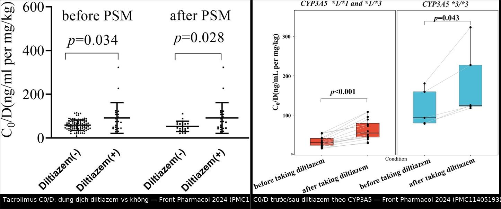
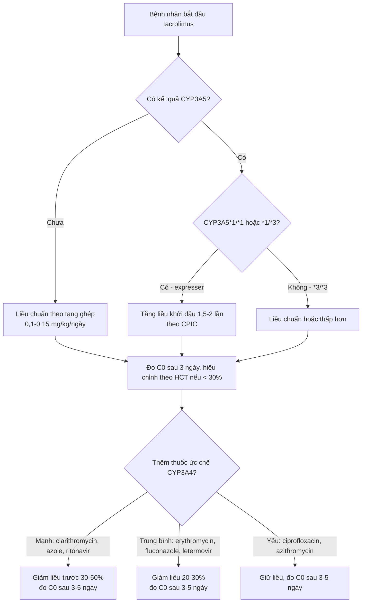
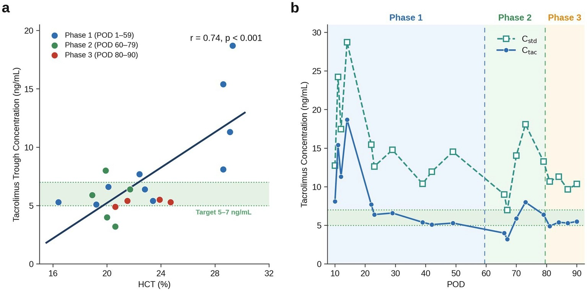

# 117 — Tương tác thuốc & theo dõi nồng độ tacrolimus ở người ghép tạng / Tacrolimus drug–drug interactions and therapeutic drug monitoring

**Tags:** `pattern:tuong-tac-thuoc` `pattern:ngo-doc-thuoc` `vung:gan` `vung:than-ghep` `score:C0-trough` `score:C0-D` `score:CYP3A5` `protocol:TDM-tacrolimus` `protocol:CYP3A5-genotype` `protocol:LC-MSMS`

**Mức chắc chắn (certainty):** tổng hợp y văn (literature synthesis) — bảng phân loại ức chế/cảm ứng CYP3A4 lấy từ tổng quan tương tác kháng sinh (Rev Esp Quimioter 2024, PMC11231487); các con số độ lớn tương tác lấy từ 4 nghiên cứu nguyên văn (Front Pharmacol 2024 PMC11405193; Ther Adv Drug Saf 2026 PMC12901897; CPT Pharmacometrics Syst Pharmacol 2026 PMC13539210; Pharmacol Res Perspect 2023 PMC10395274) + 3 ca/đoàn hệ về theo dõi nồng độ (Front Med 2026 PMC13448784; Pharmacotherapy 2026 PMC12884575; Clin Pharmacol Drug Dev 2026 PMC12813645) + 1 ca ngộ độc (Cureus 2025 PMC12009141). **Không** gắn một thử nghiệm ngẫu nhiên nào về cách chỉnh liều; mọi ngưỡng "giảm bao nhiêu %" là tổng hợp thực hành và được ghi rõ mức suy luận.

> **Câu chốt:** tacrolimus là thuốc **chỉ số điều trị hẹp (narrow therapeutic index)** chuyển hóa qua **CYP3A4/3A5 ở ruột và gan** + bị **P-glycoprotein (P-gp)** đẩy ngược ra lòng ruột, lại **gắn hồng cầu > 95%** — nên một con số "C0 = 6,2 ng/mL" chỉ có nghĩa khi biết **4 thứ**: **(1)** thuốc nào vừa được thêm/bớt (ức chế hay cảm ứng), **(2)** **hematocrit** lúc lấy máu, **(3)** lấy đúng **12 giờ ± 30 phút** sau liều và đã **đạt trạng thái ổn định (≥ 3 ngày, ~5 chu kỳ bán thải)**, **(4)** **kiểu gen CYP3A5** của người nhận (và của **gan cho** nếu ghép gan). Sai lầm hay gặp không phải "không đo nồng độ" mà là **đo rồi chỉnh liều theo con số mà không đọc bối cảnh** — tăng liều oan khi **thiếu máu** (C0 giả thấp) hoặc bỏ sót **ngộ độc thật** khi thêm **clarithromycin/voriconazole/ritonavir**.

## 1. Tổng quan bệnh học – cơ chế hình ảnh

Ở đây "hình ảnh" là **đường cong nồng độ–thời gian** và **biểu đồ C0/D**, không phải CT/MRI. Vì vậy phần (1) giải thích **TẠI SAO nồng độ đo được lại lệch** bằng dược động học, đúng tinh thần "vật lý + mô bệnh" của repo: mỗi con số trên giấy là kết quả của **4 tầng** dưới đây.

### 1.1 Bốn tầng quyết định con số C0

| Tầng | Cơ chế | Hệ quả trên xét nghiệm |
|---|---|---|
| **Hồng cầu** | Tacrolimus gắn hồng cầu **> 95%**, phần tự do rất nhỏ | Đo **máu toàn phần (whole blood)**, không dùng huyết tương; **HCT thấp → C0 đo được thấp giả** dù phơi nhiễm mô không đổi |
| **Ruột (CYP3A4 + P-gp)** | Thuốc uống qua niêm mạc ruột bị CYP3A4 chuyển hóa trước khi vào cửa và bị P-gp bơm ngược ra lòng ruột | Ức chế CYP3A4/P-gp tại ruột làm **sinh khả dụng tăng mạnh** — đây là nơi tương tác lớn nhất, không phải gan |
| **Gan (CYP3A4/3A5)** | Chuyển hóa chính; **CYP3A5\*1** (expresser) có hoạt tính cao hơn **CYP3A5\*3/\*3** | Expresser cần liều **gần gấp đôi**; suy gan/ghép gan làm **giảm thanh thải** |
| **Thời điểm & trạng thái ổn định** | C0 = nồng độ ngay trước liều kế (12 giờ sau liều tối) | Lấy sớm/muộn 1–2 giờ, hoặc chưa đạt trạng thái ổn định → con số **không dùng để chỉnh liều** |

Nguồn cho tầng hồng cầu + chuyển hóa: PMC13539210 (nêu rõ "gắn hồng cầu > 95% và chuyển hóa chủ yếu ở gan"), PMC13448784 (công thức hiệu chỉnh theo HCT).

### 1.2 Ngưỡng định lượng trụ cột

| Đại lượng | Con số | Nguồn |
|---|---|---|
| **Biến thiên nồng độ trong cùng một bệnh nhân (intra-patient variability)** | **CV ≥ 27%** → **gấp 3,5 lần** nguy cơ tử vong/suy thận | PMC13539210 |
| Tần suất **CYP3A5\*1** (expresser) | **~30%** người châu Á · **~14%** người da trắng; tần suất alen **CYP3A5\*3** trong đoàn hệ Thái **65,55%** | PMC13539210 |
| Liều khởi đầu theo **CPIC** cho expresser | **× 1,5–2** so với non-expresser | PMC12884575 |
| Ghép **tim**, expresser vs non-expresser (n = 33): thời gian đạt đích (C0 8–12 ng/mL) | **14 ngày (9,5–16) vs 7,5 ngày (6–11)**, p = 0,0073 | PMC12884575 |
| Cùng đoàn hệ: liều tại đích | **10 mg/ngày (5,5–13) vs 5 mg/ngày (3,3–5,9)**, p = 0,0019 | PMC12884575 |
| Cùng đoàn hệ: **C0/D** | **1,1 (0,83–1,7) vs 2,0 (1,6–3,4) ng/(mL·mg)**, p = 0,0015 | PMC12884575 |
| Ghép **gan**, liều khởi đầu chuẩn | **0,1–0,15 mg/kg/ngày** (kèm mycophenolate + corticoid); đích **C0 6–10 ng/mL** tháng đầu | PMC12901897 |
| Ghép gan, đích theo giai đoạn (một trung tâm) | **8–12 ng/mL** 3 tháng đầu → **5–8 ng/mL** sau đó | PMC13539210 |
| Ghép gan nguy cơ miễn dịch thấp (basiliximab) | **5–7 ng/mL** | PMC13448784 |
| **Ngưỡng hiệu chỉnh HCT** trong thực hành | Hiệu chỉnh khi **HCT < 30%**: `C_std = C_đo × (45 / HCT%)` | PMC13448784 (theo đồng thuận Brunet) |
| Ca minh họa sai lệch do HCT | **HCT 16,4%**, C0 đo **3,2 ng/mL** → C_std **7,0 ng/mL** (đúng đích 5–7) | PMC13448784 |
| Tương quan HCT – C0 trong ca đó | **r = 0,74, p < 0,001** | PMC13448784 |
| Tiêu chảy viêm làm tăng phơi nhiễm | **C/D tăng ~55%**; C0 **8,0 ng/mL** dù **không đổi liều** (6–7 lần tiêu chảy nước/ngày) | PMC13448784 |

> **Đọc đúng bảng này:** các đích C0 **khác nhau theo tạng ghép, thời gian sau ghép, nguy cơ miễn dịch và trung tâm** — không có một con số "chuẩn" duy nhất. Khi trích dẫn cho đồng nghiệp, luôn kèm **bối cảnh** (tạng nào, tháng thứ mấy, có induction hay không); nếu không sẽ thành "hướng dẫn miệng" sai.

### 1.3 Độ lớn tương tác — số thật, không phải "tăng/giảm"

| Thuốc thêm vào | Độ lớn (số đo) | Bệnh cảnh | Nguồn |
|---|---|---|---|
| **Diltiazem** (1,82 mg/kg/ngày) | **C0/D × ~2**: **75,84 vs 34,76** ng/mL per mg/kg (p < 0,001); sau ghép cặp PSM: 75,84 vs 46,93 (p = 0,028) | 117 trẻ hội chứng thận hư (không phải ghép) | PMC11405193 |
| — phân theo **CYP3A5** | Expresser **× 1,8** · non-expresser **× 1,3** | như trên | PMC11405193 |
| **Voriconazole** | **C0/D × 3,16** ở người nhận **CYP3A4\*1G TT/TC**; **× 3,04** khi **cả gan cho và người nhận** TT/TC | 139 ca ghép gan | PMC12901897 |
| **Fluconazole** | **CL/F 23,0 → 15,4 L/h (−33%)**; C0 **4,0 → 6,7 ng/mL**; liều khuyến nghị **1,5–3,0** (có fluconazole) vs **2,5–7,0 mg mỗi 12 giờ** (không có) | 114 ca ghép gan, mô hình hóa | PMC13539210 |
| **Letermovir** (± azole) | **C/D 1234,7 vs 564,4** ng/mL per mg/kg (**~2,2 lần**), p < 0,001; khi **không** kèm azole: 809,9 vs 616,1 (**p = 0,125 — không khác**) | 35 ca ghép tế bào gốc, 795 điểm | PMC10395274 |
| **Nước bưởi (grapefruit juice)** + tacrolimus phóng thích kéo dài (LCPT) | **AUC 0–24 tăng 28%** (GMR 1,28; KTC 90% 1,12–1,44); **Cmax tăng 73%** (1,73; 1,46–2,00) | 11 ca ghép thận, crossover ngẫu nhiên | PMC12813645 |
| **Nirmatrelvir/ritonavir** | C0 **> 90 ng/mL** (ngưỡng báo cáo của xét nghiệm), AKI (creatinin **2,46 mg/dL**, GFR **27**); sau **phenytoin 200 mg × 2/ngày × 6 liều** → C0 **2,9 ng/mL**, creatinin **1,33 mg/dL** | 1 ca ghép thận 72 tuổi | PMC12009141 |

### 1.4 Phân loại ức chế/cảm ứng CYP3A4 — dùng đúng bảng, đừng đoán theo "cảm giác mạnh nhẹ"

Theo bảng tổng hợp tương tác kháng sinh (PMC11231487):

- **Ức chế MẠNH CYP3A4:** **clarithromycin**, **itraconazole**, **ketoconazole/levoketoconazole**, **posaconazole**, **voriconazole**, **ritonavir** (và các phác đồ tăng cường bằng ritonavir/cobicistat: nirmatrelvir/r, lopinavir/r, darunavir/r, atazanavir), **cobicistat**.
- **Ức chế TRUNG BÌNH:** **erythromycin**, **fluconazole**, **isavuconazole**, **letermovir**.
- **Ức chế YẾU:** **azithromycin**, **ciprofloxacin**.
- **Cảm ứng MẠNH:** **rifampicin (rifampin)**. **Cảm ứng TRUNG BÌNH:** efavirenz, etravirine, nafcillin, **rifabutin**, rifapentine.
- **P-gp:** **clarithromycin** và **erythromycin** là ức chế **mạnh**; **azithromycin** cũng ức chế; **ciprofloxacin** chỉ ở mức **minor**.

**Suy luận thực hành (ghi rõ là suy luận):** vì clarithromycin vừa **ức chế CYP3A4 mạnh** vừa **ức chế P-gp mạnh** ở **cùng một niêm mạc ruột**, tác động của nó lên tacrolimus uống lớn hơn nhiều so với một thuốc chỉ ức chế CYP3A4; ngược lại **ciprofloxacin (yếu, không đáng kể trên CYP3A4)** hầu như không làm tăng tacrolimus — nhưng lại **giảm phơi nhiễm mycophenolate ~33%** do diệt vi khuẩn sinh glucuronidase ở ruột (PMC11231487). Đây là cặp "**tưởng nguy hiểm nhưng không** (với tacrolimus) / **tưởng vô hại nhưng có** (với mycophenolate)".

### 1.5 TẠI SAO "C0/D" là chỉ số chốt, không phải C0

`C0/D` (nồng độ đáy chia cho liều/ngày) **loại bỏ phần biến thiên do liều** và trở thành thước đo **thanh thải biểu kiến**. Vì vậy:

- Trong một bệnh nhân, **C0/D tăng > 30–50%** sau khi thêm thuốc = tương tác thật, kể cả C0 còn "trong khoảng đích" vì liều đang thấp.
- **C0/D lệch giữa các lần** với cùng liều là dấu hiệu **nguồn biến thiên mới**: thuốc, tiêu chảy, suy gan, thiếu máu, không tuân thủ.
- Các nghiên cứu trong bài này đều dùng **C0/D** (PMC11405193, PMC12901897, PMC10395274) — nếu chỉ so C0 trần, tương tác sẽ bị "che" bởi việc giảm liều đồng thời.


*Trái: C0/D (ng/mL per mg/kg) ở nhóm có/không diltiazem, trước và sau ghép cặp PSM — 75,84 vs 46,93 (p = 0,028). Phải: C0/D trước → sau diltiazem theo kiểu gen; nhóm **CYP3A5 \*1/\*1 + \*1/\*3** tăng **1,8 lần** (p < 0,001), nhóm **\*3/\*3** tăng **1,3 lần** (p = 0,043). Ảnh ghép letterbox từ Front Pharmacol 2024 (PMC11405193), CC BY 4.0.*

## 2. Mẫu hình + chẩn đoán phân biệt theo vị trí (gamut)

**Mẫu hình chốt:** *người ghép tạng đang dùng tacrolimus ổn định, **C0 lệch khỏi đích** (hoặc **C0/D lệch > 30–50%** so với chính bệnh nhân đó), kèm **một thay đổi có thể chỉ tên được**: thuốc mới, tiêu chảy, suy gan/ghép gan, thiếu máu, hoặc lỗi lấy máu.*

### 2.1 Gamut theo HƯỚNG lệch

| Hướng | Nguyên nhân hay gặp | Dấu hiệu phân biệt |
|---|---|---|
| **Tăng vọt (giờ–ngày)** | Ức chế CYP3A4/P-gp mới: **clarithromycin, azole, ritonavir/cobicistat** | C0 tăng trong **1–5 ngày** sau liều đầu; ca ritonavir: **C0 > 90 ng/mL**, creatinin **2,46 mg/dL**, **lú lẫn** (PMC12009141) |
| **Tăng từ từ (tuần)** | **Suy gan tiến triển**, **tiêu chảy viêm**, **giảm HCT** (làm phần hồng cầu chở thuốc ít đi → **tăng phần tự do** dù C0 toàn phần có thể xuống) | C0/D tăng dần; kèm bilirubin/AST/ALT, số lần tiêu chảy, HCT |
| **Giảm (giờ–tuần)** | **Cảm ứng enzym**: rifampicin, rifabutin, phenytoin, carbamazepine, St John's wort | C0 tụt sau **1–2 tuần** (cảm ứng cần thời gian tổng hợp enzym); nguy cơ **thải ghép** |
| **Giảm "giả"** | **Thiếu máu nặng (HCT thấp)**, lấy máu **sớm** (< 12 giờ), lấy **qua đường truyền có thuốc**, chưa đạt trạng thái ổn định | C0 thấp nhưng **bệnh nhân không có dấu hiệu thải ghép**; C_std (hiệu chỉnh HCT) nằm trong đích |
| **Dao động lớn** | **Không tuân thủ**, nôn, hấp thu thất thường, tương tác ngắt quãng (kháng sinh đợt ngắn) | CV cá nhân cao; hỏi lại giờ uống thuốc từng ngày |

### 2.2 Gamut theo bối cảnh lâm sàng (ai cần đo lại ngay)

- **Vừa thêm kháng sinh/kháng nấm/kháng virus** → đo C0 sau **3–5 ngày** (hoặc sớm hơn nếu có triệu chứng ngộ độc). Với **voriconazole** mức tăng tới **3 lần** (PMC12901897) nên **giảm liều trước** là hợp lý.
- **Tiêu chảy cấp** → C0 có thể tăng **~55%** dù không đổi liều (PMC13448784) — **không tăng liều** vì "đang tiêu chảy mất thuốc".
- **Thiếu máu/HCT < 30%** → dùng **C_std** trước khi kết luận "dưới đích" (PMC13448784).
- **Suy gan, ghép gan lại** → thanh thải giảm; C0 tăng dù không có tương tác.
- **Trẻ nhỏ, mang thai** → liều/thanh thải khác người lớn; mọi thay đổi phải qua TDM, không suy từ người lớn.

## 3. Bảng so sánh phân biệt (ma trận đối chiếu)

| Thực thể (entity) | Hình ảnh điển hình (đường cong / chỉ số) | Chốt vào (rule-in) | Chốt loại (rule-out) | Gợi ý xác nhận |
|---|---|---|---|---|
| **Tương tác do ức chế CYP3A4/P-gp** | C0 và **C0/D tăng trong 1–5 ngày** sau thuốc mới; hết khi ngừng thuốc | **Có thuốc ức chế mạnh/trung bình + C0/D tăng > 30–50% + hồi phục sau ngừng** | **Không có thuốc mới, C0/D không đổi** → không phải tương tác | Danh sách thuốc theo ngày; so C0/D trước–sau; thử ngừng thuốc nghi ngờ |
| **Tương tác do cảm ứng enzym** | C0 **tụt sau 1–2 tuần**, thường kèm **thải ghép** hoặc không triệu chứng | **Rifampicin/rifabutin/phenytoin/carbamazepine/St John's wort + C0/D giảm dần** | **C0/D ổn định** khi không có thuốc cảm ứng | Hỏi cả **thuốc nam/thảo dược**; đo lại sau 2 tuần |
| **Giả thấp do thiếu máu** | C0 thấp nhưng **C_std (× 45/HCT) trong đích**; **r HCT–C0 dương mạnh** (r = 0,74) | **HCT < 30% + C0 thấp + C_std bình thường + không dấu thải ghép** | **HCT bình thường** → C0 phản ánh thật | Công thức `C_std = C × 45/HCT`; kiểm tra lại sau truyền máu |
| **Suy gan / ghép gan** | C0 tăng kèm **bilirubin, AST/ALT tăng**; C0/D tăng dần | **Bệnh gan hoạt động + C0/D tăng không giải thích bằng thuốc** | **Gan ổn định, enzym không đổi** → tìm nguyên nhân khác | Bilirubin, AST/ALT, albumin; sinh thiết khi cần |
| **Tiêu chảy viêm** | C0 tăng **~55%** khi **không đổi liều**, kèm CRP tăng | **Tiêu chảy 6–7 lần/ngày + C0 tăng + CRP tăng** | **Không tiêu chảy** | Đếm số lần/ngày; CRP; cấy phân |
| **Lỗi lấy máu** | C0 cao/thấp bất thường **một điểm duy nhất**, các lần khác bình thường | **Giờ lấy khác 12 giờ ± 30 phút; lấy qua line có thuốc; ống không EDTA** | **Nhiều điểm cùng xu hướng** → không phải lỗi | Lấy lại đúng giờ, tay khác, ống EDTA, gửi trong 2 giờ |
| **Không tuân thủ** | **CV cá nhân cao**, C0 dao động không theo liều | **C0 rất thấp không tương xứng liều + phỏng vấn ra bỏ liều** | **C0/D ổn định qua nhiều lần** | Đếm viên; hỏi giờ uống; cân nhắc giám sát |
| **Ciprofloxacin (tưởng là tương tác)** | **C0 gần như không đổi** (ức chế CYP3A4 yếu) nhưng **MPA giảm ~33%** | **C0/D ổn định + mycophenolate AUC giảm** | **C0/D tăng rõ** → tìm thuốc khác | So C0 trước–sau; theo dõi nồng độ MPA nếu có |

## 4. Protocol chụp + hệ phân độ/điểm chuẩn hóa

### 4.1 Protocol theo dõi nồng độ (TDM)

| Bước | Yêu cầu cụ thể | Vì sao |
|---|---|---|
| **Lấy máu** | **12 giờ ± 30 phút** sau liều tối, **trước liều kế**, bệnh nhân **đói** (theo protocol của nghiên cứu: lấy lúc đói, xử lý trong **2 giờ**) | C0 chỉ so sánh được khi cùng một mốc thời gian |
| **Trạng thái ổn định** | Sau **≥ 3 ngày** giữ nguyên liều (khoảng **5 chu kỳ bán thải**) | Tránh chỉnh liều theo điểm chưa ổn định |
| **Mẫu** | **Máu toàn phần, EDTA**; không dùng huyết tương | Gắn hồng cầu > 95% |
| **Phương pháp** | **LC-MS/MS** (chuẩn) hoặc **miễn dịch** (CMIA/EMIT — LLOQ ~1,2–2,0 ng/mL, CV < 10%) | Miễn dịch có thể **phản ứng chéo với chất chuyển hóa**; khi kết quả "lạ", đối chiếu LC-MS/MS |
| **Đơn vị & cách ghi** | Ghi **C0 (ng/mL) + liều/ngày + C0/D + HCT + ngày sau ghép + thuốc kèm** | Một mình C0 không đủ để quyết định |
| **Tần suất** | Tuần đầu: **hằng ngày**; ổn định: **1–2 lần/tuần** rồi **1–3 tháng/lần**; **bất kỳ thay đổi thuốc/tiêu chảy/suy gan** → đo lại sau **3–5 ngày** (khuyến cáo thực hành) | Bắt sớm tương tác trước khi có tổn thương thận |

### 4.2 Hiệu chỉnh theo hematocrit (khi HCT < 30%)

```
C_std = C_đo × (45 / HCT[%])
```

- Ca thật: **HCT 16,4%**, C0 đo **3,2 ng/mL** → **C_std 7,0 ng/mL** (đích 5–7) → **không tăng liều**; nếu chỉ nhìn C0 sẽ tăng liều và gây **ngộ độc phần tự do** (PMC13448784).
- Cảnh báo: công thức này là **công cụ hỗ trợ diễn giải**, không phải đích điều trị; tác giả ghi rõ cần **kiểm chứng tiến cứu** trước khi dùng đại trà.

### 4.3 Kiểu gen CYP3A5 (CPIC) — dùng để chọn **liều khởi đầu**, không thay TDM



- **Phần trăm giảm liều ở nhánh I/J/K là suy luận thực hành** (từ độ lớn tương tác đã đo: voriconazole × 3, fluconazole −33% thanh thải, letermovir × 2,2), **không phải** con số từ một thử nghiệm ngẫu nhiên; luôn **đo lại** và chỉnh theo kết quả.
- **CYP3A5 ở ghép gan** phụ thuộc **cả gan cho và người nhận** — mô hình của PMC13539210 dùng **cặp kiểu gen (người nhận/gan cho)**, với liều đề xuất khác nhau theo 4 tổ hợp.

### 4.4 "Bảng điểm" cần nhớ khi trực

| Câu hỏi | Ngưỡng/đáp án nhanh |
|---|---|
| C0 tăng bao nhiêu thì gọi là tương tác? | **C0/D tăng > 30–50%** so với chính bệnh nhân đó (suy luận thực hành) |
| Ngộ độc thận do tacrolimus? | Creatinin tăng + C0 cao; ca ritonavir: **2,46 → 1,33 mg/dL** sau khi cắt tương tác (PMC12009141) |
| Thuốc nào phải giảm liều **trước**? | Ức chế **mạnh**: clarithromycin, azole, ritonavir/cobicistat (PMC11231487) |
| Thuốc nào an toàn với tacrolimus? | **Ciprofloxacin/azithromycin** — nhưng nhớ **mycophenolate** |

## 5. Biến thể bình thường và cạm bẫy

### 5.1 "Biến thể bình thường" của xét nghiệm

- **C0 dao động sinh lý 10–20%** giữa các lần với cùng liều là bình thường; chỉ hành động khi **xu hướng** hoặc **> 30–50%**.
- **HCT cao (đa hồng cầu tương đối)** làm C0 đo được **cao hơn** so với phơi nhiễm huyết tương — ngược với thiếu máu.
- **Trẻ nhỏ** cần liều/khối lượng lớn hơn người lớn; **mang thai** tăng nhu cầu **25–50%** (dẫn trong PMC12009141) — đừng áp đích người lớn không mang thai.
- **Ghép gan vs ghép thận**: cùng C0 nhưng **khác nguy cơ**; đích của tạng này không dùng cho tạng kia.

### 5.2 Cạm bẫy

1. **"C0 trong đích nên không có tương tác"** — SAI. C0 có thể vẫn trong đích **vì liều đã bị giảm**; chỉ **C0/D** mới lộ tương tác (PMC11405193, PMC10395274).
2. **Tăng liều vì "C0 thấp" ở bệnh nhân thiếu máu** — ca HCT 16,4% với C0 3,2 chính là bẫy này; C_std 7,0 nằm trong đích (PMC13448784).
3. **Giảm liều vì "C0 cao" nhưng HCT rất thấp** — ngược lại, HCT thấp làm phần **tự do** tăng; cần đọc cùng albumin và bối cảnh.
4. **Bỏ qua thuốc không kê đơn**: **nước bưởi** làm **AUC +28%, Cmax +73%** với tacrolimus phóng thích kéo dài (PMC12813645); **St John's wort**, nhân sâm, trà thảo dược cũng phải hỏi.
5. **Cho rằng "kháng sinh hô hấp nào cũng vậy"**: **clarithromycin** (mạnh) khác hoàn toàn **azithromycin/ciprofloxacin** (yếu) (PMC11231487).
6. **Quên rằng letermovir chỉ tăng mạnh khi có azole**: **809,9 vs 616,1, p = 0,125** khi không kèm azole — đừng giảm liều như nhau cho mọi ca (PMC10395274).
7. **Kết luận "không tuân thủ" từ một điểm C0 thấp** — kiểm tra **giờ lấy máu, ống EDTA, đường lấy** trước.
8. **Dùng miễn dịch (immunoassay) để so chuỗi thời gian dài mà không biết phản ứng chéo chất chuyển hóa** — khi nghi ngờ, đối chiếu **LC-MS/MS**.
9. **"Satisfaction of search" trong dược lý**: đã tìm ra thuốc ức chế nên dừng lại, bỏ qua **tiêu chảy/suy gan/thiếu máu** đang cùng lúc đẩy C0 lên.
10. **Ngộ độc tacrolimus nặng có thể cần "tăng thanh thải"**: ca ritonavir dùng **phenytoin** để cảm ứng CYP3A4 — biện pháp **cứu cánh, nhiều rủi ro**, chỉ trong ICU có theo dõi; **không** dùng thường quy (PMC12009141).

## 6. Tự lượng giá — Blind Quiz

**Ca 1 — Người ghép gan, thiếu máu nặng, C0 "tụt" dù đã tăng liều gấp 4. Nhìn hai đồ thị trước.**



- Gợi ý lâm sàng: nam 33 tuổi, **2 lần ghép gan trong 90 ngày**, thiếu máu tiến triển (**HCT nadir 16,4%**), tiêu chảy nước 6–7 lần/ngày từ ngày 71; đích C0 **5–7 ng/mL**.
- Câu hỏi: (a) Vì sao C0 đo được lại thấp? (b) Nếu chỉ nhìn C0, bạn sẽ làm gì và hậu quả? (c) Điều gì xảy ra với C0 khi bệnh nhân tiêu chảy?

<details><summary><b>Bấm để hiện đáp án (findings + chẩn đoán)</b></summary>

- **Dấu hiệu:** (a) tương quan **dương** giữa HCT và C0 toàn phần, **r = 0,74, p < 0,001**; (b) đường **C_std (hiệu chỉnh HCT)** nằm cao và ổn định hơn nhiều so với **C_tac đo được**, đặc biệt giai đoạn HCT 16–20%.
- **Cơ chế:** tacrolimus gắn hồng cầu > 95% → **HCT thấp = ít "giá thể" chở thuốc** → nồng độ **toàn phần** đo được giảm, trong khi nồng độ **tự do** (phần có tác dụng/độc) không giảm tương ứng.
- **Quyết định đúng:** dùng **C_std = C × 45/HCT**: **3,2 → 7,0 ng/mL** → **không tăng liều**; tác giả ghi rõ việc tăng liều theo C0 thô có thể gây **ngộ độc phần tự do** (thần kinh/thận).
- **Diễn tiến:** khi tiêu chảy viêm xuất hiện, **C0 tăng 8,0 ng/mL dù không đổi liều** (**C/D +55%**) → phải **giảm liều** (1,5 mg mỗi 12 giờ) và theo dõi sát.
- **Phản biện:** đây là **một ca**, bị nhiễu bởi ghép lại, suy gan, albumin, truyền máu; công thức hiệu chỉnh **chưa được kiểm chứng tiến cứu** — dùng như công cụ diễn giải.
- **Nguồn:** Front Med 2026 (PMC13448784), **CC BY 4.0**.
</details>

**Ca 2 — Trẻ hội chứng thận hư được thêm diltiazem. Nhìn hai biểu đồ trước.**


- Gợi ý: 117 trẻ, **diltiazem trung vị 1,82 mg/kg/ngày** (1,56–2,67), tacrolimus dùng cho protein niệu mức hội chứng thận hư.
- Câu hỏi: (a) Diltiazem làm C0/D thay đổi bao nhiêu? (b) Vì sao nhóm **CYP3A5 expresser** tăng nhiều hơn? (c) Bạn sẽ làm gì trước khi thêm diltiazem?

<details><summary><b>Bấm để hiện đáp án (findings + chẩn đoán)</b></summary>

- **Dấu hiệu:** C0/D **75,84 vs 34,76** ng/mL per mg/kg (tự đối chứng, **p < 0,001**); sau ghép cặp PSM **75,84 vs 46,93** (p = 0,028) → **~2 lần**.
- **Theo kiểu gen:** **expresser × 1,8** (p < 0,001) vs **non-expresser × 1,3** (p = 0,043) — nghĩa là **cùng một tương tác, hai mức phơi nhiễm khác nhau**.
- **Vì sao:** diltiazem ức chế CYP3A4/3A5; ở người có **CYP3A5\*1** hoạt tính cao, phần enzym bị ức chế chiếm tỉ trọng lớn hơn trong tổng thanh thải → mức tăng **tương đối** lớn hơn.
- **Xử trí:** giảm liều tacrolimus **trước** khi thêm diltiazem, đo **C0/D** sau **3–5 ngày**, và **không** đánh giá bằng C0 trần vì liều đã đổi.
- **Phản biện:** đây là **trẻ hội chứng thận hư**, không phải ghép — độ lớn có thể khác ở người ghép; tác giả cũng lưu ý cỡ mẫu nhỏ (21 ca tự đối chứng).
- **Nguồn:** Front Pharmacol 2024 (PMC11405193), **CC BY 4.0**.
</details>

**Ca 3 — Người ghép thận 72 tuổi, lơ mơ sau 3 ngày dùng thuốc kháng virus COVID-19.**

- Gợi ý: đang dùng tacrolimus + mycophenolate + prednisone; nhập viện vì **lú lẫn, sốt, nôn**; creatinin **2,46 mg/dL** (nền 1,3–1,6), GFR **27**, Na **126 mmol/L**, CO₂ **16**.
- Câu hỏi: (a) Ba chẩn đoán hàng đầu? (b) Xét nghiệm nào chốt? (c) Nếu C0 **> 90 ng/mL** thì xử trí thế nào, và tại sao "tăng thanh thải" lại là một lựa chọn?

<details><summary><b>Bấm để hiện đáp án (findings + chẩn đoán)</b></summary>

- **Chẩn đoán:** **ngộ độc tacrolimus do tương tác với nirmatrelvir/ritonavir** (ritonavir ức chế CYP3A4 mạnh) — C0 **> 90 ng/mL**; kèm **AKI** và **hạ Na** do thuốc/thận.
- **Chốt:** **C0** (không cần sinh thiết); phân biệt với **nhiễm trùng huyết** và **viêm màng não** — nhưng ở đây **bệnh cảnh + thuốc mới** đã đủ.
- **Xử trí trong ca:** **ngừng tacrolimus**, ngừng mycophenolate; vì nồng độ giảm chậm, nhóm tác giả dùng **phenytoin IV 200 mg × 2/ngày × 6 liều** để **cảm ứng CYP3A4** → C0 **2,9 ng/mL**, creatinin **1,33 mg/dL**, GFR **57**, xuất viện ngày **13** với tacrolimus **1 mg/ngày** dạng phóng thích kéo dài.
- **Phản biện (bắt buộc):** cảm ứng bằng phenytoin là **charcoal-burning**, có thể gây **độc thần kinh, loạn nhịp, tương tác ngược khi ngừng**; **không** phải chuẩn điều trị — ưu tiên là **phòng ngừa** (chọn kháng virus ít tương tác, giảm liều trước, đo C0 sớm).
- **Nguồn:** Cureus 2025 (PMC12009141), **CC BY 4.0**.
</details>

## Bài liên quan chéo
- [116 – Nhiễm trùng nang gan ở người ghép thận: chỉnh ức chế miễn dịch & tương tác thuốc](../116-nhiem-trung-nang-gan-ghep-than/lesson.md) — bối cảnh lâm sàng dùng bài này
- [120 – Khối gan nền lành vs xơ](../120-khoi-gan-nen/lesson.md) — đọc gan ở người ghép
- [124 – Bệnh mạch máu gan: Budd–Chiari, SOS/VOD](../124-benh-mach-mau-gan/lesson.md) — tổn thương gan do thuốc/ức chế miễn dịch
- [104 – Nhiễm trùng nang gan trong ADPKD/PLD](../104-nhiem-trung-nang-gan-pld-adpkd/lesson.md)
- [3031 – PRES sau phục hồi](../3031-pres-benh-nao-sau-phuc-hoi/lesson.md) — chẩn đoán phân biệt với **ngộ độc thần kinh do tacrolimus**

## Ảnh
- `117_tacrolimus_Bar-PMC11405193-F1.jpg`, `117_tacrolimus_Box-PMC11405193-F3.jpg`, `117_tacrolimus_Line-PMC13448784-F2.jpg` — nguồn + giấy phép từng ảnh trong `images/CREDITS.md`.
- `composite_tacrolimus-diltiazem-va-gen.jpg` — ghép từ **2 hình CC BY 4.0** (PMC11405193), letterbox bằng `tools/make_composite.py`.
- Không dùng ảnh từ nguồn không rõ giấy phép; ảnh bệnh nhân (nếu có) luôn dùng nguyên bản, không crop.

> Không dùng để chẩn đoán độc lập khi chưa có người hướng dẫn.
