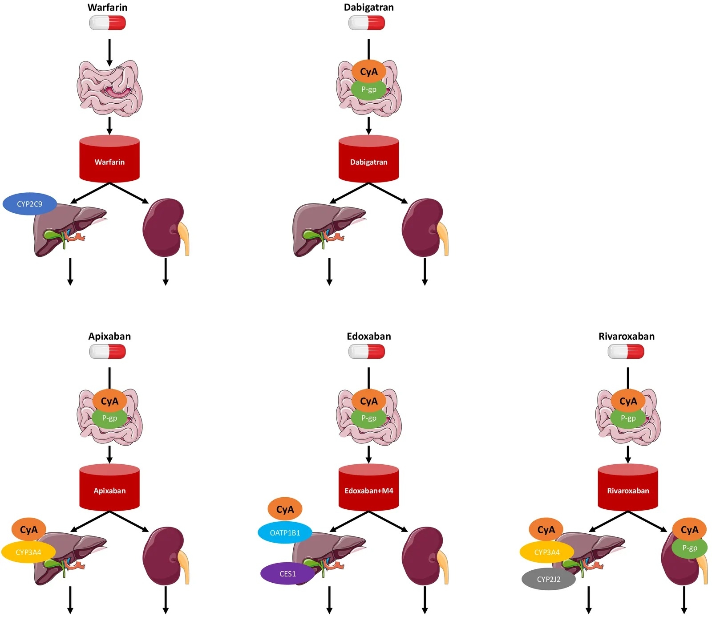
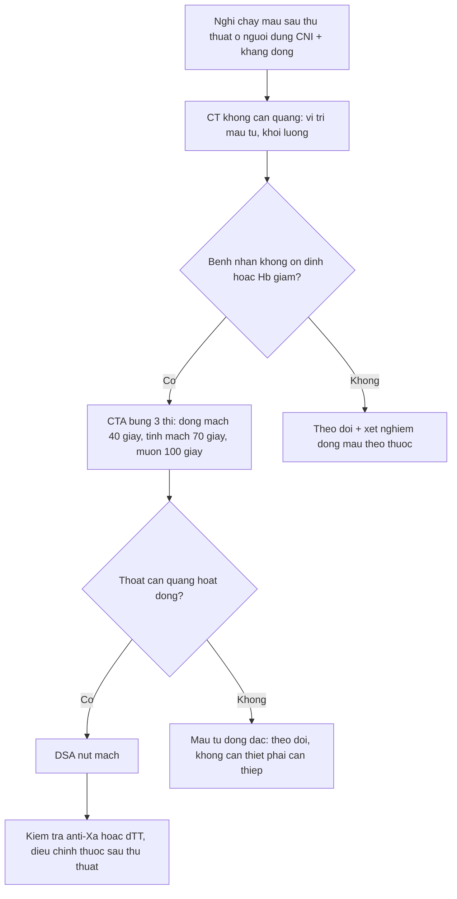
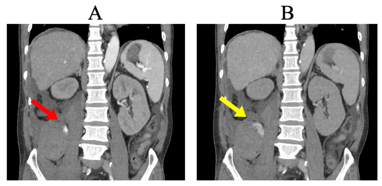
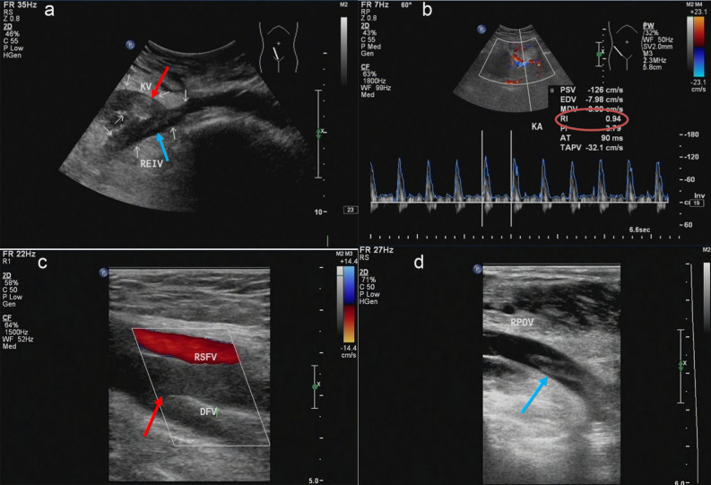

# 118 — Kháng đông đường uống ở người ghép tạng dùng ức chế calcineurin: chọn DOAC hay kháng vitamin K, theo dõi và xử trí quanh thủ thuật hình ảnh

**Tags:** `pattern:huyet-khoi` `pattern:chay-mau` `pattern:tuong-tac-thuoc` `vung:than` `vung:gan` `vung:manh-ghep` `protocol:sieu-am-Doppler` `protocol:CTA-bung` `protocol:anti-Xa` `score:CHADS-VASc`

**Mức chắc chắn (certainty):** tổng hợp y văn (literature synthesis) — tổng quan **tương tác dược động học DOAC–CNI** có bảng liều và số AUC (Biomedicines 2026, PMC13509657); **khuyến cáo thực hành ERBP/ERA–ESOT 2026** về kháng đông ở người nhận ghép thận (Nephrol Dial Transplant 2026, PMC13518092); đoàn hệ **79 bệnh nhân dùng apixaban sau ghép tạng bụng** (Adv Hematol 2026, PMC13504357); **ca chảy máu sau sinh thiết thận** có CT 2 thì và can thiệp nút mạch (Cureus 2025, PMC12076264); **ca huyết khối tĩnh mạch thận ghép** có Doppler + CT + DSA (Sci Rep 2023, PMC10570330). Không có thử nghiệm ngẫu nhiên nào so sánh DOAC với kháng vitamin K riêng ở người ghép tạng.

> **Câu chốt:** Người ghép tạng dùng **ức chế calcineurin (calcineurin inhibitor, CNI)** — tacrolimus, cyclosporine, voclosporin — có **hai lý do cùng lúc** để kháng đông sai: **(1) CNI ức chế P-glycoprotein/CYP3A4 làm tăng nồng độ DOAC**; **(2) CNI gây độc thận và tăng huyết áp làm tăng nguy cơ chảy máu**. Ba câu hỏi trước mọi quyết định: **thuốc nào (P-gp phụ thuộc bao nhiêu)? chức năng thận hiện tại (CrCl)? và lần chụp/can thiệp tới là bao giờ?** Sai lầm hay gặp: **dùng INR để "kiểm tra" DOAC** (vô nghĩa), và **ngừng DOAC mà không có phương án thay thế** — huyết khối mảnh ghép tụy xảy ra tới **35%**.

## 1. Tổng quan bệnh học – cơ chế hình ảnh

### 1.1 Vì sao CNI làm thay đổi nồng độ DOAC

- **Tacrolimus và cyclosporine** đều là **cơ chất của CYP3A4/5 và P-glycoprotein (P-gp)**. Tacrolimus **ức chế CYP3A4 yếu** (ít ý nghĩa lâm sàng) nhưng **cyclosporine ức chế P-gp mạnh hơn** — đây là trục tương tác chính.
- **Niêm mạc ruột là nơi tương tác mạnh nhất** với edoxaban và dabigatran: nồng độ cyclosporine trong lòng ruột **cao hơn nhiều** so với nồng độ trong máu (tính theo liều/250 mL dịch ruột) → **ức chế P-gp tại chỗ** làm tăng hấp thu.
- **Hệ quả kép ở người ghép:** CNI gây **co mạch đến và độc ống thận** → giảm mức lọc cầu thận; nhiều DOAC **thải qua thận** (dabigatran ~**85%**), nên **giảm thanh thải + tăng hấp thu** cùng lúc.

### 1.2 Số liệu dược động học định lượng

| Cặp tương tác | Thay đổi nồng độ (AUC) | Nguồn |
|---|---|---|
| **Apixaban 10 mg + cyclosporine 100 mg** | **GMR 119%** — trong biên an toàn, **không cần chỉnh liều** | PMC13509657 |
| **Apixaban 10 mg + tacrolimus 5 mg** | **GMR 77%** (giảm) — vẫn trong biên | PMC13509657 |
| **Apixaban ở người ghép phổi/thận** (so người không ghép) | **4.312 vs 1.511 ng·h/mL** (cùng tacrolimus); **5.388 vs 2.356 ng·h/mL** (cùng cyclosporine); CLcr nhóm ghép **54 mL/phút** | PMC13509657 |
| **Edoxaban + cyclosporine 500 mg** | Phơi nhiễm **~×2**; **chất chuyển hóa M4: AUC ×6,9** | PMC13509657 |
| **Rivaroxaban 20 mg + cyclosporine (± fluconazole 400 mg)** | **Tăng AUC rõ rệt** do giảm bài tiết ống thận qua P-gp; ở người **ghép gan**: nồng độ đáy **131,7 vs 20,3 ng/mL** (cyclosporine vs tacrolimus, p = 0,014) | PMC13509657 |
| **Dabigatran + cyclosporine** | **Không có nghiên cứu lâm sàng**; **không khuyến cáo ở châu Âu**; mô hình P-gp (verapamil 120 mg) làm **AUC +143%** | PMC13509657 |
| **Warfarin + CNI** | **Ít tương tác dược động học** (chuyển hóa qua CYP2C9, không qua P-gp) | PMC13509657 |

### 1.3 Nguy cơ huyết khối của chính mảnh ghép (bối cảnh quyết định)

- **Huyết khối mảnh ghép:** tụy **10–35%**, gan **2–9%**, thận **0,1–4,2%**; nguy cơ cao nhất trong **6 tháng đầu** (trạng thái tăng đông sau ghép).
- Vì vậy **"ngừng kháng đông cho an toàn"** có thể đánh đổi bằng **mất mảnh ghép** — quyết định phải cá thể hóa theo loại ghép và chỉ số đông máu.

## 2. Mẫu hình + chẩn đoán phân biệt (gamut)

### 2.1 Gamut theo "huyết khối hay chảy máu" trên hình ảnh

- **Huyết khối tĩnh mạch mảnh ghép thận:** siêu âm Doppler là tuyến đầu — **mất phổ tĩnh mạch**, lòng tĩnh mạch **giảm âm không đều (huyết khối)**, **chỉ số trở kháng động mạch (RI) tăng** (ca minh họa **RI 0,94** so với nền); CT có thể thấy **thận ghép to, mật độ vỏ không đều, vùng giảm tưới máu**.
- **Huyết khối động mạch mảnh ghép:** Doppler **mất phổ động mạch**, "parvus–tardus"; CTA là chuẩn xác định vị trí và độ dài.
- **Huyết khối tĩnh mạch cửa / động mạch gan sau ghép gan:** Doppler cửa **PSV thấp, mất pha dao động**; CTA 3 thì.
- **Chảy máu sau sinh thiết/can thiết:** CT **không cản quang** thấy máu tụ; **CTA thì động mạch (40 giây)** thấy **thoát cản quang hoạt động**; **thì muộn (100 giây)** thấy cản quang **tồn tại/lan rộng** — dấu hiệu **đang chảy** (ca PMC12076264: nguồn từ **động mạch thắt lưng phải**, nút mạch thành công).

### 2.2 Gamut theo nguyên nhân "mảnh ghép xấu đi" (để không quy oan cho thuốc)

- **Huyết khối mạch** (trên) · **thải ghép cấp** (thận to, tăng tín hiệu T2 vỏ, RI tăng) · **độc thận do CNI** (RI tăng nhẹ, không huyết khối) · **hẹp miệng nối động mạch** (chênh áp, jet) · **tắc nghẽn niệu quản** (ứ nước, phổ động mạch **RI cao do áp lực ngược**) · **nhiễm trùng mảnh ghép/áp-xe**.
- **Chảy máu do thuốc** không có hình ảnh đặc hiệu — chẩn đoán bằng **vị trí + thì cản quang + diễn tiến**, và bằng **xét nghiệm đông máu phù hợp với từng thuốc**.

## 3. Bảng so sánh phân biệt (ma trận đối chiếu)

| Thực thể (entity) | Hình ảnh/đặc điểm điển hình | Chốt vào (rule-in) | Chốt loại (rule-out) | Gợi ý xác nhận |
|---|---|---|---|---|
| **Warfarin + CNI** | Không phụ thuộc P-gp; hiệu ứng đo bằng **INR** | **Cần theo dõi INR, nhiều tương tác qua CYP2C9** | INR bình thường **không** loại trừ tác dụng của DOAC khác | INR + xem lại danh sách thuốc |
| **Apixaban + CNI** | Tương tác **nhẹ nhất** trong nhóm ức chế Xa; GMR 119% (CsA) / 77% (Tac) | **Ưu tiên khi eGFR thấp**, có kinh nghiệm nhiều nhất ở người ghép | **Vẫn tăng AUC ở người ghép phổi/thận** (4.312 vs 1.511) | Anti-Xa **hiệu chuẩn apixaban** khi cần |
| **Rivaroxaban + CNI** | **Tăng AUC mạnh** khi có cyclosporine (± azole); đáy **131,7 vs 20,3 ng/mL** (CsA vs Tac ở ghép gan) | **Tránh phối hợp cyclosporine + fluconazole** | Liều thấp không "an toàn" nếu chức năng thận giảm | Anti-Xa hiệu chuẩn rivaroxaban |
| **Edoxaban + CNI** | **Phơi nhiễm ×2**, **M4 ×6,9** với cyclosporine | **Giảm liều 30 mg** khi CLcr 30–50, < 60 kg, hoặc dùng P-gp inhibitor | "60 mg là liều chuẩn" **sai** ở nhóm đủ tiêu chí giảm liều | Kiểm tra 3 tiêu chí giảm liều trước kê |
| **Dabigatran + CNI** | **85% thải qua thận**; không có dữ liệu với cyclosporine | **Tránh ở CKD nặng và khi dùng cyclosporine** | Không dùng **dTT** để loại trừ nếu đã quá 24 giờ | **dTT (dilute thrombin time)** định tính |
| **Huyết khối tĩnh mạch mảnh ghép thận** | Lòng TM giảm âm không đều, **mất phổ TM**, **RI 0,94** | **Mất phổ tĩnh mạch + RI tăng + thận to** | RI tăng đơn thuần **không** chốt (gặp cả trong tắc niệu quản) | Doppler lặp + CTA/CTV |
| **Chảy máu hoạt động sau sinh thiết** | **Thoát cản quang** thì động mạch, **tồn tại** thì muộn | **Cản quang ngoài lòng mạch, tăng kích thước giữa 2 thì** | Máu tụ đông đặc **không ngấm** = đã cầm | CTA 2–3 thì; DSA nút mạch |

*Sơ đồ dược động học: warfarin qua CYP2C9 (không qua P-gp) so với dabigatran, apixaban, edoxaban (+M4) và rivaroxaban — các DOAC đều bị **cyclosporine (CyA) ức chế P-gp tại ruột**, riêng apixaban/rivaroxaban thêm **CYP3A4 ở gan**. Nguồn: PMC13509657, CC BY 4.0.*

### 3.1 Chọn thuốc trong 4 tình huống thường gặp

| Tình huống | Lựa chọn hợp lý | Lý do |
|---|---|---|
| Rung nhĩ, eGFR **< 30**, đang dùng tacrolimus | **Apixaban** (liều theo tuổi/cân nặng/creatinine) | Kinh nghiệm nhiều nhất, FDA đã phê duyệt cho GFR < 15 và lọc máu |
| Đang dùng **cyclosporine** + cần kháng đông | **Warfarin** hoặc **apixaban**; **tránh rivaroxaban + azole** | CsA ức chế P-gp mạnh; rivaroxaban tăng AUC rõ khi có thêm fluconazole |
| Huyết khối tĩnh mạch mảnh ghép thận cấp | Kháng đông **toàn thân sớm**; cân nhắc can thiệp lấy huyết khối | Nguy cơ mất mảnh ghép cao; ca PMC10570330 dùng hút huyết khối + nong bóng |
| Chuẩn bị **sinh thiết mảnh ghép** | Hoãn nếu được; nếu cấp thiết, **ngừng theo loại thuốc + kiểm tra anti-Xa/dTT** | Chảy máu nặng sau sinh thiết **0,3–12,6%** |

## 4. Protocol + hệ phân độ

### 4.1 Trước khi khởi trị

- **Xét nghiệm nền:** công thức máu, creatinine/eGFR (đặc biệt người ghép thận), men gan, tiền sử chảy máu (tiêu hóa, nội sọ), cân nặng.
- **TDM tacrolimus/cyclosporine** là bắt buộc — tương tác **hai chiều**: DOAC ít ảnh hưởng CNI, nhưng **thay đổi CNI làm đổi mức ức chế P-gp**.
- **Không dùng INR để theo dõi DOAC**; với warfarin, **INR mục tiêu 2–3** (van tim cơ học: theo khuyến cáo riêng).

### 4.2 Quanh thủ thuật hình ảnh (theo ERBP 2026 và chuỗi sinh thiết lớn)

| Tình huống | Khuyến cáo | Nguồn |
|---|---|---|
| Ghép thận **hiến sống** chương trình | **Ngừng kháng kết tập tiểu cầu (trừ aspirin) 5 ngày**; **warfarin 5 ngày**, cầu nối khi cần | PMC13518092 |
| **DOAC trước ghép** | **Không khuyến cáo** trừ khi có chuyên gia và có thuốc đảo ngược; thường **chuyển sang warfarin** | PMC13518092 |
| **Sinh thiết mảnh ghép thận** | Chảy máu nặng sau sinh thiết **1,6%** (khoảng **0,3–12,6%**); loạt **> 2.500** ca ngừng kháng đông/kháng kết tập **7 ngày** | PMC13518092 |
| **Apixaban ở thời điểm ghép** | Mất máu **100–1.600 mL**, có ca tổn thương mạch máu lớn cần mổ lại → **tránh dùng ngay lúc ghép** | PMC13518092 |
| **Can thiệp ít xâm lấn (chọc hút/dẫn lưu)** | Cá thể hóa theo CrCl và thuốc; **không có ngưỡng chung** — quyết định theo khoa can thiệp | tổng hợp |

### 4.3 Protocol hình ảnh khi nghi chảy máu

### 4.4 Theo dõi hiệu quả và an toàn

| Thuốc | Xét nghiệm phù hợp | Lưu ý |
|---|---|---|
| Apixaban / rivaroxaban | **Anti-Xa hiệu chuẩn theo từng thuốc** | Không dùng chung ngưỡng với heparin; chỉ định khi cấp cứu/chảy máu |
| Edoxaban | Anti-Xa hiệu chuẩn edoxaban | Kiểm tra **3 tiêu chí giảm liều** trước kê |
| Dabigatran | **dTT** (định tính), aPTT chỉ định hướng | **85% thải qua thận** → theo dõi CrCl |
| Warfarin | **INR** | Tương tác qua CYP2C9, nhiều thuốc |

## 5. Biến thể bình thường và cạm bẫy

- **INR bình thường không loại trừ tác dụng DOAC** — INR chỉ nhạy với warfarin; dùng INR để "kiểm tra apixaban" là **bẫy chết người** trước khi chọc mạch lớn.
- **Anti-Xa không dùng lẫn**: mỗi thuốc cần **hiệu chuẩn riêng**; kết quả "bình thường" theo hiệu chuẩn heparin **không** nói gì về apixaban.
- **Phù do hội chứng thận nhiễm mỡ làm giảm AUC toàn phần nhưng KHÔNG đổi AUC dạng tự do** → không chỉnh liều theo mức phù; ngược lại, **giảm albumin** có thể làm tăng phần thuốc tự do.
- **Tacrolimus "an toàn hơn" không có nghĩa là không cần theo dõi**: ức chế P-gp yếu hơn nhưng vẫn **bắt buộc TDM** vì tương tác qua CYP3A4 và độc thận.
- **RI tăng đơn thuần không chốt huyết khối tĩnh mạch** — phải thấy **mất phổ tĩnh mạch**; tắc niệu quản, thải ghép, chèn ép cũng làm RI tăng.
- **Ngừng kháng đông "cho chắc" trước thủ thuật nhỏ** có thể gây **huyết khối mảnh ghép tụy (10–35%)** — luôn có kế hoạch thay thế và thời điểm dùng lại.
- **Giai đoạn quanh ghép:** apixaban dùng sát lúc ghép gây **mất máu 100–1.600 mL** và can thiệp lại — không phải "DOAC nào cũng tiện".

## 6. Tự lượng giá — Blind Quiz

**Ca 1 — Nam 56 tuổi, ghép thận 3 tuần, đang dùng tacrolimus + apixaban vì huyết khối tĩnh mạch sâu; đau hông lưng đột ngột, Hb giảm 2 g/dL.**

- Câu hỏi: Dấu hiệu nào chứng minh đang chảy máu? Vì sao phải chụp **hai thì**? Bước tiếp theo?

<b>Bấm để hiện đáp án (findings + chẩn đoán)</b>

- **Findings:** (A) thì động mạch 40 giây: **thoát cản quang** từ **động mạch thắt lưng phải** (mũi tên đỏ); (B) thì muộn 100 giây: cản quang **tồn tại và lan rộng** trong khoang sau phúc mạc (mũi tên vàng).
- **Chẩn đoán:** **chảy máu sau phúc mạc hoạt động** sau sinh thiết thận — không phải máu tụ đông đặc.
- **Vì sao:** máu tụ đông đặc **không ngấm** và **không tăng giữa 2 thì**; cản quang tồn tại ở thì muộn = **dòng chảy đang tiếp diễn** → cần **DSA nút mạch** (ca gốc đã nút thành công).
- **Nguồn ảnh:** Isa K et al, *Cureus* 2025, Fig. 2 — PMC12076264, CC BY 4.0.

**Ca 2 — Nữ 47 tuổi, ghép thận 5 ngày, thiểu niệu, creatinin tăng; siêu âm Doppler mảnh ghép.**

- Câu hỏi: Phổ Doppler bất thường ở đâu? RI 0,94 nói lên điều gì? Cần làm gì tiếp?

<b>Bấm để hiện đáp án (findings + chẩn đoán)</b>

- **Findings:** (a) tĩnh mạch thận ghép **giãn, lòng giảm âm không đều** (huyết khối, mũi tên đỏ) lan ra tĩnh mạch chậu ngoài; (b) **không có phổ tĩnh mạch**, động mạch thận **RI 0,94** (cao hơn nền).
- **Chẩn đoán:** **huyết khối tĩnh mạch mảnh ghép thận** — RI cao là hệ quả của **ứ máu**, không phải nguyên nhân.
- **Vì sao:** mất phổ tĩnh mạch là dấu hiệu **quyết định**; RI đơn thuần **không đặc hiệu** (tắc niệu quản, thải ghép cũng tăng).
- **Xử trí:** kháng đông/can thiệp lấy huyết khối sớm (ca gốc hút huyết khối + nong bóng) để cứu mảnh ghép.
- **Nguồn ảnh:** Wu SJ et al, *Sci Rep* 2023, Fig. 1 — PMC10570330, CC BY 4.0.

**Ca 3 — Nam 63 tuổi, ghép tim–thận, rung nhĩ; đang dùng cyclosporine. Bác sĩ hỏi: "Kê rivaroxaban 20 mg được không?"**

- Câu hỏi: Vì sao rivaroxaban là lựa chọn **kém** ở ca này? Nếu buộc phải dùng, cần kiểm tra gì?

<b>Bấm để hiện đáp án (findings + chẩn đoán)</b>

- **Trả lời:** rivaroxaban bị **ức chế P-gp tại ruột/thận + CYP3A4 ở gan**; khi phối hợp **cyclosporine** (và càng nặng nếu thêm **fluconazole**) → **AUC tăng mạnh**; việc phối hợp **ức chế đồng thời P-gp và CYP3A4** làm phơi nhiễm tăng mạnh và **nên tránh**.
- **Nếu buộc phải dùng:** kiểm tra **CrCl**, cân nhắc **apixaban** (kinh nghiệm ghép nhiều nhất) hoặc **warfarin**; theo dõi anti-Xa hiệu chuẩn rivaroxaban nếu có.
- **Vì sao:** đây là tương tác **dược động học**, không phải "dị ứng thuốc" — đổi liều không bù được việc mất kiểm soát nồng độ.
- **Nguồn ảnh:** Hirai T & Katayama K, *Biomedicines* 2026, Fig. 2 — PMC13509657, CC BY 4.0.

## Bài liên quan chéo

- [100 – Tổng quan hệ Bụng](../100-tong-quan-he-bung/lesson.md)
- [117 – Tương tác thuốc & theo dõi tacrolimus](../117-tuong-tac-thuoc-va-theo-doi-tacrolimus/lesson.md) — trục **P-gp/CYP3A4** của tacrolimus
- [116 – Nhiễm trùng nang gan ở người ghép thận](../116-nhiem-trung-nang-gan-ghep-than/lesson.md)
- [133 – Hẹp miệng nối & cholangiopathy thiếu máu sau ghép gan](../133-hep-mieng-noi-duong-mat-sau-ghep/lesson.md)
- [3011 – Biến chứng niệu quản sau ghép thận](../3011-bien-chung-nieu-quan-sau-ghep-than/lesson.md)
- [172 – Theo dõi & biến chứng sau can thiệp bóc tách ĐMC bụng](../172-theo-doi-sau-can-thiep-boc-tach-dmc-bung/lesson.md)

> Không dùng để chẩn đoán độc lập khi chưa có người hướng dẫn.
