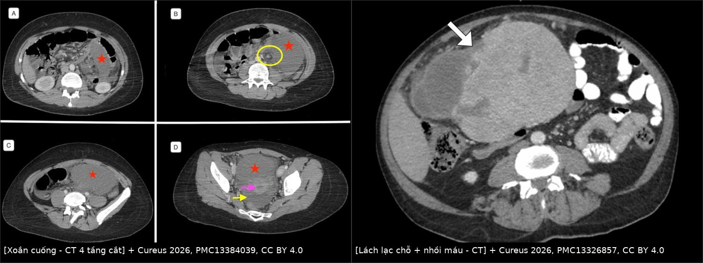
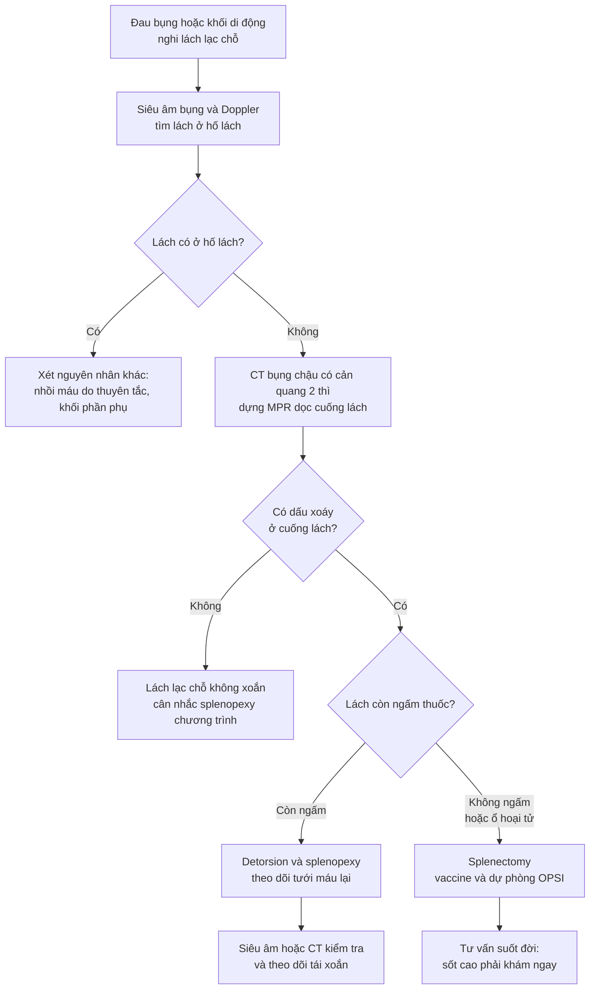
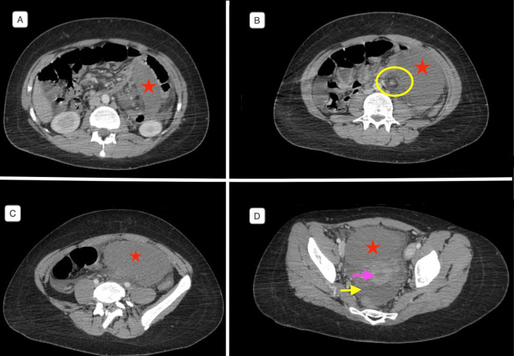
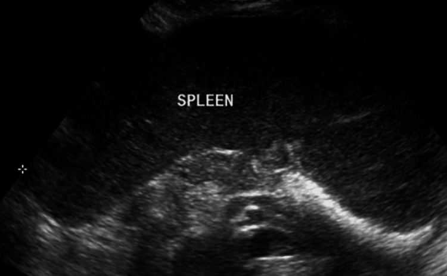
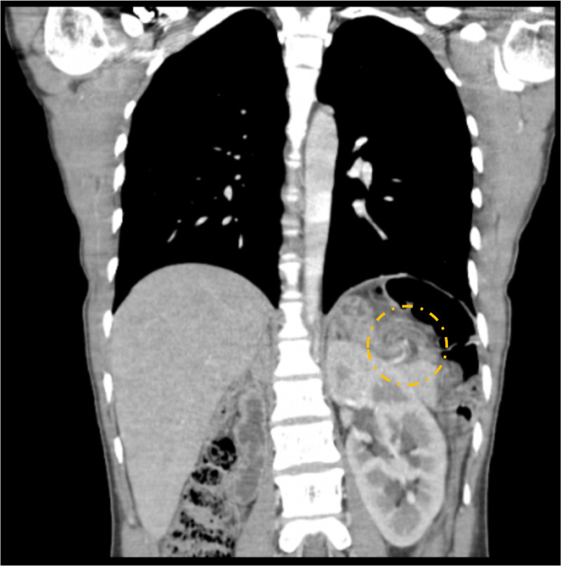

# 119 — Lách lạc chỗ & xoắn lách: "hố lách trống + khối di động + dấu xoáy" / Wandering spleen & splenic volvulus

**Tags:** `pattern:lach-lac-cho` `pattern:xoan-cuong` `pattern:nhoi-mau-tang` `vung:lach` `protocol:CT-bung-da-thi` `protocol:Doppler-sieu-am`
**Mức chắc chắn (certainty):** tổng hợp y văn (literature synthesis) — số liệu lấy nguyên từ 2 ca nguyên văn có ảnh (Cureus 2026, PMC13384039; Cureus 2026, PMC13326857), 1 ca X-quang–CT có ảnh (Radiol Case Rep 2026, PMC13084344), 1 ca nhi 10 tuổi kèm tổng quan y văn (Case Rep Pediatr 2025, PMC12349995) và 2 bài review ca (Am J Case Rep 2020, PMC7483514; Radiol Case Rep 2025, PMC11847500).

> **Câu hỏi gốc của bài:** bệnh nhân **đau bụng tái diễn hoặc đau bụng cấp**, khám có **khối di động**; trên siêu âm/CT **không thấy lách ở hố lách** và có một khối giống lách ở **bụng giữa – tiểu khung** kèm **dấu xoáy (whirl sign)** ở cuống mạch. Đây là **lách lạc chỗ bị xoắn** — và câu quyết định là **còn cứu được lách hay không**, vì **cứu lách (splenopexy)** khác hoàn toàn **cắt lách (splenectomy)** về hệ quả lâu dài.
> **Điểm tựa giải phẫu:** lách được giữ trong hố lách bởi **4 dây chằng** (vị–lách, lách–thận, lách–đại tràng, lách–hoành). Thiếu/hão các dây chằng này → lách chỉ còn **treo trên cuống mạch** → di chuyển khắp ổ bụng và **xoắn cuống quanh trục dọc**.

## 1. Tổng quan bệnh học – cơ chế hình ảnh

**A. Vì sao lách "đi lang thang":**
- **Bẩm sinh:** **mô lưng (dorsal mesogastrium) không dung hợp** với thành bụng sau trong thời kỳ phôi thai → thiếu dây chằng lách–thận/lách–hoành/lách–đại tràng; ca PMC13084344 mô tả **tất cả dây chằng đều mất, chỉ còn dây chằng vị–lách**.
- **Mắc phải:** lách to (lymphoma, sốt rét, bệnh tăng sinh tủy), **đa thai/thành bụng nhão**, phẫu thuật ổ bụng trước, thay đổi nội tiết (thai kỳ), dị tật cơ hoành.
- **Dịch tễ – ngưỡng định lượng nằm lòng:**
  - Chiếm **< 0,2% các ca cắt lách**; tỷ lệ mắc ước tính **< 0,02%**; từ năm 1667 ghi nhận **< 600 ca** trong y văn (PMC13084344, PMC13384039).
  - **Phân bố hai đỉnh:** trẻ **< 10 tuổi** chiếm tới **1/3** tổng số ca, tỷ lệ **nam:nữ ≈ 1:1**; đỉnh thứ hai **20–40 tuổi** với **70–80% là nữ**, tỷ lệ **nữ:nam tới 20:1** (PMC7483514, PMC11847500).
- **Vì sao xoắn lại gây nhồi máu — thứ tự mạch máu quyết định hình ảnh:**
  1. **Tĩnh mạch lách thành mỏng, áp lực thấp** → bị chèn trước → **ứ máu, lách to nhanh, phù nhu mô**.
  2. **Động mạch lách thành dày, áp lực cao** → còn thông lâu hơn → giai đoạn đầu lách **vẫn ngấm thuốc nhưng chậm/không đều**, tĩnh mạch **không đọng thuốc**.
  3. Xoắn kéo dài/hoàn toàn → **mất tưới máu toàn bộ** → **nhồi máu, hoại tử, có thể vỡ**.
  - Ca PMC13084344 ghi đúng hiện tượng này: thì tĩnh mạch cửa **động mạch lách vẫn ngấm (ĐK 2,5 mm)** trong khi **các tĩnh mạch dẫn lách KHÔNG đọng thuốc**, tĩnh mạch lách đoạn trước chỗ xoắn còn cản quang bình thường.
- **Hệ quả không chỉ ở lách:** cuống xoắn kéo theo **đuôi tụy** (viêm tụy do xoắn), **dạ dày** (xoắn dạ dày đồng thời), **tĩnh mạch lách** (huyết khối → giãn tĩnh mạch dạ dày, xem bài 146).

**B. Vì sao hình ảnh trông như vậy (vật lý + giải phẫu):**
- **"Hố lách trống"** là dấu đầu tiên: trên mọi mặt cắt ngang qua vòm hoành – thượng vị **không có cấu trúc đậm độ mô mềm hình lách** ở vị trí giải phẫu.
- **Giảm đậm độ khi nhồi máu:** mô hoại tử **không còn tưới máu → không có iod** trong nhu mô. Định lượng: thì tĩnh mạch cửa, **lách 49 HU (24–64 HU)** so với **gan 92 HU (73–113 HU)** (PMC13084344); khi hoại tử hóa lỏng, ổ dịch có thể xuống **~13 HU** (bài 146, ca nhồi máu gần toàn bộ).
- **Dấu xoáy (whirl/whirlpool sign):** trên mặt cắt **vuông góc với trục xoắn**, các mạch máu và mỡ mạc treo cuống lách **cuộn thành hình xoáy ốc** — dấu **đặc hiệu nhất** của xoắn cuống; trên mặt cắt **song song trục**, mạch máu hiện như **"cột tháp sọc" (barber-pole)**.
- **Kích thước:** lách lạc chỗ thường **to hơn bình thường** do ứ máu mạn; ca nguyên văn ghi **16 × 5 cm** (PMC13084344) và **24 cm trục dọc, chạm tiểu khung** (PMC13384039).
- **Mức xoắn:** y văn ghi từ **180° đến 1800°** (PMC11847500 dẫn ca xoắn 1800°); **mức xoắn không tương quan tuyến tính với mức nhồi máu** — thời gian xoắn quan trọng hơn.

## 2. Mẫu hình + chẩn đoán phân biệt theo vị trí (Gamut)

**A. "Hố lách trống" (empty splenic fossa) — gamut theo nguyên nhân:**
- **Lách lạc chỗ (wandering spleen):** lách hiện ở bụng giữa/tiểu khung, **to, cuống dài**, có/không xoắn — chẩn đoán hay bị bỏ sót nhất.
- **Đã cắt lách:** hỏi tiền sử + tìm **mô lách lạc (splenosis)** hoặc **lách phụ phì đại**.
- **Tự cắt lách (autosplenectomy)** trong **hồng cầu hình liềm**: lách **teo nhỏ, vôi hóa**, không phải mất hẳn.
- **Đa lách (polysplenia) / dị tạng:** nhiều khối lách nhỏ **cùng bên phải dạ dày**, kèm bất thường gan–tim–mạch.
- **Đảo phủ tạng (situs inversus):** lách ở **phải**, gan ở trái — kiểm tra trước khi kết luận "mất lách".
- **Bất sản lách bẩm sinh:** hiếm, kèm dị tật tim bẩm sinh (hội chứng Ivemark).

**B. "Khối vùng chậu/bụng dưới" ở nữ — gamut:**
- **Lách lạc chỗ:** đậm độ/ngấm thuốc **giống lách**, có **cuống mạch kéo lên trên** (dấu then chốt).
- **Khối phần phụ (u buồng trứng, nang, xoắn buồng trứng):** cuống riêng, không nối với trục tĩnh mạch lách–cửa.
- **U xơ tử cung sa/nhân xơ:** liên tục với tử cung, không có mô lách.
- **Khối mạc treo/mạc nối, GIST, lymphoma, nang sán:** không có "dấu xoáy" cuống lách, không giải thích hố lách trống.
- **Splenosis (mô lách lạc mắc phải sau vỡ lách):** nhiều nốt nhỏ, **không cuống**, ngấm thuốc như lách.

**C. "Dấu xoáy" (whirl sign) — không chỉ của lách:**
- **Xoắn cuống lách**, **xoắn ruột non/đại tràng**, **tắc quai kín**, **xoắn mạc nối**, **xoắn buồng trứng**, **xoắn dạ dày** — luôn xác định **cơ quan nào nuôi bởi mạch trong ổ xoáy** và **cơ quan nào thiếu tưới máu**.

**D. Ba câu hỏi lọc trước khi kết luận:**
1. **Lách có ở hố lách không?** (nếu không → tìm khối lách lạc, đừng dừng ở "không thấy lách").
2. **Khối đó có cuống mạch nối với trục lách–cửa không?** (có → lách lạc chỗ).
3. **Có dấu xoáy + giảm/mất ngấm thuốc không?** (có → xoắn; mức ngấm quyết định **cứu lách hay cắt lách**).

## 3. Bảng so sánh phân biệt (ma trận đối chiếu)

| Thực thể (entity) | Hình ảnh điển hình | Chốt vào (rule-in) | Chốt loại (rule-out) | Gợi ý xác nhận |
|---|---|---|---|---|
| **Lách lạc chỗ + xoắn cấp** | Hố lách trống; lách **to, lệch vị trí**, cuống dài; **dấu xoáy**; ngấm thuốc **giảm/không đều** | **Hố lách trống + khối giống lách + dấu xoáy + cuống nối trục lách–cửa** | **Lách vẫn ở hố lách** → không phải lách lạc chỗ (nghĩ nhồi máu do thuyên tắc, bài 146) | CT bụng–chậu có cản quang 2 thì + MPR; Doppler |
| **Xoắn TỪNG LÚC (intermittent torsion)** | Cơn đau tái diễn; **giữa các cơn CT có thể bình thường**; lách lạc chỗ, cuống dài, tĩnh mạch giãn | **Đau từng cơn + lách lạc chỗ + đổi hướng cuống giữa 2 lần chụp** | **Không thấy lách lạc chỗ** → tìm nguyên nhân đau khác | Chụp **trong cơn đau**; MRI/CT lặp lại; theo dõi |
| **Splenosis** | Nhiều **nốt nhỏ** mô lách rải rác phúc mạc, **không cuống**, ngấm như lách | **Tiền sử vỡ/cắt lách + nhiều nốt ngấm như lách** | **Một khối lớn có cuống mạch** → lách lạc chỗ | Tc-99m HDRBC nếu cần; **không sinh thiết** |
| **Đa lách / lách phụ** | Nhiều khối lách **cùng bên**, kích thước nhỏ–vừa, **vị trí cố định** | **Nhiều khối + bất thường gan/tim/mạch (dị tạng)** | **Một lách to + di động** → lách lạc chỗ | CT có cản quang; siêu âm |
| **Khối phần phụ / xoắn buồng trứng** | Khối tiểu khung, **cuống buồng trứng**, có nang/dịch; **lách vẫn ở hố lách** | **Lách bình thường ở hố lách + khối phần phụ** | **Dấu xoáy cuống lách + hố lách trống** | Siêu âm đầu dò âm đạo; MRI |
| **Xoắn dạ dày / thoát vị hoành** | Dạ dày giãn, mức khí–dịch, **"dạ dày lộn ngược"**; có thể **kèm** lách lạc chỗ | **Dạ dày giãn + mất liên tục cơ hoành** | **Dạ dày bình thường** → không phải | X-quang bụng; CT; **luôn tìm lách lạc chỗ khi có xoắn dạ dày** |
| **Nhồi máu lách do thuyên tắc** | Lách **đúng vị trí**, ổ giảm đậm độ **hình nêm đáy ở vỏ**, nhiều ổ nếu thuyên tắc | **Lách tại chỗ + ổ nêm + nguồn thuyên tắc (rung nhĩ, van tim)** | **Lách lạc chỗ + dấu xoáy** | CT 3 thì; siêu âm tim; xem bài 146 |
| **Chấn thương lách / vỡ lách** | Máu quanh lách, vỡ bao, **máu đông tăng đậm độ**, tụ máu dưới bao | **Tiền sử chấn thương + dịch máu 35–70 HU quanh lách** | **Không chấn thương + cuống xoắn** | CT có cản quang thì tĩnh mạch; xem bài 140 |

*Trái: CT 4 tầng cắt — lách **không ở hố lách**, nằm thấp trong bụng, **to 24 cm chạm tiểu khung**, ngấm thuốc kém, **dấu xoáy (vòng vàng)** ở cuống mạch. Phải: CT thì tĩnh mạch cửa — lách lạc chỗ trong tiểu khung, **ổ giảm đậm độ hình nang ở cực trên (mũi tên) = ổ nhồi máu**. Cùng hình thái lách lạc chỗ, khác mức độ thiếu máu. Nguồn: Cureus 2026, PMC13384039 Fig. 2 và PMC13326857 Fig. 2, CC BY 4.0; ảnh ghép letterbox.*

### Đọc chuẩn xác: "còn cứu được" hay "đã nhồi máu"
- **Còn cứu (viable):** lách **còn ngấm thuốc** (dù không đều), **không có ổ giảm đậm độ rõ**, không khí trong nhu mô, bệnh nhân đau **từng cơn** → mục tiêu **detorsion + splenopexy**.
- **Không cứu (non-viable/infarcted):** **không ngấm thuốc toàn bộ**, **ổ hoại tử/dịch hóa**, **khí trong nhu mô**, đau liên tục nhiều ngày → **cắt lách**, vì gỡ xoắn trên lách hoại tử có nguy cơ **giải phóng cytokin, tăng K⁺, huyết khối và vỡ muộn** (PMC12349995).
- **Đo được — nên đo:** **kích thước lách 3 chiều**, **HU lách/HU gan thì tĩnh mạch cửa**, **số vòng xoắn/độ xoắn**, **chiều dài cuống**, **tình trạng tĩnh mạch lách (có huyết khối?)**, **đuôi tụy**, **dạ dày**.

## 4. Protocol chụp + tiêu chuẩn cứu lách

**Protocol hình ảnh:**
- **Siêu âm bụng + Doppler màu** đầu tay (trẻ em, thai phụ, cấp cứu): xác nhận **hố lách trống** + khối lách lạc chỗ; Doppler đánh giá **dòng chảy cuống** — nhưng **hạn chế bởi hơi/béo/đau**, và ca PMC13326857 ghi nhận dòng **thay đổi, giảm từng lúc**, không loại trừ xoắn.
- **CT bụng–chậu có cản quang, 2 thì** (động mạch **25–35 giây**, tĩnh mạch cửa **60–70 giây**), lát **1–2 mm**, **dựng MPR coronal/sagittal dọc cuống lách** — đây là chuẩn chẩn đoán (hố lách trống, vị trí lách, dấu xoáy, mức ngấm thuốc).
- **Đo và ghi:** HU lách/HU gan, kích thước, dấu xoáy, tĩnh mạch lách, đuôi tụy, dạ dày, dịch ổ bụng.
- **Chụp lặp lại trong cơn đau** nếu lần đầu bình thường mà vẫn nghi **xoắn từng lúc**.
- **Không cần** thuốc cản quang đường uống; **không chọc hút/sinh thiết** khối nghi lách lạc chỗ (nguy cơ chảy máu, gieo rắc nếu nhầm ung thư).

**Tiêu chuẩn quyết định (theo mức sống của lách):**

| Tình huống | Bằng chứng hình ảnh | Xử trí |
|---|---|---|
| Lách lạc chỗ **không xoắn**, không triệu chứng | Lách di động, ngấm thuốc bình thường | **Splenopexy** chương trình (nếu nguy cơ xoắn cao: cuống dài, nữ tuổi sinh sản, thai kỳ) hoặc theo dõi chọn lọc |
| **Xoắn từng lúc**, lách còn sống | Cơn đau + dấu xoáy khi đau, ngấm thuốc còn | **Detorsion + splenopexy** (nội soi được) |
| **Xoắn hoàn toàn, lách còn ngấm thuốc** | Xoáy cuống, tĩnh mạch không đọng, nhu mô còn ngấm | **Detorsion + splenopexy** trong thời gian ngắn; theo dõi |
| **Nhồi máu / hoại tử** | **Không ngấm thuốc**, ổ dịch hóa, khí trong nhu mô | **Splenectomy** + vaccine phế cầu/não mô cầu/Hib, kháng sinh dự phòng, tư vấn suốt đời |
| **Vỡ lách / chảy máu** | Máu ổ bụng 35–70 HU, tụt HA | **Mổ cấp cứu** |

## 5. Biến thể bình thường và cạm bẫy

- **"Không thấy lách" ≠ "đã cắt lách":** luôn quét **toàn bộ bụng–chậu** trước khi kết luận; lách lạc chỗ hay nằm **sát bàng quang/tử cung**, dễ bị đọc thành khối phần phụ.
- **Xoắn từng lúc — phim giữa cơn có thể bình thường:** ca PMC13326857 có nhiều đợt đau, giữa các đợt hình ảnh **không điển hình**; nếu chỉ chụp lúc hết đau sẽ **âm tính giả**. Cách xử lý: chụp **trong cơn**, hoặc ghi nhận **cuống dài + lách di động** để đặt chỉ định splenopexy.
- **Siêu âm không loại trừ:** Doppler **giảm dòng từng lúc** do tư thế/đau/hơi; báo cáo phải nêu rõ **hạn chế kỹ thuật**, không ghi "không xoắn".
- **Dấu xoáy không đặc hiệu cho lách:** phải chỉ ra **mạch nào** nằm trong ổ xoáy; xoắn dạ dày/đại tràng/quai kín có dấu xoáy tương tự (bài 160, 162).
- **Lách lạc chỗ + xoắn dạ dày cùng lúc:** do cùng cơ chế **hão dây chằng**; đừng bỏ sót dạ dày giãn/mức khí–dịch sau khi đã "giải thích xong" bằng lách.
- **Viêm tụy do xoắn đuôi tụy:** lipase tăng có thể bị quy cho "viêm tụy tự phát"; trên CT tìm **đuôi tụy xoắn theo cuống**.
- **Thai kỳ:** lách lạc chỗ thường **biểu hiện lần đầu khi mang thai** do giãn dây chằng + tử cung to; chẩn đoán bằng **siêu âm/MRI** (tránh xạ), mổ nội soi **tam cá nguyệt 2** nếu cần.
- **Nhầm "u tiểu khung" và mổ oan:** có ca lách lạc chỗ bị chẩn đoán là **khối tử cung/phần phụ** trước mổ; dấu phân biệt là **hố lách trống** + **cuống mạch**.
- **Sau cắt lách:** nguy cơ **nhiễm trùng tối cấp sau cắt lách (OPSI)** suốt đời — phải ghi vào báo cáo/đơn chuyển tiếp, tiêm vaccine và hướng dẫn **sốt là cấp cứu**.

## 6. Tự lượng giá — Blind Quiz

**Ca 1 — Nữ 16 tuổi, đau bụng tăng dần 5 ngày, sốt 38 °C, bạch cầu 18.200/µL. CT bụng–chậu có cản quang (4 tầng cắt từ trên xuống dưới):**

- Câu hỏi: (1) Lách nằm ở đâu, kích thước? (2) Dấu trong vòng tròn vàng là gì, nghĩa là gì? (3) Còn cứu lách được không, xử trí?

<b>Bấm để hiện đáp án (findings + chẩn đoán)</b>

- **Dấu hiệu:** **hố lách trống** (A); lách nằm thấp ở **bụng trái/bụng giữa** (B), rồi xuống **tiểu khung** (C, D) với **trục dọc ~24 cm**; nhu mô **ngấm thuốc kém**; **dấu xoáy (vòng vàng, B)** của cuống mạch lách.
- **Chẩn đoán:** **lách lạc chỗ bị xoắn cuống lách (splenic torsion)** — dấu xoáy + hố lách trống + lách to giảm ngấm là bộ ba chốt.
- **Xử trí:** lách **không còn khả năng sống** → **cắt lách**; ca gốc hậu phẫu thuận lợi. Bài học: khối "tiểu khung" ở nữ trẻ có thể là **lách**, đừng mổ như khối phần phụ trước khi xem hố lách.
- Nguồn ảnh: Bani Abdel-Rahman GM, Halasah LH. Cureus 2026;18(6):e111195, **PMC13384039**, Fig. 2, CC BY 4.0.

**Ca 2 — Người trẻ, đau bụng trái **tái diễn nhiều tháng**, mỗi cơn tự hết; giữa các cơn xét nghiệm gần bình thường. Siêu âm bụng dưới:**

- Câu hỏi: (1) Vì sao siêu âm hố lách trống mà vẫn thấy "lách"? (2) Cần chụp gì tiếp và tìm dấu nào? (3) Vì sao **không** cắt lách ở ca này?

<b>Bấm để hiện đáp án</b>

- **Dấu hiệu:** siêu âm **không thấy lách ở hố lách trái**, thay vào đó là **khối mô đều, âm vang giống lách ở bụng dưới/tiểu khung** — hình dưới ghi rõ "SPLEEN".
- **Bước tiếp:** **CT bụng–chậu có cản quang** → lách lạc chỗ trong tiểu khung, **cuống dài, dấu xoáy khi có cơn**, tĩnh mạch ứ nhưng **động mạch còn thông** = **xoắn từng lúc**.
- **Vì sao không cắt lách:** lách **còn sống**, cơn đau **hồi phục giữa các đợt** → mục tiêu là **giữ lách**: detorsion + **splenopexy**; cắt lách chỉ khi nhồi máu/hoại tử.
- Nguồn ảnh: Altaif Z, Altaif M. Cureus 2026;18(6):e110126, **PMC13326857**, Fig. 1, CC BY 4.0.

**Ca 3 — Nữ 27 tuổi, đau hạ sườn trái lan vai trái 5 ngày, CRP 121 mg/L, LDH 626 U/L. CT thì tĩnh mạch cửa, mặt cắt coronal:**

- Câu hỏi: (1) Cấu trúc trong vòng đứt nét? (2) Vì sao lách giảm đậm độ? (3) Dấu nào cho biết **tĩnh mạch bị chèn trước động mạch**?

<b>Bấm để hiện đáp án</b>

- **Dấu hiệu:** **"whirlpool" của cuống lách xoắn theo chiều kim đồng hồ (vòng đứt nét vàng)**; lách **16 × 5 cm**, **đậm độ trung bình 49 HU (24–64)** so với gan **92 HU (73–113)**.
- **Vì sao giảm đậm độ:** nhu mô **mất tưới máu** do xoắn → **không có iod** trong mô; giảm đậm độ lan tỏa là dấu **nhồi máu**.
- **Tĩnh mạch bị chèn trước:** **động mạch lách vẫn ngấm (ĐK 2,5 mm)** nhưng **các tĩnh mạch dẫn lách không đọng thuốc**; tĩnh mạch lách đoạn gần chỗ xoắn vẫn cản quang — đúng sinh lý "tắc tĩnh mạch trước, tắc động mạch sau".
- **Xử trí ca gốc:** mở bụng xác nhận xoắn + nhồi máu → **cắt lách**, hậu phẫu thuận lợi, ra viện ngày 5.
- Nguồn ảnh: Alfakhry A, Ghosen A, Hariri AA. Radiol Case Rep 2026;21(6):2643–2647, **PMC13084344**, Fig. 3, **CC BY-NC-ND 4.0 (nguyên bản, không chỉnh sửa)**. Số liệu HU và kích thước lấy từ cùng bài.

> **Phản biện (critique):** cả ba ca đều là **báo cáo ca đơn lẻ**, không có đoàn hệ; tỷ lệ "70–80% nữ 20–40 tuổi" và "nam:nữ 1:1 ở trẻ" đến từ **tổng quan y văn** (PMC7483514, PMC11847500) chứ không từ dữ liệu tiến cứu. Ngưỡng **49 HU** là của **một ca** — dùng để minh họa **hướng thay đổi**, không phải cut-off chẩn đoán; bối cảnh (hố lách trống + dấu xoáy + mất ngấm) mới là chốt. Chỉ định **splenopexy** dựa trên mức sống của lách và nguyện vọng/nguy cơ của bệnh nhân, không có thử nghiệm ngẫu nhiên so sánh với cắt lách.

## Bài liên quan chéo
- [100 – Tổng quan hệ Bụng](../100-tong-quan-he-bung/lesson.md)
- [110 – Giải phẫu bụng cắt lớp](../110-giai-phau-bung/lesson.md)
- [140 – Lách & chấn thương tạng](../140-lach-tang-dac/lesson.md)
- [146 – Huyết khối tĩnh mạch lách & nhồi máu lách](../146-huyet-khoi-tm-lach-va-nhoi-mau-lach/lesson.md) (nhồi máu do thuyên tắc, tăng áp cửa bên trái)
- [149 – Tăng áp cửa không do xơ gan](../149-tang-ap-cua-khong-xo-gan/lesson.md)
- [160 – Bụng cấp GI](../160-bung-cap-GI/lesson.md) (dấu xoáy, tắc quai kín)
- [162 – Tắc ruột & mạc treo](../162-tac-ruot/lesson.md)
- [181 – BRTO cho giãn tĩnh mạch dạ dày](../181-brto-thuyen-tac-nguoc-tm-than-trai-gian-tm-da-day/lesson.md)

> Không dùng để chẩn đoán độc lập khi chưa có người hướng dẫn.
