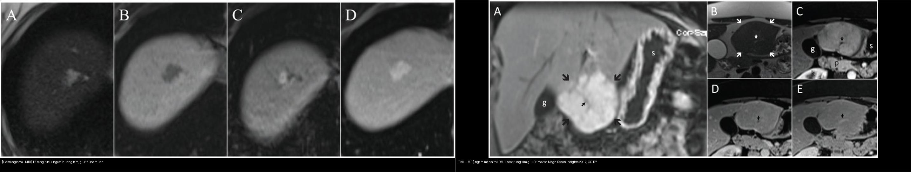
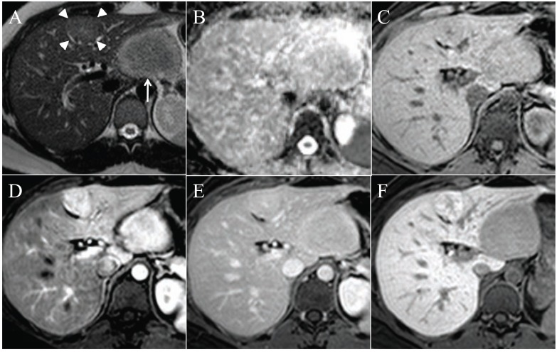
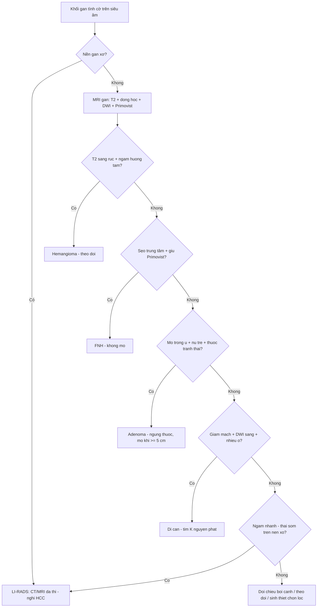
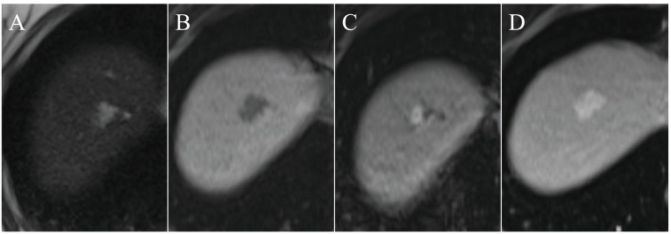
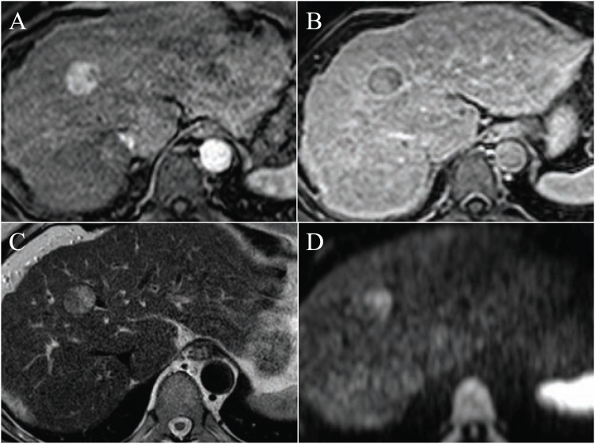

# 120 — Khối gan nền lành vs xơ: động học bắt thuốc & u lành hay gặp / Focal liver lesions

**Tags:** `pattern:khoi-gan` `vung:gan` `protocol:MRI-gan-Primovist` `score:LI-RADS`
**Mức chắc chắn (certainty):** tổng hợp y văn (literature synthesis) — tự biên từ y văn mở (Albiin 2012 CC BY; Kaltenbach 2016 CC BY), chưa gắn ca nguyên văn đơn lẻ.

## 1. Tổng quan — nền gan quyết định "xác suất trước kiểm", động học quyết định tên gọi

- **Nền xơ/viêm gan B–C (cirrhosis):** nốt mới = **HCC đến khi chứng minh ngược lại** (áp dụng **LI-RADS** — bài 121). Nền lành: ác tính hiếm — chủ yếu u lành + nang + áp-xe (trừ khi có ung thư nguyên phát nơi khác → di căn).
- **Tần suất u lành gặp tình cờ** (siêu âm 45.319 BN — Kaltenbach 2016, CC BY): có ≥ 1 tổn thương **15,1%**; hay gặp nhất là **mỡ chừa khu trú (focal fatty sparing) 6,3%**, **nang đơn thuần 5,8%**, **hemangioma 3,3%**; còn **FNH 0,2%** và **adenoma 0,04%** — nghĩa là **FNH/adenoma hiếm khi tình cờ**.
- **TẠI SAO cùng một nốt lại khác kết luận theo nền:** nốt ngấm mạnh thì động mạch (arterial hyperenhancement) ở gan xơ = **LR-4/5 (HCC)**; ở gan lành + nữ trẻ + chảy máu = **adenoma**. Bối cảnh nền đổi hẳn giá trị tiên đoán của một dấu hiệu.
- **Vật lý cốt lõi — học thuyết động học bắt thuốc (enhancement kinetics):** gan cấp máu kép (**~75% tĩnh mạch cửa, ~25% động mạch gan**). U ác/HCC lấy máu động mạch nên **ngấm sớm thì ĐM (APHE) rồi thải (washout) thì cửa/muộn**; u lành giữ mô gan hoặc ngấm theo **bể máu** (hemangioma). Trên MRI, thêm **T2** (nước tự do/nang/hemangioma sáng rực) và **khuếch tán (DWI/ADC)** (tế bào đặc → tối DWI) để định hướng.

## 2. Gamut theo nền + động học + tín hiệu (Gamut)

- **Nền xơ + APHE + washout (± vỏ bao, tăng LDH/AFP):** **HCC** (LR-5) hoặc **di căn**; cholangiocarcinoma trong gan (T2 sáng, đường mật giãn quanh).
- **Nền lành + T2 sáng rực + ngấm nốt ngoại vi hướng tâm:** **hemangioma** (u lành hay gặp nhất sau nang/mỡ chừa).
- **Nền lành + sẹo trung tâm T2 sáng + ngấm mạnh thì ĐM rồi đồng tín hiệu + GIỮ thuốc thì gan–mật:** **FNH** (nữ trẻ, không vỡ, không ung thư hóa).
- **Nền lành + nữ trẻ + thuốc tránh thai + mỡ trong u/tăng tín hiệu T1 + chảy máu:** **adenoma** (nguy cơ vỡ; ngừng thuốc, cân nhắc mổ khi lớn).
- **Nang/bờ tròn nước + đuôi tăng âm trên siêu âm, không ngấm:** **nang gan đơn thuần** (theo dõi).
- **Sốt + viền ngấm + "bia bắn đôi" ± khí trong u:** **áp-xe gan** (Klebsiella + đái tháo đường).

## 3. Bảng so sánh phân biệt (ma trận đối chiếu)

| Thực thể (entity) | Hình ảnh điển hình (US/CT/MRI theo thì) | Chốt vào (rule-in) | Chốt loại (rule-out) | Gợi ý xác nhận |
|---|---|---|---|---|
| Hemangioma | **T2 sáng rực "bóng đèn"**, T1 tối; ngấm **nốt ngoại vi hướng tâm**, đầy dần thì muộn | **T2 rất sáng + ngấm hướng tâm + giữ thuốc muộn** | Ngấm nhanh–thải sớm → nghĩ HCC/di căn | MRI (± CEUS); theo dõi, **mổ khi khổng lồ > 5 cm có triệu chứng** |
| FNH | T2 hơi sáng, **sẹo trung tâm T2 sáng**; ngấm mạnh thì ĐM → đồng tín hiệu, **GIỮ Primovist thì gan–mật** | **Sẹo trung tâm + giữ thuốc gan–mật** | Thải thuốc/washout → loại FNH | MRI **Gd-EOB-DTPA (Primovist)**; không sinh thiết vô ích |
| Adenoma | T1 **mỡ (mất tín hiệu out-of-phase)** ± chảy máu; ngấm thì ĐM, **KHÔNG giữ thuốc gan–mật** | **Mỡ + chảy máu + nữ trẻ/thuốc tránh thai** | Giữ thuốc gan–mật → FNH | MRI; **ngừng thuốc tránh thai; mổ khi ≥ 5 cm/vỡ** |
| HCC | Nền xơ; **APHE + washout** ± vỏ bao, T2 hơi sáng, hạn chế khuếch tán | **LI-RADS LR-5** (bài 121) | Không nền xơ + ngấm hướng tâm → hemangioma | CT/MRI đa thì; **LR-5 đủ để điều trị, không cần sinh thiết** |
| Di căn gan | Thường **giảm mạch**, viền ngấm thì cửa, **hạn chế khuếch tán rõ**, hình "bia" | **Nhiều ổ + K nguyên phát + DWI sáng** | Đơn độc + T2 rất sáng → hemangioma/nang | CT/MRI + PET; tìm nguồn (đại tràng, NET, thận) |
| Nang gan đơn thuần | Đồng tín hiệu nước (T2 rất sáng, **không ngấm**), bờ trơn | **Không ngấm mọi thì** | Có thành/ngấm → nang phức tạp/áp-xe | Siêu âm/MRI; theo dõi |
| Áp-xe gan | Đông đặc/ổ **viền ngấm dày**, có thể khí, "bia bắn đôi" | **Sốt + viền ngấm + khí/ĐTĐ** | Không sốt, không viền → u | CT cản quang; kháng sinh + dẫn lưu |
| THAD/THID (shunt) | **Tăng đậm độ/tín hiệu thì ĐM hình thùy**, **mất thì cửa/muộn** | **Biến mất khi chụp thì muộn** | Tồn tại + thải thuốc → u thật | Nhìn thì muộn là chốt — đừng gọi HCC |

*Trái: hemangioma — T2 sáng rực, ngấm nốt ngoại vi rồi đầy dần hướng tâm, giữ thuốc thì muộn. Phải: FNH — ngấm mạnh thì động mạch + sẹo trung tâm giữ thuốc gan–mật. Nguồn: Albiin N, Curr Med Imaging Rev 2012, Fig. 3 & 4, CC BY. Ảnh ghép letterbox.*

### Bốn cặp "đọc chốt" trong đầu
- **Sáng rực T2 + ngấm hướng tâm** = hemangioma (không phải HCC).
- **Sẹo trung tâm + giữ Primovist** = FNH (không phải adenoma).
- **Mỡ trong u + nữ trẻ + thuốc tránh thai** = adenoma (không phải FNH).
- **APHE + washout trên nền xơ** = HCC (LR-5).

*FNH (đầu mũi tên) và adenoma (mũi tên) đều ngấm thì động mạch (D). Thì gan–mật (F, MultiHance 2 giờ sau tiêm): **FNH TĂNG tín hiệu, adenoma GIẢM tín hiệu** so với gan — chốt phân biệt. Nguồn: Albiin N, Curr Med Imaging Rev 2012, Fig. 5, CC BY.*

## 4. Protocol chụp + hệ điểm chuẩn hóa

- **Siêu âm** đầu tay (phát hiện tình cờ); nghi ngờ → **MRI gan** (không cản quang + đa thì động học).
- **CT 4 thì / MRI động học** (không cản quang, thì ĐM, thì cửa, thì muộn): chuẩn để đọc động học bắt thuốc. **MRI ưu thế hơn** ở u lành (T2, mỡ, sẹo, khuếch tán).
- **MRI chất tương phản gan–mật đặc hiệu (Gd-EOB-DTPA/Primovist, Gd-BOPTA/MultiHance):** thêm **thì gan–mật (hepatobiliary phase, 20 phút–2 giờ)** — **FNH giữ thuốc, adenoma/hầu hết u ác không giữ**; đây là chốt rẻ nhất giữa FNH và adenoma/di căn.
- **Khuếch tán (DWI/ADC):** u lành (hemangioma/nang) **không hạn chế** (ADC cao); u ác đặc (di căn/HCC) **hạn chế khuếch tán** (ADC thấp) — dùng để **phân dạng nốt** và phát hiện di căn nhỏ.
- **Ngưỡng xử trí then chốt:** adenoma **≥ 5 cm** (và một số khuyến cáo mức thấp hơn cho nam/adenoma β-catenin) → **cân nhắc mổ**; hemangioma **> 5 cm** chỉ can thiệp khi có triệu chứng; **FNH không cần theo dõi/mổ**.
- **Quy tắc "dừng":** u lành **điển hình** (hemangioma/FNH/nang) → **dừng, không sinh thiết**; nghi ngờ hoặc nền xơ → theo **LI-RADS** (bài 121).

## 5. Biến thể bình thường và cạm bẫy

- **THAD/THID (transient hepatic attenuation/intensity difference):** vùng tăng đậm độ/tín hiệu thì ĐM do shunt bù — **biến mất thì cửa/muộn**, đừng gọi HCC; chụp lại thì muộn là đủ.
- **Mỡ chừa khu trú (focal fatty sparing):** vùng giảm âm quanh túi mật/rốn gan — thực chất là mỡ chừa giữa vùng gan nhiễm mỡ (**hay gặp nhất 6,3%**); đừng nhầm u giảm âm.
- **Hemangioma "khổng lồ"** có thể có sẹo/hoại tử/ngấm không điển hình — đối chiếu T2 + đặc điểm huyết học (thrombocytopenia trong hội chứng Kasabach–Merritt, hiếm).
- **Adenoma vỡ chảy máu cấp** → cấp cứu nút mạch/mổ, **đừng sinh thiết** (nguy cơ chảy máu/gieo mầm).
- **Di căn tăng sinh mạch** (thận, thần kinh nội tiết) giả HCC ở gan lành — **tìm K nguyên phát** trước khi kết luận u nguyên phát gan.
- **Cạm bẫy mặt cắt:** cùng một khối, tên gọi phụ thuộc **phân thùy/vị trí** — khối ở rốn gan/thùy đuôi dễ nhầm với đường mật/hạch; luôn định vị theo **phân thùy Couinaud** (bài 110).

## 6. Tự lượng giá — Blind Quiz

**Ca 1 — Nữ 40 tuổi, tình cờ khối gan. MRI: tổn thương thùy phải. Mô tả tín hiệu + đặc điểm ngấm thuốc.**

- Hỏi: T2/T1 thế nào? Kiểu ngấm theo thì? Chốt chẩn đoán?

<b>Bấm để hiện đáp án (findings + chẩn đoán)</b>

- Dấu hiệu (findings): **T2 sáng rực (A)**, **T1 tối (B)**; thì động–cửa: **ngấm nốt ngoại vi (C)** rồi **đầy dần vào giữa (D, 5 phút)**.
- Chẩn đoán (diagnosis): **hemangioma** — vì ngấm **nốt ngoại vi hướng tâm, đầy dần và giữ thuốc thì muộn** (giống "bể máu" trong lòng mạch giãn), T2 rất sáng do nhiều nước.
- Xử trí: theo dõi; chỉ can thiệp khi khổng lồ > 5 cm có triệu chứng.
- Nguồn ảnh: Albiin N, Curr Med Imaging Rev 2012, Fig. 3, CC BY.

**Ca 2 — Khối trong gan cùng lúc hai nốt (FNH + adenoma). Nốt nào GIỮ thuốc gan–mật, nốt nào KHÔNG?**

- Hỏi: thì gan–mật (F) phân biệt hai nốt thế nào? Ý nghĩa lâm sàng?

<b>Bấm để hiện đáp án (findings + chẩn đoán)</b>

- Dấu hiệu (findings): hai nốt đều **ngấm thì động mạch (D)**; thì gan–mật (F, MultiHance 2 giờ) — **nốt đầu mũi tên (FNH) TĂNG tín hiệu**, **nốt mũi tên (adenoma) GIẢM tín hiệu** so với gan.
- Chẩn đoán (diagnosis): **FNH giữ thuốc gan–mật** (tế bào gan lành còn chức năng bài tiết) vs **adenoma không giữ** (mất chức năng).
- Ý nghĩa: FNH **không mổ**; adenoma có **nguy cơ vỡ/chảy máu** → ngừng thuốc tránh thai, mổ khi ≥ 5 cm.
- Nguồn ảnh: Albiin N, Curr Med Imaging Rev 2012, Fig. 5, CC BY.

**Ca 3 — Bệnh nhân nền gan xơ (viêm gan B), nốt 15 mm: thì ĐM sáng, thì cửa/muộn tối đi. Nghĩ gì, xử trí?**

- Hỏi: mô tả hiện tượng? Áp dụng hệ nào, có cần sinh thiết không?

<b>Bấm để hiện đáp án (findings + chẩn đoán)</b>

- Dấu hiệu (findings): nốt **tăng tín hiệu thì động mạch (A)** rồi **giảm tín hiệu = thải thuốc (washout) thì cửa (B)**; T2 hơi sáng (C), **DWI sáng (D)**.
- Chẩn đoán (diagnosis): **HCC** — **APHE + washout** trên nền xơ.
- Xử trí: áp dụng **LI-RADS** (bài 121); nốt 10–19 mm + APHE + washout = **LR-5** → **đủ để điều trị, không cần sinh thiết**.
- Nguồn ảnh: Albiin N, Curr Med Imaging Rev 2012, Fig. 6, CC BY.

## Bài liên quan chéo
- [100 – Tổng quan hệ Bụng](../100-tong-quan-he-bung/lesson.md)
- [110 – Giải phẫu bụng](../110-giai-phau-bung/lesson.md) (phân thùy Couinaud)
- [121 – LI-RADS & HCC](../121-khoi-gan-LIRADS/lesson.md) (chuẩn LR-5)
- [122 – U lành & áp-xe gan](../122-u-lanh-gan/lesson.md) (chi tiết từng u)
- [125 – Gan mỡ – xơ](../125-gan-mo-xo/lesson.md) (mỡ chừa khu trú phân biệt u giảm âm)

## Ảnh
- `120_hemangioma_MRI_PMC3462338-CCBY.jpg` (Fig. 3), `120_FNH_MRI_PMC3462338-CCBY.jpg` (Fig. 4), `120_FNH-vs-adenoma_MRI_PMC3462338-CCBY.jpg` (Fig. 5), `120_HCC-washout_MRI_PMC3462338-CCBY.jpg` (Fig. 6), `120_di-can-va-nang_DWI-MRI_PMC3462338-CCBY.jpg` (Fig. 2) — CC BY, Albiin N, Curr Med Imaging Rev 2012 (PMC3462338).
- `composite_hemangioma-vs-FNH.jpg` — ghép từ Fig. 3 & 4 (letterbox, giữ aspect), CC BY.
- Chi tiết giấy phép từng ảnh trong `images/CREDITS.md`.

> Không dùng để chẩn đoán độc lập khi chưa có người hướng dẫn.
