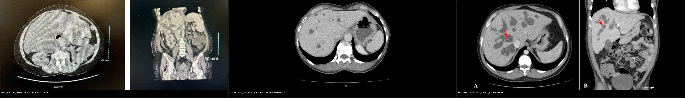
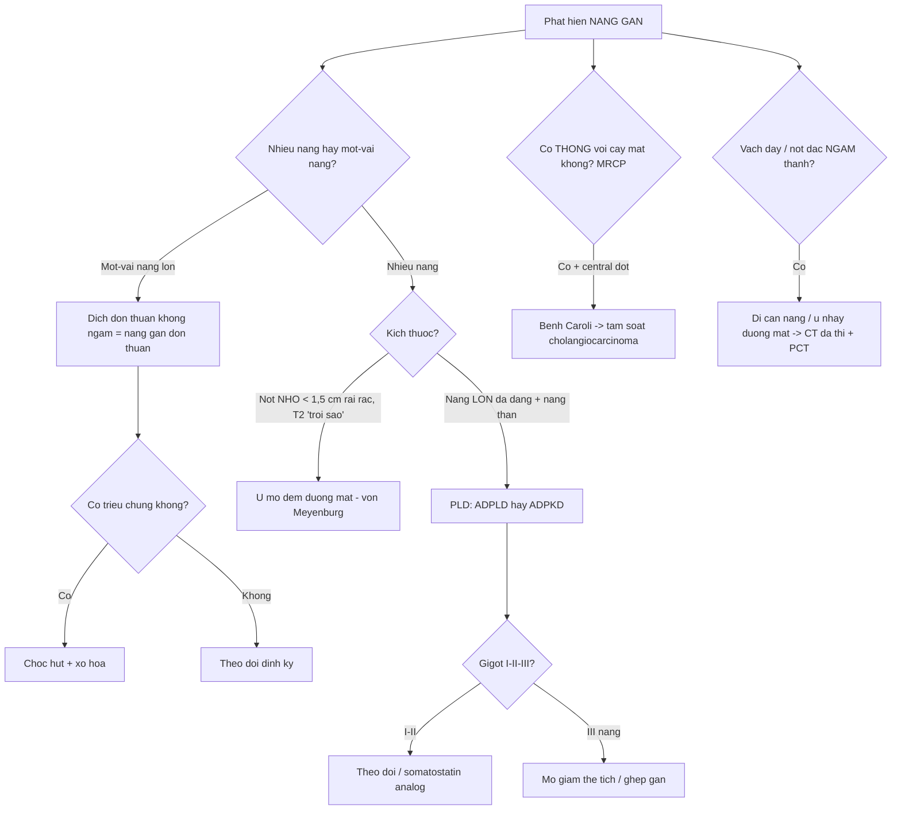
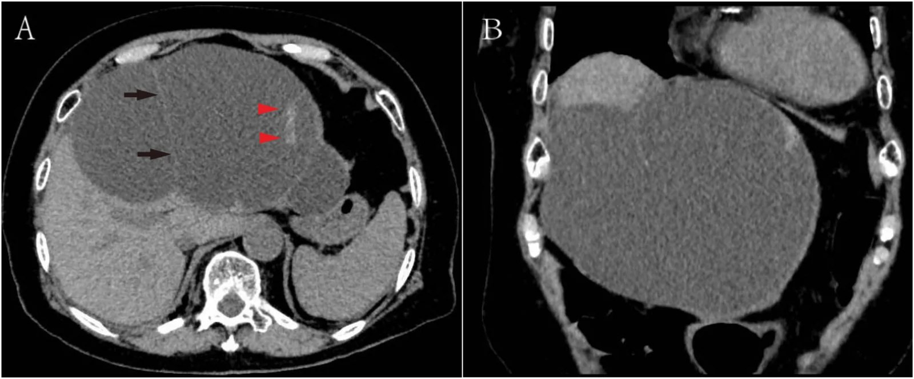
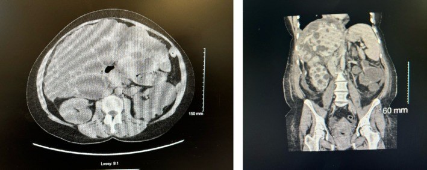
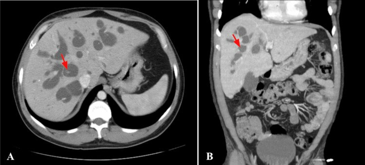
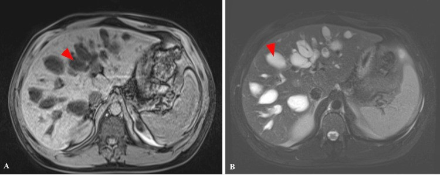
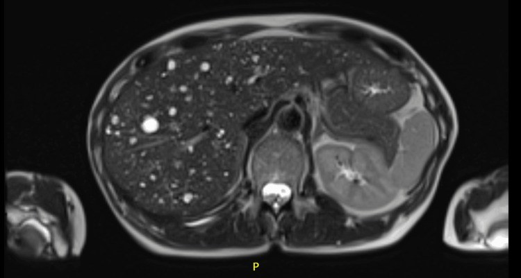
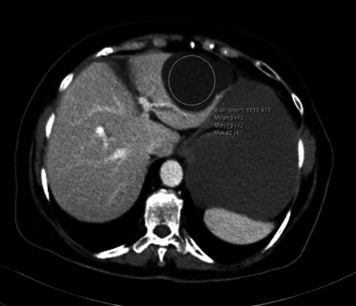
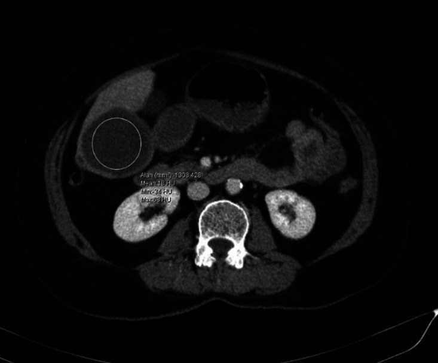
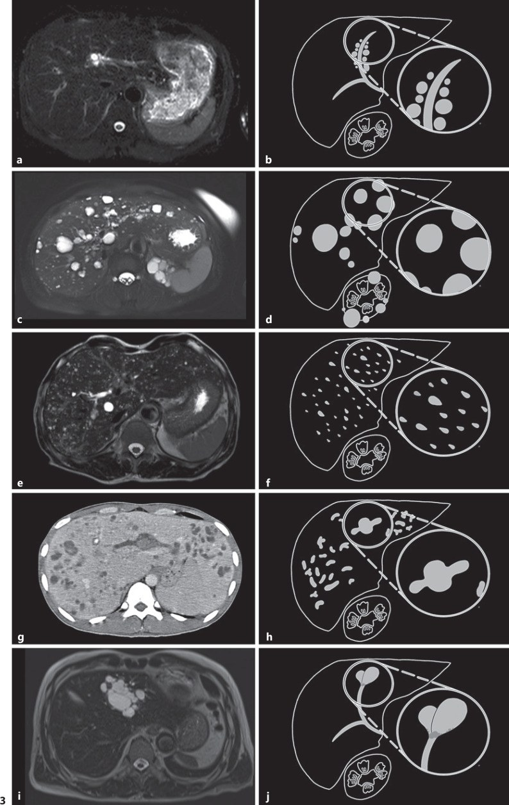

# 123 — Nang gan & bệnh gan đa nang: đơn thuần, PLD/Caroli vs u mô đệm đường mật (von Meyenburg) / Hepatic cysts & polycystic liver disease

**Tags:** `pattern:nang-gan` `vung:gan` `score:Gigot` `protocol:MRCP` `incidentaloma:nang-gan`
**Mức chắc chắn (certainty):** tổng hợp y văn (literature synthesis) — nhóm tự biên từ y văn mở (Front Surg 2026, Clin Case Rep 2026, Cureus 2026, J Int Med Res 2026, GE Port J Gastroenterol 2023, J Clin Exp Hepatol 2026, J Surg Case Rep 2025), số liệu lấy nguyên từ bài gốc.

## 1. Tổng quan — vì sao có "một nang" và vì sao có "cả gan đầy nang"

- **Nang gan đơn thuần (simple hepatic cyst):** nang bẩm sinh từ **mảnh ống mật lạc chỗ** (*biliary microhamartoma*) **KHÔNG thông với cây mật**, thành là **biểu mô đường mật hình khối/thấp** trên mô xơ, chứa dịch huyết thanh (PMC13631860).
  - **TẠI SAO hình ảnh "thuần dịch":** dịch nước tự do → **T1 tối, T2 rất sáng** (thời gian T2 dài), **đậm độ gần nước 0–15 HU**, **không ngấm cản quang** (không có mạch máu), **thành không thấy được** vì chỉ vài mm; không có mô đặc nên **không hạn chế khuếch tán**, không ngấm vỏ.
- **Bệnh gan đa nang (polycystic liver disease — PLD):** bệnh **di truyền trội/ặn** của **dị dạng tấm ống mật (ductal plate malformation)**, chia 3 nhóm:
  - **PLD kèm ADPKD** (*autosomal dominant polycystic kidney disease*, gen **PKD1/PKD2**) — **thể PLD hay gặp nhất**; ADPKD là bệnh thận di truyền phổ biến nhất (≈ **1/1.000** dân số, chiếm **6–10%** bệnh nhân cần điều trị thay thế thận trên toàn cầu).
  - **PLD đơn độc ADPLD** (*autosomal dominant polycystic liver disease*, gen **PRKCSH** [hepatocystin] và **SEC63** là hay gặp nhất; còn GANAB, ALG8, LRP5, SEC61B, PKHD1) — **tần suất ~1/100.000** (có nguồn thấp tới **1/1.000.000**); nang ở ADPLD thường **nhiều và lớn hơn** nang gan của ADPKD.
  - **ARPKD** (gen **PKHD1**) — hiếm (**~1/20.000**), gây **xơ gan bẩm sinh** — họ hàng với Caroli.
  - **Chẩn đoán PLD trên hình ảnh = ≥ 10 nang gan** (giảm còn **≥ 4 nang** nếu đã xác nhận tiền sử gia đình) (PMC13545369).
  - **Yếu tố thúc đẩy:** **giới nữ** — **94%** số bệnh nhân có triệu chứng là nữ, do **estrogen** kích thích tăng sinh cholangiocyte; gan tăng nhanh hơn khi dùng hormone thay thế.
- **Bệnh Caroli (Caroli disease):** **giãn đường mật trong gan từng đoạn dạng túi/khúc khuỷu, THÔNG với cây mật**, do dị dạng tấm ống mật, gene **PKHD1**; **tần suất ~1/1.000.000**.
  - **Caroli syndrome** = Caroli **+ xơ gan bẩm sinh** (tăng áp cửa) — chỉ phân biệt được bằng **mô bệnh học**, hình ảnh không tách được 2 thể (PMC13409416).
  - **Nguy cơ ung thư đường mật trong gan (cholangiocarcinoma) 6,6%–37%** → phải tầm soát suốt đời (PMC13409416).
- **U mô đệm đường mật / nốt von Meyenburg (biliary hamartoma / von Meyenburg complex — VMC):** dị dạng tấm ống mật lành tính, **nhiều nốt nhỏ < 15 mm** rải rác nhu mô gan, **KHÔNG thông cây mật**, T1 tối + **T2 rất sáng tạo hình "trời sao" (starry-sky)**; **0,6–5,6%** trong mổ tử thi (PMC13367765).
- **4 câu hỏi chốt khi gặp nang gan:** (1) **MỘT hay NHIỀU?** (2) dịch **đơn thuần** hay có **vách/nốt đặc ngấm**? (3) **CÓ thông với cây mật** không (MRCP)? (4) nang **LỚN** hay nốt **NHỎ < 1,5 cm** rải rác?

## 2. Mẫu hình — gamut theo SỐ LƯỢNG & KÍCH THƯỚC (Gamut)

- **Một/vài nang lớn, dịch đơn thuần, không ngấm** → *nang gan đơn thuần* (thường < 3 cm, có thể khổng lồ 20 cm gây chèn ép/vỡ).
- **Rất nhiều nang LỚN đa dạng kích thước, thường kèm nang thận** → *PLD* (ADPKD/ADPLD); gan có thể to **gấp ~10 lần** bình thường → hội chứng chèn ép (ăn mau no, buồn nôn, khó thở).
- **Nhiều nốt NHỎ < 1,5 cm rải rác toàn gan, "trời sao" T2, không ngấm** → *u mô đệm đường mật (VMC)* — **giả di căn gan** hay gây chỉ định chụp/soi sai.
- **Giãn đường mật từng đoạn dạng túi + "điểm ngấm trung tâm" (central dot sign), thông cây mật** → *bệnh Caroli*.
- **Nang dọc theo bó mạch cửa (bắt cặp với nhánh mật)** → *nang quanh đường mật (peribiliary cysts)* — hay gặp trên nền xơ gan/tăng áp cửa.
- **Nang có vách dày/nốt đặc ngấm thành/ngấm vỏ** → *di căn gan dạng nang* hoặc *u nhầy đường mật (biliary cystadenoma/IPNB)*.
- **Nang thành dày + vôi hóa + tách màng nổi** → *nang sán (hydatid cyst)*.
- **Nang + sốt + khí trong ổ + ngấm viền** → *áp-xe gan*.
- Gợi nhớ **"S-C-V-P"**: **S**imple cyst · **C**aroli · **V**on Meyenburg · **P**olycystic liver disease.

## 3. Bảng so sánh phân biệt (ma trận đối chiếu)

| Thực thể (entity) | Hình ảnh điển hình | Chốt vào (rule-in) | Chốt loại (rule-out) | Gợi ý xác nhận |
|---|---|---|---|---|
| **Nang gan đơn thuần** | Nang tròn/bầu dục, **0–15 HU**, thành không thấy, **T2 rất sáng**, không ngấm, không vách | **Dịch thuần nhất + không ngấm + không thông cây mật** | Vách/nốt ngấm, thành dày, có mảnh/màng → loại trừ u/nang sán | Siêu âm + CT/MRI không cản quang; chọc hút khi có triệu chứng |
| **PLD (ADPKD/ADPLD)** | **Nhiều nang lớn đa dạng** toàn gan, thường **kèm nang thận**; gan to | **≥ 10 nang gan** (≥ 4 nếu có tiền sử gia đình) + nang thận | Số nốt nhỏ đều < 1,5 cm rải rác → VMC | Bệnh sử gia đình, gene PKD1/PKD2/PRKCSH/SEC63, MRI đo thể tích gan |
| **Bệnh Caroli** | **Giãn đường mật từng đoạn dạng túi** + **central dot sign**, có **thông với cây mật** | **Thông cây mật (MRCP) + central dot** | Không thông cây mật + nốt nhỏ → VMC | MRCP + CT/MRI; sinh thiết gan tìm xơ gan bẩm sinh |
| **U mô đệm đường mật (VMC)** | **Nhiều nốt < 1,5 cm** rải rác, **T1 tối / T2 rất sáng "trời sao"**, không ngấm | **Nốt nhỏ đều + T2 rất sáng + KHÔNG ngấm + KHÔNG thông cây mật** | Nốt ngấm/vách/thành dày, có u nguyên phát → di căn | MRCP (không thông mật) + theo dõi không lớn |
| **Di căn gan dạng nang** | Nang **vách dày + nốt đặc ngấm thành**, ngấm vỏ, tăng kích thước | **Nốt đặc ngấm thành + có ung thư nguyên phát** | Dịch thuần nhất không ngấm → lành | CT đa thì/PET; đối chiếu phim cũ |
| **Nang sán (hydatid type 1)** | Nang **thành dày**, có thể tách màng/hạt sán; đậm độ **KHÔNG phân biệt được** với nang đơn thuần | **Tiền sử dịch tễ + thành dày + ELISA (+) + kích thước lớn** | Thành mỏng + ELISA (−) + kích thước nhỏ → nang đơn thuần | ELISA, siêu âm WHO, **không chọc mù** |

*Trái: **PLD** — nang LỚN đa dạng (gan + thận). Giữa: **VMC (von Meyenburg)** — nốt NHỎ < 1,5 cm rải rác. Phải: **Caroli** — giãn đường mật túi + **central dot** (mũi tên đỏ). Nguồn: Brossart 2026 (PMC12881206) + Masued 2026 (PMC13367765) + Usman 2026 (PMC13409416), CC BY 4.0. Ảnh ghép letterbox.*

### Đọc chuẩn "central dot sign" và "thông cây mật"
- **Central dot sign:** nhánh **mạch cửa ngấm cản quang** nằm ngay **trong lòng túi mật giãn** bị bao quanh bởi dịch mật — **rất đặc hiệu** cho Caroli (PMC13409416). KHÔNG nhầm với nốt đặc ngấm trong lòng nang (di căn/ung thư).
- **Thông cây mật (biliary communication)** là **mấu chốt tách Caroli khỏi VMC và nang đơn thuần**: VMC và nang đơn thuần **KHÔNG thông**; Caroli **CÓ thông** — chỉ thấy rõ trên **MRCP** (đôi khi cần mật đồ thì muộn).

## 4. Protocol chụp + phân độ Gigot + tầm soát theo bệnh nền

- **Siêu âm bụng là đầu tay:** phân biệt nang dịch đơn thuần vs nang có thành/vách/nốt; đo kích thước.
- **MRI + MRCP (không cản quang) là chìa khóa:** xác định **có thông cây mật hay không** (Caroli vs VMC/nang đơn thuần), tín hiệu T1/T2, và **đo thể tích gan (total liver volume — TLV)**. **CT đa thì** khi nghi u đặc/ngấm (di căn nang, u nhầy đường mật).
- **Phân độ Gigot** (theo số lượng + kích thước nang + nhu mô gan còn lại) — dùng để quyết định điều trị PLD (PMC13545369):
  - **Gigot I:** **< 10 nang lớn (> 10 cm)**, còn **nhiều nhu mô gan lành**.
  - **Gigot II:** nang **trung bình rải rác** khắp gan, vẫn **nhận ra nhu mô gan** giữa các nang.
  - **Gigot III:** nang **nhỏ–trung bình lan tỏa dày đặc**, còn **rất ít nhu mô** (thể nặng nhất).
- **Điều trị định lượng:** nang đơn thuần có triệu chứng → **chọc hút + xơ hóa** (tetracycline/minocycline/bleomycin; tiêm cồn tuyệt đối); PLD → **thuốc ức chế somatostatin (octreotide/lanreotide)** làm giảm thể tích gan, hoặc **phẫu thuật/truyền dịch qua da–cửa chủ (TIPS)/ghép gan** khi Gigot III; Caroli → **kháng sinh + tầm soát cholangiocarcinoma**, ghép gan khi suy gan/tăng áp cửa.
- **Tầm soát phối hợp (bắt buộc khi nghĩ PLD):** siêu âm/CT **thận** (nang thận → ADPKD), tầm soát **phình mạch não ở ADPKD**, và **cả gia đình** (di truyền trội). Caroli → **tầm soát ung thư đường mật suốt đời**.

## 5. Biến thể bình thường và cạm bẫy

- **U mô đệm đường mật (VMC) giả di căn gan — cạm bẫy kinh điển:** hình ảnh **nhiều nốt nhỏ dễ bị gọi là "di căn gan đa ổ"** → chỉ định PET, sinh thiết oan. Chốt lành: **< 1,5 cm + T2 rất sáng "trời sao" + không ngấm + không thông cây mật + KHÔNG có u nguyên phát + không lớn theo thời gian** (PMC13367765).
- **Nang sán type 1 vs nang gan đơn thuần — ĐẬM ĐỘ KHÔNG GIÚP PHÂN BIỆT:** nghiên cứu CT đậm độ cho thấy nang sán **9,2 ± 8,8 HU** vs nang đơn thuần **7,3 ± 6,5 HU** (p = 0,30); **cut-off 8,5 HU chỉ Se 43,1%/Sp 72,2%, AUC 54,6%** → **vô dụng**. Chốt lại bằng **thành dày** (nang sán lớn hơn: **55,9 ± 30,0 mm** vs **25,6 ± 12,4 mm**, p < 0,001), **tách màng nổi**, **tiền sử dịch tễ** và **ELISA**. **TUYỆT ĐỐI không chọc hút mù** (nguy cơ sốc phản vệ/rải sán) (PMC13396558).
- **Caroli vs VMC vs PLD:** cả ba đều "nhiều nang gan" — chốt bằng **CÓ thông cây mật không** (MRCP) và **kích thước nốt** (VMC < 1,5 cm; PLD nang lớn; Caroli có thông + central dot).
- **Nang gan lớn tách màng/chảy máu nội nang trông "phức tạp nhưng vẫn lành":** nang đơn thuần khổng lồ (**20 cm**) có thể **vỡ + chảy máu** với hình ảnh phức tạp trên CT, nhưng mô bệnh học vẫn là **nang gan đơn thuần** (không có nhú mô đệm kiểu u nhầy) (PMC13631860).
- **PLD vs ACKD (xem bài 153):** PLD = **gan** đầy nang, thận có thể to khổng lồ (ADPKD); ACKD = **thận NHỎ** nhiều nang ở người lọc máu, gan không phải mấu chốt.
- **PLD + xuất huyết tái diễn — đừng chỉ nghĩ nang vỡ:** hiếm khi có **u mạch máu ác tính (epithelioid angiosarcoma)** nằm dưới nền PLD gây chảy máu lặp lại — cần nghi ngờ khi chảy máu tái phát không cắt được nguồn (PMC12222048).
- **Nang quanh đường mật (peribiliary cysts)** bám dọc **bó mạch cửa**, không thông mật — dễ nhầm nang đơn thuần/PLD; gắn bối cảnh xơ gan/tăng áp cửa (PMC10521313).

## 6. Tự lượng giá — Blind Quiz

**Ca 1 — Nữ 94 tuổi, đau bụng cấp, tụt Hb, CT bụng không cản quang.**

- Hỏi: mô tả tổn thương? Nang thuần dịch hay có thành phần đặc? Chẩn đoán và biến chứng cần nghĩ nhất?

<b>Bấm để hiện đáp án (findings + chẩn đoán)</b>

- **Findings:** nang **~20 cm** thùy trái gan, có **vách mảnh + vùng tăng đậm độ lốm đốm** (máu trong nang) và **màng/thành mỏng** — không có phần đặc ngấm kiểu u.
- **Chẩn đoán:** **nang gan đơn thuần khổng lồ vỡ + chảy máu** (hemoperitoneum) — mô bệnh xác nhận nang đơn thuần. Đối chiếu: **u nhầy đường mật** sẽ có nhú mô đệm kiểu buồng trứng (MCN-L) — đã bị loại bằng mô bệnh.
- Nguồn: Qiu J et al., Front Surg 2026, Fig. 1, PMC13631860, CC BY 4.0.

**Ca 2 — CT bụng ở bệnh nhân có nang thận: nhiều nang gan LỚN đa dạng kích thước.**

- Hỏi: số lượng/kích thước nang gợi gì? Có bằng chứng phối hợp ngoài gan? Chẩn đoán và gene liên quan?

<b>Bấm để hiện đáp án (findings + chẩn đoán)</b>

- **Findings:** **nhiều nang lớn** ở gan **+ nang thận hai bên** → **PLD kèm ADPKD**. Tiêu chuẩn hình ảnh PLD: **≥ 10 nang gan** (≥ 4 nếu có tiền sử gia đình).
- **Chẩn đoán:** **PLD** (ADPKD — **PKD1/PKD2**; hoặc ADPLD — **PRKCSH/SEC63**). Xử trí theo **Gigot**; cần tầm soát **phình mạch não/van tim** và tầm soát gia đình.
- Nguồn: Brossart AK et al., Clin Case Rep 2026, Fig. 2, PMC12881206, CC BY 4.0.

**Ca 3 — Nữ 38 tuổi, sốt cao tái diễn + đau hạ sườn phải; CT bụng cản quang thì cửa.**

- Hỏi: tổn thương là nang hay giãn đường mật? Dấu hiệu nào đặc hiệu? Cần tầm soát gì về lâu dài?

<b>Bấm để hiện đáp án (findings + chẩn đoán)</b>

- **Findings:** **giãn đường mật trong gan từng đoạn dạng túi/khúc khuỷu** + **nhánh mạch cửa ngấm nằm TRONG lòng túi = "central dot sign"** (mũi tên đỏ).
- **Chẩn đoán:** **bệnh Caroli** (thông với cây mật, khác VMC và nang đơn thuần). Nếu kèm **xơ gan bẩm sinh** → **Caroli syndrome** (phân biệt bằng mô bệnh).
- **Quan trọng:** **nguy cơ ung thư đường mật 6,6%–37%** → tầm soát suốt đời.
- Nguồn: Usman M et al., Cureus 2026, Fig. 1, PMC13409416, CC BY 4.0.

**Ca 4 — MRI bệnh nhân có giãn đường mật trong gan (T1 sau tiêm + T2 fat-sat).**

- Hỏi: so với CT (Ca 3), MRI thêm được thông tin gì để chốt Caroli?

<b>Bấm để hiện đáp án (findings + chẩn đoán)</b>

- **Findings:** nhiều **giãn túi ĐM/DM đường mật trong gan** — **T1 sau tiêm giảm tín hiệu, KHÔNG có thành ngấm** (không phải nang có vỏ/khối); **T2 fat-sat rất sáng** (dịch mật).
- **Chốt:** **không có thành ngấm** loại trừ u/nang viêm; kết hợp **MRCP** cho thấy **thông với cây mật** = **Caroli**. VMC sẽ **không thông** và nốt **< 1,5 cm**.
- Nguồn: Usman M et al., Cureus 2026, Fig. 3, PMC13409416, CC BY 4.0.

**Ca 5 — Bệnh nhân tầm soát ung thư: CT thấy nhiều nốt giảm đậm độ rải rác hai gan; MRI T2 tiếp theo.**

- Hỏi: có phải di căn gan đa ổ không? Dấu hiệu nào chốt lành tính?

<b>Bấm để hiện đáp án (findings + chẩn đoán)</b>

- **Findings:** **vô số nốt T2 rất sáng rải rác** cả hai gan tạo **hình "trời sao" (starry sky)**, đều < 1,5 cm, **không ngấm**, **không thông cây mật** trên MRCP, **không có u nguyên phát**.
- **Chẩn đoán:** **u mô đệm đường mật (von Meyenburg / biliary hamartoma)** — lành tính; KHÔNG phải di căn. Tránh PET/sinh thiết oan.
- Nguồn: Masued M et al., Cureus 2026, Fig. 2, PMC13367765, CC BY 4.0.

**Ca 6 — Hai bệnh nhân, hai CT bụng: nang lớn thuần dịch và một nang có thành mỏng có thể (A) vs nang thành dày (B).**

- Hỏi: hai nang này nhìn khác nhau ở đâu? Đậm độ có giúp phân biệt nang sán với nang gan đơn thuần không? Chốt bằng gì?

<b>Bấm để hiện đáp án (findings + chẩn đoán)</b>

- **Findings:** **A = nang gan đơn thuần** (thành rất mỏng, dịch thuần nhất); **B = nang sán type 1** (thành dày). **Đậm độ trung bình gần như bằng nhau** (sán 9,2 HU vs đơn thuần 7,3 HU, p = 0,30).
- **Chốt:** **cut-off 8,5 HU chỉ Se 43,1%/Sp 72,2% (AUC 54,6%) — đậm độ KHÔNG phân biệt được**; chốt bằng **thành dày + kích thước lớn (55,9 vs 25,6 mm) + ELISA + dịch tễ**. **Không chọc hút mù** nang sán.
- Nguồn: Özkaçmaz S et al., J Int Med Res 2026, Fig. 3–4, PMC13396558, CC BY-NC 4.0 (giữ nguyên bản).

**Ca 7 — Bảng đối chiếu các bệnh "nhiều nang gan" (ảnh dọc theo bó mạch cửa).**

- Hỏi: thực thể nào bám **dọc bó mạch cửa**? Phân biệt nhanh các thực thể trong hình bằng 1 tiêu chí mỗi loại?

<b>Bấm để hiện đáp án (findings + chẩn đoán)</b>

- **Chốt nhanh (mỗi thực thể 1 tiêu chí):** **nang quanh đường mật** = nang nhỏ **bắt cặp dọc bó mạch cửa**, không thông mật · **PLD** = nang lớn rải rác + nang thận · **von Meyenburg** = nốt **< 1,5 cm** T2 sáng "trời sao" · **Caroli** = giãn đường mật **thông cây mật** + central dot · **IPNB** = u nhầy **trong lòng ống mật** gây giãn ống.
- **Chốt:** chỉ cần **vị trí so với bó mạch cửa + kích thước + có thông cây mật không** là tách được hầu hết.
- Nguồn: Wongwattanachai A et al., GE Port J Gastroenterol 2023, Fig. 3, PMC10521313, CC BY-NC 4.0 (giữ nguyên bản).

## Bài liên quan chéo
- [100 – Tổng quan hệ Bụng](../100-tong-quan-he-bung/lesson.md)
- [120 – Khối gan nền: lành vs xơ](../120-khoi-gan-nen/lesson.md)
- [121 – LI-RADS & HCC](../121-khoi-gan-LIRADS/lesson.md)
- [122 – U lành gan & áp-xe](../122-u-lanh-gan/lesson.md)
- [131 – Tắc mật](../131-tac-mat/lesson.md)
- [136 – U/nang tụy](../136-u-nang-tuy/lesson.md)
- [153 – Thận nang mắc phải & ACD-RCC](../153-benh-than-nang-mac-phai-loc-mau/lesson.md) (PLD vs ACKD)

## Ảnh
- Tên file: `123_slug_Modality_SourceID.jpg`. Nguồn + giấy phép từng ảnh trong `images/CREDITS.md`.
- Ảnh **CC BY-NC** (PMC13396558, PMC10521313) giữ **nguyên bản**, không crop/ghép; ảnh ghép chỉ dùng ảnh **CC BY** (letterbox nền đen).

> Không dùng để chẩn đoán độc lập khi chưa có người hướng dẫn.
