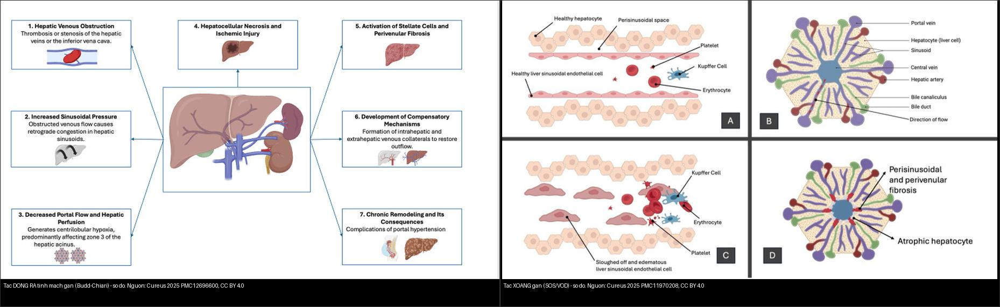
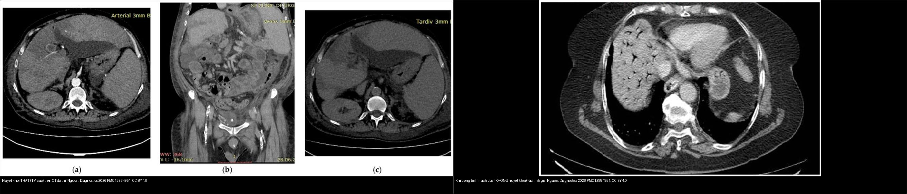
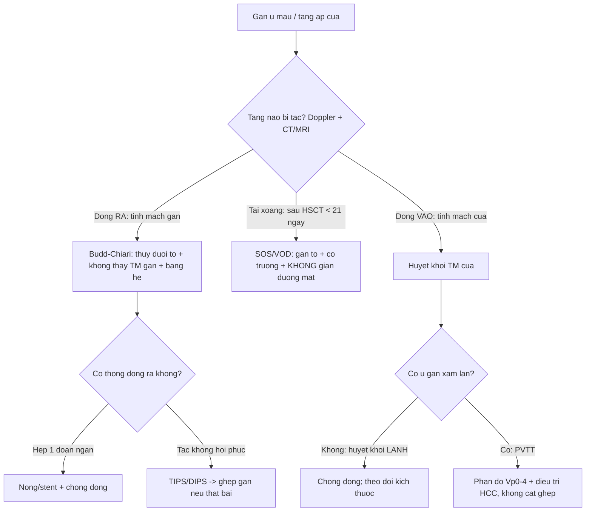
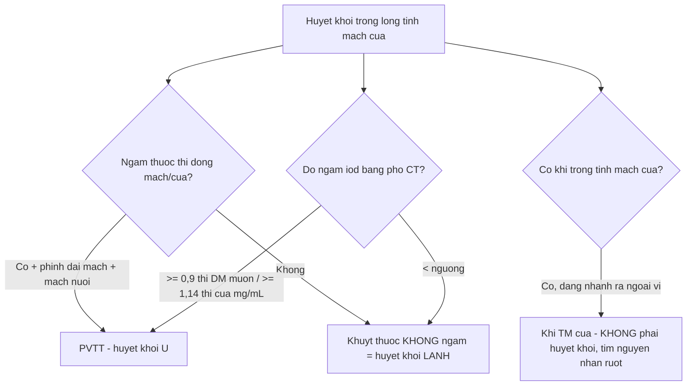
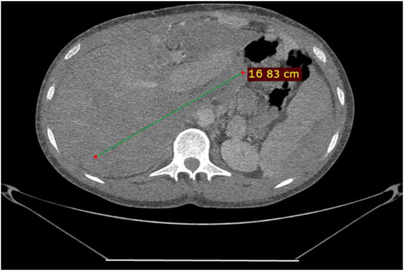
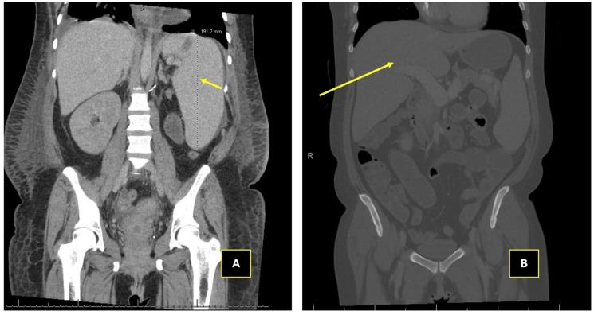
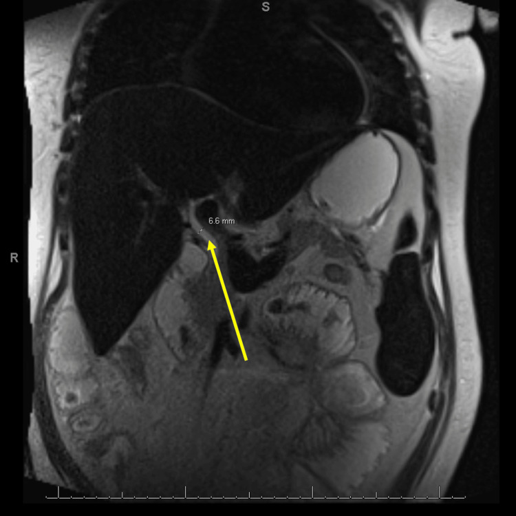
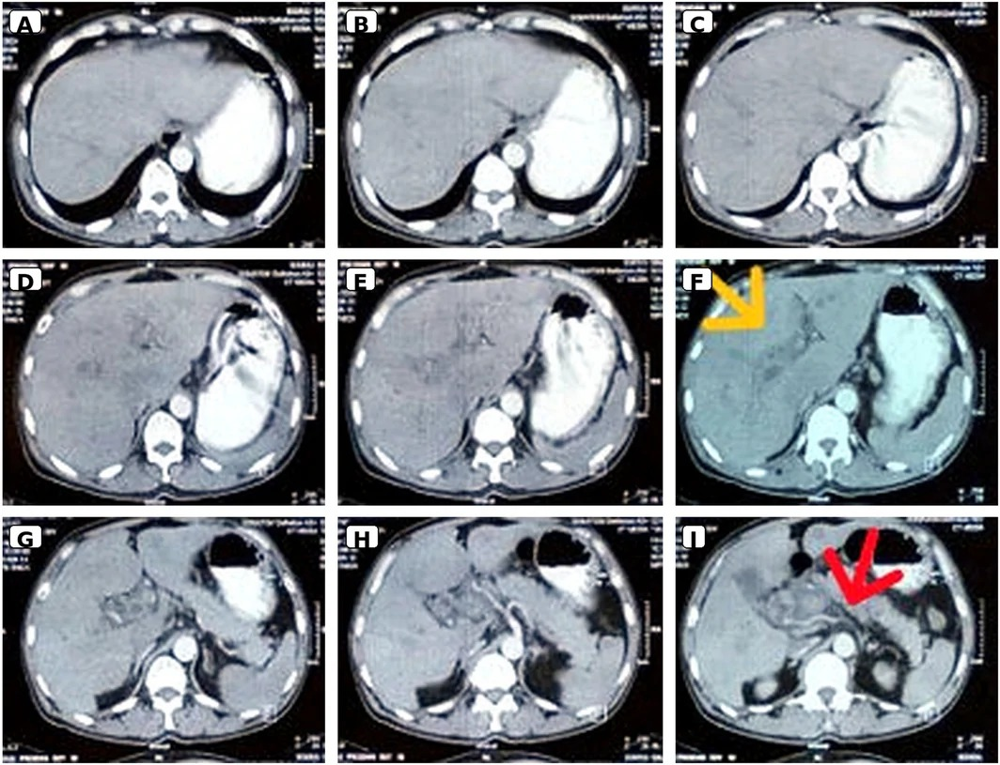
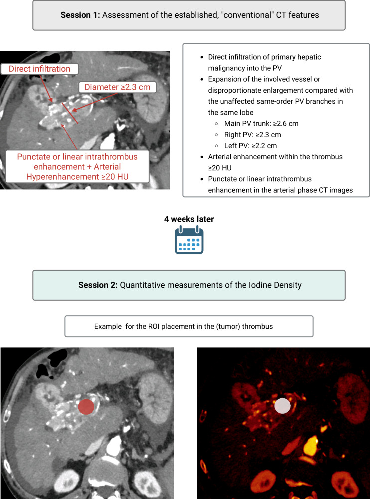

# 124 — Bệnh mạch máu gan: Budd-Chiari, tắc xoang gan (SOS/VOD) & huyết khối tĩnh mạch cửa / Hepatic vascular disease: Budd-Chiari, SOS/VOD & Portal vein thrombosis

**Tags:** `pattern:tac-mach-gan` `vung:gan` `vung:mach-cua` `score:Rotterdam` `score:Vp` `protocol:CT-MRI-da-thi` `incidentaloma:huyet-khoi-tm-cua`
**Mức chắc chắn (certainty):** tổng hợp y văn (literature synthesis) — nhóm tự biên từ y văn mở (Am J Gastroenterol 2026 PMC13313475; Cureus 2025 PMC12696600 & PMC11970208; Radiol Case Rep 2026 PMC12856290; Diagnostics 2026 PMC12984951; Clin Case Rep 2026 PMC13498970; Eur Radiol 2026 PMC13282226), số liệu lấy nguyên từ bài gốc; ca MRI dị vật mắt tách riêng ở bài 401.

> **Câu hỏi gốc của bài:** đứng trước **một gan bị "ứ trệ mạch máu"**, làm sao phân biệt **tắc dòng RA (Budd-Chiari)** – **tắc tại XOANG (SOS/VOD)** – **tắc dòng VÀO (huyết khối tĩnh mạch cửa)**, và mỗi thực thể xử trí khác nhau thế nào?
> Gan là tạng **cấp máu kép** (75% tĩnh mạch cửa + 25% động mạch gan) — học thuyết cốt lõi của hệ Bụng — nhưng **dòng RA chỉ có đường tĩnh mạch gan → nên tắc dòng ra gây ứ máu toàn gan**; hiểu "vào–xoang–ra" là chìa khóa cả bài.

## 1. Tổng quan bệnh học – cơ chế hình ảnh

**Bối cảnh giải phẫu – huyết động (TẠI SAO hình ảnh lại như vậy):**
- Máu vào gan bằng **tĩnh mạch cửa (portal vein)** + **động mạch gan**; máu ra **chỉ bằng các tĩnh mạch gan (hepatic veins)** đổ vào **tĩnh mạch chủ dưới (IVC)** rồi về tim. Vì vậy **tắc dòng ra = ứ máu toàn gan (congestive hepatopathy)**, còn **tắc dòng vào = teo vùng do cửa đó nuôi (atrophy), không ứ máu**.
- **Học thuyết động học bắt thuốc (enhancement kinetics) của hệ Bụng** (xem AGENTS.md): u/viêm thay đổi ngấm thuốc theo thì. Trong bài này, **bản chất huyết khối (thrombus)** mới quyết định tín hiệu: huyết khối cũ **T1 tăng/T2 giảm** (do hemoglobin thoái biến), huyết khối tươi **T1 giảm/T2 tăng**, mô u trong lòng mạch **ngấm thuốc thì mạch máu** (động mạch/cửa) như mô u.

**A. Hội chứng Budd-Chiari (Budd-Chiari syndrome – BCS):** tắc **đường ra tĩnh mạch gan**, từ **tiểu tĩnh mạch gan đến chỗ hợp lưu gan–tĩnh mạch chủ**, **KHÔNG do nguyên nhân trong tim/màng ngoài tim** (PMC13313475).
- **Nguyên phát:** huyết khối trên nền **tăng đông/myeloproliferative neoplasm (MPN)** — **MPN gặp 35–50%** ca BCS, **đột biến JAK2 V617F 35–45%** (khuyến cáo tầm soát JAK2 V617F thường quy); thể **tắc màng IVC** hay gặp ở châu Á (MPN chỉ ~2,4% ở Trung Quốc).
- **Thứ phát:** xâm lấn bởi u (HCC, di căn), chèn ép (nang sán, đa nang gan), chấn thương/phẫu thuật gan, rất hiếm do sarcoidosis.
- **TẠI SAO đặc trưng "thùy đuôi to" (caudate lobe hypertrophy):** thùy đuôi **dẫn lưu trực tiếp vào IVC bằng các tĩnh mạch ngắn riêng** → vùng này **không bị ứ** và **phì đại bù trừ**; phần gan còn lại **ứ máu, ngấm thuốc không đồng nhất thì cửa/muộn trừ thùy đuôi** — đây là "flip-flop"/"nutmeg liver" trên hình ảnh.
- **TẠI SAO ~15% bệnh nhân KHÔNG triệu chứng:** nếu tắc **không hoàn toàn/từ từ**, hệ **tuần hoàn bàng hệ trong–ngoài gan** hình thành kịp → gan còn bù. Ngược lại **thể tối cấp (fulminant)** tắc nhanh, ít bàng hệ → suy gan cấp (diễn tiến nhanh, tiên lượng nặng).
- **Dịch tễ:** hiếm — **0,42%** trong mổ tử thi; tuổi khởi phát **20–45 tuổi** (trẻ hơn các huyết khối tạng khác). Điều trị theo bậc thang giúp sống còn 10 năm tới **72–73%** (Trung Quốc).

**B. Tắc xoang gan / bệnh tắc tĩnh mạch gan (sinusoidal obstruction syndrome / veno-occlusive disease – SOS/VOD):** tổn thương **nội mô xoang gan (sinusoidal endothelium)** do **hóa trị liều cao (busulfan/cyclophosphamide), xạ trị, alkaloid pyrrolizidine** — hay gặp nhất **sau ghép tế bào gốc tạo máu (HSCT)**.
- **Chuỗi bệnh sinh (TẠI SAO ra hình ảnh):** nội mô xoang bị phá hủy → **bong tế bào + huyết khối vi mạch trong xoang** → ứ máu xoang → **gan to + tăng áp cửa + tăng bilirubin**; về sau **xơ quanh xoang (perisinusoidal fibrosis)** không hồi phục (PMC11970208).
- **Cửa sổ thời gian:** biểu hiện **trong vòng 3 tuần (21 ngày) sau ghép**. Yếu tố nguy cơ: **điều trị hóa trị diệt tủy (myeloablative), người cho ghép nửa hợp (haploidentical), bệnh gan nền có sẵn**.

**C. Huyết khối tĩnh mạch cửa (portal vein thrombosis – PVT):** huyết khối **trong líp của hệ tĩnh mạch cửa**. Học thuyết **"tam giác Virchow"** (ứ trệ – tăng đông – tổn thương nội mô) giải thích vì sao **xơ gan, ung thư, cắt lách, chấn thương** đều sinh PVT.
- **Cấp vs mạn:** **cấp** = huyết khối mới + nguy cơ **thiếu máu ruột (nếu lan tĩnh mạch mạc treo)**; **mạn** = tắc kéo dài **> 6 tháng**, thường không triệu chứng, có **biến đổi dạng hang (cavernous transformation = mạng bàng hệ quanh tĩnh mạch cửa bị tắc)** (PMC12984951).
- **Huyết khối nhiễm khuẩn (pylephlebitis)** = huyết khối mủ, biến chứng ổ nhiễm trong vùng dẫn lưu cửa (**viêm ruột thừa, viêm túi thừa, viêm tụy, viêm đường mật**).
- **Khí trong tĩnh mạch cửa (portal venous gas)** = tắc **KHÔNG do huyết khối** (thường trong bối cảnh thiếu máu/hoại tử ruột) → **hình ảnh giống tắc nhưng xử trí NGƯỢC** (chống đông không giải quyết nguyên nhân).
- **Phân biệt sống còn – "huyết khối lành" (bland) vs "huyết khối u" (neoplastic/portal vein tumor thrombosis – PVTT):** trong HCC, PVTT **loại bỏ khả năng chữa khỏi** (cắt gan/ghép gan) ở **phần lớn** bệnh nhân → đây là câu hỏi bắt buộc mọi lần thấy huyết khối cửa trên nền u.

**Ngưỡng định lượng mấu chốt (Argon – cửa 1):**
- BCS: **caudate vein ≥ 3 mm** gợi ý BCS trên siêu âm (PMC13313475); **Rotterdam I/II/III** → sống không ghép 5 năm **89% / 74% / 42%**; **Clichy > 5,4** → sống không ghép 5 năm **65% vs 95%**.
- SOS: **Baltimore** = bilirubin **> 2 mg/dL** + **≥ 2** dấu (gan to, cổ trướng, **tăng cân > 5%**); **phác đồ defibrotide 6,25 mg/kg IV mỗi 6 giờ, ≥ 21 ngày**.
- PVT huyết khối u: **mật độ iod (photon-counting CT)** huyết khối u **1,73 mg/mL (thì ĐM muộn)** / **1,96 mg/mL (thì cửa)** vs huyết khối lành **0,42 / 0,58 mg/mL**; **cut-off 0,9 (ĐM muộn) và 1,14 mg/mL (cửa)** → **Se 100%/Sp 95,9%** và **Se 93,1%/Sp 100%** (PMC13282226).

## 2. Mẫu hình + chẩn đoán phân biệt theo vị trí (Gamut)

**Gamut theo TẦNG dòng máu bị tắc (vào – xoang – ra):**

- **Tắc tầng RA (tĩnh mạch gan/IVC) → gan ứ máu to, thùy đuôi phì đại, bàng hệ, cổ trướng "dịch tiết":** *Budd-Chiari* (huyết khối/màng), **hội chứng gan tim (cardiac hepatopathy/constrictive pericarditis)**, tắc IVC do u/chèn ép.
- **Tắc tầng XOANG (huyết động trong xoang) → gan to + tăng áp cửa nhưng tĩnh mạch gan còn thông:** *SOS/VOD* (sau ghép, alkaloid, oxaliplatin), **viêm gan ứ mật/dùng thuốc**, **nghìn u máu gan (hemangiomatosis)**.
- **Tắc tầng VÀO (động mạch cửa) → huyết khối trong lòng mạch, hạ phân thùy giảm tưới, biến đổi dạng hang:** *huyết khối cửa lành*, **huyết khối u (PVTT)**, **pylephlebitis**, **khí trong tĩnh mạch cửa (không do huyết khối)**, **TIPS huyết khối**, **tắc tĩnh mạch mạc treo**.
- **Bối cảnh lâm sàng quyết định gamut:** sau HSCT + tăng bilirubin + tăng cân → nghĩ **SOS**; trẻ + đau hạ sườn + cổ trướng dịch tiết + gan to → nghĩ **BCS**; xơ gan/HCC + huyết khối cửa → **bland vs PVTT**.
- **Mnemonic "IN–SINUS–OUT":** **IN** = portal vein (PVT) · **SINUS** = SOS/VOD · **OUT** = hepatic vein/IVC (Budd-Chiari).

## 3. Bảng so sánh phân biệt (ma trận đối chiếu)

| Thực thể (entity) | Hình ảnh điển hình (US/CT/MRI) | Chốt vào (rule-in) | Chốt loại (rule-out) | Gợi ý xác nhận |
|---|---|---|---|---|
| **Budd-Chiari (BCS)** | Gan to; **thùy đuôi phì đại ngấm đồng nhất**, phần còn lại ngấm không đồng nhất thì cửa; **bàng hệ trong gan "mạng nhện"/dưới bao**; tĩnh mạch gan không thấy/không dòng | **Thùy đuôi to giữ ngấm + không thấy tĩnh mạch gan + bàng hệ + cổ trướng** | Có **màng/khuyết trong lòng tĩnh mạch gan hoặc IVC** (chụp tĩnh mạch) là chốt | Doppler US → CT 3 thì → **chụp tĩnh mạch gan/IVC (venography) là chuẩn vàng** |
| **SOS/VOD** (sau HSCT) | Gan to, lách to, **cổ trướng**, **giãn tĩnh mạch cửa**, dày thành túi mật, **KHÔNG giãn đường mật**; MRCP loại tắc mật | **Bộ tiêu chuẩn Baltimore/Seattle/EBMT + hình ảnh trong 21 ngày sau ghép** | Bệnh cảnh lâm sàng + **không giãn đường mật** → loại tắc mật | Lâm sàng là chính; US-Doppler + CT/MRI xác nhận tăng áp cửa; sinh thiết chỉ khi không điển hình |
| **PVT huyết khối lành (bland)** | Khuyết thuốc trong lòng tĩnh mạch cửa, **không ngấm thêm thì cửa**, dần **thu nhỏ theo thời gian**, có thể tái thông | **Khuyết thuốc KHÔNG ngấm + không phì đại mạch + không có u gan xâm lấn** | **Ngấm thuốc thì mạch + phì đại mạch + diện tiếp xúc u > 90°** → u | CT 3 thì (ĐM/cửa/muộn) + MRI DWI; theo dõi kích thước |
| **PVTT (huyết khối u)** | Mạch **phình lớn bất thường**, huyết khối **ngấm thì ĐM/cửa**, có **mạch nuôi trong huyết khối**; gắn khối HCC | **Ngấm mạch + phì đại tĩnh mạch + mật độ iod ≥ 0,9–1,14 mg/mL** | Ngấm kém, không phì đại mạch → huyết khối lành | PCCT/dual-energy (mật độ iod) hoặc **MRI gadoxetate + DWI**; phân độ **Vp0–Vp4** (LCSGJ) |
| **Pylephlebitis** | Huyết khối cửa **+ khí trong thành/mạch + ổ nhiễm trong bụng**; sốt cao | **Huyết khối cửa + sốt + ổ nhiễm (ruột thừa/túi thừa)** | Không ổ nhiễm, không sốt → huyết khối vô khuẩn | CT bụng có cản quang + cấy máu; kháng sinh + xử trí ổ nhiễm |
| **Khí trong tĩnh mạch cửa** (không do huyết khối) | **Khí dạng nhánh chạy ra ngoại vi tới dưới bao gan**, đôi khi giống "khuyết thuốc"; hay kèm **khí thành ruột/mất ngấm thành** | **Khí trong tĩnh mạch cửa + bệnh cảnh ruột thiếu máu** | Có **huyết khối đặc ngấm thật** trong lòng → PVT thật | CT bụng cấp cứu: đánh giá thành ruột/tĩnh mạch mạc treo; **không chỉ dùng chống đông** |

*Trái: **Budd-Chiari** — sơ đồ tắc **dòng ra tĩnh mạch gan**. Phải: **SOS/VOD** — sơ đồ tổn thương **nội mô xoang gan**. Nguồn: Cureus 2025 (PMC12696600, PMC11970208), CC BY 4.0. Ảnh ghép letterbox.*

*Trái: **huyết khối THẬT** trên CT đa thì (khuyết thuốc trong lòng mạch). Phải: **khí trong tĩnh mạch cửa** — tắc KHÔNG do huyết khối (hay gặp trong thiếu máu/hoại tử ruột). Nguồn: Diagnostics 2026 (PMC12984951), CC BY 4.0. Ảnh ghép letterbox.*

### Đọc chuẩn ba dấu hiệu hay nhầm
- **Bàng hệ dạng hang (cavernous transformation):** là **di chứng của tắc cửa MẠN**, gồm mạng tĩnh mạch bàng hệ quanh tĩnh mạch cửa **nằm NGOÀI lòng mạch** — KHÔNG phải "nhiều huyết khối"; phân biệt bằng vị trí (quanh mạch cửa, thường ở rốn gan).
- **Thùy đuôi ngấm đồng nhất trong BCS:** đây là **dấu hiệu dương tính** giúp chẩn đoán (vùng dẫn lưu riêng), KHÔNG phải "giả u" — đừng nhầm với nốt tăng mạch của u.
- **Nốt loạn sản/tăng sản trong BCS mạn:** nhiều nốt tăng mạch thì ĐM kích thước vài mm–**4–5 cm**; khác HCC ở chỗ **không thải thuốc + không vỏ** (nhưng phân biệt có thể phải mô bệnh) (PMC13313475).

## 4. Protocol chụp + hệ phân độ/điểm chuẩn hóa

- **Siêu âm Doppler là đầu tay:** tìm tĩnh mạch gan dày/hyperechoic thay tĩnh mạch, khối echo trong lòng mạch, **đảo dòng tĩnh mạch cửa**, và **đường kính tĩnh mạch đuôi ≥ 3 mm** (gợi ý BCS). Hạn chế: phụ thuộc người làm, khó thấy đầu xa tĩnh mạch gan và đoạn trong hoành của IVC.
- **CT gan 3 thì (ĐM muộn–cửa–muộn)** và **MRI gan (T1/T2 fat-sat + DWI + thì mạch máu)** là chuẩn không xâm lấn: đánh giá **dòng RA (tĩnh mạch gan/IVC)**, **dòng VÀO (tĩnh mạch cửa)**, bàng hệ và nốt trong gan. **Chụp tĩnh mạch gan/IVC (venography)** khi cần chốt và can thiệp.
- **Phân độ/grading:**
  - **Budd-Chiari:** tiên lượng theo **Rotterdam (I–III)**, **Clichy/New Clichy**, **CTP ≥ 10**, **MELD > 20**, **TIPS-BCS (≤ 7 vs > 7)**, **BCS-ALF**. AUC cho sống không ghép 3 tháng: **Rotterdam 0,84 · Clichy 0,82 · CTP ≥ 10 0,80 · MELD > 20 0,64** → **Rotterdam/Clichy tốt hơn MELD ở ngắn hạn**; **TIPS-BCS ≤ 7 → sống 1 năm 95% vs 12% (> 7)**.
  - **PVTT:** phân độ **Vp0–Vp4** (Liver Cancer Study Group of Japan): **Vp0** không PVTT · **Vp1** xâm lấn phân thùy · **Vp2** nhánh phải trước/sau · **Vp3** tĩnh mạch cửa phải/trái · **Vp4** thân chính và/hoặc nhánh đối bên.
  - **SOS/VOD:** **Baltimore** (bilirubin > 2 mg/dL + ≥ 2 dấu), **Seattle** (> 2 mg/dL + gan to/đau HSP), **EBMT** (đủ dấu kinh điển trong 21 ngày; **thể nặng = suy đa tạng**).
- **Điều trị theo bậc thang (BCS):** **chống đông** → **nong/mạch máu ghép (angioplasty ± stent)** (sống không hẹp lại 3 năm **96%** có stent vs **60%** không stent) → **TIPS/DIPS** → **ghép gan** (sống 5 năm **> 80%**, 10 năm **67%**); **đa số cần chống đông suốt đời**. SOS: **defibrotide 6,25 mg/kg mỗi 6 giờ ≥ 21 ngày** + điều trị hỗ trợ (giảm thể tích, lợi tiểu, lọc máu khi suy thận). PVT cấp: **chống đông (LMWH)**; **TIPS có thể tái thông** ở ca chọn lọc.

## 5. Biến thể bình thường và cạm bẫy

- **Không thấy tĩnh mạch gan trên CT ≠ BCS:** xơ gan teo cũng làm tĩnh mạch gan khó thấy; phải tìm **bàng hệ + thùy đuôi to + đảo dòng cửa** mới quy được cho BCS (cửa 3).
- **Cạm bẫy mặt cắt (bắt buộc – Argon cửa 4): dịch màng phổi vs cổ trướng.** BCS/SOS gây **cổ trướng** (dịch ổ bụng): **đẩy chân cơ hoành (crus) ra ngoài**, **không len vào vùng trần của gan (bare area)**, bao quanh ruột/gan. Tràn dịch màng phổi **đẩy crus vào trong, len vào bare area, có meniscus**. Cùng một mật độ dịch — **vị trí tương đối với crus/bare area mới chốt tên gọi**.
- **PVT lành có thể tái thông hoàn toàn; PVTT thì không** — vì vậy **đừng "chốt u" rồi bỏ theo dõi**: khuyết thuốc không ngấm + không phì đại mạch + teo nhỏ dần = lành.
- **Khí trong tĩnh mạch cửa ≠ huyết khối cửa:** khí **chạy ra ngoại vi tới dưới bao gan** và có thể **giả dạng khuyết thuốc**; bệnh cảnh (**thiếu máu ruột, mất ngấm thành ruột, khí trong thành ruột**) quyết định, và **chống đông không phải điều trị** (PMC12984951).
- **SOS: "không giãn đường mật" mới là điểm tựa.** Vàng da + gan to sau ghép rất giống **tắc mật**; **MRCP/US cho thấy đường mật KHÔNG giãn** giúp loại tắc mật cơ học (PMC11970208).
- **Cạm bẫy thỏa mãn tìm kiếm (satisfaction of search):** thấy huyết khối cửa là "đủ" để dừng — nhưng phải quét tiếp **tĩnh mạch gan (BCS kèm PVT trong ~8% ca BCS)** và **tìm u gan** để không bỏ PVTT.
- **Cạm bẫy kỹ thuật:** giả ảnh dòng chảy/tạo ảnh có thể tạo "khuyết thuốc" giả trong tĩnh mạch cửa — luôn đối chiếu **đa thì** trước khi gọi huyết khối.

## 6. Tự lượng giá — Blind Quiz ngay trên trang tĩnh (không cần app)

**Ca 1 — Bệnh nhân trẻ, gan to, cổ trướng, đau hạ sườn phải; CT bụng không cản quang.**

- Gợi ý lâm sàng (clinical context): người trẻ, cổ trướng mới xuất hiện, men gan chỉ rối loạn nhẹ.
- Câu hỏi: Dấu hiệu chính trên ảnh? Vì sao thùy đuôi to gợi ý tắc **dòng ra**? Ba chẩn đoán phân biệt?

<b>Bấm để hiện đáp án (findings + chẩn đoán)</b>

- **Dấu hiệu (findings):** gan to, **thùy đuôi phì đại** (đo được ~**16,83 cm** trên lát này) kèm **cổ trướng quanh gan**.
- **Chẩn đoán (diagnosis):** **Hội chứng Budd-Chiari** — thùy đuôi dẫn lưu trực tiếp vào IVC nên **giữ ngấm/không ứ**, phần gan còn lại ứ máu → thùy đuôi phì đại bù trừ.
- **Cần làm tiếp:** Doppler tĩnh mạch gan/IVC (dòng và bàng hệ) → CT/MRI 3 thì → **chụp tĩnh mạch gan** để xác định vị trí tắc và hướng can thiệp (nong/stent/TIPS).
- Nguồn ảnh: Radiol Case Rep 2026, PMC12856290 (Fig. 2), CC BY-NC-ND 4.0 (giữ nguyên bản).

**Ca 2 — Bệnh nhân sau ghép tế bào gốc tạo máu 10 ngày: vàng da tăng, tăng cân > 5%, cổ trướng.**

- Gợi ý: bilirubin tăng dần tới đỉnh **22,2 mg/dL**; có dùng hóa trị diệt tủy.
- Câu hỏi: Hình ảnh gợi ý gì? Cần loại trừ chẩn đoán nào hay nhầm nhất, và bằng cách nào?

<b>Bấm để hiện đáp án (findings + chẩn đoán)</b>

- **Dấu hiệu (findings):** **gan to** (tới ~**22 cm** trục đầu–chân) + **lách to** + **giãn tĩnh mạch cửa**, không khối khu trú.
- **Chẩn đoán (diagnosis):** **SOS/VOD sau ghép** — thỏa **tiêu chuẩn Baltimore** (bilirubin > 2 mg/dL + ≥ 2 dấu: gan to, cổ trướng, **tăng cân > 5%**), xuất hiện trong **21 ngày** sau ghép. Đỉnh bilirubin **22,2 mg/dL**.
- **Loại trừ (rule-out):** **tắc mật** — chụp MRCP/US: **đường mật KHÔNG giãn** → loại tắc mật cơ học.
- Nguồn ảnh: Cureus 2025, PMC11970208 (Fig. 1), CC BY 4.0.

**Ca 3 — Cùng bệnh nhân trên, MRCP để loại trừ tắc mật.**

- Câu hỏi: MRCP thêm thông tin gì để khẳng định SOS mà loại tắc mật?

<b>Bấm để hiện đáp án (findings + chẩn đoán)</b>

- **Dấu hiệu (findings):** gan lách to, ống mật chủ **~6,6 mm**, **KHÔNG có giãn đường mật trong hoặc ngoài gan**; tín hiệu T2 gan/lách giảm lan tỏa (gợi ý hemosiderosis).
- **Chốt:** **không giãn đường mật ⇒ loại tắc mật cơ học** → củng cố **SOS/VOD**.
- Nguồn ảnh: Cureus 2025, PMC11970208 (Fig. 2), CC BY 4.0.

**Ca 4 — Bệnh nhân xơ gan, CT đa thì: khuyết thuốc trong lòng tĩnh mạch cửa. Huyết khối lành hay huyết khối u?**

- Gợi ý: có tiền sử xơ gan; sốt nhẹ, đau bụng.
- Câu hỏi: Mô tả bất thường mạch máu? Có phải huyết khối u không? Dấu hiệu nào giúp phân biệt lành/ác?

<b>Bấm để hiện đáp án (findings + chẩn đoán)</b>

- **Dấu hiệu (findings):** **huyết khối lấp một phần tĩnh mạch cửa** + **mạng bàng hệ quanh tĩnh mạch cửa (biến đổi dạng hang)** + vôi hóa/tổn thương nhu mô gan nền xơ. Huyết khối **KHÔNG ngấm thuốc thêm** và mạch **không phì đại**.
- **Chẩn đoán (diagnosis):** **huyết khối tĩnh mạch cửa lành (bland) + biến đổi dạng hang** (di chứng tắc mạn) — khác **PVTT** (huyết khối u: phì đại mạch + ngấm mạch + mật độ iod ≥ 0,9–1,14 mg/mL).
- **Xử trí:** xử lý ổ nhiễm (nếu pylephlebitis) + **chống đông LMWH**; theo dõi tái thông.
- Nguồn ảnh: Clin Case Rep 2026, PMC13498970 (Fig. 3), CC BY 4.0.

**Ca 5 — CT cấp cứu: huyết khối tĩnh mạch cửa và khí trong tĩnh mạch cửa — hai bệnh nhân khác nhau.**

- Câu hỏi: Hai hình khác nhau ở đâu? Vì sao **không được chống đông máy móc** cho ca bên phải?

<b>Bấm để hiện đáp án (findings + chẩn đoán)</b>

- **Dấu hiệu (findings):** **huyết khối THẬT** = khuyết thuốc đặc trong lòng tĩnh mạch cửa (tăng huyết khối/thrombus). **Khí trong tĩnh mạch cửa** = khí **chạy ra ngoại vi tới dưới bao gan**, thường trong bối cảnh **thiếu máu/hoại tử ruột**.
- **Chẩn đoán (diagnosis):** **PVT thật** vs **khí tĩnh mạch cửa — tắc KHÔNG do huyết khối**.
- **Vì sao không chống đông máy móc:** ở ca khí tĩnh mạch cửa, **nguyên nhân là bệnh ruột** (thiếu máu, hoại tử, thủng kín) → **chống đông không giải quyết nguyên nhân** và có thể gây hại; phải điều trị theo nguyên nhân ruột.
- Nguồn ảnh: Diagnostics 2026, PMC12984951 (Fig. 3 + Fig. 2), CC BY 4.0. Ảnh ghép letterbox.

**Ca 6 — Đặc điểm CT phân biệt huyết khối lành vs huyết khối u (bảng/mật độ iod).**

- Câu hỏi: Kể tên 4 đặc điểm CT phân biệt? Ngưỡng mật độ iod nào chốt u, và độ chính xác?

<b>Bấm để hiện đáp án (findings + chẩn đoán)</b>

- **4 đặc điểm CT (mỗi dấu = một phiếu, tính điểm "CT score"):** **thâm nhiễm trực tiếp (direct infiltration)**, **phì đại mạch (distension)**, **ngấm thì động mạch (arterial enhancement)**, **ngấm điểm/thành dải trong huyết khối (punctate/linear intrathrombus enhancement)**.
  - Hiệu năng lẻ: thâm nhiễm trực tiếp **Se 86,2%/Sp 93,9%**; ngấm động mạch **82,8%/93,9%**; ngấm nội huyết khối **51,7%/95,9%**; phì đại mạch **31,0%/91,8%**.
  - **CT score ≥ 1: Se 89,7%/Sp 81,6%; ≥ 2: Se 86,2%/Sp 95,9%.**
- **Mật độ iod (photon-counting CT):** u **1,73 (ĐM muộn)/1,96 (cửa) mg/mL** vs lành **0,42/0,58 mg/mL**; **cut-off 0,9 mg/mL (ĐM muộn)** → Se 100%/Sp 95,9%; **cut-off 1,14 mg/mL (cửa)** → Se 93,1%/Sp 100%; **AUC 0,98 và 0,97**.
- **Chốt:** ở bệnh nhân ung thư, **huyết khối ngấm mạch + phì đại mạch + mật độ iod ≥ 0,9–1,14 mg/mL = PVTT** → ảnh hưởng trực tiếp quyết định cắt/ghép gan.
- Nguồn ảnh: Eur Radiol 2026, PMC13282226 (Fig. 1), CC BY 4.0.

## Bài liên quan chéo
- [100 – Tổng quan hệ Bụng](../100-tong-quan-he-bung/lesson.md)
- [120 – Khối gan nền: lành vs xơ](../120-khoi-gan-nen/lesson.md)
- [121 – LI-RADS & HCC](../121-khoi-gan-LIRADS/lesson.md) (PVTT trong HCC)
- [123 – Nang gan & bệnh gan đa nang](../123-nang-gan-va-benh-gan-da-nang/lesson.md) (chèn ép mạch do nang)
- [125 – Gan mỡ-xơ & tăng áp cửa](../125-gan-mo-xo/lesson.md) (HVPG, tăng áp cửa)
- [135 – Viêm tụy Atlanta](../135-viem-tuy-Atlanta/lesson.md) (huyết khối tĩnh mạch cửa/lách do viêm tụy)
- [153 – Thận nang mắc phải & ACD-RCC](../153-benh-than-nang-mac-phai-loc-mau/lesson.md)
- [175 – Chèn ép mạch & nút mạch](../175-chen-ep-mach/lesson.md)
- [930 – TACE/RFA (LR-TR)](../930-hepatic-oncology-tace-rfa/lesson.md) (điều trị HCC/PVTT)

## Ảnh
- Tên file: `124_slug_Modality_SourceID.jpg`. Nguồn + giấy phép (license) từng ảnh trong `images/CREDITS.md`.
- Ảnh **CC BY-NC-ND** (PMC13313475, PMC12856290) giữ **nguyên bản**, không crop/ghép; ảnh ghép chỉ dùng ảnh **CC BY** (letterbox nền đen).
- AuntMinnie (Case of the Day): **chỉ dẫn link, không tải**.

> Không dùng để chẩn đoán độc lập khi chưa có người hướng dẫn.
