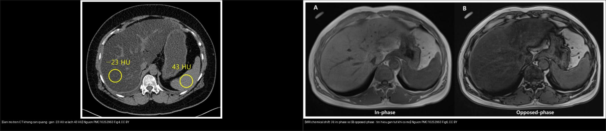
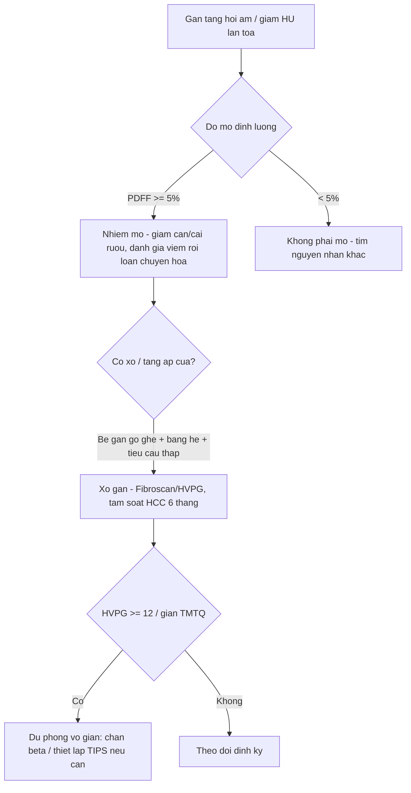
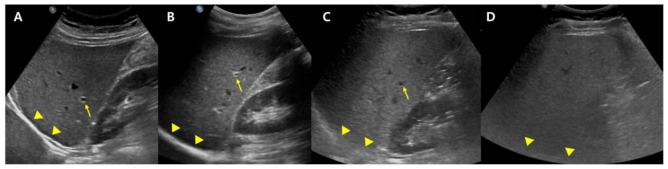
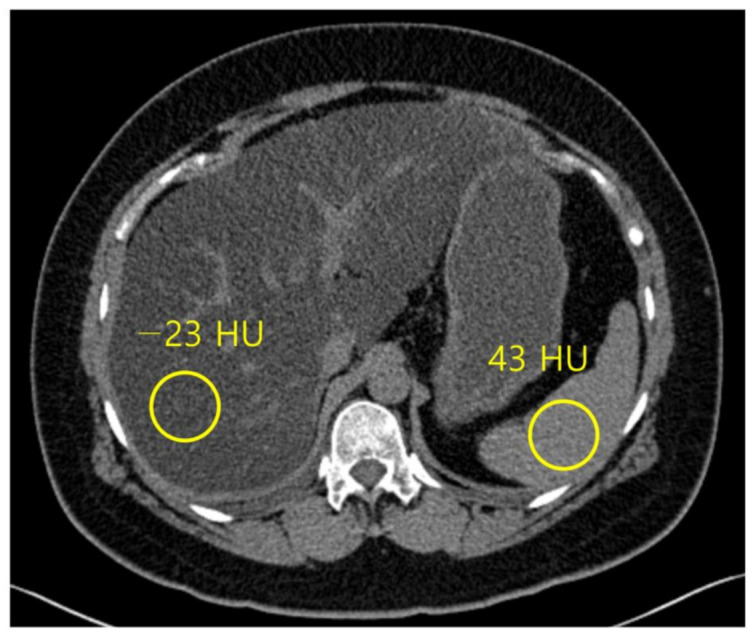
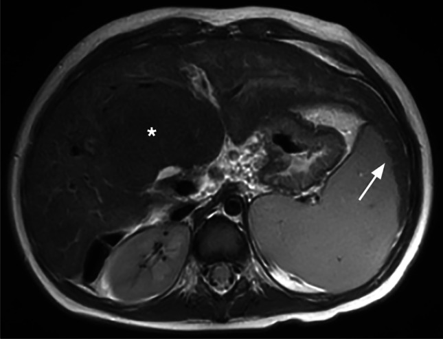
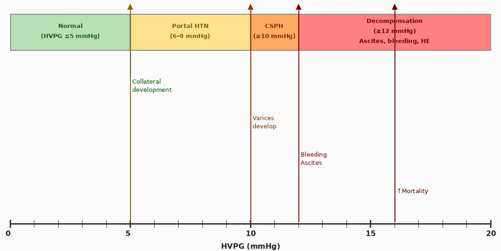

# 125 — Gan nhiễm mỡ, xơ gan & tăng áp cửa / Fatty liver, Cirrhosis & Portal hypertension

**Tags:** `pattern:gan-lan-toa` `vung:gan` `score:PDFF` `protocol:CT-MRI-gan` `protocol:Fibroscan`
**Mức chắc chắn (certainty):** tổng hợp y văn (literature synthesis) — nhóm tự biên từ y văn mở (Diagnostics 2023 CC BY, Pediatr Radiol 2023 CC BY, Cureus 2026 CC BY), chưa gắn ca nguyên văn đơn lẻ.

## 1. Tổng quan — mỡ → viêm → xơ → tăng áp cửa + TẠI SAO mỗi bước đổi hình ảnh

- **Gan nhiễm mỡ (steatosis):** mỡ nội bào **giảm suy giảm tia X** → **giảm đậm độ HU** so với lách; trên MRI, mỡ và nước **lệch pha** ở ảnh **đối pha (opposed-phase)** → tín hiệu gan **tụt** so với ảnh **cùng pha (in-phase)**. **TẠI SAO:** proton mỡ (−CH₂−) và proton nước tần số khác nhau; ở đối pha hai tín hiệu triệt tiêu → mất tín hiệu tỉ lệ với lượng mỡ.
- **Ngưỡng định lượng mỡ:** CT **gan < 40 HU** hoặc **gan − lách ≥ 10 HU** (không cản quang) → nghĩ nhiễm mỡ; **MRI-PDFF (proton density fat fraction) ≥ 5%** = nhiễm mỡ, **≥ 33%** = mỡ nặng (grade 3). Siêu âm: tăng hồi âm, **khó thấy mạch máu/cơ hoành**, **chỉ số gan–thận (hepatorenal index)**.
- **Xơ gan (cirrhosis):** xơ hóa co kéo + **nốt tái tạo (regenerative nodule)** → **bờ gồ ghề**, **thùy phải teo + thùy đuôi/trái phì đại**, **lách to**, dịch ổ bụng. **TẠI SAO:** xơ bít dòng → tải máu dồn vào phân thùy còn lại.
- **Tăng áp cửa (portal hypertension):** **HVPG ≥ 6 mmHg** định nghĩa tăng áp cửa; **≥ 10 mmHg = CSPH (tăng áp cửa có ý nghĩa lâm sàng)**; **≥ 12 mmHg = nguy cơ vỡ giãn TMTQ + mất bù**; **TIPS** nhắm **HVPG < 12 mmHg**. Bàng hệ hay gặp **80–90%**: **tái thông tĩnh mạch rốn (paraumbilical)**, **lách–thận**, giãn **TMTQ** (gastric varices theo Sarin: GOV1/2, IGV1/2).

## 2. Gamut gan lan tỏa + giãn TM

- **Nhiễm mỡ (đơn thuần hoặc MASH):** gan tối hơn lách (−23 HU vs 43 HU), mạch xuyên bình thường — cai rượu/giảm cân, không sinh thiết thường quy.
- **Xơ + bàng hệ:** bờ gồ ghề + tái thông rốn + lách to — tầm soát HCC mỗi 6 tháng.
- **Huyết khối TM cửa:** lấp đầy **không ngấm** + giãn TM — cấp (đau) vs mạn (hang mạch).
- **Huyết khối u (HCC):** **ngấm ĐM trong huyết khối** + u kề + AFP tăng — không mổ cắt gan thường.
- **Mỡ khu trú (focal steatosis) / vùng chừa mỡ (focal sparing):** gặp ở vùng chừa quanh túi mật/hạ phân thùy IV — giả u trên siêu âm (cần MRI chemical-shift).

*Trái: gan mỡ nặng — đậm độ gan (−23 HU) thấp hơn hẳn lách (43 HU) (PMC10252963 Fig. 4, CC BY). Phải: MRI chemical shift — (A) cùng pha vs (B) đối pha, tín hiệu gan tụt ở (B) do mỡ (PMC10252963 Fig. 6, CC BY). Ảnh ghép letterbox.*

**Quiz composite:** che 2 nhãn, hỏi dấu định lượng nào trên mỗi chuỗi khẳng định có mỡ gan?

<b>Bấm để hiện đáp án</b>

- **Trái (CT):** chốt định lượng là **gan −23 HU < 40 HU** và **gan − lách = 66 HU ≥ 10 HU** → nhiễm mỡ nặng.
- **Phải (MRI):** chốt là **tín hiệu gan tụt trên ảnh đối pha (B) so với cùng pha (A)** — mất tín hiệu tỉ lệ lượng mỡ; định lượng chính xác bằng **PDFF**.
- Chốt phân biệt: CT **nhiễm mỡ thật** khác **u/huyết khối** (thường khu trú, ngấm sau tiêm); MRI chemical-shift **phân biệt mỡ với máu/melanin** (máu/melanin không mất tín hiệu ở đối pha).

## 3. Bảng so sánh phân biệt (ma trận đối chiếu)

| Thực thể (entity) | Hình ảnh điển hình | Chốt vào (rule-in) | Chốt loại (rule-out) | Gợi ý xác nhận |
|---|---|---|---|---|
| Nhiễm mỡ lan tỏa | **Gan < 40 HU / gan−lách ≥ 10 HU**, mạch xuyên bình thường; PDFF ≥ 5% | **Giảm HU lan tỏa + mất tín hiệu đối pha + mỡ ≥ 5%** | U khu trú ngấm sau tiêm → không phải mỡ đơn thuần | MRI chemical-shift/PDFF, siêu âm định lượng |
| Xơ gan | **Bờ gồ ghề + thùy đuôi phì đại + lách to + dịch** | **Nốt tái tạo + bờ gồ ghề + bàng hệ** | Gan bờ nhẵn + không bàng hệ → chưa xơ | Fibroscan/đàn hồi, theo dõi HCC 6 tháng |
| Tăng áp cửa | **Giãn TM cửa > 13 mm + tái thông rốn + TMTQ + lách to** | **HVPG ≥ 10 (CSPH) / bàng hệ + tiểu cầu thấp** | Bàng hệ đơn độc không giãn TM → chưa tăng áp rõ | Doppler TM cửa, nội soi tìm giãn TMTQ |
| Huyết khối TM cửa | **Lấp đầy không ngấm** + giãn TM | **Cấp: đau + không ngấm** | Ngấm ĐM trong huyết khối → nghĩ u | CT/MRI đa thì, Doppler |
| Huyết khối u (HCC) | **Ngấm ĐM trong huyết khối + u kề** | **Ngấm+thải + AFP tăng + HCC kề** | Không ngấm → huyết khối sạch | MRI gan (HCA/Eovist), AFP, LI-RADS |

## 4. Protocol chụp + hệ định lượng / phân độ

- **Định lượng mỡ:** siêu âm định lượng (hồi âm/AC/HRI/UDFF) sàng lọc → **MRI-PDFF** là **chuẩn tham chiếu** (≥ 5% mỡ); CT cửa khi cần tổng quan nhưng kém nhạy với mỡ nhẹ.
- **Định lượng xơ:** **Fibroscan (đàn hồi gan, kPa)** + xét nghiệm không xâm lấn (FIB-4); MRI (cT1, MRE) bổ sung.
- **Tăng áp cửa:** siêu âm Doppler TM cửa (đường kính, hướng dòng, huyết khối) + nội soi tìm giãn TMTQ; **HVPG** là chuẩn (≥ 6 tăng áp; ≥ 10 CSPH; ≥ 12 nguy cơ vỡ).
- **Tầm soát HCC:** siêu âm ± AFP mỗi **6 tháng** ở xơ gan (bài 121) — nốt mới cần MRI/CT đa thì.

## 5. Biến thể bình thường và cạm bẫy

- **Vùng chừa mỡ (focal sparing)** quanh túi mật/hạ phân thùy IV giả khối — MRI chemical-shift chốt (mất tín hiệu ở vùng "u" = mỡ, không phải u).
- **Nhiễm mỡ + xơ cùng lúc** làm "đối xứng" tín hiệu: gan vẫn tối hơn lách dù có xơ — đừng loại xơ chỉ vì CT còn mỡ.
- **Huyết khối u vs huyết khối sạch:** ngấm ĐM trong huyết khối là dấu hiệu **chỉ HCC** — thay đổi hoàn toàn điều trị (không mổ cắt gan thường).
- **Bàng hệ tái thông rốn** giả di căn dây chằng tròn — cuộn coronal xem mạch liên tục, có dòng trên Doppler.
- **Nốt tăng sản tái tạo ở xơ** giả HCC — **không** áp LI-RADS trên gan xơ nền (bài 121).

## 6. Tự lượng giá — Blind Quiz

**Ca 1 — Chẩn đoán hình ảnh siêu âm: 4 mức độ gan mỡ. Nhìn panel, xếp thứ tự độ:**

- Hỏi: dấu siêu âm nào tăng dần theo độ? Ngưỡng định lượng chuẩn tham chiếu là gì?

<b>Bấm để hiện đáp án (findings + chẩn đoán)</b>

- Dấu hiệu: **(A) gan–thận tương phản rõ, thấy mạch/cơ hoành → (D) tăng hồi âm dần, mờ mạch máu và cơ hoành**.
- Chẩn đoán: **gan nhiễm mỡ nhẹ → trung bình → nặng**; chuẩn tham chiếu định lượng là **MRI-PDFF (≥ 5%)**.
- Nguồn ảnh: Diagnostics 2023 (PMC10252963) Fig. 1, CC BY.

**Ca 2 — Bệnh nhân béo bụng, men gan tăng. CT không cản quang gan −23 HU, lách 43 HU:**

- Hỏi: tính chênh gan–lách? Chẩn đoán? Có cần sinh thiết không?

<b>Bấm để hiện đáp án (findings + chẩn đoán)</b>

- Chênh **gan − lách = 66 HU (≥ 10 HU)** và gan **−23 HU (< 40 HU)** → **nhiễm mỡ nặng**.
- Không cần sinh thiết thường quy; **cai rượu/giảm cân + kiểm soát chuyển hóa**, đánh giá viem/xơ bằng xét nghiệm + Fibroscan/PDFF.
- Nguồn ảnh: Diagnostics 2023 (PMC10252963) Fig. 4, CC BY.

**Ca 3 — Xơ gan trên MRI: thùy đuôi phì đại + nốt tái tạo. Nhìn hình, mô tả bờ gan và kiểm tra bàng hệ:**

- Hỏi: dấu hình thái chốt xơ gan? Cần tìm thêm gì để đánh giá tăng áp cửa?

<b>Bấm để hiện đáp án (findings + chẩn đoán)</b>

- Dấu hiệu: **phì đại phân thùy 1 (thùy đuôi) + nốt tái tạo (dấu hoa thị) + phân thùy 2/3 to**, bờ gan gồ ghề.
- Tìm thêm: **lách to, tái thông TM rốn, giãn TMTQ, dịch ổ bụng** (Doppler TM cửa ± nội soi) để xác định CSPH (**HVPG ≥ 10 mmHg**).
- Nguồn ảnh: Pediatr Radiol 2023 (PMC10027649) Fig. 2, CC BY.

**Ca 4 — Sơ đồ HVPG trong tăng áp cửa. Nhìn hình, kể các ngưỡng quyết định:**

- Hỏi: HVPG bao nhiêu gọi là tăng áp cửa, bao nhiêu là CSPH, bao nhiêu nguy cơ vỡ giãn TMTQ?

<b>Bấm để hiện đáp án (findings + chẩn đoán)</b>

- **HVPG ≥ 6 mmHg** = tăng áp cửa; **≥ 10 mmHg** = **CSPH**; **≥ 12 mmHg** = **nguy cơ vỡ giãn TMTQ + mất bù**.
- Điều trị: chẹn beta không chọn lọc / thắt vòng khi giãn TMTQ; **TIPS** nhắm **HVPG < 12 mmHg** hoặc giảm ≥ 20%.
- Nguồn ảnh: Cureus 2026 (PMC13645364) Fig. 1, CC BY.

## Bài liên quan chéo
- [100 – Tổng quan hệ Bụng](../100-tong-quan-he-bung/lesson.md)
- [110 – Giải phẫu bụng](../110-giai-phau-bung/lesson.md) (TM cửa, lách)
- [120 – Khối gan nền lành vs xơ](../120-khoi-gan-nen/lesson.md) (u lành/hemangioma/FNH)
- [121 – LI-RADS & HCC](../121-khoi-gan-LIRADS/lesson.md) (tầm soát HCC nền xơ)
- [130 – Túi mật](../130-tui-mat/lesson.md) (vùng chừa mỡ quanh túi mật)
- [170 – Phình ĐMC bụng](../170-phinh-DMC-bung/lesson.md) (bàng hệ, dịch ổ bụng)

## Ảnh
- Nguồn + giấy phép từng ảnh trong `images/CREDITS.md`.
- AuntMinnie: chỉ dẫn link, không tải.

> Không dùng để chẩn đoán độc lập khi chưa có người hướng dẫn.
