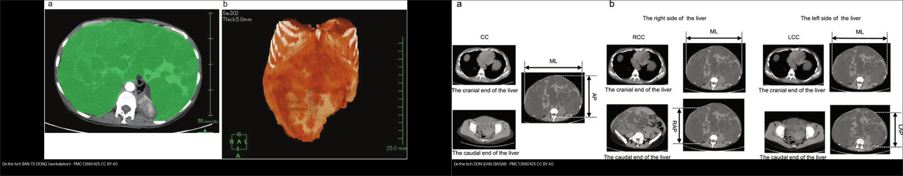
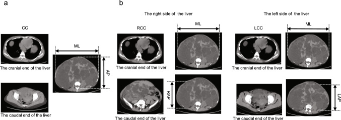
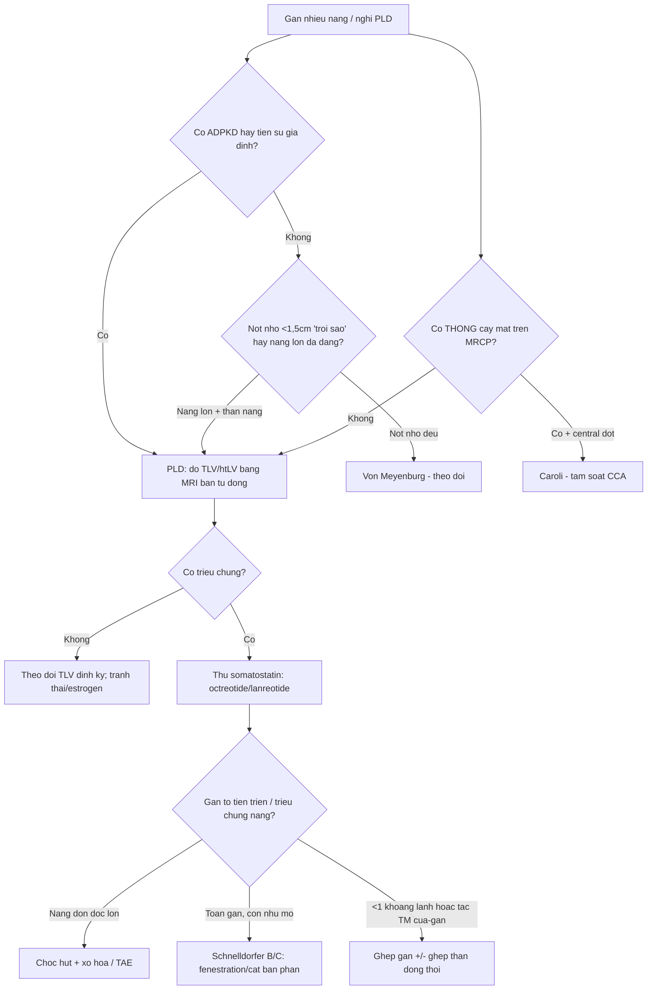
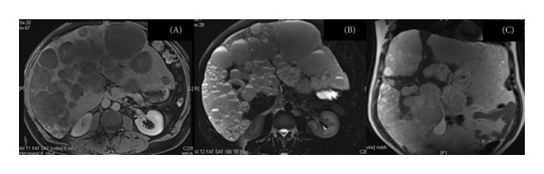
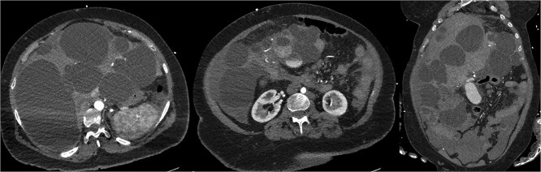
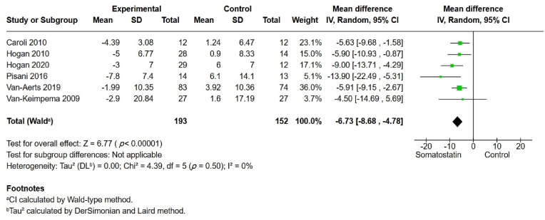
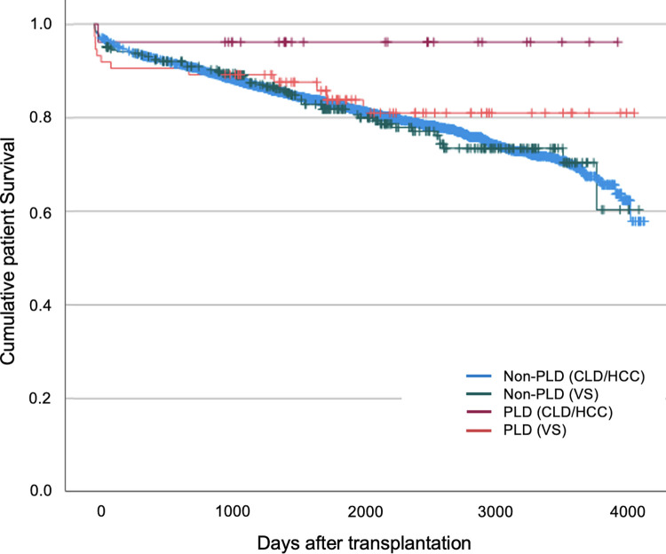
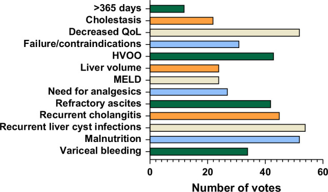

# 126 — Đo thể tích gan & điều trị nội khoa bệnh gan đa nang / Liver volumetry & medical therapy in polycystic liver disease (PLD)

**Tags:** `pattern:gan-da-nang` `vung:gan` `score:Schnelldorfer` `score:Gigot` `protocol:do-the-tich-gan-MRI-CT` `incidentaloma:nang-gan`
**Mức chắc chắn (certainty):** tổng hợp y văn (literature synthesis) — nhóm tự biên từ y văn mở (iLIVER 2026 PMC12870861, Clin Exp Nephrol 2025 PMC12660425, Liver Transpl 2026 PMC12991327, Turk J Gastroenterol 2026 PMC13382228, PLoS One 2024 PMC10760649, Sci Rep 2021 PMC8648823, Case Rep Hepatol 2026 PMC13478724, J Surg Case Rep 2025 PMC12222048), số liệu lấy nguyên từ bài gốc.

## 1. Tổng quan — vì sao phải ĐO THỂ TÍCH GAN, và tại sao nang là "nước"

- **Bệnh gan đa nang (polycystic liver disease — PLD):** **≥ 20 nang gan** (một số tài liệu dùng ngưỡng **≥ 10**) **KHÔNG thông với cây mật** (PMC12870861, PMC12660425). Là biểu hiện ngoài thận của **ADPKD** (nang gan có ở **> 90% người ADPKD trên 35 tuổi**) hoặc thể **đơn độc ADPLD** (gen **PRKCSH/SEC63**, **~1/158.000**); **ARPKD** (gen **PKHD1**, **~1/20.000–1/40.000**) sinh xơ gan bẩm sinh. ADPKD nền tảng: **~1/500–1/1.000**, chiếm **5–10%** ca suy thận giai đoạn cuối.
- **Cơ chế nang & TẠI SAO cận lâm sàng là "đo thể tích":** tăng **cAMP** trong tế bào đường mật nang (cholangiocyte) → bài tiết dịch nang + tăng sinh biểu mô ống mật → nang lớn dần và **gan to theo thể tích**. Bệnh nhân thường **không triệu chứng cho tới khi thể tích gan đủ lớn** → **hình ảnh không dừng ở "có nang hay không" mà là "GAN TO BAO NHIÊU mL"** để quyết định điều trị và đo đáp ứng. Thể tích gan tăng theo thời gian: đoạn MRI ca nặng dài **31 cm** (trước đó 27 cm) (PMC13478724).
- **TẠI SAO nang cho hình ảnh "nước" (mô bệnh học → vật lý):** nang là **khoang kín chứa dịch huyết thanh giống huyết tương**, **không mạch máu** → trên MRI **T1 tối, T2 rất sáng** (thời gian hồi phục T2 dài của nước tự do), trên CT **~0–15 HU**, **không ngấm cản quang** (không có mao mạch nang); vách mỏng chỉ vài mm nên **không thấy được** khi nang nhỏ. Dịch nang **không hạn chế khuếch tán** (ADC không tối) trừ khi có máu/mủ trong nang.
- **Ngưỡng định lượng nằm lòng:** **tổng thể tích gan (total liver volume — TLV)** hoặc **thể tích gan hiệu chỉnh theo chiều cao (height-adjusted liver volume — htLV)** là endpoint chuẩn; **phương pháp vàng là đo bán tự động trên workstation** (vẽ tay viền gan từng lát). Phương pháp đơn giản hóa **BASiM** (đo 3 chiều) có độ tin cậy giữa hai người đọc **ICC 0,991 (95% CI 0,986–0,994)**, cao hơn **QDSiM** **ICC 0,851**, khớp với bán tự động **ICC 0,924** và **nhanh hơn (61 ± 4 s so với 107 ± 9 s, p = 0,01)** (PMC12660425).
- **Bối cảnh lâm sàng:** đa số PLD **không triệu chứng**; phần nang nhiều gây **đau bụng, ăn mau no, buồn nôn, khó thở, suy dinh dưỡng/sarcopenia**; biến chứng **xuất huyết nang, nhiễm khuẩn nang, tăng áp cửa, vàng da tắc mật, hội chứng kiểu Budd-Chiari**. **Thể tích gan không phải lúc nào cũng song hành với triệu chứng** → cần thêm bảng hỏi triệu chứng **PLD-Q / POLCA** (PMC13382228).

## 2. Mẫu hình + chẩn đoán phân biệt theo "mức gan to" (gamut)

- **Tình cờ / nhẹ (gan bình thường hoặc hơi to, vài-vài chục nang):** PLD giai đoạn sớm ở ADPKD; nang gan đơn thuần; **nhiều nốt < 1,5 cm "trời sao" T2** = u mô đệm đường mật (von Meyenburg); **giãn đường mật túi + central dot, THÔNG cây mật** = Caroli.
- **Gan to vừa–nhiều (hàng trăm nang, gan chèn ép):** PLD/ADPKD tiến triển (chỉ định theo dõi thể tích, thuốc, can thiệp).
- **Gan to khổng lồ + biến chứng:** xuất huyết nang (dịch nang tăng đậm độ/hemoperitoneum), nhiễm khuẩn nang (khí trong nang, ngấm viền), tăng áp cửa/giãn tĩnh mạch thực quản, tắc mật, hội chứng kiểu Budd-Chiari do chèn ép TM gan.
- **Cạm bẫy "giả PLD":** **vô số di căn gan dạng nang** (vd u thần kinh nội tiết tụy — PMC13634188), **nang sán** (thành dày, tách màng), **di căn buồng trứng nhầy**, **nang quanh đường mật** (bám bó mạch cửa) — chốt bằng **thành nang + ngấm + có u nguyên phát + tiền sử**.
- Gợi nhớ **"P-C-V-M"**: **P**LD (ADPKD/ADPLD) · **C**aroli (thông mật) · **V**on Meyenburg (nốt nhỏ) · **M**etastases/nang sán (giả PLD).

## 3. Bảng so sánh phân biệt (ma trận đối chiếu)

| Thực thể (entity) | Hình ảnh điển hình | Chốt vào (rule-in) | Chốt loại (rule-out) | Gợi ý xác nhận |
|---|---|---|---|---|
| **PLD (ADPKD/ADPLD)** | **Rất nhiều nang tự do đa dạng kích thước** toàn gan, dịch nước **0–15 HU, T2 rất sáng, không ngấm**; thường kèm nang thận; gan to | **≥ 20 nang gan (≥ 10 cũng đủ cảnh giác) + gan to + không thông cây mật** + bối cảnh ADPKD/tiền sử gia đình | Nốt < 1,5 cm đều T2 sáng (von Meyenburg), có thông mật (Caroli), hay nốt ngấm/vách dày (di căn/u nhầy) | MRI/CT đo **TLV/htLV** bán tự động; gene **PKD1/PKD2/PRKCSH/SEC63** |
| **U mô đệm đường mật (von Meyenburg)** | **Nhiều nốt nhỏ < 1,5 cm** rải rác, **T1 tối/T2 rất sáng "trời sao"**, không ngấm, không thông mật | **Nốt nhỏ ĐỀU + không ngấm + không thông cây mật + KHÔNG có u nguyên phát** | Nang lớn đa dạng có thận nang → PLD; nốt ngấm → di căn | MRCP; theo dõi không lớn (bài 123) |
| **Bệnh Caroli** | **Giãn đường mật từng đoạn dạng túi + central dot**, **thông cây mật** | **Thông cây mật (MRCP) + central dot** | Không thông mật → PLD/von Meyenburg | MRCP; tầm soát cholangiocarcinoma suốt đời (bài 123) |
| **Di căn gan dạng nang "giả PLD"** | Nhiều nang **vách dày/nốt đặc NGẤM**, tăng kích thước, có u nguyên phát | **Nốt/vách ngấm + có u nguyên phát (pNET, buồng trứng…)** | Dịch thuần nhất, không ngấm, không có u tiên phát → PLD | CT đa thì/PET; đối chiếu phim cũ (PMC13634188) |
| **Nang xuất huyết/nhiễm khuẩn trong PLD** | Trong ổ nang: **dịch tăng đậm độ (máu)**, **khí/mức dịch–khí + ngấm viền (mủ)**; có thể hemoperitoneum | **Máu: nang tăng đậm độ cấp; Mủ: khí + ngấm viền + sốt** | Nang dịch thuần nhất không ngấm → nang thường | CT cản quang; cấy dịch nang |

*Trái: **đo bán tự động** (vẽ viền gan từng lát trên workstation — "chuẩn vàng"). Phải: **đo đơn giản hóa BASiM** (nhân các chiều) — ICC 0,991, nhanh 61 ± 4 s. Nguồn: Hattanda F et al., Clin Exp Nephrol 2025 (PMC12660425), CC BY 4.0. Ảnh ghép letterbox.*

## 4. Protocol đo thể tích + phân độ + điều trị (có flowchart)

- **Chọn phương thức:** **MRI là tối ưu** (phát hiện nang nhỏ tốt hơn, không tia xạ, đo thể tích lặp lại) khi nghi PLD/biến chứng; **CT** khi cần đánh giá tăng áp cửa/biến chứng cấp. **Đo TLV/htLV bằng bán tự động** (hoặc **BASiM** khi thiếu công cụ); **ghi rõ phương pháp + phần mềm** vì đổi phương pháp làm sai lệch "đáp ứng".
- **Phân độ Gigot** (số + kích thước nang, nhu mô còn lại) — hướng dẫn chọn can thiệp (bài 123): **I** < 10 nang lớn; **II** nang rải rác còn nhận ra nhu mô; **III** nang nhỏ–vừa dày đặc, còn rất ít nhu mô.
- **Phân độ Schnelldorfer (A–D)** — **phân biệt ai cần CẮT GAN vs ai cần GHÉP GAN** (PMC13382228):
  - **A:** triệu chứng không/ít → **theo dõi hoặc điều trị nội khoa**.
  - **B:** triệu chứng vừa–nặng, **có ≥ 2 "khoang" nhu mô gan tương đối lành** → **mở cửa sổ nang (fenestration)**.
  - **C:** **1 khoang nhu mô lành** → **cắt bán phần gan (có thể ± fenestration phần còn lại)**.
  - **D:** **< 1 khoang nhu mô lành, hoặc TẮC TM CỬA/TM GAN ở phần nhu mô còn lại** → **GHÉP GAN**.
- **Điều trị nội khoa (thuốc):** **đồng vận somatostatin** làm giảm cAMP → **octreotide LAR 40 mg tiêm bắp/28 ngày** hoặc **lanreotide 120 mg dưới da/28 ngày**. Meta-analysis 7 RCT (640 người): **TLV giảm MD −6,73% (95% CI −8,68 đến −4,78)**, **TKV giảm MD −3,35%**, **eGFR KHÔNG đổi (MD 0,32; p = 0,90)**; **biến chứng sỏi/cholecystitis tăng: OR 4,66 (1,19–18,26)** (PMC12870861). Meta cũ (6 RCT, 332 người, TLV nền 3.289 vs 3.089 mL) cho **MD −176 mL (95% CI −406 đến 54; p = 0,133)** và **không cải thiện QoL** → hiệu quả khiêm tốn, cân nhắc từng ca (PMC8648823). **Ưu tiên ở nữ, trước mãn kinh (estrogen thúc đẩy)**.
- **Can thiệp (theo mức xâm lấn):** chọc hút nang + **xơ hóa** (nang đơn độc lớn); **nút mạch động mạch gan qua da (TAE)**; **fenestration/cắt gan**; **ghép gan** — phương pháp chữa khỏi duy nhất cho bệnh nặng.
- **Chỉ định & chiến lược ghép gan (số liệu châu Âu 2026):** thiếu tiêu chí thống nhất (chỉ **8/17 nước** có tiêu chí riêng); yếu tố hàng đầu: **nhiễm khuẩn nang tái diễn (78,3%)**, **suy giảm chất lượng sống (75,4%)**, **suy dinh dưỡng nặng (75,4%)**; **ghép gan–thận đồng thời** được ưu tiên **40,4%** (lợi miễn dịch, dự phòng suy thận); **ghép gan–thận khi eGFR ≤ 30 mL/phút/1,73 m²**; **sống 5 năm sau ghép > 80%** (PMC12991327, PMC13382228). Ca ghép gan nặng nhất nguy cơ cao: **thời gian chờ dài hơn nhưng kết cục dài hạn tốt hơn** (PMC10760649).

*BASiM: nhân các chiều trên ảnh CT để ước lượng thể tích gan — rẻ, nhanh, tương hợp cao với bán tự động. Nguồn: Hattanda F et al., Clin Exp Nephrol 2025 (PMC12660425), CC BY 4.0.*

## 5. Biến thể bình thường và cạm bẫy

- **Nang gan tăng theo tuổi/estrogen:** nang nhỏ nhiều là biến thể; **đừng gọi "PLD" khi chỉ có vài nang** (ngưỡng ≥ 20, hoặc ≥ 10). Nang mới nhiều sau dùng estrogen → bối cảnh quyết định.
- **"Đo thể tích" không đồng nhất:** **đổi phương pháp/người đo/ngưỡng viền gan làm sai lệch ước lượng đáp ứng** — luôn dùng **cùng phương thức + cùng người/phần mềm** khi theo dõi; **htLV ≠ TLV** (hiệu chỉnh chiều cao) — ghi rõ loại nào.
- **Thể tích gan ≠ triệu chứng:** nhiều bệnh nhân gan rất to nhưng vẫn ổn; ngược lại có ca triệu chứng nặng dù thể tích chưa khổng lồ → đánh giá bằng **PLD-Q/POLCA** kèm thể tích (PMC13382228).
- **"Giả PLD" — di căn dạng nang:** vô số nang không tự động = PLD; tìm **u nguyên phát + nốt/vách ngấm** (u thần kinh nội tiết tụy — PMC13634188) trước khi kết luận.
- **Dịch nang "phức tạp" lành tính:** nang lớn **vỡ/chảy máu** trông phức tạp (vách, tăng đậm độ) nhưng vẫn lành — so phim cũ và tìm thành phần đặc ngấm.
- **Cạm bẫy can thiệp:** **chọc hút nang sán = sốc/rải sán** (bài 123) → **không chọc mù**; phân biệt nang nhiễm khuẩn với xuất huyết bằng **khí + ngấm viền + sốt** vs **tăng đậm độ cấp**.
- **Thuốc có giá của nó:** somatostatin analog **không cải thiện eGFR** và **tăng sỏi mật/cholecystitis (OR 4,66)** — không dùng đại trà cho mọi người có nang (PMC12870861).

## 6. Tự lượng giá — Blind Quiz

**Ca 1 — Nữ, bụng to dần, MRI bụng không cản quang (axial T1 fat-sat).**

- Hỏi: mô tả tổn thương? Vì sao nang sáng/tối như vậy trên T1? Đo gan dài bao nhiêu và hệ quả?

<b>Bấm để hiện đáp án (findings + chẩn đoán)</b>

- **Findings:** **vô số nang** chiếm gần hết nhu mô gan, dịch **tối trên T1 fat-sat** (nước tự do), không thấy thành/vách ngấm; **gan dài ~31 cm (trước đó 27 cm)** = gan to khổng lồ.
- **Cơ chế:** dịch nang giống huyết thanh → **T1 tối, T2 rất sáng**; không mạch máu nang → **không ngấm**.
- **Chẩn đoán:** **PLD tiến triển** (dạng ADPKD/ADPLD); cần **đo TLV/htLV**, đánh giá biến chứng (tăng áp cửa, tắc mật) và cân nhắc **Schnelldorfer → ghép gan** nếu < 1 khoang nhu mô lành.
- Nguồn: Vinton ZC et al., Case Rep Hepatol 2026 (PMC13478724), CC BY 4.0.

**Ca 2 — Bệnh nhân PLD vào cấp cứu, CT bụng cản quang (axial + coronal).**

- Hỏi: ngoài nang, có dấu hiệu biến chứng nào? Biến chứng gì hay gặp ở gan đa nang?

<b>Bấm để hiện đáp án (findings + chẩn đoán)</b>

- **Findings:** gan **đa nang biến dạng nặng**, thêm **dịch tự do trong ổ bụng (hemoperitoneum)** và vùng **tăng đậm độ hỗn hợp** ở phần dưới gan → **xuất huyết nang vỡ**.
- **Chẩn đoán:** **PLD biến chứng xuất huyết nang**. Biến chứng nang hay gặp khác: **nhiễm khuẩn nang**, chèn ép mạch/đường mật.
- Nguồn: Wu MY et al., J Surg Case Rep 2025 (PMC12222048), CC BY 4.0.

**Ca 3 — Đọc đồ thị tổng hợp: đồng vận somatostatin làm gì với thể tích gan?**

- Hỏi: MD gộp của TLV là bao nhiêu? Ý nghĩa với eGFR? Tác dụng phụ đáng lưu ý?

<b>Bấm để hiện đáp án (findings + chẩn đoán)</b>

- **Kết quả:** TLV giảm **MD −6,73% (95% CI −8,68 đến −4,78; p < 0,001)**, đồng nhất (I² = 0%). TKV **−3,35%**; **eGFR KHÔNG khác biệt** (MD 0,32; p = 0,90).
- **Tác dụng phụ:** **sỏi mật/cholecystitis tăng OR 4,66 (1,19–18,26)**; tiêu chảy, đau bụng.
- **Ý nghĩa:** hiệu quả khiêm tốn + tăng biến cố → **chọn bệnh nhân**, không đại trà.
- Nguồn: Beshr MS et al., iLIVER 2026 (PMC12870861), CC BY 4.0.

**Ca 4 — Khi nào PLD cần GHÉP GAN? Đọc đường cong sống còn.**

- Hỏi: nhóm PLD chờ ghép lâu hơn hay ngắn hơn? Kết cục dài hạn thế nào?

<b>Bấm để hiện đáp án (findings + chẩn đoán)</b>

- **Findings:** nhóm **PLD chờ ghép LÂU HƠN** nhưng **sống còn và sống còn mảnh ghép dài hạn TỐT HƠN** so với các chỉ định khác.
- **Ý nghĩa:** ghép gan là chữa khỏi duy nhất cho PLD nặng; **sống 5 năm > 80%**; chỉ định chính: **nhiễm khuẩn nang tái diễn, suy giảm chất lượng sống, suy dinh dưỡng nặng**; ghép gan–thận đồng thời khi **eGFR ≤ 30 mL/phút/1,73 m²**.
- Nguồn: Gittus M et al., PLoS One 2024 (PMC10760649), CC BY 4.0.

**Ca 5 — Hội chẩn ghép: yếu tố nào được chuyên gia châu Âu coi là chỉ định ghép?**

- Hỏi: 3 yếu tố hàng đầu? Vì sao tiêu chí ghép PLD khó thống nhất?

<b>Bấm để hiện đáp án (findings + chẩn đoán)</b>

- **Findings:** 3 yếu tố hàng đầu: **nhiễm khuẩn nang tái diễn (78,3%)**, **suy giảm chất lượng sống (75,4%)**, **suy dinh dưỡng nặng (75,4%)**; **ghép gan–thận đồng thời ưu tiên 40,4%**.
- **Vì sao khó thống nhất:** chỉ **8/17 nước châu Âu** có tiêu chí ghép riêng cho PLD; **thể tích gan không phản ánh đủ gánh nặng triệu chứng** → cần bảng hỏi (PLD-Q/POLCA).
- Nguồn: Duijzer R et al., Liver Transpl 2026 (PMC12991327), CC BY-NC-ND 4.0 (giữ nguyên bản, không ghép/cắt).

## Bài liên quan chéo
- [100 – Tổng quan hệ Bụng](../100-tong-quan-he-bung/lesson.md)
- [123 – Nang gan & bệnh gan đa nang (PLD/Caroli/von Meyenburg)](../123-nang-gan-va-benh-gan-da-nang/lesson.md)
- [124 – Bệnh mạch máu gan: Budd-Chiari, huyết khối TM cửa](../124-benh-mach-mau-gan/lesson.md)
- [157 – Bệnh thận đa nang ADPKD/ARPKD & gan đa nang](../157-benh-than-da-nang-adpkd-arpkd/lesson.md)
- [170 – Phình ĐMC bụng](../170-phinh-DMC-bung/lesson.md) (can thiệp mạch/bối cảnh theo dõi)

## Ảnh
- Tên file: `126_slug_Modality_SourceID.jpg`. Nguồn + giấy phép từng ảnh trong `images/CREDITS.md`.
- Ảnh **CC BY 4.0** (PMC13478724, PMC12222048, PMC12660425, PMC12870861, PMC10760649) dùng được; ảnh **CC BY-NC-ND** (PMC12991327) giữ **nguyên bản**, không crop/ghép.

> Không dùng để chẩn đoán độc lập khi chưa có người hướng dẫn.
