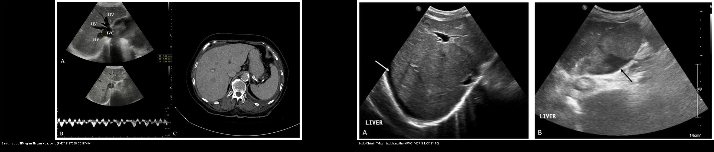
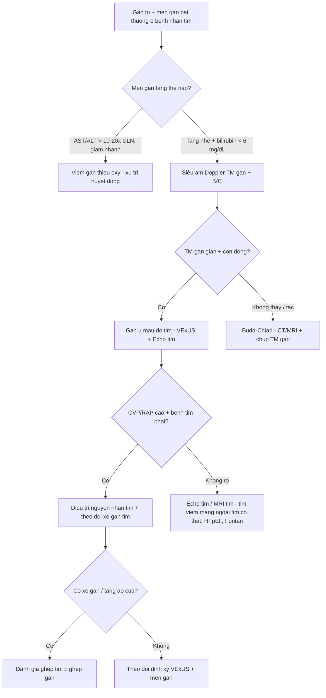
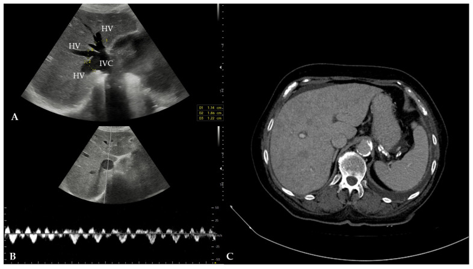
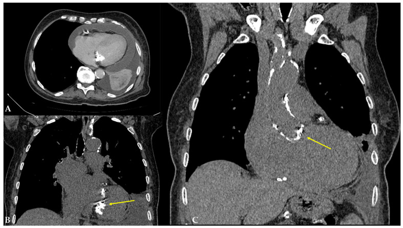
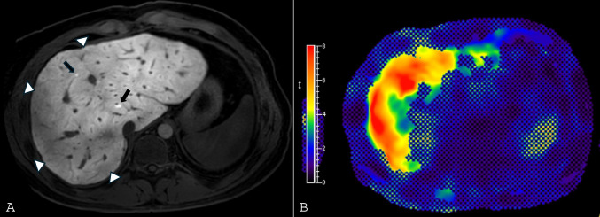
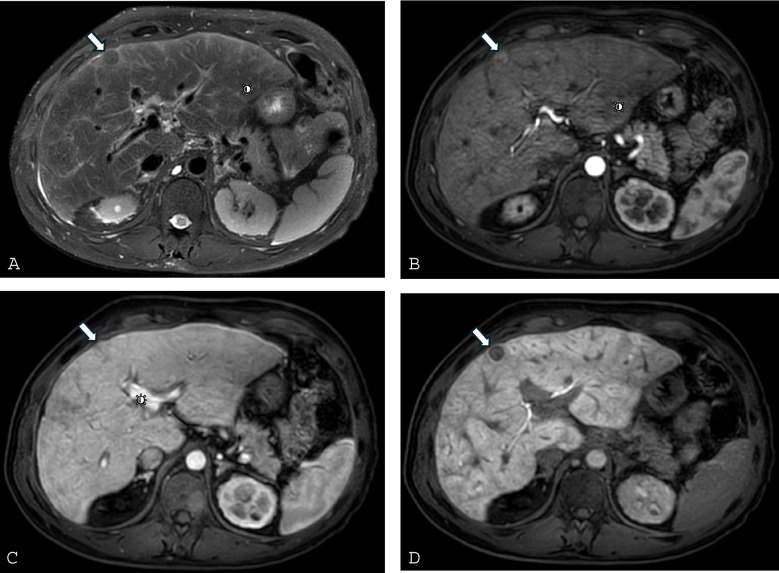
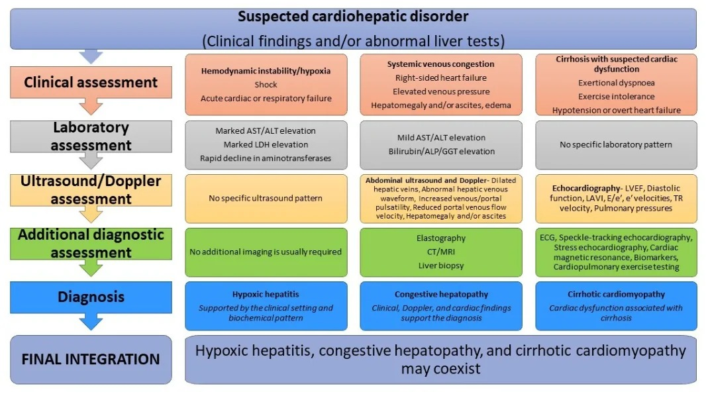
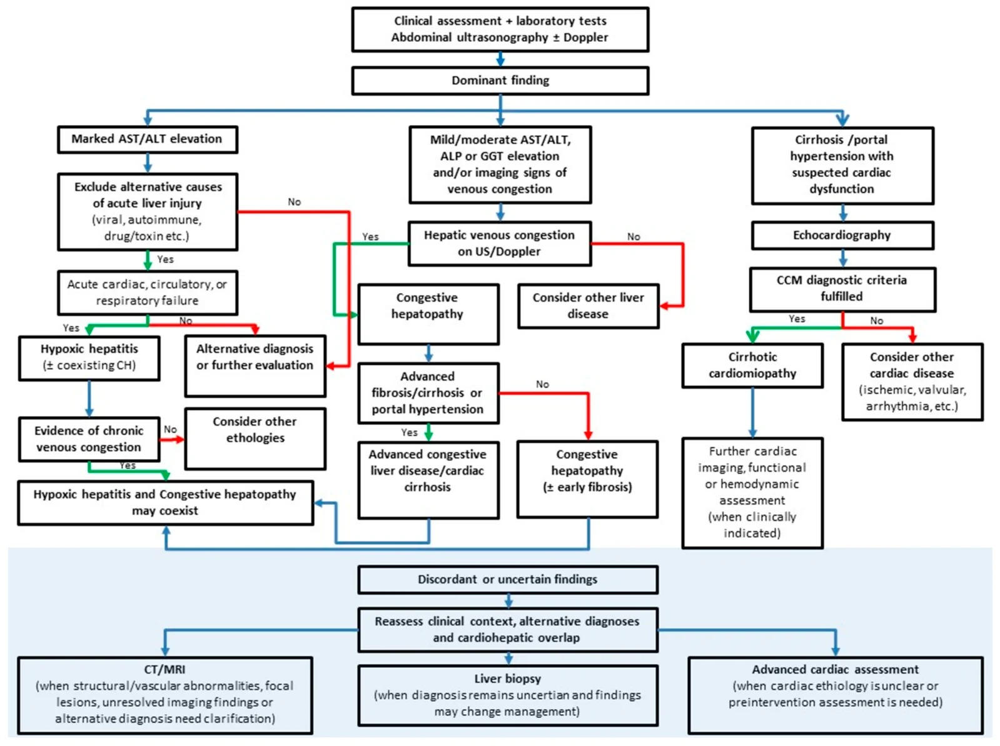

# 127 — Gan tim (cardiac hepatopathy) & tăng áp cửa do tắc nghẽn dòng ra: chẩn đoán phân biệt "gan ứ máu" khi KHÔNG có huyết khối / Cardiac hepatopathy & post-sinusoidal portal hypertension

**Tags:** `pattern:gan-u-mau` `vung:gan` `vung:mach-cua` `score:VExUS` `score:MELD-XI` `protocol:Doppler-TM-gan` `incidentaloma:gan-to`
**Mức chắc chắn (certainty):** tổng hợp y văn (literature synthesis) — nhóm tự biên từ y văn mở (Cureus 2024 PMC11110487; Reports 2025 PMC12197035; IJMS 2023 PMC10649397; Diagnostics 2026 PMC13664619; Current Cardiology Reports 2026 PMC13186934; Life 2026 PMC13027775; Medicina 2024 PMC11677191), số liệu lấy nguyên từ bài gốc.

> **Câu hỏi gốc của bài:** đứng trước một gan to + **giãn tĩnh mạch gan (hepatic vein) và tĩnh mạch chủ dưới (inferior vena cava – IVC)** nhưng **KHÔNG có huyết khối trong lòng mạch**, làm sao phân biệt **gan tim (cardiac hepatopathy)** với **Budd-Chiari**, **tắc xoang gan (sinusoidal obstruction syndrome – SOS)**, **xơ gan** và **huyết khối tĩnh mạch cửa (portal vein thrombosis – PVT)** — và vì sao tim phải được khám trước khi kết luận "bệnh gan".
> **Điểm tựa giải phẫu:** gan nhận máu kép (75% tĩnh mạch cửa + 25% động mạch gan) nhưng **chỉ có MỘT đường ra là tĩnh mạch gan**. Vì vậy tắc nghẽn dòng ra ở tim làm ứ máu **toàn gan**, còn tắc dòng vào chỉ làm teo vùng tương ứng.

## 1. Tổng quan bệnh học – cơ chế hình ảnh

**A. Phổ bệnh "gan tim" (cardiac hepatopathy) — 4 thể nằm trên một trục:**
- **Gan ứ máu mạn (congestive hepatopathy – CH):** hậu quả của **suy tim phải (right heart failure)** hoặc bất kỳ nguyên nhân nào làm **áp lực nhĩ phải (right atrial pressure – RAP) / áp lực tĩnh mạch trung tâm (central venous pressure – CVP)** tăng kéo dài (hẹp hở van ba lá, hẹp van hai lá, viêm màng ngoài tim co thắt, tăng áp động mạch phổi, tuần hoàn Fontan).
- **Viêm gan thiếu ôxy (hypoxic hepatitis / ischemic hepatitis – "shock liver"):** suy tim **xuôi dòng** (forward failure) gây giảm tưới máu + giảm ôxy, hoại tử vùng trung tâm tiểu thùy (centrilobular necrosis), diễn tiến **cấp tính**.
- **Xơ gan tim (cardiac cirrhosis):** CH kéo dài → xơ quanh xoang (perisinusoidal fibrosis) → xơ gan, tăng áp cửa.
- **Bệnh cơ tim xơ gan (cirrhotic cardiomyopathy):** rối loạn chức năng tim ở người đã xơ gan (thể đảo chiều của trục tim–gan).

**TẠI SAO hình ảnh lại như vậy (cơ chế – vật lý):**
- **Tĩnh mạch gan giãn:** áp lực nhĩ phải tăng được truyền **ngược dòng** qua IVC → tĩnh mạch gan → xoang gan. Thành tĩnh mạch gan mỏng, chịu áp lực thấp, nên chỉ cần CVP tăng là **giãn rõ** (trong ca minh họa: đường kính tĩnh mạch gan **12–18 mm**, IVC trong gan **31 mm**) (PMC12197035).
- **Dấu "sừng hươu" (deer horn sign) trên siêu âm:** IVC trong gan giãn tạo "đầu hươu", các tĩnh mạch gan giãn tỏa ra tạo "sừng hươu" — dấu hiệu gợi ý CH khi thấy trên mặt cắt dưới sườn (PMC12197035).
- **Mất dạng sóng ba pha (triphasic) của tĩnh mạch gan:** bình thường dòng tĩnh mạch gan có 3 pha (sóng a = nhĩ thu, S = tâm thu thất, D = tâm trương). Khi ứ máu: **S < D → S đảo ngược → dạng đơn pha**, vì áp lực nhĩ phải cao "đè" lên dòng chảy trong thì tâm thu (PMC13027775).
- **Tĩnh mạch cửa đập theo nhịp tim (portal vein pulsatility):** bình thường dòng cửa liên tục, **đập < 30%**; khi xoang gan ứ, dao động áp lực tim truyền ngược vào hệ cửa làm **đập ≥ 50%** (PMC13027775).
- **Ngấm thuốc gan kiểu "nhục đậu khấu" (nutmeg liver) / mosaic:** vùng ứ máu nặng (trung tâm tiểu thùy) ngấm thuốc **chậm và kém** hơn vùng còn tưới máu, nên thì cửa/muộn có dạng **lưới/khảm không đồng nhất**; thì động mạch có thể thấy **thuốc trào ngược sớm vào IVC và tĩnh mạch gan** (PMC10649397). Đây là hệ quả huyết động, **không phải nốt u**.
- **Thùy đuôi phì đại (caudate lobe hypertrophy):** thùy đuôi dẫn lưu trực tiếp vào IVC bằng các tĩnh mạch ngắn riêng nên **né được ứ máu** và phì đại bù trừ — **gặp ở cả gan tim và Budd-Chiari**, nên **không dùng một mình để phân biệt** (PMC10649397).
- **Cổ trướng tim (cardiac ascites):** áp lực xoang gan tăng → dịch thoát vào ổ bụng; dịch **giàu protein** vì hàng rào xoang bị phá vỡ. Do đó **SAAG > 1,1 g/dL**, **protein dịch ≥ 2,5 g/dL**, LDH và hồng cầu trong dịch tăng — khác cổ trướng xơ gan (protein < 2,5 g/dL) (PMC13664619).

**Ngưỡng định lượng mấu chốt (Argon – cửa 1):**
- **CH gặp ở 20–30% bệnh nhân suy tim mạn (CHF)** (PMC11110487); bilirubin thường **< 6 mg/dL**, tăng nhiều hơn gợi ý suy gan cấp (PMC11110487).
- **Xơ gan sau Fontan ~43% ở thời điểm 30 năm sau mổ** (PMC13186934).
- **Viêm gan thiếu ôxy:** AST/ALT tăng **> 10–20 lần giới hạn trên (ULN)**, LDH tăng mạnh, giảm nhanh **> 50% trong 48 giờ** sau khi tái lập huyết động (PMC13664619).
- **VExUS (Venous Excess Ultrasound Score):** IVC **≥ 2,0 cm** + giảm xẹp theo nhịp thở; IVC **> 2,1 cm + xẹp < 50%** tương ứng RAP **10–20 mmHg**; IVC **< 2,1 cm + xẹp > 50%** tương ứng RAP **0–5 mmHg** (PMC13027775).
- **Điểm tiên lượng:** MELD-XI, ALBI, MELD 3.0, Child–Pugh; **MELD-XI** dùng được khi bệnh nhân dùng chống đông (không phụ thuộc INR) (PMC10649397).

## 2. Mẫu hình + chẩn đoán phân biệt theo tầng tắc nghẽn (Gamut)

**Gamut theo TẦNG tắc nghẽn của tăng áp cửa (đây là chìa khóa định vị):**
- **Tầng TRƯỚC XOANG (pre-sinusoidal):** huyết khối tĩnh mạch cửa, huyết khối tĩnh mạch lách, sán máng (schistosomiasis), rối loạn mạch máu xoang cửa (porto-sinusoidal vascular disorder – PSVD), dò động–tĩnh mạch. **Tĩnh mạch gan KHÔNG giãn**, gan thường không to.
- **Tầng XOANG (sinusoidal):** xơ gan, SOS/VOD, viêm gan. **Tĩnh mạch gan bình thường hoặc khó thấy**, gan to nhẹ.
- **Tầng SAU XOANG / SAU GAN (post-sinusoidal / post-hepatic):** **gan tim** (suy tim phải, bệnh van ba lá, viêm màng ngoài tim co thắt, Fontan), **Budd-Chiari** (tắc tĩnh mạch gan/IVC). **Tĩnh mạch gan ± IVC giãn hoặc không thấy tùy nguyên nhân.**

**Gamut "gan to + giãn tĩnh mạch gan, KHÔNG huyết khối" theo bối cảnh:**
- **Tim phải to + tĩnh mạch cổ nổi + phù + gan đập theo nhịp tim:** suy tim phải, hở van ba lá, tăng áp phổi.
- **Mạch nghịch thường (pulsus paradoxus) + tiếng cọ màng tim + vôi hóa màng ngoài tim:** viêm màng ngoài tim co thắt (constrictive pericarditis) — nguyên nhân "giả xơ gan" kinh điển.
- **Bệnh nhân trẻ đã mổ Fontan:** bệnh gan liên quan Fontan (Fontan-associated liver disease – FALD).
- **Suy tim cấp + sốc + AST/ALT tăng vọt:** viêm gan thiếu ôxy (có thể **đồng thời** với CH).
- **Gan to + cổ trướng + tuần hoàn bàng hệ + không có bệnh tim:** xơ gan — nhưng tĩnh mạch gan **không giãn**.
- **Gan to + đau hạ sườn + cổ trướng dịch tiết ở người trẻ:** Budd-Chiari (bài 124).

**Mnemonic "HEART" cho gan ứ máu do tim:** **H**epatic vein dilation (giãn tĩnh mạch gan) · **E**ffusion (tràn dịch màng phổi/màng tim) · **A**scites (cổ trướng giàu protein) · **R**ight atrial pressure ↑ (CVP/RAP cao) · **T**ricuspid disease / tamponade physiology (bệnh van ba lá, chèn ép tim).

## 3. Bảng so sánh phân biệt (ma trận đối chiếu)

| Thực thể (entity) | Hình ảnh điển hình (US/CT/MRI) | Chốt vào (rule-in) | Chốt loại (rule-out) | Gợi ý xác nhận |
|---|---|---|---|---|
| **Gan ứ máu do tim (CH)** | Gan to; **giãn tĩnh mạch gan + IVC**; mất sóng ba pha (S < D → S đảo); tĩnh mạch cửa đập ≥ 50%; ngấm thuốc mosaic thì cửa/muộn; cổ trướng | **Giãn tĩnh mạch gan/IVC + CVP cao + tim phải to + dòng tĩnh mạch gan bất thường nhưng KHÔNG tắc** | **Có khuyết/huyết khối trong lòng tĩnh mạch gan hoặc IVC** → Budd-Chiari, không phải CH đơn thuần | Echo tim (EF, RAP, van ba lá, màng ngoài tim) + VExUS; CT/MRI gan đa thì |
| **Viêm gan thiếu ôxy** | Gan có thể to; **không có dấu ứ máu đặc hiệu**; CT thường bình thường hoặc phù nhẹ | **AST/ALT > 10–20× ULN sau biến cố tim/phổi + LDH tăng + giảm nhanh > 50%/48 giờ** | Tĩnh mạch gan giãn + CVP cao → thành phần ứ máu chiếm ưu thế | Lâm sàng + men gan; loại trừ virus/thuốc/thiếu máu |
| **Budd-Chiari (BCS)** | **Thùy đuôi phì đại**, phần gan còn lại ngấm không đồng nhất; **tĩnh mạch gan không thấy/không dòng**; bàng hệ "mạng nhện"; cổ trướng | **Không thấy tĩnh mạch gan + bàng hệ trong gan + thùy đuôi to** | **Tĩnh mạch gan giãn đều, còn dòng (dù bất thường)** → gan tim | Doppler → CT/MRI 3 thì → chụp tĩnh mạch gan/IVC |
| **SOS/VOD** | Gan to, lách to, cổ trướng, giãn tĩnh mạch cửa, **KHÔNG giãn đường mật**; thường sau ghép tế bào gốc < 21 ngày | **Bilirubin > 2 mg/dL + ≥ 2 dấu (gan to, cổ trướng, tăng cân > 5%) trong 21 ngày sau ghép** | Bệnh cảnh sau ghép + MRCP không giãn đường mật | Lâm sàng + Doppler; sinh thiết khi không điển hình |
| **Xơ gan** | Gan teo/bờ gồ ghề, nốt, lách to, bàng hệ, **tĩnh mạch gan nhỏ/không giãn** | **Bờ gan gồ ghề + nốt + bàng hệ + tĩnh mạch gan không giãn** | **Tĩnh mạch gan giãn rõ + CVP cao** → gan tim | Elastography (sau khi giảm ứ), CT/MRI, xét nghiệm nguyên nhân |
| **Huyết khối tĩnh mạch cửa (PVT)** | Khuyết thuốc trong lòng tĩnh mạch cửa, có thể bàng hệ dạng hang; **tĩnh mạch gan bình thường** | **Khuyết thuốc trong lòng tĩnh mạch cửa** | **Tĩnh mạch cửa thông, chỉ tĩnh mạch gan giãn** → gan tim | CT đa thì; phân biệt huyết khối lành/u (bài 124) |

*Trái: **gan ứ máu do tim** — tĩnh mạch gan giãn, còn dòng (dù mất dạng ba pha). Phải: **Budd-Chiari** — tĩnh mạch gan tắc/không thấy, gan to + cổ trướng. Nguồn: Reports 2025 (PMC12197035) + Medicina 2024 (PMC11677191), CC BY 4.0. Ảnh ghép letterbox.*

### Ba dấu hiệu hay bị đọc nhầm
- **Thùy đuôi to KHÔNG phân biệt được gan tim với Budd-Chiari** — cả hai đều có, vì cùng cơ chế "né" ứ máu. Phải nhìn **lòng tĩnh mạch gan**: giãn + còn dòng = tim; tắc/không thấy = Budd-Chiari.
- **Ngấm thuốc mosaic ("nhục đậu khấu") không phải di căn/u:** nó thay đổi theo thì và theo mức ứ máu; không có vỏ, không thải thuốc, không xâm lấn mạch.
- **Gan to + men gan tăng nhẹ ở người suy tim ≠ "viêm gan do thuốc":** luôn đo CVP/khám tĩnh mạch cổ và làm siêu âm Doppler tĩnh mạch gan trước khi gắn nhãn bệnh gan.

## 4. Protocol chụp + hệ phân độ/điểm chuẩn hóa

- **Siêu âm bụng + Doppler là đầu tay (bắt buộc):** đo **IVC** (đường kính, % xẹp), **tĩnh mạch gan** (đường kính, dạng sóng ba pha/biphasic/đơn pha/đảo S), **tĩnh mạch cửa** (tốc độ, chỉ số đập), **tĩnh mạch trong thận** (liên tục/gián đoạn/đơn pha); tìm cổ trướng, gan to, dấu sừng hươu.
- **Siêu âm tim (echocardiography):** bắt buộc để chốt nguyên nhân — EF, chức năng thất phải, RAP ước tính, van ba lá, màng ngoài tim (dày/vôi hóa, dấu suy giãn bất thường), áp lực động mạch phổi. **EF bình thường không loại trừ** HFpEF/viêm màng ngoài tim co thắt.
- **CT gan đa thì (ĐM – cửa – muộn):** xác định giãn IVC/tĩnh mạch gan, **trào ngược thuốc sớm vào IVC thì ĐM**, ngấm thuốc mosaic, thùy đuôi to, cổ trướng, tràn dịch màng phổi/màng tim; loại trừ huyết khối và u.
- **MRI gan:** T1/T2 fat-sat, DWI, chuỗi động mạch; **MR elastography** đo độ cứng gan (lưu ý **ứ máu làm độ cứng giả tăng**, phải đo lại sau khi giảm ứ); gadoxetate thì gan mật đánh giá chức năng và nốt FNH-like.
- **Phân độ VExUS (0–3):** **Grade 0** = IVC < 2 cm; **Grade 1** = IVC ≥ 2 cm + không có bất thường Doppler "nặng"; **Grade 2** = IVC ≥ 2 cm + **1** bất thường nặng; **Grade 3** = IVC ≥ 2 cm + **≥ 2** bất thường nặng. Bất thường "nặng" gồm: **đảo dòng tĩnh mạch gan**, **đập tĩnh mạch cửa > 50%**, **mất dòng tâm thu tĩnh mạch trong thận (đơn pha)** (PMC13027775).
- **Điểm tiên lượng:** MELD-XI (không dùng INR → phù hợp bệnh nhân chống đông), ALBI, MELD 3.0, Child–Pugh; theo dõi bilirubin, albumin, creatinine, INR, tiểu cầu.
- **Xử trí nguyên tắc:** điều trị **nguyên nhân tim** (giảm thể tích, lợi tiểu, kiểm soát nhịp/van, can thiệp màng ngoài tim, tối ưu Fontan); **không** dùng thuốc hạ áp gan khi chưa đánh giá huyết động; xơ gan tim tiến triển → cân nhắc **ghép tim ± ghép gan đồng thời** (đánh giá đa chuyên khoa).

## 5. Biến thể bình thường và cạm bẫy

- **IVC giãn do nghiệm pháp Valsalva / nín thở** — luôn đo lại khi thở đều; **giãn "giả" khi bụng căng, thai kỳ, béo phì**.
- **"Giả huyết khối" do hiện tượng dòng chảy (flow artifact)** trong tĩnh mạch gan/IVC trên MRI/CT: khuyết thuốc **thay đổi giữa các thì**, không có viền ngấm, không phì đại mạch → không phải huyết khối thật.
- **Tĩnh mạch gan không thấy trên CT ≠ Budd-Chiari:** xơ gan teo, gan thoái hóa mỡ nặng, hoặc thì chụp chưa đúng cũng làm khó thấy; phải có **bàng hệ + thùy đuôi to + đảo dòng** mới quy cho BCS.
- **Elastography giả tăng trong đợt ứ máu cấp:** độ cứng gan có thể giảm rõ sau khi lợi tiểu/giảm ứ → **không chẩn đoán xơ gan chỉ dựa vào một lần đo khi đang phù**.
- **"Gan tim" có thể che lấp bệnh gan nền:** bệnh nhân suy tim vẫn có thể có xơ gan, viêm gan virus, hoặc HCC; **mosaic enhancement** dễ làm bỏ sót nốt thật → luôn đọc đa thì và so phim cũ.
- **Cạm bẫy mặt cắt (bắt buộc – Argon cửa 4): dịch màng phổi vs cổ trướng.** Cổ trướng **đẩy chân cơ hoành (crus) ra ngoài**, **không len vào vùng trần gan (bare area)**, bao quanh gan/ruột; tràn dịch màng phổi **đẩy crus vào trong, len vào bare area, có meniscus**. Cùng mật độ dịch — **vị trí tương đối với crus/bare area mới chốt tên gọi**.
- **Cạm bẫy "thỏa mãn tìm kiếm":** thấy gan to + cổ trướng là dừng ở "xơ gan" mà không khám tim — bỏ sót **viêm màng ngoài tim co thắt** (mổ được, chữa khỏi) và **bệnh van ba lá**.

## 6. Tự lượng giá — Blind Quiz ngay trên trang tĩnh (không cần app)

**Ca 1 — Nam giới lớn tuổi, khó thở tăng dần, gan to, tĩnh mạch cổ nổi; siêu âm bụng dưới sườn.**

- Gợi ý lâm sàng (clinical context): phù hai chân, cổ trướng, không sốt, không đau bụng.
- Câu hỏi: Dấu hiệu chính trên ảnh? Vì sao gọi là "dấu sừng hươu"? Ba chẩn đoán phân biệt và xét nghiệm chốt?

<b>Bấm để hiện đáp án (findings + chẩn đoán)</b>

- **Dấu hiệu (findings):** **tĩnh mạch gan giãn 12–18 mm**, **IVC trong gan 31 mm**; phổ Doppler tĩnh mạch gan **mất dạng ba pha**, có **sóng a nổi bật**; kèm gan to và cổ trướng. Hình trên còn có mặt cắt CT bụng cho thấy gan to, tĩnh mạch gan giãn.
- **Chẩn đoán (diagnosis):** **gan ứ máu do suy tim phải (congestive hepatopathy)** — "dấu sừng hươu" = IVC giãn ("đầu hươu") + tĩnh mạch gan giãn ("sừng hươu"). Cơ chế: CVP cao truyền ngược → giãn tĩnh mạch gan và mất dạng sóng ba pha.
- **Phân biệt (differential):** Budd-Chiari (tĩnh mạch gan tắc), xơ gan (tĩnh mạch gan không giãn), SOS/VOD (bối cảnh sau ghép).
- **Xét nghiệm chốt:** **siêu âm tim** (EF, RAP, van ba lá, màng ngoài tim) + **VExUS**; CT/MRI gan đa thì nếu cần loại trừ huyết khối/u.
- Nguồn ảnh: Ferenc T et al., *Reports* 2025, PMC12197035 (Fig. 2), CC BY 4.0.

**Ca 2 — Cùng bệnh nhân, CT ngực không cản quang: vì sao "gan tim" lại do màng ngoài tim?**

- Gợi ý: tĩnh mạch cổ nổi, gan đập theo nhịp tim, không có bệnh van rõ trên lâm sàng.
- Câu hỏi: Mô tả bất thường ngoài gan? Vì sao đây là nguyên nhân "mổ được" của gan tim?

<b>Bấm để hiện đáp án (findings + chẩn đoán)</b>

- **Dấu hiệu (findings):** **tràn dịch màng tim lượng nhiều** + **vôi hóa lan rộng màng ngoài tim** (mũi tên vàng), tim to; kèm tràn dịch màng phổi hai bên.
- **Chẩn đoán (diagnosis):** **viêm màng ngoài tim co thắt (constrictive pericarditis)** gây gan tim — màng ngoài tim dày/vôi hóa làm áp lực nhĩ phải tăng, truyền ngược xuống gan.
- **Vì sao quan trọng:** đây là nguyên nhân **có thể chữa khỏi bằng phẫu thuật bóc màng ngoài tim**, khác với suy tim cơ năng tiến triển không hồi phục. Bỏ sót = "xơ gan không rõ nguyên nhân" kéo dài.
- **Cần làm tiếp:** siêu âm tim (dấu suy giãn bất thường, septal bounce), MRI tim (dày/vôi hóa màng ngoài tim, dấu "thở bất thường"), hội chẩn tim–gan.
- Nguồn ảnh: Ferenc T et al., *Reports* 2025, PMC12197035 (Fig. 3), CC BY 4.0.

**Ca 3 — Bệnh nhân 21 tuổi sau mổ Fontan, theo dõi định kỳ; MRI gan.**

- Gợi ý: tuần hoàn Fontan, nhiều năm CVP cao; men gan dao động nhẹ.
- Câu hỏi: Bất thường trên MRI? Vì sao bệnh gan ở Fontan gần như phổ quát? Cần theo dõi gì?

<b>Bấm để hiện đáp án (findings + chẩn đoán)</b>

- **Dấu hiệu (findings):** ảnh A (thì gan mật) cho thấy **gan ngấm thuốc không đồng nhất, các dải/tĩnh mạch giãn** (mũi tên trắng) và **nốt giữ thuốc kiểu FNH-like** (mũi tên đen); ảnh B là **bản đồ độ cứng MR elastography** với vùng đỏ = độ cứng tăng.
- **Chẩn đoán (diagnosis):** **bệnh gan liên quan Fontan (Fontan-associated liver disease – FALD)** — CVP cao mạn tính truyền vào tĩnh mạch gan/xoang gây ứ máu, xơ hóa và cuối cùng xơ gan. **Xơ gan gặp ~43% bệnh nhân 30 năm sau Fontan** (PMC13186934).
- **Theo dõi:** siêu âm Doppler + elastography (đo khi không ứ máu cấp), MRI/MR elastography định kỳ, nội soi tầm soát giãn tĩnh mạch, sàng lọc HCC, đánh giá PLE (protein-losing enteropathy) và suy tim.
- Nguồn ảnh: Jarasvaraparn C et al., *Curr Cardiol Rep* 2026, PMC13186934 (Fig. 4), CC BY 4.0.

**Ca 4 — Cùng bệnh nhân Fontan, MRI T2 fat-sat: vì sao có "vòng tăng tín hiệu" quanh gan?**

- Câu hỏi: Mô tả dấu hiệu? Phân biệt với Budd-Chiari và xơ gan trên cùng chuỗi xung?

<b>Bấm để hiện đáp án (findings + chẩn đoán)</b>

- **Dấu hiệu (findings):** **tĩnh mạch gan/IVC giãn** (mũi tên trắng), **dịch quanh gan** (viền tăng tín hiệu T2), nhu mô gan không đồng nhất, có thể thấy nốt giữ thuốc ở thì gan mật (ảnh khác).
- **Chẩn đoán (diagnosis):** **FALD/gan ứ máu mạn** — dịch quanh gan do tăng áp xoang, tĩnh mạch giãn do CVP cao.
- **Phân biệt:** Budd-Chiari = **tĩnh mạch gan không thấy/tắc** + bàng hệ trong gan; xơ gan = **tĩnh mạch gan không giãn**, bờ gan gồ ghề, nốt thật. Ở FALD tĩnh mạch gan **giãn và còn dòng**, dù dòng bất thường.
- Nguồn ảnh: Jarasvaraparn C et al., *Curr Cardiol Rep* 2026, PMC13186934 (Fig. 6), CC BY 4.0.

**Ca 5 — Bảng đối chiếu: cùng "gan to + men gan tăng", ba bệnh cảnh khác nhau.**

- Câu hỏi: Dựa vào bảng, chỉ ra **3 dấu hiệu** giúp phân biệt viêm gan thiếu ôxy với gan ứ máu; khi nào cần sinh thiết gan?

<b>Bấm để hiện đáp án (findings + chẩn đoán)</b>

- **Ba dấu hiệu phân biệt:** (1) **AST/ALT tăng > 10–20× ULN** + LDH tăng mạnh → viêm gan thiếu ôxy; (2) **bilirubin tăng nhẹ, ALP/GGT tăng nhẹ** + **giãn tĩnh mạch gan, tĩnh mạch cửa đập** → gan ứ máu; (3) **bệnh cảnh xơ gan + rối loạn chức năng tim** → bệnh cơ tim xơ gan.
- **Sinh thiết gan:** chỉ khi **chẩn đoán còn không chắc** hoặc kết quả **thay đổi xử trí** (ví dụ phân biệt xơ gan tim với bệnh gan nền, đánh giá mức xơ trước ghép).
- **Điểm cần nhớ:** ba thể có thể **đồng thời** trên cùng bệnh nhân — "viêm gan thiếu ôxy + gan ứ máu" là cặp hay gặp ở sốc tim.
- Nguồn ảnh: Popovic D et al., *Diagnostics* 2026, PMC13664619 (Hình tổng hợp), CC BY 4.0.

**Ca 6 — Sơ đồ tiếp cận: bệnh nhân nghi "rối loạn tim–gan", nên đi đường nào?**

- Câu hỏi: Theo lưu đồ, khi nào chuyển sang CT/MRI? Khi nào chụp MRI tim? Vai trò của sinh thiết gan?

<b>Bấm để hiện đáp án (findings + chẩn đoán)</b>

- **Trình tự:** lâm sàng + xét nghiệm + **siêu âm bụng ± Doppler** → xác định "dấu hiệu trội" (men gan tăng vọt vs tăng nhẹ + ứ máu vs xơ gan + nghi bệnh tim).
- **CT/MRI gan:** khi cần đánh giá **bất thường cấu trúc/mạch máu, tổn thương khu trú, hoặc chẩn đoán chưa rõ**.
- **MRI/đánh giá tim chuyên sâu:** khi **nguyên nhân tim chưa rõ** hoặc cần đánh giá trước can thiệp (ghép tim, mổ van, bóc màng ngoài tim).
- **Sinh thiết gan:** khi **chẩn đoán vẫn không chắc** và kết quả có thể **thay đổi xử trí**.
- Nguồn ảnh: Popovic D et al., *Diagnostics* 2026, PMC13664619 (lưu đồ), CC BY 4.0.

## Bài liên quan chéo
- [100 – Tổng quan hệ Bụng](../100-tong-quan-he-bung/lesson.md)
- [110 – Giải phẫu bụng cắt lớp](../110-giai-phau-bung/lesson.md)
- [124 – Bệnh mạch máu gan: Budd-Chiari, SOS/VOD & huyết khối tĩnh mạch cửa](../124-benh-mach-mau-gan/lesson.md)
- [125 – Gan mỡ-xơ & tăng áp cửa](../125-gan-mo-xo/lesson.md)
- [126 – Thể tích gan & điều trị nội khoa PLD](../126-the-tich-gan-dieu-tri-noi-khoa-PLD/lesson.md)
- [129 – IPNB & u nhầy đường mật](../129-IPNB-va-u-nhay-duong-mat/lesson.md)
- [800 – Tổng quan tim mạch](../800-cardiovascular-overview/lesson.md)

## Ảnh
- Tên file: `127_slug_Modality_SourceID.jpg`. Nguồn + giấy phép (license) từng ảnh trong `images/CREDITS.md`.
- Ảnh **CC BY 4.0** được phép ghép letterbox (composite); ảnh composite giữ nguyên tỷ lệ, không crop/kéo giãn.
- AuntMinnie (Case of the Day): **chỉ dẫn link, không tải**.

> Không dùng để chẩn đoán độc lập khi chưa có người hướng dẫn.
