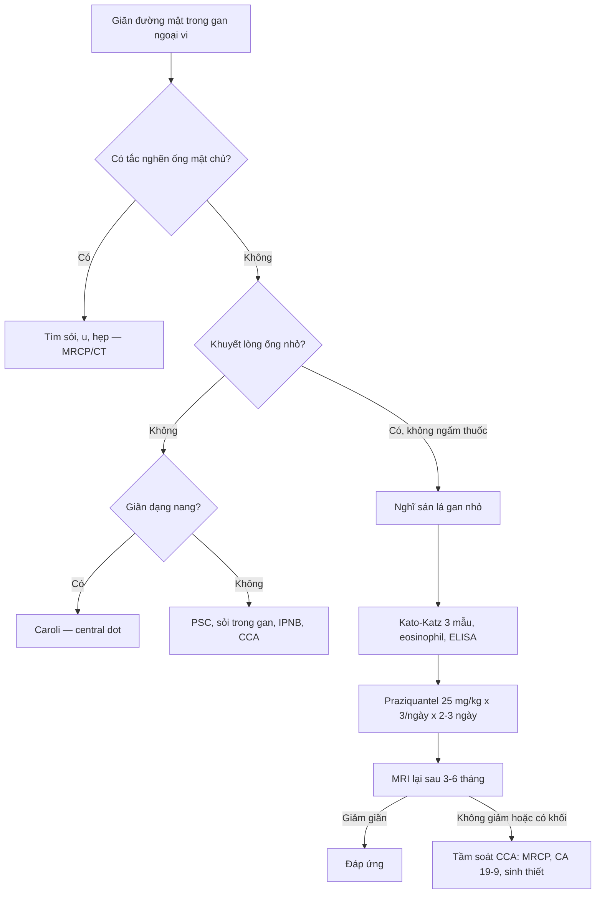
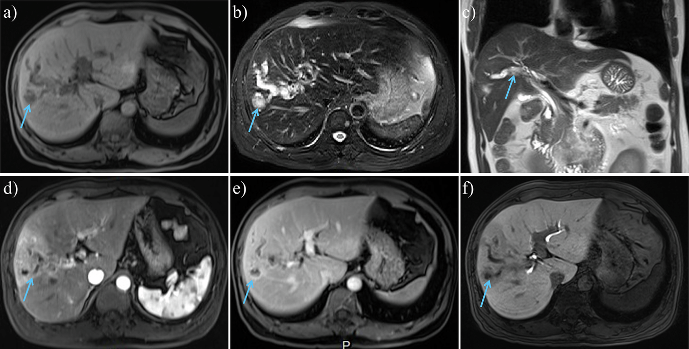
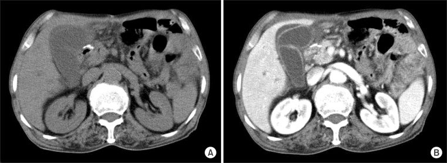
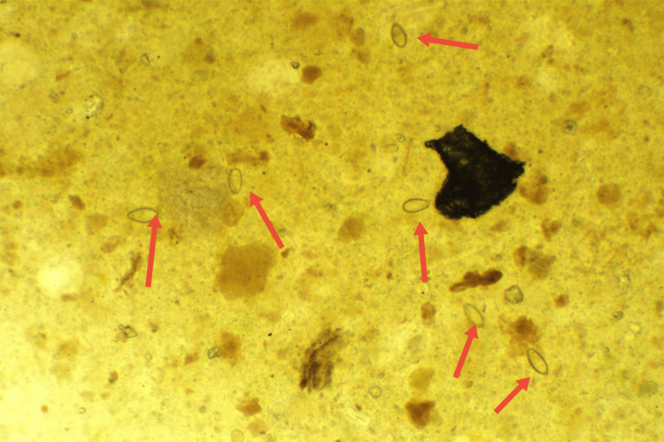
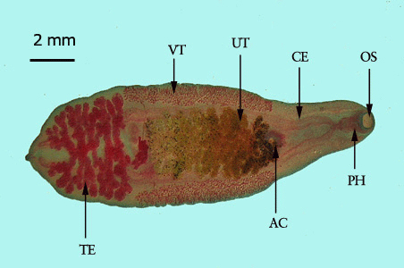

# 128 — Ký sinh trùng đường mật (sán lá gan nhỏ) & giãn đường mật ngoại vi / Clonorchiasis & opisthorchiasis

**Tags:** `pattern:gian-duong-mat` `pattern:khuyet-long-ong` `vung:duong-mat-trong-gan` `protocol:MRCP` `protocol:US` `incidentaloma:gian-duong-mat`
**Mức chắc chắn (certainty):** tổng hợp y văn (literature synthesis) — nhóm tự biên từ y văn mở (CC BY, CC BY-NC), có 3 ca nguyên văn (verbatim case) ghi rõ tuổi/bối cảnh trong chú thích ảnh; số liệu lấy nguyên từ bài gốc kèm PMCID tại chỗ.

> **Câu chốt:** giãn **đường mật trong gan ngoại vi** mà **không có tắc nghẽn đường mật ngoài gan**, kèm **khuyết lòng ống nhỏ, không bóng cản** = nghĩ **sán lá gan nhỏ** ở người từng ăn cá nước ngọt sống. Bệnh cảnh này **không phải "giãn đường mật do sỏi"** và cũng **không loại trừ ung thư đường mật** — sán làm tăng nguy cơ cholangiocarcinoma (OR 4,8).

## 1. Tổng quan bệnh học – cơ chế hình ảnh

### 1.1 Tác nhân và đường lây

- **Sán lá gan nhỏ (small liver flukes):** *Clonorchis sinensis*, *Opisthorchis viverrini*, *O. felineus* (họ Opisthorchiidae). Người nhiễm do ăn **cá nước ngọt sống hoặc chưa nấu chín** (gỏi cá, cá muối, cá khô ướp) hoặc tôm nước ngọt chứa **ấu trùng nang (metacercaria)**.
- **Chu trình:** trứng theo phân → ốc nước ngọt (vật chủ thứ nhất) → cá chép (vật chủ thứ hai) → người/động vật ăn cá. Trong tá tràng, ấu trùng thoát nang, **ngược dòng ống mật chủ** vào **đường mật trong gan ngoại vi** và trưởng thành.
- **Quy mô:** khoảng **15 triệu người nhiễm** toàn cầu theo tổng quan hình ảnh 2026 (PMC13652791); vùng Greater Mekong ước **15–18 triệu ca** (PMC11077858). Tại Việt Nam, gộp các nghiên cứu trong GMS cho **tỷ lệ nhiễm C. sinensis 20,30%** (KTC 95%: 9,13–31,47%) — vùng lưu hành chính là **Bắc Bộ** (PMC11077858).
- **Yếu tố nguy cơ:** thói quen ăn gỏi cá/cá nướng chưa chín, vùng có ao chuôm/ốc–cá nước ngọt, nghề đánh bắt cá, vệ sinh phân bón tươi.

### 1.2 TẠI SAO lại giãn đường mật ngoại vi (cơ chế hình ảnh)

- **Cơ học:** sán trưởng thành dài **10–25 mm**, rộng **3–5 mm**, bám vào **thành ống mật nhỏ ở ngoại vi** bằng hai giác bám (sucker). Số lượng lớn + dịch tiết (excretory–secretory products) gây **viêm thành ống, phù nề, tăng sinh biểu mô tuyến và xơ hóa quanh ống (periductal fibrosis)** → ống mật **giãn không đều, hình ống/chùm nho nhỏ** ở ngoại vi, trong khi **ống mật chủ thường không giãn hoặc chỉ giãn nhẹ**.
- **Vì sao ngoại vi là chỗ giãn rõ nhất:** lòng ống nhỏ, thành mỏng, ít mô đệm → chỉ cần phù nề + co kéo xơ là thấy giãn; ở ống lớn, thành dày và áp lực mật thấp hơn nên ít thay đổi.
- **Trên siêu âm (US):** mật là dịch **trống âm (anechoic)**; thành ống viêm **tăng hồi âm (hyperechoic)** dày → hình **"nhiều ống nhỏ" (too many tubes)** chạy ra ngoại vi, **không có bóng cản (acoustic shadowing)** như sỏi.
- **Trên CT:** dịch mật **0–20 HU**; sán trong lòng ống **đồng đậm độ với dịch** hoặc **khuyết nhẹ**, **không cản quang**, **không vôi hóa**. Thành ống viêm **ngấm thuốc thì tĩnh mạch cửa**. Không thấy **khối** hay **hẹp đột ngột** gây giãn ngược dòng.
- **Trên MRI/MRCP:** mật **tăng tín hiệu rất mạnh trên T2**; sán là **khuyết tín hiệu (filling defect) hình sợi/dải nhỏ** trong lòng ống giãn, **không ngấm thuốc ở mọi thì**; thành ống **dày, ngấm thuốc đồng nhất** (PMC13652791, Fig 5). Đây là **dấu hiệu chốt** vì MRI phân biệt được **khuyết lòng ống do sán** với **sỏi** (sỏi thường tối cả trên T1, có viền tăng tín hiệu) và với **u nhú** (ngấm thuốc).
- **Ngưỡng định lượng giãn ống mật trong gan:** ở người **< 60 tuổi**, gọi là giãn khi đường kính ống **> 2 mm** hoặc **> 40% đường kính tĩnh mạch cửa liền kề**; người lớn tuổi có thể rộng sinh lý thêm **0,3–0,7 mm mỗi thập kỷ** (PMC13652791).

### 1.3 Tại sao sán gây ung thư đường mật (cholangiocarcinoma – CCA)

- Viêm mạn + xơ hóa quanh ống + **tăng sinh biểu mô (adenomatous hyperplasia)** → tổn thương DNA do **gốc oxy hóa (ROS), NO, acid mật** và dịch tiết ký sinh trùng kích thích tăng sinh tế bào.
- **IARC xếp *O. viverrini* nhóm 1 từ 1994 và *C. sinensis* nhóm 1 từ 2009.**
- **Nguy cơ:** OR cho CCA **4,5 (KTC 95%: 2,6–7,7) đến 6,1 (4,4–8,6)** với *C. sinensis*; **4,4 (1,0–18,6)** với *O. viverrini*; gộp cả hai **4,8 (2,8–8,4)** (PMC13220244). Tỷ lệ CCA quy cho nhiễm *C. sinensis* ước **25/100.000 ở nữ và 35/100.000 ở nam** mỗi năm.

## 2. Mẫu hình + chẩn đoán phân biệt theo vị trí (gamut)

**Mẫu hình chính (pattern):** giãn **lan tỏa hoặc khu trú** các ống mật **nhỏ ở ngoại vi**, **không có điểm tắc (no transition point)**, thành ống dày nhẹ, **khuyết lòng ống nhỏ**; ống mật chủ bình thường hoặc giãn nhẹ.

**Gamut theo cơ chế:**

- **Do ký sinh trùng (bài này):** *Clonorchis/Opisthorchis* (giãn ngoại vi + khuyết lòng ống dạng sợi, vùng dịch tễ, tăng eosinophil); **sán lá gan lớn** (*Fasciola*) thường áp-xe/đường hầm trong gan hơn là giãn ống mật đơn thuần; **nang sán (hydatid)** là nang, không phải giãn ống (bài 139).
- **Do sỏi/bùn:** **sỏi trong gan (hepatolithiasis)** — sỏi cản quang/tối trên MRI, có bóng cản trên US, thường kèm hẹp ống và teo phân thùy (bài 138).
- **Do viêm/xơ:** **viêm đường mật xơ hóa nguyên phát (PSC)** — hẹp và giãn **dạng chuỗi hạt (beaded)** hoặc **"cây bị tỉa" (pruned tree)**, ưu thế ống lớn và trung gian, kèm bệnh viêm ruột; **viêm đường mật xơ hóa thứ phát** (sau thiếu máu, sau xạ, thuốc).
- **Bẩm sinh:** **bệnh Caroli** — giãn **dạng nang** thông với cây mật, có thể thấy **dấu "trung tâm chấm" (central dot sign)** do nhánh tĩnh mạch cửa trong nang; kèm xơ gan bẩm sinh/thận đa nang (bài 166).
- **Tân sinh:** **IPNB** (u nhú trong lòng ống, ngấm thuốc, giãn ống phía sau) (bài 129); **iCCA thể quanh ống (periductal-infiltrating)** — hẹp không đều, dày thành bất quy tắc, có khối mô mềm; **HCC xâm lấn đường mật (BDTT)**.
- **Mnemonic "FLUKE"** cho giãn đường mật ngoại vi không tắc: **F**luke (sán), **L**ithiasis (sỏi trong gan), **U**nknown cholangiopathy/PSC, **K**aroli (Caroli), **E**pithelium neoplastic (IPNB/CCA).

## 3. Bảng so sánh phân biệt (ma trận đối chiếu)

| Thực thể (entity) | Hình ảnh điển hình (US/CT/MRI) | Chốt vào (rule-in) | Chốt loại (rule-out) | Gợi ý xác nhận |
|---|---|---|---|---|
| **Sán lá gan nhỏ (clonorchiasis/opisthorchiasis)** | Giãn ống mật **ngoại vi** lan tỏa/khu trú; thành ống dày ngấm thuốc; **khuyết lòng ống dạng sợi, không ngấm thuốc** trên T2/MRCP; không sỏi | **Vùng dịch tễ + ăn cá sống + eosinophil tăng + khuyết lòng ống di động/không bóng cản** | Có **sỏi cản quang/bóng cản**, hẹp đột ngột, khối mô mềm ngấm thuốc → không phải sán đơn thuần | Kato–Katz 3 mẫu phân; ELISA/kháng thể; cholangioscopy thấy sán |
| **Sỏi trong gan (hepatolithiasis)** | Sỏi **tăng đậm độ trên CT**, **bóng cản trên US**, **tối trên T2**; ống mật giãn kèm **teo nhu mô** phân thùy | **Sỏi cản quang/tối trong lòng ống + teo phân thùy + hẹp ống** | Khuyết lòng ống **mềm, dạng sợi, không bóng cản, không cản quang** → nghĩ sán | CT không cản quang + MRCP; ERCP/PTBD lấy sỏi |
| **PSC** | Hẹp–giãn **dạng chuỗi hạt**, **"cây bị tỉa"**, ưu thế ống lớn/trung gian, thành ống dày | **Nhiều hẹp ngắn xen kẽ + bệnh viêm ruột + p-ANCA** | Giãn **chỉ ở ngoại vi**, không hẹp chuỗi hạt, khuyết lòng ống dạng sợi → nghĩ sán | MRCP; ERCP lấy mật tế bào; loại trừ nguyên nhân thứ phát |
| **Bệnh Caroli** | Giãn **dạng nang** thông với cây mật; **central dot sign**; có thể sỏi trong nang | **Nang thông với ống mật + central dot + thận đa nang/xơ gan** | Giãn **hình ống đều, không dạng nang**, không central dot → không Caroli | MRCP; CT; gen PKHD1 nếu cần |
| **IPNB** | **Khối nhú trong lòng ống ngấm thuốc**, giãn ống phía sau, có thể tiết nhầy | **Khối trong lòng ống ngấm thuốc + giãn ống không tương xứng** | Khuyết lòng ống **không ngấm thuốc, dạng sợi mảnh** → nghĩ sán/bùn | MRCP + cholangioscopy + sinh thiết |
| **iCCA thể quanh ống** | **Hẹp không đều + dày thành bất quy tắc + khối mô mềm**, giãn ống phía trên; ngấm thuốc thì muộn | **Khối/hẹp bất quy tắc + ngấm thuốc + CA 19-9 tăng** | Thành ống dày **đồng nhất, mỏng, không khối** → nghĩ viêm/sán | CT đa thì, MRI gadoxetic, sinh thiết |

**Đọc ma trận theo 3 câu hỏi:** (1) giãn **ngoại vi hay cả ống lớn**? (2) có **điểm tắc/khối** không? (3) khuyết lòng ống **có ngấm thuốc hay không**? Sán = ngoại vi + không tắc + không ngấm thuốc.

## 4. Protocol chụp + hệ phân độ/điểm chuẩn hóa

### 4.1 Protocol

- **Siêu âm (first-line):** nhịn ăn **≥ 6 giờ**; đầu dò **convex 3,5–5 MHz** cho gan, **linear 7–12 MHz** cho ống mật ngoại vi sát bao gan; đo đường kính ống mật trong gan, ghi **vị trí ngoại vi**, tìm **bóng cản**, **khuyết lòng ống**, dày thành, dịch quanh túi mật.
- **CT bụng:** **không cản quang + thì tĩnh mạch cửa** (lát **1–3 mm**); cần thì thêm thì động mạch muộn để đánh giá khối/ngấm thuốc thành ống. Không dùng CT để "tìm sán" — CT để **loại trừ sỏi cản quang, khối, biến chứng**.
- **MRI/MRCP (chốt):** **T2 lát mỏng 3 mm**, **MRCP 3D**, **DWI**, và **T1 sau tiêm + thì gan–mật (gadoxetic acid)** nếu nghi CCA. Đánh giá: mức giãn, **khuyết lòng ống**, dày/ngấm thuốc thành ống, khối, hạch.
- **Nội soi ống mật (cholangioscopy – SpyGlass):** khi cần **nhìn trực tiếp sán** hoặc phân biệt u/bùn; ca 2026 ghi nhận **thấy sán sống di động trong lòng ống mật** (PMC13040101) — bằng chứng trực tiếp, tránh sinh thiết mù.
- **Xét nghiệm kèm:** **công thức máu (eosinophil)**, **Kato–Katz 3 mẫu phân** (độ nhạy tăng khi lặp mẫu), **ELISA/ICT kháng thể** (độ đặc hiệu thấp, không phân biệt nhiễm cũ/mới), **CA 19-9** khi nghi CCA.

### 4.2 Điều trị và theo dõi (ngưỡng lấy từ nguồn)

- **Praziquantel (thuốc chọn):** **25 mg/kg × 3 lần/ngày × 2–3 ngày** (WHO); **40 mg/kg liều đơn** tiện hơn nhưng **tỷ lệ thất bại cao hơn**. **Albendazole** thay thế: **10 mg/kg/ngày × 7 ngày** hoặc **8 mg/kg × 2 lần/ngày × 5 ngày** (PMC13220244).
- **Kiểm soát nguồn:** điều trị **cả gia đình/người cùng ăn**, tẩy giun định kỳ ở vùng lưu hành, **không ăn cá nước ngọt sống**.
- **Theo dõi sau điều trị:** chụp lại MRI/US sau **3–6 tháng** (khoảng cách tối ưu chưa có đồng thuận — ghi rõ "chưa rõ"): giãn ống và dày thành **giảm** sau praziquantel là **bằng chứng đáp ứng** (PMC13652791); nếu **giãn tăng, xuất hiện khối/hẹp** → **tầm soát CCA** (MRCP + CA 19-9 + sinh thiết/cholangioscopy).
- **Tầm soát CCA ở người nhiễm mạn vùng lưu hành:** siêu âm ± CA 19-9 định kỳ; **khoảng cách tối ưu chưa có đồng thuận** — không bịa con số.

## 5. Biến thể bình thường và cạm bẫy

- **Giãn sinh lý theo tuổi:** ống mật trong gan có thể **rộng dần 0,3–0,7 mm/thập kỷ**, không kèm dày thành hay ứ mật → **đừng gọi là bệnh** nếu không có khuyết lòng ống/eosinophil/triệu chứng.
- **Sau cắt túi mật:** ống mật chủ có thể giãn nhẹ **bù trừ**; nhưng **giãn ống trong gan ngoại vi mới** vẫn phải giải thích (sán, sỏi, hẹp).
- **Khí trong đường mật sau ERCP/cắt cơ vòng Oddi:** khí **HU rất thấp (−1000 đến −500)**, nổi **phía trước (non-dependent)**, có thể thấy cả trong túi mật — **không phải sán, không phải áp-xe**; so phim trước và hỏi tiền sử thủ thuật.
- **Sán vs sỏi non-calcified:** sỏi cholesterol **không cản quang** trên CT và có thể **không bóng cản** trên US → chuyển sang **MRI**: sỏi **tối trên T2**, sán **khuyết tối mảnh, dạng sợi, có thể di động**; cholangioscopy là chốt.
- **Sán vs IPNB:** u nhú **ngấm thuốc**, có **cuống/chồi**, giãn ống không tương xứng; sán **không ngấm thuốc**. Đừng chỉ dừng ở "có sán" — **u có thể nằm cùng chỗ**.
- **Cạm bẫy "thỏa mãn tìm kiếm" (satisfaction of search):** thấy sán không loại trừ **CCA đồng thời**; luôn đo **CA 19-9**, tìm **khối/hẹp**, và **theo dõi hình ảnh sau điều trị**.
- **Eosinophil bình thường không loại trừ:** nhiễm nhẹ/mạn có thể không tăng eosinophil; hỏi kỹ **thói quen ăn gỏi cá** và làm **3 mẫu phân**.

## 6. Tự lượng giá — Blind Quiz

**Ca 1 — Nam 56 tuổi, đau hạ sườn phải mơ hồ, không sốt. MRI gan (T1, T2, MRCP, động mạch, tĩnh mạch cửa, thì gan–mật):**

- Gợi ý: không có tiền sử sỏi; sống ở vùng có ao cá.
- Hỏi: (1) Giãn ở đâu, có tắc nghẽn không? (2) Khuyết lòng ống có ngấm thuốc không? (3) 3 chẩn đoán phân biệt và xét nghiệm chốt?

<b>Bấm để hiện đáp án (findings + chẩn đoán)</b>

- **Dấu hiệu:** giãn **khu trú đường mật trong gan thùy phải** (a: T1 giảm tín hiệu; b–c: T2 tăng tín hiệu, **khuyết tín hiệu dạng sợi trong lòng ống** — mũi tên xanh); thành ống **dày, ngấm thuốc đồng nhất** thì tĩnh mạch cửa (e); các khuyết lòng ống **không ngấm thuốc** ở mọi thì (d–f). **Không có khối, không hẹp đột ngột, không sỏi.**
- **Chẩn đoán:** **clonorchiasis** (sán lá gan nhỏ) — khuyết lòng ống là **sán trưởng thành**, không ngấm thuốc; giãn ngoại vi do viêm/xơ quanh ống.
- **Vì sao:** mật T2 rất sáng; sán là mô mềm nhỏ **không có mạch máu** nên **không ngấm thuốc**, khác u nhú/IPNB.
- **Xác nhận:** Kato–Katz 3 mẫu phân, eosinophil, ELISA; điều trị **praziquantel 25 mg/kg × 3/ngày × 2–3 ngày**, MRI lại sau 3–6 tháng.
- **Nguồn ảnh:** Insights into Imaging 2026 (PMC13652791), Fig 5, CC BY 4.0.

**Ca 2 — Nam 68 tuổi, sốt + đau hạ sườn phải 2 ngày, sống gần sông; CT bụng có/không cản quang:**

- Hỏi: dấu hiệu chính? Có giãn đường mật không? Chẩn đoán và yếu tố nguy cơ ẩn?

<b>Bấm để hiện đáp án</b>

- **Dấu hiệu:** **túi mật căng to, thành dày, ngấm thuốc, dịch quanh túi mật (pericholecystic fluid)**; **giãn nhẹ đường mật trong gan ngoại vi** không có sỏi cản quang.
- **Chẩn đoán:** **viêm túi mật cấp nguyên phát do *C. sinensis*** (hiếm) — sán trong túi mật/ống túi mật gây viêm; ca gốc mô tả **sán lấy ra từ ống túi mật và túi mật**.
- **Vì sao:** viêm thành túi mật + dịch quanh túi mật là **dấu hiệu viêm cấp**; giãn ngoại vi nhẹ là manh mối ký sinh trùng.
- **Xử trí:** cắt túi mật nội soi + **praziquantel**; tìm **sỏi/sán trong ống mật chủ** trước mổ bằng MRCP nếu nghi.
- **Nguồn ảnh:** Annals of Surgical Treatment and Research 2014 (PMC4127904), Fig 1, CC BY-NC 3.0.

**Ca 3 — Nam 29 tuổi, men gan bất thường 3 năm, không rõ nguyên nhân; soi phân tươi:**

- Hỏi: hình dạng, kích thước trứng? Vì sao men gan kéo dài? Cần làm gì tiếp?

<b>Bấm để hiện đáp án</b>

- **Dấu hiệu:** trứng **hình hạt vừng (sesame seed)**, **26–32 × 15–17 µm**, một đầu có **nắp (operculum)** và **vai (shoulder/acromion)**; vỏ mỏng, bên trong có ấu trùng.
- **Chẩn đoán:** **clonorchiasis** — trứng trong phân xác nhận nhiễm; men gan kéo dài do viêm đường mật mạn.
- **Vì sao:** trứng nhỏ, vỏ mỏng, nắp rõ — đặc trưng Opisthorchiidae; phân biệt với trứng *Fasciola* (lớn hơn, ~130–150 µm) và sỏi mật (không có cấu trúc sinh học).
- **Xử trí:** praziquantel theo cân nặng; kiểm tra lại phân sau điều trị; **siêu âm/MRCP** tầm soát giãn ống mật và CCA.
- **Nguồn ảnh:** Cureus 2024 (PMC11108091), Fig 1, CC BY 4.0.

**Ảnh minh họa thêm — sán trưởng thành (hình thái):**

*Sán trưởng thành: thân dẹt, dài 10–25 mm, hai giác bám. Nguồn: DPDx–CDC, public domain (Wikimedia Commons).*

## Bài liên quan chéo
- [100 – Tổng quan hệ Bụng](../100-tong-quan-he-bung/lesson.md)
- [131 – Tắc mật](../131-tac-mat/lesson.md)
- [138 – Sỏi trong gan & viêm đường mật mủ tái phát](../138-soi-trong-gan-viem-duong-mat-mu/lesson.md)
- [139 – Sán lá gan (nang sán)](../139-san-la-gan/lesson.md)
- [129 – IPNB & u nhầy đường mật](../129-IPNB-va-u-nhay-duong-mat/lesson.md)
- [137 – Theo dõi stent/dẫn lưu đường mật](../137-theo-doi-stent-dan-luu-duong-mat-di-tru-tac-nhiem-trung/lesson.md)

## Ảnh
- `128_ks-trung-duong-mat_MRI_InsightsImaging2026-Fig5.png` — MRI 6 thì, ca 56 tuổi, CC BY 4.0 (PMC13652791).
- `128_ks-trung-duong-mat_CT_AnnSurgTreatRes2014-Fig1.jpg` — CT không cản quang/có cản quang, ca 68 tuổi, CC BY-NC 3.0 (PMC4127904).
- `128_ks-trung-duong-mat_Egg_Cureus2024-Fig1.jpg` — soi phân ×100, ca 29 tuổi, CC BY 4.0 (PMC11108091).
- `128_ks-trung-duong-mat_Adult-worm_CDC-DPDx.jpg` — DPDx–CDC, public domain.
- Chi tiết giấy phép từng ảnh: `images/CREDITS.md`.

> Không dùng để chẩn đoán độc lập khi chưa có người hướng dẫn.
