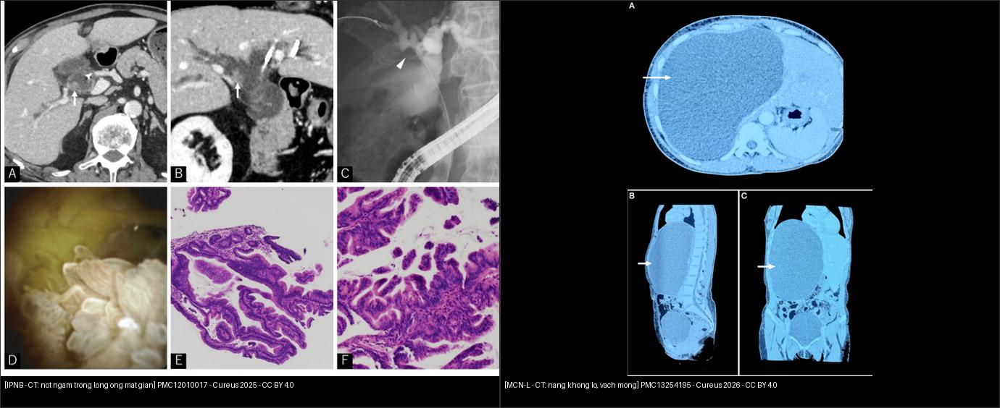
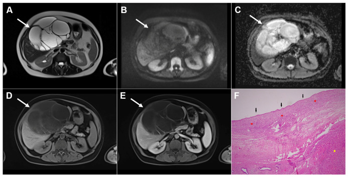
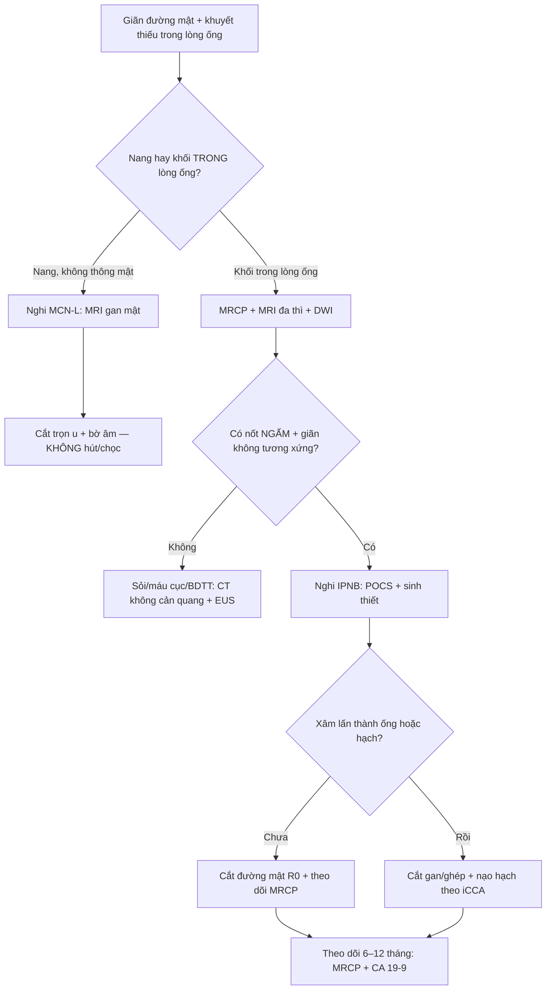
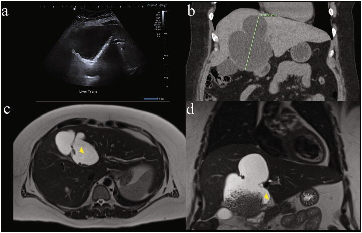
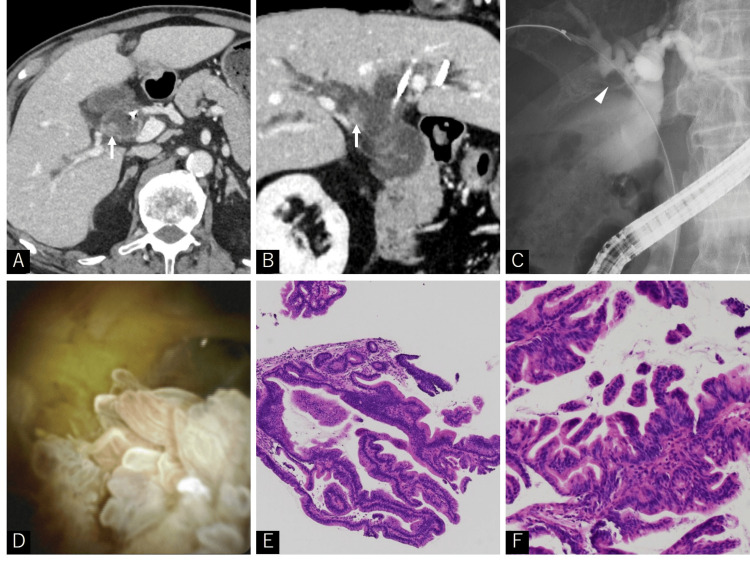
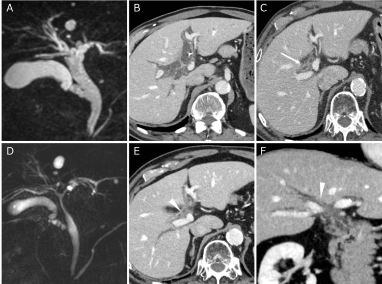
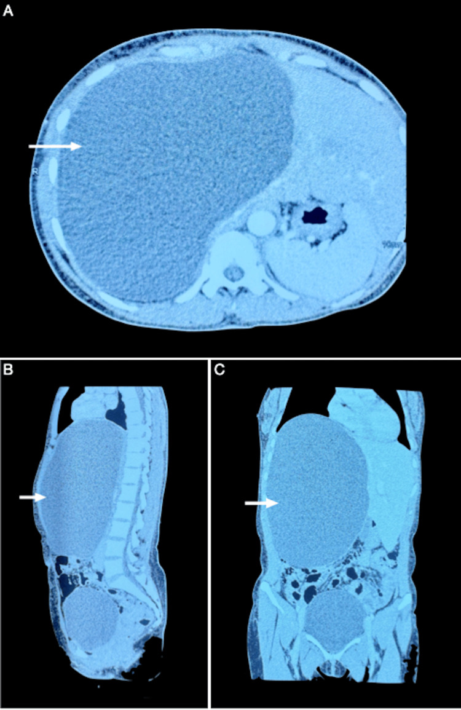
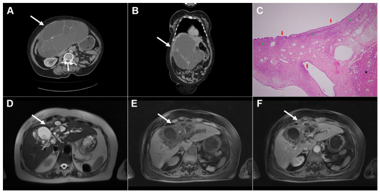
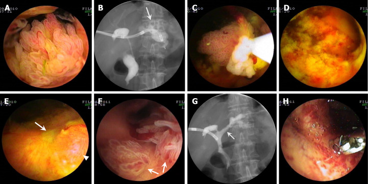
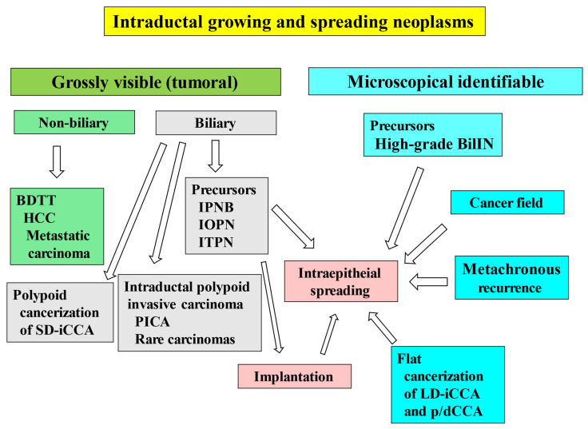

# 129 — U nhầy nhú nội ống mật (IPNB) & u nhầy đường mật (MCN-L): khối trong lòng ống vs nang có vách / Intraductal papillary neoplasm of the bile duct & mucinous cystic neoplasm of the liver

**Tags:** `pattern:u-long-ong-mat` `vung:duong-mat` `protocol:MRCP` `protocol:cholangioscopy`
**Mức chắc chắn (certainty):** tổng hợp y văn (literature synthesis) — nhóm tự biên từ y văn mở, có 1 ca nguyên văn IPNB (PMC12010017) và 1 ca nguyên văn MCN-L 27 cm (PMC13254195); mọi số liệu lấy nguyên từ bài gốc, ghi PMCID tại chỗ.

> **Câu chốt:** cùng là "nang/khối đường mật", nhưng **IPNB là u TIỀN ÁC MỌC TRONG LÒNG ỐNG** (phải cắt đường mật), còn **MCN-L là u nang TIỀN ÁC CÓ MÔ ĐỆM BUỒNG TRỨNG** (phải cắt trọn u, không chọc/hút). Nhầm hướng điều trị đều dẫn tới **tái phát hoặc gieo rắc**.

## 1. Tổng quan bệnh học – cơ chế hình ảnh

### 1.1 Hai thực thể, hai nguồn gốc

- **IPNB (intraductal papillary neoplasm of the bile duct):** u **tiền ác, nhìn thấy đại thể**, gồm **nhú/nhung mao biểu mô đường mật** mọc trong lòng **ống mật lớn** (trong gan, rốn gan hoặc ống mật chủ) — định nghĩa WHO 2019, giữ nguyên trong phân loại 2026 (PMC12118913, PMC13162898). Đây là **tiền thân của ung thư đường mật trong gan typ ống lớn và CCA rốn gan/đoạn xa**.
  - Tần suất: **~4–15% các u đường mật** (PMC12118913).
  - **Type 1:** cấu trúc nhú–nhung mao **đều**, lõi xơ mạch **mảnh**, loạn sản **thấp–trung bình**; **Type 2:** cấu trúc **phức tạp**, phân nhánh không đều và/hoặc **thành phần đặc–ống**, tế bào **độ cao**, xâm lấn nhiều hơn (PMC12118913).
  - **Hình thái trên hình ảnh:** **branched** (dạng nhánh), **main duct** (ống chính), **mixed** (hỗn hợp) — sống 5 năm sau mổ **100% / 90% / 50%**, tái phát 5 năm **62%** ở thể mixed (PMC12118913, n = 42).
  - **Xâm lấn qua thành ống (SE/SI) → sống đặc hiệu bệnh 5 năm 0%**; hạch di căn cũng làm tiên lượng xấu (p = 0,021) (PMC12118913). Đây là lý do **phải đánh giá độ xâm lấn và hạch trước mổ**, không chỉ "có khối trong ống".
- **MCN-L (mucinous cystic neoplasm of the liver):** u nang **tiền ác** với **biểu mô tiết nhầy + mô đệm kiểu buồng trứng (ovarian-type stroma)** — mô đệm này là **tiêu chuẩn mô bệnh học bắt buộc** và là thứ phân biệt MCN-L với mọi nang gan khác (PMC13194582, PMC13254195).
  - **< 5% các nang gan**; **96–100% ở nữ** khi bắt buộc có mô đệm buồng trứng; kích thước trung bình khi chẩn đoán **~11 cm** (PMC13194582, PMC13254195).
  - **Ung thư xâm lấn đi kèm: < 5% đến ~9%** (PMC13254195). Không thể loại trừ ác tính trước mổ bằng hình ảnh/sinh thiết → **cắt trọn u là tiêu chuẩn**, không hút/chọc/đốt.
  - **Đa số MCN-L KHÔNG thông với cây mật**; thể **có thông mật** là biến thể hiếm, dễ giả IPNB (PMC12981661).

### 1.2 TẠI SAO hình ảnh trông như vậy (vật lý + mô bệnh)

- **Khối nhú trong lòng ống:** tổ chức u có **mạch máu trong lõi xơ** → **ngấm cản quang** ở thì động mạch/TM cửa, trong khi **dịch mật xung quanh không ngấm** → nốt sáng nằm trong ống mật tối trên CT sau tiêm. Trên **MRCP (T2 nặng)**, dịch mật **rất sáng**, còn u **trung bình–tối hơn** → **khuyết thiếu (filling defect)** nổi bật trong ống sáng.
- **Giãn ống mật không tương xứng:** nhầy do u tiết ra **làm đầy và tăng áp lực lòng ống**, gây giãn **lan cả trên và dưới chỗ tắc**, trong khi nguyên nhân cơ học (sỏi) thường chỉ giãn **phía trên**. Đây là dấu hiệu "gợi ý nhầy" kinh điển; ca PMC12010017 vẫn giãn ống mật **1 tháng sau khi đã lấy sỏi**, và nhầy chảy ra từ nhú Vater là lúc nghĩ tới IPNB.
- **T2/ADC:** tổ chức nhú đặc **hạn chế khuếch tán nhẹ**; nhưng **nhầy rất sáng T2** có thể làm ADC không thấp giả tạo — **không dùng DWI một mình để chốt lành/ác**. Giá trị của DWI là **phát hiện ổ đặc/xâm lấn** và **hạch**.
- **MCN-L:** dịch nhầy **T2 rất sáng, T1 tối**, vách xơ **T2 tối + ngấm thuốc**, **không có nốt đặc trong lòng ống mật** vì u **nằm trong nang**, không nằm trong ống. Vôi hóa vách gặp ở một phần ca (không đặc hiệu).
- **Vì sao MCN-L "giả nang đơn thuần":** nếu **một ngăn, vách mỏng, không có thành phần đặc**, hình ảnh gần như trùng nang gan đơn thuần — ca 27 × 18 × 19 cm trong PMC13254195 là ví dụ điển hình. **Kích thước lớn + giới nữ trung niên + vách mỏng nhưng có vài vách** phải cảnh giác, không chọc hút.

## 2. Mẫu hình + chẩn đoán phân biệt theo vị trí (Gamut)

### 2.1 Khối/khuyết thiếu TRONG LÒNG ống mật (intraductal)

- **IPNB** (typ ống lớn/rốn gan): nốt nhú ngấm thuốc, giãn ống mật trên–dưới, có thể nhiều ổ do **gieo cấy nội ống**.
- **iCCA thể mọc trong lòng ống / huyết khối u (BDTT):** HCC, di căn đại tràng–thận–melanoma có thể **mọc vào lòng ống mật**, giả IPNB (PMC13162898).
- **Sỏi trong gan / sỏi OMC:** tăng đậm độ trên CT không cản quang, **tín hiệu trống** trên MRCP, **di động** khi đổi tư thế/không ngấm thuốc.
- **Máu cục sau chấn thương/ERCP:** không ngấm, tự tiêu theo thời gian.
- **IOPN/ITPN:** IOPN (u nhú tế bào ưa acid) và ITPN (u ống–nhú) — nhóm u nội ống khác, **mô bệnh học** mới phân biệt được; ITPN có thể giống iCCA typ ống nhỏ (PMC13162898).
- **MCN-L có thông mật (hiếm):** nang chứa nhầy **thoát vào ống mật**, tạo khuyết thiếu + giãn ống, rất dễ nhầm IPNB (PMC12981661).

### 2.2 Nang/khối dạng NANG trong gan

- **MCN-L:** nữ trung niên, nang lớn nhiều ngăn/vách, **không thông mật** (thường), mô đệm buồng trứng.
- **Nang gan đơn thuần:** thành không thấy, dịch thuần nhất **0–15 HU**, không vách/nốt, không thông mật.
- **Nang sán lá gan:** màng tách, nang con, vôi hóa vỏ, huyết thanh dương tính (xem [139](../139-san-la-gan/lesson.md)).
- **Bệnh Caroli:** giãn nang **thông với cây mật** + **central dot** (mạch máu trong nang) — xem [123](../123-nang-gan-va-benh-gan-da-nang/lesson.md).
- **U mô đệm đường mật (von Meyenburg):** nhiều nốt nhỏ **< 1,5 cm**, T2 "trời sao", không thông mật.
- **Di căn nang / u nhầy khác:** thường nhiều ổ, có thành phần đặc, bối cảnh ung thư nguyên phát.

### 2.3 Mnemonic "MINT" cho khối trong lòng ống

- **M**ucin → **IPNB** (giãn không tương xứng, nhầy).
- **I**nvasion → **iCCA/BDTT** (khối ngấm + xâm lấn nhu mô).
- **N**idus → **sỏi** (tăng đậm độ, tín hiệu trống).
- **T**hrombus → **máu cục** (không ngấm, có bối cảnh chấn thương/thủ thuật).

## 3. Bảng so sánh phân biệt (ma trận đối chiếu)

| Thực thể (entity) | Hình ảnh điển hình | Chốt vào (rule-in) | Chốt loại (rule-out) | Gợi ý xác nhận |
|---|---|---|---|---|
| **IPNB** | Nốt/nhú **ngấm thuốc trong lòng ống mật giãn**; giãn trên–dưới; có thể nhiều ổ | **Nốt ngấm trong lòng ống + giãn không tương xứng + nhầy** | Nang không thông mật, không có nốt trong ống → nghĩ MCN/nang | MRCP + MRI đa thì + **POCS sinh thiết**; cắt đường mật |
| **MCN-L** | Nang lớn **nhiều ngăn/vách**, dịch nhầy, vách ngấm; **không nốt trong ống** | **Nữ + nang lớn + vách ngấm + không thông mật** | Có nốt ngấm trong lòng ống + giãn mật → IPNB; màng tách/nang con → sán | MRI gan mật; **cắt trọn u** (không hút) |
| **iCCA/BDTT** | Khối ngấm **xâm lấn nhu mô**, hẹp/tắc ống, hạch; BDTT là khối trong ống | **Khối ngấm + phá nhu mô + hạch + bối cảnh HCC/di căn** | Chỉ có khuyết thiếu không ngấm, bờ nhẵn → sỏi/máu | CT 4 thì/MRI, sinh thiết |
| **Sỏi trong gan** | **Tăng đậm độ** trên CT không cản quang; **tín hiệu trống** trên MRCP; có thể di động | **Tăng đậm độ + tín hiệu trống + không ngấm** | Nốt ngấm thuốc → u | CT không cản quang + MRCP; ERCP/POCS |
| **Nang sán (CE1–CE3a)** | Nang **màng tách/nang con**, vỏ vôi hóa; **không ngấm** | **Màng tách + nang con + huyết thanh dương** | Vách ngấm + nốt đặc → MCN/IPNB | US + MRI + ELISA (xem bài 139) |
| **Nang gan đơn thuần** | **0–15 HU**, thành không thấy, không vách/nốt | **Thuần dịch + không ngấm + không vách** | Vách dày/ngấm, nốt, vôi hóa → MCN/khác | US đủ nếu điển hình; MRI khi không chắc |

*Trái: IPNB — nốt ngấm thuốc trong ống mật giãn (mũi tên), kèm ERCP/cholangioscopy/mô bệnh. Phải: MCN-L 27 cm — nang một ngăn, vách mỏng, không nốt đặc. Cả hai đều CC BY 4.0; ảnh ghép letterbox giữ nguyên tỷ lệ.*

### 3.1 Ba câu hỏi đọc hình ảnh theo thứ tự

1. **Tổn thương nằm TRONG lòng ống hay TRONG nang?** → trong lòng ống = IPNB/BDTT/sỏi; trong nang = MCN/nang/sán.
2. **Có ngấm thuốc không?** → ngấm = tổ chức u (IPNB, MCN vách/nốt, iCCA); không ngấm = dịch/sỏi/máu.
3. **Có thông với cây mật không?** → có = IPNB, Caroli, MCN thể thông mật; không = MCN điển hình, nang đơn thuần, sán.

*MCN-L: T2 nhiều ngăn (A), DWI/ADC không hạn chế đáng kể (B,C), vách ngấm thuốc (D,E); mô bệnh có mô đệm buồng trứng (F). Điểm chốt: u nằm **trong nang**, không phải trong lòng ống mật. Nguồn: Djokic Kovač J et al., Diagnostics (Basel) 2026, PMC13163135, CC BY 4.0.*

## 4. Protocol chụp + hệ phân độ/điểm chuẩn hóa

### 4.1 Protocol

- **Siêu âm bụng:** bước đầu, phát hiện giãn đường mật/nang; **không đủ** để chốt IPNB.
- **CT bụng–chậu đa thì (không cản quang + động mạch + TM cửa + muộn):** đánh giá nhu mô gan, hạch, xâm lấn mạch, di căn; **không cản quang** để thấy sỏi/vôi hóa.
- **MRI gan mật + MRCP (3D, T2 nặng) + DWI + T1 sau tiêm động học:** **tiêu chuẩn** cho khối trong lòng ống. Cần **lát mỏng ≤ 3 mm** qua rốn gan và **MIP 3D** để không bỏ sót tổn thương thứ hai (gieo cấy nội ống).
- **Cholangioscopy (POCS) + sinh thiết dưới hướng dẫn:** khi nghi IPNB mà hình ảnh không chốt; ca PMC12010017 chẩn đoán nhờ **POCS thấy nhú trắng + nhầy** và sinh thiết. Lưu ý **sinh thiết âm không loại trừ** (lấy mẫu nông).
- **EUS/FNA:** hữu ích cho đoạn ống mật xa/tụy.
- **PET/CT:** không thường quy; có thể giúp phát hiện hạch/di căn khi nghi xâm lấn.

### 4.2 Phân loại & ngưỡng xử trí

- **WHO 2019/2026:** IPNB (typ 1/2), **IOPN**, **ITPN**, **BilIN độ cao**; MCN-L xếp theo **loạn sản thấp/độ cao/ung thư xâm lấn** (PMC13162898, PMC13194582).
- **IPNB:** **cắt đường mật/ghép gan tùy vị trí** là điều trị chuẩn; **R0** quan trọng. Xâm lấn qua thành ống → tiên lượng rất xấu (5 năm DSS **0%**) → cần **nạo hạch** và đánh giá mạch.
- **MCN-L:** **cắt trọn u + bờ âm** cho **mọi** ca nghi ngờ, **bất kể kích thước/triệu chứng**; **không** hút/chọc/đốt (nguy cơ tái phát, gieo rắc) (PMC13194582).
- **EASL 2022** cho MCN-L dựa trên "đặc điểm đáng lo" trên hình ảnh, nhưng khi kiểm chứng độc lập: **Se 40% (95% CI 5,3–85%), Sp 80% (61–92%)** — **không đủ để loại trừ MCN** (PMC10874321). Vì vậy **không được dùng hình ảnh để "theo dõi" một nang nghi MCN**.
- **IPNB không mổ được:** ca PMC12010017 dùng **SBRT 60 Gy/8 phân liều** (VMAT, 10 MV, fiducial vàng, nín thở thì thở ra); giãn đường mật và viêm đường mật hết sau **1 tháng**, không tái phát ≥ 1 năm. Đây là lựa chọn cá biệt, không thay thế mổ.

## 5. Biến thể bình thường và cạm bẫy

- **Sỏi "giả u":** sỏi cholesterol có thể **không tăng đậm độ rõ** trên CT; trên MRCP là **tín hiệu trống** — đừng gọi u. Ngược lại, **u nhầy không vôi hóa** có thể bị đọc là "sỏi mềm".
- **Nhầy làm mờ tổn thương:** nhầy lấp đầy ống → chỉ thấy giãn ống, **bỏ sót u nhỏ**. Ca PMC12010017: CT/MRCP ban đầu nghĩ sỏi, chỉ sau khi **giãn ống không giảm sau lấy sỏi** mới nghĩ IPNB.
- **Đa ổ do gieo cấy:** IPNB có thể **gieo cấy nội ống** và **lan biểu mô > 20 mm** khỏi u chính (định nghĩa "superficial spread" trong PMC12118913) → **cắt bờ xa hơn u trên hình ảnh**, kiểm tra toàn bộ cây mật.
- **MCN-L một ngăn:** giống nang đơn thuần; **không chọc hút để "xem dịch"** vì có thể làm gieo rắc/tái phát. Nang lớn ở nữ trung niên → **MRI + cắt trọn**.
- **MCN-L thông mật:** hiếm, tạo khuyết thiếu trong ống → dễ chẩn đoán nhầm IPNB; **chỉ mô bệnh học (mô đệm buồng trứng)** mới phân biệt (PMC12981661).

*Siêu âm (a) thấy "chất nền" tăng echo trong nang; CT (b) nang 121,69 mm; MRI T2 (c) nhiều ngăn; MRI sau tiêm (d) vách ngấm. Cùng một tổn thương nhưng **mỗi phương thức cho một khuôn mặt khác nhau** — đây là lý do phải cắt trọn và mô bệnh. Nguồn: Hines EM et al., J Surg Case Rep 2026, PMC12981661, CC BY 4.0.*
- **Sinh thiết âm:** POCS/biopsy có thể chỉ lấy được nhầy/niêm mạc viêm → **âm không loại trừ IPNB**; cần lặp lại/lấy sâu hoặc mổ chẩn đoán.
- **Cạm bẫy "ổn định":** MCN-L có thể **lớn chậm nhiều năm**; kích thước không đổi **không** loại trừ ác tính.

## 6. Tự lượng giá — Blind Quiz

**Ca 1 — Nam 80 tuổi, sốt + vàng da, tiền sử sỏi OMC đã lấy. Nhìn CT/MRCP trước, mô tả trước khi mở đáp án.**

- Gợi ý: giãn đường mật **không giảm** sau can thiệp; dịch mật quánh.
- Hỏi: (1) Dấu hiệu chính trong lòng ống? (2) 3 chẩn đoán phân biệt? (3) Bước tiếp theo để chốt?

<b>Bấm để hiện đáp án</b>

- **Findings:** ống mật trong gan và OMC giãn; **nốt ngấm thuốc trong nhánh ống gan phải** (mũi tên); ERCP có **khuyết thiếu** cùng vị trí; POCS thấy **nhú trắng + nhầy**; mô bệnh là **IPNB type 1, loạn sản thấp–trung bình**.
- **Chẩn đoán:** IPNB.
- **Vì sao:** nhú có lõi xơ mạch → ngấm thuốc; dịch mật T2 sáng → khuyết thiếu; nhầy → giãn không tương xứng.
- **DDx:** sỏi (tín hiệu trống, không ngấm), máu cục (không ngấm), iCCA/BDTT (xâm lấn nhu mô/hạch), MCN thông mật (hiếm).
- **Bước tiếp:** POCS + sinh thiết; nếu mổ được → cắt đường mật R0; ca này không mổ được → SBRT 60 Gy/8 phân liều.
- **Nguồn:** Inoue M et al., *Cureus* 2025, PMC12010017, CC BY 4.0.

**Ca 2 — Cùng bệnh nhân, MRCP trước và sau điều trị. Vì sao vẫn giãn ống mật dù đã lấy sỏi?**

- Hỏi: so sánh A với D; nốt trong ống thay đổi thế nào? Điều này nói gì về cơ chế giãn?

<b>Bấm để hiện đáp án</b>

- **Findings:** trước điều trị, MRCP giãn lan tỏa + khuyết thiếu; sau SBRT, **giãn đường mật giảm rõ** trên MRCP và CT; tổn thương trong ống nhỏ lại.
- **Cơ chế:** giãn do **nhầy + tắc bởi u**, không chỉ do sỏi. Lấy sỏi không giải quyết được nếu còn u tiết nhầy.
- **Chốt:** giãn đường mật **không tương xứng/không hồi phục sau can thiệp sỏi** = tìm IPNB.
- **Nguồn:** PMC12010017, CC BY 4.0.

**Ca 3 — Nữ 44 tuổi, bụng to 6 tháng, không đau. CT bụng có nang rất lớn.**

- Hỏi: 3 đặc điểm khiến đây **không** phải nang gan đơn thuần? Xử trí?

<b>Bấm để hiện đáp án</b>

- **Findings:** nang **27 × 18 × 19 cm** vùng gan phải, **vách mỏng**, một ngăn, không nốt đặc rõ; đè đẩy tạng.
- **Chẩn đoán:** **MCN-L** (mô bệnh: biểu mô tiết nhầy + **mô đệm kiểu buồng trứng**, không loạn sản/ác).
- **Vì sao không phải nang đơn thuần:** kích thước khổng lồ + nữ trung niên + vách/thành thấy được; **không thể loại trừ ác tính bằng hình ảnh**.
- **Xử trí:** **cắt trọn u** (ca này cắt gan phải sau, nội soi), **không hút/chọc**; theo dõi 1 năm không tái phát.
- **Nguồn:** Lomada MS et al., *Cureus* 2026, PMC13254195, CC BY 4.0.

**Ca 4 — Nữ 57 tuổi, MCN-L đã mổ 3 năm, đau bụng tái phát. CT/MRI cho thấy vách dày hơn và một phần đặc.**

- Hỏi: dấu hiệu nào gợi **tái phát/ác tính**? Theo dõi hay mổ lại?

<b>Bấm để hiện đáp án</b>

- **Findings:** nang nhiều ngăn **vách dày không đều**, **thành phần đặc nhỏ** trong lòng; vách ngấm thuốc; không có nang con/màng tách.
- **Chẩn đoán:** **MCN-L tái phát** (mô bệnh xác nhận); vách dày + thành phần đặc là **đặc điểm đáng lo**, không thể loại trừ ung thư xâm lấn.
- **Xử trí:** **mổ lại lấy trọn** + mô bệnh; không theo dõi đơn thuần.
- **Cạm bẫy:** đây không phải nang sán (không nang con, không màng tách, vách **ngấm thuốc**).
- **Nguồn:** Djokic Kovač J et al., *Diagnostics (Basel)* 2026, PMC13163135, CC BY 4.0.

**Ca 5 — Bệnh nhân nghi IPNB, cholangioscopy qua đường xuyên gan. Mô tả tổn thương và lấy mẫu thế nào?**

- Hỏi: hình thái nào gợi IPNB? Vì sao sinh thiết có thể âm?

<b>Bấm để hiện đáp án</b>

- **Findings:** khối **nhú/nhung mao mềm, nhiều thùy** trong lòng ống, có **nhầy**; một số ảnh có mạch máu bề mặt.
- **Chẩn đoán:** IPNB (ca được điều trị bằng **polypectomy qua POCS** để giảm tắc mật).
- **Vì sao sinh thiết âm:** tổn thương nhú nông, kim/kẹp chỉ lấy được nhầy hoặc niêm mạc viêm; **âm không loại trừ** → cần lấy sâu/lặp lại hoặc mổ chẩn đoán.
- **Nguồn:** Ren X et al., *World J Gastrointest Oncol* 2024, PMC11099459, **CC BY-NC 4.0** (giữ nguyên bản, không ghép).

**Ca 6 — Sơ đồ: có mấy nhóm u mọc trong lòng ống mật, và IPNB nằm ở đâu?**

- Hỏi: kể tên 4 nhóm; nhóm nào **không phải u đường mật** nhưng giả IPNB?

<b>Bấm để hiện đáp án</b>

- **4 nhóm:** (1) tiền thân CCA mọc trong ống lớn (BilIN độ cao, **IPNB**, IOPN, ITPN); (2) lan thứ phát (lan biểu mô, gieo cấy, đa ổ); (3) CCA xâm lấn mọc nhú trong lòng ống (PICA); (4) **u KHÔNG phải đường mật** có huyết khối u trong ống (HCC, di căn đại tràng, melanoma).
- **Chốt:** IPNB thuộc nhóm **tiền thân CCA**; nhóm (4) là **BDTT** — không phải IPNB, xử trí theo ung thư nguyên phát.
- **Nguồn:** Nakanuma Y et al., *Cancers* 2026, PMC13162898, CC BY 4.0.

## Bài liên quan chéo
- [100 – Tổng quan hệ Bụng](../100-tong-quan-he-bung/lesson.md)
- [121 – LI-RADS & HCC](../121-khoi-gan-LIRADS/lesson.md) (iCCA/BDTT)
- [123 – Nang gan & bệnh gan đa nang](../123-nang-gan-va-benh-gan-da-nang/lesson.md)
- [130 – Túi mật](../130-tui-mat/lesson.md)
- [131 – Tắc mật](../131-tac-mat/lesson.md)
- [132 – Hẹp đường mật không xác định](../132-hop-duong-mat-khong-xac-dinh/lesson.md)
- [138 – Sỏi trong gan & viêm đường mật mủ tái phát](../138-soi-trong-gan-viem-duong-mat-mu/lesson.md)
- [139 – Sán lá gan](../139-san-la-gan/lesson.md)

## Ảnh
- Tên file: `129_..._PMCxxxxx-FigN.jpg`; nguồn + giấy phép từng ảnh trong `images/CREDITS.md`.
- Ảnh **CC BY-NC** (PMC11099459) **giữ nguyên bản**, không ghép/cắt.
- Ảnh ghép `composite_129_IPNB-vs-MCN-CT.jpg` chỉ dùng ảnh **CC BY 4.0**, letterbox nền đen, giữ tỷ lệ gốc.

> Không dùng để chẩn đoán độc lập khi chưa có người hướng dẫn.
