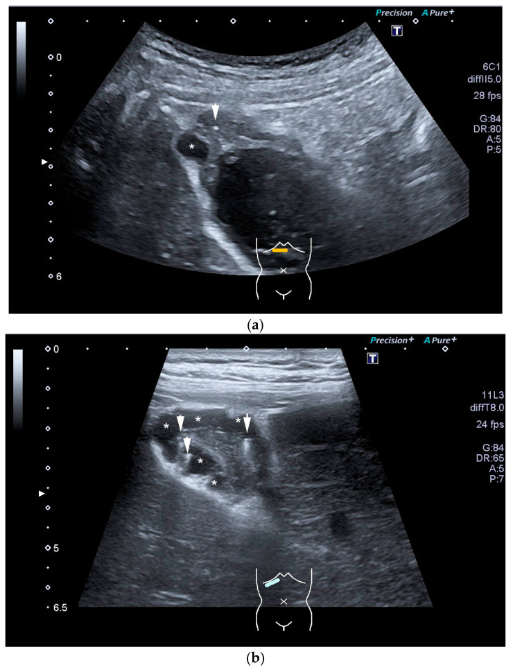
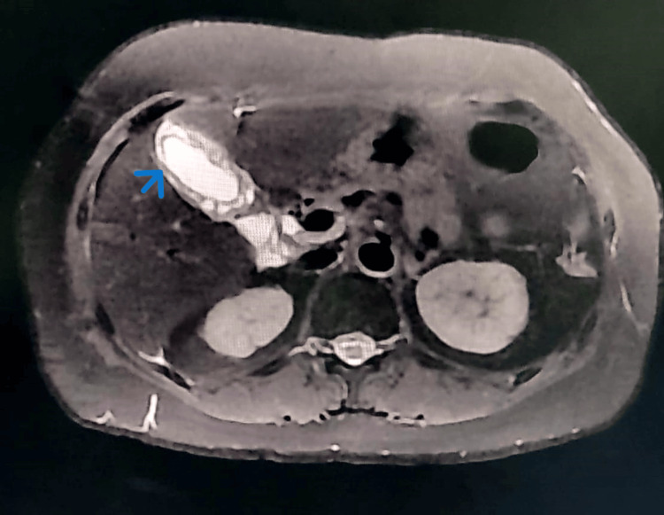
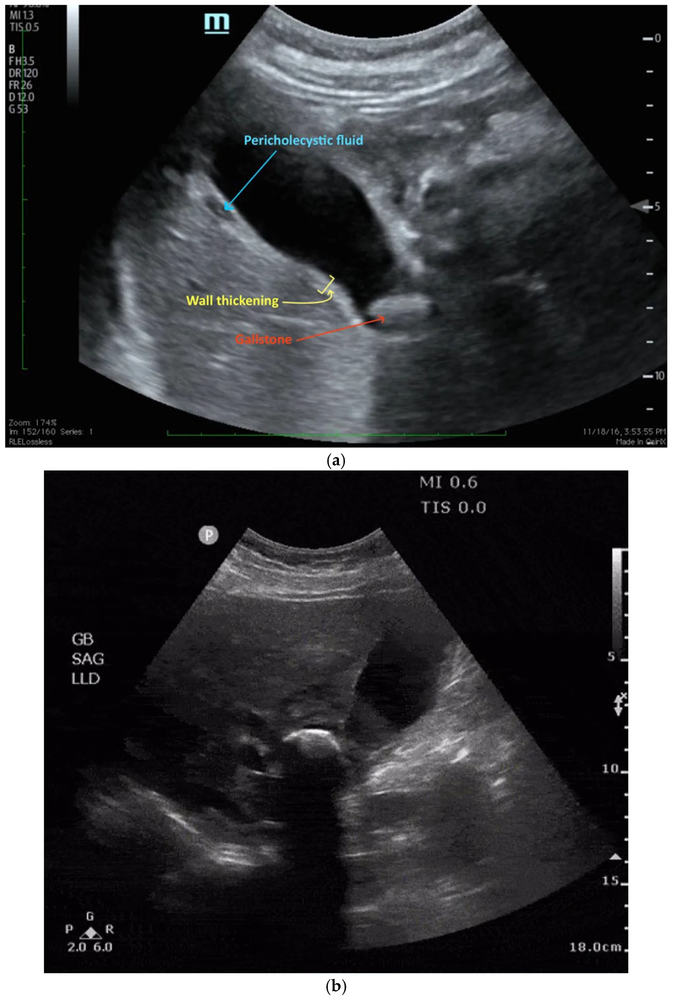
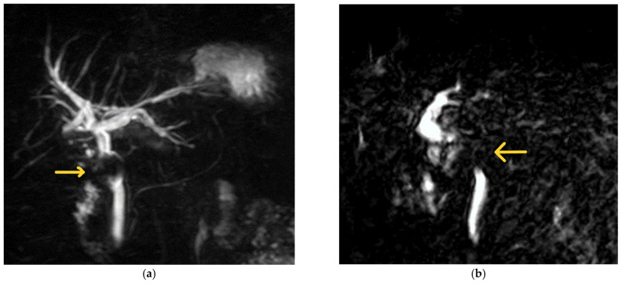
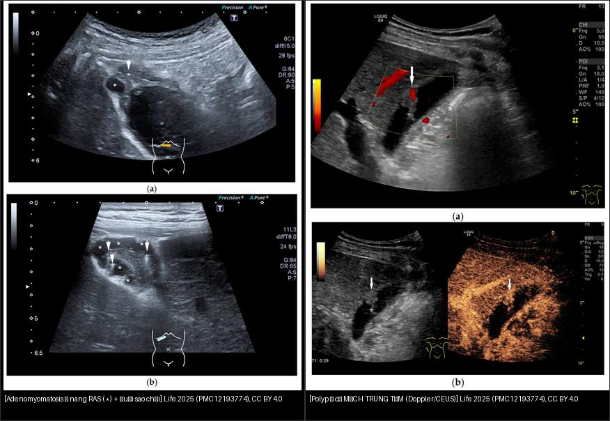
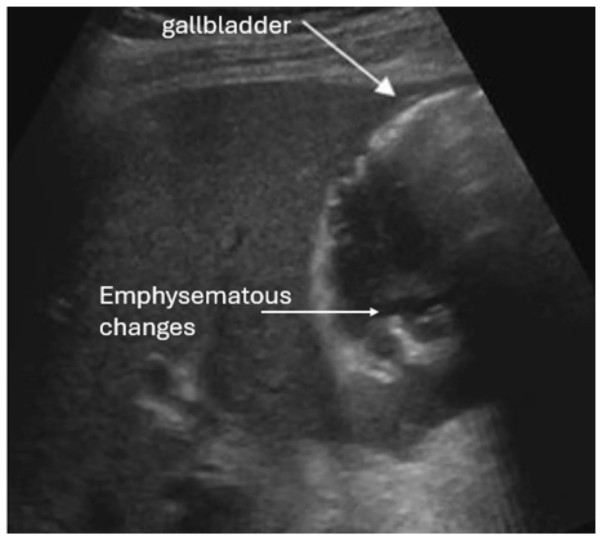

# 130 — Túi mật: sỏi, viêm cấp/mạn, adenomyomatosis vs K / Gallbladder

**Tags:** `pattern:viem-tui-mat` `vung:tui-mat` `pattern:adenomyomatosis` `protocol:MRCP`
**Mức chắc chắn (certainty):** tổng hợp y văn (literature synthesis) — nhóm tự biên từ y văn mở, chưa gắn ca nguyên văn đơn lẻ.

## 1. Tổng quan — 5 dấu CT + Murphy siêu âm

- Viêm túi mật cấp: sỏi kẹt cổ + **thành dày ≥ 5 mm CT (siêu âm > 3 mm, Tokyo ≥ 3–4 mm)** + túi căng (**ngang > 4 cm, dài > 8–10 cm**) + thâm nhiễm mỡ ≥ 5 mm + Murphy siêu âm (+) + dịch quanh.
- Sỏi cholesterol **đồng tỷ trọng dịch mật** (tàng hình CT!) vs sỏi sắc tố **vôi hóa** — TẠI SAO siêu âm/MRCP mới thấy sỏi cholesterol: CT chỉ thấy vôi.
- Ống mật chủ (CBD) thường **< 6–7 mm** (+ 1 mm mỗi thập kỷ sau 60 tuổi; sau cắt túi mật tới **8–10 mm** còn chấp nhận) — TẠI SAO giãn sinh lý theo tuổi/mất túi: mất bể chứa + giảm đàn hồi.
- 5 dấu CT nặng (Tabuchi): dày ≥ 5 mm, kém ngấm thành, mỡ ≥ 5 mm, khí trong thành/lòng, áp-xe quanh — càng nhiều điểm càng khó mổ.
- **Adenomyomatosis:** dày thành + **nang Rokitansky-Aschoff + đuôi sao chổi (comet-tail)** siêu âm — lành tính, đừng mổ oan. **Cạm bẫy MRI:** các nang RAS có thể **hạn chế khuếch tán** (tối DWI) → dễ nhầm ác; chìa khóa là **bờ nhẵn + nang trong thành + không khối thực**.

*Siêu âm (a,b): dày thành đáy túi mật + nang trong thành (*) + vi tinh thể cholesterol (mũi tên) tạo **đuôi sao chổi**. Life 2025, PMC12193774, CC BY 4.0.*

*T2 axial: dày thành túi mật chu vi + nhiều nang nhỏ trong thành (mũi tên xanh) + hạn chế khuếch tán. Cureus 2024, PMC11585340, CC BY 4.0.*

- **K túi mật:** khối thay thế túi mật + xâm lấn gan/đường mật + hạch — mổ rộng khi còn khu trú.
- **Khí trong thành/túi (emphysematous cholecystitis):** vi khuẩn sinh hơi (thường **đái tháo đường**), khí hình ảnh giả "dày thành" — biến chứng nặng, mổ cấp cứu.

*Dày ≥ 5 mm + kém ngấm + mỡ ≥ 5 mm + khí + áp-xe. Nguồn: Tabuchi et al., Cureus 2026 Fig. 1, CC BY 4.0.*

## 2. Gamut dày thành túi mật

- **Viêm cấp sỏi:** sỏi cổ + dày + Murphy + sốt — mổ trong 72 giờ (vàng) hoặc dẫn lưu khi quá nặng.
- **Hoại thư/khí:** khí thành + kém ngấm + nhiễm trùng nặng — mổ cấp cứu.
- **Adenomyomatosis:** đuôi sao chổi + không viêm cấp — theo dõi.
- **Polyp thật:** cố định vị trí, **có mạch trung tâm** (± ngấm CEUS) — phân biệt với sỏi/bùn (sludge) di động.
- **K túi mật:** khối + xâm lấn + hạch + sụt cân — mổ rộng/PET.
- **Dày thành KHÔNG do túi mật (toàn thân):** suy tim, xơ gan/tăng áp cửa, viêm gan virus, giảm albumin — dày **lan tỏa, không Murphy, không sỏi**.

*Siêu âm: **dịch quanh túi mật (pericholecystic fluid)** + **dày thành** + **sỏi** kẹt cổ. Diagnostics 2026, PMC13605488, CC BY 4.0.*

- **Mirizzi:** sỏi kẹt ống túi mật/hạch cổ túi mật **đè OMC** → vàng da + hẹp OMC trên sỏi (đừng ERCP mù).

*MRCP: **khuyết thiếu (filling defect)** ngay dưới hợp lưu ống gan (mũi tên) + giãn mật thượng nguồn = sỏi/hạch chèn ép (Mirizzi). Medicina 2023, PMC10818783, CC BY 4.0.*

## 3. Bảng so sánh

| Thực thể (entity) | Hình ảnh | Chốt vào (rule-in) | Chốt loại (rule-out) | Gợi ý xác nhận |
|---|---|---|---|---|
| Viêm cấp | **Sỏi cổ + dày ≥ 5 mm + Murphy + mỡ** | **Đau HSP + sốt + Murphy + sỏi kẹt** | Túi xẹp + không sỏi + Murphy (−) → dày thứ phát | Mổ sớm/dẫn lưu |
| Hoại thư/khí | **Khí + kém ngấm + nặng** | **Khí thành + nhiễm trùng nặng** | Khí trước (pneumobilia) → không phải khí thành | Mổ cấp cứu |
| Mirizzi/Bouveret | **Sỏi kẹt ống túi mật ép OMC / sỏi to rò tá tràng gây tắc ruột** | **Vàng da + sỏi cổ + OMC trên hẹp; hơi + sỏi lạc chỗ tá tràng** | Sỏi OMC đơn thuần → ERCP thường | Mổ (đừng ERCP mù Mirizzi!) |
| Adenomyomatosis | **Đuôi sao chổi + nang RAS** | **Siêu âm chốt, không viêm** | Khối + xâm lấn → K | Theo dõi |
| K túi mật | **Khối + xâm lấn + hạch** | **Khối thay túi mật + sụt cân** | Đuôi sao chổi → adeno | Mổ rộng/PET |
| Polyp thật | **Khối cố định, ± mạch trung tâm (Doppler/CEUS)** | **Không di động khi đổi tư thế + có mạch nuôi** | Sỏi/bùn di chuyển theo tư thế → không phải polyp | Theo dõi; ≥ 10 mm → cắt |
| Khí trong túi (emphysematous) | **Khí trong thành/lòng + ĐTĐ** | **Khí + đái tháo đường + nhiễm trùng nặng** | Khí trước (pneumobilia sau ERCP) → không phải khí thành | Mổ cấp cứu |
| Dày thành toàn thân | **Dày lan tỏa, không sỏi, không Murphy** | **Bối cảnh suy tim/xơ gan/viêm gan/giảm albumin** | Dày khu trú + sỏi + Murphy → viêm túi mật | Điều trị nguyên nhân |

*Trái: adenomyomatosis — nang trong thành + đuôi sao chổi. Phải: polyp túi mật — khối có **mạch trung tâm** trên Doppler/CEUS. Cả hai Life 2025 (PMC12193774), CC BY 4.0. Ảnh ghép letterbox.*

## 4. Protocol

- **Siêu âm đầu tay** (Murphy + sỏi di động + dày thành + Doppler) — nhanh, không tia X.
- CT khi nặng/không rõ (5 dấu trên) + Tokyo grade (I/II/III) quyết định mổ/dẫn lưu.
- MRCP khi nghi sỏi OMC kèm.

## 5. Cạm bẫy

- **Dày thành do suy tim/xơ gan/giảm albumin** — toàn thân, không khu trú + không Murphy.
- **Sỏi kẹt cổ không viêm** (đau quặn mật) — cơn qua nhanh, không sốt/viêm.
- **K túi mật giai đoạn sớm** lẫn viêm mạn — khối khu trú + tuổi già + sỏi lâu năm → sinh thiết/mổ.
- **Khoảng trống tín hiệu MRCP giả sỏi:** bóng khí (pneumobilia — nổi phía trước theo trọng lực) + **flow-void dịch mật** + **động mạch gan phải bắt chéo sau ống gan chung** — sỏi thật luôn nằm thấp theo trọng lực + không đổi theo tư thế!
- **Sỏi cholesterol tàng hình CT** tưởng không sỏi — siêu âm bóng lưng + MRCP mới kết luận.
- **Adenomyomatosis hạn chế khuếch tán trên MRI** (nang RAS) giả ác — bờ nhẵn + nang trong thành + không khối thực là chìa khóa.
- **Khí trong thành túi mật (emphysematous)** dễ đọc nhầm là dày thành/khí tự do; hỏi **đái tháo đường** + bối cảnh nhiễm trùng nặng.
- **Polyp vs sỏi/bùn:** polyp **cố định theo tư thế + có mạch trung tâm**; sỏi/bùn di chuyển, có bóng lưng/không mạch.
- **Dày thành do nguyên nhân toàn thân** (suy tim/xơ gan/viêm gan) đừng mổ túi mật — dày lan tỏa, không sỏi, không Murphy.

## 6. Tự lượng giá — Blind Quiz

**Ca 1 — Đau HSP + sốt + Murphy (+). Đếm dấu CT nặng.**

- Hỏi: kể 5 dấu? Ca này mổ nội soi thường hay khó? Vì sao?

<b>Bấm để hiện đáp án</b>

- **5 dấu:** dày ≥ 5 mm, kém ngấm, mỡ ≥ 5 mm, khí, áp-xe — càng nhiều điểm càng khó (mổ mở/dẫn lưu khi nặng + ASA cao + CRP cao).
- Nguồn: Tabuchi et al., Fig. 1, CC BY 4.0.

**Ca 2 — Dày thành + đuôi sao chổi + không sốt/Murphy:** viêm hay adenomyomatosis? Mổ không? *(Bảng mục 3.)*

<b>Bấm để hiện đáp án</b>

- **Adenomyomatosis:** nang Rokitansky-Aschoff trong thành + đuôi sao chổi → **theo dõi, không mổ**.
- Nguồn: Life 2025 (PMC12193774), CC BY 4.0.

**Ca 3 — Hai bệnh nhân: bên nào là adenomyomatosis, bên nào là polyp thật? Bên nào cần cắt?**

<b>Bấm để hiện đáp án</b>

- **Trái — adenomyomatosis:** nang trong thành + đuôi sao chổi → **lành, theo dõi**. **Phải — polyp thật:** khối **có mạch trung tâm** (Doppler/CEUS), cố định theo tư thế → **theo dõi, cắt nếu ≥ 10 mm / có nguy cơ**.
- **Chốt:** polyp **có mạch nuôi + cố định**; sỏi/bùn **di động, không mạch**. Nguồn: PMC12193774, CC BY 4.0.

**Ca 4 — Vàng da + sỏi cổ túi mật + hẹp OMC trên sỏi. MRCP có khuyết thiếu dưới hợp lưu:**

<b>Bấm để hiện đáp án</b>

- **Findings:** khuyết thiếu (filling defect) ngay dưới hợp lưu + giãn mật thượng nguồn → **Mirizzi** (sỏi kẹt ống túi mật đè OMC).
- **Xử trí:** **mổ** (không ERCP mù — nguy cơ tổn thương OMC). Nguồn: Medicina 2023 (PMC10818783), CC BY 4.0.

**Ca 5 — Đau HSP + sốt + đái tháo đường, siêu âm thấy khí trong thành túi mật:**

<b>Bấm để hiện đáp án</b>

- **Viêm túi mật sinh hơi (emphysematous cholecystitis):** bóng khí trong thành/lòng (mũi tên "emphysematous changes"). Nguy cơ cao ở **đái tháo đường** → **mổ cấp cứu**.
- Nguồn: Diagnostics 2026 (PMC13605488), CC BY 4.0.

## Bài liên quan chéo
- [100 – Tổng quan hệ Bụng](../100-tong-quan-he-bung/lesson.md)
- [131 – Tắc mật (đã có)](../131-tac-mat/lesson.md) (sỏi OMC)
- [132 – Hẹp đường mật không xác định & cholangioscopy (đã có)](../132-hop-duong-mat-khong-xac-dinh/lesson.md) (bước tiếp theo của hẹp không rõ bản chất)
- [136 – U/nang tụy (đã có)](../136-u-nang-tuy/lesson.md) (vàng da tắc mật)

> Không dùng để chẩn đoán độc lập khi chưa có người hướng dẫn.
